# ghrah 系统架构

> 本文是对 `ghrah-monorepo` **全仓源码**的通读分析结果，用于回答"这个多智能体运行时到底由什么构成、各部件如何协作、数据与控制如何流动"。
>
> - **代码基线**：分支 `andrew-dev`，HEAD `f3ab0e0`（*feat(manifest): 引入源码组合清单草案与各包交付身份声明*）。
> - **分析口径**：以**源码为准**。仓库内 `ghrah-core/docs/`、`blueprints/` 保留了早期设计文档，其中"双模式架构（远程 Ability 执行器 / ServerEventPublisher / RemoteBackend）"等章节描述的是**已删除的设计**，本文在「[附录 C：文档与代码的偏差](#附录-c文档与代码的偏差)」中逐条列出，请勿以旧文档为准。
> - **引用约定**：`路径:行号`。路径省略 `ghrah-monorepo/` 前缀，Python 侧省略 `src/` 前缀（如 `ghrah-core/ghrah/core/unit.py:609`）。
> - **图表**：全部使用 Mermaid，可在支持 Mermaid 的 Markdown 渲染器（GitHub、VS Code、Typora 等）中直接查看。

---

## 目录

- [1. 系统定位与设计原则](#1-系统定位与设计原则)
- [2. 全局架构](#2-全局架构)
- [3. 协议层：ghrah-protocol](#3-协议层ghrah-protocol)
- [4. Subject 运行时（效果半区）](#4-subject-运行时效果半区)
- [5. Core 认知半区](#5-core-认知半区)
- [6. 能力系统](#6-能力系统)
- [7. 上下文系统：ActionChain / Session / Branch](#7-上下文系统actionchain--session--branch)
- [8. 业务域：Project / Room / Task / Workspace](#8-业务域project--room--task--workspace)
- [9. Observer 观察端](#9-observer-观察端)
- [10. 一致性与 CQRS 模型](#10-一致性与-cqrs-模型)
- [11. 恢复与弹性（reconcile）](#11-恢复与弹性reconcile)
- [12. 配置、启动与运维](#12-配置启动与运维)
- [13. 已知偏离与技术债](#13-已知偏离与技术债)
- [附录 A：图索引](#附录-a图索引)
- [附录 B：术语表](#附录-b术语表)
- [附录 C：文档与代码的偏差](#附录-c文档与代码的偏差)

---

## 1. 系统定位与设计原则

### 1.1 是什么

ghrah 是一个**多智能体运行时**（multi-agent runtime）：为**持久化、可观察、受权限治理**的多 Agent 协作提供基础设施。它不是一个 Agent 框架（不含"如何写好 prompt"），而是一套运行时——负责 Agent 的认知循环、能力执行、上下文持久化、审批治理、资源隔离与外部观察。

README 的一句话概括最准确：

> 认知（Core）、效果（Subject）、观察（Observer）三层分离的 agent 基础设施。

### 1.2 三大支柱与三层分离

| 层 | 包 | 一句话职责 | 是否内嵌 Core |
|---|---|---|---|
| **认知半区** | `ghrah-core` | Agent loop、LLM 调用、上下文管理、能力（Ability）执行、per-agent 注入式装配 | — |
| **效果半区** | `ghrah-subject` | 工作区与沙箱、权限/HITL 审批、Project/Room/Task 管理、manifest store、事件持久化与恢复 | **是**（内嵌 CoreUnit，单进程） |
| **契约平面** | `ghrah-protocol` | Envelope / CommandResult / Event 与各域 payload schema（wire 契约唯一权威） | — |
| **观察端** | `ghrah-observer-webui` | CQRS 读模型：WS 订阅事件流，聊天 / ActionChain 链视图 / HITL 审批 / Project·Room 管理 | — |

### 1.3 设计原则

从代码中反复出现、并被注释显式声明的原则：

**(1) 单一权威 + 派生副本（SSOT / CQRS）**

> 分布式下组件不共享内存、只共享消息，因此每一个被多方共享的"事实"必须有**唯一的权威来源**；其余副本只能是**派生**（生成 / 校验 / 读通 / 缓存），且必须**单向、可重建**。

判断标准（`AGENTS.md`）：一份副本若能被**独立写**、或**不能从权威重建**，它就不是副本，而是**第二权威**（违规）。本仓的落地形态见 [§10](#10-一致性与-cqrs-模型)。

**(2) 零隐式行为**

新功能必须**显式声明**（配置 / Filter / 白名单驱动），不做"顺便帮用户做了"的隐式默认。代码中的具体体现：
- 可选组件通过配置切片开关（`taskstore.enabled`、`room_filter.enabled`），关闭时**完全不挂载**，命令回落 `Unknown command`（`ghrah-subject/ghrah/subject/units/__init__.py:79-81,107-108`）。
- manifest 解析出 0 个能力时**拒绝 spawn**，而不是落入默认能力（`ghrah-core/ghrah/core/unit.py:1000-1007`）。
- 服务未接线时能力返回**显式 FAILURE 并指路**，而不是静默降级（`abilities/builtin/spawn_agent.py:120-130`、`load_skill.py:102-113`）。
- `include_environment` 之类的注入开关默认 `False`（`HITLPolicyConfig.environment_injection`）。

**(3) 组合优于继承（Ability 组合模式）**

Agent 不是靠类型继承分化，而是靠**注册能力**组合行为：`agent.register_ability(ReadFileAbility())`。同一份 `ActorAgent` 代码通过不同 manifest 装配出不同 Agent。

**(4) fail-closed / fail-loud**

- HITL 响应载荷 `HITLResponsePayload` 用 `@model_validator` 强制"`promise_id` 或完整三元组至少一路"，否则 `ValueError`（`ghrah-protocol/ghrah/protocol/payloads/agent.py`）。
- FS 权限检查器返回 `(True, "pending")` 时**必须**由 Hook 转成 HITL 等待，否则会被静默放行——这条断链在两处被显式注释警告（`manifest/materialize.py:145-149`、`core/unit.py:511-516`）。
- 服务端 env 解析失败抛 `ValueError`，不静默回落默认值（`server/config.py:57-78`）。

**(5) 契约双侧对齐**

`ghrah-protocol`（Python）是 wire 契约唯一权威，TS `@ghrah/protocol` 与其**对齐演进**（双侧同步 + 一致性测试），不得单侧手改。

---

## 2. 全局架构

### 2.1 系统架构总览

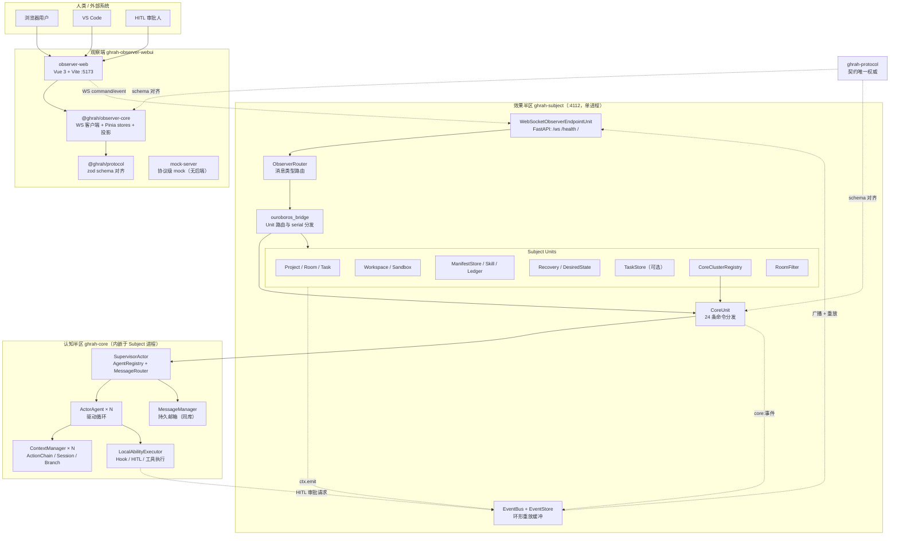

### 2.2 进程与部署拓扑

**当前形态是单进程**：Core 已 Unit 化并**内嵌**在 Subject 进程中，不再有独立的 Core 进程或端口。

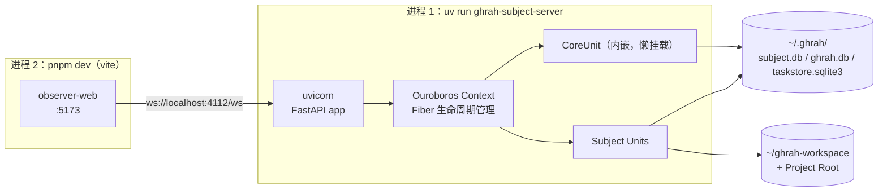

要点：
- **观察端端口** `4112`（`ObserverServerConfig.port`，注释明确"区别于 Core 的 4111"，`ghrah-subject/ghrah/subject/server/config.py:23`）。
- `GHRAH_SUBJECT_CORE_URL` 默认 `ws://localhost:4111/ws` 是**遗留配置项**（`CoreTransportConfig`），当前单进程形态下 CoreUnit 由 Ouroboros Context 直接在进程内挂载，不经过该 WS。
- 前端 dev server 端口 `5173`，后端地址经 `packages/observer-web/.env.local` 的 `VITE_GHRAH_SUBJECT_WS_URL` 注入（`scripts/start_all.py:213-218`）。

### 2.3 仓库结构与包依赖

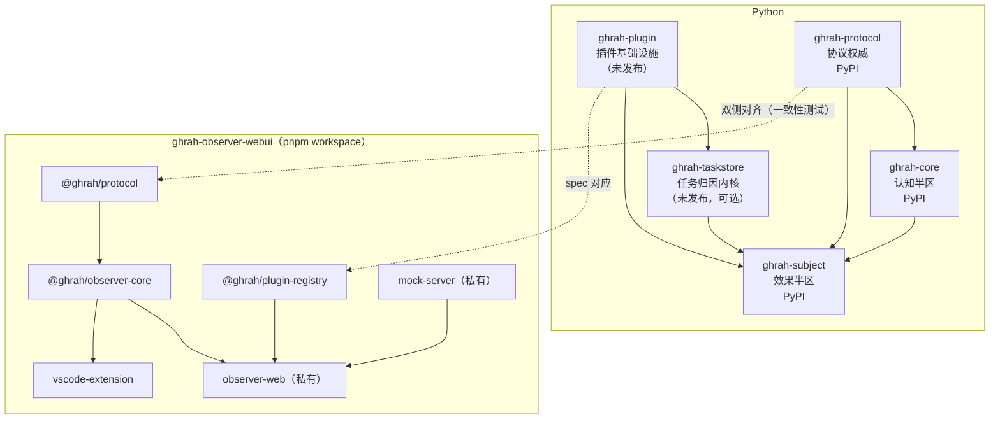

依赖链关键约束（由 `component.toml` / `pyproject.toml` 钉死）：
- `ghrah-plugin ← ghrah-taskstore ← ghrah-subject`（无环）。`ghrah-taskstore` **零 ghrah 域包依赖**，唯一外部域包 import 是 `ghrah.plugin.registry`（`ghrah-taskstore/ghrah/taskstore/kernel.py:20`），**不 import `ghrah.protocol`**——wire 映射归 Subject 侧 `TaskStoreUnit`。
- `ghrah-core` 是**独立库**：不 import `ghrah.subject`，与宿主的耦合全部走 duck-typed 协议（`ctx.emit` / `ctx.serial` / `mount_unit` 桥契约）。

| 目录 | 语言 | 发布面 | 说明 |
|---|---|---|---|
| `ghrah-core/` | Python | PyPI `ghrah-core` | agent 认知核心（loop/上下文/能力/装配） |
| `ghrah-plugin/` | Python | 未发布 | 插件 spec 契约/发现/注册/协商/离线验证 |
| `ghrah-protocol/` | Python | PyPI `ghrah-protocol` | 协议类型与消息定义 |
| `ghrah-subject/` | Python | PyPI `ghrah-subject` | 效果宿主 |
| `ghrah-taskstore/` | Python | 未发布 | 任务归因内核（tasks/claims/evidence 三表权威） |
| `ghrah-observer-webui/` | TypeScript | npm / Marketplace | 观察端（5 包 + vscode-ext） |
| `scripts/` | Python | — | 全栈启动入口 |

### 2.4 技术栈

| 面 | 技术 |
|---|---|
| Python | ≥ 3.11；`uv` 管理（单一 `uv.lock` 在根）；pydantic v2；aiosqlite；ruff（`E,F,I,N,W,UP`，行宽 100）；pytest（`asyncio_mode = "auto"`） |
| Unit 内核 | [Ouroboros](https://pypi.org/project/cordis-ouroboros/)（`Context` / `plugin` / `Fiber` / `FiberState`） |
| Web 服务 | FastAPI + uvicorn（WebSocket + `/health` + `/`） |
| TS | Node ≥ 22.12（pnpm 11 依赖 `node:sqlite`）、pnpm workspace、Vue 3 + Vite、Pinia、zod、vitest、tsup |
| Lint（TS） | oxlint → eslint → prettier → i18n/ui-token 门禁 |
| 许可 | Apache-2.0（REUSE 标注补全进行中） |

---

## 3. 协议层：ghrah-protocol

协议包是**跨进程契约的真相源**，Python 侧 `ghrah/protocol/`，TS 侧 `ghrah-observer-webui/packages/protocol/`。

### 3.1 Envelope

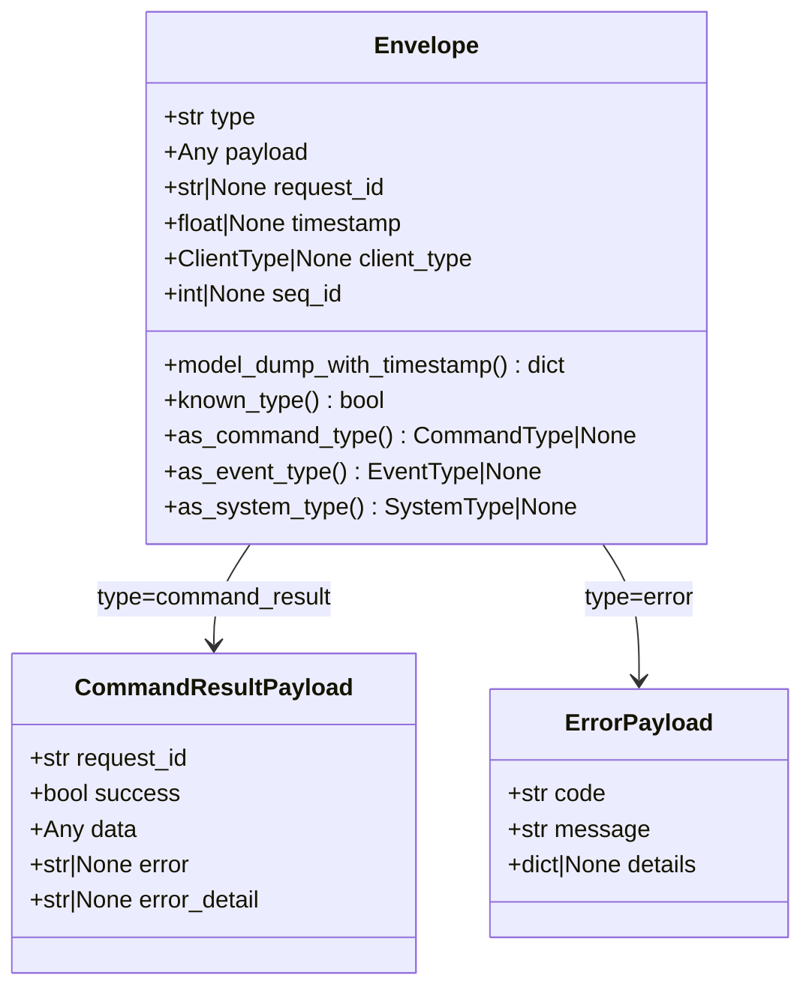

设计要点（`ghrah-protocol/ghrah/protocol/envelope.py:137-195`）：

- `Envelope` **不是泛型**：`payload` 在 wire 层保持 `Any`（`dict | BaseModel | None`）。类型安全通过 `PAYLOAD_MAP` + `envelope_from_dict`（入口收窄）+ `expect_payload`（handler 边界断言）实现。
- `type` 保持 `str`（不收紧为 `MessageType` union），以接受未知 type 字符串、保持**前向兼容**；由 `known_type()` 判断。
- **唯一反序列化入口** `envelope_from_dict(data)`（`:392-420`）：已知 type → 查 `PAYLOAD_MAP` 收窄为对应 Pydantic 模型；未知 type / 未登记 → payload 保持裸 dict，**不崩**。
- 三种消息共用一个信封：
  - **命令** `type ∈ CommandType`，带 `request_id`
  - **事件** `type ∈ EventType`，**不带** `request_id`
  - **系统** `SystemType`：`command_result` / `ping` / `pong` / `error`

工厂函数（`factories.py`，6 个）：

| 函数 | 产物 |
|---|---|
| `create_command_result(request_id, success, data, error, error_detail)` | `type=command_result`，回填 `request_id` |
| `create_event(event_type, payload)` | `type=event_type.value`，**无 request_id** |
| `create_error(code, message, details, request_id)` | `type=error` |
| `create_ping()` / `create_pong()` | `ping` / `pong`（无 payload） |
| `generate_request_id()` | `uuid4().hex[:12]`（12 位十六进制） |

`types.py` 是历史单文件拆分后的**兼容门面**（通配再导出，保留 `Message = Envelope` 别名），新代码应直接从域子模块导入。

### 3.2 ClientType

| 值 | 语义 |
|---|---|
| `subject` | Subject 服务连接 |
| `observer` | Observer 客户端连接（接收事件、下发命令） |
| `core` | Agent 的 CoreClient 连接（发布事件、请求执行 Ability） |

> ⚠ 实现现状：`ClientType` 在 `ghrah-subject` 内**零命中**——`ConnectionManager` 无 ClientType 字段、无类型判别，仅靠 query 参数 `client_id` 做重连去重。协议枚举为将来多类连接预留，当前实际只有 Observer 一类连接（详见 [§13](#13-已知偏离与技术债)）。

### 3.3 命令与事件全量清单

#### 命令（CommandType，共 102 个）

按前缀分组（`ghrah-protocol/ghrah/protocol/enums.py:32-183`）：

| 分组 | 数量 | 命令 | 方向 |
|---|---|---|---|
| **Agent 管理** | 12 | `spawn_agent` `terminate_agent` `send_message` `broadcast_message` `register_ability` `unregister_ability` `list_agents` `health_check` `delegate` `get_agent_info` `agent_compact_context` `agent_reset` | Observer → Subject → Core |
| **Supervisor / Cluster** | 4 | `init_cluster` `shutdown_cluster` `cluster_status` `list_clusters` | Observer → Subject → Core |
| **订阅（本地）** | 2 | `subscribe` `unsubscribe` | Observer 本地处理 |
| **Ability 执行** | 1 | `execute_ability` | **Core → Subject**（同步请求-回执） |
| **HITL** | 1 | `hitl_response` | Observer → Subject → Core |
| **持久化** | 7 | `persist_save_node` `persist_load_node` `persist_load_chain` `persist_save_messages` `persist_load_messages` `persist_delete_chain` `persist_list_agents` | Core → Subject（**payload 为裸 dict，schema 未登记**） |
| **Workspace** | 9 | `create_workspace` `destroy_workspace` `workspace_snapshot` `workspace_rollback` `workspace_diff` `workspace_status` `workspace_register` `workspace_get` `workspace_list` | Observer → Subject |
| **Session** | 5 | `session_create` `session_activate` `session_list` `session_archive` `session_delete` | Observer → Subject → Core |
| **Branch** | 5 | `branch_create` `branch_activate` `branch_list` `branch_archive` `branch_delete` | Observer → Subject → Core |
| **Manifest CRUD** | 10 | `manifest_list_abilities` `manifest_get_ability` `manifest_put_ability` `manifest_delete_ability` `manifest_list_agents` `manifest_get_agent` `manifest_put_agent` `manifest_delete_agent` `manifest_resolve_agent` `manifest_validate` | Observer → Subject |
| **链历史** | 1 | `get_chain_history` | Observer → Subject（读侧投影） |
| **Task** | 11 | `task_create` `task_update` `task_assign` `task_start` `task_complete` `task_fail` `task_cancel` `task_block` `task_list` `task_get` `task_delete` | Observer/Core → Subject |
| **Task 归因切面** | 4 | `task_submit_completion` `task_verify` `task_list_claims` `task_dump` | Observer/Core → Subject |
| **Plugin** | 1 | `plugin_negotiate` | Observer → Subject |
| **Project** | 15 | `project_create` `project_update` `project_list` `project_get` `project_archive` `project_restore` `project_delete` `project_add_agent` `project_remove_agent` `project_link_task` `project_unlink_task` `project_set_recovery` `project_pause` `project_resume` `project_stop` | Observer → Subject |
| **Room** | 12 | `room_create` `room_list` `room_get` `room_update` `room_archive` `room_restore` `room_delete` `room_join` `room_leave` `room_get_members` `room_get_log` `room_send` | Observer/Core → Subject |
| **恢复** | 2 | `reconcile_now` `reconcile_status` | Observer → Subject |

#### 事件（EventType，共 67 个）

| 分组 | 事件 |
|---|---|
| **Agent 核心** | `agent_spawned` `agent_terminated` `agent_response` `action_chain_updated` `agent_error` `health_status` `ability_result` `context_usage_updated` |
| **HITL** | `hitl_request` `hitl_resolved` |
| **Workspace** | `workspace_created` `workspace_destroyed` `workspace_snapshot_created` `workspace_rolled_back` |
| **Manifest** | `manifest_ability_created/updated/deleted`、`manifest_agent_created/updated/deleted` |
| **Session** | `session_created` `session_activated` `session_archived` `session_deleted` `session_list_result` |
| **Branch** | `branch_created` `branch_activated` `branch_archived` `branch_deleted` `branch_list_result` |
| **Task** | `task_created/updated/assigned/started/completed/failed/canceled/blocked/deleted` |
| **Task 归因** | `task_delivered` `task_verified` `task_rejected` |
| **Project** | `project_created/updated/archived/restored/deleted/paused/resumed/stopped`、`project_agent_added/removed`、`project_recovery_set` |
| **Room** | `room_created/updated/archived/restored/deleted`、`room_member_joined/left`、`room_log_appended` |
| **恢复** | `subject_reconciled` `reconcile_failed` |
| **Plugin** | `plugin_enabled` `plugin_disabled` `plugin_negotiated` `plugin_crashed` |

#### 系统类型（SystemType）

`command_result` / `ping` / `pong` / `error`。

#### 附属枚举

`TaskStatus`（`pending` `in_progress` `blocked` `delivered` `completed` `failed` `canceled`）、`TaskPriority`、`ProjectStatus`（`active` `paused` `stopped` `failed`）、`RecoveryAction`（`resume` `pause` `drop`）、`RoomStatus`、`RoomSubjectType`、`ClaimantType`。

### 3.4 路由分组与归属契约

`routing.py` 定义 **Unit 归属判定**与**事件归属强制**两组契约。

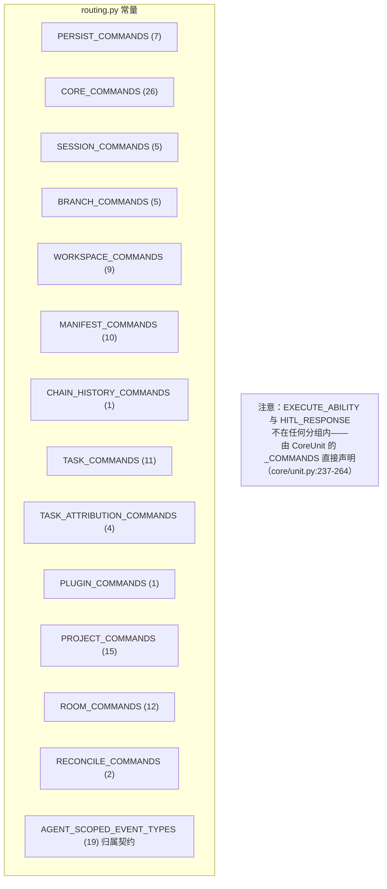

**Agent 作用域事件归属契约**（`routing.py:18-40`）：以下 19 类事件**必须携带非空 `project_id` + `agent_id`**：

`agent_spawned` `agent_terminated` `agent_response` `agent_error` `action_chain_updated` `ability_result` `hitl_request` `hitl_resolved` `context_usage_updated` + 全部 10 个 session/branch 事件。

契约在**两侧独立实现**（这是刻意的不变量防线）：
- **生产侧**（Core）：缺失归属 → `warning` + **跳过发布**（`core/unit.py:840-849`、`UnitEventPublisher.publish` `unit.py:404-412`）。
- **转发侧**（Subject EventBus）：缺失归属 → 计数 + `warning` + **丢弃，不落缓冲区、不广播**（`server/event_bus.py:184-192`）。

设计意图（代码注释）：不猜测归属，以免污染 Observer 侧的 Project 分桶。

### 3.5 Payload 模型

`payloads/` 按域组织，共 **164 个 Pydantic 模型**：agent 34 / manifest 14 / persist 4 / plugin 5 / project 23 / room 19 / session 22 / system 2 / task 28 / workspace 13。

**type → payload 注册表**（`envelope.py:208-389`）：
- `COMMAND_PAYLOAD_MAP`：命令 → payload 类
- `EVENT_PAYLOAD_MAP`：事件 → payload 类
- `PAYLOAD_MAP`：两者合并后的 `{type 字符串 → 类}`

**刻意不登记的三类**（模块注释 `envelope.py:198-206`）：

| 未登记项 | 原因 |
|---|---|
| `persist_*`（7 个命令） | `PersistSavePayload` 等 schema 与实际 wire shape **不符**，留待补真实 payload；此处 payload 保持裸 dict 透传 |
| `command_result` / `error` / `ping` / `pong` | welcome 包手写 payload 与 `CommandResultPayload` schema 不符；保持裸 dict |
| `plugin_*` / task 归因切面 | **例外：契约先行**——类型期即登记，消费方后续接线，schema 与 wire 已定且经双侧一致性测试覆盖 |

关键 payload 字段（架构相关者）：

| 模型 | 关键字段 | 用途 |
|---|---|---|
| `SpawnAgentPayload` | `project_id` `cluster_id` `config: AgentConfigPayload` `abilities: list[AbilityDefinitionPayload]?` `manifest_ref: str?` | spawn 命令；**两条互斥的装配路径**（manifest_ref / 直传 abilities） |
| `ExecuteAbilityPayload` | `request_id` `agent_name` `ability_name` `tool_args` | Core → Subject 执行请求 |
| `AbilityResultPayload` | `request_id` `agent_name` `ability_name` `success` `result` `error` | 执行结果事件 |
| `HITLRequestPayload` | `promise_id` `agent_name` `ability_name` `tool_args` `context` `reason` | 审批请求事件 |
| `HITLResponsePayload` | `promise_id` `agent_name` `ability_name` `tool_call_id` `approved` `reason` `result` | 审批回执命令（fail-closed 校验） |
| `ActionChainUpdatedPayload` | `agent_name` `node: dict` `branch: dict?` | 链更新事件；`branch` 是 commit 后的**权威 Branch 快照** |
| `ContextUsageUpdatedPayload` | `phase`(pre/post) `occupied_tokens` `basis`(anchor/real) `budget_tokens` `budget_source` `real_*_tokens` `compaction` `iteration` | 双相位上下文占用权威口径 |
| `GetChainHistoryPayload` | `project_id` `agent_id` `agent_name` `session_id` `branch_id` `limit=-1` | Observer 重建链历史的读命令 |
| `ChainHistoryResultPayload` | …五键 + `active_session_id` + `nodes: list[dict]` | 重建响应 |
| `ProjectInfoPayload` | 见 [§8.1](#81-project-域) | Project 全量快照 |
| `TaskInfoPayload` / `TaskClaimPayload` / `TaskEvidencePayload` / `TaskVerificationGapsPayload` | 见 [§8.5](#85-任务归因ghrah-taskstore) | 任务归因链 |
| `PluginNegotiatePayload` | `enabled_ts: list[TsHalfReport]` | 插件协商（TS 半已启用清单） |
| `PluginNegotiateResultPayload` | **空体子类 `NegotiationResult`** | 与 `ghrah-plugin` 输出逐位一致，零字段重复 |

### 3.6 与 TS 侧的对齐机制

- `packages/protocol/src/` 用 zod 复刻 Python 侧 schema，`__snapshots__/` 下 **~150 个 JSON 快照**固化每个 payload 的序列化形状（含 `_full` / `_minimal` / `_defaults` 变体，如 `SpawnAgentPayload.json` 与 `SpawnAgentPayload_minimal.json`）。
- `protocol-align.spec.ts`（20KB）承担**防漂移**：比对 TS schema 与权威来源，单侧手改即测试失败。
- 修订协议时的正确流程是：先改 Python `ghrah-protocol`（权威）→ 同步 TS → 更新快照 → 双侧测试（`AGENTS.md`：「收编跨包漂移的修复，须跑双侧测试」）。

---

## 4. Subject 运行时（效果半区）

Subject 是**效果宿主**：持有工作区、执行沙箱命令、持久化 ActionChain、裁决 HITL、管理 Project/Room/Task，并**内嵌 Core**。运行时基于 Ouroboros Unit 内核。

### 4.1 Unit 内核抽象

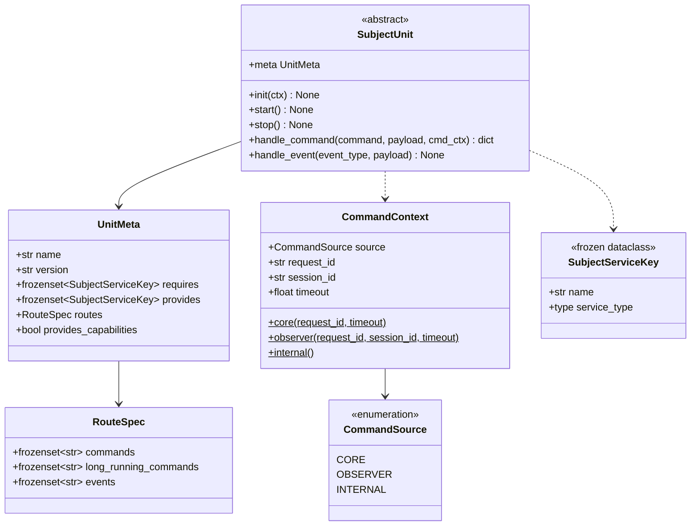

Unit 契约（`ghrah-subject/ghrah/subject/unit/base.py`）：
- `meta` 是**静态元数据**：`requires` / `provides`（服务键）、`routes`（命令与订阅的事件）。
- `handle_command(command, payload, cmd_ctx) -> dict` 返回**回执字典** `{"success": bool, "data"?, "error"?, "error_detail"?}`。
- `handle_event(event_type, payload)` 是事件消费入口（少数 Unit 使用）。
- `CommandSource` 区分命令来源：`core` / `observer` / `internal`。

**服务定位**（`runtime/service_keys.py`）：用 `SubjectServiceKey[T](name, service_type)` 作**类型化键**，值存于 Ouroboros Context。全量键清单：

| 键 | 提供者 | 消费者 |
|---|---|---|
| `WORKSPACE_SERVICE` / `WORKSPACE_MANAGER` | WorkspaceUnit | ProjectUnit、RecoveryUnit、CoreClusterRegistry |
| `SANDBOX_EXECUTOR` | SandboxUnit | WorkspaceUnit、CoreClusterRegistry |
| `MANIFEST_STORE` | ManifestStoreUnit | ProjectUnit、RecoveryUnit、CoreClusterRegistry |
| `LEDGER` | （LedgerUnit 显式空 provides，仅注释保留） | — |
| `OBSERVER_ENDPOINT` / `OBSERVER_EVENT_BUS` | WebSocketObserverEndpointUnit | — |
| `TASK_MANAGER` / `TASK_STORE` | TaskUnit | ProjectUnit、RecoveryUnit |
| `TASKSTORE_SERVICE` / `TASKSTORE_CHECKERS` | TaskStoreUnit（**meta 未声明，运行时直接 provide**） | 插件 checker 装配 |
| `CORE_CLUSTER_REGISTRY` | CoreClusterRegistryUnit | ProjectUnit、RoomUnit、RecoveryUnit |
| `PROJECT_MANAGER` / `PROJECT_STORE` | ProjectUnit | RoomUnit、LedgerUnit、RecoveryUnit |
| `ROOM_MANAGER` / `ROOM_STORE` | RoomUnit | RoomFilterUnit |
| `DESIRED_STATE_STORE` | DesiredStateUnit | ProjectUnit、RecoveryUnit |
| `RECONCILIATION_SERVICE` | RecoveryUnit | 装配层（启动 reconcile） |
| `ABILITY_BRIDGE` / `ABILITY_BRIDGE_UNIT` | AbilityBridgeUnit | plugin_mount 挂载/崩溃路径 |
| `MCP_CLIENT_REGISTRY` / `SESSION_REGISTRY` / `COMMAND_BRIDGE` / `EVENT_BRIDGE` | — | **保留占位**（键真实存在，供依赖声明先行） |

服务键定义处同时声明了**跨层 Protocol 契约**（`WorkspaceService`、`CommandRunner`、`TaskManagerService`、`ProjectManagerService`、`RoomManagerService`、`ClusterHandle`、`CoreClusterRegistryService`、`ObserverEventBus`、`AbilityBridgeService`），使 Unit 之间依赖抽象而非具体类。

### 4.2 启动时序

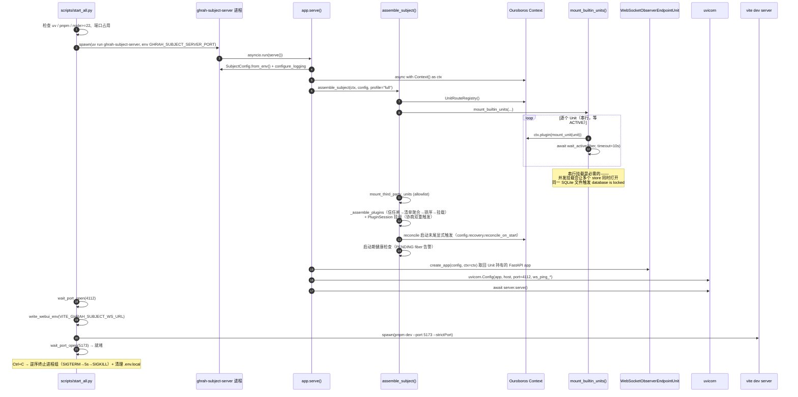

**两个关键的架构决策**：

1. **`WebSocketObserverEndpointUnit` 拥有 FastAPI app**（Unit owns app）。`server/app.py:create_app(config, *, ctx)` 只是"经 ctx 取回该 app"的**薄 facade**，不自己构造 app。路由定义在 `units/websocket_observer_endpoint.py:_create_observer_app()`：
   - `app.websocket(ws_path)` → `/ws`（默认，env `GHRAH_SUBJECT_SERVER_WS_PATH`）
   - `app.get("/health")` → `{"status":"ok","active_sessions":N}`
   - `app.get("/")` → name/version/description
   - FastAPI 元信息：title `ghrah-subject-observer`，version `0.1.0`

2. **reconcile 不在 `RecoveryUnit.start()`**（该方法为空实现），而由**装配层末尾显式调用**（`runtime/assembly.py:71-82`）。注释说明：对齐旧 `engine.start()` 末尾语义，避免启动顺序耦合。Ouroboros 无 `internal/status` 事件，**装配完成即全部 ACTIVE**。

**装配 profiles**（`units/__init__.py:53`，仅 `coexistence` / `full` 两个合法值）：

| profile | Unit 数（默认配置） | 组成 |
|---|---|---|
| `coexistence` | 8 | Sandbox、ManifestStore、Skill、Ledger、Workspace + TaskStore + Task + DesiredState |
| `full` | 15 | coexistence 8 + WebSocketObserverEndpoint、CoreClusterRegistry、Project、Room、Recovery + RoomFilter + AbilityBridge |

关闭 `config.taskstore.enabled` 或 `config.room_filter.enabled` 时对应 Unit **完全不挂载**。

### 4.3 Unit 全清单（15 个）

| Unit 类 | 文件 | `meta.name` | requires | provides | 路由命令集 |
|---|---|---|---|---|---|
| `SandboxUnit` | `units/sandbox.py:19` | `sandbox` | — | `SANDBOX_EXECUTOR` | 空 |
| `ManifestStoreUnit` | `units/manifest_store.py:75` | `manifest_store` | — | `MANIFEST_STORE` | `MANIFEST_COMMANDS` |
| `SkillUnit` | `units/skill.py:31` | `skill` | — | — | 空（仅 init 期目录/lock 引导） |
| `LedgerUnit` | `units/ledger.py:32` | `ledger` | — | 显式空 | `CHAIN_HISTORY_COMMANDS` |
| `WorkspaceUnit` | `units/workspace.py:87` | `workspace` | `SANDBOX_EXECUTOR` | `WORKSPACE_SERVICE` `WORKSPACE_MANAGER` | `WORKSPACE_COMMANDS` |
| `TaskStoreUnit` | `units/taskstore.py:62` | `taskstore` | — | （运行时 provide 两个键） | `TASK_ATTRIBUTION_COMMANDS` |
| `TaskUnit` | `units/task.py:22` | `task` | — | `TASK_MANAGER` `TASK_STORE` | `TASK_COMMANDS` |
| `DesiredStateUnit` | `units/recovery.py:34` | `desired_state` | — | `DESIRED_STATE_STORE` | 空 |
| `WebSocketObserverEndpointUnit` | `units/websocket_observer_endpoint.py:71` | `websocket_observer_endpoint` | — | `OBSERVER_ENDPOINT` `OBSERVER_EVENT_BUS` | 空 |
| `CoreClusterRegistryUnit` | `units/core_cluster.py:124` | `core_cluster_registry` | `MANIFEST_STORE` `WORKSPACE_SERVICE` `SANDBOX_EXECUTOR` | `CORE_CLUSTER_REGISTRY` | 内联 `_PROJECT_AGENT_COMMANDS`（**21 条**） |
| `ProjectUnit` | `units/project.py:43` | `project` | 6 个 | `PROJECT_MANAGER` `PROJECT_STORE` | `PROJECT_COMMANDS` |
| `RoomUnit` | `units/room.py:29` | `room` | `PROJECT_MANAGER` `CORE_CLUSTER_REGISTRY` | `ROOM_MANAGER` `ROOM_STORE` | `ROOM_COMMANDS` |
| `RecoveryUnit` | `units/recovery.py:81` | `recovery` | 6 个 | `RECONCILIATION_SERVICE` | `RECONCILE_COMMANDS` |
| `RoomFilterUnit` | `units/room_filter.py:43` | `room_filter` | `ROOM_MANAGER` | 空 | 空（订阅 `core:action_chain_updated`） |
| `AbilityBridgeUnit` | `runtime/ability_bridge.py` | `ability_bridge` | `CORE_CLUSTER_REGISTRY` | `ABILITY_BRIDGE` `ABILITY_BRIDGE_UNIT` | — |

#### 事件订阅（`RouteSpec.events` / `ctx.subscribe`）

大部分 Unit 是**命令驱动**的，只有三个 Unit 主动订阅事件：

| Unit | 订阅 | 行为 |
|---|---|---|
| `WebSocketObserverEndpointUnit` | **`EventType` 全集，双前缀** `core:{type}` + `event/{type}`（`websocket_observer_endpoint.py:146-148`） | 闭包转发为 WS Message 广播给 Observer |
| `RoomFilterUnit` | `core:action_chain_updated`（`room_filter.py:67`） | 白名单投影：把能力结果落到 RoomLog |
| `WorkspaceUnit` | `agent_spawned` / `agent_terminated`（`workspace.py:101`） | spawn → 建 workspace；terminated → 销毁 |

**双前缀约定**：Core 发的事件前缀是 `core:`（`core/unit.py:858`），Subject 各域 Unit 发的事件前缀是 `event/`（如 `units/taskstore.py:193`）。端点对两者都订阅并统一转发。

#### 重点 Unit 机制

**`CoreClusterRegistryUnit`（cluster = CoreUnit 实例）**

这是"内嵌 Core"的落地点。命令面不是"cluster 命令"，而是**project agent 命令**（21 条）：

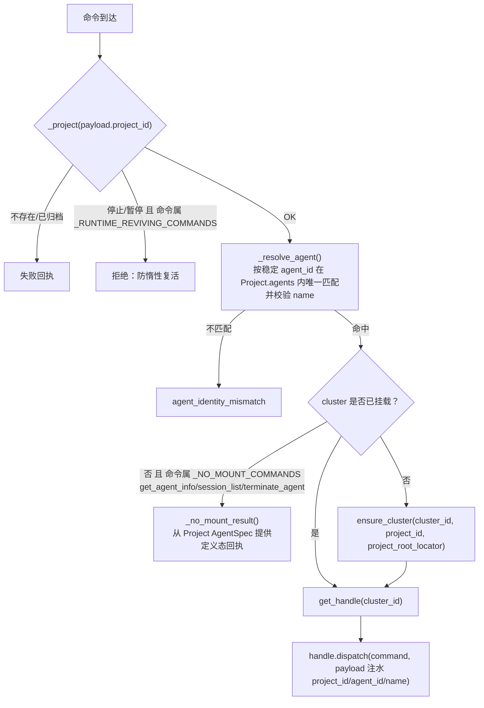

要点：
- 三条 `_NO_MOUNT_COMMANDS` 在 cluster 未挂载时返回**定义态**回执，避免"查询 Agent 信息"被迫启动一个进程。
- `_RUNTIME_REVIVING_COMMANDS` 守卫：`stopped`/`paused` 的 Project **不会**被一条消息惰性复活（`core_cluster.py:287-291`）。
- **spawn 是两阶段**：先 `project_add_agent` 写 ProjectStore（**权威**），乐观锁冲突时最多重取快照重试 3 次；成功后由 CoreUnit 物化运行时。
- **跨 cluster**：`broadcast` / `delegate` 按 cluster 拆解；`delegate` 跨 cluster **显式拒绝**（`cross_cluster_delegate_unsupported`）。
- Room 投影：init 时给 Core 注入 `room_projector` 回调——Core 消息带 `metadata.room_ids/room_id` 时经 `ctx.serial("command/room_send")` 回写 RoomLog（`core_cluster.py:166-190`）。

**`LedgerUnit`（只读投影）**

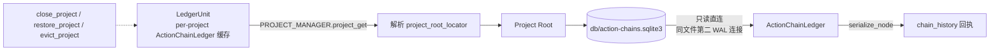

- 只打开**目标 Project Root 下**的 `action_chain_db_path`（`units/ledger.py:87-89`），**不提供实例级/全局库读后门**（`provides` 显式为空集）。
- 归档即**冻结并关闭句柄**（`_frozen_projects`），由 Project 归档/恢复事件驱动。
- `_resolve_persistence_key` 把 Observer 的显示名解析为**稳定 agent_id**，必须在同一 Project 内唯一且 name 匹配，否则报 `agent_project_mismatch` / `agent_identity_mismatch`。
- 异常统一吞为 `{"success": False, "error": str(exc)}`，不炸宿主。

**`RoomFilterUnit`（显式 Filter，宁缺毋滥）**

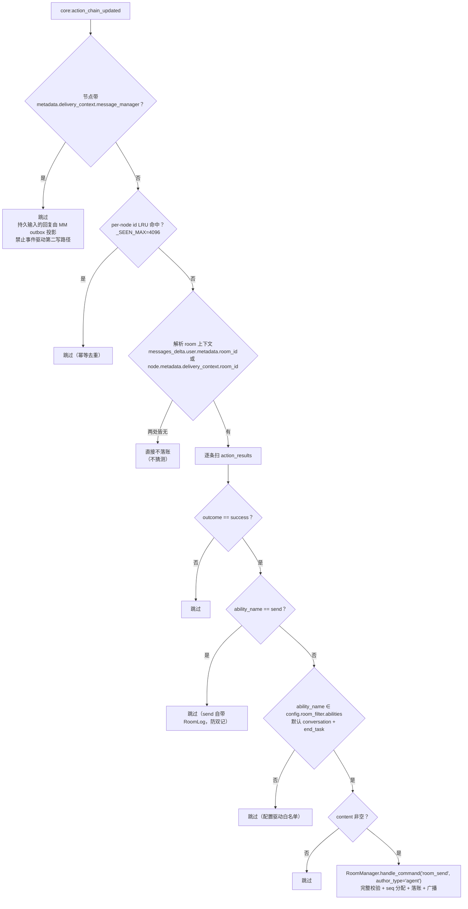

**`TaskStoreUnit`（可选组件、待纠正偏离）**

- 由 `config.taskstore.enabled` 控制挂载，`false` 时归因命令回落 `Unknown command`。
- 但**包依赖仍硬**（`ghrah-taskstore` 在 Subject 的依赖里），且当前经 **builtin 链**挂载而非插件链——代码自认这是**待纠正偏离**，目标形态是插件（经 `ghrah.plugins` 发现 + 信任闸 + Project 装配清单挂载）。
- 惰性 `plugin_registry_provider`：在 submit 边界**即时**构造注册表快照（因为 PluginSession 晚于本 Unit 挂载，故用 `ctx.get(..., strict=False)`）。
- Denial 形状冻结：`success=False` + `data={"gaps": ...}`（结构化缺口清单，Agent 可直接消费）。
- 事件路径：内核回调 `_on_kernel_event` → 补内嵌 evidence → `TaskClaimEventPayload` → `ctx.emit("event/<type>")`。

**`RecoveryUnit` + `DesiredStateUnit`**：见 [§11](#11-恢复与弹性reconcile)。

### 4.4 命令路由链路

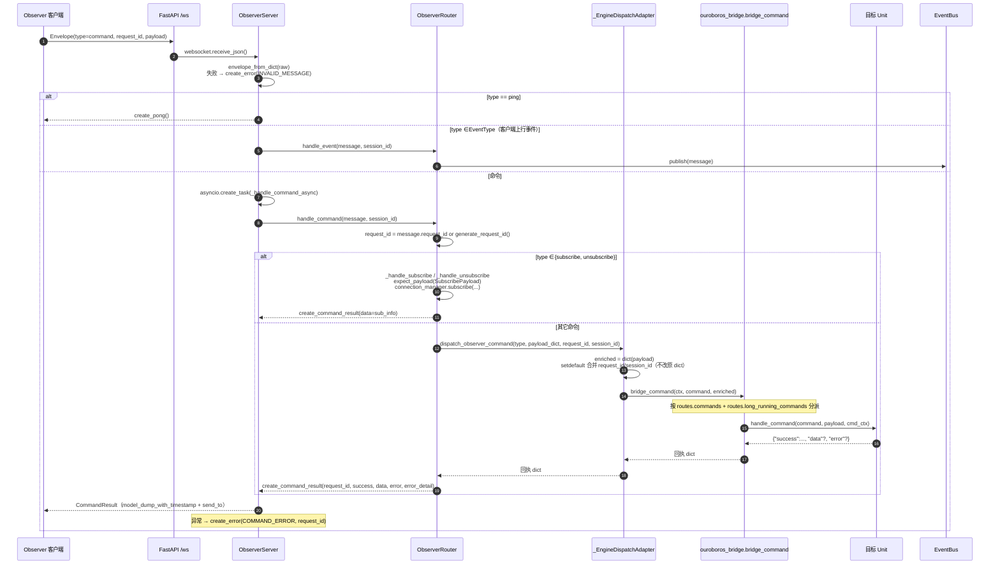

**未知命令**：`router.py` 内**没有中心化的 unknown-command 分支**——非 subscribe/unsubscribe 的一切都交给 engine，`success=False` 原样回执；"无 Unit 认领"的错误产生于 `bridge_command` 分发层并**由各 Unit 自报**（文案各异）：

| Unit | 未知命令文案 |
|---|---|
| Ledger | `Unknown ledger command: {command}` |
| TaskStore | `Unknown command: {command}` |
| Workspace | `Unknown workspace command: {command}` |
| CoreClusterRegistry | `unknown project agent command: {command}` |
| Recovery | `unknown command: {command}` |
| RoomFilter | `room_filter has no commands` |
| DesiredState | `desired_state has no commands` |

### 4.5 WebSocket 服务端与连接管理

**ClientType 分类：未实现**——仅 docstring 声称"只管理 OBSERVER 类型连接"，代码无字段/判别/拒绝。

**连接注册结构**（`server/connection_manager.py:34-37`，纯内存、仅 asyncio 单线程）：

| 结构 | 类型 | 语义 |
|---|---|---|
| `_connections` | `session_id → WebSocket` | 活跃连接 |
| `_subscriptions` | `session_id → set[str]` | agent 名订阅集，**默认 `{"*"}`** |
| `_event_subscriptions` | `session_id → set[str]` | 事件类型订阅集，**默认空集** |
| `_client_ids` | `client_id → session_id` | 重连去重 |

**订阅语义**（注意两侧不对称）：

| 参数 | 语义 |
|---|---|
| `agent_names` | 含 `"*"` → 置 `{"*"}`；当前为 `{"*"}` 且给具体名 → **替换**为该集合；否则与现有**并集** |
| `event_types` | 非 None → **整体替换**（非并集） |

**广播匹配规则**（`get_subscribed_sessions`）：
- agent 匹配 = `"*" in subs or agent_name is None or agent_name in subs`
- event 匹配 = `len(event_subs) == 0 or event_type is None or event_type in event_subs`

> ⚠ 推论：**空事件集 = 订阅全部**，因此 `unsubscribe` 到空集会**退化为全订阅**（已知语义陷阱）。

**重连与重放**：

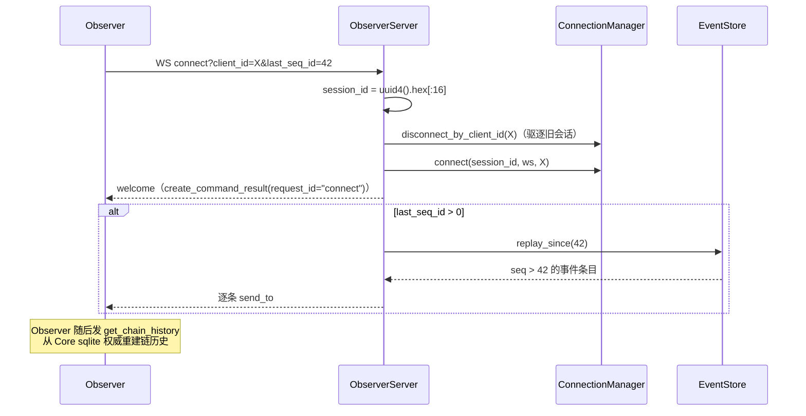

**心跳**：ConnectionManager **无心跳定时器**；对客户端 `ping` 做**被动 pong** 应答。`ping_interval`/`ping_timeout` 配置项在此层无消费点，实际经 `server/app.py` 透传给 uvicorn 的 `ws_ping_interval`/`ws_ping_timeout`。

### 4.6 事件总线与归属过滤

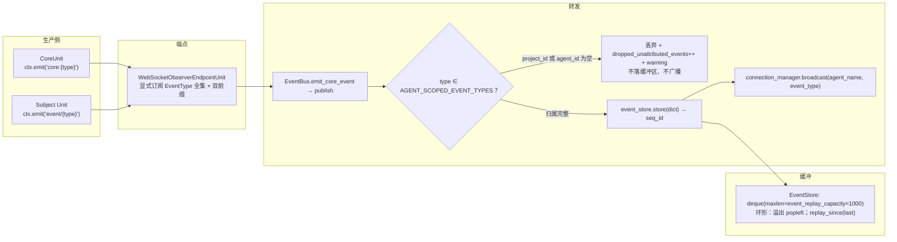

**归一化与守卫细节**（`server/event_bus.py:177-194`）：
1. payload 归一：`BaseModel → model_dump()`；非 dict → `{}`。
2. 归属校验：`type ∈ AGENT_SCOPED_EVENT_TYPES` 且 `project_id`/`agent_id` 任一为空 → 丢弃。
3. 通过后：若 `"agent_name" not in payload and "name" in payload` → 把 `name` 映射为 `agent_name`，保证订阅过滤生效。

> ⚠ 已知偏差：`publish` 在 `store()` **之后**才把 `seq_id` 写回 dict，因此**缓冲区内存的是无 `seq_id` 的副本**，重放条目不带 seq 标识。另 `_running` 标志在 `publish` 通路中未被检查（stop 后仍可 publish）。

### 4.7 插件装配

见 [§13](#13-已知偏离与技术债) 之前先看 `ghrah-plugin` 的契约。装配流程（`runtime/assembly.py:_assemble_plugins`）：

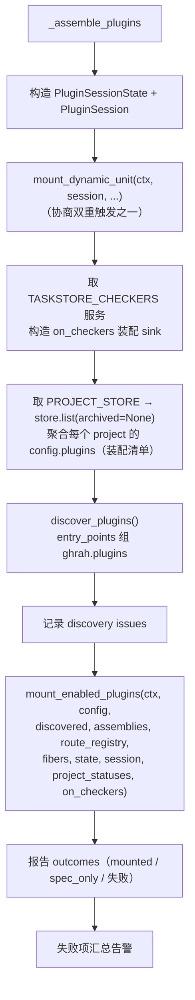

**信任闸**在 Subject 侧强制执行（`ghrah-plugin` 内**不存在**实现）：
- 配置 `GHRAH_SUBJECT_PLUGIN_TRUST`（逗号分隔 plugin_id）→ `PluginTrustConfig.trust_set`。
- 语义链：**发现 ≠ 启用 ≠ 信任**。未受信插件在离线验证中只能作为 `candidate_provides` 出现在候选清单，不参与能力闭环判定。
- checker 装配 sink 协议：`(plugin_id, {name: checker})`；值 `None` 或空 dict → **注销**（崩溃/卸载路径）。

**`ghrah-plugin` 契约要点**（供插件作者查阅）：

| 概念 | 说明 |
|---|---|
| `PluginSpec` | `schema_version` / `plugin_id`(kebab-case) / `version` / `prefix` / `provides` / `requires` / `multi_instance` / `timeout_ms` / `on_timeout` / `after`（**排序声明非依赖**） |
| `provides` | `checkers` / `evidence_kinds` / `commands` / `capabilities`（须 `prefix:name`） |
| `requires` | `core_version`（PEP 440 specifier）/ `capabilities` / `host_capability` |
| 命名空间 | 声明命名空间 = `prefix` 去尾冒号，否则 `plugin_id`；`provides.capabilities` 的 namespace 必须等于声明值；保留前缀 `core` **一律拒绝** |
| 发现 | `importlib.metadata.entry_points()` 组 `ghrah.plugins`；**无文件扫描、无 plugin.yaml**；探测异常**静默降级为空列表**；单条 load 失败转 `LoadIssue` |
| 协商 | 纯函数 `negotiate(python, ts)` → `NegotiationResult{matched, python_only, ts_only, version_conflicts, missing_capabilities, instances}`；版本**仅相等比较**，冲突只记录不 raise |
| 离线验证 | `verify_plugins(...)` → `Finding[]`（`load_failed` / `capability_missing` / core 版本 / `command_conflict`），全部以 Finding 表达，不 raise |
| 装配 | `PluginAssembly{enabled: list[plugin_id], instances: dict}`；`validate_assembly` 三条规则（multi_instance 与 instances 一致性、instances 必须 enabled）；`sort_for_mount` 按 `after` 稳定 Kahn 排序，有环按入参序落完不爆炸 |
| 错误 | `PluginMountError` / `CapabilityMissingError(missing, candidates)`（挂期爆炸，非静默遮蔽） |

**第三方 Unit**：`mount_third_party_units` 按 `GHRAH_SUBJECT_ENABLED_UNITS` allowlist 挂载，复用同一 `iter_entry_point_values` 底座。

**冲突裁决**（`runtime/route_registry.py`）：`UnitRouteRegistry` 维护命令 → owner 的登记表；**builtin 非互斥（仅记名）**，**插件挂载路径据此互斥裁决**（同一命令被两个插件认领时拒绝挂载）。

### 4.8 serial：Core ↔ Subject 进程内互调

单进程化后，Core 与 Subject 不再走 WS，而是经 Ouroboros 的 **`ctx.serial(name, payload)`** 直调：

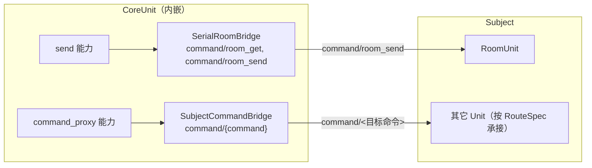

- **`SerialRoomBridge`**（`core/room_protocol.py:64-120`）：`resolve_recipients` 经 `command/room_get` 逐 room 展开成员（只收 `member.subject_type == "agent"`，与 `extra_targets` 去重）；`append_room_log` 经 `command/room_send`。
- **`SubjectCommandBridge`**（`core/subject_bridge.py:41-70`）：`command_proxy` 能力的执行回路——把工具调用派发为 `command/{command}` 协议命令，由宿主 Unit 的 RouteSpec 处理器承接。异常/非 dict 回执一律归一为 `{"success": False, "error": ...}`，**不炸调用方**（驱动循环把回执转 `ActionResult(FAILURE)`）。
- **standalone 场景**：`ctx.serial` 不可用时两个 bridge 皆为 `None`，工具在**执行期**明确报错（注册不拒绝）——`ROOM_BRIDGE_UNAVAILABLE_ERROR` / `COMMAND_BRIDGE_UNAVAILABLE_ERROR`。

### 4.9 沙箱与工作区

**Workspace 挂载语义 = 登记 + 授权 + 解挂，对挂载目录零物理操作**（`ghrah-subject/README.md`）：

| 操作 | 行为 |
|---|---|
| `workspace_register` | 仅登记已有目录（store 记录 + sandbox cwd 授权）；**不** git init、**不**写 git config、**不** add/commit、**不**落 marker；`provider_type="git"` 显式拒绝 |
| `destroy_workspace` / `unregister_workspace` | 只软删 store 记录 + 解除 sandbox 授权，**永不物理删除目录**（rmtree 全域退出） |
| 版本能力命令 | `workspace_snapshot` / `workspace_rollback` / `workspace_diff` 随 legacy GitWorkspaceProvider 一并移除，**路由保留但返回 `capability_not_supported`**（`units/workspace.py:36-42` 静态拒绝）；`workspace_status` 降级为存在性/可写性 |
| git 观测 | 由 agent 侧只读命令承担（`git status` / `git diff` 在 SAFE 子命令白名单内） |
| legacy 迁移 | `WorkspaceStore.start()` 把存量 `provider_type='git'` 一次性 retag 为 `'plain'`（含软删记录，避免复活路径命中未知 provider） |

**`SandboxExecutor`**（`sandbox/executor.py`）——命令执行的唯一闸门：

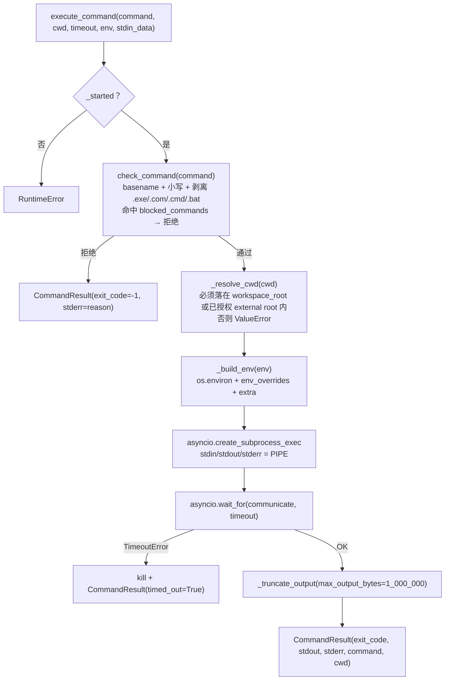

- **blocked_commands 默认集合**：`rm` `rmdir` `mkfs` `dd` `format` `shutdown` `reboot` `kill` `killall` + Windows `taskkill` `del` `rd` `reg` `regedit`。
- **cwd 边界**：`workspace_root` ∪ `_external_workspace_roots`（由 `WorkspaceManager` 经 `allow_external_workspace` 授权），越界抛 `ValueError`。
- **超时**：默认 300s；**输出截断**：单流 1MB。
- 注意：`git status` / `git diff` 的 SAFE 判定发生在 **Core 侧的 `CommandSafetyChecker`**（分类器），沙箱只做 blocked 名单硬拒——两层各司其职。

---

## 5. Core 认知半区

Core 是**独立库**（不 import `ghrah.subject`），但作为运行时它以 **`CoreUnit`** 的形态被 Subject 挂载。这里有一个重要的认知校准：

> **认知半区的真实进程边界是 `CoreUnit`，不是 `ActorAgent`。** `CoreUnit` 持 24 条命令面、HITL promise 单例、唯一 `SupervisorActor`；`ActorAgent` 只是被装配出来的执行体。

### 5.1 CoreUnit 类图

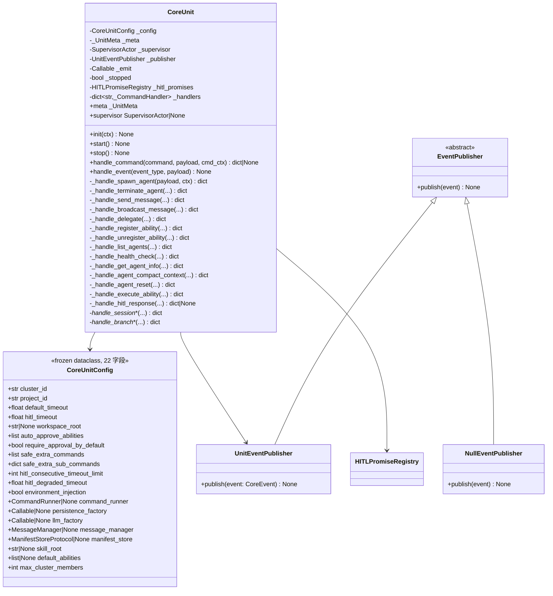

**对外只暴露 5 个面**（= Subject `mount_unit` 桥契约，`core/unit.py:1-27`）：

| 面 | 语义 |
|---|---|
| `meta` | `name="core"`，`requires=∅`，**`provides=∅`**（刻意不 provide supervisor——多集群会撞 Ouroboros 全局服务名），`routes.commands=_COMMANDS`（24 条） |
| `init(ctx)` | 取 `ctx.emit` 与 `ctx.serial`；构建 `SupervisorActor`；`skill_root` 显式注入才构造 `SkillAbilityProvider` |
| `start()` | **幂等空实现** |
| `stop()` | 清 HITL promises → 逐 agent `hitl_store.cancel_all()` → `supervisor.shutdown()`（`_stopped` 卫兵保证幂等） |
| `handle_command(...)` | 查表分发；未知命令 → `{"success": False, "error": "Unknown command: …"}`；**handler 返回 `None` 时原样穿透**（多 cluster 语义，仅 `hitl_response` 使用） |

**24 条命令分发表**（`_handlers`，`core/unit.py:643-668`）：`spawn_agent` `terminate_agent` `send_message` `broadcast_message` `register_ability` `unregister_ability` `list_agents` `health_check` `delegate` `get_agent_info` `agent_compact_context` `agent_reset` `execute_ability` `hitl_response` + session×5 + branch×5。

> 代码内 docstring 写"17 个命令"（`unit.py:614`），**实际 24** —— 过时注释。

**两条事件出路径**（同一归属契约，独立实现）：

| 路径 | 触发者 | 事件 |
|---|---|---|
| `UnitEventPublisher.publish()` | Agent / ContextManager 主动发 | `action_chain_updated` `agent_response` `agent_error` `context_usage_updated` + 8 个 session/branch |
| `CoreUnit._emit_event()` | Unit 自发（**裸 `EventType.*` 字符串**） | `agent_spawned` `agent_terminated` `ability_result` `hitl_resolved` |

两者都：补 `project_id`/`cluster_id`/`agent_id` → 若事件属 `AGENT_SCOPED_EVENT_TYPES` 且归属缺失 → **丢弃 + warning** → 前缀 `core:` → `ctx.emit`（fire-and-forget，异常只记日志**不阻断驱动循环**）。

> ⚠ 注释自陈的坑（`unit.py:829-831`）：`_emit_event` **不能用 `setdefault`** 补键，因为 wire `model_dump()` 自带空串字段（协议默认 `project_id=""`），已存在的空键不会被覆盖。

**能力物化的双通道**（`spawn_agent` 的两条路径）：

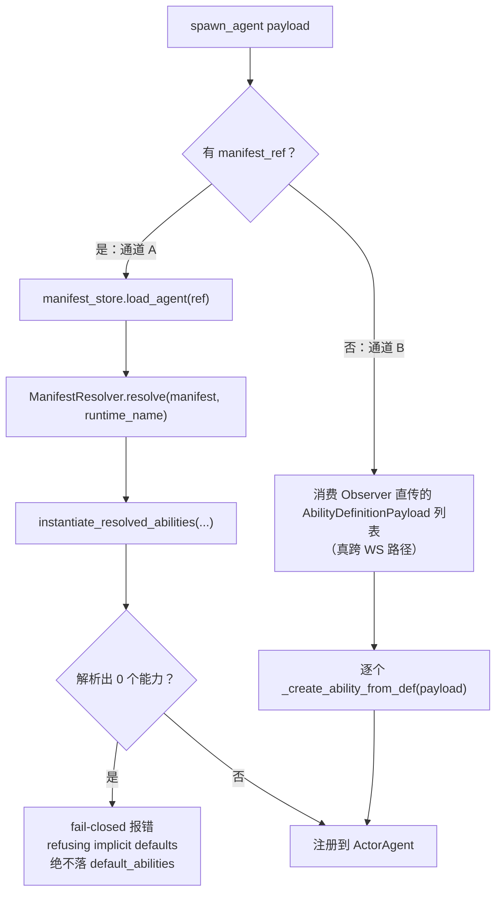

`_create_ability_from_def` 的**参数重写规则**（`unit.py:449-543`）：

| 能力类别 | 重写 |
|---|---|
| FS 类（命中 `{require_hitl, allowed_paths, denied_paths, workspace_root}`） | 弹出 4 键 → 构造 `FSPermissionChecker(require_approval=...)` → 注入 `params["permission_checker"]`；`require_approval=True` 时**注入 `params["hooks"]=[AccessApprovalHook(checker)]`** |
| `execute_command` | `CommandSafetyChecker` + `CommandApprovalHook`；`safe_extra_*` 经 `extend_safe_lists` **并集**（只增不减，fail-closed）；`command_runner` 非 None 才注入 |
| `end_task` | 强制 `params["mode"]="toolcall"` |

> **为什么必须挂 Hook**（`unit.py:511-516` 显式警告）：FS 内联检查只判"允许/拒绝"，返回 `(True, "pending")` 时**必须**由 Hook 转成 HITL 等待，否则白名单外访问会被**静默放行**。
>
> 优先级链：**`auto_approve_abilities` 白名单 > manifest 显式声明 > 兜底默认**（三种能力各实现一次）。

**已知的装配补丁（架构债）**：`_apply_hitl_timeout`（`unit.py:1143-1164`）在 spawn 后 **best-effort 直写 executor 私有字段** `_hitl_timeout` / `_hitl_timeout_limit` / `_hitl_degraded_timeout`，并 `update_hitl_promise_registry(self._hitl_promises)`。原因注释：**AgentBuilder 不透传 hitl_timeout 到 LocalAbilityExecutor**。失败只 warning → 存在"HITL 卡死不报错"窗口。

**Service 定位现状**：`CoreUnit` 不用 `SupervisorProtocol`，而是**白盒直取 Supervisor 私有属性**（9 处：`_registry.get_info` / `get_info_by_id` / `_resolve_timeout` / `message_manager` / `manifest_store` / `agent_handle._abilities` / `_ability_executor` / `_context_manager`）。这是"协议窄、实现宽"的 duck-typed 妥协。

### 5.2 CoreUnit 生命周期（代码里只有一个 bool）

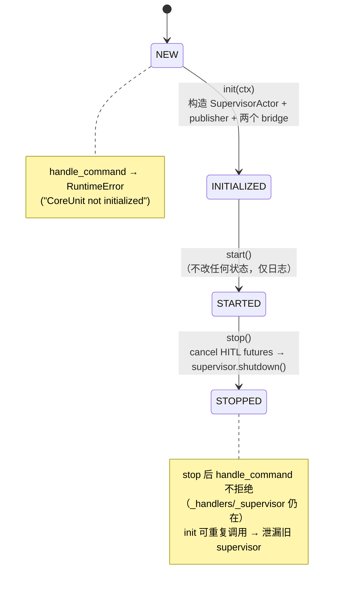

**可观测性缺口**：NEW / INITIALIZED / STARTED 三者**外部无法区分**。

### 5.3 ActorAgent 与驱动循环

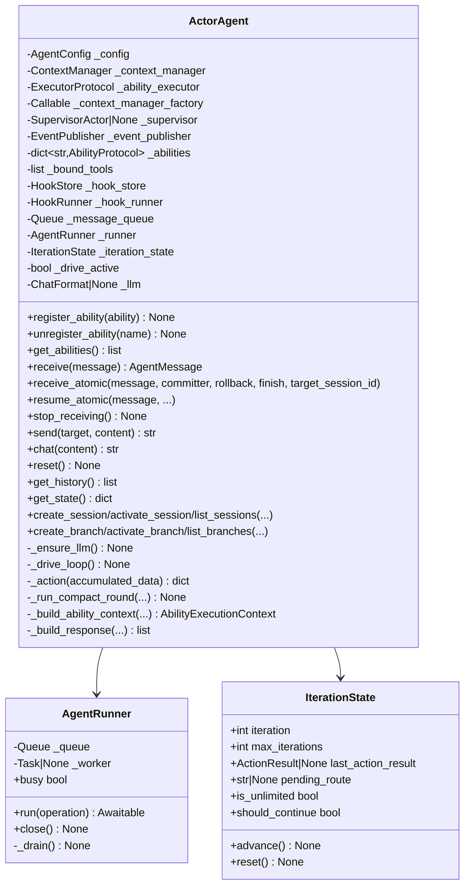

**构造是纯 DI（7 参数）**：`ActorAgent(config, context_manager, ability_executor, context_manager_factory, supervisor=None, event_publisher=None, llm_factory=None)`。注意 `ability_executor` 类型是 `ExecutorProtocol`，**运行期不切换**。

#### 驱动循环（`_drive_loop`，`agents/base.py:762-981`）

```mermaid
flowchart TD
    Start([receive → _receive_once]) --> HasAb{有注册 Ability？}
    HasAb -->|否| Err["AgentError"]
    HasAb -->|是| LLM["_ensure_llm()"]
    LLM --> Q["_message_queue.put(ChatMessage.user(...))<br/>max_iterations=cfg; reset()"]
    Q --> Loop{"should_continue？"}

    Loop -->|否| Done([_finish_response])
    Loop -->|是| Compact{"cm.check_compact_trigger()？"}
    Compact -->|是| CR["_run_compact_round()"] --> Loop
    Compact -->|否| BA["BEFORE_ACTION hooks<br/>modified_context 并入 accumulated"]
    BA --> BAStop{"should_continue？"}
    BAStop -->|否| BARoute["可选 _execute_routed_ability(route_to)"] --> Done
    BAStop -->|是| BI["cm.begin_iteration()"]
    BI --> Drain["_drain_message_queue() → cm.add_messages()"]
    Drain --> Action["_action(accumulated_data)"]
    Action --> Cmt["cm.commit_iteration_async(ability_names, action_results, llm_metadata)"]
    Cmt --> Pub["publish ActionChainUpdatedEvent<br/>(serialize_node + serialize_branch)"]
    Pub --> Cum["累加 cumulative_token_usage"]
    Cum --> AA["AFTER_ACTION hooks<br/>last_action_result = results[-1]"]
    AA --> AARoute{"route_to？"}
    AARoute -->|是| PR["pending_route + advance()"] --> Loop
    AARoute -->|否| AAStop{"should_continue？"}
    AAStop -->|否| Done
    AAStop -->|是| Max{"iteration+1 >= max？"}
    Max -->|是| OMI["ON_MAX_ITERATIONS hooks<br/>（只消费 route_to）"] --> Done
    Max -->|否| Adv["advance()"] --> Loop

    Action -.->|异常| EHandle["publish AgentErrorEvent<br/>if cm.in_iteration: cm.rollback_iteration(e)<br/>排空消息回队（带 delivery_id 的除外）"]
    EHandle -.-> CtxErr{"_is_context_limit_error 且 halvings<4？"}
    CtxErr -->|是| Emg["厂商窗口回填 → 仍超限则 budget //= 2^n<br/>_run_compact_round('emergency', budget)"] --> Loop
    CtxErr -->|否| OE["ON_ERROR hooks<br/>raise AgentError('Action failed: …')"]
    Action -.->|finally| EIC["cm.ensure_iteration_closed()<br/>兜 CancelledError / BaseException"]
```

关键细节：
- **compact 检查在 BEFORE_ACTION 之前**（`base.py:767-770`）。
- **`should_continue` 的唯一写入者是 Hook**：`HookResult.should_continue`；多 Hook 合并是 **AND**；`ActorAgent` 自己不写这个值。
- `finally: cm.ensure_iteration_closed()` 是必需兜底——注释指出 `CancelledError` **不进 `except Exception`**，残留 `_in_iteration` 会让下一次 `begin_iteration` 永久失败。
- **上下文超限的保守识别**是"类型名 + 消息短语"双通道白名单（`base.py:105-129`），并允许最多 4 次预算减半（`_MAX_EMERGENCY_HALVINGS=4`）。

#### `_action`（单次迭代的 LLM 交互，`base.py:1216-1423`）

```mermaid
sequenceDiagram
    autonumber
    participant A as ActorAgent._action
    participant H as HookRunner
    participant CM as ContextManager
    participant LLM as ChatFormat
    participant EX as LocalAbilityExecutor

    A->>H: PRE_LLM_CALL hooks
    A->>A: if cfg.window: publish ContextUsageUpdated(phase=pre_call)
    A->>CM: get_llm_messages()
    CM-->>A: 窗口视图（系统消息保护 + 策略管道 + 技能目录）
    A->>LLM: generate(messages, tools)
    LLM-->>A: LLMResponse
    Note over A: 空响应重试：无 tool_calls 且 text 空白<br/>→ system 位插 retry prompt 再调一次（仅一次）
    A->>CM: record_real_usage(first_usage)（只取首响应做成本锚点）
    A->>A: publish ContextUsageUpdated(phase=post_call)
    A->>CM: add_messages([llm_response.to_chat_message(source="agent:{name}")])
    A->>H: POST_LLM_CALL hooks
    alt 无 tool_calls
        A->>A: accumulated["llm_response"] = text
        opt 有 conversation 能力
            A->>EX: execute_ability(conversation)
        end
    else 有 tool_calls
        A->>EX: execute_tool_calls(tool_calls, abilities, accumulated_data, cm, last_action_result)
        EX-->>A: [{ability_name, action_result, tool_call_id}]
        opt 任一 data 含 await_reply
            A->>CM: commit_iteration_async（中间节点：pending_tool_replies=True）
            A->>A: publish ActionChainUpdated
            A->>CM: begin_iteration()
            A->>EX: _await_tool_results(results)  ← 阻塞等对端回复
        end
        A->>CM: _add_tool_results(results)
    end
    A-->>A: return {"results", "llm_metadata"}
```

**"一次 receive 多次 commit"** 是必须理解的语义（`base.py`）：
1. 正常迭代节点（`825`）
2. `await_reply` 中间节点（`1382-1410`）——**先提交、再阻塞等对端**
3. 恢复/`resume_atomic` 补节点（`1512-1520`）
4. routed ability 节点（`1547-1569`）
5. compact 节点（`1145`）

**回滚只回当前迭代，无跨节点补偿事务**；补偿仅靠"排空消息回队"（`883-887`）。

#### 接收的 4 个入口

| 入口 | 语义 |
|---|---|
| `receive(message)` | **若 supervisor 有 `message_manager` 则立刻改道** `supervisor.route_message(message)`，完全绕过 `_drive_loop`（投递整体外移到持久邮箱）；否则 `_runner.run(_receive_once)` |
| `receive_atomic(message, committer, rollback, finish, target_session_id)` | `cm.use_session()` + `durable_iteration_scope`；session 路由时禁止消费非作用域队列消息；finally 排除同 `delivery_id` 后回队 |
| `resume_atomic(message, ...session_id, branch_id, last_node_id)` | 校验 head 与 branch 一致；`execute_ability` 消息 → `_restore_pending_tools()` + `_finish_command_result`；**不重注入输入、不重放已提交工具** |
| `_receive_command_once` | `metadata["execute_ability"]` 短路路径（无 LLM 调用） |

#### AgentRunner：FIFO 串行执行器

`agents/runner.py` 只管「请求 → 返回值 + 取消」，不碰 agent 逻辑：
- `busy` = `_worker is not None`（被 `request_compact` 与 `reset` 当"驱动中"判据）。
- `run(operation)`：从 `ContextVar` 取父 runner → **环检测** `_reaches` → 同步等待环抛 `RuntimeError("Synchronous agent wait cycle: A -> B")`；`_Work(operation, future, copy_context())` 入队；无 worker 则起 `_drain()`。
- **架构含义**：一个 Agent 同时最多一个驱动循环——这是"迭代事务不可重入"的实现基础。
- **局限**：环检测只覆盖**进程内 Runner**，跨进程同步链无保护。

### 5.4 Supervisor 与集群内通信

```mermaid
classDiagram
    class SupervisorActor {
        -AgentRegistry _registry
        -MessageRouter _router
        -EventPublisher _event_publisher
        -str cluster_id
        -int _max_cluster_members
        +spawn_agent(config, abilities) str
        +terminate_agent(name) None
        +list_agents() list
        +get_agent_handle(name) ActorAgent
        +route_message(message) AgentMessage
        +prepare_message(*, targets, content, sender, idempotency_key, metadata) str
        +send(target, content, sender) str
        +broadcast(content, sender) list
        +get_cluster_context() dict
        +shutdown() None
    }
    class AgentRegistry {
        +register(agent) None
        +get(name) ActorAgent
        +get_info(name) AgentInfo
        +get_info_by_id(agent_id) AgentInfo
        +list_agents() list
        +unregister(name) None
    }
    class MessageRouter {
        +route(message) AgentMessage
    }
    SupervisorActor --> AgentRegistry
    SupervisorActor --> MessageRouter
    SupervisorActor --> EventPublisher
```

`SupervisorActor` 是**集群内唯一编排者**：持有 `AgentRegistry`（名称/ID → Agent 实例）、`MessageRouter`（消息投递）、事件发布器、`cluster_id`、`max_cluster_members`（默认 20）、`MessageManager`（可选）。

**四个跨层协议契约**（`core/supervisor_protocol.py` / `room_protocol.py` / `window_protocol.py`）：

| 协议 | 关键成员 |
|---|---|
| `SupervisorProtocol` | `list_agents` `terminate_agent` `spawn_agent(config, abilities)` `prepare_message(*, targets, content, sender, idempotency_key, metadata)` `send` `broadcast` `get_agent_handle` `get_cluster_context() -> {cluster_id, members:[{name, description, tags}]}` |
| `RoomBridgeProtocol` | `resolve_recipients(room_ids, extra_targets) -> {success, data:{recipients, rooms}}`；`append_room_log(room_id, author, data, author_type)` |
| `MessageFactory` | `create_message(role, content_blocks, *, text, source, metadata)`；`create_tool_result_block(tool_call_id, name, content, success, error)` |
| `ContextManagerProtocol` | `apply_state_changes(changes) -> dict`（用于解 abilities → context 的循环依赖） |

**多 Agent 通信在 Agent 层只有一个原语**：`ActorAgent.send(target, content)` → 构造 `AgentMessage(type=COMMAND)` → `supervisor.route_message()`。

> **spawn / terminate / broadcast / delegate 不在 Agent 层**——它们只存在于 `CoreUnit` 命令面和 `builtin/` 的 cluster 能力（`spawn_agent` / `terminate_agent` / `send_message` / `broadcast_message` / `query_agents` / `send`）。

#### 消息模型

```mermaid
classDiagram
    class AgentMessage {
        +str sender
        +str recipient
        +str content
        +MessageType type
        +str id
        +dict metadata
        +float timestamp
        +str|None reply_to
        +list~dict~|None content_blocks
        +to_chat_message() ChatMessage
        +create_reply(original, content, msg_type, content_blocks)$ AgentMessage
    }
    class MessageType {
        <<enumeration>>
        CHAT
        COMMAND
        TOOL_CALL
        TOOL_RESULT
        RESULT
        ERROR
        BROADCAST
    }
    AgentMessage --> MessageType
```

`AgentMessage` 是 **Agent 间通信的领域消息**，与 WS 的 `Envelope`（在 `ghrah.protocol.types` 里别名 `Message`）是不同的东西——代码注释显式强调这一点。`to_chat_message()` 的 role 映射：`CHAT/COMMAND/BROADCAST → user`，`TOOL_CALL/RESULT → ai`，`TOOL_RESULT → tool`，`ERROR → system`；`source` 经 `classify_source`：`"user" → "human:user"`，其他 → `"agent:{sender}"`。

### 5.5 MessageManager：持久消息邮箱

`communication/message_manager.py`（1704 行）是**显式装配的本地持久消息服务**，用于 Supervisor 的**原子发送与接收**。它是"持久输入"这条链路的权威。

```mermaid
graph TB
    subgraph MM["MessageManager（单项目、单本地进程）"]
        API["prepare_send / send / send_external<br/>wait_replies / wait_inline<br/>retry / get_progress / get_replies"]
        SCHED["_dispatch_loop → _scan → _run(agent_id, receiver)"]
        ATOMIC["bind_atomic(agent) → _AtomicDelivery<br/>节点/消费/出站同事务"]
        RESUME["resume_interrupted / _resume_checkpoint<br/>resume_delivery / dispatch_pending / recover_completions"]
        ROOM["configure_room_projector → recover_room_projections"]
    end
    DB[("与 Core 共用同一 sqlite 文件<br/>mm_meta / mm_messages / mm_deliveries<br/>mm_room_projections / mm_inline_waits / mm_delivery_results")]
    AG["ActorAgent.receive_atomic<br/>durable_iteration_scope"]
    API --> DB
    SCHED --> DB
    ATOMIC --> DB
    ATOMIC --> AG
    RESUME --> DB
    ROOM --> DB
```

**数据模型**：

| 类型 | 字段要点 |
|---|---|
| `MessageKind` | `request`（自动产生一次最终回复）/ `notification` / `response`（不自动产生新回复） |
| `DeliveryState` | `pending` `processing` `completed` `failed` `interrupted` `blocked` |
| `MessageRecord` | `message_id` `project_id` `sender_id` `recipient_ids` `content` `kind` `reply_to` `accepted_at` `origin_node_id` `sender_session_id` `metadata` `external_sender` |
| `DeliveryRecord` | `delivery_id` `message_id` `recipient_id` `state` `attempts` `error` `consumed_node_id` `consumed_session_id` `result_ready` `result_node_id` `target_session_id` `blocked_reason` `last_node_id` `resume_requested` |
| `PreparedMessage` | 本轮待提交出站消息；`idempotency_key`；**此对象不表示已持久受理** |
| `DeliveryProgress` | `delivery` + `branch_id` + `iteration` + `resume_block_reason` |

**表结构**（与 Core 共用同一 sqlite 文件）：

| 表 | 关键列 |
|---|---|
| `mm_meta` | `singleton INTEGER PRIMARY KEY CHECK(singleton=1)` |
| `mm_messages` | `seq INTEGER PRIMARY KEY AUTOINCREMENT`、`message_id`、`project_id`、`sender_id`、`content`、`kind`、`reply_to`、… |
| `mm_deliveries` | `seq` PK、`delivery_id`、`message_id`、`recipient_id`、`state`、`attempts`、… |
| `mm_room_projections` | `message_id TEXT PRIMARY KEY REFERENCES mm_messages(message_id)` |
| `mm_inline_waits` | `message_id TEXT PRIMARY KEY REFERENCES mm_messages(message_id)` |
| `mm_delivery_results` | `delivery_id TEXT PRIMARY KEY REFERENCES mm_deliveries(delivery_id)` |

索引：`mm_inbox(recipient_id, seq)`、`mm_replies(reply_to, seq)`。

**关键设计约束**（代码注释）：
1. **agent_ids 是部署方显式提供的稳定身份白名单**，包含离线 agent。`bind` 只登记运行回调，不创建 agent，也不复制其上下文。
2. **独立 SQLite 锁连接**确保一个数据库只有一个活跃管理器；强杀后锁由操作系统释放。
3. **已消费但没有持久最终结果的中断输入禁止重新注入**；**不保证工具只执行一次**（`message_manager.py:9`）。
4. 最终结果**先保存为收尾意图**，再原子生成回复和完成状态；可在重启后恢复收尾。
5. `_AtomicDelivery` 把"节点写入 / 消费标记 / 出站消息"放在**同一事务**（`_commit_atomic` → `_apply_atomic`），并要求 `SqliteBackend` 的 `main` 库路径与 `self._path` 一致（`message_manager.py:421`）。

**`await_reply` 同步回路的两条执行路径**（`core/unit.py:1416-1449`）：

| 路径 | 条件 | 行为 |
|---|---|---|
| 持久邮箱 | 有 `message_manager` | `send_external(metadata={"execute_ability": {...}})` → `wait_replies(timeout)` → `deserialize_action_result(json.loads(reply.content))` → `recover_room_projections()` |
| 直调 | 无 `message_manager` | 构造 `AbilityExecutionContext` → `executor.execute_ability(ability, context)` |

**已知风险**：`await_reply` 是**同步阻塞的洞**——它在已 `begin_iteration()` 的 `_action` 内部先提交中间节点再阻塞等对端，靠 Runner 的进程内环检测防 A↔B 死锁；跨进程同步链无保护。

### 5.6 LLM 与 Chat 交互层

```mermaid
graph LR
    AC["AgentConfig<br/>effective_agent_config_name"] --> AR["agentconf.AgentsConfig().resolve_agent(name)"]
    AR --> LF["LLMFactory.create(resolved)"]
    LF --> PT{"provider_type"}
    PT -->|OPENAI / CUSTOM| OF["OpenAIFormat"]
    PT -->|ANTHROPIC| AF["AnthropicFormat"]
    PT -->|DEEPSEEK| DF["DeepSeekFormat extends OpenAIFormat"]
    PT -->|其他| Err["LLMError"]
    OF --> MO["apply_model_overrides(overrides)"]
    AF --> MO
    DF --> MO
    MO --> Agent["_ensure_llm: configure_tools →<br/>wm.resolve_budget_from_model(llm.model) → _initialized=True"]
```

> ⚠ 不存在 `ResolvedLLMConfig` 类型；也不存在 `create_format` 以外的第二条真实路径（`format/__init__.py:create_format(provider_type, **kwargs)` 与 `LLMFactory` 是**两条并存的构造路径**）。

**ContentBlock 联合类型（8 元）**：

| Block | 字段 |
|---|---|
| `TextBlock` | `text` |
| `ReasoningBlock` | `reasoning` `incomplete`（Anthropic `stop_reason=="tool_use"` 时置 True） |
| `ImageBlock` | `url` `base64` `mime_type` |
| `AudioBlock` | `data` `mime_type` |
| `FileBlock` | `url` `base64` `mime_type` `filename` |
| `ToolCallBlock` | `id` `name` `arguments: dict` |
| `ToolResultBlock` | `tool_call_id` `name` `content` `success` `error` |
| `ErrorBlock` | `error_type` `message` `details` |

（`ToolCallChunkBlock` 是**流式预留**，不在 `ContentBlock` 联合内；`StreamingBlock = TextBlock | ToolCallChunkBlock`。）

序列化容错：`blocks_from_dicts` **单项失败降级为 TextBlock**（取 `text` 或 `reasoning`），不整体失败。

**三种 ChatFormat 的差异**：

| 维度 | OpenAIFormat | AnthropicFormat | DeepSeekFormat |
|---|---|---|---|
| SDK | `openai.AsyncOpenAI`（惰性） | `anthropic.AsyncAnthropic`（惰性） | 继承 OpenAI |
| system | 留在 messages 内 | **抽出**为顶层 `system`，多段 `\n\n` 拼接 | 同 OpenAI |
| tool schema | `{"type":"function","function":{name,parameters,description}}` | 扁平 `{"name","input_schema","description"}` | 同 OpenAI |
| tool_call 表达 | assistant 上 `tool_calls[]`（`arguments` 为 JSON 字符串） | content part `{"type":"tool_use","id","name","input"}` | 同 OpenAI |
| tool_result 回填 | 独立 `{"role":"tool","tool_call_id","content"}`（**只取第一条** tool_result） | 转成 `{"role":"user","content":[{"type":"tool_result","tool_use_id",…}]}`；失败置 `is_error=True` | 同 OpenAI |
| reasoning | `message.reasoning_content` → `ReasoningBlock`；回填 `d["reasoning_content"]` | `{"type":"thinking","thinking":…}` | **强制补 `reasoning_content`**（缺则 400） |
| 多模态 | `image_url` / `input_audio{data,format}` / `file{file_data,filename}` | `image{source:{type:base64,...}}` / `document{...}`；**AudioBlock 不处理** | 同 OpenAI |
| usage 归一 | `input=prompt_tokens`（已含 cached）、`cache_read=cached_tokens`、**无 cache_write** | `input = input + cache_read + cache_write`，两维单列 | 继承 |
| 空响应 | 无 choices → `ErrorBlock(provider_error)` | `[TextBlock("")]` | 继承 |

**token 口径权威**（`types/tokens.py`）：`input_tokens` **恒为总输入（含 cache_read + cache_write）**；未命中 = `input - cache_read`。提取顺序（`chat/response.py:24-60`）：先信 `response.token_usage`（三值全 0 视为无）→ 再从 `response_metadata["token_usage"|"usage"]` 做**双风格键兼容**（`input_tokens|prompt_tokens`、`output_tokens|completion_tokens`、`cache_read_tokens|cache_read_input_tokens|cached_tokens`、`cache_write_tokens|cache_creation_input_tokens`）。

### 5.7 AgentBuilder

```
AgentBuilder.from_config(config, persistence_factory, llm_factory, event_publisher, supervisor, abilities)
 ├─ resolved_llm_factory = llm_factory or _default_llm_factory
 │    └─ _default_llm_factory: AgentsConfig().resolve_agent(effective_agent_config_name)
 │       → LLMFactory.create → apply_model_overrides   ← 每次 spawn 新建 AgentsConfig，无复用
 ├─ context_manager = _build_context_manager(...)
 │    ① system_prompt = config.system_prompt
 │    ② [Cluster Context] 注入（cluster_context_injection=True 且 supervisor.get_cluster_context 可调用）
 │       → _render_cluster_context_section 前置拼接；方法缺失只 warning 跳过（structural typing）
 │    ③ [Environment] 注入（environment_context_injection=True 且 environment_info 非空）
 │       → 只有开关无快照 → warning 跳过（零隐式）
 │    ④ WindowManager（仅 config.window is not None）
 │       summary_llm_factory = lambda: llm_factory(config)  ← 零参闭包，解"策略装配先于 LLM 创建"时序耦合
 │    ⑤ 持久化：persistence_factory 优先（注入了就生效，不看 context 配置）→ 否则 create_persistence(context_config)
 │    ⑥ ContextManager(agent_name=config.effective_agent_id, ...)
 │       ← 必须按稳定 UUID 分区，否则跨 cluster 同名 agent 会覆盖快照
 ├─ _cm_factory() 闭包（同参数，每次调用重建 CM）
 ├─ executor = LocalAbilityExecutor(...)  ← 或注入的实现
 ├─ agent = ActorAgent(config, cm, executor, _cm_factory, supervisor, event_publisher, llm_factory)
 └─ for ability in abilities: agent.register_ability(ability)
```

`_build_window_manager` 的 `strategy_map` 四键：`truncation` / `sliding_window` / `tool_call_fold` / `llm_summary`；**未知策略名静默 warning 跳过**。

### 5.8 子 Agent 上下文继承（rebase）

`create_rebased_context(...)`（`context/rebase.py:27`）用于 spawn 子 Agent：

| 维度 | 默认行为 |
|---|---|
| 消息继承 | `inherit_messages=True`，但**过滤掉 `role == "system"` 的消息** |
| 状态继承 | `inherit_state=False`；`True` 时取源 CM 的**运行时状态（含未提交改动）**，而非节点快照；可再经 `state_filter` 裁剪 |
| system prompt | **不继承**，必须显式指定 |
| window_manager | **必须传独立实例**（共享会让摘要策略状态与压缩排水记录跨 Agent 互串） |
| persistence | 与源 CM **共享同一 backend** |
| 继承项 | `auto_persist` / `message_factory` / `snapshot_interval`（缺省用源 store 的）/ `compact_*` / `skill_provider` |
| provenance | 写入 `origin_session_id` / `origin_node_id` / `origin_agent_name` 到 `root_metadata` |

`source_node_id=None` → 取源 `active_head`；显式 ID 不存在 → `ValueError`。

---

## 6. 能力系统

### 6.1 Ability 抽象与执行上下文

```mermaid
classDiagram
    class Ability {
        <<abstract>>
        +name str
        +execute(context) ActionResult
        +get_hooks() list~Hook~
        +bind_tool() dict|None
        +get_default_state() dict
        +to_prompt_description() str
    }
    class AbilityProtocol {
        <<Protocol, runtime_checkable>>
        +name str
        +execute(context) ActionResult
        +bind_tool() dict|None
        +get_hooks() list
        +get_default_state() dict
    }
    class HITLRequiredAbility {
        -AbilityProtocol _inner
        -HITLApprovalHook _hitl_hook
        +get_hooks() list
        +__getattr__(name)
    }
    class ActionResult {
        +ActionOutcome outcome
        +dict data
        +str|None next_action_hint
    }
    class ActionOutcome {
        <<enumeration>>
        SUCCESS
        FAILURE
        NEEDS_INPUT
        DELEGATE
    }
    class AbilityExecutionContext {
        +AbilityInvocation invocation
        +ExecutionData data
        +ExecutionServices services
        +dict agent_state
        +ActionResult|None last_action_result
        +get_ability_state() dict
        +update_state(changes) None
        +update_global_state(changes) None
    }
    class AbilityInvocation {
        <<frozen>>
        +str ability_name
        +dict tool_args
        +str tool_call_id
    }
    class ExecutionData {
        +dict raw
        +get(key) T
        +set(key, value) None
        +update(mapping) None
        +snapshot() dict
    }
    class ExecutionServices {
        +get(key) T
        +require(key) T
        +set(key, value) None
        +snapshot() dict
    }
    Ability ..|> AbilityProtocol
    HITLRequiredAbility o-- AbilityProtocol
    Ability --> ActionResult
    ActionResult --> ActionOutcome
    Ability --> AbilityExecutionContext
    AbilityExecutionContext --> AbilityInvocation
    AbilityExecutionContext --> ExecutionData
    AbilityExecutionContext --> ExecutionServices
```

`AbilityExecutionContext`（`scheme/execution/context.py:38`）是**兼容门面**，真实字段是 `invocation + data + services + agent_state + last_action_result`，旧属性以 property 透传（`current_ability_name` / `tool_args` / `accumulated_data` / `context_manager` / `supervisor` / `agent_name` / `manifest_store` / `skill_provider`）。构造接受 **13 个关键字参数**，是装配期唯一注入口。

**`bind_tool()` 产出的 schema 形状**（OpenAI function calling）：
```
{"type":"function","function":{"name":<tool名>,"description":<...>,"parameters":<JSON Schema>}}
```
`parameters` 三态来源：① pydantic 直出 `SomeInput.model_json_schema()`（文件/命令/全部 cluster 与 core 类）；② descriptor 直出（`command_proxy`）；③ 手写空/简化 schema（`session_info`、`end_task` 仅 `mode="toolcall"`）。

返回 `None` → **不注册为 tool**：`conversation`、以及默认 `mode="auto"` 的 `end_task`。消费点：`register_ability` 收进 `_bound_tools`。

**执行上下文四文件分工**：

| 文件 | 提供 |
|---|---|
| `invocation.py` | `AbilityInvocation`（frozen）—— 调用身份 |
| `execution_data.py` | `ExecutionData`（可变数据总线）+ `DataKey[T]` + 5 键：`TOOL_ARGS` `LLM_RESPONSE` `COT_CONTENT` `CUMULATIVE_TOKEN_USAGE` `FINAL_RESPONSE` |
| `execution_services.py` | `ExecutionServices`（类型化服务容器）+ `ServiceKey[T]` + 5 键：`CONTEXT_MANAGER` `SUPERVISOR` `AGENT_NAME` `MANIFEST_STORE` `SKILL_PROVIDER` |
| `execution_frame.py` | `ExecutionFrame`：`data` + `services` + `agent_state` + `last_action_result` + `current_node_id` —— Hook 与 drive-loop 共享的一步状态帧 |

> **注意**：能力**没有声明式 `require` 机制**。服务全靠构造注入 `AbilityExecutionContext`（或 `services.set`），运行时用 `get()`/`require()`；未接线时**必须显式返回 FAILURE 并指路**（零隐式）。

### 6.2 能力定义面与物化面

能力**不再有代码注册表**。2026-10-28 的重构（`1938ffa`）删除了 `ghrah/abilities/` 与 `ghrah/manifest/` 两棵目录树，改为**先有定义、后有类**：一份 `ability.yaml` 声明容器及其成员（`operations` / `skills` / `assets`），`ghrah.scheme_ability.loading` 负责扫盘、校验、投影，`create_ability()` 在物化期把 handler 映射到实现类。

```mermaid
flowchart LR
    Dir["（root）/（容器）/ability.yaml<br/>format: ghrah.ability-definition"] --> Scan["scan_ability_definitions()<br/>目录面：全池扫盘、收集 issue、不抛错"]
    Scan --> Def["AbilityDefinition<br/>identity / operations / skills / assets"]
    Def --> View["AbilityManifest 视图<br/>load_all_builtin_manifests()"]
    Def --> Ops["operation_containers()<br/>builtin_handlers()"]
    Ops --> Create["create_ability(handler, **params)<br/>ability_class() → 实现类"]
```

`ghrah-core/src/ghrah/scheme_ability/loading/ability_catalog.py` 是把定义面装配成运行时视图的唯一门面：

| API | 语义 | 行号 |
|---|---|---|
| `load_definition(container)` | 取单容器定义；未知容器抛 `ManifestValidationError` | `:130` |
| `operation_containers()` | `{handler: 容器名}`，**含** registry-only | `:452` |
| `builtin_handlers()` | 升序 handler 列表，**含** registry-only | `:469` |
| `has_handler(handler)` / `ability_class(handler)` | 存在性 / 取实现类 | `:481` / `:495` |
| `create_ability(handler, **params)` | **原 `AbilityRegistry.create` 的唯一替代入口** | `:518` |
| `builtin_full_names()` | 声明路径成员全名，**不含** registry-only | `:424` |
| `load_builtin_manifest(full_name)` | 单个 `AbilityManifest` 视图 | `:539` |

**三个口径不可混用**（同一份内置树，实测于 `f8ff157`）：

| 口径 | 数量 | API |
|---|---|---|
| handler 全集 | 22（含 `send`） | `builtin_handlers()` |
| 运行时视图 | 21（不含 `send`，见 `REGISTRY_ONLY_OPERATIONS`） | `load_all_builtin_manifests()` |
| 模型工具面 | 20（再去掉 `conversation`，其 `expose: false`） | `load_tool_list()` |

> **关键区分**：按名称解析 `tool_call` 的既不是注册表也不是 catalog，而是 **Agent 的实例表**（`execute_tool_calls(abilities=self._abilities)`）。`create_ability()` 只在**物化期**用；catalog 是**进程本地、无缓存、每次重新扫盘**（热插拔）。
>
> 字段级契约、扫描规则与投影细节见 [ghrah-01-ability-design-and-implementation.md](ghrah-01-ability-design-and-implementation.md) §5–§7；改 `ability.yaml` 的逐字段说明见 [ghrah-02-ability-package-guide.md](ghrah-02-ability-package-guide.md)。

### 6.3 AbilityExecutor

```mermaid
classDiagram
    class AbilityExecutor {
        <<abstract>>
        +execute_ability(ability, context) ActionResult
        +execute_tool_calls(tool_calls, abilities, accumulated_data, context_manager, last_action_result) list~dict~
        +handle_hitl_hook_result(context, hook_result) ActionResult
        +update_hooks(hooks) None
        +update_event_publisher(publisher) None
        +receive_hitl_response(ability_name, tool_call_id, approved, result) bool
    }
    class LocalAbilityExecutor {
        -str _agent_name
        -HookStore _hook_store
        -HookRunner _hook_runner
        -EventPublisher _event_publisher
        -float _hitl_timeout
        -str|None _workspace_root
        -HITLPromiseRegistry|None _hitl_promise_registry
        -SupervisorActor|None _supervisor
        -int _hitl_timeout_limit
        -float _hitl_degraded_timeout
        -HITLFutureStore hitl_store
        -dict _deferred_contexts
    }
    AbilityExecutor <|-- LocalAbilityExecutor
```

**只有 `LocalAbilityExecutor` 一个实现**。"远程执行"不是执行器类，而是协议命令 `EXECUTE_ABILITY`（由 `CoreUnit._handle_execute_ability` 承接后**仍走本地执行器**）。

#### `execute_tool_calls()` 精确流程

1. 遍历 `ToolCallBlock`（`arguments` 已由 LLM 层解析成 dict）。
2. `abilities.get(name)` 为 None → **立刻**追加 FAILURE `{"error": "Unknown ability: X"}` 并 `continue`（不抛错）。
3. 其余收进 `tool_call_tasks`。
4. `asyncio.gather(*tasks, return_exceptions=True)` → **并行、无并发上限、无顺序保证**。
5. 结果归并：
   - `BaseException` 且非 `Exception`（`CancelledError` 等控制流）→ **原样重抛**
   - `Exception` → 转 `ActionResult(FAILURE, {"error": str(e)})`
   - 正常 → 补 `tool_call_id`
6. 返回 `list[{ability_name, action_result, tool_call_id}]`；顺序 = 先 unknown 失败项（按出现顺序），再并行结果（gather 保序）。

`_resolve_paths`：**仅当** `workspace_root` 已设且 `ABILITY_PATH_SPECS` 命中时，把 `path_keys`/`working_dir_keys` 里的**相对路径**解析为 `workspace_root/xxx`；绝对路径原样。**注意 `search_files` 的 `path` 不在 spec 里，不会被解析**。

#### `execute_ability()` 精确流程

```mermaid
flowchart TD
    In["execute_ability(ability, context)"] --> Pre["PRE_EXECUTE hooks"]
    Pre --> R{"hook_result 非 None？"}
    R -->|否| Exec["ability.execute(context)"]
    R -->|是| SC{"should_continue？"}
    SC -->|否| HITLQ{"requires_hitl？"}
    HITLQ -->|是| H["handle_hitl_hook_result(context, hook_result)"]
    H --> HO{"outcome"}
    HO -->|approved| Exec
    HO -->|timeout| FT["FAILURE {error, hitl_timeout:true, hitl_degraded, promise_id, tool_call_id}"]
    HO -->|rejected| FR["FAILURE {error(优先透传 reason), hitl_rejected:true, promise_id, tool_call_id}"]
    HITLQ -->|否| FB["FAILURE {error: hook_result.message or 'Execution blocked by hook'}"]
    SC -->|是| RT{"route_to？"}
    RT -->|是| Del["ActionResult(DELEGATE, route_to, next_action_hint=route_to)"]
    RT -->|否| MC["modified_context → accumulated_data.update(...)"]
    MC --> Exec
    Exec --> AR{"data 含 await_reply？"}
    AR -->|是| Defer["记 _deferred_contexts[message_id]=context<br/>**跳过 POST_EXECUTE**，直接返回"]
    AR -->|否| Post["POST_EXECUTE hooks（带 action_result）"] --> Out([返回])
```

`await_reply` 是**持久同步回复的延迟钩子**：`finish_deferred(message_id, context, result)` 在回复确定后补跑 `POST_EXECUTE`（恢复时不重跑 PRE / 工具）；`clear_deferred()` 释放未完成上下文。

### 6.4 Hook 机制

#### HookPoint 全清单（10 个）

| 枚举 | 层 | 实际触发点 |
|---|---|---|
| `BEFORE_ACTION` | drive_loop | `base.py:774`，compact 检查**之前**；`modified_context` 并入；`not should_continue` → 可选 route 后 break |
| `AFTER_ACTION` | drive_loop | `base.py:954`；route → pending_route + advance + continue；stop → break |
| `ON_ERROR` | drive_loop | `base.py:934`，异常后、重抛前（**返回值被忽略**） |
| `ON_MAX_ITERATIONS` | drive_loop | `base.py:972`，仅达上限时；**只消费 `route_to`** |
| `PRE_LLM_CALL` | action | `base.py:1234`，`get_llm_messages()` / `generate()` 之前 |
| `POST_LLM_CALL` | action | `base.py:1315`，AI 消息写链之后、解析 tool_calls 之前 |
| `PRE_TOOL_EXECUTE` | action | **无触发点（死枚举）** |
| `POST_TOOL_EXECUTE` | action | **无触发点（死枚举）** |
| `PRE_EXECUTE` | ability | `executor.py:323` —— **HITL 唯一闸门** |
| `POST_EXECUTE` | ability | `executor.py:409`（及 `finish_deferred`）；返回值被丢弃，只用于 `modified_context` |

#### HookResult 能做什么

| 字段 | 语义 |
|---|---|
| `should_continue` | 是否继续循环（多 Hook 合并 = **AND**） |
| `route_to` | 跳转路由（→ `DELEGATE` 或下游 ability；后者覆盖前者） |
| `modified_context` | 修改上下文数据（与 `data_updates` 在 `__post_init__` 双向镜像） |
| `data_updates` | 同上的别名入口 |
| `message` | 终止/审批说明（后者覆盖前者） |
| `requires_hitl` | 暂停请求人工审批（合并 = **OR**） |

工厂：`continue_()` / `stop(*, message)` / `hitl(*, message)`（= stop + requires_hitl）/ `route(target, *, message)`。

→ 能力清单：**改上下文数据 / 拦截（stop）/ 暂停求审批（hitl）/ 跳转路由（route）**。

#### 注册、执行顺序、优先级

```mermaid
graph TB
    subgraph HookStore["HookStore（纯内存，每 ActorAgent 一个实例）"]
        E["_entries：注册序总表"]
        G["_global_by_point"]
        A["_by_point_and_ability"]
        L["_legacy_by_point"]
    end
    Reg["register_ability → get_hooks()"] --> Add["HookStore.add_hooks(owner, hooks)<br/>owner ∈ {ability.name, '__agent_hooks__'}"]
    Add --> E
    Sel["select(point, ability_name)"] --> U["全局作用域 ∪ legacy(无 scope) ∪ 该 point+ability 定向"]
    U --> F["按 _entries 顺序过滤输出"]
    F --> Run["HookRunner.run → 顺序 await，逐个 merged = merged.merge(result)"]
    Run --> W["末尾把 merged.modified_context 写入 context.frame.data"]
```

- **执行顺序 = 注册顺序**；**优先级机制不存在**（`Hook` 只有 `hook_point` 与 `scope`，无 priority 字段）。
- **两套语义**：`scope is None`（legacy）→ 每个 Hook 都要 `await should_trigger(ctx)` 过滤；有 `HookScope{points,target_abilities}` → 建索引直接命中，**完全跳过 `should_trigger`**。**现存全部内建 Hook 都是 legacy**。
- `HookContext.from_ability_context()` **共享同一份** `data`/`services`/`agent_state`；`to_ability_context()` 反向适配给 legacy Hook。
- **`HookStore` 什么都没持久化**：无序列化、无磁盘/DB、无跨进程共享，进程退出即失。

#### `BuiltinHookRegistry`

`handler(str) → Hook 类` 的进程级类注册表：

| handler | Hook 类 | 触发点 | 行为 |
|---|---|---|---|
| `conversation_done` | `ConversationDoneHook` | AFTER_ACTION | 当前 ability = conversation → `stop()` |
| `write_approval` | `AccessApprovalHook`（别名 `WriteApprovalHook`） | PRE_EXECUTE | FS 写路径审批 |
| `command_approval` | `CommandApprovalHook` | PRE_EXECUTE | SAFE→continue / DANGEROUS→stop / REQUIRE_HITL→hitl |

> ⚠ **重要缺口**：`BuiltinHookRegistry.create` 在 `src/` 内**无任何调用点**；`materialize.instantiate_resolved_abilities` **完全不读 `ResolvedAbility.hooks`**。manifest 里 `write_approval` / `command_approval` 之所以生效，是靠 `materialize` / `_create_ability_from_def` 按**权限字段硬编码挂载**对应 Hook 类，**不是**靠 `BuiltinHookRegistry` 解析 `HookDef`。
>
> 真正的 Hook 挂载只有三条路：① 能力构造参数 `hooks=[...]`；② `HITLRequiredAbility` 包装追加；③ 代码显式 `register_ability`。

### 6.5 HITL（人机协作审批）

HITL 是 ghrah 最复杂的控制流，其**权威被切成两半**：
- **Future** 在 `LocalAbilityExecutor`（进程内 `HITLFutureStore`）
- **promise_id → 三元组翻译表** 在 `CoreUnit`（`HITLPromiseRegistry` 单例）

```mermaid
sequenceDiagram
    autonumber
    participant Agent as ActorAgent
    participant EX as LocalAbilityExecutor
    participant HS as HITLFutureStore
    participant PR as HITLPromiseRegistry (CoreUnit 单例)
    participant Pub as EventPublisher (ctx.emit "core:")
    participant Bus as Subject EventBus
    participant Obs as Observer UI
    participant CU as CoreUnit._handle_hitl_response

    Agent->>EX: execute_ability(ability, context)
    EX->>EX: PRE_EXECUTE hooks → HITLApprovalHook
    EX->>EX: hook_result.requires_hitl == True
    EX->>EX: tool_call_id = args.get("call_id") or uuid4().hex[:12]<br/>promise_id = uuid4().hex
    EX->>Pub: publish HITLRequestEvent{promise_id, ability_name, tool_call, context, reason}
    Pub->>Bus: core:hitl_request
    Bus->>Obs: 广播（带 project_id + agent_id 归属）
    EX->>HS: create_future(agent_name, ability_name, tool_call_id)
    EX->>PR: register(promise_id, (agent, ability, tool_call_id))
    Note over EX: 熔断降级：limit>0 且 consecutive>=limit<br/>wait_timeout = degraded_timeout(30s) 否则 hitl_timeout(300s)
    EX->>HS: await wait_for(future, timeout=wait_timeout)
    Obs->>CU: hitl_response{promise_id, approved, reason}
    CU->>PR: resolve(promise_id) → 三元组（pop 语义 = 一次性消费）
    Note over CU: 缺失则回退 payload 三元组；<br/>两路皆 miss → return None 穿透下一个 CoreUnit（多 cluster）
    CU->>EX: receive_hitl_response(ability, tool_call_id, approved, result)
    EX->>HS: resolve_future(...)
    alt approved
        EX->>EX: **任何响应都把 consecutive_timeouts 归零**
        EX->>PR: remove(promise_id)
        EX->>Pub: publish HITLResolvedEvent{status="approved"}
        EX->>Agent: 继续 ability.execute(context)
    else rejected
        EX->>Pub: publish HITLResolvedEvent{status="rejected"}
        EX->>Agent: ActionResult(FAILURE){hitl_rejected, promise_id, tool_call_id, error=reason}
    else timeout
        EX->>EX: consecutive += 1
        EX->>PR: remove_triplet(...)
        EX->>Pub: publish HITLResolvedEvent{status="timeout"}
        EX->>Agent: ActionResult(FAILURE){hitl_timeout, hitl_degraded, promise_id, tool_call_id}
    end
```

**HITLFutureStore 状态机**（无显式枚举，由「Future 是否 done」+「promise 是否在表」隐式表达）：

```mermaid
stateDiagram-v2
    [*] --> PENDING : create_future(key=(agent,ability,tool_call_id))<br/>（重复 create 会先 cancel 旧 future 再建新）
    PENDING --> RESOLVED : resolve_future(approved, result)<br/>set_result + del _futures[key]
    PENDING --> CANCELLED : cancel_future / cancel_all<br/>future.cancel() + del（**不 resolve**）<br/>等待方收 CancelledError
    PENDING --> TIMEOUT : executor 侧 wait_for 超时<br/>future.cancel() + registry.remove(_triplet)
    RESOLVED --> [*]
    CANCELLED --> [*]
    TIMEOUT --> [*]
    note right of RESOLVED
        不可重入：done 后再 resolve 返回 False，不覆盖
    end note
```

**两种失败文案严格区分**（超时**绝不折算成"用户拒绝"**）：

| 终态 | 文案 |
|---|---|
| timeout + degraded | `"HITL approval timed out after {degraded_timeout}s (degraded wait; approval channel likely offline after {limit}+ consecutive timeouts); {attribution}; consider wrapping up and calling end_task instead of requesting more approvals"` |
| timeout 普通 | `"HITL approval timed out after {hitl_timeout}s with no response delivered; {attribution}"` |
| rejected | 有理由 → `"HITL request rejected by human: {reason}"`，否则回落 `hook_result.message` |

`_hitl_attribution()` 提供并行多调用超时的归因：`ability=<name>(<command|file_path|dir_path|path 摘要>), promise_id=..., tool_call_id=...`。

**熔断降级机制**：`hitl_consecutive_timeout_limit`（默认 0 = 禁用）连续超时 N 次后，后续等待降级为 `hitl_degraded_timeout`（默认 30s），避免审批通道离线时每个请求都白等 300s。

> ⚠ 已知实现细节：`tool_call_id` 取自 `context.tool_args["call_id"]`（`executor.py:669`），**而不是** `context.invocation.tool_call_id`（executor 明明已把它放进 invocation）。LLM 工具调用参数通常无 `call_id` 键 → 实际**几乎总走 `uuid4().hex[:12]` 分支**。

> ⚠ 已知风险：`HITLPromiseRegistry` 是 CoreUnit 实例态，`stop()` 里 clear；stop 后仍持引用的 executor 会**永久 miss**。

### 6.6 内置能力全量清单（22 个 handler）

> **口径**：下表按 **handler** 计 22 个（5 个内置容器：`fs` 7 / `core` 6 / `cluster` 7 / `shell` 1 / `mcp` 1）。运行时视图 **21** 个（去掉 registry-only 的 `send`）；模型可见的工具面 **20** 个（再去掉 `conversation`——它 `expose: false` 且 `bind_tool()` 返回 `None`）。混着说"20 个能力"就是把三个口径搅在一起了。容器与成员的声明结构见 §6.2，逐字段契约见 [ghrah-01-ability-design-and-implementation.md](ghrah-01-ability-design-and-implementation.md) §6–§7。

| # | 类 | tool name | 职责 | 关键参数 | 审批 / 权限 |
|---|---|---|---|---|---|
| 1 | `ConversationAbility` | `conversation` | 纯文本轮收尾：取 `accumulated_data["llm_response"]` 包 SUCCESS；**`bind_tool=None`** | 无 | 无。自带 `ConversationDoneHook`(AFTER_ACTION→stop) |
| 2 | `EndTaskAbility` | `end_task` | 终止任务并产出终答；优先级 `llm_response` → `tool_args.summary` → `accumulated.response` → `"Task completed"` | `summary`（仅 mode=toolcall 暴露） | 无。自带 `EndTaskDoneHook`；物化统一 `mode="toolcall"` |
| 3 | `ReadFileAbility` | `read_file` | 读文件；offset/limit>0 时**分页并加 `  N→` 行号前缀** | `file_path`(必) `encoding` `offset` `limit`(0=全文) | `fs_read_only`；`check_read_path` |
| 4 | `WriteFileAbility` | `write_file` | 新建/覆盖写；可自动建父目录 | `file_path`(必) `content`(必) `create_dirs=True` `encoding` | `fs_write`+`require_hitl` + `write_approval` Hook |
| 5 | `EditFileAbility` | `edit_file` | **唯一子串替换**；`count==0` 或 `count>1` 均 FAILURE 并提示补上下文 | `file_path` `old_str` `new_str`(必) `encoding` | 同 write_file |
| 6 | `DeleteFileAbility` | `delete_file` | 删文件（不可逆），按**写**权限校验 | `file_path`(必) | 同 write_file |
| 7 | `MoveFileAbility` | `move_file` | 移动/重命名，跨目录；源读 + 目标写**双检** | `source_path` `destination_path`(必) `create_dirs=True` `overwrite=False` | `fs_write`+`fs_read_only`+`require_hitl` |
| 8 | `ListDirectoryAbility` | `list_directory` | 列目录（name/type/size），可递归/分页 | `dir_path`(必) `recursive` `offset` `limit` | `fs_read_only` |
| 9 | `SearchFilesAbility` | `search_files` | 内容正则搜索；**三路回退**：command_runner(Sandbox) → 本地 rg → Python | `pattern`(必) `path`(必) `include` `context_lines≤5` `max_results 1-200` `ignore_case` | `fs_read_only`；rg 只用固定 flag 集 |
| 10 | `ExecuteCommandAbility` | `execute_command` | 执行 shell；DANGEROUS 内联硬拒；双模式 subprocess / CommandRunner 委托 | `command`(必) `working_dir`；构造 `timeout=300` `fold_stdout_lines=100` | `shell_access`+`require_hitl` + `command_approval`；三级分类 |
| 11 | `CommandProxyAbility` | 动态 = `descriptor.tool_name` | 插件能力工具面投影：`bridge.dispatch(command, args)` → `command/<command>` | descriptor（`extra="forbid"`，无 hooks 构造面） | HITL 由 `CoreUnit` **强制包装** `HITLRequiredAbility`；descriptor 声明**不具自批效力** |
| 12 | `QueryAgentsAbility` | `query_agents` | 列集群 agent（name/description），可按名称子串过滤 | `filter` | 无；需 supervisor |
| 13 | `SendMessageAbility` | `send_message` | 本迭代 `prepare_message` 备消息，提交后投递；回复走持久 mailbox | `target`(必) `content`(必) `fire_and_forget=True` | 无；幂等键 `tool:{head}:{call_id}` |
| 14 | `BroadcastMessageAbility` | `broadcast_message` | 向全部 peer 广播（排除自身） | `content`(必) | 无；`await_reply{mode:"broadcast", timeout:-1}` |
| 15 | `SpawnAgentAbility` | `spawn_agent` | `manifest_ref` → 解析 → 物化 → 建**平级** agent | `manifest_ref`(必) `name` `description` `system_prompt`（覆写人设） | `require_hitl`；需 `manifest_store`；**0 能力拒绝（防 zombie）** |
| 16 | `TerminateAgentAbility` | `terminate_agent` | 从集群移除 agent | `agent_name`(必) | `require_hitl`；需 supervisor |
| 17 | `QueryManifestsAbility` | `query_manifests` | 只读查 agent manifest：全列 / 单条（含冻结能力清单 + 权限摘要） | `manifest_ref`；上限 50 能力 / 200 字 | 无；需 `manifest_store` |
| 18 | `ListAbilitiesAbility` | `list_abilities` | 发现全部 ability：`core-ability` + `skill-ability`，含 `diff` 与 `sources` 缺席说明 | `full_name`；上限 100 | 无；未接线的面**缺席而非空集** |
| 19 | `LoadSkillAbility` | `load_skill` | 按 `full_name` 精确查表读 `SKILL.md` **整篇原文**（正文不再有 frontmatter，逐字返回、不截断） | `full_name`(必) `server` `tool`(`extra="forbid"`) | 无（只读）；"provider 未接线" ≠ "技能不存在" |
| 20 | `RecallContextAbility` | `recall_context` | 动作链历史召回：`list` 节点概要 / `messages` 原文 | `mode` `node_id` `node_id_range`(互斥) `keyword` `role` `since_iteration` `limit≤500` `max_output_tokens=2000` | 无；需 `context_manager.get_history()` |
| 21 | `SendAbility` | `send` | room 维度发信：`resolve_recipients` 展开成员 ∪ targets → 排除自身 | `room_ids`(必) `message`(必) `targets`（`extra="forbid"`） | 无；需 supervisor + `room_bridge` |
| 22 | `SessionInfoAbility` | `session_info` | 只读自省：`environment`（部署快照）+ `agent` + `cluster` | 无参数（空 object schema） | 无；三段各自按接线叠加，缺一段不整体失败 |

**两个易被误计入的模块（不是能力）**：

| 模块 | 内容 | 权限模型 |
|---|---|---|
| `fs_permissions.py` | `FSPermissionChecker` + `AccessApprovalHook` + `WriteApprovalHook` 别名 | denied 硬拒 → allowed/workspace 命中放行 → 否则 `require_approval ? (True,"pending") : 拒绝`；**两者均未配时** `require_approval ? 全 pending : 全拒` |
| `command_safety.py` | `CommandSafetyCategory`(SAFE/DANGEROUS/REQUIRE_HITL)、`CommandSafetyChecker`（含 `parse_command` 子命令路由、`extend_safe_lists` 只增不减）、`CommandApprovalHook` | 默认 **SAFE 50 个 / DANGEROUS 26 个**，子命令路由覆盖 `git` `npm` `pip` `uv` `docker` `kubectl` `cargo` |

### 6.7 manifest 体系

manifest 是**声明 → 运行实例**的装配语言，实现"同一份 Agent 代码通过不同配置装配出不同 Agent"。

```mermaid
classDiagram
    class AgentManifest {
        +Literal manifest
        +str version
        +AgentMetadata metadata
        +ModelConfig model
        +str system_prompt
        +int max_iterations
        +float communication_timeout
        +str description
        +list~AbilityRef~ abilities
        +ContextOverrides|None context
        +AgentHooks hooks
    }
    class AbilityManifest {
        +Literal manifest
        +str version
        +AbilityMetadata metadata
        +ToolSchema|None tool
        +ImplementationDef implementation
        +AbilityHooks hooks
    }
    class PermissionFlags {
        +bool require_hitl
        +bool fs_read_only
        +bool fs_write
        +bool net_access
        +bool shell_access
        +list allowed_paths
        +list denied_paths
        +list allowed_commands
        +list denied_commands
        +merge(overrides) PermissionFlags
    }
    class AbilityRef {
        +str ref
        +str type
        +PermissionFlags|None permissions
    }
    class AgentHooks {
        +list before_action
        +list after_action
        +list pre_llm_call
        +list post_llm_call
        +list pre_tool_execute
        +list post_tool_execute
        +list on_error
        +list on_max_iterations
    }
    class AbilityHooks {
        +list pre_execute
        +list post_execute
        +list on_error
    }
    AgentManifest --> AgentMetadata
    AgentManifest --> ModelConfig
    AgentManifest --> AbilityRef
    AgentManifest --> ContextOverrides
    AgentManifest --> AgentHooks
    AbilityManifest --> AbilityMetadata
    AbilityManifest --> ToolSchema
    AbilityManifest --> ImplementationDef
    AbilityManifest --> AbilityHooks
    AbilityMetadata --> PermissionFlags
    AbilityRef --> PermissionFlags
```

**`PermissionFlags.merge(overrides)` 语义**：布尔取 **OR**（收紧）；`allowed_*` **替换**（override 非空才替换）；`denied_*` **追加**。

**`AgentManifest` 关键字段**：`abilities` 至少 1 个且 `AbilityRef` 强制 **`ref` 与 `type` 二选一**；`AgentMetadata` **无 permissions**（权限只在 ability 层）；`ContextOverrides{window, persistence}`；`WindowOverrides` 含 `strategies` / `compact_threshold` / `compact_method` 等。

#### 声明 → 运行实例的四级链路

```mermaid
flowchart TD
    YAML["YAML / JSON 文本"] --> P["① parse_agent_manifest(raw, format)<br/>yaml.safe_load + AgentManifest.model_validate<br/>异常统一包 ManifestValidationError<br/>旁路 validate_manifest(raw) -> (bool, list[str])"]
    P --> AM["AgentManifest（不可变声明）"]
    AM --> R["② ManifestResolver(store).resolve(manifest, runtime_name)"]
    R --> RC["_build_config → AgentConfig(...)<br/>window ← build_window_from_overrides<br/>context ← build_context_from_overrides<br/>model_overrides ← build_model_overrides_from_config"]
    R --> RA["_resolve_abilities(manifest.abilities)<br/>ref  → store.load_ability + merge(ref.permissions)<br/>type → ResolvedAbility.from_builtin(type)<br/>（has_handler + 在 5 份容器定义中按 handler 反查）"]
    R --> RO["ResolvedAgent{config: AgentConfig, abilities: list[ResolvedAbility]}<br/>ResolvedAbility{ability_name, tool_schema, permissions, implementation, hooks}"]
    RO --> M["③ instantiate_resolved_abilities(abilities, workspace_root,<br/>auto_approve_abilities, require_approval_by_default,<br/>command_runner, safe_extra_commands, safe_extra_sub_commands)"]
    M --> B1["分支① conversation → create('conversation')"]
    M --> B2["分支② end_task → create('end_task', mode='toolcall')"]
    M --> B3["分支③ FS 类 → _make_fs_permission_checker<br/>{{workspace}} 展开 + '.'→workspace<br/>auto_approved ? False : bool(require_hitl)<br/>→ hooks=[AccessApprovalHook]"]
    M --> B4["分支④ execute_command → _make_command_approval<br/>CommandSafetyChecker + extend_safe_lists<br/>→ hooks=[CommandApprovalHook]"]
    M --> B5["分支⑤ 兜底 create(handler)<br/>not auto_approved and require_hitl<br/>→ HITLRequiredAbility(reason='manifest requires HITL approval for ...')"]
    M --> Skip["非 builtin（type≠builtin 或 handler 空）<br/>→ warning + 跳过（宽松语义，不中断 spawn）"]
    B1 --> Inst["list[AbilityProtocol]"]
    B2 --> Inst
    B3 --> Inst
    B4 --> Inst
    B5 --> Inst
    Inst --> REG["④ register_ability(each)<br/>bind_tool() → _bound_tools<br/>get_hooks() → HookStore<br/>get_default_state() → CM state"]
```

> **存在两条物化路径**（画图时须并列）：上表是 **manifest 驱动**（`scheme/execution/ability_build.py:55 instantiate_resolved_abilities`，吃 `PermissionFlags`）；另一条是**命令面直传**（`core/unit.py:449 _create_ability_from_def`，吃 `params` dict，决策链同样是 `auto_approve > manifest 显式 > 兜底默认`）。

> **注意**：`manifest.abilities[].ref` 指向 **ability manifest 视图**（`AbilityManifest`）。内置树已无 `format: ability` 的 YAML 文件（全部改成 `ability.yaml` 定义面，§6.2），视图由 `load_all_builtin_manifests()` 从定义面投影得到；**按 YAML 文本解析** `format: ability` 的那条路（`scheme/loading/manifest_io.py:61 parse_ability_manifest`）只有测试在用。新写 agent manifest 优先用 `type`（handler）而非 `ref`。

#### ManifestStore 的两种实现

| 实现 | 位置 | 能力 |
|---|---|---|
| `BuiltinManifestStore` | `ghrah-core/src/ghrah/scheme_ability/loading/manifest_io.py:116` | **只读**、从 5 份内置容器定义**投影**出 21 个 ability 视图（`REGISTRY_ONLY_OPERATIONS` 里的 `send` 不在其中）；**不缓存**，每次访问重新扫盘（热插拔）。`load_ability` 未命中抛 `ManifestNotFoundError`；**`load_agent` 恒抛**；`list_agents` 恒 `[]` |
| `ManifestStore`（Subject 侧） | `ghrah-subject/src/ghrah/subject/manifest_store/store.py:54` | **文件存储 CRUD**：`{root}/abilities/{namespace}/{name}.yaml`、`{root}/agents/{namespace}/{name}.yaml`；`full_name` 分解为 `(namespace, name)`（无点则 `default`）；namespace/name 有正则校验；原子写 |

`ManifestStoreProtocol`（4 方法 duck-typed）：`load_ability` / `load_agent` / `list_abilities` / `list_agents`。命令面 DTO 有 7 个（`responses.py`），对应 `MANIFEST_*` 命令。

#### 内置定义面（5 个容器 / 22 个 handler）

2026-10-28 之后内置树不再有 20 份 per-ability YAML，改为 5 份容器定义（`ghrah-core/src/ghrah/scheme_ability/ability/<容器>/ability.yaml`）。容器内用 `operations` 声明成员，**成员键就是 handler**：

| 容器 | 成员数 | 成员（handler） |
|---|---|---|
| `fs` | 7 | `read_file` / `write_file` / `edit_file` / `delete_file` / `move_file` / `list_directory` / `search_files` |
| `core` | 6 | `conversation`（`expose: false`）/ `end_task` / `recall_context` / `list_abilities` / `load_skill` / `session_info` |
| `cluster` | 7 | `query_agents` / `send_message` / `broadcast_message` / `spawn_agent` / `terminate_agent` / `query_manifests` / `send`（registry-only） |
| `shell` | 1 | `execute_command` |
| `mcp` | 1 | `command_proxy`（工具名由插件 descriptor 的 `tool_name` 决定，见 §6.6 第 11 行） |

> 旧文档里"缺 2 个已注册能力（`send` / `command_proxy`）"的说法已经过期：两者都在容器定义里声明了，`command_proxy` 只是走 descriptor 通道生成工具名。因此 `list_abilities` 的 `diff.registered_without_manifest` 现在稳定为空，差异只体现在**视图 21 / 工具面 20** 两级投影上。

### 6.8 skills 体系

skills 是**指令文档**（不是可调用能力），但它**不再是与 abilities 并列的独立体系**：`1938ffa` 之后 skill 是 **ability 容器的一种成员**，与 `operations`、`assets` 同级——写在 `ability.yaml` 的 `skills:` 段，**一个容器最多一个 skill 成员**。

```mermaid
flowchart LR
    Def["ability.yaml 的 skills 段"] --> Scan["scan_ability_definitions()<br/>摊出技能成员"]
    Scan --> Cat["digest_skill_catalog() + render_skill_catalog()<br/>目录消息（full_name + 一句 description）"]
    Cat --> Inject["会话注入：消息队列末尾一条 user 消息<br/>正文不在注入物里"]
    Scan --> Get["provider.read_skill(full_name)"]
    Get --> Doc["SkillDocument（正文逐字，不裁剪）"]
    Doc --> Load["load_skill 能力：按需加载（两段式第二段）"]
```

- **位置**：`<root>/<容器>/skills/SKILL.md`，正文**没有 frontmatter**（旧格式 `<包名>/SKILL.md` + frontmatter 在 `1938ffa` 一并删除）。身份的权威在 `ability.yaml` 的 `identity`，目录名只做定位与一致性校验。
- **两段式**：会话里只注入目录（`full_name` + 描述，描述超 500 字符截断）；正文由 `load_skill` 能力按全名查表读取，**不猜路径**、不缓存、不截断。
- **三个指纹不是一件事**：`digest_skill_catalog()` 管"清单文案要不要标 changed"；入口哨兵 `sha256-entry-v1`（`ability.yaml` + `skills/SKILL.md` 两个文件）管"这个技能变没变"，供发现面每轮调用；整树 `content_digest` / `snapshot_digest` 管"整个容器还是不是同一份快照"，只在登记与显式校验时算（昂贵）。前两者可从整树 manifest 复算，不是第二套权威。
- **lock**：`ability.lock.yaml`（schema 2）；`ensure_locks()` 只补缺失、**不覆盖**，`relock_skill()` 是唯一覆盖路径（`.tmp` + `os.replace`）。条目 > 1024 或总字节 > 64 MiB 时降级，两枚摘要写 `null`，绝不拿"部分树的摘要"冒充全树。

**模块**（`ghrah-core/src/ghrah/scheme_ability/loading/`）：`ability_scan.py`（扫盘 + 技能摊出 + lock 登记）、`skill_fingerprint.py`（整树 manifest 与两枚投影）、`skill_lock.py`（lock 读写）、`skill_models.py`、`skill_context.py`（目录渲染与正文读取）、`skill_provider.py`（目录池持有者）、`skill_mcp.py`（技能声明的 MCP 服务解析）。

> ⚠ **两套实现并存**：`ghrah-core/src/ghrah/skills/`（旧的目录式技能包，写 schema=1 的单文件 lock）仍然存在，`ghrah-subject/src/ghrah/subject/units/skill.py:21` 仍在用它做装配期初始化；而 Core 的注入与 `load_skill` 走 `scheme/loading`（schema=2）。结果：`SkillUnit` 写出的 lock 会被判 `schema=1 与当前 2 不符`，漂移永久不可裁决。这是迁移未收尾，不是设计意图——完整成因与排查见 [ghrah-04-skill-system.md](ghrah-04-skill-system.md) §3、§12。

### 6.9 能力子系统的深入文档

本章只给骨架；逐字段契约、开发手册、排障与历史判决在以下 8 份文档（基线 `ghrah-monorepo @ f8ff157`，2026-10-28）：

| 文档 | 回答什么问题 |
|---|---|
| [ghrah-00-doc-index.md](ghrah-00-doc-index.md) | 先读这页：文档集、按角色选读、写作约定、改代码后要同步哪份 |
| [ghrah-01-ability-design-and-implementation.md](ghrah-01-ability-design-and-implementation.md) | 定义面/目录池/扫描/投影/工具面/执行/Hook/权限/HITL/装配的全量契约与不变式 |
| [ghrah-02-ability-package-guide.md](ghrah-02-ability-package-guide.md) | 怎么新增一个成员：`ability.yaml` 逐字段、实现模板、权限写法、测试点 |
| [ghrah-03-drive-loop.md](ghrah-03-drive-loop.md) | 一次任务的阶段划分、`_action` 的一次 LLM 调用 + 工具执行、压缩、异常回滚 |
| [ghrah-04-skill-system.md](ghrah-04-skill-system.md) | 技能成员、两套实现并存、扫描根、lock 与漂移、会话注入、`load_skill` |
| [ghrah-05-build-startup-and-troubleshooting.md](ghrah-05-build-startup-and-troubleshooting.md) | 启动链、命令面、端口、日志落点、启动期硬失败、排障手册 |
| [ghrah-06-code-map.md](ghrah-06-code-map.md) | 每个文件负责什么、一次调用的七步链、依赖方向、新代码放哪 |
| [ghrah-07-history-and-decisions.md](ghrah-07-history-and-decisions.md) | 旧设计为什么被推翻（D-1~D-8）、教训、文档债务 |

本仓原有的 4 份 `2026-10-26-*` scheme 系列已移入 [archive/](archive/README.md)，**不要照着写代码**；另 12 份旧设计稿在仓外资料库 `doc/archive/`，判定理由已吸收进 `ghrah-07` §2。

---

## 7. 上下文系统：ActionChain / Session / Branch

上下文系统是 ghrah 的**写侧权威核心**——`ContextManager` 的 sqlite 是 ActionChain / Session / Branch / Messages 的**唯一真相源**。

### 7.1 对象模型（类图）

```mermaid
classDiagram
    class ContextManager {
        -str _agent_name
        -StateManager _state_manager
        -MessageStore _message_store
        -str _system_prompt
        -WindowManager|None _window_manager
        -PersistenceBackend|None _persistence
        -bool _auto_persist
        -MessageFactory|None _message_factory
        -TokenEstimator _estimator
        -SkillAbilityProvider|None _skill_provider
        -list _pending_messages
        -bool _in_iteration
        -dict|None _pending_compaction
        -set _persist_tasks
        -Lock _persist_lock
        -dict~str,SessionRuntime~ _session_runtimes
        -str _active_session_id
        +agent_name str
        +chain ActionChain
        +active_head ContextNode
        +message_store MessageStore
        +in_iteration bool
        +active_session_id str
        +create_session(...) ActionSession
        +activate_session(session_id) None
        +use_session(session_id) contextmanager
        +list_sessions(...) list
        +archive_session/delete_session(...) ActionSession
        +create_branch(...) ActionBranch
        +activate_branch(...) None
        +list_branches(...) list
        +archive_branch/delete_branch(...) ActionBranch
        +begin_iteration() None
        +apply_state_changes(changes) dict
        +add_messages(messages) None
        +commit_iteration(...) ContextNode
        +commit_iteration_async(...) ContextNode
        +rollback_iteration(error) ActionBranch
        +ensure_iteration_closed() None
        +get_llm_messages(max_tokens, filter_fn) list
        +check_compact_trigger() bool
        +commit_compact_node(snapshot_messages, metadata) ContextNode
        +get_history(limit, *, session_id, branch_id) list
        +get_messages(*, session_id, branch_id) list
        +get_current_state() dict
        +fork_for_sub_agent(...) ContextManager
        +persist() None
        +restore(agent_name) None
        +wait_for_persist() None
    }
    class SessionRuntime {
        +ActionSession session
        +ActionChain chain
        +dict~str,ActionBranch~ branches
        +active_branch() ActionBranch
        +active_head() ContextNode
        +create_branch(...) ActionBranch
        +activate_branch(branch_id) None
        +commit_node(...) ContextNode
        +get_history(branch_id, limit) list
        +validate() None
    }
    class ActionChain {
        -str _agent_name
        -str _session_id
        -dict~str,ContextNode~ _nodes
        +init_chain(agent_state, messages, *, branch_id, metadata) ContextNode
        +append_node(*, parent_id, branch_id, ...) ContextNode
        +get_history_from(head_node_id, limit) list
        +checkout(node_id) ContextNode
        +ingest_node(node) None
    }
    class ContextNode {
        <<frozen>>
        +str id
        +str|None parent_id
        +str agent_name
        +float timestamp
        +int iteration
        +list~str~ ability_names
        +dict agent_state
        +list messages_delta
        +list|None messages_snapshot
        +bool is_snapshot
        +list~dict~ action_results
        +dict metadata
        +str session_id
        +str created_on_branch_id
    }
    class ActionBranch {
        <<frozen>>
        +str branch_id
        +str session_id
        +str name
        +str head_node_id
        +str lifecycle
        +str|None parent_branch_id
        +str|None fork_point_node_id
        +str created_at
        +dict metadata
        +create_root(...)$ ActionBranch
        +create_fork(...)$ ActionBranch
        +is_root bool
    }
    class ActionSession {
        <<frozen>>
        +str session_id
        +str agent_name
        +str name
        +str root_node_id
        +str active_branch_id
        +str lifecycle
        +str system_prompt
        +str|None origin_agent_name
        +str|None origin_session_id
        +str|None origin_node_id
        +str created_at
        +dict metadata
        +is_derived bool
    }
    class StateManager {
        -dict _current
        -dict _baseline
        -dict _pending
        -bool _in_transaction
        -list _savepoints
        +current dict
        +begin_transaction() None
        +apply_changes(changes) dict
        +commit() dict
        +rollback() None
        +savepoint() str
        +rollback_to_savepoint(id) None
        +reset(new_state) None
    }
    class MessageStore {
        -list _messages
        -int _snapshot_interval
        -list|None _last_snapshot
        +current_messages list
        +append/extend(messages) None
        +compute_delta_since_last_snapshot() list
        +should_snapshot(iteration) bool
        +take_snapshot(iteration) list
        +rebuild_from(snapshot, deltas) list
    }

    ContextManager "1" *-- "N" SessionRuntime : _session_runtimes
    SessionRuntime "1" *-- "1" ActionSession
    SessionRuntime "1" *-- "1" ActionChain
    SessionRuntime "1" *-- "N" ActionBranch : branches
    ActionChain "1" *-- "N" ContextNode : _nodes
    ContextNode --> ContextNode : parent_id（DAG 反向边）
    ActionBranch --> ContextNode : head_node_id（Head 唯一权威）
    ActionBranch --> ActionBranch : parent_branch_id / fork_point_node_id
    ActionSession --> ContextNode : root_node_id
    ContextManager "1" *-- "1" StateManager
    ContextManager "1" *-- "1" MessageStore
```

**核心不变量**：
- **Branch Head 的唯一权威是 `ActionBranch.head_node_id`**（由 `SessionRuntime` 维护）。`ActionChain` **明确不持有 Head**（代码注释：避免节点索引与 Branch 表双重真相）。
- `ContextNode.parent_id` 构成 DAG 的反向边；**父必先于子存在**。
- `ContextNode.messages_snapshot` 是**消息的唯一持久权威**（重建走"最近快照 + 后续 delta"）。
- **没有 `current_node` 字段**——等价物是 `SessionRuntime.active_head`（由 `session.active_branch_id` → `branch.head_node_id` → `chain.checkout` 推导）。
- 一个节点可被多个 Branch 的祖先链共享（fork 后共用前缀）；节点归属由 `session_id` 而非 `branch_id` 决定。

### 7.2 Session / Branch / 拓扑校验

```mermaid
graph TB
    subgraph Session["ActionSession（独立 Root 的执行会话）"]
        R["ContextNode Root<br/>parent_id=None, iteration=0, ability_names=['init'], is_snapshot=True"]
        subgraph B1["ActionBranch main"]
            N1["node 1"] --> N2["node 2"] --> N3["node 3 (head)"]
        end
        subgraph B2["ActionBranch retry-1（fork）"]
            N2 --> N2b["node 2'"] --> N2c["node 2'' (head)"]
        end
    end
    R --> N1
    N2 -.->|"fork_point_node_id = node 2<br/>parent_branch_id = main"| N2b
```

**分叉**：`SessionRuntime.create_branch(...)` 默认 `parent_branch_id = 当前 active branch`、`fork_point_node_id = 父 branch 的 head`，新 Branch 的 `head_node_id = fork_point_node_id`，**不隐式激活**。

**合并**：**未发现 merge / rebase-onto 类链上合并操作**。唯一"汇合"形态是 `create_session(origin_session_id=…, origin_node_id=…)`——新 Root 的 `parent_id` 仍为 `None`，只**复制**来源节点的 `agent_state` 与历史消息（去 system），即**跨 Session 拷贝而非 DAG 合并**。

**拓扑校验**（`context/topology.py:validate_session_topology`）是**唯一校验入口**，在 `SessionRuntime.__post_init__` / `create_branch` / `commit_node` / `validate` 处调用。校验 8 类不变量：

| # | 不变量 |
|---|---|
| 1 | active branch 属于本 session |
| 2 | root 属于本 session |
| 3 | **恰好一个 `parent_id is None` 且等于 `session.root_node_id`** |
| 4 | 无环且所有节点连通到 root |
| 5 | branch 归属 / head 存在 / parent branch 与 fork point 存在 |
| 6 | node 归属 / creation branch 存在 / parent 存在 |
| 7 | **fork point 必须同时在该 branch 自身与父 branch 的祖先集中** |
| 8 | head 与 branch 同 session |

`ActionBranch` 的字段级不变量：`parent_branch_id` 与 `fork_point_node_id` **必须同时有值或同时为 None**。
`ActionSession` 的字段级不变量：三个 `origin_*` **必须全有或全无**。

### 7.3 迭代事务

驱动循环的一次迭代 = 一个事务。**三种提交路径语义不同**：

```mermaid
sequenceDiagram
    autonumber
    participant A as ActorAgent._drive_loop
    participant CM as ContextManager
    participant SM as StateManager
    participant MS as MessageStore
    participant SR as SessionRuntime
    participant P as PersistenceBackend

    rect rgb(240,248,255)
    Note over A,P: ① begin_iteration（只开缓冲区与状态事务，不碰链）
    A->>CM: begin_iteration()
    CM->>SM: begin_transaction()（_baseline = deepcopy(_current)）
    CM->>CM: _pending_messages = [] ; _in_iteration = True
    A->>CM: apply_state_changes(changes)（迭代中累积到 _pending）
    A->>CM: add_messages(msgs)（迭代中入缓冲；迭代外直写 store）
    end

    rect rgb(240,255,240)
    Note over A,P: ②a commit_iteration（同步版：先状态、后持久）
    A->>CM: commit_iteration(ability_names, action_results, state_changes, llm_metadata)
    CM->>SM: apply_changes(state_changes) → commit()
    CM->>MS: extend(_pending_messages)
    CM->>MS: should_snapshot(iteration) → take_snapshot
    CM->>CM: metadata 合并 llm_metadata + _pending_compaction
    CM->>SR: commit_node(...) ← 追加节点 + 原子前移 Head + validate()
    CM->>P: _schedule_persist_node(node)（后台异步，若 auto_persist）
    end

    rect rgb(255,250,240)
    Note over A,P: ②b commit_iteration_async（durable-first：先持久、后推进内存）
    A->>CM: commit_iteration_async(...)
    CM->>CM: get_iteration_committer(self)（ContextVar 作用域）
    CM->>CM: await wait_for_persist()（防旧后台变更用旧 head 覆盖新 head）
    CM->>CM: _commit_candidate() = copy.copy(self) + 深拷贝 active runtime/state/store<br/>**暂不推进权威 Head**
    CM->>P: create_task(committer(changes)) + asyncio.shield
    P-->>CM: 持久提交成功
    CM->>CM: 把 candidate 的内存聚合安装回 self（此时权威 Head 才前进）
    end

    rect rgb(255,240,240)
    Note over A,P: ③ rollback_iteration（"回滚即分支"）
    A->>CM: rollback_iteration(error)
    CM->>CM: discard_iteration_effects(self)（丢弃本请求作用域未提交的出站变更）
    CM->>SM: rollback()（_current = _baseline）
    Note over CM: 消息与链节点**不动**——pending 消息从未进入 store，本轮无节点
    CM->>SR: 从当前 Head 创建并**激活** retry-{N} Branch<br/>metadata: is_rollback / rollback_from_* / error / error_type
    end
```

**`ensure_iteration_closed()` 是幂等兜底**：与 `rollback_iteration` 的差异是**不建重试 Branch、不落持久化**，用于 `BaseException`（`CancelledError` / `KeyboardInterrupt`）逃逸场景。驱动循环的 `finally` 必须调用它——否则残留的 `_in_iteration` 会让下一次 `begin_iteration` 永久失败。

**一致性观察（未文档化的缺口）**：同步 `commit_iteration` 路径中，若"状态已 commit、store 已 extend"之后 `commit_node` 抛错，**未发现任何补偿逻辑**——此时 `_in_iteration` 仍为 True，只能靠 `ensure_iteration_closed` 兜底。

**StateManager 事务语义**：

```mermaid
stateDiagram-v2
    Idle --> InTransaction : begin_transaction()<br/>_baseline = deepcopy(_current) ; _pending = {}
    InTransaction --> InTransaction : apply_changes(changes)<br/>_pending = merge(_pending, changes)（保留 _DELETE sentinel）<br/>返回 _apply_pending_to_current() —— **只预览，不改 _current**
    InTransaction --> Idle : commit()<br/>_current = apply_pending_to_current() ; 清 baseline/pending/savepoints
    InTransaction --> Idle : rollback()<br/>_current = _baseline（baseline 已是深拷贝，直接赋值安全）
    InTransaction --> InTransaction : savepoint() / rollback_to_savepoint(id)<br/>（后者截断该点之后的保存点）
    Idle --> Idle : reset(new_state)（彻底清空，非事务写入用）
    note right of Idle
        非线程安全：设计为单线程 Agent loop
    end note
```

`set_state` / `remove_state` / `update_state` 在**迭代外**直改（内部走 `reset`）；**迭代中调用 → `RuntimeError`**。

**`IterationState`**（`context/iteration_state.py`）是**驱动者（ActorAgent）持有的循环控制状态**（`iteration` / `max_iterations` / `last_action_result` / `pending_route`），与 `ContextManager` **无耦合**（CM 用私有 `_in_iteration` 布尔）。`pending_route` 当前是**死状态（仅写无读）**。

**`iteration_commit.py`** 只是 `ContextVar` 作用域 + 4 个回调分发函数（`durable_iteration_scope` / `get_iteration_committer` / `discard_iteration_effects` / `get_delivery_finisher` / `clear_durable_iteration_scope`），**不含任何事务实现**。`get_iteration_committer(manager)` 按 `is` 匹配 manager，防嵌套 agent 串用。

### 7.4 窗口与压缩

**没有 `ContextWindow` 类**。窗口职责 = `WindowStrategy`（抽象）+ `WindowManager`（管道）。

```mermaid
flowchart TD
    In["get_llm_messages(max_tokens, filter_fn)"] --> Merge["合并 _pending_messages"]
    Merge --> Filter["filter_fn 过滤"]
    Filter --> WMA["WindowManager.apply(messages, max_tokens)"]
    WMA --> B1["① budget = 参数 or self._max_tokens"]
    B1 --> B2["② 预算短路：estimate <= budget 时<br/>只留 skip_when_under_budget=False 的策略"]
    B2 --> B3["③ result = list(messages) 浅拷贝"]
    B3 --> B4["④ 按注册序 result = await s.apply(result, budget) 管道"]
    B4 --> B5["⑤ 返回 list[WindowableMessage]"]
    B5 --> Drain["排水 compression records 入 _pending_compaction"]
    Drain --> Skill["末尾追加技能目录消息（system-reminder）"]
    Skill --> Out["发给 LLM 的消息视图"]
```

**预算三级来源**：`declared`（显式配置）> `model_table`（`resolve_budget_from_model`，仅当来源为 default 时查表）> `default`（`DEFAULT_WINDOW_MAX_TOKENS = 200_000`）。`correct_budget_from_vendor(window_tokens)` **无条件覆盖（含 declared）**，来源标记为 `vendor`。

**模型窗口表**（`model_windows.py`，32 条，最长前缀匹配、大小写不敏感）：

| 前缀 | 窗口 | 前缀 | 窗口 |
|---|---|---|---|
| `claude-opus-4` / `claude-sonnet-4` / `claude-3-7` / `claude-3-5-haiku` / `claude-3-5` / `claude-3` / `claude` | 200k | `deepseek-reasoner` / `deepseek-chat` / `deepseek` | 128k |
| `gpt-5` | 400k | `gemini-2` | 1,048,576 |
| `gpt-4.1` | 1,047,576 | `gemini-1.5-pro` | 2,097,152 |
| `gpt-4o-mini` / `gpt-4o` / `gpt-4-turbo` | 128k | `gemini-1.5-flash` | 1,048,576 |
| `gpt-4` | 8,192 | `gemini` | 1,048,576 |
| `gpt-3.5` | 16,385 | `qwen3` / `qwen2.5` / `qwen` | 131,072 |
| `o3-mini` / `o3` / `o4-mini` / `o1` | 200k | `llama-3` / `llama` | 128k |
| | | `mistral-large` | 128k |
| | | `mistral` | 32k |

**token 估算**：`effective_length = cjk_count + non_cjk // 4`，CJK 区间 `0x2E80..0x9FFF`。块级规则：`text`/`reasoning`/`tool_result`/`audio` = `max(1, effective_length(字段))`；`tool_call` = `max(1, eff(json.dumps(arguments))) + max(1, eff(name))`；`image`/`file` = **常量 1600**；其他 = 1。

#### 压缩编排与四种策略

> **`compact.py` 本模块无入口、无触发**，只是纯函数 + 常量的集合。编排在 `ActorAgent._run_compact_round`（触发判定）与 `ContextManager.commit_compact_node`（提交）。

**压缩编排五阶段**（`compact.py`）：

| 阶段 | 函数 | 作用 |
|---|---|---|
| ① | `split_compact_windows` | 保留窗 = 尾部 `keep_recent` 节点、摘要窗 = 其余；**窗外为空则返回 None 防振荡** |
| ② | `collect_window_messages` | 摘要侧**吸收上一份摘要**（不堆叠） |
| ③ | `fold_long_tool_outputs` + `truncate_summary_input` | 折叠长工具输出；超 `budget × 2` 时**丢最旧** |
| ④ | `assemble_snapshot` | `[system(session), 前置提示, 摘要消息, 保留窗…]`；降级用 `COMPACT_DEGRADED_PREAMBLE` |
| ⑤ | `post_check_snapshot` | 超预算则截摘要文本（**保留窗是地板**）；终态标 `over_budget` |

**触发条件**：`WindowConfig.compact_threshold`（`(0,1]` 比率，`None` = 禁用）；阈值 = `int(max_tokens * compact_threshold)`。触发来源三态：`manual`（Observer 手动 `agent_compact_context`）/ 常规（驱动循环每轮检查）/ `emergency`（上下文超限错误路径）。

**四种策略对照表**（**全部是纯内存视图，均不写持久化**）：

| 策略 | 触发 | 输入 | 输出 | 写回持久化/权威 |
|---|---|---|---|---|
| `ToolCallFoldStrategy` | **无条件**（`skip=False`）；仅 `role=="tool"` 且 `tool_result.content > max_content_length`（默认 500） | 消息列表 + budget（**不使用**） | 条数不变；超长 → 前 500 字符 + `\n...[truncated, original: {length} chars]`；无 factory 原样返回 | **否** |
| `LLMSummaryStrategy` | `skip=True` + 内检超预算；`split_index <= 0` 返回 | 预算 − system 后的 **75%** 给新消息，从尾部累积定 split | `system + [摘要 system] + new`；LLM 两次失败/无 LLM/无 factory → `system + new` 回退 | **否落盘**；产出审计事件 `_last_compaction={strategy, summarized_messages, tokens_before, tokens_after, summary}` |
| `SlidingWindowStrategy` | **无条件**；非 system 数 > `window_size`（默认 20） | 列表 + budget（**不使用**） | `system + other[-N:]` | **否** |
| `TruncationStrategy` | `skip=True` + 内检 | 列表 + **真实预算** | `system + 尾部保留`，`pop(0)` 至 ≤ 预算 | **否** |

**压缩结果落在哪一层（关键结论）**：
- 策略与 `compact.py` 全是**派生视图**——只改"发给 LLM 的消息"，**原文仍在链上可 `recall_context` 召回**。
- **权威落点是新提交的 compact 节点**：`commit_compact_node(_async)` → `messages_snapshot` 写入 `nodes.messages_snapshot` 列，且 `node_kind="compact"`。
- 唯一副产物是 `LLMSummaryStrategy._last_compaction` 审计事件，经 `drain_compaction_record()` → `WindowManager.drain_compaction_records()` 取出，落到 `ContextUsageUpdatedPayload.compaction` 供 UI 展示。

推荐策略顺序（仅 docstring，**未发现默认管道装配代码**）：`tool_call_fold` → `llm_summary` → `sliding_window` → `truncation`。

### 7.5 持久化

```mermaid
classDiagram
    class PersistenceBackend {
        <<abstract>>
        +apply_changes(changes: ContextChanges) None
        +load_checkpoint(agent_name) ContextCheckpoint|None
        +delete_checkpoint(agent_name) None
        +list_agents() list~str~
    }
    class SqliteBackend
    class JsonFileBackend
    class InMemoryBackend
    class ContextCheckpoint {
        <<frozen>>
        +str agent_name
        +str active_session_id
        +tuple sessions
        +tuple branches
        +tuple nodes
    }
    class ContextChanges {
        <<frozen>>
        +str agent_name
        +tuple sessions
        +tuple branches
        +tuple nodes
        +str|None active_session_id
        +tuple delete_session_ids
        +tuple delete_branch_ids
    }
    PersistenceBackend <|-- SqliteBackend
    PersistenceBackend <|-- JsonFileBackend
    PersistenceBackend <|-- InMemoryBackend
    PersistenceBackend ..> ContextChanges
    PersistenceBackend ..> ContextCheckpoint
```

工厂：`create_persistence(config, *, agent_name="")`，`PERSISTENCE_BACKEND_TYPES = ("json_file", "memory", "sqlite")`。

#### SqliteBackend 表结构（schema 版本 3）

| 表 | 字段 | 备注 |
|---|---|---|
| `context_schema` | `singleton INTEGER PRIMARY KEY CHECK(singleton=1)`、`version INTEGER NOT NULL` | 建表即 `INSERT(1, 3)`；**版本不匹配 → RuntimeError（无迁移代码，一律显式重建）** |
| `runs` | `run_id PK`、`created_at`、`updated_at`、`metadata` | 运行代次 |
| `agents` | `agent_name PK`、`run_id REFERENCES runs(run_id)`、`created_at`、`updated_at` | — |
| `sessions` | `session_id PK`、`agent_name`、`name`、`root_node_id`、`active_branch_id`、`lifecycle`、`origin_agent_name`、`origin_session_id`、`origin_node_id`、`system_prompt`、`created_at`、`updated_at`、`metadata` | `ON CONFLICT DO UPDATE`（**不更新 origin_\* / agent_name**） |
| `branches` | `branch_id PK`、`session_id REFERENCES sessions(session_id) ON DELETE CASCADE`、`name`、`head_node_id`、`lifecycle`、`parent_branch_id`、`fork_point_node_id`、`created_at`、`metadata` | — |
| `nodes` | `id PK`、`parent_id`、`agent_name REFERENCES agents(agent_name)`、`session_id`、`timestamp`、`iteration`、`created_on_branch_id`、`is_snapshot`、`ability_names`、`agent_state`、`messages_delta`、`messages_snapshot`（可空）、`action_results`、`metadata`、`created_at` | 按 `iteration` 排序 `DO NOTHING`（**不可变**） |
| `chain_meta` | `agent_name PK REFERENCES agents(agent_name)`、`active_session_id`、`updated_at` | active session 指针 |

索引 8 个：`nodes(agent_name)` / `nodes(parent_id)` / `nodes(session_id, created_on_branch_id)` / `nodes(agent_name, iteration)` / `nodes(session_id)`；`agents(run_id)`；`sessions(agent_name)`；`branches(session_id)`。

**WAL 与双连接设计**（关键，供 Subject 只读投影使用）：

```python
# connect()
aiosqlite.connect(path, isolation_level=None)   # 手动事务
row_factory = aiosqlite.Row
PRAGMA journal_mode=WAL        # ← 允许同文件多连接读写
PRAGMA busy_timeout=5000       # ← 注释明示：多 agent 独立连接写同一 db
PRAGMA foreign_keys=ON
```

- **`connect()` 的守卫是实例级的**，因此同一文件可被**另一个 `SqliteBackend` 实例**连接——这正是 Subject 侧 `ActionChainLedger` 的做法（`ledger/chain.py:49-50,63` 直接 `SqliteBackend(db_path=...)`）。
- **未发现 `mode=ro` / `readonly` 开关**——只读是**约定**（ledger 只用读 API），不是数据库层强制。
- 写路径：`_write_lock` → `BEGIN IMMEDIATE` → upsert → `commit`，异常 `rollback`。事务内写还需 `db.in_transaction` 且 `PRAGMA database_list` 的 main 路径匹配，否则 `ValueError`（`apply_changes_in_transaction`）。
- JSON 列在读写边界各 dumps/loads 一次（`ability_names` / `agent_state` / `messages_delta` / `messages_snapshot` / `action_results` / `metadata`）。

`load_checkpoint(agent_name)`：`chain_meta` 行缺失 → `None`；否则按 `sessions ORDER BY created_at, session_id` → `branches WHERE session_id IN(...)` → `nodes WHERE agent_name=? ORDER BY session_id, iteration, timestamp` 汇聚为 `ContextCheckpoint`。
`list_agents()`：`SELECT agent_name FROM agents ORDER BY agent_name`。

#### JsonFileBackend 文件布局

```
<root_dir>/                          # 默认 ~/.ghrah/data
└── <run_id>/                        # run_%Y-%m-%dT%H-%M-%S
    └── <agent_name>/
        └── changes-v3/              # 版本化目录（旧布局加载即 RuntimeError）
            ├── {time_ns:020d}-{uuid4}.json.gz   # 压缩（默认）
            └── {time_ns:020d}-{uuid4}.json
```

**一条 `ContextChanges` = 一个追加记录**；文件名字典序 = 时间序，加载时 `sorted` 重放；记录结构 = `{schema_version:3, agent_name, active_session_id, sessions[], branches[], nodes[], delete_session_ids[], delete_branch_ids[]}`；写入用 tmp + `os.replace` 原子替换（Windows 重试 5×50ms）。

#### 落盘事实汇总

| 数据 | 路径 | 决定项 |
|---|---|---|
| Core Agent 链（默认/独立库） | `~/.ghrah/data/ghrah.db` | `ContextConfig.persistence_root_dir`（目录）+ `persistence_type="sqlite"`；**文件名 `ghrah.db` 在工厂硬编码** |
| **Subject 部署下** Core Agent 链 | `<db_path 所在目录>/ghrah.db`（默认 `~/.ghrah/ghrah.db`） | `SubjectConfig.core_db_path`（`config.py:392-399`）；与 ledger 读侧共用同一派生 |
| **Project 域** Agent 链 | `<project_root>/db/action-chains.sqlite3` | `ProjectPaths.action_chain_db_path`；由 `default_core_unit_factory` 的 `persistence_factory` 注入，**空 locator 直接拒绝，不回退实例级全局库** |
| Subject 自身域 | `~/.ghrah/subject.db` | `GHRAH_SUBJECT_DB_PATH` |
| 任务归因内核 | `~/.ghrah/taskstore.sqlite3` | `GHRAH_SUBJECT_TASKSTORE_DB` |
| 持久消息邮箱 | **与 Core 共用同一 sqlite 文件** | `MessageManager(db_path=...)`（注释："与 Core 原子提交共用的数据库路径"） |
| Manifest | `~/.ghrah/manifests/{abilities,agents}/{namespace}/{name}.yaml` | `GHRAH_SUBJECT_MANIFEST_ROOT` |
| Skills | `~/.ghrah/skill-ability/<full-name>/SKILL.md` | `GHRAH_SUBJECT_SKILL_ROOT` |
| Workspace 根 | `~/ghrah-workspace` | `GHRAH_SUBJECT_WORKSPACE_ROOT` |
| Project Root 模板 | `~/.ghrah/projects/{project_id}` | `GHRAH_SUBJECT_PROJECT_DEFAULT_ROOT_LOCATOR_TEMPLATE` |
| 日志双写 | 空 = 只写终端 | `GHRAH_SUBJECT_LOG_FILE` |

**Project Root 固定布局**（`project/paths.py`，`initialize()` 认领空 Root 并写 owner marker）：

```
<project_root>/
├── .ghrah-project.json      # {"project_id": ..., "schema_version": 1} —— 归属标记
├── db/
│   ├── action-chains.sqlite3   # Core Agent 链（每个 Project 独立）
│   ├── tasks.sqlite3
│   └── rooms.sqlite3
├── manifests/agents/        # 实例 manifest 落点
├── memory/
└── artifacts/
```

**边界校验**：`validate_project_path_boundaries` 强制新 Root **不与任何已有 Root / 文件系统 Workspace 重叠**（相同或父子嵌套都拒绝）；`purge` 前必须 `validate_owner` 校验 marker 归属。

---

## 8. 业务域：Project / Room / Task / Workspace

### 8.1 Project 域

Project 是**顶层隔离原语**：一个 Project 拥有 Root 目录、cluster_ids、workspaces、agents、task_ids、isolation 配置与 recovery 策略。

```mermaid
classDiagram
    class ProjectRecord {
        +str project_id
        +str name
        +str description
        +str project_root_locator
        +str manifest_ref
        +list~str~ cluster_ids
        +list~WorkspaceMount~ workspaces
        +list~AgentSpec~ agents
        +list~str~ task_ids
        +IsolationSpec isolation
        +ProjectStatus status
        +RecoverySpec recovery
        +ProjectRuntimeConfig|None config
        +datetime created_at
        +datetime updated_at
        +int version
        +datetime|None archived_at
        +datetime|None deleted_at
        +to_wire() dict
    }
    class AgentSpec {
        <<frozen>>
        +str name
        +str cluster_id
        +str agent_id
        +str manifest_ref
        +str instance_manifest_path
        +str system_prompt
        +list~str~|None abilities
        +list~PathGrant~ path_grants
        +str runtime_status
        +str runtime_error
    }
    class IsolationSpec {
        <<frozen>>
        +dict~str,list~PathGrant~~ agent_path_grants
        +bool agent_private_dir
        +set~str~|None effect_allowlist
        +dict|None hitl_override
        +bool task_scope
    }
    class WorkspaceMount {
        <<frozen>>
        +str workspace_id
        +str|None role
        +bool default_for_agents
        +validate_single_default(mounts)$ WorkspaceMount|None
    }
    class PathGrant {
        <<frozen>>
        +str workspace_id
        +str subpath
    }
    class ProjectRuntimeConfig {
        <<frozen>>
        +PluginAssembly plugins
    }
    class RecoverySpec {
        <<frozen>>
        +RecoveryAction on_restart
    }
    ProjectRecord --> AgentSpec
    ProjectRecord --> IsolationSpec
    ProjectRecord --> WorkspaceMount
    ProjectRecord --> RecoverySpec
    ProjectRecord --> ProjectRuntimeConfig
    AgentSpec --> PathGrant
    IsolationSpec --> PathGrant
```

**Project 状态机**（`PROJECT_TRANSITIONS`）：

```mermaid
stateDiagram-v2
    [*] --> ACTIVE : project_create
    ACTIVE --> PAUSED : project_pause
    ACTIVE --> STOPPED : project_stop
    ACTIVE --> FAILED
    PAUSED --> ACTIVE : project_resume
    PAUSED --> STOPPED : project_stop
    STOPPED --> ACTIVE : project_resume
    FAILED --> ACTIVE : project_resume
    FAILED --> STOPPED : project_stop
    note right of ACTIVE
        归档轴独立：archived_at（资源可用性）
        与 status（运行状态）**分轴**
    end note
```

**`AgentSpec.runtime_status`** 是 desired-state 的一部分（随定义持久化，重启后可读）：`pending`（定义已写入、runtime 尚未确认）/ `running`（已在 cluster 上启动）/ `error`（启动失败，`runtime_error` 记录可诊断原因，reconcile 可重试收敛）。

**关键约束**：
- **`WorkspaceMount.default_for_agents=True` 全 project 至多一个**（决策 B，`validate_single_default`）；agent 所属 workspace = 该 default mount，`AgentSpec` **不含** `default_workspace_id`。
- **`AgentSpec.agent_id` 是跨 Room/cluster 稳定不变的业务身份**（UUID hex），reconcile 与 message_manager 的身份白名单都依赖它。
- `to_wire()` **排除 `config`**（内部装配语义不进 wire）。

**ProjectStore 表结构**（schema 版本 4）：

| 表/索引 | 内容 |
|---|---|
| `subject_schema_versions` | `component TEXT PK`、`version INTEGER`（版本 != 支持值 → RuntimeError） |
| `subject_projects` | `project_id PK`、`name`、`description`、`project_root_locator`、`manifest_ref`、`cluster_ids`、`workspaces`、`agents`、`task_ids`、`isolation`、`status`、`recovery`、`created_at`、`updated_at`、`version`、`archived_at`、`deleted_at`、`config` |
| 索引 | `idx_subject_projects_status(status)`、`idx_subject_projects_deleted(deleted_at)`、`idx_subject_projects_archived` |

JSON 列：`cluster_ids` / `workspaces` / `agents` / `task_ids` / `isolation` / `config`（`recovery` 是单值字符串列）。

**ProjectManager（50KB）职责**：Project 全生命周期命令编排（15 条 `PROJECT_*`）、`bootstrap_default_project()`（首启建 default project + default cluster + default workspace + 迁移 sentinel task + 归入现有 agent）、`adopt_existing_agents()`、`mark_agent_runtime()`、乐观锁（`expected_version`）与 `_READ_ONLY_COMMANDS = {project_get, project_list}` 豁免。

**Project 隔离（现状与规划）**：

```mermaid
graph LR
    P["ProjectRecord.isolation: IsolationSpec"] --> AI["apply_isolation(project, registry, workspace_records)"]
    AI --> R["resolve_project_roots()<br/>经 ProviderRegistry + WorkspaceCaps.FILESYSTEM_BACKED<br/>把 file:// locator 解析为本地路径"]
    AI --> IC["IsolationContext{project_id, workspace_roots, agent_path_grants, isolation}"]
    IC --> SS["构成 sandbox cwd 允许集合"]
    IC -.->|TODO Foxtrail Stage 3b| PI["注入 AbilityExecutionContext.metadata['isolation']<br/>由 effect 系统按 policy_config / agent_path_grants 裁决写操作"]
```

> **现状是"已定义、部分施加"**：`IsolationContext` 目前**仅构造快照**（`workspace_roots` 已实际构成 sandbox cwd 边界），`effect_allowlist` / `hitl_override` / `agent_path_grants` 的**运行期施加**标注为 TODO（`PolicyConfig` / `ActionClass` 尚未存在）。已实现的是**声明期校验**：`validate_path_grants_non_overlapping`（subpath 不得重叠、`"."` 与任何其他 subpath 冲突）、`validate_workspace_locators_non_nested`（locator 互不嵌套）、`validate_project_path_boundaries`（Root 不与 Root/Workspace 重叠）。

**Scoped stores**（`project/scoped_stores.py`）：把全局 store 按 Project 作用域包装，使同一进程内多 Project 的域数据互不可见。这是"Project 隔离"在存储层的落地形态。

### 8.2 Room 域

Room 是**多主体（agent + human）的消息空间**，挂在 Project 下，用 **append-only 日志 + 单点 seq 分配**实现有序可见。

```mermaid
classDiagram
    class RoomRecord {
        +str room_id
        +str project_id
        +str name
        +RoomStatus status
        +list~RoomMember~ members
        +int seq_watermark
        +int version
        +str created_at
        +str updated_at
        +str|None archived_at
    }
    class RoomMember {
        +str subject
        +RoomSubjectType subject_type
        +str subject_name
        +str joined_at
    }
    class RoomLogRecord {
        +str id
        +str room_id
        +int seq
        +str author
        +RoomSubjectType author_type
        +float timestamp
        +dict data
    }
    RoomRecord --> RoomMember
```

`RoomRecord` / `RoomLogRecord` **直接继承** protocol 的 `RoomInfoPayload` / `RoomLogEntryPayload`，保证 wire 一一对应。`RoomLogEntryPayload.data` 是**自由 map**（不预置业务枚举 schema）——当前约定 `{message, targets?, ability?}`。

**RoomStore 表结构**：

| 表 | 字段 |
|---|---|
| `subject_rooms` | `room_id PK`、`project_id`、`name`、`status`、`members`（JSON）、`seq_watermark`、`version`、`created_at`、`updated_at`、`archived_at` |
| `subject_room_logs` | `id`、`room_id`、`seq`、`author`、`author_type`、`timestamp REAL`、`data`（JSON）；**`PRIMARY KEY (room_id, seq)`** |
| 索引 | `idx_subject_rooms_project(project_id)` |

`seq_watermark` = 已分配最大 seq（**Subject 单点分配**）。`RoomArchivedError` 阻止跨归档边界的写。

**Room 事件的两种来源**：
1. **命令面**：`room_send`（人类 / Mock 公开路径；agent 路径由 Core `send` 能力解析后经同一命令面收敛——"双调用方分流"）。
2. **投影面**：`RoomFilterUnit` 把能力结果（白名单 `conversation` + `end_task`）经 `room_send` 落账。

两条路径同语义（同校验 + 同 seq 分配 + 同广播），但**互为排他**：带 `metadata.delivery_context.message_manager` 的节点会被 Filter 跳过，避免第二写路径。

**`send` 能力的 room 回路**（`SerialRoomBridge`）：`command/room_get` 逐 room 展开成员（**只收 `member.subject_type == "agent"`**）∪ `extra_targets` 去重 → 排除自身 → `supervisor.prepare_message(...)`。

### 8.3 Task 域（Subject 侧）

```mermaid
stateDiagram-v2
    [*] --> pending : task_create
    pending --> in_progress : task_start
    pending --> blocked : task_block
    pending --> completed : task_complete
    pending --> failed : task_fail
    pending --> canceled : task_cancel
    in_progress --> blocked : task_block
    in_progress --> completed : task_complete
    in_progress --> failed : task_fail
    in_progress --> canceled : task_cancel
    blocked --> pending : task_update
    blocked --> in_progress : task_start
    blocked --> failed
    blocked --> canceled
    completed --> [*]
    failed --> [*]
    canceled --> [*]
```

> ⚠ 这是**Subject 侧 `TaskRecord` 的状态机**（`task/models.py:TRANSITIONS`），与 [§8.5](#85-任务归因ghrah-taskstore) **taskstore 内核的独立状态机**（含 `delivered`）不同——两者是"任务管理"与"任务归因"两层不同语义的状态机，不要混用。

**`TaskRecord` 继承 protocol `TaskInfoPayload`**，扩展 `version`（乐观锁）与 `deleted_at`（软删）；`to_wire()` 排除这两者。

**TaskStore 表结构**：

| 表 | 内容 |
|---|---|
| `subject_tasks` | `task_id PK`、`project_id`、`title`、`description`、`status`、`priority`、`agent_id`、`agent_name`、`parent_id`、`dependencies`（JSON）、`result`、`error`、`created_at`、`updated_at`、`started_at`、`completed_at`、`metadata`、`version`、`deleted_at` |
| 索引 | `status`、`agent_name`、`parent_id`、`deleted_at`、`project_id`、`agent_id` |

> ⚠ 代码注释指出：对已存在 DB **不补列**，故新增列需显式 `ALTER` 迁移（`task/store.py:100`）。

**`TaskGraphView`**（`task/graph.py`）是**只读纯函数拓扑视图**：

| 边类型 | 语义 |
|---|---|
| `dependency` 边 | `task → task.dependencies`，构成 **DAG**（create/update 时增量环校验） |
| `parent` 边 | `task.parent_id`，构成**森林**（parent 链环校验） |

方法：`dependents_of`（谁依赖我）/ `children_of` / `predecessors`（我依赖谁，用于 `task_start` 的前驱状态校验）/ `would_create_dependency_cycle`（自指或从 new_deps 可达自身即环，O(E)）/ `would_create_parent_cycle`（沿 parent 链向上，O(深度)）/ `has_dependency_cycle`（三色 DFS）。**只产拓扑信息（task_id 集合），不查状态、不碰持久化。**

### 8.4 Workspace 域与沙箱

见 [§4.9](#49-沙箱与工作区)。WorkspaceStore 表结构：

| 表 | 字段 |
|---|---|
| `subject_workspaces` | `workspace_id PK`、`name`、`provider_type`、`subject_id`（默认 `'default'`）、`locator UNIQUE`、`created_at`、`updated_at`、`deleted_at` |
| 索引 | `provider_type`、`deleted_at` |

**store 是唯一注册真相**（挂载语义下无 marker 落盘）。`providers/` 当前只有 `plain`（`WorkspaceCaps.FILESYSTEM_BACKED`）；`ProviderRegistry.detect` 按是否存在 `.git` 探测（`git` 类型已被显式拒绝）。

### 8.5 任务归因：ghrah-taskstore

`ghrah-taskstore` 是**可选组件**（L3，零 ghrah 域包依赖），也是**首个接入插件系统的插件**。它把"任务完成"从**声称**变成**可归因的声明 + 证据 + 裁决**。

```mermaid
classDiagram
    class TaskRecord {
        +str task_id
        +str project_id
        +int seq
        +str title
        +str description
        +TaskStatus status
        +str|None acceptance
        +dict metadata
        +Verification|None verification
        +int version
        +datetime created_at
        +datetime updated_at
        +datetime|None deleted_at
    }
    class ClaimRecord {
        +str claim_id
        +str task_id
        +ClaimantType claimant_type
        +str claimant_id
        +str|None claimant_name
        +str|None note
        +list~str~ evidence_ids
        +ClaimState state
        +list~CheckOutcome~ checks
        +str|None verdict_by
        +datetime|None verdict_at
        +str|None verdict_reason
        +Provenance|None provenance
        +int version
        +datetime created_at
    }
    class EvidenceRecord {
        +str evidence_id
        +str kind
        +str ref
        +str|None digest
        +dict payload
        +str|None created_by
        +datetime created_at
    }
    class Verification {
        <<声明式要求，空=无要求>>
        +int|None evidence_min
        +list~str~ evidence_kinds
        +list~str~ checks
        +str|None approver
    }
    class CheckOutcome {
        +str checker
        +bool passed
        +str|None detail
    }
    class Provenance {
        +str|None agent_id
        +str|None session_id
        +str|None branch_id
        +str|None node_id
    }
    class Outcome {
        +bool success
        +Any data
        +str|None error
        +VerificationGaps|None denial
        +ok(data)$ Outcome
        +denied(gaps, error)$ Outcome
    }
    class VerificationGaps {
        +int evidence_have
        +int|None evidence_need
        +list~str~ missing_evidence_kinds
        +list~MissingCheck~ missing_checks
        +list~CheckOutcome~ failed_checks
        +str|None missing_approver
    }
    TaskRecord --> Verification
    ClaimRecord --> CheckOutcome
    ClaimRecord --> Provenance
    Outcome --> VerificationGaps
    VerificationGaps --> CheckOutcome
```

**归因链的语义**（模块注释）：`task ─ claim(谁认领) ─ evidence[](凭什么) ─ verdict(谁判的)`，`provenance` 把声明**锚定到产生它的 ActionChain 轨迹节点**。

**归因状态机**（与 Subject Task 域**不同**）：

```mermaid
stateDiagram-v2
    [*] --> pending : create_task
    pending --> in_progress : update_task / 通用 status
    pending --> blocked
    pending --> canceled
    in_progress --> blocked
    in_progress --> failed
    in_progress --> canceled
    in_progress --> delivered : submit_completion（证据+checker 通过）
    blocked --> pending
    blocked --> in_progress
    blocked --> failed
    blocked --> canceled
    delivered --> completed : verify(verdict=verified)
    delivered --> in_progress : verify(verdict=rejected)（打回）
    completed --> [*]
    failed --> [*]
    canceled --> [*]
```

**纯/不纯的分界**（代码注释显式声明）：

| 层 | 性质 | 职责 |
|---|---|---|
| `transition.py` | **纯函数**：零 IO、零钟读、零世界读取 | `submit_outcome` / `verify_outcome` / `complete_outcome`，只吃 `(state, cmd, frozen)` 产出 `state' \| Denial`。`claim_id` / `created_at` **由外部传入**（边界分配，本函数零生成） |
| `kernel.py` | **不纯边界**：唯一世界读取点 | 跑 checker、落证据、取钟、分配 id、写库、发事件 |
| `store.py` | 半纯：零钟读 | `seq` 仅在锁内 `MAX(seq)+1`；`created_at`/`updated_at`/`claim_id`/`evidence_id` 全由调用方传入 |

**提交（submit）与裁决（verify）的精确流程**：

```mermaid
sequenceDiagram
    autonumber
    participant C as 调用方（TaskStoreUnit）
    participant K as TaskStoreKernel
    participant S as TaskStore (sqlite)
    participant CK as CheckerRegistry
    participant T as transition (纯函数)
    participant P as PluginRegistryProvider

    C->>K: submit_completion(task_id, claimant_id, evidence[], provenance, expected_version)
    K->>S: get_task(task_id, include_deleted=True)
    Note over K: task 不存在 → **抛 TaskNotFoundError**
    Note over K,S: ① 证据写入时机 = submit 边界，**先于转移**
    loop 每条 evidence input
        K->>K: evidence_id = IdFactory() ; created_at = clock() ; created_by = claimant_id
        K->>S: upsert_evidence(evidence)
        Note over S: 按 (kind, ref, digest) 去重 → **复用首写记录**<br/>（created_at / created_by 以首次为准）
    end
    Note over K: **Denial 时证据已落库，不可回滚**
    Note over K,CK: ② 跑 checker 并冻结（仅 submit 边界执行）
    loop verification.checks 排序去重后
        K->>P: resolve_checker(name)（惰性取注册表快照）
        P-->>K: checker 或 None（候选清单来源）
        K->>CK: run_checker(checker, name, evidence={items:[...]}, task=json, config={})
        Note over CK: **深冻结入参**（嵌套 dict/list 只读化）<br/>任何异常归一为 passed=False（不拖垮宿主转移）
    end
    K->>S: list_claims(task_id, state=submitted, limit=1) → has_open_claim
    K->>T: submit_outcome(state, cmd, frozen)
    Note over T: 校验 evidence_min / evidence_kinds / checks 缺失或失败<br/>任一不满足 → **Outcome.denied(gaps, "verification gaps")**<br/>不建 claim、不改 task
    T-->>K: ClaimRecord(state=SUBMITTED, evidence_ids, checks, provenance)<br/>+ task 新状态恒 **DELIVERED** + superseded 标记
    K->>S: insert_claim(new_claim)
    K->>S: 旧 submitted claim 逐个置 SUPERSEDED
    K->>S: update_task(status=delivered, updated_at)（乐观锁）
    K->>K: _emit("task_delivered", task, claim)

    C->>K: verify(claim_id, verdict, verifier_id, reason)
    K->>S: get_task + get_claim（claim 必须属于该 task）
    K->>T: verify_outcome(state, cmd, frozen)
    Note over T: claim 非 SUBMITTED → Denial<br/>approver 非空且 verifier_id == claimant_id → Denial(_SELF_APPROVAL_ERROR)<br/>**执行者独立原则**<br/>Verdict 非法值 → 直接 ValueError
    alt verified
        T-->>K: task → COMPLETED ; claim → VERIFIED
    else rejected
        T-->>K: task → IN_PROGRESS ; claim → REJECTED
    end
    K->>S: update_claim(verdict_by/at/reason) + update_task(status)
    K->>K: _emit("task_verified" | "task_rejected", ...)
    Note over S: **verify 阶段不再写 evidence**
```

**checker 扩展点协议**：

| 项 | 说明 |
|---|---|
| 接口 | `Checker` Protocol（`runtime_checkable`）：`__call__(evidence: Mapping, task: Mapping, config: Mapping) -> Mapping` |
| 入参 | 全是**冻结只读视图**；`evidence` = `{"items": [...]}`；`task` = task 的 json dump；`config` P0 恒 `{}` |
| 返回 | `{"passed": bool, "detail": str\|None}`；结构非法 → 内核归一为 `passed=False`（detail=`"invalid checker result"`） |
| 注册 | `CheckerRegistry.register(name, checker)` **同名后注册者胜**；`unregister` 返回是否命中；`resolve` 未命中返回 `None`；`candidates()` 稳定排序 |
| 调用时机 | **仅 submit 边界**；未命中的 checker **不执行**，由纯转移记入 `missing_checks`；**verify / complete 不跑**（"重放不重跑"） |
| 候选来源 | `PluginRegistryProvider` → `PluginRegistry.resolve_checker(name)`；缺口清单里的 `MissingCheck.candidates` 即从此来 |

**三张表结构**（`_SCHEMA_VERSION=1`）：

| 表 | 字段 | 索引/约束 |
|---|---|---|
| `schema_version` | `version INTEGER NOT NULL` | — |
| `tasks` | `task_id PK`、`project_id`（默认 `''`）、`seq`、`title`、`description`、`status`、`acceptance`、`metadata`、`verification`、`version`、`created_at`、`updated_at`、`deleted_at` | `idx_tasks_project`、**`UNIQUE(project_id, seq)`**、`idx_tasks_status`、`idx_tasks_deleted` |
| `evidence` | `evidence_id PK`、`kind`、`ref`、`digest`、`payload`、`created_by`、`created_at` | **`UNIQUE(kind, ref, digest)`** |
| `claims` | `claim_id PK`、`task_id`、`claimant_type`、`claimant_id`、`claimant_name`、`note`、`evidence_ids`、`state`、`checks`、`verdict_by`、`verdict_at`、`verdict_reason`、`provenance`、`version`、`created_at` | `idx_claims_task`、`idx_claims_state`、`idx_claims_claimant` |

JSON 列：tasks `metadata` / `verification`；claims `evidence_ids` / `checks` / `provenance`；evidence `payload`。

**Evidence 类型不闭合**：`EvidenceRecord.kind` 是**开放字符串**（插件可声明新 `evidence_kinds`）；可枚举的 kind 只来自**声明侧** `Verification.evidence_kinds`。同样，`checker` 名也是开放字符串。**Wire 层不做闭合枚举，未知类型两侧安全穿透不崩溃**。

**与 Subject 的边界**：
- `ghrah-taskstore` **不 import `ghrah.protocol`**（wire 映射归 Subject 侧 `TaskStoreUnit`）。
- 唯一外部域包 import 是 `ghrah.plugin.registry.PluginRegistry`（`kernel.py:20`）——插件基础设施，不是域包。
- README 自述"**当前由 ghrah-subject 经 builtin 链挂载，属待纠正偏离**"——目标形态是插件（经 `ghrah.plugins` 发现 + 信任闸 + Project 装配清单挂载）。`GHRAH_SUBJECT_TASKSTORE_ENABLED=false` 时不挂载（但**包依赖仍硬**）。

**Wire 对接**：Subject `TaskStoreUnit` 把 4 条命令映射为内核调用（`task_submit_completion` / `task_verify` / `task_list_claims` / `task_dump`），Denial 形状冻结为 `success=False` + `data={"gaps": ...}`（结构化缺口清单，**Agent 可直接消费**），并把内核事件（`task_delivered` / `task_verified` / `task_rejected`）补内嵌 evidence 后发 `event/<type>`。

---

## 9. Observer 观察端

Observer 是 **CQRS 读模型**：只读、可重建、不持有权威。

### 9.1 包结构与依赖

```mermaid
graph TB
    subgraph WS["pnpm workspace（ghrah-observer-webui）"]
        P["@ghrah/protocol<br/>发布 npm"]
        PR["@ghrah/plugin-registry<br/>发布 npm"]
        OC["@ghrah/observer-core<br/>发布 npm"]
        OW["observer-web<br/>私有"]
        MS["mock-server<br/>私有"]
        VS["vscode-extension<br/>发 Marketplace"]
    end
    P --> OC
    PR --> OW
    OC --> OW
    OC --> VS
    MS -.->|协议级 mock| OW
```

| 包 | 职责 | 关键文件 |
|---|---|---|
| `@ghrah/protocol` | TS 侧协议类型 + zod schema + 对齐测试 | `enums.ts`(354) `message.ts`(25) `identity.ts`(6) `builders.ts`(71) `client.ts`(428) `payloads/*`(10 域镜像) `index.ts`(372, 显式出口) `__snapshots__/`(**159 个 JSON**) |
| `@ghrah/observer-core` | WS 客户端 + Pinia stores + 投影逻辑 | `client.ts`(1164) `bind.ts`(723) `projection.ts`(277) `scope.ts`(60) `clear-derived.ts`(41) `frame-batcher.ts`(79) `visible-nodes.ts`(92) `stores/*`(15 个) |
| `observer-web` | Vue 3 Web 前端 | `main.ts` `app.vue` `i18n.ts` `import-map-plugin.ts` `pages/*`(2) `components/*`(7 子目录) `composables/*`(7) `style.css`(2970) |
| `@ghrah/plugin-registry` | TS 半插件契约 | `spec.ts` `manifest.ts` `import-map.ts` `registry.ts` `loader.ts` `negotiator.ts` |
| `mock-server` | 协议级 WS mock（无后端） | `server.ts`(340, 传输层) `state.ts`(1699, 模拟 Subject 状态机) `scenarios/*` `cli.ts` |
| `vscode-extension` | VS Code 宿主 | `extension.ts` `launcher.ts` `file-opener.ts` |

### 9.2 传输层：ServerClient（`@ghrah/protocol`）

```mermaid
classDiagram
    class ServerClient {
        -WebSocketLike|None _ws
        -Map _pendingRequests
        -Map _requestCommandTypes
        -Map _eventHandlers
        -Map _systemHandlers
        -Map _subscriptions
        -bool _running
        -int _lastSeqId
        -Map _foldedState
        +connect() Promise
        +disconnect() None
        +send(message) None
        +request(message, timeout=30000) Promise
        +on(type, handler) void
        +off(type, handler) void
        +onConnected/onDisconnected/onReconnecting/onReconnected(fn)
        +foldedState Map
        -_doConnect() Promise
        -_scheduleReconnect() void
        -_reconnectDelay() number
        -_startHeartbeat() void
        -_handlePing() void
        -_processMessage(raw) void
        -_dispatch(type, message) void
        -_applyStateFold(message) void
        -_buildUrl() string
        -_syncInitialState() Promise
    }
```

| 机制 | 实现 |
|---|---|
| **重连** | 指数退避 + 抖动：`min(initial × 2^(attempt % 10), max) + rand × delay × 0.5`，默认 `initial=1000ms` / `max=60000ms`；成功后 `_resubscribe()` 重放订阅，再 `_syncInitialState()` |
| **心跳** | 每 **30s** 主动发 `PING`；收到 PING 回 `PONG` |
| **req/resp 关联** | `_pendingRequests: Map<requestId, Deferred>` + `_requestCommandTypes` 记住原始命令名；`COMMAND_RESULT` 命中 → 把 **`original_command` 写回 payload** → `deferred.resolve(payload)`；`ERROR` 带 `request_id` 时合成 `{success:false, error, error_detail:code}` resolve 同一条 deferred |
| **seq 续传** | `_lastSeqId` 取自 `message.seq_id`；`_buildUrl` 在 `>0` 时追加 `&last_seq_id=` |
| **事件分发** | `on()/off()` 按 SYSTEM_TYPES 分流到 `_eventHandlers` / `_systemHandlers`；`_dispatch` 逐 handler 调用并**吞掉 handler 异常** |
| **状态折叠** | `_applyStateFold` 仅对 `EventType`，用 `agent_name\|name\|sender` 作 key 缓存 `agentName:eventType → payload` |
| **命令 API** | **只有低阶两个**：`send(message)` / `request(message, timeout)`。**无任何具体命令方法** |

**对齐机制（防漂移）**：

```mermaid
flowchart LR
    PY["Python model_dump(mode='json')"] -->|gen_s1_snapshots.py| SNAP["ghrah-observer-webui/packages/protocol/src/__snapshots__/*.json<br/>（159 个，双侧同 commit）"]
    SNAP --> TSTEST["protocol-align.spec.ts<br/>PAYLOAD_SCHEMA_MAP: 快照文件 → zod schema（约 200 项）"]
    SNAP --> PYTEST["test_snapshot_roundtrip.py<br/>model_validate + dump 幂等 + 同一套 key 容差"]
    TSTEST --> A1["断言 1：每个 map key 必须有同名快照文件<br/>（防'加了 schema 忘了样本'）"]
    TSTEST --> A2["断言 2：schema.parse(pythonSnapshot) 不抛"]
    TSTEST --> A3["断言 3：键集对齐（带容差）<br/>missingFromTs 仅当 Python 值为 null<br/>extraInTs 仅当 TS 值为 undefined/null"]
```

**防漂移结论**：**单一副本（快照文件）被双侧消费者读取** → 任一侧 schema 漂移即该侧测试红；**不依赖运行时联调**。
**缺口**：`PAYLOAD_SCHEMA_MAP` 是**手工维护的双向清单**——"快照未被任何 schema 消费"只在 `if (!schema) continue` 处静默跳过（有断言 1 兜 schema 侧，但无断言兜快照侧）。

### 9.3 ObserverClient：业务命令层

`ObserverClient extends ServerClient`，**只加业务命令方法 + 请求上下文**。

**请求上下文机制**（`get_chain_history` 重建能工作的关键）：

```mermaid
sequenceDiagram
    autonumber
    participant UI as observer-web
    participant OC as ObserverClient
    participant SC as ServerClient
    participant WS as Subject /ws
    participant B as bind.ts handler

    UI->>OC: listAgents(projectId)
    OC->>OC: 生成/植入 request_id<br/>_requestContexts.set(id, {command, payload})
    OC->>SC: super.request(message, 30_000)
    SC->>SC: _requestCommandTypes.set(id, type)<br/>createDeferred → _pendingRequests.set(id, d)<br/>setTimeout(30s) → TimeoutError
    SC->>WS: send(serializeMessage(msg))
    Note over UI: await deferred.promise ← 挂起
    WS-->>SC: onmessage(command_result)
    SC->>SC: parseMessage；更新 _lastSeqId
    SC->>SC: 从 _requestCommandTypes 取 original_command → 写回 payload<br/>删除两条登记 → deferred.resolve(payload)
    Note over SC: 此后**同步**继续，不 await
    SC->>B: _dispatch("command_result", message) ← handler 同步跑
    B->>OC: getRequestContext(payload.request_id) ← **此刻仍有效**
    B->>B: command = context.command ?? payload.original_command
    B->>B: 按命令分发到 store action
    Note over OC: 微任务边界后 await 恢复<br/>→ finally 清 timer + 两条登记<br/>→ finally 删 _requestContexts[id]
```

> **关键时序**：`deferred.resolve` 只是调度微任务，同步 `_dispatch` 仍在同一次调用栈内 → **handler 能读到 `_requestContexts`**。外部直接 `client.request(...)` 未登记 context 时，**只有 `payload.original_command` 可用**；两者都缺则该回执**不产生任何投影**。

**命令方法**：约 70 个（`_agentContextRequest` / `_branchLifecycleRequest` / `_roomLifecycle` / `_projectLifecycle` 四个私有装配器 + 载荷助手）。
**未封装**（协议有命令、client 无便捷方法）：`task_update/assign/start/complete/fail/cancel/block/delete`、`workspace_snapshot/rollback/diff/register/get/list`、`persist_load_chain/save_messages/load_messages`、`reconcile_now/status`。

**初始同步**（`_syncInitialState`）：`listProjects({archived:false})` → `listManifestAgents()` → 对每个 project `Promise.all([listAgents, listRooms(project,'active')])`；三步各自 `try/catch` **静默吞错**。

### 9.4 投影绑定：bind.ts（读模型的核心）

`connectStores(client, options)`（`bind.ts:86`）返回 **unbind 函数**。选项 `tsHalfProvider: () => TsHalfReport[]` **必须在连接前就绪**（连接后补装不会重发协商）。

```mermaid
graph TB
    subgraph 连接生命周期
        C1["onConnected → connection.setConnected()<br/>+ syncPluginAndTaskState()（pluginNegotiate + taskDump）"]
        C2["onDisconnected → setDisconnected()<br/>+ inFlight.clear()"]
        C3["onReconnecting → setReconnecting()"]
        C4["onReconnected → setConnected() + syncPluginAndTaskState()<br/>+ 对每个 operable project 发 listAgents"]
    end
    subgraph 事件层["事件 → store（43 类）"]
        E1["AGENT_SPAWNED / TERMINATED"] --> S1["agents + clearAgentDerived"]
        E2["ACTION_CHAIN_UPDATED（经 batcher）"] --> S2["chains + changes + branches.advanceHead"]
        E3["HITL_REQUEST / RESOLVED（不过 batcher）"] --> S3["hitl（只存 promiseId 引用）"]
        E4["CONTEXT_USAGE_UPDATED（经 batcher）"] --> S4["contextUsage"]
        E5["ROOM_*"] --> S5["rooms / chat"]
        E6["PROJECT_*"] --> S6["projects + agents.applyProjectRuntimeState"]
        E7["SESSION_* / BRANCH_*"] --> S7["sessions / branches / chains"]
        E8["TASK_* / TASK_DELIVERED / TASK_VERIFIED / TASK_REJECTED"] --> S8["tasks（upsertTask/upsertClaim）"]
        E9["MANIFEST_*"] --> S9["manifests"]
        E10["PLUGIN_*"] --> S10["plugins；PLUGIN_NEGOTIATED → 重发协商"]
    end
    subgraph 回执层["CommandResult → store（8 类）"]
        R1["LIST_AGENTS"] --> T1["agents.replaceProjectAgents → 逐个 clearAgentDerived<br/>→ syncAgentActionState"]
        R2["ROOM_LIST"] --> T2["rooms.replaceProjectRooms → 逐个 clearRoomDerived"]
        R3["ROOM_GET_LOG"] --> T3["rooms.setRoomLog"]
        R4["GET_AGENT_INFO + data.context_usage"] --> T4["contextUsage.restoreSnapshot（**权威纠偏**）"]
        R5["PROJECT_LIST"] --> T5["projects.replaceProjects → 不在 retained 的 clearProjectDerived"]
        R6["PLUGIN_NEGOTIATE"] --> T6["plugins.setNegotiationResult"]
        R7["TASK_DUMP"] --> T7["tasks.replaceFromDump（claims/evidence 全量替换）"]
        R8["TASK_LIST_CLAIMS"] --> T8["逐条 upsertClaim（不触碰 tasks 投影）"]
    end
    C1 --> 事件层
    C4 --> 回执层
```

**14 个 store 清单**：

| store id | state 关键字段 | 备注 |
|---|---|---|
| `ghrah-action-chains` | `chains: Map<chainKey, {target, nodes}>`、`diagnostics`（上限 50） | `mergeNodes` **只并集不覆盖** |
| `ghrah-agents` | `agents: Map<agentKey, AgentInfo>`、`selectedAgentTarget` | — |
| `ghrah-branches` | `branches`、`activeBranches`、`entityRevisions`/`activeRevisions`、`viewedBranches`、`headCommitCursor` | `advanceHead` **单调 Head**（`headAdvances` 校验） |
| `ghrah-changes` | `changes: FileChange[]`、`seenKeys` | 去重键 = project/agent/session/branch/node/ability/filePath |
| `ghrah-chat` | `entries: ChatEntry[]`、`currentAuthor`（默认 `"user"`） | `addPendingEntry` 用**负数 childSeq 置前**做乐观层 |
| `ghrah-connection` | `state`、`serverUrl` | URL 优先级：`VITE_GHRAH_SUBJECT_WS_URL` → `__GHRAH_SUBJECT_WS_URL__` → `ws://localhost:4112/ws` |
| `ghrah-context-usage` | `entries: Map<agentKey, ContextUsageEntry>` | 事件**累加** cumulative；`restoreSnapshot` **直置**（权威纠偏）+ 时间戳竞态守卫 |
| `ghrah-hitl` | `requests: HitlRequest[]`（**只存 promiseId 引用**）、`selectedIds` | 按 promise_id 幂等 |
| `ghrah-manifests` | `abilities`/`agents` Map、loading、selected、validationResult | `*_UPDATED` → **删除本地条目**等重新拉取 |
| `ghrah-plugins` | `negotiation`、`crashed`、`lifecycle` | 注释："权威在 Subject 侧 negotiator，本 store 只持投影" |
| `ghrah-projects` | `projects: Map<project_id, ProjectInfoPayload>`、`activeProjectId` | `isProjectOperable` = 仅 `archived_at == null` |
| `ghrah-rooms` | `activeRooms`/`archivedRooms`、`logs`（**LRU 上限 10**）、`activeRoomId` | `onRoomLogAppended` 幂等 by id + 按 seq 插序 |
| `ghrah-sessions` | `sessions`、`activeSessions`、`entityRevisions`/`activeRevisions`、`viewedSessions` | `mergePushedAgentSessions` **只补缺失，不回退** |
| `ghrah-tasks` | `tasks`、`claims`、`evidence` Map | `replaceFromDump` claims/evidence 全量替换，tasks 仅 upsert |

**重建时清派生**（`clear-derived.ts`）——**权威未动，只清投影**：

| 函数 | 级联范围 |
|---|---|
| `clearAgentDerived(target)` | **7 个 store**：actionChains → branches → sessions → changes → hitl → chat → contextUsage |
| `clearRoomDerived(target, removeRoom=true)` | chat.clearRoom；`removeRoom` 为真 → rooms.clearRoom，否则只 `clearRoomLog`（**保留 room 实体，只丢日志**） |
| `clearProjectDerived(projectId)` | **10 个 store**：actionChains → branches → sessions → changes → hitl → chat → contextUsage → tasks → rooms → agents |

**关键作用域概念**（`scope.ts`）：**只有 project 维度，cluster 不参与身份键**。

| 键 | 构成 |
|---|---|
| `AgentKey` | `[projectId, agentId]` |
| `SessionKey` | `[projectId, agentId, sessionId]` |
| `ChainKey` / `BranchKey` | `[projectId, agentId, sessionId, branchId]` |
| `RoomTarget` | `{projectId, roomId}` |

所有键都是 **`JSON.stringify(parts)` 的 JSON 数组字符串**。`agentName` 被注释明确标为 *"carried for the current wire contract only"* —— **身份不由 name 决定**。

**两个辅助机制**：

| 机制 | 作用 |
|---|---|
| `frame-batcher` | 同一帧内多条事件回调**合并为一次 flush**（保持 FIFO，事件语义顺序不变）。降级链：`requestAnimationFrame` → `queueMicrotask` → `Promise.resolve().then`。用于 `ACTION_CHAIN_UPDATED` / `CONTEXT_USAGE_UPDATED` / `ROOM_LOG_APPENDED` 三处高频事件 |
| `visible-nodes` | ActionChain 可见节点：**先按 viewed session 隔离 Root，再从 Branch Head(s) 沿 `parent_id` 回溯祖先**；跨 Session 拒边；`iteration` → `timestamp` → `id` 三元稳定排序 |

**防回退不变式**（投影污染防御）：`branches.advanceHead` 单调校验、`sessions`/`branches` 的 revision baseline 门、`mergePushed*` 只补缺失、`contextUsage.restoreSnapshot` 时间戳竞态守卫。

### 9.5 `get_chain_history` 重建路径（读通量）

```mermaid
sequenceDiagram
    autonumber
    participant SC as ServerClient
    participant B as bind.ts
    participant OC as ObserverClient
    participant LU as LedgerUnit（Subject）
    participant AL as ActionChainLedger
    participant DB as Project Root action-chains.sqlite3

    Note over SC,B: 入口三条：① 重连 onReconnected（主路径）<br/>② 首连 _syncInitialState ③ syncProject（PROJECT_RESUMED / AGENT_ADDED / RESTORED）
    SC->>B: onReconnected 回调
    B->>OC: listAgents(projectId)（每个 operable project）
    OC-->>B: COMMAND_RESULT
    B->>B: agents.replaceProjectAgents → 逐个 clearAgentDerived
    B->>B: syncAgentActionState(agentList) ← **核心函数 bind.ts:634-713**

    Note over B,DB: agent 独立执行**四层读通量瀑布**
    par 第 0 层：上下文用量（并行旁路）
        B->>OC: dedupe("usage:"+agentKey, getAgentInfo)
        OC-->>B: COMMAND_RESULT → contextUsage.restoreSnapshot
    and 第 1 层：session
        B->>OC: sessions.captureBaseline(target)<br/>dedupe("sessions:"+key, listSessions)
        OC-->>B: sessions.replaceAgentSessions（baseline 门控）<br/>旧 session 逐个 branches.clearSession + chains.clearSession
    and 第 2 层：branch
        B->>OC: branches.captureBaseline(sessionTarget)<br/>dedupe("branches:"+sessionKey, listBranches)
        OC-->>B: branches.replaceSessionBranches<br/>旧 branch 逐个 chains.clearChain
    and 第 3 层：链历史
        B->>OC: dedupe("history:"+chainKey, getChainHistory(target))
        OC->>LU: get_chain_history{project_id, agent_id, agent_name, session_id, branch_id, limit}
        LU->>AL: get_chain_history(...)
        AL->>DB: chain_meta → sessions → branches → nodes（只读直连）
        DB-->>AL: 节点
        AL-->>LU: serialize_node 列表
        LU-->>OC: ChainHistoryResultPayload
        OC-->>B: 回执
        B->>B: **chains.mergeHistory(target, nodes)（只并集不覆盖）**
    end
    Note over B: 每层 await 后 isStale(agentTarget, generation) → return<br/>每层校验 success + 数组形状否则 return<br/>整体 try/catch 吞错（"一个 Agent 读失败不使已投影状态失效"）
```

**四层瀑布的语义**：`dedupe(key, run)` 让同 key 请求**串行化**，保证"响应 ≥ 本次 baseline"不变式；`syncGenerations` 让旧轮结果**逻辑过期**丢弃。第 3 层**只合并不可变 node**——不覆盖 Session/Branch 快照、不触碰 active 指针。

### 9.6 observer-web 前端

**没有 vue-router**（依赖清单无、`src/` 内零命中）——导航是**状态驱动的视图调度**。

| 维度 | 取值 | 面板 |
|---|---|---|
| 顶层覆盖层 | `settingsOpen` | InstanceSettings（模态） |
| tab kind | `room` | ChatPanel（room 会话） |
| | `agent` | ActionChainPanel |
| | `changes` | ProjectChangesPanel |
| | `project` | ProjectSettingsPanel |
| | `agents` | AgentsOverviewPanel |
| 设置 section | `general` `agents` `abilities` `plugins` `tasks` `archived` | 6 个 ConfigPage |

**组件分层**：

| 目录 | 特征 |
|---|---|
| `action-chain/`（11 文件） | `action-chain-panel.vue` 是唯一有状态容器（479 行）——严格区分**运行态** `runtime*`（只由后端事件推进）与**展示态** `viewed*`（面板本地选择）；子组件全部 props/emit 无 store。三个纯逻辑模块：`layout-graph.ts`（图布局）、`layout-cache.ts`、`render-payload.ts` + `ability-class.ts`（能力分类"写>读>通信>未知"） |
| `chat/` | `chat-panel.vue` 组装历史 + draft 乐观层；`message-input.vue` 仅输入 |
| `config/`（11 文件） | `config-nav.vue` 定义 6 section；5 个 ConfigPage 由 `instance-settings.vue` 动态 `<component :is>` 挂载；manifest 组件走 `useObserver` + `window.postMessage({type:"openFile"})` 回宿主 |
| `hitl/` | inbox 持 store，item 持审批交互；**回执成功才移除卡片** |
| `nav/` | project-selector / room-selector / project-fixed-nav，**只发 intent，导航不写运行态** |
| `task/` | 仅 `evidence-badge.vue`（21 行）——插件徽章管线的唯一消费点（命中插件 renderer 否则 raw 回退） |
| `ui/` | `base-modal.vue`（焦点陷阱 + Esc + 焦点归还）、`sidebar-list/row` |

**`useObserver.ts`（514 行）是唯一 RPC / 连接门面**：

```mermaid
graph TB
    subgraph useObserver["composables/useObserver.ts（模块级单例）"]
        CL["client: shallowRef~ObserverClient|null~"]
        ERR["error: Ref"]
        UB["unbind: (()=>void)|null"]
    end
    useObserver --> Stores["8 个 store 句柄 + 约 55 个动作"]
    Stores --> U1["connection / agents / actionChains / hitl / chat /<br/>changes / manifests / rooms / projects"]
    useObserver --> Conn["connect(url?) / disconnect() / autoConnect()"]
    useObserver --> Nav["switchRoom / switchProject / selectAgent"]
    Conn --> Order["① 已有 client → unbind + disconnect + 置空（避免双连接）<br/>② connection.setConnecting()<br/>③ **先** usePlugins().loadManifest()（连接后补装不重发协商）<br/>④ new ObserverClient → connectStores(client, {tsHalfProvider}) → await connect()<br/>⑤ 失败 → setDisconnected + error"]
    Nav --> Persist["navPersistenceStarted + watch([activeProjectId, activeRoomId])<br/>写 localStorage['ghrah-nav']（异常静默忽略）<br/>首连成功后读回；恢复也会触发懒拉历史"]
```

**`dashboard.vue:activateTab` 的三方联动**：先切 project，再按 kind 切 room / selectAgent；agent tab **只写 viewed 态**，注释明确"标签页定位是查看选择（viewed），**不得写运行态 active 指针**"。

### 9.7 i18n 与 UI token 门禁

| 门禁 | 脚本 | 判定规则 |
|---|---|---|
| i18n | `packages/observer-web/scripts/check-i18n.mjs`（49 行） | 只扫 `src/` 的 `.vue`/`.ts`（**排除 `*.spec.ts`**，跳过 `locales`/`test`）；剥注释后含 **Han 字符**（`\p{Script=Han}`）即失败并报 `file:line`；`.vue` 额外剥离 `<script>`/`<style>` 后以 `>\s*([A-Za-z][^<{}]*?)\s*<` 抓**模板裸英文文本节点**（白名单 `{"G"}`）；有失败 `exit(1)`。**不校验 key 缺失** |
| UI token | `scripts/check-ui-tokens.mjs`（35 行） | 规则一：禁 `font-size: <N>px` 魔法值；规则二：**8 个指定选择器块必须含 `--font-ui-` token** |

- 语言机制：`SUPPORTED_LOCALES = ["en","zh-CN"]`；**en 是类型源**（`MessageSchema = typeof en`）；存储键 `ghrah-locale` 优先于 `navigator.language`；`setLocale` 同步 `<html lang>`。en↔zh 结构一致性由 `locales.spec.ts` 覆盖（**不在 lint 链内**）。
- token 载体：`style.css:1-2` `html { font-size: calc(16px * var(--font-scale)) }`；`:root` 定义 `--font-scale` / `--spacing-*` / `--radius-md` / `--font-ui-*` + ActionChain 语义色 `--ac-write/read/converse/unknown`。运行时缩放由 `useFontScale.ts` 写 `--font-scale`。
- **lint 链顺序差异**（`AGENTS.md` 描述与实现不一致）：
  - webui 根：`pnpm --filter @ghrah/observer-web lint:i18n && pnpm --filter @ghrah/observer-web lint:ui-tokens && oxlint . && eslint . && prettier --check .`（**门禁在前**）
  - 包级：`oxlint src/ && eslint src/ && prettier --check src/ && lint:i18n && lint:ui-tokens`（**门禁在后**，且**不被根 lint 调用**）

### 9.8 插件系统（TS 半）

前后端插件是**同一插件的两半**，能力命名空间共享一套拍平约定：

```mermaid
graph TB
    subgraph PY["Python 半（权威）"]
        PS["PluginSpec<br/>checkers / evidence_kinds / commands / capabilities"]
        PN["negotiator.negotiate(python, ts) → NegotiationResult"]
    end
    subgraph TS["TS 半（@ghrah/plugin-registry）"]
        TS1["TsHalfSpec<br/>badge_renderers / view_renderers / commands / capabilities<br/>requires.host_capability / ui_slots / entry"]
        TW["toWireReport → badge-renderer/&lt;k&gt; · view-renderer/&lt;n&gt; · command/&lt;c&gt; · capabilities 原文"]
    end
    PS -->|python_half_from_spec| PN
    TS1 -->|toWireReport| PN
    PN -->|matched ∩ manifest| Load["applyNegotiationResult → toLoad{spec,url}[]"]
    Load --> R["registry.register(spec, hostCaps) → 组件解析桶"]
    R --> UI["evidence-badge.vue 等消费点（未解析 → raw 回退）"]
    ASM["assemble-plugins.mjs<br/>扫 ~/.ghrah/plugins/&lt;id&gt;/&lt;version&gt;/plugin.json<br/>→ public/plugins/ + plugins-manifest.json + import-map.json"] --> TS1
    IMP["import-map-plugin.ts<br/>注入 &lt;script type='importmap'&gt; 共享 vue 单实例"] --> UI
```

| 概念 | 说明 |
|---|---|
| 字段域**刻意不同** | TS 半只声明**前端渲染/命令**能力；`checkers`/`evidence_kinds` 归 Python 半。因此**不与 Python schema 同源生成**，靠 provides 拍平测试对齐 |
| 宿主能力白名单 | `HOST_CAPABILITIES = ["node-assembler"]`；空 `requires` 即通过，否则需为子集 |
| loader 隔离 | `new Function("url","return import(url)")` 构造器间接导入，**躲开 Vite/Rollup 构建期改写**；失败归一为 `{ok:false, error}`，**不抛出、不炸宿主** |
| registry | 两级状态（spec 级"已声明"桶 + 运行时"已解析组件"桶）；`resolveBadge` 未解析返回 **`null` → 消费方 raw 回退** |
| 装配容错 | `assemble-plugins.mjs` 异常时写**空产物且 `exit 0`**（不阻断构建） |

### 9.9 mock-server

| 文件 | 职责 |
|---|---|
| `server.ts`（340 行） | **传输/协议层**：`ws.WebSocketServer`（默认 path `/ws`）；入站 `parseMessage`；PING→PONG；SUBSCRIBE/UNSUBSCRIBE 维护每连接订阅；其余命令路由到 `state.handleCommand` 并回 `COMMAND_RESULT`；`broadcastEvent` 分配**单调 seq_id** + ring buffer（默认 1000）+ 按订阅过滤；重连按 `last_seq_id` 增量回放；6 个生命周期命令做 **request_id 幂等缓存 + fingerprint 冲突检测** |
| `state.ts`（1699 行） | **模拟 Subject 状态机**：`MockState` 持 projects/rooms/agents/roomLogs/tasks/pendingHitl/actionStates/claims/evidence；`handleCommand` 覆盖 Room 9 / Project 10 / Task 6 / Plugin 1 / Agent 6 / Session 5 / Branch 5 / Chain 1 / HITL 1；辅助入口 `spawnAgent` / `terminateAgent` / `triggerHitl` / `resolveHitl` |

**scenario 机制**：`Scenario = {name, description?, setup?(state), timeline: [offsetMs, action][]}`；`runScenario` **setup 同步执行 + timeline 按绝对偏移 `setTimeout` 调度**，返回 cancel。`ScenarioContext.apply(type, payload)` 显式走 `state.handleCommand`——**与外部命令同一路径**。

| scenario | 内容 |
|---|---|
| `demo` | 4 agent（architect/frontend/backend/tester）+ 1 project + 4 room，architect 跨 3 room；时间线 500→13800ms：spawn ×4 → join ×6 → room_send ×7 → `triggerHitl(backend, deploy)` → architect 当前 session 上建 2 个 rollback branch 演示失败重试 |
| `plugins` | 3 个 Python 半（含版本冲突与 python_only）+ 归因种子（1 delivered task + 1 verified claim，evidence kind=`git_commit`） |

**CLI**：`ghrah-mock-server [--port N] [--scenario NAME] [--hitl-timeout MS] [--no-chains]`；默认 **port 4113**（避开真实 server 4112）、scenario `demo`。
**订阅语义**："未订阅 = 全发"；过滤维度 `event_types`/`agent_names` 支持 `*`；agent 身份提取顺序 `agent_name → name → sender → entry.author`。

### 9.10 VS Code 扩展

| 项 | 说明 |
|---|---|
| 激活事件 | 仅 `onCommand:ghrah.openDashboard`（其他 3 个命令在 `activate` 中一次性注册） |
| 命令 | `ghrah.openDashboard` / `ghrah.openConfig`（向已有 panel 发 `navigate`）/ `ghrah.startCluster`（**TODO 空实现**）/ `ghrah.stopCluster`（**TODO**） |
| 呈现方式 | 单个 `WebviewPanel`（`ghrah-dashboard`，`enableScripts` + `retainContextWhenHidden`）。**dev**（`GHRAH_DEV=1`）→ `<iframe src="http://localhost:5173">`；**生产** → `dist-web/assets/*` 经 `asWebviewUri`，CSP `default-src 'none'; script-src ${cspSource}; style-src ${cspSource} 'unsafe-inline'; connect-src ws://localhost:* wss://localhost:*` |
| panel 复用 | 已存在则 `reveal` + `postMessage({type:"navigate"})` |
| `launcher.ts` | 进程生命周期：`ensureCore`（先 `isReachable` 探测 `http://<host>/health`，**已可达则不重复启动**；否则 `uv run ghrah-core` + `waitForReachable 30s`）、`ensureSubject`（`uv run ghrah-subject --workspace-root … --core-url …`）、`stopAll`（顺序 **subject → core**，`SIGTERM`） |
| 反向通道 | webui 发 `window.postMessage({type:"openFile"})` → `file-opener.ts` 按 `kind` 走 `abilities/<ns>/<name>.yaml` 或 `agents/<ns>/<name>.yaml`；`fullName` 以 `.` 分段、前段拼 `/` 作 namespace；`~` 展开 homedir |
| 与浏览器版差异 | ① 承载（webview + CSP vs import-map 注入）；② **可编排进程**（浏览器版无此能力）；③ 深链走 `navigate` 消息替代 URL 路由；④ `openFile` 反向通道；⑤ **扩展无测试**（`test-extension.sh` 标注 TODO） |

### 9.11 构建与门禁链

```
monorepo 根 package.json  →  pnpm --dir ghrah-observer-webui <script>（纯转发）

webui 根：
  dev            → ./scripts/dev.sh
      --mock        → mock-server(:4113) + observer-web(:5173)，后台 + trap 清理
      （默认）      → exec python3 <monorepo>/scripts/start_all.py
  dev:extension  → 构建 4 包 → 起 Core(:4111) → 轮询 /health 30s → 起 Subject → webui dev → extension watch
  build          → ./scripts/build.sh
      protocol → plugin-registry → observer-core → observer-web → vscode-extension → vsce package
      （**mock-server 不在链内**，由 dev.sh --mock 单独构建）
      observer-web build = prebuild(assemble-plugins.mjs) → vue-tsc --noEmit && vite build
  lint           → i18n 门禁 → ui-token 门禁 → oxlint . → eslint . → prettier --check .
  test           → pnpm -r test（vscode-extension 无 test script，被跳过）
  type-check     → pnpm -r type-check（observer-web 用 vue-tsc，其余 tsc）
```

> ⚠ `packages/protocol` 与 `packages/observer-core` 的 `exports` 指向 `dist/`——**改动后必须 `pnpm build`**，否则 dist 陈旧会让 type-check 与测试结果分裂（`AGENTS.md` 明确警告）。

---

## 10. 一致性与 CQRS 模型

这是理解 ghrah 架构**最关键的一节**。分布式下组件不共享内存、只共享消息，因此每一个被多方共享的"事实"必须有唯一权威来源。

### 10.1 权威与投影全景图

```mermaid
graph TB
    subgraph W["写侧权威（唯一写路径）"]
        CM["Core ContextManager 的 sqlite<br/>ActionChain / Session / Branch / Messages<br/>—— 链与上下文的唯一真相源"]
        MM["Core MessageManager 的 sqlite 表<br/>持久消息邮箱<br/>（**与 Core 同库文件**）"]
        HP["Core Unit 的 HITLPromiseRegistry<br/>promise_id →（agent, ability, tool_call_id）"]
        PS["Subject ProjectStore<br/>Project 定义 · agents desired-state · 装配清单"]
        RS["Subject RoomStore<br/>Room 元数据 + append-only RoomLog（seq 单点分配）"]
        TS["Subject TaskStore<br/>Task 管理域"]
        KS["ghrah-taskstore 三表<br/>tasks / claims / evidence（归因权威）"]
        WS["Subject WorkspaceStore<br/>Workspace 登记（唯一注册真相）"]
        DS["Subject DesiredStateStore<br/>desired-state 快照（**派生缓存**）"]
        MS["Subject ManifestStore<br/>YAML 文件（abilities / agents）"]
        PR["ghrah-protocol<br/>wire 契约（类型定义权威）"]
    end

    subgraph R["读侧投影（不得独立写，必须可重建）"]
        AL["Subject ActionChainLedger<br/>**只读投影**：同文件第二 WAL 连接直读 Core sqlite<br/>无写侧"]
        OB["Observer stores（14 个 Pinia store）<br/>事件驱动实时投影 + 重连经 get_chain_history 重建"]
        AP["ability_bridge._assembled<br/>装配账本（从 specs + 服务面可完整重建）"]
        TS2["TS @ghrah/protocol<br/>与 Python 对齐（快照 + 双向测试）"]
    end

    CM -->|"同文件 WAL 双连接（只读）"| AL
    CM -->|"core:* 事件（实时投影）"| OB
    CM -->|"get_chain_history（重建路径）"| AL
    AL -->|chain_history 回执| OB
    MM -->|mm_room_projections / 事件| OB
    HP -->|promise_id 引用（**不复制真相**）| OB
    PS -->|project_* 事件（全量快照）| OB
    RS -->|room_* 事件| OB
    TS -->|task_* 事件| OB
    KS -->|task_delivered / verified / rejected| OB
    DS -.->|"从 ProjectStore 重建（**绝不反向覆盖**）"| PS
    PR -->|"schema 对齐（双向快照测试）"| TS2
```

### 10.2 五条关键权威链

| # | 权威 | 副本（派生） | 重建指令 | 防第二写路径的机制 |
|---|---|---|---|---|
| 1 | Core `ContextManager` sqlite | Subject `ActionChainLedger`（**只读**） | `get_chain_history` → `SqliteBackend.load_checkpoint` → `SessionRuntime.restore` | ledger **provides 显式为空集**，无写侧 API；只打开目标 Project Root 下的库 |
| 2 | Core sqlite | Observer 全部 14 个 store | 重连时 `syncAgentActionState` 四层瀑布（`listSessions` → `listBranches` → `getChainHistory` + `getAgentInfo`） | 客户端**零本地持久化**（localStorage 只存 UI 偏好 `ghrah-nav`/`ghrah-locale`/`ghrah-font-scale`，非域数据）；写语义命令**全部是 RPC** |
| 3 | Core `HITLPromiseRegistry` | Observer `hitl` store | 无（回执经 promise_id 关联） | Observer **只持 `promise_id` 引用**，不复制消息/能力/调用三元组 |
| 4 | ghrah-protocol（Python） | TS `@ghrah/protocol` | `gen_s1_snapshots.py` 生成快照 → 双侧测试 | 快照文件是**单一副本被双侧读取**；`protocol-align.spec.ts` 三条断言 + `test_snapshot_roundtrip.py` 镜像 |
| 5 | Subject `ProjectStore` | Subject `DesiredStateStore` | `ReconcileService.reconcile()` 从 ProjectStore 拉全量并 `save` | 代码注释：**"ProjectStore 是权威；每次启动都由其刷新 desired cache，绝不反向覆盖"** |

### 10.3 事件是投影，不是权威

一个容易误读的点：**事件不承担持久化职责**。

| 事实 | 依据 |
|---|---|
| Observer 的实时更新**靠事件**，但**重建靠读通量** | `bind.ts` 注释："须从权威读通量重建投影" |
| `room_filter` 明确**禁止事件驱动落库**式投影写回 | 排除带 `metadata.delivery_context.message_manager` 的节点——持久输入的回复由 MM outbox 投影 |
| Core 侧 `RoomFilterUnit` 是**唯一**把"能力结果"转成"RoomLog"的路径 | 且受配置白名单（默认 `conversation` + `end_task`）与 LRU 幂等去重约束 |
| 事件驱动的图投影（旧 `ActionChainLedger.append_node`）**已删除** | `ledger/chain.py:8-12` 注释：写侧落库面已死，随删 |

**归属契约的双向防线**（见 [§3.4](#34-路由分组与归属契约)）：生产侧缺失归属 → 跳过发布；转发侧缺失归属 → 丢弃并计数。**两侧独立实现**是为了在任一实现退化时仍能发现。

### 10.4 新增共享状态时的检查清单（来自 `AGENTS.md`）

1. 这份事实的唯一权威在哪（谁写）？
2. 其他出现的地方是生成 / 校验 / 读通 / 缓存？能否被独立写？
3. 能否从权威重建？重建指令是什么？
4. 是否引入了第二条写路径？
5. 跨机部署后此方案是否仍成立？（读通式投影依赖共享存储边界；跨机须改为"权威 + 单向复制/CDC + 可重建投影"）

### 10.5 跨机部署的可行性边界

当前 CQRS 有两个**依赖单机/共享存储的假设**，跨机部署会失效：

| 假设 | 现状 | 跨机所需改造 |
|---|---|---|
| 读通式投影依赖共享存储 | `ActionChainLedger` 用**同文件第二 WAL 连接**直读 Core sqlite | 改为"权威 + 单向复制/CDC + 可重建投影" |
| 进程内 serial 互调 | Core ↔ Subject 经 `ctx.serial` 进程内直调；`CoreUnitHandle._dispatch` 进程内直达 | 改为跨进程传输（`TransportKindConfig` 已预留 `websocket`/`ipc`/`grpc` 概念，但只实现了 websocket） |
| 单进程 = 单 sqlite 文件 | MessageManager 与 Core 共用同一 sqlite 文件，靠 `BEGIN IMMEDIATE` + `busy_timeout` 协调 | 需要真正的分布式事务或消息队列 |

---

## 11. 恢复与弹性（reconcile）

### 11.1 desired-state 模型

```mermaid
classDiagram
    class DesiredStateRecord {
        +str subject_id
        +list~UnitSpec~ units
        +list~ProjectRecord~ projects
        +list~AgentSpec~ agents
        +datetime updated_at
        +derive_agents() list~AgentSpec~
    }
    class UnitSpec {
        +str name
        +bool enabled
    }
    DesiredStateRecord --> UnitSpec
```

- **单行全量快照**（`subject_desired_state` 表：`subject_id PK` / `snapshot TEXT` / `updated_at TEXT`），单 subject 单行覆盖，**无乐观锁**。
- `agents` 在 `save` 时由 `projects` **派生**（跨 project 汇总去重，优先按 UUID，旧记录按 `project/cluster/name`）——简化调用方（只需传 `projects`）。
- **写入触发**：`ProjectUnit` 每次成功变更命令后 `save` 全量快照。
- **启动时由 `ProjectStore` 重建**；本缓存**不参与反向恢复覆盖**（代码注释显式声明）。

### 11.2 reconcile 流程

```mermaid
flowchart TD
    Start["assemble_subject 末尾（所有 Unit ACTIVE 后）<br/>config.recovery.enabled 且 reconcile_on_start"] --> Get["ctx.get(RECONCILIATION_SERVICE)"]
    Get -->|None| Skip["日志跳过"]
    Get -->|有| R["reconcile()（**幂等可重复，不 raise**）"]
    R --> S1["desired_store.start()"]
    S1 --> L["_load_projects()：经 project_mgr.handle_command('project_list')"]
    L --> NB{"projects 为空 且 bootstrap_default_project？"}
    NB -->|是| BS["_bootstrap(report)（**前置：无已登记 workspace**）"]
    BS --> BS1["project_mgr.bootstrap_default_project()<br/>建 default project + default cluster + default workspace"]
    BS1 --> BS2["adopt_existing_agents(project_id, cluster_id)<br/>归入现有 agent"]
    BS2 --> BS3["task_store.reassign_project_id('', project_id)<br/>迁移 sentinel task"]
    BS3 --> Save
    NB -->|否| Save["_desired_store.save(DesiredStateRecord(projects=projects))<br/>**ProjectStore 是权威，绝不反向覆盖**"]
    Save --> Loop{"对每个 project"}
    Loop --> RP["_reconcile_project"]
    RP --> St{"status == ACTIVE？"}
    St -->|否| Paused["report.paused += len(agents) → return"]
    St -->|是| W["workspace 对账：desired mounts ↔ 已登记 records<br/>未登记 → _handle_unknown_workspace（按 on_unknown_workspace：<br/>RESUME 记录 error（locator 未持久化，TODO）<br/>PAUSE → paused++ / DROP → dropped++）"]
    W --> C["cluster 对账：对每个 cluster_id 幂等 ensure_cluster"]
    C --> Rec{"recovery.on_restart"}
    Rec -->|PAUSE| P2["paused += len(agents) → return"]
    Rec -->|DROP| D2["dropped += len(agents) → return"]
    Rec -->|RESUME| A["_reconcile_agents"]
    A --> A1["实例 manifest 校验（当前仅 os.path.exists，缺失 warning 不渲染）"]
    A1 --> A2["handle.list_agents(project_id) 取 existing_ids / existing_names"]
    A2 --> A3{"agent 已存在？<br/>（按 agent_id，旧记录按 name）"}
    A3 -->|是| Next["continue"]
    A3 -->|否| SP["_spawn_agent(handle, project_id, agent)<br/>构造：SpawnAgentPayload(config(name, agent_id, system_prompt),<br/>manifest_ref, abilities=None)"]
    SP --> Res{"success？"}
    Res -->|是| OK["agents_spawned++ ；按 recovery_mode 分<br/>restored / initialized<br/>→ project_mgr.mark_agent_runtime(project_id, agent_id, None)"]
    Res -->|否| Fail["agents_failed++ ；errors.append<br/>→ mark_agent_runtime(project_id, agent_id, error)"]
    OK --> Emit
    Fail --> Emit
    A3 -->|是| Emit
    Emit["_emit(report)：成功 → subject_reconciled<br/>失败 → reconcile_failed（全程 try/except，**失败不崩溃退出**）"]
```

**`ReconcileReport` 字段**（映射为 `ReconcileReportPayload`）：`subject_id` / `success` / `bootstrap` / `projects_reconciled` / `agents_spawned` / `agents_restored` / `agents_initialized` / `agents_failed` / `agent_results` / `workspaces_adopted` / `tasks_migrated` / `paused` / `dropped` / `errors`。

**触发时机**（三处）：
1. **装配末尾显式触发**（`assemble_subject`，非 `RecoveryUnit.start()`）。
2. `reconcile_now` 命令（Observer 手动）。
3. `reconcile_status` 查询最近报告。

### 11.3 崩溃与失败处理矩阵

| 失败面 | 处理 | 依据 |
|---|---|---|
| 单个 Unit 挂载超时 | `wait_active` 抛 `AssertionError`（"失败而非挂起"是刻意设计） | `ouroboros_bridge.py:55-67` |
| 插件超时 | `on_timeout == "reject"`（默认）→ `on_crash` + 卸载；`"allow_with_warn"` → 透传结果 + warning | `ouroboros_bridge.py:255-261` |
| 插件运行期异常 | `on_crash`：unmount → 摘 spec → **注销全部 checker**（空 dict = 注销语义）→ 发 `plugin_crashed` → 重协商 → 通知 ability_bridge | `plugin_mount.py:342-381` |
| reconcile 失败 | 全部 try/except；发 `reconcile_failed` + 记 `errors`，**不阻断启动** | `reconciler.py:148-155` |
| Agent 启动失败 | `mark_agent_runtime(..., error)` 持久化诊断，reconcile 可重试收敛 | `reconciler.py:388-392` |
| 驱动循环异常 | `rollback_iteration` + 排空消息回队；`finally: ensure_iteration_closed()` | `agents/base.py:880-941` |
| 上下文超限 | 厂商窗口回填 → 仍超限则预算减半（最多 4 次）→ emergency compact | `agents/base.py:895-931` |
| 消息投递中断 | `DeliveryState.interrupted`；`resume_interrupted` / `resume_delivery` 恢复；**已消费但无最终结果的中断输入禁止重新注入** | `message_manager.py` |
| HITL 审批通道离线 | 连续超时熔断 → 降级为 `hitl_degraded_timeout`（30s）+ 明确文案建议收尾 | `executor.py:700-704,338-351` |
| 多 cluster 的 HITL 响应 | handler 返回 `None` **穿透**给下一个 CoreUnit | `core/unit.py:1497-1520` |
| 半挂载的 CoreUnit | `ensure_cluster` 异常时 `fiber.dispose()` 回收（不留无主 fiber）+ `factory.release` | `core_cluster/registry.py:256-277` |
| 并发 ensure 双挂载 | **per-cluster `asyncio.Lock`** 串行化"检查-挂载-登记"窗口 | `core_cluster/registry.py:203-222` |

### 11.4 重启后的语义

| 资源 | 重启后 |
|---|---|
| Project / agents desired-state | 从 `ProjectStore` 重建 desired cache → 按 `recovery.on_restart` 恢复 |
| Agent 上下文 | 从 Core sqlite `load_checkpoint` 恢复 Session/Branch/Node；`ActorAgent.resume_atomic` 继承上一节点 `last_action_result`，**不重注入输入、不重放已提交工具** |
| 持久消息 | `resume_interrupted` 恢复中断投递；`recover_completions` 补收尾 |
| Room 投影 | `recover_room_projections` 补账 |
| 未登记的 workspace | 按 `on_unknown_workspace`：默认 **PAUSE**（保守） |
| 运行时注册的能力 | **不保留**（只更新当前实例，不写 manifest） |
| 插件装配 | 重新发现 → 信任闸 → 协商 → 挂载 |
| Skill 目录与 lock | `SkillUnit.init` 幂等自举（已存在不覆盖） |

---

## 12. 配置、启动与运维

### 12.1 启动命令

```sh
# 依赖（仓库根执行）
uv sync --all-packages      # Python 全量（单一 uv.lock 在根）
pnpm install                # TS 全量（单一 pnpm-lock.yaml 在根）

# 一键全栈
python3 scripts/start_all.py            # Subject :4112 + WebUI dev :5173
python3 scripts/start_all.py --no-webui  # 仅后端
python3 scripts/start_all.py --no-webui --open
python3 scripts/start_all.py --webui-port 5273

# 仅前端 demo（无需后端，协议级 mock）
cd ghrah-observer-webui && pnpm dev -- --mock --scenario demo

# 仅 Subject（含内嵌 Core，Observer WS）
uv run ghrah-subject-server
```

### 12.2 环境变量全量表

#### `GHRAH_SUBJECT_*`（Subject 主配置）

**基础/顶层**

| 变量 | 默认 | 说明 |
|---|---|---|
| `GHRAH_SUBJECT_WORKSPACE_ROOT` | `~/ghrah-workspace` | 工作区根（Subject 持有的文件系统根） |
| `GHRAH_SUBJECT_DB_PATH` | `~/.ghrah/subject.db` | Subject 自身库；**其父目录也决定 `core_db_path`（`ghrah.db`）** |
| `GHRAH_SUBJECT_MANIFEST_ROOT` | `~/.ghrah/manifests` | manifest 文件存储根 |
| `GHRAH_SUBJECT_LOG_LEVEL` | `INFO` | 根 logger 级别 |
| `GHRAH_SUBJECT_LOG_LEVELS` | `""` | **定向**日志级别（形如 `ghrah=DEBUG,aiosqlite=WARNING`；只改指定 logger） |
| `GHRAH_SUBJECT_LOG_FILE` | `""` | 空 = 只写终端；非空 = **终端与文件双写** |
| `GHRAH_SUBJECT_ENABLED_UNITS` | `""` | 第三方 Unit allowlist（逗号分隔） |
| `GHRAH_SUBJECT_TRANSPORT_CORE_KIND` | `websocket` | 预留 ipc/grpc |
| `GHRAH_SUBJECT_TRANSPORT_OBSERVER_KIND` | `websocket` | 同上 |

**HITL 策略切片**

| 变量 | 默认 | 说明 |
|---|---|---|
| `GHRAH_SUBJECT_HITL_AUTO_APPROVE_ABILITIES` | `""` | **管理员强制放行**的能力（覆盖 manifest 的 `require_hitl=True`） |
| `GHRAH_SUBJECT_HITL_REQUIRE_APPROVAL` | `true` | 对未在 manifest 注册能力的兜底策略 |
| `GHRAH_SUBJECT_HITL_ALLOWED_PATHS` | `""` | 路径白名单（`;` 分隔） |
| `GHRAH_SUBJECT_HITL_WORKSPACE_ROOT` | — | 此路径下操作自动放行 |
| `GHRAH_SUBJECT_SAFE_EXTRA_COMMANDS` | `""` | 部署方追加的基础命令 safe 白名单（**只增不减**） |
| `GHRAH_SUBJECT_SAFE_EXTRA_SUB_COMMANDS` | `""` | 追加的子命令白名单（`base:sub1,sub2;base2:sub3`） |
| `GHRAH_SUBJECT_HITL_CONSECUTIVE_TIMEOUT_LIMIT` | `0` | 连续超时熔断阈值（0 = 禁用，**零隐式**） |
| `GHRAH_SUBJECT_HITL_DEGRADED_TIMEOUT` | `30.0` | 熔断降级后的等待秒数 |
| `GHRAH_SUBJECT_ENVIRONMENT_INJECTION` | `false` | `[Environment]` prompt 段注入开关（默认关闭） |

**沙箱 / 传输 / 恢复 / 插件 / 任务归因 / Skill / Room Filter**

| 变量 | 默认 | 说明 |
|---|---|---|
| `GHRAH_SUBJECT_SANDBOX_DEFAULT_TIMEOUT` | 回退 `GHRAH_SUBJECT_CORE_COMMAND_TIMEOUT`（300） | 沙箱命令默认超时 |
| `GHRAH_SUBJECT_CORE_URL` | `ws://localhost:4111/ws` | **遗留**（单进程形态下不生效） |
| `GHRAH_SUBJECT_CORE_RECONNECT_INTERVAL` | `5.0` | 同上 |
| `GHRAH_SUBJECT_CORE_PING_INTERVAL` | `30.0` | 同上 |
| `GHRAH_SUBJECT_CORE_COMMAND_TIMEOUT` | `300.0` | 命令超时（也是 `CoreUnitConfig.hitl_timeout` 的来源） |
| `GHRAH_SUBJECT_CORE_MAX_RECONNECT_ATTEMPTS` | `None` | 同上 |
| `GHRAH_SUBJECT_CORE_CLUSTER_ID` | `default` | cluster 标识 |
| `GHRAH_SUBJECT_PROJECT_BOOTSTRAP_WORKSPACE_LOCATOR` | `""` | 首启 bootstrap 工作区 locator（空则派生 `workspace_root + "/projects/default"`） |
| `GHRAH_SUBJECT_PROJECT_DEFAULT_ROOT_LOCATOR_TEMPLATE` | `~/.ghrah/projects/{project_id}` | 新 Project Root 模板 |
| `GHRAH_SUBJECT_RECOVERY_ENABLED` | `true` | recovery 切片开关 |
| `GHRAH_SUBJECT_RECOVERY_SUBJECT_ID` | `default` | 对账归属标识 |
| `GHRAH_SUBJECT_RECOVERY_ON_UNKNOWN_WORKSPACE` | `pause` | `resume` \| `pause` \| `drop` |
| `GHRAH_SUBJECT_RECOVERY_RECONCILE_ON_START` | `true` | 启动时是否自动对账（独立于 enabled） |
| `GHRAH_SUBJECT_RECOVERY_BOOTSTRAP_DEFAULT_PROJECT` | `true` | 首启自动建 default project |
| `GHRAH_SUBJECT_PLUGIN_TRUST` | `""` | **信任闸白名单**（plugin_id，逗号分隔） |
| `GHRAH_SUBJECT_TASKSTORE_ENABLED` | `true` | 任务归因内核 Unit 挂载开关 |
| `GHRAH_SUBJECT_TASKSTORE_DB` | `~/.ghrah/taskstore.sqlite3` | 内核三表库路径 |
| `GHRAH_SUBJECT_SKILL_ROOT` | `~/.ghrah/skill-ability` | Skill 存储根（装配期自举 + 补 lock） |
| `GHRAH_SUBJECT_ROOM_FILTER_ENABLED` | `true` | Room Filter Unit 挂载开关 |
| `GHRAH_SUBJECT_ROOM_FILTER_ABILITIES` | `conversation,end_task` | 落 RoomLog 的能力白名单 |

#### `GHRAH_SUBJECT_SERVER_*`（Observer 服务端）

| 变量 | 默认 | 说明 |
|---|---|---|
| `GHRAH_SUBJECT_SERVER_HOST` | `0.0.0.0` | 监听地址 |
| `GHRAH_SUBJECT_SERVER_PORT` | `4112` | 端口（注释明确"区别于 Core 的 4111"） |
| `GHRAH_SUBJECT_SERVER_WS_PATH` | `/ws` | WS 端点路径 |
| `GHRAH_SUBJECT_SERVER_PING_INTERVAL` | `30.0` | 透传 uvicorn `ws_ping_interval` |
| `GHRAH_SUBJECT_SERVER_PING_TIMEOUT` | `10.0` | 透传 uvicorn `ws_ping_timeout` |
| `GHRAH_SUBJECT_SERVER_EVENT_REPLAY_CAPACITY` | `1000` | EventStore 环形缓冲容量 |
| `GHRAH_SUBJECT_SERVER_LOG_LEVEL` | `INFO` | uvicorn 日志级别 |

#### CLI

| 命令 | 说明 | 退出码 |
|---|---|---|
| `subject plugin verify [--all]` | 离线校验插件（**不启动 Subject 进程**，不 import 域代码） | 0 = 无 error finding；1 = 有 error；2 = 环境错误 |
| `--all` | 验证全部已发现插件、**忽略信任清单过滤**（供发行版 CI） | — |

**`verify` 的解析链**：`discover_plugins()` + `SubjectConfig.from_env()`；信任清单为空 → 打印提示并返回 0；`selected = 已发现 ∩ 信任`；**信任但未发现** → 合成 `LoadIssue`；`untrusted` 的 capability 只作**闭环候选**（`candidate_provides`），**不参与实际裁决**。

### 12.3 日志与可观测性

| 面 | 手段 |
|---|---|
| Subject 日志 | `GHRAH_SUBJECT_LOG_LEVEL` + **定向** `LOG_LEVELS`（`ghrah=DEBUG,aiosqlite=WARNING`）；`LOG_FILE` 支持终端与文件双写 |
| 事件流 | Observer WS 订阅 `EventType` 全集；`last_seq_id` 增量续传；环形缓冲 1000 条重放 |
| 上下文用量 | `context_usage_updated` 双相位（`pre_call` / `post_call`）+ `basis`（`anchor`/`real`）+ 预算来源（`declared`/`model_table`/`default`/`vendor`）+ 累计口径 |
| 装配诊断 | 启动期健康检查：非 root fiber 停留 PENDING → warning 列出名单（承接旧"启动即发现配置错误"语义） |
| 归因审计 | `task_dump` 单命令重建全量归因链；`TaskCheckOutcome` 冻结机械校验结果（重放不重跑） |
| 压缩审计 | `ContextUsageUpdatedPayload.compaction`（strategy / summarized_messages / tokens_before / tokens_after / summary） |
| 未归属事件计数 | EventBus `dropped_unattributed_events` |
| 投递诊断 | `get_progress(delivery_id)` → `DeliveryProgress`（含 `resume_block_reason`） |
| 插件诊断 | `plugin_verify` Finding、`PluginMountOutcome` 状态、`plugin_crashed` 事件、`plugins.loadResults` 失败项 |

### 12.4 git 观测

Workspace 不管理版本控制；版本观测由 **agent 侧只读命令**承担：`git status` / `git diff` 在 `CommandSafetyChecker` 的 **SAFE 子命令白名单**内。快照/回滚的后续方案是 harness 侧 shadow-git checkpoint 库（存储移出挂载目录，**当前为 backlog**）。

---

## 13. 已知偏离与技术债

以下均为**代码/注释中明确呈现或分析中发现**的问题，按影响面排序。

### 13.1 架构性偏离

| # | 问题 | 位置 | 影响 |
|---|---|---|---|
| 1 | **`ghrah-taskstore` 经 builtin 链挂载，而非插件链** | `units/__init__.py:74-81`、`ghrah-taskstore/README.md:5` | 代码自认"**待纠正偏离**"。可选性仅由 `config.taskstore.enabled` 体现，但**包依赖仍硬**（`ghrah-taskstore` 在 Subject 依赖里），与"可选组件"定位不符 |
| 2 | **`IsolationSpec` 的 effect 策略未施加** | `project/isolation.py:105-127` | `effect_allowlist` / `hitl_override` / `agent_path_grants` 仅构造快照记录，运行期施加标注 TODO（`PolicyConfig` / `ActionClass` 尚未存在）。当前只有 `workspace_roots` 真正构成 sandbox cwd 边界 |
| 3 | **Cross-machine 不可用** | `context/ledger` 同文件 WAL 直读、`ctx.serial` 进程内互调、MM 与 Core 共用 sqlite | 三处均依赖单机/共享存储；跨机需改为"权威 + 单向复制/CDC + 可重建投影" + 跨进程传输 |
| 4 | **`UnitRouteRegistry._apply` 是后写覆盖** | `route_registry.py:61-65` | builtin 与插件同名共存时 `owner_of()` 展示值可能被后来者改写；错误消息里的"现任 owner"**只对插件互斥路径严格可靠** |
| 5 | **第三方 unit 挂载路径无互斥、无崩溃 wrapper** | `third_party.py:75-98` | fiber 键用 `unit.meta.name`；不传 `exclusive`/`plugin_spec`/`on_crash`。若第三方 unit 与插件声明同名命令，插件路径的互斥裁决**拦不住**它 |

### 13.2 一致性 / 正确性风险

| # | 问题 | 位置 | 影响 |
|---|---|---|---|
| 6 | **`commit_iteration` 无节点创建失败的补偿** | `context/manager.py:780-873` | 状态已 commit、store 已 extend 之后若 `commit_node` 抛错，`_in_iteration` 残留为 True，只能靠 `ensure_iteration_closed` 兜底 |
| 7 | **`EventBus.publish` 在 `store()` 之后才写 `seq_id`** | `server/event_bus.py:113-114` | 缓冲内存的是**无 `seq_id` 的副本** → 重放条目不带 seq 标识；而 `replay_since` 依赖缓冲内部 seq |
| 8 | **`EventBus._running` 未被 `publish` 检查** | `event_bus.py:59/66/70` | stop 后仍可 publish |
| 9 | **`unsubscribe` 到空集会退化为全订阅** | `connection_manager.py:145,197` | 空事件集 = 订阅全部。且 `event_types` 是**整体替换**而 `agent_names` 是并集，两侧语义不对称 |
| 10 | **`subscribe(event_types)` 为整体替换而非并集** | 同上 | 与 `agent_names` 语义不一致 |
| 11 | **HITL 权威被切成两半，靠 best-effort 直写连接** | `core/unit.py:1143-1164` | `_apply_hitl_timeout` 直接改 executor 私有字段，**失败只 warning** → 存在"HITL 卡死不报错"窗口 |
| 12 | **`tool_call_id` 取值路径可疑** | `abilities/executor.py:669` | 取 `context.tool_args["call_id"]` 而非 `context.invocation.tool_call_id`（后者已就绪）→ 实际几乎总走随机分支 |
| 13 | **`await_reply` 是同步阻塞的洞** | `agents/base.py:1371-1410` | 在已 `begin_iteration()` 的 `_action` 内部先提交中间节点再阻塞等对端；环检测**只覆盖进程内 Runner**，跨进程同步链无保护 |
| 14 | **`DenialError` 定义了但无抛出点** | `taskstore/errors.py:26-31` | Denial 实际走 `Outcome.denied` 返回；该类是"对外 API 保留" |
| 15 | **taskstore `failed`/`canceled` 无命令实现** | `taskstore/models.py` vs `kernel.py` | TRANSITIONS 里可达，但只有 `update_task` 的通用 status 参数能到达 |
| 16 | **`delete_checkpoint` 不显式删 branches** | `sqlite_backend.py:500-517` | 依赖 `ON DELETE CASCADE`——而 `nodes.session_id` 与 `sessions.agent_name` **无 FK**，是潜在残留点 |
| 17 | **`ContextChanges.branches` 无 ownership 校验字段** | `persistence/changes.py` | 无法校验 branch 归属（sessions/nodes 有） |

### 13.3 声明与实现不一致

| # | 声明 | 实际 |
|---|---|---|
| 18 | `HookPoint.PRE_TOOL_EXECUTE` / `POST_TOOL_EXECUTE` 存在 | **无任何触发点**（死枚举）；`AgentHooks` 里对应两个列表也无消费者 |
| 19 | `AgentManifest.hooks` 与 `AbilityManifest.hooks` 声明了 Hook | `instantiate_resolved_abilities` **完全不读 `ResolvedAbility.hooks`**；`BuiltinHookRegistry.create` 在 `src/` 内**无调用点**。真正挂载靠权限字段**硬编码** |
| 20 | `CoreUnit` docstring 写"17 个命令" | 实际 **24** |
| 21 | `TaskStoreUnit.meta.provides` 为空 | 运行时**实际** `ctx.provide(TASKSTORE_SERVICE, TASKSTORE_CHECKERS)` |
| 22 | `ConnectionManager` docstring 称"仅管理 OBSERVER 类型连接" | 代码**无 ClientType 字段/判别/拒绝**；`ClientType` 在 `ghrah-subject` 内零命中 |
| 23 | `HITLResolvedEvent.status` docstring 列 `approved/rejected/timeout` | 代码**只写 approved/rejected**（timeout 无人产生） |
| 24 | `verify.py` 的 `FindingKind` 列出 `spec_invalid` / `not_discovered` | 该文件**从不产出**这两种 kind（仅类型面预留） |
| 25 | `plugin/registry.py` 的 `resolve_checker` docstring 称键为 `core:checker/<name>` | 实现以 **checker 原名**为键 |
| 26 | `persist_*` 命令有 payload 模型 | **未登记 `PAYLOAD_MAP`**（schema 与实际 wire shape 不符，保持裸 dict） |
| 27 | `AGENTS.md` 描述 lint 顺序为 "oxlint → eslint → prettier → 门禁" | webui **根** lint 是"门禁 → oxlint → eslint → prettier"；包级是另一个顺序且**不被根 lint 调用** |
| 28 | `check-i18n` 被描述为"防中文残留" | 实现**只查 Han 残留 + 模板裸英文**，**不校验 key 缺失/zh 覆盖率** |

### 13.4 未实现 / 预留

| # | 项 | 状态 |
|---|---|---|
| 29 | `ghrah.startCluster` / `stopCluster` | VS Code 命令注册了但实现为 **TODO** |
| 30 | vscode-extension 测试 | `test-extension.sh` 显式 TODO，`package.json` 无 test script |
| 31 | `packages/plugin-registry` 的 biome lint | 声明在包内，**不在根 lint 链**，且 biome 不在 devDependencies |
| 32 | `mock-server` 构建 | **不在 `scripts/build.sh` 链内** |
| 33 | `MCP_CLIENT_REGISTRY` / `SESSION_REGISTRY` / `COMMAND_BRIDGE` / `EVENT_BRIDGE` | 服务键**真实存在**但为"保留占位"（供依赖声明先行） |
| 34 | 流式响应 | `ChatFormat` 只有注释（`format/__init__.py:78-82`），`ToolCallChunkBlock` 是预留类型 |
| 35 | 插件实例展开（`multi_instance`） | `PluginSessionState.snapshot()` 的 `instances` **恒空**；`_mount_one` 遇 `multi_instance=True` 直接返回 `multi_instance_unsupported` |
| 36 | 插件热装配 | `ProjectRecord.plugins` 变更**不触发**自动挂载/卸载，归后续 reconciler |
| 37 | Workspace 快照/回滚 | 随 legacy `GitWorkspaceProvider` 移除；路由保留但静态拒绝 `capability_not_supported` |

### 13.5 文档漂移（`ghrah-core/docs/` 与代码）

详细逐条见 [附录 C](#附录-c文档与代码的偏差)。核心结论：**"双模式架构"整节（`RemoteAbilityExecutor` / `ServerEventPublisher` / `CommandSender` / `RemoteBackend`）描述的是已删除的设计**，全仓 grep 零命中。

---

## 附录 A：图索引

| 图 | 位置 | 类型 |
|---|---|---|
| 系统架构总览 | [§2.1](#21-系统架构总览) | graph（分层 + 端口 + 数据流） |
| 进程与部署拓扑 | [§2.2](#22-进程与部署拓扑) | graph（进程边界 + 落盘） |
| 仓库结构与包依赖 | [§2.3](#23-仓库结构与包依赖) | graph（包依赖 + 发布面） |
| Envelope 类图 | [§3.1](#31-envelope) | classDiagram |
| 路由分组与归属契约 | [§3.4](#34-路由分组与归属契约) | graph |
| Unit 内核抽象 | [§4.1](#41-unit-内核抽象) | classDiagram |
| **启动时序** | [§4.2](#42-启动时序) | sequenceDiagram |
| CoreClusterRegistry 命令流 | [§4.3](#43-unit-全清单15-个) | flowchart |
| Ledger 只读投影 | [§4.3](#43-unit-全清单15-个) | graph |
| RoomFilter 白名单投影 | [§4.3](#43-unit-全清单15-个) | flowchart |
| **命令路由链路** | [§4.4](#44-命令路由链路) | sequenceDiagram |
| 重连与重放 | [§4.5](#45-websocket-服务端与连接管理) | sequenceDiagram |
| 事件总线与归属过滤 | [§4.6](#46-事件总线与归属过滤) | graph |
| 插件装配流程 | [§4.7](#47-插件装配) | flowchart |
| serial 进程内互调 | [§4.8](#48-serialcore--subject-进程内互调) | graph |
| 沙箱执行流程 | [§4.9](#49-沙箱与工作区) | flowchart |
| CoreUnit 类图 | [§5.1](#51-coreunit-类图) | classDiagram |
| 能力物化双通道 | [§5.1](#51-coreunit-类图) | flowchart |
| CoreUnit 生命周期 | [§5.2](#52-coreunit-生命周期代码里只有一个-bool) | stateDiagram |
| ActorAgent 类图 | [§5.3](#53-actoragent-与驱动循环) | classDiagram |
| **驱动循环** | [§5.3](#53-actoragent-与驱动循环) | flowchart |
| **单次迭代 LLM 交互** | [§5.3](#53-actoragent-与驱动循环) | sequenceDiagram |
| Supervisor / Registry / Router | [§5.4](#54-supervisor-与集群内通信) | classDiagram |
| AgentMessage 模型 | [§5.4](#54-supervisor-与集群内通信) | classDiagram |
| MessageManager 结构 | [§5.5](#55-messagemanager持久消息邮箱) | graph |
| LLM 配置解析 | [§5.6](#56-llm-与-chat-交互层) | graph |
| Ability 与执行上下文 | [§6.1](#61-ability-抽象与执行上下文) | classDiagram |
| AbilityExecutor | [§6.3](#63-abilityexecutor) | classDiagram |
| execute_ability 流程 | [§6.3](#63-abilityexecutor) | flowchart |
| Hook 注册与执行 | [§6.4](#64-hook-机制) | graph |
| **HITL 审批时序** | [§6.5](#65-hitl人机协作审批) | sequenceDiagram |
| HITL Future 状态机 | [§6.5](#65-hitl人机协作审批) | stateDiagram |
| manifest 类图 | [§6.7](#67-manifest-体系) | classDiagram |
| **声明 → 实例四级链路** | [§6.7](#67-manifest-体系) | flowchart |
| skills 体系 | [§6.8](#68-skills-体系) | graph |
| **上下文对象模型（类图）** | [§7.1](#71-对象模型类图) | classDiagram |
| Session / Branch / Fork | [§7.2](#72-session--branch--拓扑校验) | graph |
| **迭代事务三种提交路径** | [§7.3](#73-迭代事务) | sequenceDiagram |
| StateManager 状态机 | [§7.3](#73-迭代事务) | stateDiagram |
| 窗口管道 | [§7.4](#74-窗口与压缩) | flowchart |
| 持久化后端类图 | [§7.5](#75-持久化) | classDiagram |
| Project 域类图 | [§8.1](#81-project-域) | classDiagram |
| Project 状态机 | [§8.1](#81-project-域) | stateDiagram |
| Project 隔离 | [§8.1](#81-project-域) | graph |
| Room 域类图 | [§8.2](#82-room-域) | classDiagram |
| Task 域状态机 | [§8.3](#83-task-域subject-侧) | stateDiagram |
| 任务归因类图 | [§8.5](#85-任务归因ghrah-taskstore) | classDiagram |
| 归因状态机 | [§8.5](#85-任务归因ghrah-taskstore) | stateDiagram |
| **submit / verify 时序** | [§8.5](#85-任务归因ghrah-taskstore) | sequenceDiagram |
| Observer 包结构 | [§9.1](#91-包结构与依赖) | graph |
| ServerClient 类图 | [§9.2](#92-传输层serverclientghrahprotocol) | classDiagram |
| 协议对齐机制 | [§9.2](#92-传输层serverclientghrahprotocol) | flowchart |
| **请求上下文时序** | [§9.3](#93-observerclient业务命令层) | sequenceDiagram |
| 投影绑定全景 | [§9.4](#94-投影绑定bindts读模型的核心) | graph |
| **get_chain_history 重建** | [§9.5](#95-get_chain_history-重建路径读通量) | sequenceDiagram |
| useObserver 连接顺序 | [§9.6](#96-observer-web-前端) | graph |
| TS 插件系统 | [§9.8](#98-插件系统ts-半) | graph |
| **权威与投影全景（CQRS）** | [§10.1](#101-权威与投影全景图) | graph |
| desired-state 模型 | [§11.1](#111-desired-state-模型) | classDiagram |
| **reconcile 流程** | [§11.2](#112-reconcile-流程) | flowchart |

---

## 附录 B：术语表

| 术语 | 含义 |
|---|---|
| **ActionChain** | 单个 Session Root 下的**不可变 `ContextNode` DAG 索引**；不持有 Branch Head |
| **ActionSession** | 拥有独立 ActionChain Root 的执行会话元数据（frozen） |
| **ActionBranch** | Session 内指向 Head 的稳定引用（frozen，**不是节点容器**）；**Head 的唯一权威** |
| **Ability** | 能力的组合单元；`name` + `execute` + `bind_tool` + `get_hooks` + `get_default_state` |
| **Anchor / real（用量口径）** | `anchor` = 从真实上游 token 数推算的锚点；`real` = 厂商直接返回的真实值 |
| **cluster** | **一个 `CoreUnit` 实例**。`cluster_id` 是注册表主键，且一个 cluster 只能属于一个 project |
| **CommandResult** | 命令回执信封：`{request_id, success, data, error, error_detail}` |
| **compact 节点** | `node_kind="compact"`、`messages_snapshot` 承载压缩视图的特殊节点——**压缩的权威落点** |
| **CoreUnit** | Core 的 Unit 挂载形态；24 条命令面 + HITL promise 单例 + 唯一 SupervisorActor |
| **derived / 派生** | 不得独立写、必须能从权威完整重建、同步单向且幂等的副本 |
| **durable-first** | `commit_iteration_async` 的语义：**先持久化，后推进内存**（与同步版相反） |
| **Envelope** | WS 消息信封（`type` + `payload` + `request_id` + `client_type` + `seq_id`）；非泛型 |
| **Fiber** | Ouroboros 的插件生命周期单元；`ctx.plugin(apply_fn)` 返回 |
| **Head** | Branch 当前指向的节点（`ActionBranch.head_node_id`） |
| **HITL** | Human-in-the-Loop：能力执行前的人工审批闸门 |
| **manifest** | Agent / Ability 的声明式配置（YAML），是"声明 → 运行实例"的装配语言 |
| **MessageManager** | 持久消息邮箱；与 Core 共用同一 sqlite 文件 |
| **per-agent 装配** | 每个 Agent 独立的能力实例 + HookStore + ContextManager + Runner |
| **Project** | 顶层隔离原语：Root 目录 + cluster + workspace + agents + 任务 + 隔离配置 |
| **Project Root** | Project 独占的目录（`.ghrah-project.json` owner marker + `db/` + `manifests/` + `memory/` + `artifacts/`） |
| **promise_id** | HITL 审批的请求关联键；权威在 Core `HITLPromiseRegistry`，Observer 只持引用 |
| **reconcile** | 全栈对账：desired-state vs actual → 收敛（建 cluster / spawn agent / 迁移 task） |
| **Room** | 多主体（agent + human）消息空间；append-only 日志 + 单点 seq 分配 |
| **serial（`ctx.serial`）** | Ouroboros 的进程内命令面；**按注册顺序执行 listener，首个返回非 `None` 者短路胜出**（"返回 None = 不是我的"） |
| **SessionRuntime** | 单 Root Session 的内存聚合（`session` + `chain` + `branches`）；**Head 读写收拢在此** |
| **SSOT** | Single Source of Truth：唯一权威来源 |
| **Unit** | Subject 运行时的插件单元；`meta`（requires/provides/routes）+ `init`/`start`/`stop` + `handle_command`/`handle_event` |
| **零隐式** | 新功能必须显式声明（配置/Filter/白名单驱动），不做"顺便帮用户做了"的隐式默认 |

---

## 附录 C：文档与代码的偏差

`ghrah-core/docs/` 与 `blueprints/` 保留了早期设计文档。以下偏差**已在正文中以代码为准**，此处集中列出以便读者校准。

| # | 文档声称 | 代码事实 | 判定 |
|---|---|---|---|
| 1 | `RemoteAbilityExecutor` 委托 Subject 执行 | **类不存在**（全仓 grep 0 命中）。只有 `AbilityExecutor(ABC)` + `LocalAbilityExecutor` | 文档错误（已删设计残留） |
| 2 | `ServerEventPublisher` | 不存在。真实是 `NullEventPublisher`（standalone）+ `UnitEventPublisher`（Subject 挂载） | 文档错误 |
| 3 | `RemoteBackend` / `CommandSender` | `ghrah-core/src` grep 0 命中 | 文档错误 |
| 4 | "双模式架构"（本地 vs 分布式）整节 | 真实分野是 **standalone vs Subject 挂载**，分歧点**不在 executor** | 文档错误 |
| 5 | "ghrah-core 定义了**四种**事件类型" | 14 种（`core/events.py:55-68`） | 文档过时 |
| 6 | 驱动循环含 `PRE_TOOL_EXECUTE` → 执行 → `POST_TOOL_EXECUTE` | `_drive_loop` 只触发 **6** 个 HookPoint；`PRE/POST_TOOL_EXECUTE` 在 `base.py` **从未触发**；`PRE/POST_EXECUTE` 由 executor 内部触发 | 文档与代码不符 |
| 7 | "17 个 core 命令"（`unit.py:614` docstring） | 24（`_COMMANDS` 与 `_handlers` 都是 24） | 代码内注释过时 |
| 8 | HITL 分布式由 Subject 裁决 | 现形态 = executor 发事件 + promise registry 定位 + `_handle_hitl_response` resolve | 语义相容，实现完全不同 |
| 9 | `HITLResolvedEvent.status ∈ {approved, rejected, timeout}` | 只写 approved/rejected，**timeout 无人产生** | docstring 超出实现 |
| 10 | 事件与 `protocol.EventType` 全对齐 | docstring 只列 9 对；protocol 侧 19 项 `AGENT_SCOPED_EVENT_TYPES` 含 Core **未定义**的 5 项（由 `_emit_event` 裸字符串发） | 对齐不完整 |
| 11 | `Core → EventBus → Subject` | 无 EventBus；`EventPublisher` 是单方法 ABC，Unit 形态经 `ctx.emit` | 名词过时 |
| 12 | 模块表列 `tools` 模块 | `ghrah-core/src/ghrah/` **无 `tools/` 目录** | 文档错误 |
| 13 | `ResolvedLLMConfig` 类型 | **不存在**。链路是 `agentconf.resolve_agent()` → `LLMFactory.create(resolved)` → `ChatFormat` | 文档错误 |
| 14 | `commit_iteration` / `rollback_iteration` 是 ActorAgent 的方法 | 是 **`ContextManager`** 的；ActorAgent 只调 `cm.commit_iteration_async(...)` / `cm.rollback_iteration(e)` | 文档错误 |
| 15 | `fs_permissions` / `command_safety` 是能力 | 不是。是权限模块与分类器/审批 Hook 模块，**无 tool name、不产出定义面成员**（registry 已不存在） | 文档错误 |
| 16 | 内置能力数量 | 实为 **22 个 handler**（5 份容器定义声明）；运行时视图 **21**、模型工具面 **20**。三者不可混用 | 文档错误（口径混用） |
| 17 | `AbilityRegistry` 是能力注册表 | **类已删除**（`1938ffa`）。改为 `ability.yaml` 定义面 + `scheme/loading/ability_catalog.py` 门面，`create_ability()` 替代 `AbilityRegistry.create()` | 文档过时，本文 §6.2 已改 |
| 18 | 内置树有 20 份 per-ability `manifest.yaml` | 实为 **5 份容器定义** `scheme/ability/<容器>/ability.yaml`（`fs`/`core`/`cluster`/`shell`/`mcp`），共 22 个 `operations` | 文档过时，本文 §6.7 已改 |
| 19 | `docs/2026-10-26-*` 四份文档描述现行架构 | 已归档到 `docs/archive/`；连它们自己写的"4 份容器定义"也过期了（现 5 份，`mcp` 容器后加） | 归档件，不作为依据 |

**使用建议**：`ghrah-core/docs/` 中仍然准确的是 `core-concepts.md` 的**概念层**（Ability 组合模式、ChatMessage/ContentBlock）、`persistence.md` 的后端**概念**、`hitl.md` 的**语义层**。凡涉及 `Remote*`、`CommandSender`、双模式执行器、Hook 时序细节、命令数量的部分，**一律以本文与源码为准**。

---

*本文基于源码通读生成，全部结论均带 `文件:行号` 依据。若代码演进导致本文与实现不符，请以源码为准并更新本文。*
