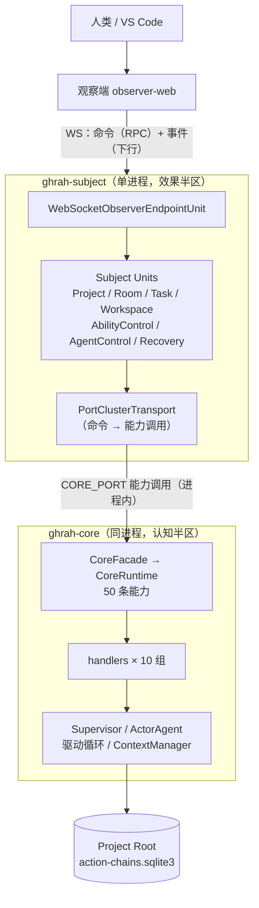
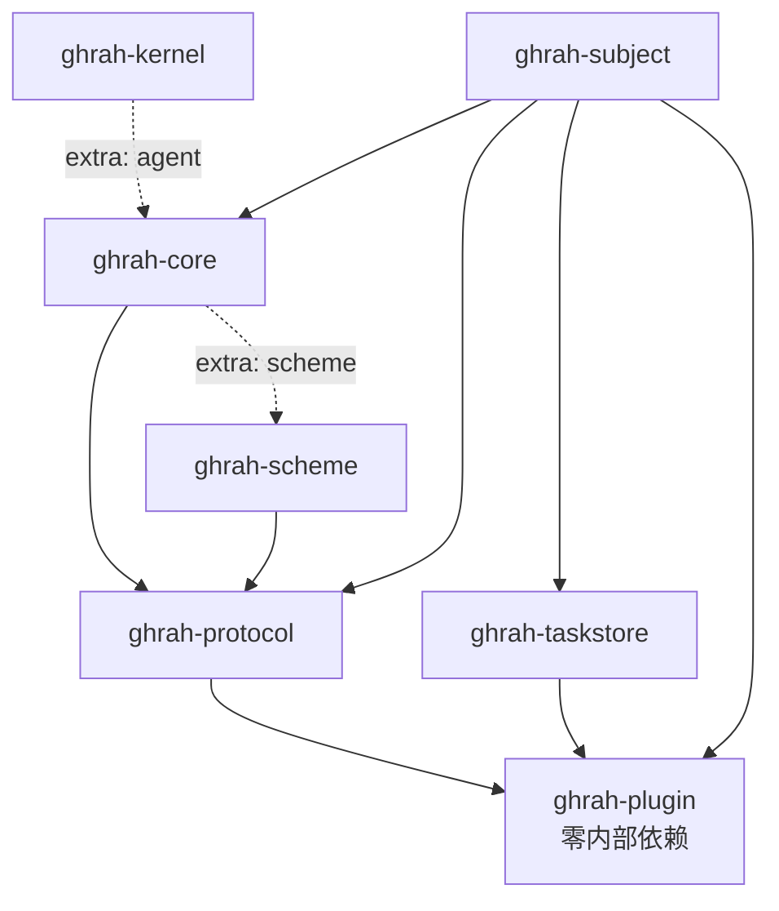
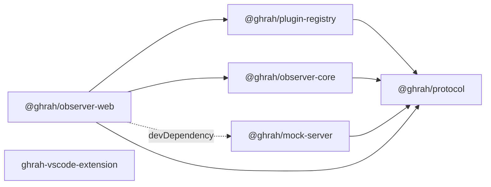
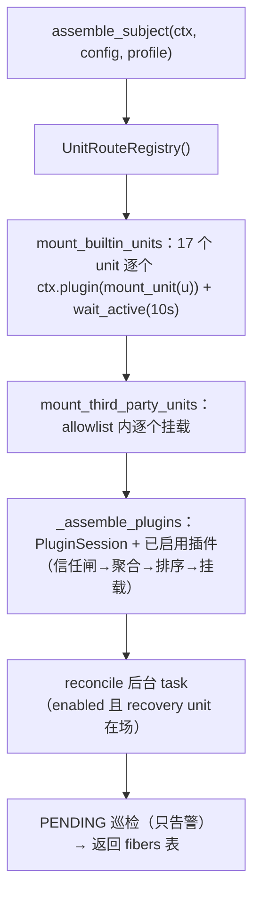
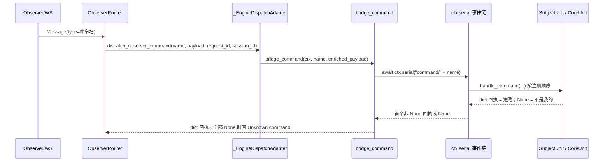
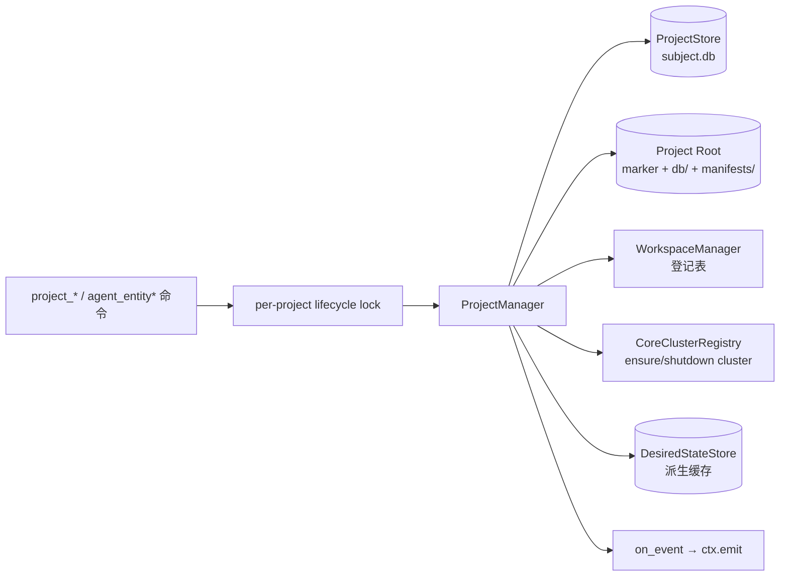
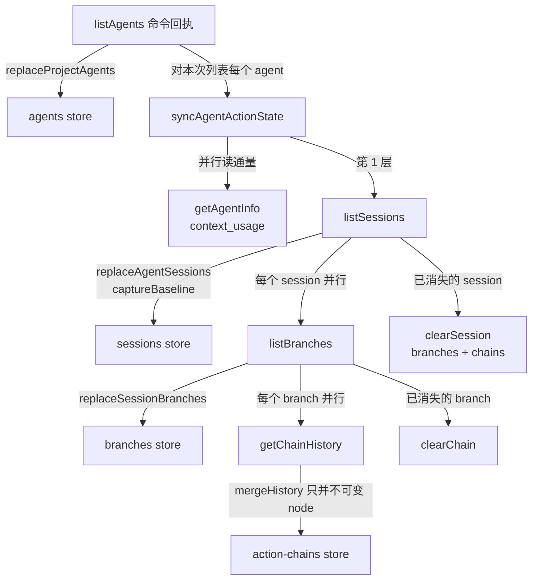
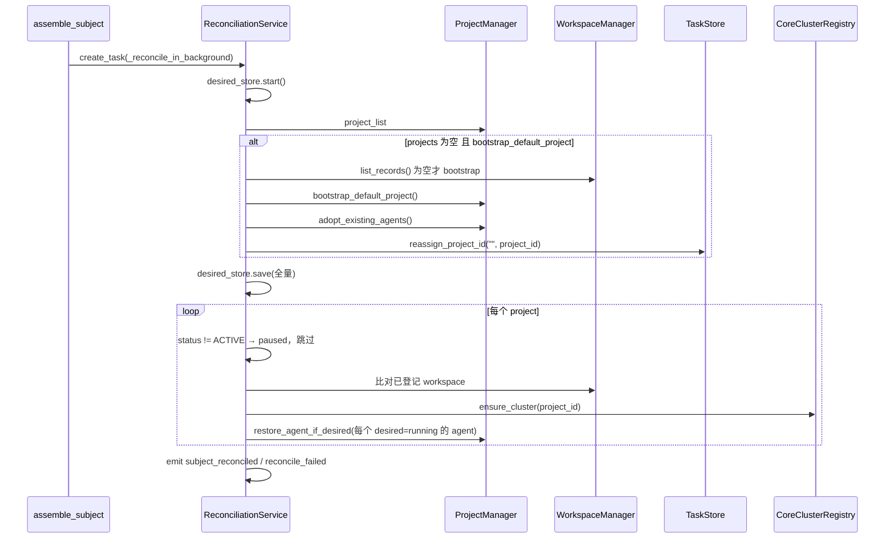
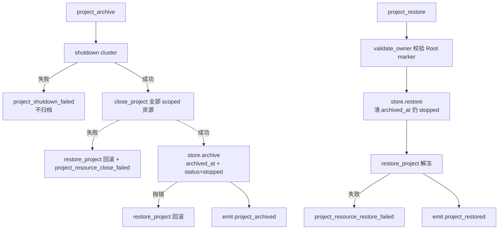

# ghrah 系统架构

> 本文是平台层的事实基线：**只写当前实现**，每条关键论断都带 `文件路径:行号`。
> 代码与本文冲突时以代码为准，并回来改本文。不写路线图、不写历史沿革。
>
> 校准基线：`ghrah-monorepo` @ `08983d7`（2026-11-13），工作区干净。
>
> **路径约定**：`file:line` 一律相对仓库根。少数条目为**包内相对路径**的简写
> （如 `corpus.py`、`ports/core.py`、`payloads/system.py`），按所在章节的包定位：
> §3 → `ghrah-protocol/src/ghrah/protocol/`；§5–§6 → `ghrah-core/src/ghrah/` 与
> `ghrah-subject/src/ghrah/subject/`；§7–§8 → `ghrah-core/src/ghrah/context/` 与
> `ghrah-core/src/ghrah/ability/`。需要精确跳转时按此补全前缀。

## 目录

1. [系统定位与设计原则](#1-系统定位与设计原则)
2. [仓库结构与包边界](#2-仓库结构与包边界)
3. [协议层：ghrah-protocol](#3-协议层ghrah-protocol)
4. [模块能力端口（跨模块唯一通道）](#4-模块能力端口跨模块唯一通道)
5. [Subject 运行时（效果半区）](#5-subject-运行时效果半区)
6. [Core 认知半区](#6-core-认知半区)
7. [上下文系统：ActionChain / Session / Branch](#7-上下文系统actionchain--session--branch)
8. [能力系统](#8-能力系统)
9. [业务域：Project / Room / Task / Workspace](#9-业务域project--room--task--workspace)
10. [Observer 观察端](#10-observer-观察端)
11. [一致性与 CQRS 模型](#11-一致性与-cqrs-模型)
12. [恢复与弹性（reconcile）](#12-恢复与弹性reconcile)
13. [配置、启动与运维](#13-配置启动与运维)
14. [已知偏离与技术债](#14-已知偏离与技术债)
15. [附录 A：术语表](#附录-a术语表)
16. [附录 B：按角色选读](#附录-b按角色选读)

## 1. 系统定位与设计原则

### 1.1 系统是什么

ghrah 是一个**多智能体运行时**的 monorepo。它把"Agent 怎么想"与"世界怎么变"拆成两个半区，跑在同一个进程里：

| 半区 | 包 | 负责 |
| --- | --- | --- |
| 认知半区 | `ghrah-core` | Agent 定义与实例、驱动循环、LLM 调用、上下文（ActionChain / Session / Branch）的唯一权威、能力执行与 HITL |
| 效果半区 | `ghrah-subject` | Project / Room / Task / Workspace 等业务域、能力管理面、WebSocket 观测端点、进程生命周期 |
| 契约 | `ghrah-protocol` | 模块能力端口的协议与视图；观察端下发的 wire 契约 |
| 基础设施 | `ghrah-plugin` / `ghrah-taskstore` / `ghrah-kernel` / `ghrah-scheme` | 插件发现与协商、任务归因三表、应用微内核、Scheme 控制平面原型 |
| 观察端 | `ghrah-observer-webui` | Vue 3 + Pinia 的可视化与操作台（TS workspace） |

两个半区**不共享内存对象**，只通过一个入口互相访问：Core 的能力端口。这条约束由测试强制，而不是靠约定（见 §4.7）。

### 1.2 五条设计原则

| # | 原则 | 具体含义 | 落地位置 |
| --- | --- | --- | --- |
| 1 | **单一权威** | 每份被多方使用的状态只有一条写路径；其余副本只能是派生，且必须能从权威重建 | Core `ContextManager` 的 sqlite 是链与消息的写入权威（`ghrah-core/src/ghrah/context/manager.py`） |
| 2 | **派生可重建** | 副本不得独立写；重建指令必须存在且幂等 | Observer store 重连时经命令面重新拉取；Subject 侧读链历史只调用能力 |
| 3 | **跨模块单一入口** | 模块之间零 import；一切能力调用经端口 | `ghrah-protocol/src/ghrah/protocol/ports/core.py` + `ghrah-core/src/ghrah/core/api/facade.py` |
| 4 | **零隐式行为** | 新能力必须显式声明（清单 / 配置 / 白名单），不做"顺便帮你做了" | 能力必须登记进 `CORE_INTERFACES` 且有处理器，否则启动即失败（`ghrah-core/src/ghrah/core/api/runtime.py:18`） |
| 5 | **代码是事实** | 文档给索引，代码给答案；关键论断附 `file:line` | 全文 |

### 1.3 一次交互的宏观形状



### 1.4 本文的组织方式

第 2 章给仓库与包边界，第 3 章给协议层（端口契约 + wire 契约），第 4 章给模块能力端口这条唯一通道，第 5–6 章给两个半区的运行时，第 7 章给上下文系统，第 8 章给能力系统，第 9 章给业务域，第 10 章给观察端，第 11–12 章给一致性与恢复，第 13 章给配置与运维，第 14 章给已核实的偏离与技术债。

每章自洽：可以只读一章完成一次局部改动。

**本文不覆盖**的内容，各自有独立归属：

- LLM 提供商接入的协议细节与重试策略（属驱动循环实现）；
- 观察端的组件级实现（Vue 组件树、样式分层、i18n）——第 10 章只到 store 与数据流；
- `ghrah-scheme` 包内部的类型化契约与五个控制原语（第 2 章只给它在仓库中的位置与边界）；
- 单个能力内部做了什么（第 4 章给能力面，第 8 章给能力系统，业务语义在各实现文件里）。

## 2. 仓库结构与包边界

本章给出 8 个顶层包的实测体量、源码内部分层、发布通道、依赖方向与 TS workspace 结构。测量基线为提交 `08983d7`（2026-11-13），所有路径相对仓库根。

### 2.1 顶层目录与体量

仓库有 7 个 Python 分发包和 1 个 TS workspace（`ghrah-observer-webui/`）。Python 侧合计 **758 个 `.py`、171,754 行**，其中 `ghrah-core` 占 63.0%。

**测量方式**（可复现；只统计版本控制内的文件）：

```powershell
@'
import subprocess
from pathlib import Path
for p in ["ghrah-core","ghrah-kernel","ghrah-plugin","ghrah-protocol",
          "ghrah-subject","ghrah-taskstore","ghrah-scheme"]:
    fs = subprocess.check_output(["git","ls-files",f"{p}/*.py"], text=True).splitlines()
    src = [f for f in fs if "/src/" in f]
    tst = [f for f in fs if "/tests/" in f]
    oth = [f for f in fs if "/src/" not in f and "/tests/" not in f]
    n = lambda xs: sum(len(Path(f).read_text(encoding="utf-8").splitlines()) for f in xs)
    print(p, len(fs), n(fs), len(src), n(src), len(tst), n(tst), len(oth), n(oth))
'@ | .venv/Scripts/python.exe -
```

口径：

- 文件集 = `git ls-files '<pkg>/*.py'`，排除 `.venv`、`node_modules`、`__pycache__` 与未跟踪文件；
- 行数 = 每个文件 `read_text(encoding="utf-8").splitlines()` 求和（与 `wc -l` 等价；末行无换行时多算 1）；
- 路径含 `/src/` 记 src，含 `/tests/` 记 tests，其余记「其它」（示例、脚本、入口）。

表 2-1 顶层包实测体量与职责

| 包 | `.py` | 总行 | src 文件/行 | tests 文件/行 | 其它 文件/行 | 一句话职责 | 锚点 |
| --- | ---: | ---: | ---: | ---: | ---: | --- | --- |
| `ghrah-core` | 441 | 108,182 | 264 / 58,340 | 155 / 45,601 | 22 / 4,241 | 认知运行时：ActorAgent、ContextManager（链/会话/分支）、Ability 目录与受控执行、manifest、MCP、LLM 适配 | `ghrah-core/src/ghrah/context/__init__.py:5` |
| `ghrah-kernel` | 66 | 10,934 | 33 / 5,124 | 33 / 5,810 | 0 / 0 | 应用微内核：14 个 ABI 入口、跨进程句柄与调用、结构化消息 SDK、期望状态监督者 | `ghrah-kernel/src/ghrah_kernel/__init__.py:5` |
| `ghrah-plugin` | 15 | 2,050 | 8 / 1,121 | 7 / 929 | 0 / 0 | 插件基础设施：plugin spec 契约 SSOT、entry-point 发现、能力注册表、协商纯函数、离线验证 | `ghrah-plugin/src/ghrah/plugin/__init__.py:5` |
| `ghrah-protocol` | 57 | 10,414 | 39 / 7,621 | 18 / 2,793 | 0 / 0 | 共享 wire 契约：信封、命令/事件类型、各域载荷、模块端口、公共视图 | `ghrah-protocol/src/ghrah/protocol/__init__.py:4` |
| `ghrah-subject` | 144 | 32,212 | 91 / 20,593 | 52 / 11,609 | 1 / 10 | 效果宿主：Ouroboros 装配、Project/Room/Task/Workspace/Recovery、内建 Unit、Observer WebSocket 服务 | `ghrah-subject/src/ghrah/subject/__init__.py:5` |
| `ghrah-taskstore` | 15 | 3,166 | 7 / 1,610 | 8 / 1,556 | 0 / 0 | 任务归因内核：tasks/claims/evidence 三表权威、确定性转移、checker 扩展点 | `ghrah-taskstore/src/ghrah/taskstore/__init__.py:5` |
| `ghrah-scheme` | 20 | 4,796 | 10 / 2,525 | 10 / 2,271 | 0 / 0 | 进程内 Scheme 控制原语：类型化契约、资源 owner 生命周期、只读目录投影、authority 端口 | `ghrah-scheme/src/ghrah/scheme/__init__.py:4` |
| `ghrah-observer-webui` | 0 | 0 | — | — | — | TS 观察端 workspace：协议/注册表/observer-core 库 + Vue SPA + mock server + VS Code 扩展 | `pnpm-workspace.yaml:2` |

`ghrah-observer-webui` 的 Python 计数由 `git ls-files 'ghrah-observer-webui/*.py'` 实测为 0；其 TS 结构见 2.5。

体量分布的两个事实：

- `ghrah-core` 一个包占 Python 总行数的 63.0%，其 tests/src 行数比为 0.78（`45,601 / 58,340`）；
- `ghrah-protocol` 的 tests/src 比为 0.37（`2,793 / 7,621`），是 7 个包中最低的，契约的校验重心在 TS 侧的交叉测试（2.5）。

`ghrah-core/src/ghrah/` 下还存在 `abilities/`、`scheme_ability/`、`skills/` 三个目录与一个空的 `core/runtime/`：四者都不含受版本控制的文件（`git ls-files` 计数为 0；前三个目录内只有未跟踪的 `__pycache__`，`core/runtime/` 为空），不构成包结构，本章不为其分配职责。

**仓库级清单不止一份，集合并不等价：**

| 清单 | 覆盖集合 | 锚点 |
| --- | --- | --- |
| uv workspace | 7 个 Python 包：core、kernel、plugin、protocol、scheme、subject、taskstore | `pyproject.toml:21`–`:29` |
| pnpm workspace | `ghrah-observer-webui/packages/*` 的 5 个包 + `vscode-extension` | `pnpm-workspace.yaml:2`–`:3` |
| `ghrah.toml` components | 10 个：6 个 Python + `web-protocol` / `web-plugin-registry` / `web-observer-core` / `web-observer-web`；不含 kernel、mock-server、vscode-extension | `ghrah.toml:12`–`:40`、`:43` |
| `publish.yml` | 3 个 PyPI + 2 个 npm + 1 个 VS Code 扩展 | `.github/workflows/publish.yml:6`–`:11` |
| `release_dry_run.py` | 6 个 Python + 2 个 npm | `scripts/release_dry_run.py:21`–`:31` |

`ghrah.toml` 是声明式组件清单（`schema = 1`，`ghrah.toml:1`–`:4`）；`[distro.generic]` 把上述 10 个组件组合成一个发行集合，入口写在 `roots = ["subject/server"]`（`ghrah.toml:43`–`:44`）。

跨清单的版本声明不一致：仓库根要求 Node `>=26.0.0`（`package.json:16`；`.nvmrc:1` 为 `26`），`ghrah.toml:49` 的发行运行时写 `node = ">=22.12"`，而各 npm 包自己的 `engines` 又写 `>=20.19.0`（如 `ghrah-observer-webui/packages/protocol/package.json:15`）。

### 2.2 发布白名单

唯一的**包发布**工作流是 `.github/workflows/publish.yml`，由 tag 前缀路由到三个 job；`github-release.yml` 只按已存在的 tag 创建 GitHub Release，不发布任何包（`.github/workflows/github-release.yml:24`–`:28`）。白名单写在两处：顶层 `on.push.tags` 决定**能否触发**，job 内的 `case` 决定**允许哪个包**。

表 2-2 进入发布通道的包

| 通道 | 允许的目标 | 实际动作 | 锚点 |
| --- | --- | --- | --- |
| PyPI | `ghrah-core`、`ghrah-protocol`、`ghrah-subject` | `uv build --package` → `twine check` → `pypa/gh-action-pypi-publish` | `.github/workflows/publish.yml:6`–`:8`、`:33`、`:38`–`:40` |
| npm | `@ghrah/protocol`、`@ghrah/observer-core` | `pnpm --filter … build` → `pnpm --filter … publish --access public` | `.github/workflows/publish.yml:9`–`:10`、`:62`、`:67`–`:72` |
| VS Code Marketplace | `ghrah-vscode-extension` | esbuild 构建 → `vsce publish` | `.github/workflows/publish.yml:11`、`:92`–`:97` |

表 2-3 明确没有发布通道的对象

| 对象 | 状态 | 依据 |
| --- | --- | --- |
| `ghrah-kernel` | 无通道；CI 只做构建与安装校验 | `.github/workflows/ci.yml:34`；不在 `.github/workflows/publish.yml:6`–`:8` 与 `:33` 的白名单 |
| `ghrah-plugin` | 无通道；仅被 `release_dry_run` 构建 | `scripts/release_dry_run.py:23`；不在 `.github/workflows/publish.yml:33` 的 `case` 中 |
| `ghrah-taskstore` | 无通道；仅被 `release_dry_run` 构建 | `scripts/release_dry_run.py:26`；不在 `.github/workflows/publish.yml:33` 的 `case` 中 |
| `ghrah-scheme` | 无通道；仅被 `release_dry_run` 构建 | `scripts/release_dry_run.py:27`；不在 `.github/workflows/publish.yml:33` 的 `case` 中 |
| `@ghrah/plugin-registry` | 无通道，尽管声明了 public 发布配置 | `ghrah-observer-webui/packages/plugin-registry/package.json:19`；不在 `.github/workflows/publish.yml:62` 的 `case` 中 |
| `@ghrah/mock-server` | 无通道（`private`） | `ghrah-observer-webui/packages/mock-server/package.json:5` |
| `@ghrah/observer-web` | 无通道（`private`） | `ghrah-observer-webui/packages/observer-web/package.json:4` |
| `ghrah-observer-webui` | 无通道（`private`，只做脚本聚合） | `ghrah-observer-webui/package.json:4` |

两处需要单独记录的不一致：

1. **标签校验器的目标集合大于发布白名单。** `scripts/check_release_tag.py:18`–`:36` 收录了 `py/ghrah-plugin`、`py/ghrah-taskstore`，但 `.github/workflows/publish.yml` 的 PyPI job 只接受 `ghrah-core|ghrah-protocol|ghrah-subject`（`.github/workflows/publish.yml:33`），触发 tag 列表也没有这两个前缀（`:6`–`:8`）。结果是这两个 tag 能通过版本校验脚本，却无法触发任何发布 job。
2. **「可构建」与「可发布」不是同一集合。** `.github/workflows/release-precheck.yml` 用 `release_dry_run.py --all` 构建 6 个 Python 包（`.github/workflows/release-precheck.yml:50`–`:51`、`scripts/release_dry_run.py:21`–`:27`），其中只有 3 个有发布通道；`ghrah-kernel` 不在这 6 个之内，只在 CI 里单独 `uv build`。

### 2.3 Python 包的 `src/` 内部分层

6 个 Python 包都打包 `src/ghrah`，共享同一个**隐式命名空间** `ghrah`：`ghrah-core`、`ghrah-plugin`、`ghrah-protocol`、`ghrah-subject`、`ghrah-taskstore`、`ghrah-scheme` 各自贡献一个子包，各包均**没有** `src/ghrah/__init__.py`（`git ls-files '*/src/ghrah/__init__.py'` 为 0）。`ghrah-kernel` 是唯一的例外：顶层包名 `ghrah_kernel`，带常规 `__init__.py`。

| 包 | wheel 打包根 | 顶层包形态 | 锚点 |
| --- | --- | --- | --- |
| `ghrah-core` | `src/ghrah` | 命名空间 `ghrah` + `ghrah.ability` 等子包 | `ghrah-core/pyproject.toml:40` |
| `ghrah-plugin` | `src/ghrah` | 命名空间 `ghrah` + `ghrah.plugin` | `ghrah-plugin/pyproject.toml:22` |
| `ghrah-protocol` | `src/ghrah` | 命名空间 `ghrah` + `ghrah.protocol` | `ghrah-protocol/pyproject.toml:22` |
| `ghrah-subject` | `src/ghrah` | 命名空间 `ghrah` + `ghrah.subject` | `ghrah-subject/pyproject.toml:41` |
| `ghrah-taskstore` | `src/ghrah` | 命名空间 `ghrah` + `ghrah.taskstore` | `ghrah-taskstore/pyproject.toml:23` |
| `ghrah-scheme` | `src/ghrah` | 命名空间 `ghrah` + `ghrah.scheme` | `ghrah-scheme/pyproject.toml:17` |
| `ghrah-kernel` | `src/ghrah_kernel` | 常规包 `ghrah_kernel`（含 `__init__.py`） | `ghrah-kernel/pyproject.toml:22` |

#### 2.3.1 `ghrah-core/src/ghrah/`

| 一级子目录 | `.py` / 行 | 职责 | 锚点 |
| --- | ---: | --- | --- |
| `ability/` | 129 / 28,099 | Ability 定义、内容与受控执行的领域入口；含 `access/`、`builtin/`、`execution/`、`loading/`、`package/`、`permissions/`、`scheme/`、`scripts/`、`surface/`、`tools/` | `ghrah-core/src/ghrah/ability/__init__.py:4` |
| `agents/` | 5 / 3,003 | Agent 实现层：`ActorAgent`、`AgentBuilder`、`AgentEntity` | `ghrah-core/src/ghrah/agents/__init__.py:5` |
| `chat/` | 11 / 1,741 | 交互格式层：ContentBlock 系列、`ChatMessage`、`LLMResponse`、ChatFormat | `ghrah-core/src/ghrah/chat/__init__.py:5` |
| `communication/` | 7 / 3,512 | Agent 注册、消息路由与生命周期监督 | `ghrah-core/src/ghrah/communication/__init__.py:5` |
| `context/` | 32 / 7,175 | ContextManager：不可变链式上下文、delta+快照、分支继承、Session | `ghrah-core/src/ghrah/context/__init__.py:5` |
| `core/` | 51 / 10,519 | 核心抽象层：配置、消息、异常、事件、HITL；内含 `api/`、`config/`、`read/`、`units/` | `ghrah-core/src/ghrah/core/__init__.py:5` |
| `llm/` | 3 / 120 | LLM 后端工厂与错误类型 | `ghrah-core/src/ghrah/llm/__init__.py:5` |
| `manifest/` | 9 / 832 | YAML manifest 解析、校验与运行时桥接 | `ghrah-core/src/ghrah/manifest/__init__.py:5` |
| `mcp/` | 13 / 3,058 | MCP 连接、会话、调用客户端与 schema | `ghrah-core/src/ghrah/mcp/__init__.py:5` |
| `types/` | 4 / 281 | 纯数据类型定义，自身零内部依赖，用于打断循环 | `ghrah-core/src/ghrah/types/__init__.py:5` |

`core/` 内部再分层：`core/api/` 16 个 `.py`（Facade、接口清单与 `handlers/`）、`core/read/` 6 个 `.py`（各类只读存储）、`core/config/` 2 个、`core/units/` 3 个（`RuntimeRegistry`/`UnitContext`）；`context/persistence/` 10 个、`context/strategies/` 5 个。

#### 2.3.2 `ghrah-kernel/src/ghrah_kernel/`

| 一级子目录 | `.py` / 行 | 职责 | 锚点 |
| --- | ---: | --- | --- |
| `integration/` | 8 / 832 | 受信宿主装配、静态身份与许可、命名服务 provider；不把领域政策放进 Kernel | `ghrah-kernel/src/ghrah_kernel/integration/__init__.py:5` |
| `kernel/` | 11 / 2,653 | 机制内核：ABI 解释、调用结算、事件、进程、流、句柄回收 | `ghrah-kernel/src/ghrah_kernel/kernel/__init__.py:5` |
| （根模块） | 14 / 1,639 | `abi.py`（14 个入口清单）、`protocol.py`（控制信封）、`wire.py`、`client.py`、`kernel_client.py`、`endpoint.py`、`context.py`、`provider.py`、`launch.py`、`payloads.py`、`supervisor.py`、`kernel_main.py`、`__main__.py`、`__init__.py` | `ghrah-kernel/src/ghrah_kernel/abi.py:5` |

`abi.py` 的 `ABI_ENTRIES` 共 14 项：`hello`、`register`、`open`、`dup`、`invoke`、`wait`、`cancel`、`close`、`revoke`、`subscribe`、`channel`、`shutdown`、`read`、`write`（`ghrah-kernel/src/ghrah_kernel/abi.py:7`–`:22`）。

#### 2.3.3 `ghrah-plugin/src/ghrah/plugin/`

无一级子目录，8 个模块平铺：

| 模块 | 职责 | 锚点 |
| --- | --- | --- |
| `spec.py` | plugin spec 契约，插件声明形状的 SSOT | `ghrah-plugin/src/ghrah/plugin/spec.py:5` |
| `registry.py` | capability → plugin_id 的唯一求解点（纯内存索引） | `ghrah-plugin/src/ghrah/plugin/registry.py:5` |
| `negotiator.py` | 协商纯函数：Python 注册表快照 + TS 上报清单 → 协商结果，零 IO、零状态 | `ghrah-plugin/src/ghrah/plugin/negotiator.py:5` |
| `loader.py` | entry-point 发现（组名 `ghrah.plugins`），发现不等于启用 | `ghrah-plugin/src/ghrah/plugin/loader.py:5` |
| `verify.py` | 离线验证引擎，输出 findings 清单 | `ghrah-plugin/src/ghrah/plugin/verify.py:5` |
| `assembly.py` | Project 侧装配事实 `PluginAssembly` 的权威形状 | `ghrah-plugin/src/ghrah/plugin/assembly.py:5` |
| `errors.py` | `CapabilityMissingError`、`PluginMountError` | `ghrah-plugin/src/ghrah/plugin/errors.py:5` |
| `__init__.py` | 对外导出面 | `ghrah-plugin/src/ghrah/plugin/__init__.py:5` |

#### 2.3.4 `ghrah-protocol/src/ghrah/protocol/`

| 一级子目录 | `.py` / 行 | 职责 | 锚点 |
| --- | ---: | --- | --- |
| `payloads/` | 13 / 2,275 | 各域载荷模型聚合再导出：agent、session、task、project、room、workspace、manifest、persist、system、plugin | `ghrah-protocol/src/ghrah/protocol/payloads/__init__.py:4` |
| `ports/` | 3 / 521 | 模块端口：每个模块对外能力的唯一入口（`CORE_PORT`、`SUBJECT_PORT`） | `ghrah-protocol/src/ghrah/protocol/ports/__init__.py:4` |
| `views/` | 3 / 619 | 跨模块共用视图与资源视图（`Page`、`AckView` 等） | `ghrah-protocol/src/ghrah/protocol/views/__init__.py:4` |
| （根模块） | 20 / 4,206 | `envelope.py`、`types.py`（门面）、`enums.py`、`events.py`、`routing.py`、`factories.py`、`interface.py`、`problem.py`、`errors.py`、`corpus.py`、`ability_control.py`、`ability_tree.py`、`agent_control.py`、`agentconf_control.py`、`scheme.py`、`runtime.py`、`runtime_agents.py`、`runtime_digest.py`、`runtime_resources.py`、`__init__.py` | `ghrah-protocol/src/ghrah/protocol/__init__.py:4` |

`payloads/` 下唯一跨包导入是 `ghrah-protocol/src/ghrah/protocol/payloads/plugin.py` 对 `ghrah.plugin.negotiator` 的复用（`ghrah-protocol/src/ghrah/protocol/payloads/plugin.py:15`），这也是 2.4.1 讨论的对象。

#### 2.3.5 `ghrah-subject/src/ghrah/subject/`

| 一级子目录 | `.py` / 行 | 职责 | 锚点 |
| --- | ---: | --- | --- |
| `core_cluster/` | 2 / 623 | `CoreClusterRegistry`：cluster = CoreUnit 实例的进程内注册表 | `ghrah-subject/src/ghrah/subject/core_cluster/__init__.py:5` |
| `manifest_store/` | 3 / 354 | Subject 端 Manifest 文件 CRUD、内置能力同步与命令分发 | `ghrah-subject/src/ghrah/subject/manifest_store/__init__.py:5` |
| `project/` | 9 / 3,380 | Project 隔离：模型、`ProjectStore`（aiosqlite + 乐观锁 + 软删）、`IsolationContext` | `ghrah-subject/src/ghrah/subject/project/__init__.py:5` |
| `recovery/` | 3 / 617 | desired-state 单行快照 + `ReconciliationService` | `ghrah-subject/src/ghrah/subject/recovery/__init__.py:5` |
| `room/` | 4 / 1,118 | Room 域的 store/manager 层 | `ghrah-subject/src/ghrah/subject/room/__init__.py:5` |
| `runtime/` | 9 / 2,138 | Ouroboros 装配形态：`assemble_subject`、`service_keys`、桥接、第三方发现 | `ghrah-subject/src/ghrah/subject/runtime/__init__.py:5` |
| `sandbox/` | 3 / 690 | `SandboxExecutor` 命令执行与 `WorkspaceManager` 工作区管理 | `ghrah-subject/src/ghrah/subject/sandbox/executor.py:79` |
| `server/` | 7 / 1,156 | Observer WebSocket 服务：配置、连接管理、EventBus、路由 | `ghrah-subject/src/ghrah/subject/server/__init__.py:5` |
| `shipped_abilities/` | 7 / 419 | 发行版预装能力包源树 | `ghrah-subject/src/ghrah/subject/shipped_abilities/__init__.py:5` |
| `task/` | 5 / 1,112 | Subject 侧任务域：11 条命令编排、状态流转、拓扑、`subject_tasks` 表 | `ghrah-subject/src/ghrah/subject/task/manager.py:54` |
| `unit/` | 2 / 158 | Unit 编写契约：`SubjectUnit`、`UnitMeta`、`RouteSpec`、`CommandContext` | `ghrah-subject/src/ghrah/subject/unit/__init__.py:5` |
| `units/` | 20 / 6,592 | 内建 Unit 注册与装配：`mount_builtin_units`，`coexistence` / `full` 两种 profile | `ghrah-subject/src/ghrah/subject/units/__init__.py:5` |
| `workspace/` | 9 / 696 | Workspace 资源模型、provider 抽象与注册表（挂载语义 = 登记 + 授权 + 解挂） | `ghrah-subject/src/ghrah/subject/workspace/__init__.py:5` |

`task/` 与 `ghrah-taskstore` 是两套不同的存储，名字相同但表不重叠：Subject 侧建 `subject_tasks`（`ghrah-subject/src/ghrah/subject/task/store.py:32`），归因内核建 `tasks` / `claims` / `evidence`（`ghrah-taskstore/src/ghrah/taskstore/store.py:40`、`:59`、`:69`）；把归因内核挂成 Unit 的是 `units/taskstore.py`，只注册 4 条归因命令（`ghrah-subject/src/ghrah/subject/units/taskstore.py:5`）。

#### 2.3.6 `ghrah-taskstore/src/ghrah/taskstore/`

无一级子目录，7 个模块平铺：

| 模块 | 职责 | 锚点 |
| --- | --- | --- |
| `store.py` | sqlite 权威：tasks/claims/evidence 三表 + schema 版本表，零钟读 | `ghrah-taskstore/src/ghrah/taskstore/store.py:5` |
| `kernel.py` | facade 与 impure 边界：跑 checker、取钟、分配 id | `ghrah-taskstore/src/ghrah/taskstore/kernel.py:5` |
| `transition.py` | 纯转移：由 `(state, cmd, frozen)` 得到 `state'` 或 `Denial`，零 IO、零钟读 | `ghrah-taskstore/src/ghrah/taskstore/transition.py:5` |
| `models.py` | 域模型：task / claim / evidence 与 verification 缺口清单 | `ghrah-taskstore/src/ghrah/taskstore/models.py:5` |
| `checkers.py` | checker 扩展点宿主：契约、`CheckerRegistry`、冻结副本 | `ghrah-taskstore/src/ghrah/taskstore/checkers.py:5` |
| `errors.py` | 乐观锁冲突与 Denial 异常 | `ghrah-taskstore/src/ghrah/taskstore/errors.py:5` |
| `__init__.py` | 对外导出面 | `ghrah-taskstore/src/ghrah/taskstore/__init__.py:5` |

#### 2.3.7 `ghrah-scheme/src/ghrah/scheme/`

无一级子目录，10 个模块平铺：

| 模块 | 职责 | 锚点 |
| --- | --- | --- |
| `runtime.py` | 进程内 Scheme 控制原语，全部状态归一个 asyncio loop | `ghrah-scheme/src/ghrah/scheme/runtime.py:4` |
| `contracts.py` | Scheme、动作与受限 provider 调用的进程内契约 | `ghrah-scheme/src/ghrah/scheme/contracts.py:4` |
| `codec.py` | 单一作者的边界编解码，JSON Schema 只接受受限子集 | `ghrah-scheme/src/ghrah/scheme/codec.py:4` |
| `authority.py` | 注入式领域核定端口，控制平面不自持 grant 表 | `ghrah-scheme/src/ghrah/scheme/authority.py:4` |
| `_lifecycle.py` | 唯一资源 owner 的运行记录与生命周期 | `ghrah-scheme/src/ghrah/scheme/_lifecycle.py:4` |
| `_state.py` | 只由运行时持有的可变记录 | `ghrah-scheme/src/ghrah/scheme/_state.py:4` |
| `_discovery.py` | 从绑定与契约重建只读目录 | `ghrah-scheme/src/ghrah/scheme/_discovery.py:4` |
| `models.py` | 进程内身份、引用与状态快照 | `ghrah-scheme/src/ghrah/scheme/models.py:4` |
| `errors.py` | 控制平面的结构化拒绝与运行错误 | `ghrah-scheme/src/ghrah/scheme/errors.py:4` |
| `__init__.py` | 对外导出面 | `ghrah-scheme/src/ghrah/scheme/__init__.py:4` |

### 2.4 包间依赖方向

只统计 `dependencies` 里的 `ghrah-*` 包；optional extra 单列，不属于默认安装图。声明与源码 import 一致（逐包反向扫描 `from ghrah.<domain>` 未发现未声明的域包导入）。

表 2-4 Python 包声明的内部依赖

| 包 | `dependencies` 中的内部包 | optional extra | 锚点 |
| --- | --- | --- | --- |
| `ghrah-core` | `ghrah-protocol` | `[scheme]` → `ghrah-scheme`；`[mcp]` → 外部 `mcp` | `ghrah-core/pyproject.toml:13`、`:26` |
| `ghrah-kernel` | 无 | `[agent]` → `ghrah-core` | `ghrah-kernel/pyproject.toml:7`、`:15` |
| `ghrah-plugin` | 无 | 无 | `ghrah-plugin/pyproject.toml:7`–`:10` |
| `ghrah-protocol` | `ghrah-plugin` | 无 | `ghrah-protocol/pyproject.toml:8` |
| `ghrah-subject` | `ghrah-core`、`ghrah-plugin`、`ghrah-protocol`、`ghrah-taskstore` | 无 | `ghrah-subject/pyproject.toml:8`–`:11` |
| `ghrah-taskstore` | `ghrah-plugin` | 无 | `ghrah-taskstore/pyproject.toml:10` |
| `ghrah-scheme` | `ghrah-protocol` | 无 | `ghrah-scheme/pyproject.toml:7` |



这张图的实线部分无环。三条结构性事实：

- **`ghrah-plugin` 是真正的叶子**：它不依赖任何 `ghrah-*` 包（`ghrah-plugin/pyproject.toml:7`–`:10`），契约（plugin spec）与实现（发现/注册/协商/验证）都在自己包内。
- **`ghrah-protocol` 不是叶子**：它有一条指向 `ghrah-plugin` 的实线（2.4.1）。
- **`ghrah-kernel` 与其余 6 个包默认解耦**：默认依赖只有 `cbor2`；`ghrah.core` 只在 `ghrah-kernel/src/ghrah_kernel/integration/agent_provider.py:261` 以函数内延迟导入的方式出现，并且只在 `[agent]` extra 安装后可用（`ghrah-kernel/pyproject.toml:15`、`ghrah-kernel/src/ghrah_kernel/integration/agent_provider.py:261`）。

#### 2.4.1 `ghrah-protocol` 的「零内部依赖」问题

**现状：不成立。** `ghrah-protocol` 声明并实际使用了一个内部依赖 `ghrah-plugin`：

- 声明：`ghrah-protocol/pyproject.toml:8`（`"ghrah-plugin>=0.1.0a0"`）；
- 使用：全包唯一的跨包 import 是 `ghrah-protocol/src/ghrah/protocol/payloads/plugin.py:15`（`from ghrah.plugin.negotiator import NegotiationResult, TsHalfReport`）；
- 具体绑定方式：`PluginNegotiateResultPayload` 直接继承 `NegotiationResult`，不重复声明字段（`ghrah-protocol/src/ghrah/protocol/payloads/plugin.py:33`）。

**为什么契约包在架构上应当零内部依赖**（三条独立理由）：

1. **依赖方向**：契约是实现之间的公共下界，`core`、`scheme`、`subject` 都指向它（表 2-4）。一旦契约反向依赖某个实现包，所有消费者都被迫传递安装那个实现包：当前 `pip install ghrah-core` 会经 `core → protocol → plugin` 装上 `ghrah-plugin`（`ghrah-core/pyproject.toml:13` + `ghrah-protocol/pyproject.toml:8`）。
2. **发布可达性**：`ghrah-plugin` 不在 `.github/workflows/publish.yml` 的 PyPI 白名单里（表 2-3，`.github/workflows/publish.yml:33`）。因此 `ghrah-core` / `ghrah-protocol` / `ghrah-subject` 的 PyPI 安装图都包含一个**无法由仓库发布通道产出**的包；它是否已在 PyPI 通过其它方式存在，见 2.6 的未核实项。
3. **跨语言契约的可生成性**：契约包是 Python 与 TS 双侧对齐的基准。把实现包的 pydantic 模型当作 wire 形状来源，TS 侧只能手抄字段：`ghrah-observer-webui/packages/protocol/src/payloads/plugin.ts:8`–`:9` 注明 `PluginNegotiateResultPayloadSchema` 是「镜像 NegotiationResult 六字段」，而不是由 `scripts/export_*_contracts.py` 生成。

**为什么当前代码选择这条边**：`ghrah-protocol/src/ghrah/protocol/payloads/plugin.py:6`–`:8` 给出的理由是「协商 wire 形状复用 ghrah-plugin 的 negotiator 模型（单一权威）……零字段重复」。即：用一条反向依赖换取 wire 形状不出现第二份定义。这与「契约包零内部依赖」是两条相互冲突的约束，仓库内没有能同时满足二者的实现。

**风险与边界**：该边目前不构成环（`ghrah-plugin` 零内部依赖）；但 `ghrah-plugin` 的任何模型变更都会直接改变 wire 形状，且会同时抬升全部 3 个可发布 PyPI 包的传递依赖。是否把这条边当作可接受例外，未核实（仓库内没有对应的 import 边界检查或决策记录可作为锚点）。

### 2.5 TS 侧 workspace 结构

`pnpm-workspace.yaml` 只声明两个 glob：`ghrah-observer-webui/packages/*` 与 `ghrah-observer-webui/vscode-extension`（`pnpm-workspace.yaml:2`–`:3`）。根 `package.json` 是脚本代理，本身 `private`（`package.json:4`），所有命令转给 `ghrah-observer-webui`（`package.json:6`–`:15`）；`ghrah-observer-webui/package.json` 也是 `private` 聚合器（`ghrah-observer-webui/package.json:4`），不含 `src/`，实际应用在 `packages/observer-web`。

表 2-5 TS workspace 包与构建产物

| 包 | 路径 | 类型 | 构建命令 | 产物 | 指向 `dist/` 的入口 | 内部依赖 | 锚点 |
| --- | --- | --- | --- | --- | --- | --- | --- |
| `@ghrah/protocol` | `packages/protocol` | 库 | `tsup` | `dist/index.js`、`dist/index.d.ts` | **是** | 无 | `ghrah-observer-webui/packages/protocol/package.json:22`–`:26` |
| `@ghrah/plugin-registry` | `packages/plugin-registry` | 库 | `tsup` | `dist/index.js`、`dist/index.d.ts` | **是** | `@ghrah/protocol` | `ghrah-observer-webui/packages/plugin-registry/package.json:24`–`:28`、`:43` |
| `@ghrah/observer-core` | `packages/observer-core` | 库 | `tsup` | `dist/index.js`、`dist/index.d.ts` | **是** | `@ghrah/protocol` | `ghrah-observer-webui/packages/observer-core/package.json:22`–`:26`、`:41` |
| `@ghrah/mock-server` | `packages/mock-server` | 私有工具（CLI） | `tsup` | `dist/index.js`、`dist/index.d.ts`、`dist/cli.js` | **是** | `@ghrah/protocol` | `ghrah-observer-webui/packages/mock-server/package.json:8`–`:15`、`:27` |
| `@ghrah/observer-web` | `packages/observer-web` | 私有 SPA | `vue-tsc --noEmit && vite build` | `dist/index.html`、`dist/assets/`、`dist/plugins/` | 否（无 `exports`） | `observer-core`、`plugin-registry`、`protocol`；`mock-server` 仅 dev | `ghrah-observer-webui/packages/observer-web/package.json:4`、`:10`、`:23`–`:25`、`:36` |
| `ghrah-vscode-extension` | `vscode-extension` | VS Code 扩展 | `tsc --noEmit && esbuild` | `dist/extension.js` | 否（`main` 指向单文件） | 无 workspace 依赖 | `ghrah-observer-webui/vscode-extension/package.json:25`、`:101` |

要点：

- **4 个包把 `exports` 指向 `dist/`**：`@ghrah/protocol`、`@ghrah/plugin-registry`、`@ghrah/observer-core`、`@ghrah/mock-server`。改动这些包后必须重建 dist，`build:deps` 把四者按序构建（`ghrah-observer-webui/package.json:11`）。
- **`@ghrah/observer-web` 没有 `exports`**：它是 SPA 入口，`vite build` 输出到默认 `dist/`（`ghrah-observer-webui/packages/observer-web/vite.config.ts:11`–`:21` 未覆写 `build.outDir`），产物形态是 `index.html` + `assets/` + `plugins/`，不是可被 import 的库。
- **`ghrah-vscode-extension` 不依赖任何 `@ghrah/*` 包**：`ghrah-observer-webui/vscode-extension/package.json` 中只有 `devDependencies`（`:107`），它通过 `esbuild` 打包成单文件 `dist/extension.js`。



TS 依赖图同样无环，且 `@ghrah/protocol` 是叶子（`ghrah-observer-webui/packages/protocol/package.json:40`–`:42` 的 `dependencies` 只有 `zod`）。这与 Python 侧 `ghrah-protocol` 依赖 `ghrah-plugin` 形成对照：同一份 wire 契约的两个语言实现，只有 TS 侧保持了「契约包零内部依赖」。

跨语言同步由两侧机制保证：

- Python 是生成源：`ability-control.generated.ts`、`runtime.generated.ts` 等文件头注明由 `scripts/export_ability_contracts.py` / `scripts/export_runtime_contracts.py` 生成（`ghrah-observer-webui/packages/protocol/src/ability-control.generated.ts:5`、`ghrah-observer-webui/packages/protocol/src/runtime.generated.ts:1`）；
- TS 是校验端：`protocol-align.spec.ts` 用 Python 导出的快照做 Pydantic–Zod 交叉校验（`ghrah-observer-webui/packages/protocol/src/protocol-align.spec.ts:307`），快照目录为该测试同级的 `__snapshots__/`（`:146`）。

手写而非生成的部分是漂移风险点：`payloads/plugin.ts` 的六字段镜像（`ghrah-observer-webui/packages/protocol/src/payloads/plugin.ts:8`–`:9`）没有对应的导出脚本。

### 2.6 边界结论与未核实项

五条可执行的边界事实：

| # | 结论 | 依据 |
| --- | --- | --- |
| 1 | 6 个 Python 包共享隐式命名空间 `ghrah`，新增子包必须继续放在 `src/ghrah/<name>`，并保持无 `src/ghrah/__init__.py` | 2.3 命名空间表；`ghrah-core/pyproject.toml:40` 等 |
| 2 | 依赖图无环，但契约包 `ghrah-protocol` 不是叶子，唯一出边指向 `ghrah-plugin` | 2.4 图；`ghrah-protocol/pyproject.toml:8` |
| 3 | 发布通道只覆盖 3 个 PyPI 包、2 个 npm 包、1 个 VS Code 扩展；`ghrah-plugin` 无通道却是 3 个可发布包的传递依赖 | 表 2-2、2-3；`.github/workflows/publish.yml:33` |
| 4 | 「可构建」集合大于「可发布」集合：6 个 Python 包可构建（不含 kernel），3 个可发布 | `scripts/release_dry_run.py:21`–`:27`；`.github/workflows/publish.yml:33` |
| 5 | `task` 命名对应两套互不重叠的存储：`subject_tasks` 与 `tasks/claims/evidence` | `ghrah-subject/src/ghrah/subject/task/store.py:32`；`ghrah-taskstore/src/ghrah/taskstore/store.py:40` |

未核实项：

| 项 | 为什么未核实 |
| --- | --- |
| `ghrah-plugin` 是否已在 PyPI 通过仓库外方式发布 | 发布白名单内没有它；仓库内无法确认 PyPI 实际状态，未联网核对 |
| `ghrah-protocol → ghrah-plugin` 是否被接受为长期例外 | 没有对应的 import 边界检查或决策记录可锚定；代码注释只说明「避免字段重复」 |
| 工作树中 `abilities/`、`scheme_ability/`、`skills/`、`core/runtime/` 的来源 | 均不受版本控制，`git ls-files` 计数为 0，无提交可追溯 |
| 是否存在 `publish.yml` 之外的人工发布流程 | `.github/workflows/` 下只有 `ci.yml`、`github-release.yml`、`publish.yml`、`release-precheck.yml`，仓库外流程无法验证 |

## 3. 协议层：ghrah-protocol

`ghrah-protocol` 是 7 个 Python 分发包里唯一承载「只描述形状」职责的包：39 个源文件里没有数据库、网络或子进程调用，文件 I/O 只有 `corpus.py` 的语料读写（`corpus.py:180`、`:206`–`:209`），读时钟只有 `envelope.py:165` 的时间戳兜底。其余内容全部是类型声明、注册表常量，以及一个收敛点 `InterfaceRuntime.invoke`（`ghrah-protocol/src/ghrah/protocol/interface.py:141`）。它的产出是**形状**——谁与谁用什么结构说话。

这个包现在承担两块互不相干的职责，物理上混在同一个 `ghrah/protocol/` 目录里，靠「谁 import 什么」而不是目录来区隔：

表 3-1 两块职责的边界

| 维度 | 模块能力端口契约 | wire 契约 |
| --- | --- | --- |
| 服务对象 | 同进程内的 Python 模块（Core、Subject、观察端服务进程） | 跨进程/跨语言的传输：WebSocket 命令与事件、观察端 REST 资源 |
| 传输 | 直接方法调用，无序列化边界 | JSON（WS 帧）/ HTTP 资源表示 |
| 失败表达 | `ApiError` + `Problem`（`errors.py:17`、`problem.py:47`） | `command_result` / `error` 信封 + `command_result.data` 内的模型（`payloads/system.py:15`、`:25`） |
| 权威范围 | 跨模块调用的唯一形状 | 观察端下发命令与事件、观察端读取的资源表示 |
| 谁定义 | 契约包（提供方只实现，不定义） | 契约包（TS 侧由生成器同步） |
| 目录 | `interface.py`、`ports/`、`views/`、`problem.py`、`errors.py`、`corpus.py`、`events.py` | `envelope.py`、`routing.py`、`enums.py`、`factories.py`、`types.py`、`scheme.py`、`ability_control.py`、`ability_tree.py`、`agent_control.py`、`agentconf_control.py`、`runtime*.py`、`payloads/*` |

两块职责的区分有代码级判据，不是分类偏好：端口面的类型只被 Python 模块 import（`ghrah-core/src/ghrah/core/api/interfaces.py:31`、`ghrah-subject/src/ghrah/subject/runtime/port_transport.py:21`），wire 面的类型只出现在 `PAYLOAD_MAP`（`envelope.py:382`）或观察端 REST 响应模型里。唯一的跨界者是 `ability_tree.py`：它自己的 `TreeModel` 严格基类被四个 REST 契约模块复用（`ability_control.py:17`、`agent_control.py:16`、`agentconf_control.py:17`、`runtime_agents.py:7`），同时又是端口 `AbilityOperations.tree()` 的出参（`ports/core.py:262`）。

### 3.1 符号面：门面只覆盖 wire 一半

`ghrah.protocol` 的顶层 `__init__.py` 只有一行星导出（`ghrah-protocol/src/ghrah/protocol/__init__.py:8`），指向 `types.py`；而 `types.py` 只转发五个 wire 子模块：

| `types.py` 行 | 被转发的模块 | 内容 |
| --- | --- | --- |
| `:23` | `enums` | 客户端/命令/事件/系统类型与各域附属枚举 |
| `:24` | `envelope` | `Envelope`、`PAYLOAD_MAP`、`envelope_from_dict`、`expect_payload` |
| `:25` | `factories` | `create_command_result` / `create_event` / `create_error` / ping / pong |
| `:26` | `payloads` | 164 个载荷与内嵌结构符号（`payloads/__init__.py:196`） |
| `:27` | `routing` | 13 组 `*_COMMANDS` 集合与 `AGENT_SCOPED_EVENT_TYPES` |

由此产生一条容易踩空的事实：**端口契约面（`capability`/`ports`/`views`/`problem`/`errors`/`corpus`/`events`）不在顶层门面里**，必须走子模块路径 import；`ghrah.protocol.capability`、`ghrah.protocol.ports.keys` 这类写法是消费方的唯一入口。全仓仅一处例外使用顶层包名导入，且是 conformance 测试按子模块取（`ghrah-protocol/tests/conformance/test_runtime_schemas.py:9`）。

`types.py` 没有声明 `__all__`，因此 `import *` 会连带把辅助导入 `time`、`uuid`、`StrEnum`、`Any`、`TypeVar`、`BaseModel`、`ConfigDict`、`Field` 带进 `ghrah.protocol` 命名空间（`types.py:16`–`:21`）。这不是设计意图，是星导出的副作用；新代码不应依赖 `ghrah.protocol.time` 这类名字。

`types.py:31` 还保留 `Message = Envelope` 别名；`Envelope` 非泛型，别名与类同形。

### 3.2 模块能力端口契约

这一半回答「一个模块怎么被别的模块调用」。它把三样东西钉在契约包里：**能力的声明形状**、**端口的方法签名**、**失败与出参的形状**。三者都必须是类或 Protocol，且不得引用任何提供方的实现对象。

#### 3.2.1 `interface.py`：接口清单与收敛点

模块自述的分层是三件套（`interface.py:9`–`:15`）：一条能力、一份清单、一个唯一运行时入口。

表 3-2 `interface.py` 的类型

| 类型 | 位置 | 字段 / 签名 | 语义 |
| --- | --- | --- | --- |
| `Handler` | `:39` | `Callable[[Any], Awaitable[Any]]` | 端点处理器：收到已校验的请求信封，返回出参 DTO |
| `Translator` | `:42` | `Callable[[str], AbstractContextManager[None]]` | 接口名 → 上下文管理器，把模块私有异常翻成统一错误族 |
| `ErrorFactory` | `:45` | `Callable[[Problem], ApiError]` | 模块可传自己的 `ApiError` 子类 |
| `Capability` | `:49`–`:61` | `name: str`、`request: type[BaseModel]`、`response: type[BaseModel]` | 一条能力的完整声明；`name` 形如 `"nodes.get"` |
| `InterfaceRegistry` | `:64`–`:78` | `get(name)`、`names()`、`__len__`、`__iter__` | 有序、名字唯一、可枚举；重名在构造期抛 `ValueError("duplicate capability name")`（`:76`–`:77`） |
| `InterfaceRuntime` | `:108`–`:139` | 构造参数 `registry`、`handlers`、`translator`、`error_factory` | 模块内唯一运行时入口 |

`InterfaceRuntime` 构造期就做一致性强制：清单名字集合与处理器名字集合必须相等，否则抛 `RuntimeError`，报错里带 `missing=` 与 `orphan=` 两栏（`interface.py:131`–`:135`）。这让「声明了能力但没实现」和「实现了但没声明」都在启动时暴露，而不是等到被调用。

`invoke(name, payload)` 固定四步，顺序不可调换（`interface.py:154`–`:158`）：查表 → 校验入参 → 转交 → 校出参并强制 JSON。四个强制点各自的失败码：

| 步骤 | 代码 | 失败码 |
| --- | --- | --- |
| 查表 | `:162`–`:169` | 未知能力 → `ProblemCode.INTERNAL`（接口名写错是代码缺陷，不是调用方错误） |
| 校验入参 | `:171`–`:183` | `INVALID_ARGUMENT`，`details.errors` 只投影 `loc`/`type`/`msg`（`:196`–`:214`，因为 pydantic 的 `ctx` 会带异常对象，直接透出破坏 JSON 可往返） |
| 转交 | `:156`–`:157` | 由模块的 `translator(name)` 决定 |
| 校出参 | `:185`–`:193` | `model_dump(mode="json")` 后过 `check_json_serializable` |

第四步是「只说 DTO」这条边界的唯一强制点（`interface.py:188` 的注释原文：这是这条铁律唯一的强制点）。进程内没有物理边界，返回值里塞一个 `datetime`、ORM 行或内部实体，只有在这里才会被抓到——而不是在下游消费方手里炸。

`invoke` 返回 `dict[str, Any]` 而非 DTO 实例（`:141`），刻意的降级：调用方必须在类型系统里显式 `model_validate` 回来，转换点因此可见。

#### 3.2.2 `ports/`：方法签名与注入键

`ports/core.py` 定义 Core 对外能力的唯一入口。约定写在模块头（`ports/core.py:6`–`:10`）：项目作用域由装配层注入、签名里不出现；所有返回值是 DTO、id 或 `None`；所有失败抛 `ApiError` 子类。

id 别名是裸 `str`（`ports/core.py:74`–`:79`）：`AgentId`、`BranchId`、`DeliveryId`、`MessageId`、`NodeId`、`SessionId`。

十个能力分组（每组一个 `Protocol`），全部用 `async def` + 关键字参数：

表 3-3 `ports/core.py` 的能力分组

| 分组 | 位置 | 方法数 | 代表方法 |
| --- | --- | ---: | --- |
| `NodeOperations` | `:82` | 1 | `get(*, agent_id, node_id) -> NodeView` |
| `SessionOperations` | `:90` | 8 | `catalog`、`history`、`head`、`meta`、`create`、`activate`、`archive`、`delete` |
| `BranchOperations` | `:145` | 5 | `list`、`create`、`activate`、`archive`、`delete` |
| `MailboxOperations` | `:188` | 6 | `summary`、`list`、`get`、`publish_external`、`publish_notification`、`recover_room_projections` |
| `DeliveriesOperations` | `:239` | 3 | `get`、`retry`、`resume` |
| `AbilityOperations` | `:255` | 13 | `tree`、`changes`、`admin`、`content`、`packages`、`package_detail`、`package_groups`、`instances`、`status`、`grant`、`revoke`、`enable_tool`、`disable_tool` |
| `AgentOperations` | `:336` | 9 | `create`、`create_from_template`、`get`、`delete`、`runtime`、`tools`、`compact`、`reset`、`list` |
| `MessageOperations` | `:381` | 3 | `append`、`broadcast`、`delegate` |
| `RoomOperations` | `:411` | 1 | `recover` |
| `ManifestOperations` | `:419` | 1 | `resolve(*, manifest_ref) -> AgentSpecView` |

`CorePort` 本身是十个 `@property` 加一个绑定方法（`ports/core.py:427`–`:476`）。`project(project_id) -> CorePort`（`:467`）返回**绑定了项目作用域**的端口视图；注释说明了动机：装配层提供一个未绑定实例，同一实例可服务多个项目，避免「一个进程只能有一个项目」的隐含约束（`:433`–`:435`）。

`ports/keys.py` 只有两个常量：`CORE_PORT = "core.port"`（`:10`）、`SUBJECT_PORT = "subject.port"`（`:13`）。它们是容器键的唯一真相——键是字符串，跨包的装配代码与消费代码必须拼同一串；把字面量写进契约包是让拼错在 import 期而非运行期失败的唯一办法。

`ports/__init__.py` 只再导出 `CORE_PORT`、`SUBJECT_PORT` 与 8 个 `core.py` 符号（`:8`–`:31`）；`MessageOperations`、`DeliveriesOperations`、`AbilityOperations` 等其余分组必须从 `ghrah.protocol.ports.core` 直接取。门面刻意收窄，避免把「端口全貌」固化成一个稳定 API 面。

#### 3.2.3 `views/`：出参形状

`views/common.py` 提供分页、长动作、空回执与 id 信封四类共用形状（134 行）：

| 类型 | 位置 | 字段 | 用途 |
| --- | --- | --- | --- |
| `Page[T]` | `:31` | `items: list[T]`、`next_cursor: str \| None`、`has_more: bool` | 列表页；泛型参数化 |
| `OperationState` | `:45` | `pending`/`running`/`succeeded`/`failed` | 长动作状态 |
| `Operation` | `:54` | `operation_id`、`state`、`result`、`error: Problem \| None`、`created_at`、`updated_at` + `terminal` 属性（`:75`） | 长动作句柄；`error` 直接内嵌 `Problem`，长动作失败与同步失败同形 |
| `OperationView` | `:81` | 与 `Operation` 同形 | `operations.get` 的出参，独立命名以便演进 |
| `AckView` | `:85` | `ok: bool = True` | 空出参占位 |
| id 信封 | `:95`–`:134` | `AgentIdView`/`SessionIdView`/`BranchIdView`/`MessageIdView`/`DeliveryIdView`/`NodeIdView`/`MessageIdListView` | Port 层拆壳成裸 id 或 `list[str]` |

`AckView` 的存在理由是硬的：`invoke` 要求出参是 DTO，而对应能力在 Port 层返回 `None`，门面用 `AckView` 接收后丢弃；没有它，那些能力无法登记进清单（`views/common.py:85`–`:93` 的注释）。

`views/core.py` 是 Core 资源的读面（433 行），字段逐项对齐 Core 现有序列化输出，**不新增语义**（`:6`–`:9`）。时间字段一律是 RFC3339 字符串而非 `datetime`——这是「只说 DTO」的直接后果（`:9`）。除 `NodeView`/`SessionView`/`BranchView` 这三张基础资源表外，`SessionCatalogView`（`:121`）把「在线/离线双路径」收进一个 `availability: Literal["online","offline"]` 字段，`HistoryView`（`:138`）与 `ChainMetaView`（`:151`）分别承载「带节点」与「只带 active 指针」两种读法。

`ContentReadResult`（`views/core.py:395`）值得单列：它与 `ghrah.ability.content.ContentReadResult` 字段一一对应，注释明说原因是「契约包里必须有一份自己的形状，协议不得依赖 Core 的实现包」（`:398`–`:400`）。这是端口契约面「不 import 提供方」原则的唯一一处显式自我复制，代价是字段漂移需两侧人工同步。

#### 3.2.4 `problem.py` 与 `errors.py`：错误的两层

`Problem`（`problem.py:47`）只有语义，没有传输：不含 HTTP 状态码，也不含 `type` URI（模块头 `:4`–`:8`）。测试把它钉死为契约——`test_problem_has_no_transport_fields` 断言字段集合里没有 `status` 与 `type`（`tests/test_port_contract.py:47`–`:50`）。

| 字段 | 类型 | 默认 | 说明 |
| --- | --- | --- | --- |
| `code` | `ProblemCode` | 必填 | 唯一的机器判据（`problem.py:20`–`:35`，13 个码） |
| `capability` | `str` | `""` | 发生位置，如 `"nodes.get"` |
| `detail` | `str` | `""` | 人类可读说明 |
| `details` | `dict[str, Any]` | `{}` | 结构化补充，必须 JSON 可往返 |
| `retryable` | `bool` | `False` | 可重试性 |
| `trace_id` | `str` | `""` | 贯穿日志的关联 ID |

`Problem.make`（`:66`）按错误码推导 `retryable`，默认集合刻意只有两个成员：`BUSY`、`UNAVAILABLE`（`:39`–`:44`，注释：其余错误码重试只会重复失败）。

`ApiError`（`errors.py:17`）是跨模块异常族的共同基类，`problem` 属性携带载荷，`code` 属性给出便捷的字符串码（`:29`）。它的存在理由被写在模块头，且是全包最直接的一句设计约束：

> 放在契约包里是硬要求：消费方要 `except` 它，但又不能 import 提供方的模块。各模块可以派生子类（`CoreApiError` 等）做精确定位，但**基类必须共享**。——`errors.py:4`–`:7`

#### 3.2.5 `corpus.py`：契约回归与 JSON 可往返

`corpus.py` 做两件事（模块头 `:4`–`:13`）：契约回归（每个能力录 `(payload, expected_response)`，实现一改就报红）与 JSON 可往返强制。

| 符号 | 位置 | 职责 |
| --- | --- | --- |
| `JsonShapeError(TypeError)` | `:36` | 值不是合法 JSON 形状 |
| `check_json_serializable(value, *, path)` | `:40` | 递归校验；拒绝非 `str` 键、拒绝 `NaN`/`Infinity`，报错带路径 |
| `diff_dicts(expected, actual, *, path)` | `:74` | 递归比较两个 JSON 形状，返回人类可读差异列表 |
| `CorpusCase` | `:108` | 一条语料：`name`、`capability`、`payload`、`response` |
| `Corpus` | `:134` | 磁盘语料目录：`path_for`、`names`、`load`、`save`、`record` |

`check_json_serializable` 刻意比 `json.dumps` 更严：`json.dumps` 默认会把 `NaN` 写成非法 JSON，这里直接拒绝（`corpus.py:12`–`:13`、`:52`–`:55`）。

#### 3.2.6 `events.py`：只带资源引用的事件契约

`events.py` 是端口面的事件契约，与 wire 面的事件枚举是两套东西：**事件是通知，不是权威**，消费方收到后应自回端口按 id 读权威数据（模块头 `:4`–`:11`）。

| 类型 | 位置 | 字段 |
| --- | --- | --- |
| `ResourceKind` | `:27` | `agent`/`node`/`session`/`branch`/`delivery`/`ability`/`hitl`/`system`（8 种） |
| `EventTypeV1` | `:39` | 7 个成员、3 个动词：`agent.created`/`agent.updated`/`agent.deleted`/`delivery.updated`/`ability.updated`/`context.updated`/`system.updated` |
| `ResourceRef` | `:56` | `kind`、`id`、`url`（不含 query）；`extra="forbid"` |
| `EventEnvelope` | `:72` | `event_id`、`seq`、`type`、`scope_ref`、`occurred_at`、`resource: ResourceRef`、`resource_etag` |

`EventTypeV1` 用 3 个动词而非每状态一事件的直接后果写在注释里：「启动/停止/出错」都是 `agent.updated`，具体状态靠读资源得到；HITL 请求走 `agent.updated` + `resource.kind == "hitl"`（`events.py:40`–`:45`）。`resource_etag` 让消费方跳过陈旧事件（`:82`）。

这一组的消费面是**空的**：全仓 grep `EventEnvelope`/`EventTypeV1`/`ResourceRef` 未命中任何 src 消费方（`ghrah-scheme/src/ghrah/scheme/models.py:147` 的 `ResourceRef` 是同名异类，与协议包无关）。它是一份已定形状、尚未接线的事件契约；是否存在仓外消费方，**未核实**。

### 3.3 wire 契约：观察端下发与历史命令面

这一半回答「进程之间传什么字节」。它分成两个不相通的子面：WebSocket 命令/事件面（`payloads` + `envelope` + `routing`）与观察端 REST 资源面（`ability_control` 等）。

#### 3.3.1 `Envelope` 与 `PAYLOAD_MAP`

`Envelope`（`envelope.py:135`）是非泛型的宽类型信封，六个字段：

| 字段 | 类型 | 默认 | 说明 |
| --- | --- | --- | --- |
| `type` | `str` | 必填 | 命令/事件/系统消息类型字符串；**保持 `str` 不收紧为 union**，以接受未知 type（`:142`–`:143`） |
| `payload` | `Any` | `{}` | 宽类型：`dict` / `BaseModel` 实例 / `None` |
| `request_id` | `str \| None` | `None` | 命令与响应的关联 id |
| `timestamp` | `float \| None` | `None` | Unix 时间戳；`model_dump_with_timestamp()` 在序列化时补（`:161`） |
| `client_type` | `ClientType \| None` | `None` | 发送方类型（subject/observer/core） |
| `seq_id` | `int \| None` | `None` | 广播时填充的单调递增序号 |

`payload` 保持 `Any` 是明确的取舍：类型安全不交给 Pydantic 泛型，而由 `PAYLOAD_MAP` + `envelope_from_dict`（入口收窄）+ `expect_payload`（handler 边界断言）三段实现（`:138`–`:140`）。四个消费侧辅助方法都不改 wire：`known_type()`（`:170`）、`as_command_type()`（`:174`）、`as_event_type()`（`:181`）、`as_system_type()`（`:188`），未知一律返回 `None` 而不抛。

注册机制是「枚举成员 → payload 类」的两张表，再按 `.value` 打平成一张以字符串为键的总表：

| 表 | 位置 | 键 | 值 | 条目数 |
| --- | --- | --- | --- | ---: |
| `COMMAND_PAYLOAD_MAP` | `envelope.py:206`–`:302` | `CommandType` | `type[BaseModel]` | 84 |
| `EVENT_PAYLOAD_MAP` | `envelope.py:304`–`:379` | `EventType` | `type[BaseModel]` | 67 |
| `PAYLOAD_MAP` | `envelope.py:382`–`:386` | `str` | `type[BaseModel]` | 151 |

`PAYLOAD_MAP` 的构造是两个字典推导的合并（`{k.value: v for ...}` ×2），因此**同名 type 字符串会在后一份里覆盖前一份**；命令与事件当前值域不重叠，这个覆盖顺序尚不构成风险，但它是隐式的。

未登记的类型分两类：有明确理由、注释写在表上方的（`envelope.py:196`–`:203`），以及只表现为「表里没有」的（两个能力管理面事件）：

| 未登记集合 | 数量 | 现状 |
| --- | ---: | --- |
| `persist_*` 命令 | 7 | payload 保持裸 dict 透传（`envelope.py:223` 旁注） |
| `manifest_*` 命令 | 10 | 未进 `COMMAND_PAYLOAD_MAP`，payload 保持裸 dict |
| `ability_tree_changed` / `ability_package_changed` 事件 | 2 | 在 `AGENT_SCOPED_EVENT_TYPES` 里（`routing.py:25`、`:26`），但不在 `EVENT_PAYLOAD_MAP` |
| `command_result` / `error` / `ping` / `pong` | 4 | 不登记：welcome 包手写 payload 与 `CommandResultPayload` schema 不符（`envelope.py:200`–`:201`） |

数字自洽：`CommandType` 101 个成员、登记 84 个，差 17 = 7 个 `persist_*` + 10 个 `manifest_*`；`EventType` 69 个成员、登记 67 个，差 2 即上述两个能力管理面失效信号事件。`payloads/__init__.py` 的 `__all__` 是 164 个符号，比登记数多是正常的——它是「可 import 的载荷符号全集」，含内嵌结构（`RoomMember`、`TaskClaimPayload`）和非顶层消息类型（各类 `*ResultPayload`），并非 `PAYLOAD_MAP` 的镜像。

反序列化只有一个入口 `envelope_from_dict`（`envelope.py:389`）：已知 type 且 payload 是 dict → `model_validate` 收窄成模型实例；未知 type / 无 payload / 未登记 → payload 原样保留（前向兼容，不崩）。handler 边界再用 `expect_payload`（`:420`）断言到具体类型，校验失败抛 `ValidationError` 而非静默 `.get()`。

另外两个 wire 侧小工具：`payload_agent_name`（`:442`）只认 `payload["agent_name"]`，缺失即「不过滤 agent、广播给所有匹配连接」；`make_agent_key`（`:458`）给出 `f"{project_id}:{agent_id}"` 这一 Observer/Subject 稳定键。

#### 3.3.2 `enums.py` / `routing.py` / `factories.py`

`enums.py`（350 行）是 wire 的字符串值域总表：

| 枚举 | 位置 | 成员数 | 说明 |
| --- | --- | ---: | --- |
| `ClientType` | `:16` | 3 | `subject` / `observer` / `core` |
| `CommandType` | `:32` | 101 | 按方向分组注释：Agent 管理（Observer→Subject→Core）、订阅（本地）、Ability 执行（Core→Subject）、持久化、Workspace、Session/Branch、Manifest、ChainHistory、Task、Plugin、Project、Room、Recovery |
| `EventType` | `:185` | 69 | 含能力管理面的两个纯失效信号 `ability_tree_changed` / `ability_package_changed`（`:202`–`:203`） |
| `SystemType` | `:303` | 4 | `command_result` / `ping` / `pong` / `error` |
| `MessageType` | `:312` | — | `CommandType \| EventType \| SystemType` 联合别名 |
| `TaskStatus` | `:282` | 7 | `pending`/`in_progress`/`blocked`/`delivered`/`completed`/`failed`/`canceled` |
| `TaskPriority` | `:294` | 4 | `low`/`normal`/`high`/`urgent` |
| `ProjectStatus` | `:315` | 4 | `active`/`paused`/`stopped`/`failed` |
| `RecoveryAction` | `:324` | 3 | `resume`/`pause`/`drop` |
| `RoomSubjectType` | `:332` | 2 | `agent`/`human` |
| `ClaimantType` | `:339` | 2 | `agent`/`human` |
| `RoomStatus` | `:346` | 2 | `active`/`archived` |

`routing.py`（225 行）是「这条命令归谁」的判据表——14 个 `frozenset[str]`（存 `.value` 而非枚举成员，便于字符串直接比对）：

| 集合 | 位置 | 成员数 | 归属 |
| --- | --- | ---: | --- |
| `AGENT_SCOPED_EVENT_TYPES` | `:18` | 20 | 必须携带非空 `project_id` + `agent_id` 的事件；生产侧缺失即跳过发布，转发侧缺失即丢弃并计数（`:14`–`:15`） |
| `PERSIST_COMMANDS` | `:43` | 7 | `persist_*` |
| `CORE_COMMANDS` | `:56` | 22 | 转发到 Core（含 Session/Branch 的 5+5） |
| `SESSION_COMMANDS` | `:84` | 5 | Session 域 |
| `BRANCH_COMMANDS` | `:95` | 5 | Branch 域 |
| `WORKSPACE_COMMANDS` | `:106` | 9 | Subject 本地 |
| `MANIFEST_COMMANDS` | `:121` | 10 | manifest CRUD |
| `CHAIN_HISTORY_COMMANDS` | `:137` | 1 | `get_chain_history` |
| `TASK_COMMANDS` | `:144` | 11 | Task 生命周期 |
| `TASK_ATTRIBUTION_COMMANDS` | `:161` | 4 | 完成声明/验收/claims/全量快照 |
| `PLUGIN_COMMANDS` | `:171` | 1 | `plugin_negotiate` |
| `PROJECT_COMMANDS` | `:178` | 18 | Project 与 Agent 实体 |
| `ROOM_COMMANDS` | `:202` | 12 | Room |
| `RECONCILE_COMMANDS` | `:220` | 2 | 期望状态对账 |

这些集合**不是互斥划分**：`SESSION_COMMANDS` ⊂ `CORE_COMMANDS`，`TASK_ATTRIBUTION_COMMANDS` ⊄ `TASK_COMMANDS`。协议包只给出集合、不给出判定次序——「先判细分集合再判大集合」这一先后关系在 `routing.py` 里没有表达为常量或函数，只能由路由层自己保证；判反了就会把 Session 命令当成「Core 通用命令」。

`factories.py`（79 行）提供五个构造器与一个 id 生成器：`create_command_result`（`:20`，payload 存 `CommandResultPayload` 实例）、`create_event`（`:41`）、`create_error`（`:49`）、`create_ping`（`:67`）、`create_pong`（`:72`）、`generate_request_id`（`:77`，`uuid4().hex[:12]`）。三处细节：`command_result` 与 `error` 会把 `request_id` 同时写进信封与 payload（`:36`、`:62` 传参）；`ping`/`pong` 的 payload 留空 dict；工厂函数一律存**模型实例**而非 dict，序列化交给统一的 `model_dump`（`:17`）。

#### 3.3.3 观察端资源契约：`scheme` / `ability_*` / `agent*` / `runtime*`

这一组不是 WS 帧，是观察端读写的 HTTP 资源表示；它们与 `payloads/` 的区别是「有 `format` 版本字面量、有严格字段封闭、由 TS 生成器消费」。

表 3-4 观察端资源契约模块

| 模块 | 行数 | 严格基类 | 主要类型 | 备注 |
| --- | ---: | --- | --- | --- |
| `ability_tree.py` | 249 | `TreeModel`（`strict=True`、`extra="forbid"`、`frozen=True`，`:15`–`:18`） | `OperationNode`、`ContentResourceNode`、`SkillNode`、`SkillReadScope`、`MemberAxes`、`AbilityNode`、`BoundToolNode`、`RuntimeObservation`、`AbilityTreeView`、`GrantAbilityRequest`、`RevokeAbilityRequest`、`BindToolRequest`、`UnbindToolRequest`、`TreeChangeResult` | 四个 REST 模块的公共基类来源；`AbilityTreeView.format = "ghrah.ability-tree.v2"`（`:158`） |
| `ability_control.py` | 640 | `TreeModel` | `AbilityApiStatus`、`AbilityApiFeatures`、`AbilityAdminView`、`AbilityGrantView`、`AbilitySurfaceView`、`AbilityChangeView`/`AbilityChangesPage`、`AbilityPackageCatalogView`/`...DetailView`/`...VersionProfileView`/`...GroupsView`、`AbilityInstancesView`、`AbilityMcpProbeView`/`...Request`、`AbilityApiErrorView`/`...Response` | 能力管理面（tree/admin/changes/packages/versions/instances/groups/mcp-probe）；10 个 `format` 字面量 |
| `agent_control.py` | 150 | `TreeModel` | `AgentPromptSummary`、`AgentRuntimeView`、`AgentAbilitySummary`、`AgentSpecificationSummary`/`...Detail`、`AgentSummaryView`、`AgentListView`、`AgentAdminView`、`AgentCreateRequest`、`AgentSpecPatch`、`AgentDesiredStateRequest`、`AgentDeletedView` | 一次读取同时给规格、运行快照、能力摘要；不接收授权字段（`:4`–`:8`） |
| `agentconf_control.py` | 443 | `TreeModel` | `AgentconfStatusView`、`AgentconfProviderView` / `...EndpointView` / `...McpProviderView` / `...McpServerView`（各配 Create/Patch/List/References/Resolve）、`AgentconfCapabilitySummary`/`...DetailView`/`...UpdatePreviewView`/`...UpdateResultView`、`BindingView` | 连接配置面；响应**不含** API key、header/env 值或外部凭据引用（`:6`）；18 个 `format` 字面量 |
| `scheme.py` | 85 | `DescriptorModel`（`strict`/`frozen`/`populate_by_name`，`:13`–`:16`） | `ActionDescriptor`、`ContractDescriptor`（+`fingerprint()`，`:46`）、`DiscoveredAction`、`DiscoveredResource`、`CatalogSnapshot` | `ghrah.scheme.local-contract.v1`、`ghrah.scheme.catalog.v1` 两个 `format` |
| `runtime.py` | 200 | `RuntimeRequest` / `RuntimeResponse` | `RuntimePrincipal`、`RuntimeCapability`、`RuntimeMeta`、`RuntimeStandardProblem`、`RuntimeProblem`、`RuntimeSystemStatus`、`RuntimeCommandRequest` | 请求 `extra="forbid"`（`:77`），响应 `extra="ignore"`（`:84`）——输入严格、输出 additive-only |
| `runtime_agents.py` | 294 | 同上 | `RuntimeAssemblyInput`、`RuntimeAssemblyView`、`RuntimeAgentCreate`、`RuntimeAgentResource`、`RuntimeAgentSummary`、`RuntimeAgentsPage`、`RuntimeStateTransitionResult` | 完整装配输入不依赖 Subject 模板；`finite_json` 校验拒绝不可 JSON 化参数（`:186`–`:198`） |
| `runtime_resources.py` | 229 | 同上 | `RuntimePage[T]`、`RuntimeOperation`、`RuntimeRef`、`RuntimeEvent`、`RuntimeMessageCreate`、`RuntimeMessageAccepted`、`RuntimeDeliveryView`、`RuntimeTimelinePage`、`RuntimeNodeView` | id 前缀模式：`agt_`/`dlv_`/`msg_`/`nod_` + 26 位 Crockford base32（`:18`–`:21`） |
| `runtime_digest.py` | 78 | — | `canonical_json`、`runtime_digest`、`normalized_assembly`、`assembly_digest` | 跨语言规范化 JSON（键按码点排序、整数限 `2**53-1`、拒绝非有限浮点，`:12`–`:49`）；`assembly_digest` 把 `digest_version: 1` 计入摘要（`:78`） |

三条成对的设计：

- **输入严格 / 输出宽容**：`RuntimeRequest` 用 `extra="forbid"` + `strict=True`；`RuntimeResponse` 用 `extra="ignore"` + `frozen=True`，并把 schema 标成 `readOnly`（`runtime.py:51`–`:56`、`:74`–`:85`）。客户端因此可以忽略未来新增字段，但服务端不能忽略客户端多传的字段。
- **可省略 ≠ 可传 null**：`RuntimeResponse._omittable` 声明的字段「可以省略但不能显式 null」（`runtime.py:86`–`:96`），序列化时未提供的非 nullable 字段不输出 null 占位（`:98`–`:105`）。`RuntimeStandardProblem` 与 `RuntimeProblem` 共用同一组 `_omittable`（`:152`、`:166`）。
- **单一事实不重复表达**：`RuntimePage` 的 `has_more` 必须等于 `next_cursor is not None`，否则校验失败（`runtime_resources.py:44`–`:49`）；`RuntimeSystemStatus.ready` 必须等于 `phase == "ready"`，`error` 只允许出现在 `failed` 阶段（`runtime.py:193`–`:199`）。

这组模型的产物不止是 Python 类型：`ghrah-protocol/contracts/runtime/` 里提交了生成物——`openapi.json`（约 122 KB，只列已实现的 10 条路由）、`schema-cases.json`（正反例语料）、`status.ready.json`、`command.list.json` 与 17 个 `fixtures/*.json`。生成器是 `scripts/export_runtime_contracts.py`，漂移由 pytest 而非 CI 单独步骤守护（`ghrah-protocol/tests/test_runtime_contract.py:25`–`:33` 直接执行 `module.artifacts()` 并逐文件比对文本）。「只列已实现路由」这条也被测试钉死（`ghrah-protocol/tests/conformance/test_runtime_schemas.py:90`–`:103`）。

#### 3.3.4 `payloads/`：实际文件清单

`payloads/` 有 12 个 `.py`（11 个域模块 + 聚合再导出的 `__init__.py`），域模块里 `model.py` 只是共享校验基类、不含载荷：

表 3-5 `payloads/` 文件清单

| 文件 | 类数 | 主要 payload 类型名 | 面 |
| --- | ---: | --- | --- |
| `agent.py` | 28 | `SpawnAgentPayload`、`TerminateAgentPayload`、`SendMessagePayload`、`BroadcastMessagePayload`、`DelegatePayload`、`RegisterAbilityPayload`、`UnregisterAbilityPayload`、`ListAgentsPayload`、`HealthCheckPayload`、`SubscribePayload`、`UnsubscribePayload`、`GetAgentInfoPayload`、`AgentCompactContextPayload`、`AgentResetPayload`、`HITLResponsePayload`、`ExecuteAbilityPayload`；事件：`AgentSpawnedPayload`、`AgentTerminatedPayload`、`AgentResponsePayload`、`ActionChainUpdatedPayload`、`AgentErrorPayload`、`HealthStatusPayload`、`AbilityResultPayload`、`HITLRequestPayload`、`HITLResolvedPayload`、`ContextUsageUpdatedPayload`；内嵌：`AgentConfigPayload`、`AbilityDefinitionPayload` | WS |
| `entity.py` | 17 | `AgentEntityPayload`、`AgentEntityCreatePayload`、`AgentEntityListPayload`；内嵌 `AgentIdentity`、`AgentSnapshot`、`AgentRuntimeSnapshot` 与 10 个 `Entity*Operation`（判别键 `type`，`:130`–`:142`） | WS |
| `manifest.py` | 14 | `ManifestListPayload`、`ManifestGetPayload`、`ManifestPutPayload`、`ManifestDeletePayload`、`ManifestValidatePayload`、`ManifestResolvePayload`；响应：`ManifestGetAbilityResponsePayload`、`ManifestGetAgentResponsePayload`、`ManifestPutResponsePayload`、`ManifestDeleteResponsePayload`、`ManifestValidateResponsePayload`、`ManifestResolveAgentResponsePayload`；事件：`ManifestAbilityEventPayload`、`ManifestAgentEventPayload` | WS |
| `model.py` | 1 | `EndpointReferenceModel`：`extra="forbid"` + 拒绝 `agent_config_name` 字段并提示改用 `endpoint_name` 的 `model_validator`（`:18`–`:26`） | 共享基类 |
| `persist.py` | 4 | `PersistSavePayload`、`PersistLoadPayload`、`PersistDeletePayload`、`PersistListPayload`（均 `key` + `namespace`，`:16`–`:54`） | WS（未登记进 `PAYLOAD_MAP`） |
| `plugin.py` | 5 | `PluginNegotiatePayload`、`PluginNegotiateResultPayload`（= `ghrah.plugin.negotiator.NegotiationResult` 空体子类，`:33`）、`PluginLifecyclePayload`、`PluginNegotiatedPayload`、`PluginCrashedPayload` | WS |
| `project.py` | 23 | `ProjectCreatePayload`、`ProjectUpdatePayload`、`ProjectIdPayload`、`ProjectLifecyclePayload`、`ProjectDeletePayload`、`ProjectListPayload`、`ProjectAddAgentPayload`、`ProjectRemoveAgentPayload`、`ProjectLinkTaskPayload`、`ProjectUnlinkTaskPayload`、`ProjectSetRecoveryPayload`、`ReconcileNowPayload`、`ReconcileStatusPayload`；结果/事件：`ProjectListResultPayload`、`ProjectInfoPayload`、`ProjectEventPayload`、`ProjectAgentEventPayload`、`ReconcileReportPayload`；内嵌：`AgentSpecSchema`、`IsolationSpecPayload`、`PathGrantSchema`、`WorkspaceMountSchema`、`WritableWorkspaceSpec` | WS |
| `room.py` | 19 | `RoomCreatePayload`、`RoomListPayload`、`RoomIdPayload`、`RoomUpdatePayload`、`RoomLifecyclePayload`、`RoomDeletePayload`、`RoomJoinPayload`、`RoomLeavePayload`、`RoomGetLogPayload`、`RoomSendPayload`；结果/事件：`RoomListResultPayload`、`RoomLogResultPayload`、`RoomEventPayload`、`RoomDeletedEventPayload`、`RoomMemberEventPayload`、`RoomLogEventPayload`；内嵌：`RoomMember`、`RoomInfoPayload`、`RoomLogEntryPayload` | WS |
| `session.py` | 22 | `SessionCreatePayload`、`SessionActivatePayload`、`SessionListPayload`、`SessionArchivePayload`、`SessionDeletePayload`、`BranchCreatePayload`、`BranchActivatePayload`、`BranchListPayload`、`BranchArchivePayload`、`BranchDeletePayload`、`GetChainHistoryPayload`；结果/事件：`SessionListResultPayload`、`SessionCreatedPayload`、`SessionActivatedPayload`、`SessionArchivedPayload`、`SessionDeletedPayload`、`BranchListResultPayload`、`BranchEventPayload`、`BranchLifecyclePayload`、`ChainHistoryResultPayload`；内嵌：`SessionInfoPayload`、`BranchInfoPayload` | WS |
| `system.py` | 2 | `CommandResultPayload`、`ErrorPayload` | WS（系统消息，均不登记） |
| `task.py` | 28 | `TaskCreatePayload`、`TaskUpdatePayload`、`TaskIdPayload`、`TaskAssignPayload`、`TaskCompletePayload`、`TaskFailPayload`、`TaskCancelPayload`、`TaskBlockPayload`、`TaskListPayload`、`TaskDeletePayload`、`TaskSubmitCompletionPayload`、`TaskVerifyPayload`、`TaskClaimListPayload`、`TaskDumpPayload`；结果/事件：`TaskListResultPayload`、`TaskEventPayload`、`TaskClaimEventPayload`、`TaskClaimListResultPayload`、`TaskVerificationGapsPayload`、`TaskDumpResultPayload`；内嵌：`TaskInfoPayload`、`TaskVerificationPayload`、`TaskClaimPayload`、`TaskEvidenceInput`、`TaskEvidencePayload`、`TaskCheckOutcomePayload`、`TaskProvenancePayload`、`TaskMissingCheckPayload` | WS |
| `workspace.py` | 13 | `CreateWorkspacePayload`、`DestroyWorkspacePayload`、`WorkspaceSnapshotPayload`、`WorkspaceRollbackPayload`、`WorkspaceDiffPayload`、`WorkspaceStatusPayload`、`WorkspaceRegisterPayload`、`WorkspaceGetPayload`、`WorkspaceListPayload`；事件：`WorkspaceCreatedPayload`、`WorkspaceDestroyedPayload`、`WorkspaceSnapshotCreatedPayload`、`WorkspaceRolledBackPayload` | WS |
| `__init__.py` | 0 | 聚合再导出 + 164 项 `__all__`（`:196`–`:361`）；注释明说新增类型必须同步此处，否则不进聚合导出面（`:195`） | — |

结构上有两类值得注意的形态：

- **一个类服务多条命令**：`TaskIdPayload` 同时服务 `task_start` 与 `task_get`（`envelope.py:239`、`:245`）；`ProjectIdPayload` 服务 `project_get`/`pause`/`resume`/`stop`（`:268`、`:280`–`:282`）；`ProjectLifecyclePayload` 服务 archive/restore（`:269`–`:270`）。
- **同一模型既是命令响应又是事件载荷**：`ProjectInfoPayload` 被嵌进 `ProjectEventPayload` 与 `ProjectAgentEventPayload`（`project.py:213`–`:228`）；`TaskClaimEventPayload` 内嵌完整的 `TaskInfoPayload`+`TaskClaimPayload`（`task.py:271`），因此 claim 事件是全量快照而非引用——这与 3.2.6 的事件契约（只带引用）方向相反，两块职责的语义不可互相套用。

`payloads/plugin.py` 跨包依赖 `ghrah.plugin.negotiator`（`:15`），是全包里唯一一处「载荷形状由另一个契约包的纯函数输出定义」：`PluginNegotiateResultPayload` 是 `NegotiationResult` 的空体子类，序列化形状与 negotiator 输出逐位一致、零字段重复（`:5`–`:8`）。这条依赖也写在包清单里：`ghrah-protocol/pyproject.toml:9`–`:12` 只有 `ghrah-plugin` 与 `pydantic` 两个依赖，`component.toml:9` 的 `depends_on = ["ghrah-plugin"]` 与之对应。

### 3.4 这个包里没有 wire 版本常量

全包 `src/` 里不存在任何形如 `PROTOCOL_VERSION`、`WIRE_VERSION`、`*_VERSION = ...` 的模块级常量（grep `^[A-Z_]*VERSION[A-Z_]* = ` 与 `PROTOCOL_VERSION|WIRE_VERSION` 均无命中）。也就是说：**没有任何一个数字可以一次读完就知道「这条连接用的是哪版 wire」**。版本信息被拆成七种不同粒度、不同作用域的字段：

表 3-6 最接近「版本」的字段

| 字段 | 位置 | 形态 | 覆盖范围 |
| --- | --- | --- | --- |
| `Envelope` 六字段 | `envelope.py:154`–`:159` | 无版本字段 | 单条 WS 消息不带版本；兼容性靠「`type` 保持 `str` + 未知 payload 原样透传」实现 |
| `contract: Literal["v1"]` | `runtime.py:144`（`RuntimeMeta`）、`:190`（`RuntimeSystemStatus`） | 单一字面量 | 整个 Runtime 契约一版；`RuntimeMeta` 另外用 `capabilities: list[RuntimeCapability]` 做**能力级协商**（`RuntimeCapability.version: int`，`:134`–`:138`） |
| `format: Literal["...vN"]` | 全包 35 处 | 逐报文类型的**形状标识** | 每个 REST 资源表示各自一版：`ghrah.ability-tree.v2`（`ability_tree.py:158`）、10 个 `ghrah.ability-control.*.v1`（`ability_control.py:102` 起）、4 个 `ghrah.agent-control.*.v1`（`agent_control.py:82`、`:93`、`:101`、`:147`）、18 个 `ghrah.agentconf-control.*.v1`（`agentconf_control.py:62` 起）、`ghrah.scheme.local-contract.v1` 与 `ghrah.scheme.catalog.v1`（`scheme.py:33`、`:84`） |
| `api_version: int = 1` | `ability_control.py:103` | 整数 | 仅能力管理面一个面 |
| `schema_version` | `runtime_resources.py:176`（`RuntimePayloadRef.schema_version`）、`:227`（`RuntimeNodeView.schema_version: Literal[1]`）、`agentconf_control.py:63`（`AgentconfStatusView.schema_version`） | 整数，≥1 | 仅负载/节点详情/agentconf 库 schema 三个局部 |
| `digest_version: 1` | `runtime_digest.py:78` | 参与摘要计算 | 装配摘要的算法版本，不是 wire 版本 |
| `version = "0.2.0a0"` | `ghrah-protocol/pyproject.toml:3`、`component.toml:4` | 软件包版本 | 分发版本，与 wire 形状无关 |

这套「无全局版本」的取舍是可推演的一致后果：`format` 字面量把版本下沉到每个报文类型，任何单个报文改形状只需动它自己的字面量；`RuntimeMeta.capabilities` 把版本上移到能力协商，客户端按名字+整数版本判断；而 WS 命令/事件面则完全没有版本位，只能靠「未知 type 不崩、未登记 payload 透传」的宽容度吸收差异。

代价同样清楚：**WS 命令/事件面没有兼容性判据**。`persist_*` 与 `manifest_*` 共 17 条命令在 payload 面上就是裸 dict（`envelope.py:223`），形状变更不会在任何一张表里留下痕迹；`EVENT_PAYLOAD_MAP` 缺 `ability_tree_changed`/`ability_package_changed` 两项（`routing.py:25`–`:26`），意味着这两个事件的载荷永远不会被收窄校验。

### 3.5 与 TS 侧 `packages/protocol` 的对齐

TS 镜像包是 `ghrah-observer-webui/packages/protocol`（pnpm workspace 成员，包名 `@ghrah/protocol`）。它不是一个手写副本：Python 侧有**三个生成器**（快照、Ability 契约、Runtime 契约）加**一套共享语料**，把「同一形状」变成可机械校验的关系。

表 3-7 同步与校验的四条链路

| 链路 | Python 侧（权威） | 生成物 | 校验方 |
| --- | --- | --- | --- |
| ① payload 快照 | `payloads/*` 的 Pydantic 模型 | `ghrah-observer-webui/packages/protocol/src/__snapshots__/*.json`（实测 154 个 `.json`，含 1 份 `scheme-discovery.json` 非 payload 快照） | 双侧：`ghrah-protocol/tests/protocol/test_snapshot_roundtrip.py` + `.../src/protocol-align.spec.ts` |
| ② 观察端 REST 契约 | `ability_tree.py`、`ability_control.py`、`agent_control.py`、`agentconf_control.py` | `src/ability-tree.generated.ts`、`src/ability-control.generated.ts`、`src/agent-control.generated.ts`、`src/agentconf-control.generated.ts` | `scripts/export_ability_contracts.py --check`（CI 门禁） |
| ③ Runtime 契约 | `runtime.py`、`runtime_agents.py`、`runtime_resources.py` | `src/runtime.generated.ts` + `ghrah-protocol/contracts/runtime/{openapi.json,schema-cases.json,fixtures/*}` | `tests/test_runtime_contract.py:25`–`:33` + `contracts/runtime/schema-cases.json` 双侧共读 |
| ④ Scheme 描述 | `scheme.py` | 无生成物，TS 手写 `src/scheme.ts` | `src/scheme.spec.ts`（断言为手写镜像） |

**链路①：快照由 Python 生成、两侧读同一份文件。**

- 生成脚本：`ghrah-protocol/tests/protocol/gen_s1_snapshots.py`。它把 `SAMPLES` 字典里的 Python 模型实例 `model_dump(mode="json")` 后直接写入 TS 包的 `src/__snapshots__/`（`SNAPSHOTS_DIR` 定义在 `:40`–`:47`，写入在 `:273`–`:280`）。用法写在模块头：根目录 `uv run python ghrah-protocol/tests/protocol/gen_s1_snapshots.py`，生成后双侧同 commit（`:7`–`:8`）。
- 覆盖范围是**显式白名单**：脚本只生成 `SAMPLES` 里的 16 项（`:49`–`:270`），`test_snapshot_roundtrip.py:52`–`:69` 用同一份 16 项清单做镜像校验，并有独立用例断言这 16 个文件存在（`:102`–`:105`）。新增快照必须两边同时加名，否则 `test_s1_snapshot_files_exist` 或 TS 的 `all payload schemas have corresponding snapshots` 会红。
- Python 侧断言三件事（`test_snapshot_roundtrip.py:80`–`:99`）：快照能被模型 `model_validate`；dump 幂等（`validate(dump) == dump`，防手贴走样）；key 容差——快照有的 key dump 必须有，dump 多出的 key 只允许值为 `None`。
- TS 侧断言同一套规则（`protocol-align.spec.ts:307`–`:363`）：`PAYLOAD_SCHEMA_MAP`（`:153`–`:305`）把快照名映射到 Zod schema；先断言「每个映射项都有对应快照文件」（`:310`–`:316`）；再逐个 `schema.parse(pythonSnapshot)`，缺 key 可接受仅当 Python 值为 `null`（`:348`–`:353`），多 key 可接受仅当值为 `undefined`/`null`（`:355`–`:360`）。另有 `Message_minimal`/`Message_full` 两条信封快照验证 `ServerMessageSchema` 与 `serializeMessage` 往返（`:365`–`:390`）。
- 快照目录缺失时 Python 侧 `skip` 而非 fail（`test_snapshot_roundtrip.py:83`–`:84`，理由注明「独立发布 protocol 包时跳过；CI 全仓 checkout 恒生效」）。

**链路②：Zod 校验器由 Python 单向生成，手改即漂移。**

生成器是 `scripts/export_ability_contracts.py`。四个产物文件头都写着 `Generated by scripts/export_ability_contracts.py; edit the Python author.`（如 `ability-control.generated.ts:5`、`agent-control.generated.ts:5`、`agentconf-control.generated.ts:5`、`ability-tree.generated.ts:5`）。TS 侧的 `ability-control.ts`、`ability-tree.ts`、`agent-control.ts`、`agentconf-control.ts` 都只有一两行 `export * from "./*.generated.js"`，不含手写逻辑。

生成器不只翻译字段，还把 Python 的 `model_validator` 语义翻成 `.refine(...)`（`scripts/export_ability_contracts.py:336`–`:344`）：`AbilityNode` 的 operations key 唯一、`AbilityTreeView` 的 alias/工具名唯一、`TreeChangeResult` 的「view 与 error 恰有一项」、`AbilityMcpProbeView` 的 `ok === (error === null)`。这些规则在两侧是同一条语义，不是两套近似。

漂移门禁是 `--check` 模式（`scripts/export_ability_contracts.py:382`、`:389`），CI 里作为独立步骤跑（`.github/workflows/ci.yml:30`–`:31`）。注意 CI 只对 `export_ability_contracts.py` 有独立步骤；`export_runtime_contracts.py` 的漂移由 pytest 用例同步守护（`ghrah-protocol/tests/test_runtime_contract.py:25`–`:33`），效果等价但门禁位置不同。

**链路③：`schema-cases.json` 是两侧共读的同一份正反例语料。**

这是全仓最强的一处「单一副本」证据：同一份 JSON 被两侧直接读、各自用本侧校验器跑。

| 侧 | 读取 | 断言 |
| --- | --- | --- |
| Python | `tests/conformance/test_runtime_schemas.py:18`–`:19` 读 `schema-cases.json` | `:22`–`:33` 按 `case["valid"]` 断言 `model_validate` 成功/抛 `ValidationError` |
| TS | `src/runtime.test.ts:5`–`:7`（相对路径 `../../../../ghrah-protocol/contracts/runtime/`）、`:16` 读同一文件 | `:19`–`:23` `it.each(cases)` 取 `runtime.generated.ts` 里的 `${schema}Schema`，断言 `safeParse(body).success === valid` |

`it.each(cases)` 会为每一条 case 生成一个用例，并在 schema 名对不上时先 `expect(validator).toBeDefined()` 失败（`runtime.test.ts:20`–`:21`）——即「Python 加了模型但 TS 生成器没跟上」会直接红，而不是静默跳过。

**链路④：`scheme.ts` 是唯一手写镜像，因此只有单侧断言。**

`ghrah-observer-webui/packages/protocol/src/scheme.ts:5` 注明「与 Python `ghrah.protocol.scheme` 对齐」，但字段是手抄的（`ActionDescriptorSchema`/`ContractDescriptorSchema`/`DiscoveredActionSchema`/`DiscoveredResourceSchema`/`CatalogSnapshotSchema`），没有生成器，也没有读 Python 的测试。它的唯一守护是 `src/scheme.spec.ts` 的自测，以及 `src/__snapshots__/scheme-discovery.json` 这份由 Python 导出的样例。这处对齐是否需要自动化，**未核实**。

**其余对齐面与它们的短板：**

- 枚举：`enums.ts`（356 行）与 `enums.spec.ts`（456 行）的关系是「TS 侧硬编码一份 Python 值列表再断言自身枚举不漂移」——`enums.spec.ts:38`–`:40` 的 `PYTHON_COMMAND_VALUES` 就是手抄的字符串集合。它**不读 Python**，因此 Python 新增 `CommandType` 成员而没人改 TS 列表时不会红。这是对齐机制里唯一没有跨语言读取的一环。
- 载荷模块数不对称：Python `payloads/` 有 12 个 `.py`，TS `src/payloads/` 有 11 个 `.ts`（`agent`、`entity`、`manifest`、`persist`、`plugin`、`project`、`room`、`session`、`system`、`task`、`workspace`），差的一个是 Python 的 `model.py`——它只是 `EndpointReferenceModel` 校验基类，不产生 wire 形状，故 TS 侧无需对应文件。
- 信封：Python `Envelope` ↔ TS `ServerMessageSchema`（`src/message.ts:8`–`:15`），六个字段一一对应，`payload` 在 TS 侧是 `z.record(z.unknown())`——与 Python 的宽 `Any` 同构。TS 侧没有与 `PAYLOAD_MAP` 等价的总表；类型收窄靠 `parseMessage` 之后按 `type` 分支。

**CI 覆盖**：Python 侧 `mypy --explicit-package-bases -p ghrah.protocol` strict 零错误（`.github/workflows/ci.yml:20`）、全量 `pytest` 含 `ghrah-protocol`（`:27`）、契约漂移 `--check`（`:31`）；TS 侧 `pnpm -r test`（含 `@ghrah/protocol` 的 vitest，`:104`）、`pnpm type-check`（`:105`）。两侧都在同一个 workflow 里跑，因此「只改一侧」不会被单侧绿灯放过。

### 3.6 为什么端口契约必须住在第三方包

一句话版本写在 `errors.py:5`–`:7`：消费方要 `except` 它，但又不能 import 提供方的模块（引文见 3.2.4）。这句话是整块端口契约的设计起点，其余模块都是它的推论。

展开成可核对的链条：

**① 提供方实现 Protocol，而不是定义 Protocol。** `CoreFacade` 从契约包 import 端口签名（`ghrah-core/src/ghrah/core/api/facade.py:32` 起 `from ghrah.protocol.ports.core import ...`），Core 的依赖分层图把 `facade → runtime, protocol.ports` 写成硬约束（`ghrah-core/src/ghrah/core/api/__init__.py:14`），并在同一段里给出结论：

> 消费方只 import `ghrah.protocol.ports`；本包对它不可见。——`ghrah-core/src/ghrah/core/api/__init__.py:18`

**② 消费方的业务代码里，提供方的名字一次都不出现。** Subject 侧读 Core 数据只经端口：`units/ledger.py:17`–`:18` import `CorePort` 与 `CORE_PORT`，`:83` 用 `self._ctx.get(CORE_PORT, strict=False)` 取端口；`runtime/port_transport.py:21` import `CORE_PORT`，模块头写明「所有对『某个 Agent 的运行时操作』都转成 `CORE_PORT` 的能力调用」，返回值统一是协议视图的 `model_dump`，「与观察端/WS 契约同源，不再有第二套形状」（`:4`–`:12`）。

**③ 唯一允许 import 提供方的地方是装配函数内部，而且是懒 import。** 全仓 Subject 侧对 `ghrah.core` 的 import 只有三处，全部在函数体内：`units/core_cluster.py:282`（`from ghrah.core.wiring import build_core_port`）、`runtime_connection.py:280`、`core_cluster/registry.py:472`；`core_cluster.py:283` 紧接着 import 的是协议包的 `CORE_PORT`。`core_cluster.py:280`–`:316` 就是「Core 能力端口的唯一装配点」：构造 `build_core_port(...)` 后 `ctx.provide(CORE_PORT, core_port)`。**依赖声明存在（`ghrah-subject/pyproject.toml` 的 `dependencies` 含 `ghrah-core`），但 import 被压到装配层这一个人为窄口**——这是本仓区分「可以依赖」与「可以 import」的实际做法。

**④ 端口形状若住在提供方，消费方会被迫在 import 期拉起提供方。** 反推一遍：`CorePort` 若定义在 `ghrah-core`，则 `units/ledger.py`（一个普通的读投影 Unit）在模块导入时就要 `import ghrah.core...`，于是「只读账本」这一段的 import 依赖会牵入整个 Core 装配面；`port_transport.py` 同理。而现在的形态下，`ledger.py`/`port_transport.py` 的 import 只有协议包与标准库，它们在只有 `pydantic` + `ghrah-plugin` 的环境里就能被导入与测试——这正是 `ghrah-protocol/pyproject.toml:9`–`:12` 依赖集合的意义，也解释了为什么 `ghrah-protocol` 的测试不依赖任何提供方（`tests/test_port_contract.py`、`tests/test_interface.py` 全程只用端口面类型）。

**⑤ 契约包必须能自证形状，因此连出参都要自带一份。** `views/core.py:398`–`:400` 的 `ContentReadResult` 是这条原则的显式代价：它与 `ghrah.ability.content.ContentReadResult` 字段一一对应，注释直说「契约包里必须有一份自己的形状，协议不得依赖 Core 的实现包」。同理 `payloads/plugin.py:33` 的 `PluginNegotiateResultPayload` 选择**继承**另一个契约包（`ghrah-plugin`）的模型而非复制字段——因为 `ghrah-plugin` 本身也是被多方共享的契约包，继承不引入对提供方的依赖。

**⑥ 错误族的基类是最不能下沉到提供方的那一件。** `ApiError` 若定义在 Core，Subject 的 `except ApiError` 就要求 Core 的模块在导入链上；`Problem` 的 `code` 会被消费方当作唯一分支判据（`problem.py:1`–`:8`），一旦两处各有一份 `ProblemCode`，码表漂移会表现为「明明 catch 到了却分不清类型」。`errors.py:7` 给出的解法是「基类共享、子类各自派生」：`CoreApiError` 可以有（`ghrah-core/src/ghrah/core/api/errors.py` 由 `__init__.py:24` 导出），但继承自契约包的 `ApiError`。

**一处遗留的不一致：** 注入键的字符串在同一仓库里出现两次字面量——`ports/keys.py:10` 的 `CORE_PORT = "core.port"`，以及 `ghrah-subject/src/ghrah/subject/runtime/service_keys.py:277`–`:278` 的 `CORE_PORT_SERVICE = SubjectServiceKey[Any]("core.port")`（注释自陈「名字就是协议包的 `core.port`」）。后者没有 import 前者，因此键名一旦变更，两处需要人工同步。这是 SubjectServiceKey 与容器字符串键两套命名空间并存的直接后果，不是笔误。

**口径说明**：本章的类数、条目数、文件数与快照数以 `ghrah-protocol/src`、`ghrah-observer-webui/packages/protocol/src` 的当前工作树为准；注册表条目数由运行时枚举实测（`len(COMMAND_PAYLOAD_MAP) == 84`、`len(EVENT_PAYLOAD_MAP) == 67`、`len(PAYLOAD_MAP) == 151`、`len(CommandType) == 101`、`len(EventType) == 69`、`len(payloads.__all__) == 164`），可用同一条命令复现：

```powershell
uv run python -c "from ghrah.protocol.envelope import PAYLOAD_MAP,COMMAND_PAYLOAD_MAP,EVENT_PAYLOAD_MAP; import ghrah.protocol.payloads as p; from ghrah.protocol import enums; print(len(COMMAND_PAYLOAD_MAP),len(EVENT_PAYLOAD_MAP),len(PAYLOAD_MAP),len(list(enums.CommandType)),len(list(enums.EventType)),len(p.__all__))"
```

## 4. 模块能力端口（跨模块唯一通道）

### 4.1 为什么用端口而不是 HTTP 语义

模块之间在**同一进程**内通信。HTTP 语义在进程内的成本是三样纯编码开销：路径模板编译与匹配、请求头解析、状态码映射。它的表达力没有一样是 HTTP 独有的：

| HTTP 表达力 | 现有等价物 | 处置 |
| --- | --- | --- |
| method + path | 方法名（`nodes.get`） | 不采用 |
| 状态码 | 异常类型 + `Problem.code` | 不采用 |
| 查询参数裁剪字段 | —— | 不采用（进程内无带宽成本） |
| 条件写（`If-Match`） | 冲突异常携带 `details.revision` | 保留语义 |
| 幂等键 | `idempotency_key` 参数 | 保留 |
| 分页 | 返回 `Page[T]` | 保留 |
| 长动作 | 返回 `Operation` | 保留 |

保留下来的不是传输细节，而是**资源命名纪律**：每条能力必须落到一个名词分组上，命名可预测（`nodes.get` 而不是 `getNodeById`），否则 50 条能力会退化成无法猜的 RPC 集合。

### 4.2 三个抽象与一次调用的四步

契约包用三个类型定义"一条能力"，与具体模块无关：

| 类型 | 职责 | 位置 |
| --- | --- | --- |
| `Capability` | 一条能力的声明：`name` + 请求信封模型 + 出参模型 | `ghrah-protocol/src/ghrah/protocol/interface.py:49` |
| `InterfaceRegistry` | 有序、名字唯一、可枚举的清单；重复名在构造时抛 `ValueError` | `ghrah-protocol/src/ghrah/protocol/interface.py:64` |
| `InterfaceRuntime` | 模块内唯一运行时入口；构造时校验"清单名字集合 == 处理器名字集合"，不一致抛 `RuntimeError` | `ghrah-protocol/src/ghrah/protocol/interface.py:108` |

`invoke(name, payload)` 固定做四件事，顺序不可调换：

1. **查表**：未登记 → `INTERNAL`（接口名写错是代码缺陷，不是调用方错误）；
2. **校验入参**：按 `Capability.request` 校验；失败 → `INVALID_ARGUMENT`，`details.errors` 给 `loc`/`type`/`msg`（只投这三个字段，因为 pydantic 的 `ctx` 可能带异常对象，会破坏 JSON 可往返）；
3. **转交**：在 `translator(name)` 上下文里调用处理器，把模块私有异常翻译成统一错误族；
4. **校出参并强制 JSON**：用 `Capability.response` 校验返回值，再走 `check_json_serializable`。

第 4 步是"只说 DTO"这条边界的**唯一强制点**：整条调用链上只有这里把返回值当可序列化数据检查。任何返回活对象（`datetime`、ORM 行、内部实体）的处理器会在第一次调用时失败，而不是在下游消费方手里才炸。

`invoke` 返回 `dict[str, Any]`（JSON 形状）而不是 DTO 实例——这个刻意的降级让门面必须显式 `model_validate` 回来，从而在类型系统里留下转换点。

### 4.3 Core 的实现分层

`ghrah-core/src/ghrah/core/api/__init__.py:6` 声明了依赖只能向下的七层：

```
read/        → 只认存储与 DTO（无内部依赖）
errors       → read, protocol.problem
capabilities → protocol.capability, protocol.views
runtime      → capabilities, errors, protocol.capability
handlers     → read, capabilities, errors
facade       → runtime, protocol.ports
wiring       → 全部
```

| 路径 | 职责 |
| --- | --- |
| `core/read/chain.py` | 只读链库：`ChainReadStore`、`ChainDatabaseUnavailableError`、`DbPathResolver` |
| `core/read/mailbox.py` | 只读信箱/投递：`MailboxReadStore` 与三类未找到异常 |
| `core/read/ability.py` | 能力关系库读面：`AbilityReadStore`、`AbilityConflictError`、`AbilityUnavailableError` |
| `core/read/ability_catalog.py` | 能力包目录读面：`CatalogError`（`not_found` / `invalid_request` / `unavailable` 三值） |
| `core/api/interfaces.py` | `CORE_INTERFACES`：50 条能力声明 |
| `core/api/handlers/` | 10 个处理器模块：`nodes`、`sessions`、`session_write`、`branches`、`mailbox`、`deliveries`、`manifests`、`abilities`、`agents`；`build_handlers(chain, mailbox, abilities, registry)` 汇总 |
| `core/api/runtime.py` | `CoreRuntime(InterfaceRuntime)` + `build_runtime`：绑定 Core 的清单、翻译表、异常工厂 |
| `core/api/errors.py` | `CoreApiError` + `translate()` 翻译表 |
| `core/api/facade.py` | `CoreFacade` 与 10 个分组实现类；`_call` / `_call_global` / `project` / `aclose` |
| `core/wiring.py` | `build_core_port(...)`：装配根唯一入口 |

**读面与集群生命周期解耦**：`core/read/*` 只按 `resolve_db_path(project_id)` 打开只读连接，不需要先挂载 `CoreUnit`。因此读取一个已停止 Agent 的历史不会复活项目。带运行时状态的能力（`agents.runtime`、`abilities.tree`、`agents.tools`）是例外：它们经 `RuntimeRegistry` 读活跃单元，离线时按各自视图返回 `offline` 或抛 `NOT_FOUND`。

### 4.4 能力面规模

口径：`len(CORE_INTERFACES) == 50`，分组数等于 `CorePort` 上的属性数，均为 10。

| 分组 | 条数 | 说明 |
| --- | --- | --- |
| `nodes` | 1 | 单节点读取 |
| `sessions` | 8 | 目录 / 历史 / 头节点 / 元数据 / 创建 / 激活 / 归档 / 删除 |
| `branches` | 5 | 列表 / 分叉 / 激活 / 归档 / 删除 |
| `mailbox` | 6 | 概览 / 分页列表 / 单条 / 外部发布 / 通知发布 / Room 投影补齐 |
| `deliveries` | 3 | 读取 / 重试 / 恢复 |
| `abilities` | 13 | 树 / 变更流 / 管理总览 / 包目录 / 包详情 / 包分组 / 实例 / 成员内容 / 可用性 / 授予 / 撤销 / 绑工具 / 解绑工具 |
| `agents` | 9 | 创建 / 按模板创建 / 读取 / 列表 / 删除 / 运行时 / 工具 / 压缩 / 重置 |
| `messages` | 3 | 发送 / 广播 / 委派 |
| `rooms` | 1 | 投影修复 |
| `manifests` | 1 | manifest 解析 |

登记表本身是唯一权威：`ghrah-core/src/ghrah/core/api/interfaces.py`。名字规律是 `<分组>.<动作>`，与 `CorePort` 的属性名、方法名一一对应。

### 4.5 作用域模型

装配根只构造**一个未绑定**的 `CoreFacade`；消费方按项目取绑定视图：

```python
port = ctx.get(CORE_PORT)  # 未绑定
scoped = port.project(project_id)  # 绑定视图（轻量，共享收敛点与连接池）
catalog = await scoped.sessions.catalog(agent_id=agent_id)
```

绑定视图是 `CoreFacade(runtime=..., project_id=..., closer=...)`——共享同一个 `CoreRuntime` 与同一组只读连接，只多记一个字符串（`ghrah-core/src/ghrah/core/api/facade.py:183`）。因此不存在"一个进程只能有一个项目"的隐含约束。

`CorePort` 的 50 个方法签名里**都没有 `project_id`**，注入点在唯一的地方：

```python
async def _call(self, capability: str, **kwargs: Any) -> dict[str, Any]:
    if self._project_id is None:
        raise CoreApiError(
            Problem.make(
                ProblemCode.FAILED_PRECONDITION,
                capability=capability,
                detail="capability requires a project-scoped port: call project(id) first",
            )
        )
    return await self._runtime.invoke(capability, {"project_id": self._project_id, **kwargs})
```

判据：漏传不可能（不是参数）；越权参数化不可能（只有一个来源）；忘了 `project()` 会得到 `FAILED_PRECONDITION` 且 detail 直接说明怎么修。

无项目维度的能力（`abilities.packages`、`abilities.package_detail`）走 `_call_global`，不注入 `project_id`（`ghrah-core/src/ghrah/core/api/facade.py:224`）。

### 4.6 装配与生命周期

```python
def build_core_port(
    *,
    resolve_db_path: DbPathResolver,
    config_factory: ConfigFactory | None = None,
    unit_factory: UnitFactory | None = None,
    manager_factory: ManagerFactory | None = None,
    manifest_resolver: ManifestResolver | None = None,
    install_root: str | None = None,
    config_hook: ConfigHook | None = None,
) -> CoreFacade: ...
```

组装顺序（`ghrah-core/src/ghrah/core/wiring.py:111`）：

1. `ChainReadStore(resolve_db_path)` —— 链库只读；
2. `MailboxReadStore(resolve_db_path)` —— 信箱/投递只读；
3. `RuntimeRegistry(config_factory=…, manager_factory=…, manifest_resolver=…, config_hook=…)` —— 活跃单元注册表，也是 `agents.*` / `abilities.tree` 的运行时真相；
4. `AbilityReadStore(resolve_db_path, resolve_run=registry.run_id_for, resolve_tools=registry.tools_for, install_root=…)`；
5. `registry.set_ability_store_factory(...)` —— 授权关系库由 Core 自持，`reclaim_stale=True` 回收上一进程异常退出留下的 pending 占位；
6. `CoreRuntime(build_handlers(chain, mailbox, abilities, registry))` —— 此处校验 50 条能力与处理器齐全；
7. `CoreFacade(runtime=…, closer=lambda: _close_all(chain.aclose, abilities.aclose, registry.aclose))`。

注入与关闭：

```python
port = build_core_port(resolve_db_path=..., config_factory=...)
ctx.provide(CORE_PORT, port)  # 键来自 ghrah.protocol.ports.keys
...
await port.aclose()  # 与创建逆序；幂等
```

- `CORE_PORT` 是字符串常量 `"core.port"`，两侧共用同一字面量（`ghrah-protocol/src/ghrah/protocol/ports/keys.py:10`）；
- `CoreFacade.aclose()` 幂等；关闭任一绑定视图等价于关闭共享连接池，连接池可在下次调用时懒重开；
- 端口对象**不做进程级全局单例**：由装配根创建、注入、关闭。这样测试可替换、多应用实例不串味、连接有明确负责人。

**部署设置不在 Core 里读**：HITL 策略、工作区根、能力安装目录由 `config_factory` / `config_hook` / `install_root` 注入。Core 不读环境变量、不猜配置。

### 4.7 错误族与边界闸门

消费方只 `except` 一个基类：

```python
class ApiError(Exception):  # ghrah-protocol/src/ghrah/protocol/errors.py:17
    problem: Problem


class CoreApiError(ApiError): ...  # ghrah-core/src/ghrah/core/api/errors.py:36
```

`Problem`（`ghrah-protocol/src/ghrah/protocol/problem.py:47`）字段：`code` / `capability` / `detail` / `details` / `retryable` / `trace_id`。13 个 `ProblemCode`，只有 `BUSY` 与 `UNAVAILABLE` 默认 `retryable=True`。载荷里没有 HTTP 状态码，也没有 `type` URI：`code` 已经是唯一标识。

`translate()` 的映射（`ghrah-core/src/ghrah/core/api/errors.py:41`）：链库/信箱/消息/投递未找到 → `NOT_FOUND`；项目不匹配、能力冲突 → `FAILED_PRECONDITION`（冲突额外给 `details.revision`、`details.view`）；`CatalogError` 按自身 code 映射；能力不可用 → `UNAVAILABLE`；`ValueError` / `ValidationError` → `INVALID_ARGUMENT`；`CoreApiError` 原样透传；其余 `Exception` → `INTERNAL` 并记日志。规则是"先匹配具体异常，最后兜底"，任何陌生异常都不许穿出模块。

边界由 AST ratchet 强制（`ghrah-subject/tests/test_module_boundary.py` + 同目录 `module_boundary_baseline.json`）：禁止 `ghrah.core` / `ghrah.context` / `ghrah.communication` / `ghrah.ability` / `ghrah.agents` / `ghrah.manifest` / `ghrah.types` 七个前缀，另查 `ghrah-subject/pyproject.toml` 是否仍声明 `ghrah-core` 依赖；**只降不升**（新增违规失败，违规减少但基线没下调也失败）。当前基线 35 条，明细见 §14。

### 4.8 契约与实现为什么必须分包

如果 `CorePort` 定义在 `ghrah-core` 里，Subject 就必须 `from ghrah.core... import CorePort`——边界当场失效。所以端口协议、视图、错误基类、注入键只能住在第三方包；模块只提供实现。这条是结构约束，不是风格偏好。

### 4.9 Subject 侧怎么接

```python
from ghrah.protocol.ports.keys import CORE_PORT

port = ctx.get(CORE_PORT, strict=False)  # ghrah-subject/src/ghrah/subject/units/ledger.py:83
```

`CoreClusterUnit` 在 mount 时构造并注入端口，再把自己的 transport 提供给注册表（`ghrah-subject/src/ghrah/subject/units/core_cluster.py:283` 起）。因此端口生命周期跟随 `CoreClusterUnit`：单元在则端口在，单元走则端口随之关闭。

`ghrah-subject/src/ghrah/subject/runtime/port_transport.py` 把历史的 cluster 命令面适配到端口：`PortClusterTransport` 实现 `CoreClusterRegistryService`、维护 `cluster_id → project_id` 映射、把命令转成能力调用；`PortMailbox` 是只实现实际用到的成员的最小替身（不给旁路留口子）；`build_port_transport(ctx)` 从 ctx 取端口构造传输层。

## 5. Subject 运行时（效果半区）

Subject 是**效果半区**：工作区、沙箱命令、任务、项目、Room、清单库、恢复对账、观察端投递、链读侧，以及唯一持有 Ouroboros `Context` 的进程。它不做 Agent 生命周期决策，只把「运行事实」的读写转成 Core 能力调用（`ghrah-subject/src/ghrah/subject/runtime/port_transport.py:1-13`）。

### 5.1 单元契约（`unit/`）

`ghrah-subject/src/ghrah/subject/unit/base.py` 是全部四个契约与基类的唯一定义处：

| 契约 | 定义处 | 形状 | 用途 |
| --- | --- | --- | --- |
| `RouteSpec` | `unit/base.py:26-32` | `commands` / `long_running_commands` / `events` 三个 `frozenset[str]` | 单元声明的命令与事件路由，挂载桥据此绑定 `ctx.on` |
| `UnitMeta` | `unit/base.py:35-44` | `name` / `version` / `requires` / `provides` / `routes` / `provides_capabilities` | 静态元数据；`name` 同时也是 fiber 名与 route registry 的 owner 名 |
| `CommandSource` | `unit/base.py:47-52` | `core` / `observer` / `internal` | 命令来源标记 |
| `CommandContext` | `unit/base.py:55-96` | `source` / `request_id` / `session_id` / `timeout` + 三个构造器 | 命令调用随附的元数据 |
| `SubjectUnit` | `unit/base.py:99-129` | `meta`（抽象属性）+ `init` / `start` / `stop` / `handle_command` / `handle_event` | 单元基类 |

四条硬约束：

1. **生命周期钩子默认空实现且必须幂等**（`unit/base.py:107-114` 的 docstring 明写 idempotent）。挂载桥的 disposer 只调 `stop()`（`runtime/ouroboros_bridge.py:112-115`）。
2. **`handle_command` 的默认回执是失败**（`unit/base.py:116-127`）：未覆写该命令的单元不会静默返回成功，而是 `{"success": False, "error": "Command '…' is not implemented by unit '…'"}`。
3. **`meta.provides` 只是声明面**：挂载桥的 `inject` 只从 `meta.requires` 派生（`runtime/ouroboros_bridge.py:96-97`），`provides` 不参与激活判定。因此实际 `ctx.provide` 与声明可以不一致，例如 `taskstore` 声明为空却在 `init` 里 provide 两个键（`units/taskstore.py:70-73` 与 `:108-109`），`core_cluster_registry` 声明两个键却额外 provide 了 `CORE_PORT`（`units/core_cluster.py:180-185` 与 `:316`）。
4. **`CommandContext` 在真实分发路径上是占位**：`_register_routes` 固定传 `CommandContext.internal()`（`runtime/ouroboros_bridge.py:146`），因为 Ouroboros listener 是单参签名；`request_id` / `session_id` 改由适配层合并进 payload（`units/websocket_observer_endpoint.py:56-68`）。

### 5.2 builtin 单元清单与职责

挂载清单是 `ghrah-subject/src/ghrah/subject/units/__init__.py:21-126`。profile 只有 `coexistence` 与 `full` 两值（`:54-55`），`full` 下按 `:66-119` 的列表顺序逐个挂载。

| # | `meta.name` | 文件 | 命令数 | `provides` | `requires` |
| --- | --- | --- | --- | --- | --- |
| 1 | `sandbox` | `units/sandbox.py` | 0 | `SANDBOX_EXECUTOR` | — |
| 2 | `manifest_store` | `units/manifest_store.py` | 10 | `MANIFEST_STORE` | — |
| 3 | `ledger` | `units/ledger.py` | 1 | — | — |
| 4 | `workspace` | `units/workspace.py` | 9（+2 事件） | `WORKSPACE_SERVICE`、`WORKSPACE_MANAGER` | `SANDBOX_EXECUTOR` |
| 5 | `taskstore` | `units/taskstore.py` | 4 | —（实 provide 2 键） | — |
| 6 | `task` | `units/task.py` | 11 | `TASK_MANAGER`、`TASK_STORE` | — |
| 7 | `desired_state` | `units/recovery.py:34-78` | 0 | `DESIRED_STATE_STORE` | — |
| 8 | `shipped_abilities` | `units/shipped_abilities.py` | 0 | — | — |
| 9 | `websocket_observer_endpoint` | `units/websocket_observer_endpoint.py` | 0 | `OBSERVER_ENDPOINT`、`OBSERVER_EVENT_BUS` | — |
| 10 | `core_cluster_registry` | `units/core_cluster.py` | 21 | `CORE_CLUSTER_REGISTRY`、`ABILITY_ACCESS`（+`CORE_PORT`） | `MANIFEST_STORE`、`WORKSPACE_SERVICE`、`SANDBOX_EXECUTOR` |
| 11 | `project` | `units/project.py` | 18 | `PROJECT_MANAGER`、`PROJECT_STORE` | 6 项（`units/project.py` `UnitMeta`） |
| 12 | `ability_control` | `units/ability_control.py` | 0 | — | 5 项（`:538-550`） |
| 13 | `agent_control` | `units/agent_control.py` | 0 | — | 5 项（`:504-516`） |
| 14 | `agentconf_control` | `units/agentconf_control.py` | 0 | — | `OBSERVER_ENDPOINT` |
| 15 | `room` | `units/room.py` | 12 | `ROOM_MANAGER`、`ROOM_STORE` | `PROJECT_MANAGER`、`CORE_CLUSTER_REGISTRY` |
| 16 | `recovery` | `units/recovery.py:81-169` | 2 | `RECONCILIATION_SERVICE` | 6 项（`:95-104`） |
| 17 | `room_filter` | `units/room_filter.py` | 0 | — | `ROOM_MANAGER` |

`coexistence` = 前 7 个（其中 `taskstore` 由 `config.taskstore.enabled` 控制，`units/__init__.py:78-79`；`room_filter` 只在 `full` 分支内挂载，另受 `config.room_filter.enabled` 控制，`:118-119`）。命令数口径：以 `SubjectConfig()` 默认值构造 17 个单元实例，对 `meta.routes.commands ∪ meta.routes.long_running_commands` 计长度（`long_running_commands` 当前全部为空）。

#### `core_cluster`（`units/core_cluster.py`）

- 职责：把「某项目的运行时」映射成 Core 能力端口调用，自身不创建 Agent 进程。`init` 里构造 `PortClusterTransport` 并以 `CORE_CLUSTER_REGISTRY` 键 provide（`:319-322`），同时构造 Core 端口并 provide 到 `CORE_PORT`（`:311-316`）。
- 21 条命令 = `_PROJECT_AGENT_COMMANDS`（`:46-70`），是从 Subject 到 Core 的**唯一 Agent 运行命令面**。
- 三道守卫，顺序固定：`register_ability` / `unregister_ability` 直接拒（`:347-353`，指向授权关系库）→ 命令名白名单（`:359-364`）→ `_project()` 校验项目存在/未归档/ACTIVE（`:417-440`）。`_RUNTIME_REVIVING_COMMANDS`（`:101-118`）要求项目处于 `ACTIVE`，防止一条消息惰性复活 stopped 项目；`_NO_MOUNT_COMMANDS`（`:122`，含 `get_agent_info` / `session_list` / `terminate_agent`）在无运行实例时走免挂载回执（`:384-385`、`:442-470`）。
- 命令到端口的落地：`handle.dispatch(command, core_payload)`（`:397`），`PortClusterTransport` 里是一张「命令名 → 能力调用」的显式映射表（`runtime/port_transport.py:305-411`）。
- `_spawn` 自带乐观锁重试（最多 3 次，`:508-538`），并把 `project_add_agent` 的回执归一成 `name`/`agent_id`/`runtime_pending`/`runtime_error`。
- `start()` 预热项目定位符（`:324-333`），因为 Core 侧库路径由 locator 推导。

#### `ledger`（`units/ledger.py`）

- 职责：ActionChain 读侧投影，**只是 Core 端口的调用方**，自己不发布任何服务（`provides=frozenset()`，`:40-45`），避免出现绕过端口的第二条读路径。
- 只有 1 条命令 `get_chain_history`（`units/_commands.py:21` ← `ghrah-protocol/src/ghrah/protocol/routing.py:137-141`）。
- 端口按项目懒取并缓存（`_port_for_project`，`:62-88`）；端口缺失抛 `core_port_unavailable`，项目已冻结抛 `resource_archived`。
- 读前把显示名解析为稳定 `agent_id` 并校验归属（`_resolve_persistence_key`，`:158-184`）：项目内匹配数必须为 1 且 `name` 一致，否则 `agent_project_mismatch` / `agent_identity_mismatch`。
- 会话不存在（`ProblemCode.NOT_FOUND`）按空历史返回，其它错误上抛（`:135-141`）。

#### `room`（`units/room.py`）

- 职责：Room 成员/日志 + 投递分流。持有 `ProjectScopedRoomStore` 与 `RoomManager`，provide `ROOM_MANAGER` / `ROOM_STORE`（`:217-218`）。
- 12 条命令 = `ROOM_COMMANDS`（`:47` ← `routing.py:202-217`）。
- 三个回调在 `init` 内闭包构造后注入 `RoomManager`（`:208-216`）：
  - `deliver`（`:86-139`）：先按 `room.project_id` 取项目成员，再用 `ensure_cluster` 取该项目的 handle，最后 `handle.send_message(...)` 直达——因此同名 Agent 不会跨项目串线（类文档 `:30-35`）。
  - `publish`（`:141-206`）：人类消息先经 Core 消息管理器持久受理，再由「MM 唯一投影入口」写引用日志；投影未落地时回执 `Message accepted; Room projection pending`（`:196-200`）。
  - `project_get`（`:80-84`）：项目查询的唯一入口。
- Agent 身份归一在单元边界完成（`_normalize_agent_identity`，`:260-328`）：`room_join` / `room_leave` / `room_send` 把显示名解析成 project-scoped `agent_id`，多义直接回 `ambiguous agent in room project`。
- 事件出口只有一个：`ctx.emit(f"event/{event_type}", payload)`（`:330-336`），由 WS 端点按 `event/` 前缀转发。

#### `ability_control`（`units/ability_control.py`）

- 职责：能力域管理面的 **HTTP 形态适配**——不含业务逻辑，全部转 Core 能力端口（`:119-131` 的 docstring 与 `_port`）。因此 `RouteSpec()` 为空：它不新增任何 WS 命令。
- 挂载方式是把 `APIRouter(prefix="/api/v1")` 加到观察端持有的 FastAPI app 上（`:562-591`），并注册错误处理器与 CORS。
- 鉴权：回环地址放行，否则要求 `Authorization: Bearer <observer_http_api_token>` 且用 `hmac.compare_digest` 比较（`:101-116`）。
- 端点可用性分两级：`observer_http_api_enabled` 总开关，`ability_source == "builtin"` 才开目录/实例读面（`:133-152`）；`/abilities/status` 永远可达（`:205-230`）。
- 变更只发信号不复制状态：写成功后 publish `ABILITY_TREE_CHANGED`（`:190-204`），观察端重读。

#### `agent_control`（`units/agent_control.py`）

- 职责：Agent 资源的观察端 REST；写者仍是 `ProjectManager` 与 Agent 实体管理器（模块 docstring `:4-8`）。同样 `RouteSpec()` 为空。
- 路由：`GET/POST /api/v1/projects/{project_id}/agents`、`GET/PATCH/DELETE .../agents/{agent_id}`、`PUT .../desired-state`（`:325`、`:339`、`:387`、`:423`、`:463-467`、`:494`）。
- 组合视图：规格（`ProjectRecord.agents`）+ 运行态（`projects.agents.list`）+ 授权摘要（`port.abilities.admin`）（`_admin`，`:202-218`）。
- 错误映射是显式表 `_COMMAND_STATUS`（`:56-70`）：领域码 → wire 码 + HTTP 状态；版本冲突额外回 `details.project_version` 与最新 `view`（`:243-258`）。

#### `recovery`（`units/recovery.py`）

- 两个单元共处一文件：`DesiredStateUnit`（`:34-78`）持有期望状态库并 provide `DESIRED_STATE_STORE`；`RecoveryUnit`（`:81-169`）持有 `ReconciliationService` 并 provide `RECONCILIATION_SERVICE`。
- `RecoveryUnit` 只有 2 条命令：`reconcile_now` / `reconcile_status`（`:147-161` ← `routing.py:220-225`）。
- reconcile 的**触发点不在 unit.start**，而在装配层末尾：条件为 `config.recovery.enabled and config.recovery.reconcile_on_start`（两者默认 `True`，`config.py:233-236`），执行位置 `runtime/assembly.py:83-98`。装配层把它放进后台 task（`assembly.py:88-93`），因此端口先可服务、状态后补齐。

#### `taskstore`（`units/taskstore.py`）

- 可选组件：`config.taskstore.enabled` 为假时完全不挂载（`units/__init__.py:78-79`），归因命令回落 `Unknown command`。
- 4 条命令 = `TASK_ATTRIBUTION_COMMANDS`（`:72` ← `routing.py:161-168`）：`task_submit_completion` / `task_verify` 走内核状态转移，`task_list_claims` / `task_dump` 走查询面（`:128-177`）。
- 拒绝形状冻结：`success=False` + `data={"gaps": …}` + error（`_outcome_to_result`，`:231-251`）。
- 内核事件经 `ctx.emit(f"event/{event_type}", …)` 出单元（`:185-193`），事件名集合固定为 `task_delivered` / `task_verified` / `task_rejected`（`:59`）。
- 插件 checker 注册表 `TASKSTORE_CHECKERS` 是**装配期**接线：`assembly.py:133-155` 把插件声明的 checker 注册/注销进来，插件不在场时该键为 `None`。

#### `websocket_observer_endpoint`（`units/websocket_observer_endpoint.py`）

- 职责：组装观察端服务器（`ConnectionManager` + `EventBus` + `ObserverRouter` + `ObserverServer`）并**持有 FastAPI app**（`:120-139`），provide `OBSERVER_ENDPOINT`（指向自身）与 `OBSERVER_EVENT_BUS`（适配器，`:31-41`、`:141-142`）。
- 无命令、无事件声明：它不参与命令路由，只做事件转发与 HTTP 挂载点；转发实现在 `units/websocket_observer_endpoint.py:143-158`。

#### 其余单元

| 单元 | 职责 |
| --- | --- |
| `sandbox` | 共享命令执行器 `SandboxExecutor`，是 `workspace` 与 Core 注入的 `command_runner` 的上游（`units/sandbox.py:20-30`） |
| `manifest_store` | Agent 模板库；10 条 `MANIFEST_COMMANDS`，写成功后再发 `manifest_*` 事件（`units/_helpers.py:17-46`） |
| `workspace` | 工作区注册/快照/回滚/状态；订阅 `agent_spawned` / `agent_terminated` 两个事件（`units/workspace.py` `UnitMeta`） |
| `task` | 任务台账读写（11 条 `TASK_COMMANDS`），与本仓另一套归因三表（`taskstore`）是两套独立存储、零跨写（`units/task.py:25-33`） |
| `project` | 项目/成员定义态权威；每次成功变更把状态投影写入期望状态库（`units/project.py:5-11`） |
| `room_filter` | 能力结果 → RoomLog 的显式 Filter，白名单配置驱动、默认 `("conversation", "end_task")`（`config.py:255-256`、`units/room_filter.py`） |
| `shipped_abilities` | 启动时按 `distro.toml` 的 `[distro.abilities].required` 校验/补齐发行版预装能力包；摘要冲突只记诊断（`units/shipped_abilities.py:5-13`） |
| `agentconf_control` | agentconf 模型/端点/MCP 管理面 REST；每请求短连接，响应不回传密钥（`units/agentconf_control.py:4-7`） |

### 5.3 挂载机制：Ouroboros ctx 的四条语义

装配入口是 `assemble_subject`（`runtime/assembly.py:58-112`），四步固定顺序：



单个 unit 的挂载由 `mount_unit`（`runtime/ouroboros_bridge.py:70-121`）完成，把「原生 `SubjectUnit`」包成 Ouroboros plugin：

1. `inject` 默认 `[key.name for key in unit.meta.requires]`（`:96-97`）——依赖未 ACTIVE 时 fiber 停在 `PENDING`（`.venv/Lib/site-packages/ouroboros/fiber.py:91`、`:112-118`）；
2. `apply` 内三件事，顺序不可换：`await unit.init(ctx)` → `_register_routes(...)` → `await unit.start()`（`:99-110`）；
3. disposer 只做 `await unit.stop()`（`:112-115`），服务与监听随 fiber dispose 自动撤销；
4. `apply.__name__ = unit.meta.name`（`:120`），否则 Ouroboros 会把名字归一成 `None`，多实例时无法区分身份。

**ctx 四条语义**（实现取自依赖 `cordis-ouroboros`：`.venv/Lib/site-packages/ouroboros/`，仓库侧只有用法与注释）：

| 调用 | 语义 | 关键实现/仓库用法 |
| --- | --- | --- |
| `ctx.provide(name, value)` | 把实现登记到**当前 fiber** 名下，返回可 dispose 的 Effect；同名重复 provide 抛 `ServiceConflictError`；fiber dispose 时自动撤销 | `.venv/Lib/site-packages/ouroboros/reflect.py:118-141`；用法 `units/room.py:217-218` |
| `ctx.get(name, strict=True)` | 只在提供者 fiber 处于 `ACTIVE` 时解析；`strict=False` 也接受非 ACTIVE 的提供者，且不存在时返回 `None` | `reflect.py:82-106`；用法 `units/ledger.py:83`（`strict=False`）、`units/room.py:62-64`（默认 strict） |
| `ctx.on(name, listener, exclusive=False)` | 注册监听并返回 `Disposable`；`exclusive=True` 时若已有交集监听抛 `ExclusiveListenerError` | `.venv/Lib/site-packages/ouroboros/events.py:154-167`；用法 `runtime/ouroboros_bridge.py:161-197` |
| `ctx.serial(name, *args)` | **按注册顺序**逐个调用并 await，第一个「bail」值短路返回；全部不 bail 返回 `None` | `events.py:203-212`；bail 判定 = 非 `None`、非 `False`、非 `Ellipsis`（`events.py:58-61`） |

顺序由两个正交机制决定，不能混为一谈：

- **注册顺序**决定 `serial` 的裁决顺序，也就是 `ctx.on` 的调用顺序；挂载顺序由 `mount_builtin_units` 的列表常量固定（`units/__init__.py:66-119`），且每个 unit 挂载后立刻 `wait_active(10.0)`（`:122-126`）。
- **激活顺序**由 `inject` 决定，不等同于注册顺序：`requires` 未满足的 fiber 不会进入 `apply`，因此「先 init 后 start」在每个 unit 内部成立，而 unit 之间的可见性由服务键的 ACTIVE 状态把关。

失败处理两条：`ctx.on` 抛错时回滚 owner 表登记，避免失败挂载留下幽灵 owner（`runtime/ouroboros_bridge.py:198-203`）；`wait_active` 超时抛 `AssertionError`（`:62-67`），装配末尾再对残留 `PENDING` 做一次只告警的巡检（`runtime/assembly.py:102-111`）。

### 5.4 命令面：registry、清单常量与真实数量

命令清单常量全部住在契约包 `ghrah-protocol/src/ghrah/protocol/routing.py`，Subject 只做再导出（`units/_commands.py:9-18`）。数量为 `len()` 实测值：

| 常量 | 定义处 | 条数 | 消费单元 |
| --- | --- | --- | --- |
| `WORKSPACE_COMMANDS` | `routing.py:106-118` | 9 | `workspace` |
| `MANIFEST_COMMANDS` | `routing.py:121-134` | 10 | `manifest_store` |
| `CHAIN_HISTORY_COMMANDS` | `routing.py:137-141` | 1 | `ledger` |
| `TASK_COMMANDS` | `routing.py:144-158` | 11 | `task` |
| `TASK_ATTRIBUTION_COMMANDS` | `routing.py:161-168` | 4 | `taskstore` |
| `PROJECT_COMMANDS` | `routing.py:178-199` | 18 | `project` |
| `ROOM_COMMANDS` | `routing.py:202-217` | 12 | `room` |
| `RECONCILE_COMMANDS` | `routing.py:220-225` | 2 | `recovery` |
| `_PROJECT_AGENT_COMMANDS`（模块内私有） | `units/core_cluster.py:46-70` | 21 | `core_cluster_registry` |

**规模口径**：上表 9 + 10 + 1 + 11 + 4 + 18 + 12 + 2 + 21 = **88** 条命令登记，覆盖 12 个有命令的 builtin 单元（其余 5 个单元 0 条）；按命令名去重后仍是 **88**（当前无重名共存）。装配完成后实际登记数 = 88 + 1（`PluginSession` 的 `plugin_negotiate`，`runtime/plugin_session.py:52-55`）+ Σ 第三方 unit / 已启用插件声明的命令（数量取决于部署配置）。参照系：`CommandType` 枚举共 101 个（`len(list(CommandType))`），即 Subject 只承接其中一部分，其余是 Core 内部命令与持久化命令。

`UnitRouteRegistry`（`runtime/route_registry.py`）是**命令 owner 表**，不是分发器：

| 方法 | 行为 | 行号 |
| --- | --- | --- |
| `register(unit, commands)` | 首个登记者胜；重复抛 `PluginMountError`（消息含现任 owner） | `:40-51` |
| `register_builtin(unit, commands)` | 只记名、不互斥——builtin 与 CoreUnit 多实例同名共存是合法形态 | `:53-59` |
| `subscribe_events(unit, events)` | 只记名、不拦截（多租户合法） | `:83-86` |
| `unregister(unit)` | 幂等注销命令与事件登记 | `:67-77` |
| `owner_of` / `command_names` | 查询现任 owner / 全量命令名快照 | `:79-81`、`:93-94` |

分发本身在 Ouroboros：



- `bridge_command` 的兜底文案是 `Unknown command: {name}`，且回执非 dict 时转 `Unexpected command result`（`runtime/ouroboros_bridge.py:284-309`）。
- **「返回 None 继续传递」是契约而不是巧合**：`ctx.serial` 只在 bail 值处短路（`events.py:203-212` + `:58-61`），仓库侧把它写成显式约定（`runtime/ouroboros_bridge.py:290-298`）。Core 侧同一约定：`CoreUnit.handle_command` 允许 handler 返回 `None` 原样穿透，当前仅 `hitl_response` 的多集群穿透使用（`ghrah-core/src/ghrah/core/unit.py:709-724`）。
- 命令 handler 的入参只有 `payload` 一个（`:135-138` 注释记录了「双参会抛 `TypeError`」这一实测结论）。

### 5.5 WS 观测端点：路由、事件总线、环形缓冲

端点由三部分拼成，全部由 `WebSocketObserverEndpointUnit` 拥有：

| 组件 | 文件 | 职责 |
| --- | --- | --- |
| `ObserverServer` | `server/server.py:44-212` | 连接生命周期、`session_id` 分配、消息循环、心跳、断连清理 |
| `ObserverRouter` | `server/router.py:65-176` | `subscribe`/`unsubscribe` 本地处理，其余命令统一委派 `dispatch_observer_command`，事件消息发布到总线路由 |
| `EventBus` + `EventStore` | `server/event_bus.py:29-205` | 事件环形缓冲 + 按订阅过滤广播 |
| `ConnectionManager` | `server/connection_manager.py:28-262` | `session_id → WebSocket`、Agent 订阅集、事件类型订阅集、`client_id → session_id` |

**路由**（`units/websocket_observer_endpoint.py:180-210`）：

| 方法 | 路径 | 说明 |
| --- | --- | --- |
| WebSocket | `config.ws_path`，默认 `/ws`（`server/config.py:29`） | 消息入口 |
| GET | `/health` | 返回 `status` 与 `active_sessions` |
| GET | `/` | 服务名/版本/描述 |

REST 管理面（`/api/v1/…`）是另挂到同一 app 的 router（`units/ability_control.py:585`、`units/agent_control.py:537`、`units/agentconf_control.py`），不属于 WS 路由。

**事件总线与环形缓冲**：

- 缓冲是 `deque`，容量 `event_replay_capacity`，默认 **1000**（`server/event_bus.py:32-42`、`server/config.py:32`、`:56`）；写入时自增 `seq_id`，超出容量从头部丢弃（`event_bus.py:37-42`）。
- 发布路径：`publish()` 先入缓冲并给消息补 `seq_id`，再按 `agent_name` + `event_type` 过滤广播（`event_bus.py:103-132`）。
- 重放路径：连接建立时读 `last_seq_id` 查询参数，把缓冲里 `seq > last_seq_id` 的事件逐条补发（`server/server.py:88-123`、`event_bus.py:44-45`）。
- 订阅缺省是「全 Agent」（`self._subscriptions[session_id] = {"*"}`，`connection_manager.py:64`），事件类型缺省为空集 = 全事件（`get_subscribed_sessions`，`:187-206`）。

**事件来源与两个前缀**：单元不直接调总线，而是 `ctx.emit`。端点 `init` 对 `EventType` 全集显式订阅**两个前缀**——`core:<type>`（CoreUnit 发射）与 `event/<type>`（Subject 单元发射）——转发闭包直接以订阅名构造 wire 消息，不做信封解包（`units/websocket_observer_endpoint.py:143-158`）。实测 `EventType` 共 **69** 个值，故此处注册 **138** 个监听。

**归属闸门**：Agent 作用域事件（`AGENT_SCOPED_EVENT_TYPES`，20 个类型，`ghrah-protocol/src/ghrah/protocol/routing.py:18-41`）缺 `project_id` 或 `agent_id` 时丢弃并计数 `dropped_unattributed_events`（`server/event_bus.py:65-67`、`:188-196`），不猜测归属。

**服务方式**：唯一在仓内 `serve` 该 app 的入口是 `ghrah-subject-server`（`server/app.py:102-164`：`Context()` → `assemble_subject(profile="full")` → `create_app` → `uvicorn.Server(...).serve()`）。`ghrah-subject` 入口（`app.py:23-33`）只装配合成常驻，不监听端口。

### 5.6 启动链：从进程入口到 17 个 unit ACTIVE

两个 console script 在 `ghrah-subject/pyproject.toml:25-28`：`ghrah-subject`（`app.py:main`）与 `ghrah-subject-server`（`server/app.py:main`）。完整的服务型启动链共 **10 步**：

| # | 步骤 | 关键位置 |
| --- | --- | --- |
| 1 | 进程入口 `main()`：读 `SubjectConfig.from_env()`、配置日志 | `server/app.py:167-181` |
| 2 | `asyncio.run(serve())` | `server/app.py:181` |
| 3 | 暂停式信号处理器先接管 `SIGINT/SIGTERM(/SIGBREAK)`，避免 uvicorn 收尾前就终止进程 | `server/app.py:127-137` |
| 4 | 建 `Context()`（拥有 fiber 树与全部 service） | `server/app.py:139` |
| 5 | `assemble_subject(ctx, cfg, profile="full")` | `server/app.py:140` → `runtime/assembly.py:58` |
| 6 | `mount_builtin_units`：按固定列表逐个 `ctx.plugin(mount_unit(u))` 并 `wait_active(10s)`；每个 unit 内部执行 `init → 注册路由 → start` | `runtime/assembly.py:71-78` → `units/__init__.py:121-126` → `runtime/ouroboros_bridge.py:99-110` |
| 7 | `mount_third_party_units`：`enabled_third_party_units` allowlist 内逐个挂载 | `runtime/assembly.py:79` → `runtime/third_party.py:75-98` |
| 8 | `_assemble_plugins`：挂 `PluginSession`（`plugin_negotiate`）→ 发现插件 → 信任闸 → Project 装配清单聚合 → 排序 → `mount_dynamic_unit`（互斥 + 崩溃 wrapper）；顺带把 checker 注册进 `TASKSTORE_CHECKERS` | `runtime/assembly.py:115-187` |
| 9 | 启动期 reconcile 后台 task（`enabled` 且 `reconcile_on_start` 且 recovery unit 在场），失败只记日志 | `runtime/assembly.py:83-98` |
| 10 | `create_app(observer_config, ctx)` 取回 unit 持有的 FastAPI app，交给 `uvicorn.Server.serve()`；返回后才进入服务循环 | `server/app.py:142-156` → `server/app.py:31-61` |

补充三点：

- 装配末尾的 `PENDING` 巡检只是告警（`runtime/assembly.py:102-111`），不会让启动失败——真正的失败发生在第 6 步 `wait_active` 超时（`runtime/ouroboros_bridge.py:62-67`）。
- `assemble_subject` 接受 `core_cluster_unit` 参数用于程序化替换 registry unit（`runtime/assembly.py:63`、`units/__init__.py:103-105`），生产默认路径为 `CoreClusterRegistryUnit(config)`。
- Context 退出（含取消）由 `__aexit__` dispose 全部 fiber，`unit.stop()` 的逆序调用由 Ouroboros 负责（`runtime/assembly.py:15-17` 的模块 docstring）。

### 5.7 未核实（本章）

- 挂载列表里的 `room_filter` 默认启用（`config.py:255`），但 `coexistence` profile 的 7 个 unit 不包含它，因此 coexistence 下 `room_filter.enabled` 实际不生效——该配置与 profile 的组合语义只从代码路径推断，未核实是否有意为之。
- `PluginMountError` 的互斥裁决在真实第三方 unit 上的行为未核实：当前 `enabled_third_party_units` 默认空，无第三方 unit 参与挂载。
- `event/` 与 `core:` 双前缀之外是否存在其它发射前缀未核实：当前只在 `units/*.py` 与 `ghrah-core/.../unit.py` 两处观察到 `ctx.emit` 调用。

## 6. Core 认知半区

Core 是**认知半区**：Agent 生命周期、模型调用、上下文窗口、能力装配、HITL、消息路由。它对宿主的要求极窄——只用到 `emit` / `provide` / `request_id` 三个成员（`ghrah-core/src/ghrah/core/units/context.py:5-8`），因此既能在 Subject 的 Ouroboros `Context` 里跑，也能被 Core 自己的注册表托管。

### 6.1 CoreUnit：命令分发与 `CoreUnitConfig`

`ghrah-core/src/ghrah/core/unit.py` 是 Core 的 Unit 形态。它是**纯 duck-typed 对象**：不 import 宿主运行时，也不 import `ghrah-subject`，形状靠本地复刻的三元组对齐挂载桥契约（`:238-261`：`_ServiceKey` / `_RouteSpec` / `_UnitMeta`）。

`CoreUnitConfig`（`:122-230`，frozen dataclass）按用途分六组：

| 组 | 字段 | 默认/说明 |
| --- | --- | --- |
| 归属与超时 | `project_id` / `default_timeout` / `hitl_timeout` | `""` / `300.0` / `300.0`；`project_id` 为空即「未归属」，Agent 作用域事件按契约**跳过发布**（`:180-184`） |
| HITL | `auto_approve_abilities` / `require_approval_by_default` / `hitl_consecutive_timeout_limit` / `hitl_degraded_timeout` | 熔断阈值 `0` = 禁用，零隐式（`:142-146`） |
| 依赖注入 | `command_runner` / `shell_cwd_provider` / `persistence_factory` / `message_manager` / `llm_factory` / `manifest_store` / `ability_store` / `ability_grant_policy` / `room_projector` / `mcp` | 默认全部为 `None` = 关闭（注入即全责）；`ability_source` 例外，默认 `builtin`（`:193-230`） |
| 能力装配 | `ability_source`（默认 `builtin`）/ `ability_install_root` / `ability_filesystem_roots` / `surface_*` | 表面阈值只承载配置，默认值单源在能力包（`:204-215`） |
| 安全白名单 | `safe_extra_commands` / `safe_extra_sub_commands` | 与内置表**并集合并**，只增不减（`:138-141`） |
| 宿主命令 | `host_command_grants: Mapping[str, frozenset[str]]` | key = `instance_id` 或 `instance_id/member`；空表 = 不注入端口（`:227-230`） |

命令分发：

- `_COMMANDS` 是 24 条（`:265-292`），`_handlers` 也是 24 条且键集完全一致（`:515-540`）；实测 `len(_COMMANDS) == len(_handlers) == 24`、`set(_handlers) == set(_COMMANDS)`。`meta.routes.commands` 就是这 24 条（`:498-503`）。
- 24 条 = 22 条 `CORE_COMMANDS`（`routing.py:56-81`）+ `execute_ability` + `hitl_response`。
- `handle_command`（`:709-732`）：查表 → 未命中回 `{"success": False, "error": "Unknown command: …"}` → 命中则 `await handler(payload, cmd_ctx)`，任何异常被兜成 `{"success": False, "error": str(e)}` 并记日志。handler 返回 `None` 时**原样穿透**（`:719-724`），服务于宿主的 serial 链。
- `meta` 的 `requires` / `provides` 都是空集（`:498-503`）：作为插件挂载时 `inject` 为空，立刻 ACTIVE；同时它不向宿主注册任何服务（`_init` docstring `:577`：Supervisor「实例自持」）。
- 生命周期：`init` 失败时关闭已建的 MCP 资源但不关闭借用的关系库（`:567-574`）；`stop` 幂等，先清 executor 层 HITL futures 再 `supervisor.shutdown()`（`:667-703`）。

事件出口有两条，都发 `core:` 前缀并共用同一归属闸门：

| 出口 | 位置 | 说明 |
| --- | --- | --- |
| `UnitEventPublisher.publish` | `:396-447` | 把 `CoreEvent` 序列化成 dict，补 `project_id` / `agent_id`，再 `_emit("core:…")`；`_emit` 为 `None`（standalone）时退化为日志 |
| `CoreUnit._emit_event` | `:748-781` | 命令路径直接发事件；同样对 `AGENT_SCOPED_EVENT_TYPES` 做缺失归属丢弃 |

### 6.2 `units/registry.py`：`RuntimeRegistry`

`ghrah-core/src/ghrah/core/units/registry.py` 是「**一个项目一个 CoreUnit**」的进程内注册表（`:12-16`）。它不负责跨重启持久化，只持有活动实例；持久化由注入的工厂决定。

构造注入点（`:61-79`）：

| 参数 | 类型 | 作用 | 缺省 |
| --- | --- | --- | --- |
| `config_factory` | `(project_id) -> CoreUnitConfig` | 部署设置注入点 | **必填** |
| `unit_factory` | `(CoreUnitConfig) -> Any` | 单元构造器 | `create_core_unit`（`unit.py:1573`） |
| `manager_factory` | `async (project_id) -> Any` | 项目 `MessageManager` | `None` |
| `manifest_resolver` | `(manifest_ref) -> Any`（可 await） | manifest 解析源 | `None` = 抛 `LookupError("manifest_source_unavailable")`（`:150-151`） |
| `config_hook` | `async (project_id, cfg) -> cfg` | 单元创建前的异步配置钩子 | `None` |
| `ability_store_factory` | `async (project_id) -> store` | 授权关系库，可在构造后经 `set_ability_store_factory` 注入（`:81-83`） | `None` |

`ensure(project_id)` 的固定顺序（`:85-136`，双检锁内执行）：

1. `config_factory(project_id)` 取基础配置；
2. 有 `manager_factory` 则先建管理器并把 `config.message_manager` 换上（`:107-110`）；
3. `config_hook(project_id, config)` 覆写（`:111-112`）；
4. `ability_store` 仍为空且有工厂 → 注入（`:113-115`）；
5. `room_projector` 非空且管理器支持 `configure_room_projector` → 接线（`:116-120`）；
6. `unit_factory(config)` 建单元 → `UnitContext(request_id=project_id)` → `unit.init` → `unit.start`（失败即 `unit.stop()` 后重抛，`:124-128`）；
7. 落 `RuntimeHandle(project_id, run_id=uuid4().hex, unit, context)`（`:129-136`）。

对外方法（全部同步或带锁，供能力处理器与装配方调用）：

| 方法 | 语义 | 行号 |
| --- | --- | --- |
| `resolve_manifest` | 解析 manifest 引用（同步或 await 结果归一） | `:138-155` |
| `message_manager` | 取项目管理器；未启动返回 `None`（不隐式启动） | `:157-166` |
| `retry_delivery` / `resume_delivery` / `recover_rooms` | 先 `ensure`，再转发管理器的重试/恢复/Room 投影修复 | `:168-190` |
| `get` | 取已启动句柄 | `:192-194` |
| `handle_command` | `ensure` → `unit.handle_command(...)` → 非 dict 抛 `RuntimeError` | `:196-220` |
| `tools_for` | **同步**读某 Agent 当前装载工具名，离线 `None`（能力关系库的 `tools` 回调是同步的） | `:222-244` |
| `run_id_for` | **同步**读某 Agent 生命周期 run（`incarnation_id`），离线 `None` | `:246-268` |
| `get_entity_runtime` | 读运行时快照，离线回 `{"availability": "offline"}` | `:270-289` |
| `stop` / `aclose` | 停单个项目 / 停全部 | `:291-313` |

`UnitContext`（`units/context.py:18-78`）是托管 CoreUnit 用的最小上下文：`request_id`、`emit`（先落内存队列）、`provide` / `get`（字典）、`drain_events`。它**没有 `serial`**，因此经它托管的 CoreUnit 无法向 Subject 反向派发命令——反向通道只在 Ouroboros 宿主下成立（见 §6.5）。

> `ghrah-core/src/ghrah/core/units/` 下的实际模块只有 `context.py`、`registry.py`、`__init__.py`；`reg_frame.py` 不存在（未核实）。

### 6.3 `api/`：`CoreFacade` 与能力面（单一端口）

`CoreFacade` 是 `CorePort` 的唯一实现（`api/facade.py:89`），门面刻意做薄：装箱 → 转交 → 建模型，不含业务判断、不碰存储、不决定错误语义（`:4-8`）。

- 10 个分组属性：`nodes` / `sessions` / `branches` / `mailbox` / `deliveries` / `rooms` / `manifests` / `abilities` / `agents` / `messages`（`:121-169`）。
- `project(project_id)` 返回绑定视图，共享同一收敛点与连接池，只多记一个字符串（`:171-187`）；`_call` 在这一层唯一注入 `project_id`（`:198-222`）；无项目维度的能力走 `_call_global`（`:224-226`）。
- 接口清单 `CORE_INTERFACES`（`api/interfaces.py:564`）：实测 **50** 条，分组分布 `abilities 13 / agents 9 / sessions 8 / mailbox 6 / branches 5 / deliveries 3 / messages 3 / nodes 1 / rooms 1 / manifests 1`。
- 收敛点 `api/runtime.py:18-31` 的 `CoreRuntime(InterfaceRuntime)` 在构造时校验「清单 == 处理器集合」；处理器由 `api/handlers/__init__.py:32-60` 的 `build_handlers(chain, mailbox, abilities, registry)` 汇总。
- 装配根 `build_core_port(...)`（`wiring.py:111-159`）按固定顺序组装：`ChainReadStore` → `MailboxReadStore` → `RuntimeRegistry` → `AbilityReadStore(resolve_run=registry.run_id_for, resolve_tools=registry.tools_for)` → `set_ability_store_factory` → `CoreRuntime(build_handlers(...))` → `CoreFacade(closer=...)`。

**「单一端口」的边界**：Subject 只知道一个字符串键 `core.port`（`ghrah-protocol/src/ghrah/protocol/ports/keys.py:10`），由 `core_cluster_registry` 单元在挂载时 provide（`ghrah-subject/src/ghrah/subject/units/core_cluster.py:311-316`）；50 条能力、10 个分组、存储与 Supervisor 全部留在 Core 内，Subject 取到的只是一个端口对象（用法 `ghrah-subject/src/ghrah/subject/units/ledger.py:83`）。

### 6.4 `runtime.py` / `runtime_agent_api.py`：进程内控制面（另一件事）

`ghrah-core/src/ghrah/core/runtime.py` 是**独立的进程内 Core 运行时**，与 §6.3 的能力端口不是同一层，名字相同但不是同一个类：

| 类 | 位置 | 角色 |
| --- | --- | --- |
| `ghrah.core.api.runtime.CoreRuntime` | `api/runtime.py:18` | 能力收敛点：`invoke(name, payload)`，名字寻址，无 HTTP |
| `ghrah.core.runtime.CoreRuntime` | `runtime.py:66` | 进程内 runtime：`dispatch(method, path, …)`，路径寻址，自带生命周期与 Problem 编码 |

它显式声明自己「唯一拥有新路径资源与生命周期，不依赖 Subject Context」（`runtime.py:66-67`），由 `RuntimeConfig`（`:52-63`）配置：`scope_ref`、`database_path`（必须是绝对路径）、`init_timeout`、`stop_timeout`、`ability_source`、`enabled_commands`、`enabled_agent_api`、`config_quota`。所有开关默认关闭：`enabled_commands=()`、`enabled_agent_api=False`。

`dispatch` 的路径表（`:387-446`）：

| 方法 | 路径 | 处理 |
| --- | --- | --- |
| GET | `/v1/meta` | 返回接口清单（`runtime.lifecycle` 恒在，另两个按开关追加） |
| GET | `/v1/status` | 返回 `RuntimeSystemStatus`（phase / ready / boot_id / since / error） |
| POST | `/v1/commands` | 仅 `enabled_commands` 白名单内的 4 条命令（`spawn_agent` / `list_agents` / `send_message` / `terminate_agent`，`:44-49`） |
| 任意 | `/v1/agents`、`/v1/agents/{id}`、`/state`、`/messages`、`/timeline`、`/v1/nodes/{id}`、`/v1/deliveries/{id}` | 转 `RuntimeAgentAPI.dispatch`（`runtime_agent_api.py:526-598`） |
| 其它 | — | `404 NOT_FOUND` |

`RuntimeAgentAPI` 的允许方法表在 `runtime_agent_api.py:538-552`：`/v1/agents` = `GET, POST`；`/v1/agents/{id}` = `GET`；`/state` = `PUT`；`/messages` = `POST`；`/timeline` = `GET`；`/v1/nodes/{id}` 与 `/v1/deliveries/{id}` = `GET`（后者支持 `wait` 0–30 秒长轮询，`:555-570`）。错误统一编码为 `application/problem+json`（`runtime.py:270-300`），资源契约用 `Idempotency-Key`（`:85-92`）与 `ETag` / `If-Match`（`:94-97`、`:300-310`；缺失 `If-Match` 回 428）。

生命周期是 5 个不可回退的阶段（`lifecycle.py:6`）：`booting → ready → stopping → stopped`，任一步失败进 `failed` 且错误保留到实例退出；`ready` 仅表示完整初始化完成（`lifecycle.py:18-21`）。`init()` 幂等且失败后必须新建实例（`runtime.py:110-147`），`stop()` 用 `asyncio.shield` 保证宿主取消也不留无主写者（`:228-239`）。

与模块端口的对照：

| 维度 | 模块端口（§6.3） | 进程内 runtime（本节） |
| --- | --- | --- |
| 寻址 | 接口名 `group.action` | `method + path` |
| 传输物 | Python 调用 + DTO | `RuntimeDispatchResponse(status, headers, body)` |
| 错误 | `ApiError` / `Problem`（无状态码） | `Problem` + HTTP 状态码 |
| 作用域 | `facade.project(id)` 视图 | `RuntimePrincipal(scope_ref)` + `config.scope_ref` |
| 开关 | 装配即全量可用 | `enabled_commands` / `enabled_agent_api` 默认关闭 |
| 消费者 | Subject 全部单元 | `RuntimeClient`（`ghrah-subject/src/ghrah/subject/runtime_connection.py:50-231`） |

`RuntimeConnection`（`runtime_connection.py:250-318`）是唯一已知消费者：默认 `enabled=False`（`:238`），启用后构造 `CoreRuntime`（`:279-294`）、后台 `init()` 并轮询 `/v1/meta` + `/v1/status` 直到 `ready`（`:211-231`、`:296-300`）。它**没有被任何 Subject 单元引用**（全仓 `RuntimeConnection` 只出现在自身、`scripts/verify_runtime_model.py` 与测试中），因此这条控制面当前是「可用的旁路」，不在 Ouroboros 装配链上。

### 6.5 Core → Subject 反向通道

正向（Subject → Core）是 `CORE_PORT` 能力调用；反向（Core → Subject）是**不透明命令字符串**，经两条薄类实现：

| 类 | 文件 | 行为 |
| --- | --- | --- |
| `SubjectCommandBridge` | `ghrah-core/src/ghrah/core/subject_bridge.py:22-51` | 持 `serial` 回调；`dispatch(command, payload)` 发 `command/<command>`，异常/非 dict 回执统一归一为 `{"success": False, "error": …}` |
| `HostCommandPort` | `ghrah-core/src/ghrah/core/host_command_port.py:61-69` | 按允许集产出 scoped 视图：`scoped(allowed)` |
| `ScopedHostCommandPort` | `host_command_port.py:33-59` | `dispatch` 先查白名单，未命中或未接线都返回显式失败回执（含固定文案 `HOST_COMMAND_PORT_UNAVAILABLE_ERROR`） |

接线点在 `CoreUnit._init`（`unit.py:590-596`）：宿主 `ctx` 有 `serial` 时才构造 `SerialRoomBridge(serial)` 与 `HostCommandPort(SubjectCommandBridge(serial))`；没有 `serial`（standalone 或 §6.2 的 `UnitContext`）时二者均为 `None`，`send` 工具与宿主命令会明确报错而不是静默失败。

授权边界：允许集来自 `CoreUnitConfig.host_command_grants`（`unit.py:227-230`），由装配方（Subject）写入；Core 不认识任何领域命令名或包身份（`host_command_port.py:5-13`）。注入粒度是**成员级**：只在命中 grants 的成员调用路径上下发 scoped 端口（`_resolve_host_command_port`，`ghrah-core/src/ghrah/agents/base.py:1822`），避免共授其它 operation 绕过授权。

### 6.6 Supervisor / Agent actor / 驱动循环入口

只给结构与入口，不复述算法：

| 组件 | 入口 | 说明 |
| --- | --- | --- |
| `SupervisorActor` | `ghrah-core/src/ghrah/communication/supervisor.py:48` | 集群内 Agent 的全部生命周期与消息路由：`spawn_agent`(:166)、`check_spawn`(:196)、`spawn_reservation`(:221)、`terminate_agent`(:485)、`list_agents`(:510)、`route_message`(:598)、`send`(:713)、`broadcast`(:762)、`delegate`(:831)、session/branch 组(:891-1045)、`health_check`(:1047)、`shutdown`(:1069) |
| `SupervisorProtocol` | `ghrah-core/src/ghrah/core/supervisor_protocol.py:21` | 能力执行层只依赖此协议，不反向依赖 `communication` |
| `ActorAgent` | `ghrah-core/src/ghrah/agents/base.py:137` | 单个 Agent 的消息接收与驱动：`receive`(:570)、`receive_atomic`(:581)、`_receive_once`(:670)、`_drive_loop`(:866)、`_action`(:1357)、`request_compact`(:845)、`_await_tool_results`(:1588) |
| `AgentRunner` | `ghrah-core/src/ghrah/agents/runner.py:33` | 把同一 Agent 的操作串行化（`run` :50，`busy` :46） |
| `AgentBuilder` | `ghrah-core/src/ghrah/agents/builder.py:303` | `from_config` 是唯一构造入口，负责窗口/上下文/环境段渲染 |
| `AgentEntity` | `ghrah-core/src/ghrah/agents/entity.py:107` | 实体端口：`context` / `mailbox` / `abilities` 三个子面 + `start` / `stop` / `configure_model` |
| `ChatMessageFactory` | `ghrah-core/src/ghrah/chat/factory.py:30` | 统一消息与工具结果块构造；四个 wire 格式适配器在 `chat/format/`（`openai` / `openai_responses` / `anthropic` / `deepseek`） |

CoreUnit 只持有 Supervisor，不把它注册成服务（`unit.py:577`），并在 `_init` 里把 `UnitEventPublisher`、`room_bridge`、`host_command_port`、`manifest_store`、`llm_factory`、`message_manager`、`ability_materializer` 一次性注入（`unit.py:646-659`）。因此「Core 的命令面」是对 Supervisor 的薄封装，真正的驱动循环在 `ActorAgent._drive_loop`。

### 6.7 未核实（本章）

- `core/units/reg_frame.py`：全仓 grep 零命中，该模块不存在；`ghrah-core/src/ghrah/core/units/` 只有 `context.py` 与 `registry.py`。任务书里这个名字指代什么未核实。
- `CoreUnit` 类 docstring 写「将 17 个 core 命令分发」（`unit.py:481`），与实测 24 条不一致；以代码为准，docstring 的 17 未核实其来源。
- `RuntimeConnection` 是否有仓外部署代码使用未核实；仓内只有 `scripts/verify_runtime_model.py` 与测试引用它。
- `units/ability_control.py` 中 `access`（`ABILITY_ACCESS`）参数被接收但未在路由实现体内使用（`:119-131`、`:562-576`）；是否为预留接缝未核实。
- `ghrah-core/src/ghrah/core/runtime.py:364` 使用无括号的多异常捕获 `except ValidationError, ValueError, TypeError, UnicodeError:`，该写法依赖 Python 3.14+ 语法（根 `pyproject.toml:6` 声明 `requires-python = ">=3.15.1"`）；在低版本解释器上的行为未核实。

## 7. 上下文系统：ActionChain / Session / Branch

本章的对象模型可以一句话概括：**Session 是独立 Root，Branch 是指向 Head 的稳定引用，Node 是不可变的历史节点**。三者都被 `ContextManager` 收在一个聚合里，落库时只有一张真相表（sqlite），其余读面都是它的投影。

引用约定：行号取自 `ghrah-monorepo` 当前工作树；路径相对仓库根。

### 7.1 节点、会话、分支的字段与不变量

| 对象 | 定义位置 | 关键字段 |
| --- | --- | --- |
| `ContextNode` | `ghrah-core/src/ghrah/context/node.py:31` | `id`（uuid4 hex 前 12 位）、`parent_id`、`agent_name`、`timestamp`、`iteration`、`ability_names`、`agent_state`、`messages_delta`、`messages_snapshot`、`is_snapshot`、`action_results`、`metadata`、`session_id`、`created_on_branch_id` |
| `ActionSession` | `ghrah-core/src/ghrah/context/action_session.py:17` | `session_id`（16 位 hex）、`agent_name`、`name`、`root_node_id`、`active_branch_id`、`lifecycle`、`system_prompt`、`origin_agent_name` / `origin_session_id` / `origin_node_id`、`created_at`、`metadata` |
| `ActionBranch` | `ghrah-core/src/ghrah/context/branch.py:17` | `branch_id`（16 位 hex）、`session_id`、`name`、`head_node_id`、`lifecycle`、`parent_branch_id`、`fork_point_node_id`、`created_at`、`metadata` |
| `SessionRuntime` | `ghrah-core/src/ghrah/context/session_runtime.py:21` | `session: ActionSession`、`chain: ActionChain`、`branches: dict[str, ActionBranch]` |

不变量逐条（都是构造期强制，抛 `ValueError`）：

| 不变量 | 落点 |
| --- | --- |
| `agent_name` / `session_id` / `created_on_branch_id` 非空 | `ghrah-core/src/ghrah/context/node.py:69` |
| 节点可变字段在 `frozen` dataclass 内做 deep copy 隔离（`agent_state` / `metadata` / `action_results`） | `ghrah-core/src/ghrah/context/node.py:76` |
| Root 节点恒为快照：`parent_id=None`、`iteration=0`、`ability_names=["init"]`、`is_snapshot=True` | `ghrah-core/src/ghrah/context/node.py:100` |
| Session 的 `lifecycle ∈ {open, archived, deleted}`；三个 `origin_*` 要么全有要么全无 | `ghrah-core/src/ghrah/context/action_session.py:46` |
| `name` 必须是非空且 strip 后非空的字符串 | `ghrah-core/src/ghrah/context/action_session.py:40` |
| Branch `lifecycle` 同三值；`parent_branch_id` 与 `fork_point_node_id` 必须同有同无 | `ghrah-core/src/ghrah/context/branch.py:41` |
| `ActionChain` 只能建一次 Root；`append_node` 只追加、**不改任何 Branch Head** | `ghrah-core/src/ghrah/context/chain.py:61`、`ghrah-core/src/ghrah/context/chain.py:87` |
| 回溯历史时检测环与跨 session 节点 | `ghrah-core/src/ghrah/context/chain.py:119`、`ghrah-core/src/ghrah/context/chain.py:124` |
| 节点归属（`agent_name` + `session_id`）在 `ingest_node` 时复核 | `ghrah-core/src/ghrah/context/chain.py:135` |

**Branch Head 的唯一持有者是 `SessionRuntime`，不是 `ActionChain`**。这条切分写在 `ActionChain` 的类文档里（`ghrah-core/src/ghrah/context/chain.py:16`），目的是避免"节点索引里的 head"和"branches 表里的 head"变成双重真相：`append_node` 只产节点（`ghrah-core/src/ghrah/context/chain.py:74`），前移 Head 由 `SessionRuntime.commit_node` 用 `dataclasses.replace` 重建 `ActionBranch` 完成（`ghrah-core/src/ghrah/context/session_runtime.py:182`）。

拓扑校验集中在 `validate_session_topology`（`ghrah-core/src/ghrah/context/topology.py:18`），它在每次 `SessionRuntime` 构造与每次 Head 变更后跑一遍（`ghrah-core/src/ghrah/context/session_runtime.py:29`、`ghrah-core/src/ghrah/context/session_runtime.py:148`、`ghrah-core/src/ghrah/context/session_runtime.py:183`）。校验项：

1. `active_branch_id` 属于本 session；`root_node_id` 属于本 session（`ghrah-core/src/ghrah/context/topology.py:27`）；
2. 全图恰好一个 `parent_id is None` 的节点，且它就是声明的 Root（`ghrah-core/src/ghrah/context/topology.py:32`）；
3. 每个 Branch 的 `head_node_id`、`parent_branch_id`、`fork_point_node_id` 都在本 session 内可解析（`ghrah-core/src/ghrah/context/topology.py:52`）；
4. 每个 Node 的 `created_on_branch_id` 与 `parent_id` 可解析（`ghrah-core/src/ghrah/context/topology.py:63`）；
5. 节点图无环、无断链、每个节点都能连回 Root（`ghrah-core/src/ghrah/context/topology.py:36`）；
6. Fork 语义闭合：Branch 的 Head 必须是其 fork point 的后代，且 fork point 位于父 Branch 的祖先集内（`ghrah-core/src/ghrah/context/topology.py:74`）。

`IterationState` 不在链上，也不在 `ContextManager` 里：它归驱动者所有（`ghrah-core/src/ghrah/context/iteration_state.py:25`），只有四个字段 `iteration` / `max_iterations` / `last_action_result` / `pending_route`，`max_iterations < 0` 表示无上限（`ghrah-core/src/ghrah/context/iteration_state.py:50`）。

### 7.2 SessionRuntime：单 Session 的内存聚合

`SessionRuntime` 只有三个成员，但它是"内存聚合边界"：任何 Head 变更都必须经过它，因此不变量只在这里被反复重算。

| 方法 | 作用 | 落点 |
| --- | --- | --- |
| `create` | 同时产生 Root 节点 + 默认 Branch + Session，三者 ID 在这里对齐 | `ghrah-core/src/ghrah/context/session_runtime.py:34` |
| `restore` | 从已持久化的 `session` + `branches` + `nodes` 重建运行时（见下） | `ghrah-core/src/ghrah/context/session_runtime.py:82` |
| `active_branch` / `active_head` | 由 `session.active_branch_id` 与 branch 的 `head_node_id` 两级推导 | `ghrah-core/src/ghrah/context/session_runtime.py:100`、`ghrah-core/src/ghrah/context/session_runtime.py:105` |
| `create_branch` | 从既有节点派生 Branch，**不隐式激活** | `ghrah-core/src/ghrah/context/session_runtime.py:120` |
| `activate_branch` | 显式切换 `active_branch_id`（`replace` 生成新 Session 对象） | `ghrah-core/src/ghrah/context/session_runtime.py:151` |
| `commit_node` | 追加节点 + 原子前移 Head + 重跑校验 | `ghrah-core/src/ghrah/context/session_runtime.py:156` |
| `get_history` | 从指定 Branch Head 回溯到 Root | `ghrah-core/src/ghrah/context/session_runtime.py:186` |
| `validate` | 链与 Session 所有权 + 拓扑 | `ghrah-core/src/ghrah/context/session_runtime.py:191` |

**`SessionRuntime.restore` 的作用有三层**（`ghrah-core/src/ghrah/context/session_runtime.py:82`）：

1. **重建**：新建一个空 `ActionChain`，对传入的每个节点调 `ingest_node` 重新建索引；`ingest_node` 会复核 `agent_name` 与 `session_id`，因此跨 session 的脏数据在这一步就被拒绝（`ghrah-core/src/ghrah/context/chain.py:135`）。
2. **校验**：`__post_init__` 走 `validate()`，于是"恢复"本身就等价于"对已落库数据重跑全部不变量"——坏 checkpoint 在读出来时失败，而不是等到下一次提交。
3. **复用**：它同时是只读读面的构造器。`ChainReadStore.head()` / `history()` 用 `restore` 拼出 Branch 头与历史（`ghrah-core/src/ghrah/core/read/chain.py:226`、`ghrah-core/src/ghrah/core/read/chain.py:272`），`ContextCheckpoint.__post_init__` 也用它按 session 逐个校验（`ghrah-core/src/ghrah/context/persistence/checkpoint.py:54`）。也就是说：**恢复与校验是同一段代码，没有第二条路径**。

补充约束：`ContextCheckpoint` 只做全局 ID 唯一性 + 每 session 拓扑闭包（`ghrah-core/src/ghrah/context/persistence/checkpoint.py:33`），`ContextManager.restore` 再把跨 session 的运行时表装回去（`ghrah-core/src/ghrah/context/manager.py:1597`）。

### 7.3 ContextManager 的提交路径

`ContextManager` 是门面：`StateManager`（事务性状态）+ `MessageStore`（运行时消息）+ `dict[str, SessionRuntime]`（多 Session）+ 可选 `PersistenceBackend`（`ghrah-core/src/ghrah/context/manager.py:59`）。

#### 7.3.1 一次迭代的完整链路

| 步骤 | 调用 | 做什么 | 落点 |
| --- | --- | --- | --- |
| 1 | `begin_iteration()` | 开状态事务、清空 `_pending_messages`、置 `_in_iteration` | `ghrah-core/src/ghrah/context/manager.py:725` |
| 2 | `apply_state_changes(changes)` | 变更只进 `StateManager` 的 pending 区，返回合并后的**预期**状态（深拷贝） | `ghrah-core/src/ghrah/context/manager.py:739` |
| 2' | `add_messages(msgs)` | 迭代中进 `_pending_messages` 缓冲；迭代外直接进 `MessageStore` | `ghrah-core/src/ghrah/context/manager.py:757` |
| 3 | `commit_iteration(...)` | 见下 7 步 | `ghrah-core/src/ghrah/context/manager.py:771` |
| 3' | `commit_iteration_async(...)` | 持久优先的原子版本 | `ghrah-core/src/ghrah/context/manager.py:854` |
| 4 | 自动持久化 | `auto_persist=True` 时后台调度增量变更 | `ghrah-core/src/ghrah/context/manager.py:848`、`ghrah-core/src/ghrah/context/manager.py:1661` |
| 失败 | `rollback_iteration(error)` | 回滚状态事务 + 新建并激活 `retry-N` Branch | `ghrah-core/src/ghrah/context/manager.py:963` |
| 兜底 | `ensure_iteration_closed()` | 取消逃逸时强制关掉残留事务（不建 Branch、不落库） | `ghrah-core/src/ghrah/context/manager.py:931` |

`commit_iteration` 内部固定七步（`ghrah-core/src/ghrah/context/manager.py:780`，代码步骤编号见 `ghrah-core/src/ghrah/context/manager.py:812`–`ghrah-core/src/ghrah/context/manager.py:846`）：

1. 若给 `state_changes`，先并入事务（`ghrah-core/src/ghrah/context/manager.py:813`）；
2. `StateManager.commit()` 拿到新状态（`ghrah-core/src/ghrah/context/manager.py:817`）；
3. `_pending_messages` 落进 `MessageStore`（`ghrah-core/src/ghrah/context/manager.py:820`）；
4. 本轮 delta = `_pending_messages`；**普通提交节点不写 `messages_snapshot`**（`ghrah-core/src/ghrah/context/manager.py:823`）；
5. 合并 `llm_metadata` 与本轮压缩审计记录进节点 metadata（`ghrah-core/src/ghrah/context/manager.py:826`、`ghrah-core/src/ghrah/context/manager.py:831`）；
6. `SessionRuntime.commit_node` 建节点并前移 Head（`ghrah-core/src/ghrah/context/manager.py:836`）；
7. 清空迭代状态（`ghrah-core/src/ghrah/context/manager.py:845`）。

`ability_names` 缺省时写 `["unknown"]`、`action_results` 置空（`ghrah-core/src/ghrah/context/manager.py:805`）——这是显式约定，不是补默认值。

#### 7.3.2 `commit_iteration_async`：先落库再推进内存

它只在**有持久提交器**时才有区别；没有则退化为 `commit_iteration`（`ghrah-core/src/ghrah/context/manager.py:870`）。

| 阶段 | 动作 | 落点 |
| --- | --- | --- |
| 取提交器 | `get_iteration_committer(self)`：从 `ContextVar` 里取，且只认**同一个 ContextManager 实例**，避免嵌套 Agent 串用 | `ghrah-core/src/ghrah/context/iteration_commit.py:43` |
| 排空前的写 | `await wait_for_persist()`，防止更早的后台变更在持久提交后覆盖新 head | `ghrah-core/src/ghrah/context/manager.py:875` |
| 候选视图 | `_commit_candidate()`：copy 顶层 + deep copy 当前 session runtime / state / message store，并把 `_auto_persist` 关掉 | `ghrah-core/src/ghrah/context/manager.py:880` |
| 候选上提交 | 在候选上跑同一个 `commit_iteration`（候选内存里的 Head 已前移，但权威实例未动） | `ghrah-core/src/ghrah/context/manager.py:877` |
| 持久提交 | `ContextChanges(sessions=…, nodes=(node,), branches=…).` 交给提交器；`asyncio.shield` 保证 COMMIT 期间被取消也拿到明确结果 | `ghrah-core/src/ghrah/context/manager.py:896`、`ghrah-core/src/ghrah/context/manager.py:907` |
| 安装内存 | 只有持久成功后，才把候选的 `_session_runtimes` / `_state_manager` / `_message_store` / 锚点等整组装回权威实例 | `ghrah-core/src/ghrah/context/manager.py:913` |
| 取消语义 | 若期间被取消，装完内存后重新抛 `CancelledError`（不假装回滚） | `ghrah-core/src/ghrah/context/manager.py:923` |

提交器由 `durable_iteration_scope` 安装（`ghrah-core/src/ghrah/context/iteration_commit.py:29`），作用域里还挂两个旁路：`discard_iteration_effects`（回滚/取消时丢弃未提交的出站变更，`ghrah-core/src/ghrah/context/iteration_commit.py:49`）与 `get_delivery_finisher`（最终结果持久收尾，`ghrah-core/src/ghrah/context/iteration_commit.py:56`）。

#### 7.3.3 持久化：三种写路径

| 路径 | 触发 | 写什么 | 落点 |
| --- | --- | --- | --- |
| 自动增量 | `auto_persist=True` 时的 commit / 建 Session / 建 Branch / 切换 / 归档 / 删除 / 回滚 / reset | 只写**本次变化**的 session / branch / node / active 指针 | `ghrah-core/src/ghrah/context/manager.py:1678`、`ghrah-core/src/ghrah/context/manager.py:1661` |
| 显式全量 | 调用方 `await persist()` | 先 `wait_for_persist`，再用 `list_node_ids` 差集只补未落库节点 | `ghrah-core/src/ghrah/context/manager.py:1517`、`ghrah-core/src/ghrah/context/manager.py:1537` |
| 恢复 | 调用方 `await restore(agent_name)` | 读 `load_checkpoint(snapshot_payloads="boundaries")` 后重建全部运行时 | `ghrah-core/src/ghrah/context/manager.py:1571` |

`_schedule_changes` 的排序保证是这一段的关键：每个后台任务先 `await` 它创建时刻的**全部前驱任务**，再拿 `_persist_lock` 调 `apply_changes`（`ghrah-core/src/ghrah/context/manager.py:1686`、`ghrah-core/src/ghrah/context/manager.py:1690`）。因此同一 Agent 的增量按调度顺序串行落地，不会出现"旧 head 覆盖新 head"。任务失败只打 warning，不抛给主循环（`ghrah-core/src/ghrah/context/manager.py:1692`）。

### 7.4 PersistenceBackend 与 SqliteBackend

#### 7.4.1 接口面

`PersistenceBackend`（`ghrah-core/src/ghrah/context/persistence/backend.py:18`）定义 4 个抽象方法 + 3 个有默认实现的轻量查询：

| 成员 | 语义 | 落点 |
| --- | --- | --- |
| `apply_changes(changes)` | 在一个原子操作里应用最小增量集 | `ghrah-core/src/ghrah/context/persistence/backend.py:22` |
| `load_checkpoint(agent, *, snapshot_payloads="all")` | 加载完整多 Session checkpoint | `ghrah-core/src/ghrah/context/persistence/backend.py:26` |
| `delete_checkpoint(agent)` | 删除该 Agent 全部数据 | `ghrah-core/src/ghrah/context/persistence/backend.py:43` |
| `list_agents()` | 列出有持久化数据的 Agent | `ghrah-core/src/ghrah/context/persistence/backend.py:47` |
| `has_checkpoint(agent)` | 存在性轻量查询；默认实现委托 `load_checkpoint(..., "none")` | `ghrah-core/src/ghrah/context/persistence/backend.py:50` |
| `load_chain_meta(agent)` | 只读目录（Session/Branch/active），不加载节点；默认实现由 `load_checkpoint` 派生 | `ghrah-core/src/ghrah/context/persistence/backend.py:59` |
| `list_node_ids(agent)` | 已落库节点 ID 集合；默认实现由 `load_checkpoint` 派生 | `ghrah-core/src/ghrah/context/persistence/backend.py:71` |

三个默认实现都标了"SQLite 等后端应覆写为单条轻量查询"（`ghrah-core/src/ghrah/context/persistence/backend.py:54`）——`SqliteBackend` 确实全部覆写。

#### 7.4.2 SqliteBackend 的 schema

版本标记 `context_schema.version = 3`（`ghrah-core/src/ghrah/context/persistence/sqlite_backend.py:79`）。表结构口径：**7 张表 + 8 个索引**（`ghrah-core/src/ghrah/context/persistence/sqlite_backend.py:74`）：

| 表 | 主键 | 关键列 | 落点 |
| --- | --- | --- | --- |
| `context_schema` | `singleton`（恒 1，CHECK 约束） | `version` | `ghrah-core/src/ghrah/context/persistence/sqlite_backend.py:75` |
| `runs` | `run_id` | `created_at`、`updated_at`、`metadata` | `ghrah-core/src/ghrah/context/persistence/sqlite_backend.py:81` |
| `agents` | `agent_name` | `run_id`（外键 → `runs`）、时间戳 | `ghrah-core/src/ghrah/context/persistence/sqlite_backend.py:88` |
| `sessions` | `session_id` | `root_node_id`、`active_branch_id`、`lifecycle`、`origin_*`、`system_prompt`、`metadata` | `ghrah-core/src/ghrah/context/persistence/sqlite_backend.py:95` |
| `branches` | `branch_id` | `session_id`（外键 + ON DELETE CASCADE）、`head_node_id`、`lifecycle`、`parent_branch_id`、`fork_point_node_id` | `ghrah-core/src/ghrah/context/persistence/sqlite_backend.py:111` |
| `nodes` | `id` | `parent_id`、`agent_name`（外键）、`session_id`、`iteration`、`is_snapshot`、`messages_delta`、`messages_snapshot`、`action_results`、`created_on_branch_id` | `ghrah-core/src/ghrah/context/persistence/sqlite_backend.py:123` |
| `chain_meta` | `agent_name`（外键） | `active_session_id` | `ghrah-core/src/ghrah/context/persistence/sqlite_backend.py:141` |

索引覆盖 `nodes` 的 `agent_name` / `parent_id` / `(session_id, created_on_branch_id)` / `(agent_name, iteration)` / `session_id`，以及 `agents.run_id`、`sessions.agent_name`、`branches.session_id`（`ghrah-core/src/ghrah/context/persistence/sqlite_backend.py:147`）。

JSON 列一律以 TEXT 存（`ability_names` / `agent_state` / `messages_delta` / `messages_snapshot` / `action_results` / `metadata`），只在 SQL 参数边界做一次 `json.loads` / `json.dumps`（`ghrah-core/src/ghrah/context/persistence/sqlite_backend.py:376`、`ghrah-core/src/ghrah/context/persistence/sqlite_backend.py:759`）。

#### 7.4.3 `read_only` 开关

构造参数 `read_only: bool = False`（`ghrah-core/src/ghrah/context/persistence/sqlite_backend.py:188`）。它改变的是**连接方式与建库行为**，不是 SQL 内容：

| 行为 | 可写连接 | `read_only=True` |
| --- | --- | --- |
| 连接串 | 普通文件路径，`isolation_level=None` | `file:...?mode=ro` + `uri=True`（`ghrah-core/src/ghrah/context/persistence/sqlite_backend.py:252`） |
| 建目录 | `mkdir(parents=True, exist_ok=True)` | 不做（`ghrah-core/src/ghrah/context/persistence/sqlite_backend.py:295` 只在可写分支） |
| `PRAGMA` | `journal_mode=WAL`、`busy_timeout=5000`、`foreign_keys=ON`（`ghrah-core/src/ghrah/context/persistence/sqlite_backend.py:301`） | `query_only=ON`（`ghrah-core/src/ghrah/context/persistence/sqlite_backend.py:256`） |
| schema 处理 | 缺表则 `executescript(_SCHEMA_SQL)`，版本不对抛错（`ghrah-core/src/ghrah/context/persistence/sqlite_backend.py:337`） | 只校验：读 `sqlite_master`；缺 `context_schema` 且存在 `sessions` / `chain_meta` / `nodes` / `branches` 任一表 → 抛 `Unsupported context database schema`；版本 ≠ 3 → 同一错误；库为空则标记 `_context_schema_present=False` 并直接返回（`ghrah-core/src/ghrah/context/persistence/sqlite_backend.py:261`） |
| `run` 登记 | `INSERT OR IGNORE INTO runs`（`ghrah-core/src/ghrah/context/persistence/sqlite_backend.py:339`） | 不写（"不得建库、迁移 schema 或插入新的 run"，`ghrah-core/src/ghrah/context/persistence/sqlite_backend.py:250`） |

只读连接里有两个容易踩的细节，代码里显式注释了：

- schema 校验包在一次性 `BEGIN` / `COMMIT` 里，**校验完必须结束事务**——WAL 下未结束的读事务会把快照钉在连接建立时刻，之后所有读取都看不到新提交（`ghrah-core/src/ghrah/context/persistence/sqlite_backend.py:257`、`ghrah-core/src/ghrah/context/persistence/sqlite_backend.py:288`）。
- `_context_schema_present=False` 时，各读方法直接返回空值而不是抛错（`load_session_catalog` 返回空目录、`has_checkpoint` 返回 `False`、`load_node` 返回 `None`）——"库还没建"是正常状态（`ghrah-core/src/ghrah/context/persistence/sqlite_backend.py:522`、`ghrah-core/src/ghrah/context/persistence/sqlite_backend.py:639`、`ghrah-core/src/ghrah/context/persistence/sqlite_backend.py:681`）。

生产读面正是这条路径：`ChainReadStore` 用 `SqliteBackend(db_path=..., read_only=True)` 懒开连接（`ghrah-core/src/ghrah/core/read/chain.py:101`），`AbilityReadStore` 同理（`ghrah-core/src/ghrah/core/read/ability.py:117`）。

#### 7.4.4 写锁与 `BEGIN IMMEDIATE`

写路径有三层保护：

| 层 | 实现 | 落点 |
| --- | --- | --- |
| 进程内 | `asyncio.Lock` `_write_lock`，`apply_changes` / `delete_checkpoint` 都先取锁 | `ghrah-core/src/ghrah/context/persistence/sqlite_backend.py:197`、`ghrah-core/src/ghrah/context/persistence/sqlite_backend.py:410`、`ghrah-core/src/ghrah/context/persistence/sqlite_backend.py:694` |
| SQLite 事务 | `BEGIN IMMEDIATE` 立即取写锁，失败 `rollback` 后原样抛 | `ghrah-core/src/ghrah/context/persistence/sqlite_backend.py:417` |
| 跨连接 | `PRAGMA busy_timeout=5000`，让并发写在 WAL 单写者下**等待**而非立刻 `SQLITE_BUSY` | `ghrah-core/src/ghrah/context/persistence/sqlite_backend.py:303` |

`apply_changes_in_transaction(db, changes)` 是**同文件既有事务的宿主**入口（`ghrah-core/src/ghrah/context/persistence/sqlite_backend.py:424`）：它先断言 `db.in_transaction`，再核对 `PRAGMA database_list` 里 `main` 的路径与本后端一致（`ghrah-core/src/ghrah/context/persistence/sqlite_backend.py:430`），然后才写。这条检查保证"跨库事务"不能借这个函数混进来。

写语句的幂等语义分工明确：

- `sessions` / `branches` 用 `ON CONFLICT DO UPDATE`（可变：`head_node_id`、`lifecycle`、`active_branch_id`，`ghrah-core/src/ghrah/context/persistence/sqlite_backend.py:451`、`ghrah-core/src/ghrah/context/persistence/sqlite_backend.py:483`）；
- `nodes` 用 `ON CONFLICT(id) DO NOTHING`，且按 `iteration` 升序插入（`ghrah-core/src/ghrah/context/persistence/sqlite_backend.py:501`、`ghrah-core/src/ghrah/context/persistence/sqlite_backend.py:505`）——节点不可变，重复写是空操作；
- `chain_meta` 用 `ON CONFLICT DO UPDATE` 维护 active 指针（`ghrah-core/src/ghrah/context/persistence/sqlite_backend.py:509`）。

#### 7.4.5 读侧查询方法（表）

口径：`SqliteBackend` 覆写或新增的公开读方法（不含内部 `_row*` 辅助）；"命中表"指 SQL 实际访问的表，"返回"指 Python 侧类型。

| 方法 | 命中表 | 返回 |
| --- | --- | --- |
| `load_checkpoint(agent, *, snapshot_payloads)` | `chain_meta` + `sessions` + `branches` + `nodes` | `ContextCheckpoint \| None`（`ghrah-core/src/ghrah/context/persistence/sqlite_backend.py:602`） |
| `load_chain_meta(agent)` | `chain_meta` + `sessions` + `branches`（**不碰 nodes**） | `ContextChainMeta \| None`（`ghrah-core/src/ghrah/context/persistence/sqlite_backend.py:646`） |
| `load_session_catalog(agent)` | `chain_meta` + `sessions` + `branches`（JOIN sessions，双重 `lifecycle!='deleted'` 过滤） | `dict`：`{active_session_id, sessions[], branches[]}`，元素已序列化成 JSON 形状（`ghrah-core/src/ghrah/context/persistence/sqlite_backend.py:519`） |
| `load_node(agent, node_id)` | `nodes`（`agent_name` + `id` 精确命中） | `ContextNode \| None`（`ghrah-core/src/ghrah/context/persistence/sqlite_backend.py:667`） |
| `has_checkpoint(agent)` | `chain_meta`（`SELECT 1 ... LIMIT 1`） | `bool`（`ghrah-core/src/ghrah/context/persistence/sqlite_backend.py:636`） |
| `list_node_ids(agent)` | `nodes`（只取 `id` 列） | `set[str]`（`ghrah-core/src/ghrah/context/persistence/sqlite_backend.py:659`） |
| `list_agents()` | `agents` | `list[str]`，按字母排序（`ghrah-core/src/ghrah/context/persistence/sqlite_backend.py:711`） |

两处细节值得单独记：

- `load_checkpoint` 的节点查询是 `WHERE agent_name = ? ORDER BY session_id, iteration, timestamp`（`ghrah-core/src/ghrah/context/persistence/sqlite_backend.py:621`）——排序键里带 `timestamp` 而不是仅 `iteration`，因此同 Agent 多 Session 时节点顺序稳定。
- `load_session_catalog` 与 `load_chain_meta` 共用内部 `_load_catalog_rows`（`ghrah-core/src/ghrah/context/persistence/sqlite_backend.py:556`），后者**以 `chain_meta` 有行为前提**：没有该行就返回 `None`，即"这个 Agent 从未持久化过 active 指针"。两者的差别只在前者对 `lifecycle='deleted'` 的 Session/Branch 做了过滤，后者不做。

#### 7.4.6 `SnapshotPayloads` 的取值与含义

`SnapshotPayloads = Literal["all", "boundaries", "none"]`（`ghrah-core/src/ghrah/context/persistence/checkpoint.py:20`）。它只影响 `ContextNode.messages_snapshot` 这一列是否被加载，不影响任何其他字段：

| 取值 | 含义 | 实现 |
| --- | --- | --- |
| `all` | 保留全部 `messages_snapshot`（默认，完全兼容） | 原样查 `_NODE_COLUMNS`（`ghrah-core/src/ghrah/context/persistence/sqlite_backend.py:67`） |
| `boundaries` | **只**保留语义边界节点的载荷：Root（`parent_id IS NULL`）与 compact 节点（`metadata.$.node_kind = 'compact'`），其余一律 `NULL` | SQL 层 `CASE WHEN ... THEN messages_snapshot ELSE NULL END`（`ghrah-core/src/ghrah/context/persistence/sqlite_backend.py:57`、`ghrah-core/src/ghrah/context/persistence/sqlite_backend.py:69`） |
| `none` | 全部不加载载荷，只需要拓扑/元数据时用 | `NULL AS messages_snapshot`（`ghrah-core/src/ghrah/context/persistence/sqlite_backend.py:62`） |

为什么要区分"边界"：`messages_snapshot` 是**独立回放起点**。普通提交节点不带快照（消息可由 delta 累加），只有 Root 与 compact 节点丢弃了历史、必须靠快照才能重建（`ghrah-core/src/ghrah/context/message_store.py:10`）。因此 `boundaries` 是"足够回放、但不读全量列"的最小口径，`ContextManager.restore` 与所有只读读面都用它（`ghrah-core/src/ghrah/context/manager.py:1584`、`ghrah-core/src/ghrah/core/read/chain.py:217`）。

内存后端（`memory` / `json_file`）没有 SQL 投影层，用等价的纯函数 `project_snapshot_payloads` 在 Python 侧剥载荷，判据一致（`ghrah-core/src/ghrah/context/persistence/checkpoint.py:67`、`ghrah-core/src/ghrah/context/persistence/checkpoint.py:72`）。

### 7.5 另外两个后端

| 后端 | 存储形态 | 写 | 读 | 落点 |
| --- | --- | --- | --- | --- |
| `InMemoryBackend` | 四个独立 dict：`_sessions` / `_branches` / `_nodes` / `_active_sessions` | 在临时副本上应用变更后**整组替换索引**（读侧永远看不到半写状态） | 组装 `ContextCheckpoint` 后 `deepcopy` 返回，避免调用方改到内部对象 | `ghrah-core/src/ghrah/context/persistence/memory.py:34`、`ghrah-core/src/ghrah/context/persistence/memory.py:60` |
| `JsonFileBackend` | `<root>/<run_id>/<agent>/changes-v3/<time_ns>-<uuid>.json[.gz]`，一条变更一个文件 | 写临时文件 + `os.replace` 原子发布（Windows 锁定时重试 5 次） | 按文件名排序重放全部记录；`schema_version != 3` 或 `agent_name` 不匹配直接抛错 | `ghrah-core/src/ghrah/context/persistence/json_file.py:145`、`ghrah-core/src/ghrah/context/persistence/json_file.py:107`、`ghrah-core/src/ghrah/context/persistence/json_file.py:169` |

`JsonFileBackend` 的读取是**重放式**：`delete_*` 先应用、再 upsert session/branch、节点用 `setdefault`（先到先得，节点不可变），最后取最后一条记录里的 `active_session_id`（`ghrah-core/src/ghrah/context/persistence/json_file.py:176`）。没有记录或没有 active 指针都视为不可读（`ghrah-core/src/ghrah/context/persistence/json_file.py:198`）。

两者的 `list_agents` 口径不同，值得注意：`InMemoryBackend` 按 `_active_sessions` 的键枚举（`ghrah-core/src/ghrah/context/persistence/memory.py:107`），`JsonFileBackend` 按磁盘上是否存在非空 `changes-v3/` 目录枚举，并对"有目录但没有 v3 记录"的 Agent 打 warning（`ghrah-core/src/ghrah/context/persistence/json_file.py:217`）。

`changes.py` 定义了两者共同的输入形状 `ContextChanges`（`ghrah-core/src/ghrah/context/persistence/changes.py:18`）：`agent_name` + `sessions` + `branches` + `nodes` + `active_session_id` + `delete_session_ids` + `delete_branch_ids`。它的构造期检查只有两条——Agent 所有权一致、五组 ID 各自无重复（`ghrah-core/src/ghrah/context/persistence/changes.py:30`）。`serialization.py` 则是纯函数集：`serialize_node` / `deserialize_node` 及其 session/branch/action_result/message 孪生函数，datetime 统一 ISO 8601，消息统一走 `ChatMessage.to_dict()`（`ghrah-core/src/ghrah/context/persistence/serialization.py:240`、`ghrah-core/src/ghrah/context/persistence/serialization.py:272`）。

### 7.6 压缩（compaction）

压缩是一条**独立的提交路径**，不经过 `begin_iteration`。分成决策、提交、观测三段。

#### 7.6.1 决策

| 方法 | 职责 | 落点 |
| --- | --- | --- |
| `record_window_occupied(real_input_tokens)` | 记录最近一次真实 LLM 调用的 `input_tokens` 锚点；**这是唯一计量权威**，估算值不参与 | `ghrah-core/src/ghrah/context/manager.py:1117` |
| `record_real_usage(usage)` | 在锚点之上留存 output/cache 拆分并累计三值（成本口径） | `ghrah-core/src/ghrah/context/manager.py:1132` |
| `evaluate_compaction_decision()` | 产出审计用决策 `{occupied, threshold, needs_compaction}`；未配阈值或无 WindowManager 时返回 `None` | `ghrah-core/src/ghrah/context/manager.py:1150` |
| `check_compact_trigger()` | 驱动循环每轮开头调用的**触发门**：手动标志优先，其次活体锚点 ≥ `max_tokens × threshold`，空窗跳过标志置位时抑制 | `ghrah-core/src/ghrah/context/manager.py:1173` |
| `request_compact()` / `compact_requested` / `consume_compact_request()` | 手动请求标志的置位、只读与消费 | `ghrah-core/src/ghrah/context/manager.py:1201`、`ghrah-core/src/ghrah/context/manager.py:1208`、`ghrah-core/src/ghrah/context/manager.py:1275` |
| `skip_compact_until_reanchor()` | 空窗时置位，抑制"锚点仍超阈值"导致的反复空转；下一次 `record_window_occupied` 清除 | `ghrah-core/src/ghrah/context/manager.py:1193` |

触发阈值算法恒为 `int(window_manager.max_tokens * compact_threshold)`（`ghrah-core/src/ghrah/context/manager.py:1165`、`ghrah-core/src/ghrah/context/manager.py:1190`）。锚点只在两处失效：Head 变更（`_restore_active_context`）与回滚（`ghrah-core/src/ghrah/context/manager.py:717`、`ghrah-core/src/ghrah/context/manager.py:1010`）——失效后 `needs_compaction` 恒 `False`（`ghrah-core/src/ghrah/context/manager.py:1166`）。

**易混淆点**：节点 metadata 里的 `needs_compaction` 只是审计记录，不参与触发判定（`ghrah-core/src/ghrah/context/manager.py:1179` 的注释即此意，触发只看 `check_compact_trigger`）。

#### 7.6.2 提交

| 方法 | 与普通提交的差异 | 落点 |
| --- | --- | --- |
| `commit_compact_node(snapshot_messages, metadata)` | 注入 `node_kind="compact"`；`messages_snapshot` = 压缩视图 deepcopy；`messages_delta=[]`、`ability_names=["compact"]`、`is_snapshot=True`；提交后按 `_restore_active_context` 模式重建 store 并置锚点 `None` | `ghrah-core/src/ghrah/context/manager.py:1213` |
| `commit_compact_node_async(...)` | 同一套候选视图 + 持久优先语义 | `ghrah-core/src/ghrah/context/manager.py:1261` |

两条都要求"不在迭代事务内"，否则抛 `RuntimeError`（`ghrah-core/src/ghrah/context/manager.py:1237`、`ghrah-core/src/ghrah/context/manager.py:1268`）；`_commit_durable_candidate` 成功后若节点 `node_kind == "compact"`，会顺手清掉手动请求标志（`ghrah-core/src/ghrah/context/manager.py:921`）。

压缩视图的**纯函数**都在 `ghrah-core/src/ghrah/context/compact.py`，编排（LLM 调用、节点提交、事件发布）在驱动侧：

| 函数 | 职责 | 落点 |
| --- | --- | --- |
| `split_compact_windows(history, keep_recent)` | 按**节点边界**切摘要窗/保留窗；Root 恒不参与；窗外为空返回 `None`（防振荡） | `ghrah-core/src/ghrah/context/compact.py:74` |
| `collect_window_messages(...)` | 重组两侧消息：保留侧过滤 `role=="system"`；compact 节点的摘要消息一律归摘要侧（吸收不堆叠） | `ghrah-core/src/ghrah/context/compact.py:95` |
| `fold_long_tool_outputs(...)` | 摘要窗内超长工具输出的确定性折叠 | `ghrah-core/src/ghrah/context/compact.py:135` |
| `truncate_summary_input(...)` | 摘要输入超过 `budget×2` 时渐进丢最旧消息 | `ghrah-core/src/ghrah/context/compact.py:190` |
| `assemble_snapshot(...)` | 拼 `[system(session), 前置提示, 摘要消息, 保留窗消息…]` | `ghrah-core/src/ghrah/context/compact.py:217` |
| `post_check_snapshot(...)` | 提交前自检：超预算则截断摘要文本，保留窗是地板；终态仍超则标 `over_budget` | `ghrah-core/src/ghrah/context/compact.py:259` |

#### 7.6.3 观测

`get_window_status()`（`ghrah-core/src/ghrah/context/manager.py:1285`）是窗口状态的唯一观测出口，返回 14 个键，分三组：

| 组 | 键 | 口径 |
| --- | --- | --- |
| 占用 | `occupied_tokens`、`basis`（恒 `"anchor"`） | 锚点是同步快照；`"real"` 保留给 `post_call` 事件相位 |
| 预算 | `budget_tokens`、`budget_source`、`compact_threshold`、`compact_keep_recent`、`compact_method` | 无 WindowManager 时 `budget_tokens=0`、`budget_source=None`、`compact_threshold=None` |
| 真实用量 | `last_real_input_tokens` / `output` / `cache_read` / `cache_write`、`cumulative_input` / `cumulative_output` / `cumulative_cache_read` | 累计值 compact 不清零，`reset` 随 ContextManager 重建归零 |

`peek_pending_compaction()` 是只读窥视（不排水），排水仍由 `commit_iteration` 的合并逻辑负责（`ghrah-core/src/ghrah/context/manager.py:1317`、`ghrah-core/src/ghrah/context/manager.py:831`）。压缩审计记录的产生点是 `get_llm_messages` 里的 `drain_compaction_records()`（`ghrah-core/src/ghrah/context/manager.py:1059`）。

### 7.7 读侧端口

只读入口是 `ChainReadStore`（`ghrah-core/src/ghrah/core/read/chain.py:52`）：按项目懒开只读连接、不缓存数据（缓存会让 `head_node_id` 落后刚提交的写，`ghrah-core/src/ghrah/core/read/chain.py:12`）。

| 方法 | 底层调用 | 返回 |
| --- | --- | --- |
| `node(project_id, agent_id, node_id)` | `load_node` | `NodeView \| None`（`ghrah-core/src/ghrah/core/read/chain.py:106`） |
| `catalog(project_id, agent_id)` | `load_session_catalog` | `SessionCatalogView`（永不为 `None`；无库时 `availability="offline"`，`ghrah-core/src/ghrah/core/read/chain.py:125`） |
| `meta(project_id, agent_id)` | `load_session_catalog` | `ChainMetaView`（`ghrah-core/src/ghrah/core/read/chain.py:148`） |
| `branches(project_id, agent_id, session_id)` | `load_session_catalog` | `list[BranchView] \| None`（session 不存在返回 `None`，`ghrah-core/src/ghrah/core/read/chain.py:169`） |
| `head(project_id, agent_id, session_id, branch_id)` | `load_checkpoint(boundaries)` + `SessionRuntime.restore` | `str \| None`（`ghrah-core/src/ghrah/core/read/chain.py:195`） |
| `history(project_id, agent_id, session_id, branch_id, limit)` | 同上 + `runtime.get_history` | `HistoryView \| None`（`ghrah-core/src/ghrah/core/read/chain.py:239`） |

分区键纪律：持久层的参数名叫 `agent_name`，但写入的是**稳定 Agent ID**；本模块统一用 `agent_id` 命名，避免把显示名传进去读空（`ghrah-core/src/ghrah/core/read/chain.py:15`）。

---

## 8. 能力系统

能力（ability）在本仓是一等对象：磁盘上是 `ability.yaml` + `operations/*.py` + `skills/<name>/SKILL.md`，运行期是 `Ability` 实例，授权上是一条关系库记录，模型侧是一个工具定义。这四处**不是四份真相**，而是"定义面 → 版本 → 授权 → 工具面"的单向投影链。

实现目录是 `ghrah-core/src/ghrah/ability/`（**不存在** `able/` / `scheme/` 作为能力主目录；`ghrah/abilities/` 目录下只有 `__pycache__` 编译产物，没有 `.py` 源码）。

### 8.1 定义面：`ability.yaml`

文件名是常量 `DEFINITION_FILE_NAME = "ability.yaml"`，布局约定 `<扫描根>/<容器>/ability.yaml`（`ghrah-core/src/ghrah/ability/loading/ability_schema.py:84`）。同模块还固定了另三个布局常量：skill 正文目录 `skills`、正文文件名 `SKILL.md`、登记文件 `ability.lock.yaml`（`ghrah-core/src/ghrah/ability/loading/ability_schema.py:87`、`ghrah-core/src/ghrah/ability/loading/ability_schema.py:90`、`ghrah-core/src/ghrah/ability/loading/ability_schema.py:93`）。

现行格式是 **v1 两段式**：`schema_version: "1"`（`ghrah-core/src/ghrah/ability/loading/ability_schema.py:58`），所有子模型 `extra="forbid"`——未知字段一律拒绝，不做隐式吸收（`ghrah-core/src/ghrah/ability/loading/ability_schema.py:11`）。

#### 8.1.1 顶层字段

口径：`_V1_TOP_LEVEL_KEYS`（`ghrah-core/src/ghrah/ability/loading/ability_schema.py:153`）。

| 字段 | 必填 | 说明 |
| --- | --- | --- |
| `format` | 是 | 恒 `ghrah.ability-definition`（`ghrah-core/src/ghrah/ability/loading/ability_schema.py:553`） |
| `schema_version` | 是 | 只接受字符串 `"1"`（`ghrah-core/src/ghrah/ability/loading/ability_schema.py:224`） |
| `identity` | 是 | `{namespace, name?, version}`；`namespace` 即包目录名，`name` 可省（用户级单技能包），`full_name` 退化为 `namespace`（`ghrah-core/src/ghrah/ability/loading/ability_schema.py:397`、`ghrah-core/src/ghrah/ability/loading/ability_schema.py:410`） |
| `title` / `description` | 是 | 非空字符串（`ghrah-core/src/ghrah/ability/loading/ability_schema.py:556`） |
| `origin` | 否 | `"source"`（默认，包内脚本/技能）或 `"mcp"`（由 `tools/list` 生成快照，`ghrah-core/src/ghrah/ability/loading/ability_schema.py:558`） |
| `mcp` | 条件 | `origin: mcp` 时必填且**只允许** `{server}`（不含 URL/密钥，`ghrah-core/src/ghrah/ability/loading/ability_schema.py:588`） |
| `members` | 是 | 两段式索引：`{operations: {...}, skills: {...}}`，至少一个成员（`ghrah-core/src/ghrah/ability/loading/ability_schema.py:252`） |

`identity.version` 必须是 SemVer core 三段 `MAJOR.MINOR.PATCH`，每段 1–9 位十进制、无前导零、不带预发布与构建元数据（`ghrah-core/src/ghrah/ability/loading/ability_schema.py:61`、`ghrah-core/src/ghrah/ability/loading/ability_schema.py:385`）——因为它同时是安装路径段。

#### 8.1.2 Operation 成员字段

口径：`_V1_OPERATION_KEYS`（`ghrah-core/src/ghrah/ability/loading/ability_schema.py:157`）。

| 字段 | 必填 | 说明 |
| --- | --- | --- |
| `title` / `description` | 是 | 给人与给模型看的说明（`ghrah-core/src/ghrah/ability/loading/ability_schema.py:267`） |
| `entry` | source 必填 | **必须**等于 `operations/<键>.py`（`ghrah-core/src/ghrah/ability/loading/ability_schema.py:278`、`ghrah-core/src/ghrah/ability/loading/ability_schema.py:392`） |
| `mcp` | mcp 必填 | `{server, tool}`，固定服务器引用与远端原始工具名（`ghrah-core/src/ghrah/ability/loading/ability_schema.py:434`） |
| `input_schema` / `output_schema` | 否 | 缺省为空对象契约；非 MCP 成员必须是 `type: object` 且显式 `additionalProperties: false`（`ghrah-core/src/ghrah/ability/loading/ability_schema.py:68`、`ghrah-core/src/ghrah/ability/loading/ability_schema.py:183`） |
| `effects` | 否 | 声明的外部副作用（如 `fs.write`），空表示只读 |
| `resources` | 否 | 路径资源声明 |
| `execution` | 否 | 缺省 `DEFAULT_EXECUTION`：`mode=request`、`timeout_ms=60000`、`cancellation=unsupported`、`on_revoke=drain`、`retry=never`（`ghrah-core/src/ghrah/ability/loading/ability_schema.py:75`） |
| `expose` | 否 | 是否进模型工具面；**此字段是"进不进工具面"的唯一权威**，实现脚本不得再声明同名开关（`ghrah-core/src/ghrah/ability/loading/ability_schema.py:469`） |
| `tags` | 否 | 发现与过滤标签 |
| `permissions` | 否 | 权限**申请值**，授权结果不在这里（`ghrah-core/src/ghrah/ability/loading/ability_schema.py:466`） |

`ExecutionSpec` 是强约束而非自由字典：`mode: Literal["request"]`、`cancellation: Literal["cooperative","unsupported"]`、`on_revoke: Literal["drain","request_cancel"]`、`retry: Literal["never"]`（`ghrah-core/src/ghrah/ability/loading/ability_schema.py:422`）。

source 成员不得声明 `mcp`，MCP 成员不得声明 `entry`，两个方向都硬拒（`ghrah-core/src/ghrah/ability/loading/ability_schema.py:274`）。

#### 8.1.3 Skill 成员字段

口径：`_V1_SKILL_KEYS`（`ghrah-core/src/ghrah/ability/loading/ability_schema.py:173`）。

| 字段 | 必填 | 说明 |
| --- | --- | --- |
| `title` / `description` | 是 | 标题与说明在定义面声明（正文 frontmatter 不承载这两项，`ghrah-core/src/ghrah/ability/loading/ability_schema.py:321`） |
| `body` | 是 | `{path, media_type}`；`path` **必须**是 `skills/<键>/SKILL.md`（`ghrah-core/src/ghrah/ability/loading/ability_schema.py:329`） |
| `tags` | 否 | —— |
| `assets` / `references` / `scripts` | 否 | 键 → `{path, media_type, size?, digest?}`；`digest` 形如 `sha256:<64 hex>`（`ghrah-core/src/ghrah/ability/loading/ability_schema.py:508`） |

`scripts` 不是 operation：它委托执行但不生成工具 schema、不进模型工具面（`ghrah-core/src/ghrah/ability/loading/ability_schema.py:541`）。

#### 8.1.4 校验入口

唯一解析入口是 `parse_definition(raw, *, source)`（`ghrah-core/src/ghrah/ability/loading/ability_schema.py:351`），它串四步：

1. `load_yaml(raw)`——`CSafeLoader` 子类，**拒绝重复键与 `<<` merge key**（`ghrah-core/src/ghrah/ability/loading/ability_schema.py:101`、`ghrah-core/src/ghrah/ability/loading/ability_schema.py:112`、`ghrah-core/src/ghrah/ability/loading/ability_schema.py:125`）；
2. `_from_members(data, source)`——把 v1 的 `members` 两段式展开成运行时形状（顶层 `operations` / `skills` 两张表），并在此完成绝大部分成员级检查（`ghrah-core/src/ghrah/ability/loading/ability_schema.py:206`）；
3. `AbilityDefinition.model_validate(...)`——pydantic 契约 + `validate_members` 跨字段校验（`ghrah-core/src/ghrah/ability/loading/ability_schema.py:377`、`ghrah-core/src/ghrah/ability/loading/ability_schema.py:567`）；
4. 版本、SemVer、`entry` 与成员键一致性复核（`ghrah-core/src/ghrah/ability/loading/ability_schema.py:380`、`ghrah-core/src/ghrah/ability/loading/ability_schema.py:391`）。

错误类型统一为 `ManifestValidationError`（`ghrah-core/src/ghrah/ability/loading/manifest_fields.py:28` 再导出）。"契约与它的解析器放在同一模块"是刻意的：扫描面与实现面都从这里取解析结果，不再各写一遍（`ghrah-core/src/ghrah/ability/loading/ability_schema.py:17`）。

### 8.2 扫描与注册

#### 8.2.1 目录约定

"能力包在哪里"的唯一权威是 `ability_roots`（`ghrah-core/src/ghrah/ability/loading/ability_roots.py:5`）。目录池的每一项是 `AbilityRoot{locator, rank, source, required}`，`rank` 越小优先级越高（`ghrah-core/src/ghrah/ability/loading/ability_roots.py:68`）。

| 根 | rank | source | required | 定位器 |
| --- | --- | --- | --- | --- |
| 内置树 `ghrah.ability.builtin` | 0 | `builtin` | 是 | `importlib.resources.files(...)`（zip/egg 安装下不是 `Path`） |
| 用户能力目录 | 100 | `skill-ability` | 否 | 真实 `Path` |

常量定义在 `ghrah-core/src/ghrah/ability/loading/ability_roots.py:47`、`ghrah-core/src/ghrah/ability/loading/ability_roots.py:50`、`ghrah-core/src/ghrah/ability/loading/ability_roots.py:61`。`default_pool()` 只返回内置树，外部目录必须由调用方显式传入（`ghrah-core/src/ghrah/ability/loading/ability_roots.py:159`）——这是"零隐式行为"在扫描面上的体现。

内置树缺失是硬故障（`required=True`）；用户目录尚未创建是正常状态，不报问题（`ghrah-core/src/ghrah/ability/loading/ability_roots.py:73`）。`AbilityRoot.writable` / `.path` 两个属性把"包资源 vs 磁盘目录"的差异收在一处（`ghrah-core/src/ghrah/ability/loading/ability_roots.py:93`、`ghrah-core/src/ghrah/ability/loading/ability_roots.py:102`）。

规模口径（`ghrah-core/src/ghrah/ability/builtin/` 下含 `ability.yaml` 的目录，并以 `load_ability_definitions()` 的运行时结果核对）：**6 个容器、25 个 operation 成员**。分布为 `cluster` 7 / `core` 9 / `fs` 7 / `mcp` 1 / `shell` 1（`operations/*.py` 文件数，排除 `__init__.py`），另 1 个是纯技能包 `ability-builder`（`operations: {}` + 1 个 skill，因此不计入 operation）。

#### 8.2.2 目录面扫描

入口 `scan_ability_definitions(pool)`（`ghrah-core/src/ghrah/ability/loading/ability_scan.py:525`），语义是**收集式**：

| 步骤 | 行为 | 落点 |
| --- | --- | --- |
| 排序 | 池按 `(rank, label)` 升序 | `ghrah-core/src/ghrah/ability/loading/ability_scan.py:547` |
| 根缺失 | `required` 根缺失记一条问题并跳过；非 required 静默跳过 | `ghrah-core/src/ghrah/ability/loading/ability_scan.py:553` |
| 逐容器 | 只枚举第一层目录；跳过 `_`/`.` 开头；没有 `ability.yaml` 的目录视为普通子目录跳过 | `ghrah-core/src/ghrah/ability/loading/ability_scan.py:491` |
| 解析失败 | 记一条 `AbilityScanIssue` 继续扫下一个包（外部目录是输入，一个坏文件不该让整面不可读） | `ghrah-core/src/ghrah/ability/loading/ability_scan.py:502` |
| 正文缺失 | 逐 skill 检查 `body.path` 可解析、不越界、文件存在；不可用的 skill **不进清单**但声明仍留在定义面 | `ghrah-core/src/ghrah/ability/loading/ability_scan.py:450`、`ghrah-core/src/ghrah/ability/loading/ability_scan.py:510` |
| 同名去重 | 同容器名先出现者胜出，后者记一条"已由 X（rank=n）提供，本条被忽略" | `ghrah-core/src/ghrah/ability/loading/ability_scan.py:561` |

容器名以定义面 `identity` 为准，目录名不参与身份判定（`ghrah-core/src/ghrah/ability/loading/ability_scan.py:505` 的显式分支）。

对外三个薄封装：`scan_abilities(pool)` 返回按容器聚合的 `AbilityContainer` 元组（`ghrah-core/src/ghrah/ability/loading/ability_scan.py:806`），`load_ability_skills(pool)` 只要 skill 成员（`ghrah-core/src/ghrah/ability/loading/ability_scan.py:832`），`scan_catalog(pool)` 把"定义面 + 运行时面 + skill 面"并成一份 `CatalogReport`（`ghrah-core/src/ghrah/ability/loading/catalog.py:90`，`CatalogReport` 见 `ghrah-core/src/ghrah/ability/loading/catalog.py:42`）。

#### 8.2.3 实现面装载

`ability_catalog` 是**严格读数**，只扫内置树，遇错直接抛：

| 函数 | 行为 | 落点 |
| --- | --- | --- |
| `load_ability_definitions()` | 扫内置树 → 有任何 issue 就抛第一个 → 再跑成员存在性校验 | `ghrah-core/src/ghrah/ability/loading/ability_catalog.py:177` |
| `_verify_member_existence(result)` | `ability.yaml` 的 `operations` 键与 `operations/*.py` **双向一一对应**；缺脚本或有脚本未声明都一次报全 | `ghrah-core/src/ghrah/ability/loading/ability_catalog.py:138` |
| `_operation_module(container, key)` | 按约定 import `ghrah.ability.builtin.<容器>.operations.<键>` | `ghrah-core/src/ghrah/ability/loading/ability_catalog.py:230` |
| `_operation_class(module)` | 一个脚本必须**恰好一个** `Ability` 子类（只认 `obj.__module__ == module.__name__`） | `ghrah-core/src/ghrah/ability/loading/ability_catalog.py:255` |
| `_project(definition, key, operation)` | 定义面 + 实现面 → `AbilityManifest`；成员事实（title/description/tags/permissions）一律取自索引，实现脚本只证明"存在且唯一" | `ghrah-core/src/ghrah/ability/loading/ability_catalog.py:417` |
| `load_all_builtin_manifests()` | 全部运行时 view，键为兼容口径全名 `ghrah.fs.read_file`；跳过 registry-only 成员 `send` | `ghrah-core/src/ghrah/ability/loading/ability_catalog.py:469`、`ghrah-core/src/ghrah/ability/loading/ability_catalog.py:81` |
| `create_ability(handler, **params)` | 按 handler 扫盘解析容器 → 取类 → 实例化（无 import 期注册表） | `ghrah-core/src/ghrah/ability/loading/ability_catalog.py:589` |

`operation_containers()` / `builtin_handlers()` / `has_handler()` / `ability_class()` 都由同一份扫盘结果派生，每次调用重新扫盘、不缓存（`ghrah-core/src/ghrah/ability/loading/ability_catalog.py:523`、`ghrah-core/src/ghrah/ability/loading/ability_catalog.py:540`、`ghrah-core/src/ghrah/ability/loading/ability_catalog.py:552`、`ghrah-core/src/ghrah/ability/loading/ability_catalog.py:566`）。

#### 8.2.4 lock 与漂移校验

仓库里有**两种** lock，名字相近但层级不同：

| lock | 文件位置 | schema | 写者 | 记录什么 |
| --- | --- | --- | --- | --- |
| 源包登记 `ability.lock.yaml` | 容器根（`<包>/ability.lock.yaml`） | `2`（`ghrah-core/src/ghrah/ability/loading/skill_lock.py:59`） | 框架（`ensure_locks` / `relock_skill`） | **整树观测** `manifest` + 它的两枚派生摘要：`content_digest`（不含 mtime，跨机器可复现）、`snapshot_digest`（含 mtime，本机状态） |
| 安装记录 `<version>.lock.yaml` | 版本目录**旁** | `1`（`ghrah-core/src/ghrah/ability/package/lock.py:69`） | 安装器 | `package_digest` + `files` 清单 + `source{kind,ref}` + `mcp` 条件块；读取时要求锁内 `package_digest` 等于由 `files` 复算的整树摘要 |

`ability.lock.yaml` 的字段归属是刻意的：业务侧写正文（申请值）与 `ability.yaml`（身份、版本），框架侧只写这个文件的生效值；**版本不在 lock 里**（`ghrah-core/src/ghrah/ability/loading/skill_lock.py:7`）。

漂移判定有两个粒度，**口径不同不能混用**：

| 粒度 | 类型 | 成本 | 结论三态 | 落点 |
| --- | --- | --- | --- | --- |
| 入口哨兵 | `SkillFingerprint`（定义面 + 正文两份文件） | 两次读盘 | `drifted: bool`——未登记或读不出时恒 `False`（"不知道"不报成"变了"） | `ghrah-core/src/ghrah/ability/loading/skill_models.py:73`、`ghrah-core/src/ghrah/ability/loading/skill_models.py:105` |
| 整树 | `BundleVerification` | 遍历容器每个文件 | `content_drifted` / `snapshot_drifted: bool \| None`，`None` = 无法裁决 | `ghrah-core/src/ghrah/ability/loading/skill_models.py:116`、`ghrah-core/src/ghrah/ability/loading/skill_models.py:139` |

扫描期只算入口哨兵（`ghrah-core/src/ghrah/ability/loading/ability_scan.py:711`），整树校验是显式调用：`verify_skill(skill)`（`ghrah-core/src/ghrah/ability/loading/ability_scan.py:940`）。登记是写操作，只走两条入口且**绝不覆盖既有 lock**：`ensure_locks(scan)` 只补缺失（`ghrah-core/src/ghrah/ability/loading/ability_scan.py:846`，已存在则记 `created=False, reason="已存在，未覆盖"`），`relock_skill(skill)` 才覆盖（`ghrah-core/src/ghrah/ability/loading/ability_scan.py:917`）。降级登记（观测不完整）会写 `null` 摘要而不是"部分树的摘要"，扫描据此填 `lock_issue`（`ghrah-core/src/ghrah/ability/loading/ability_scan.py:743`、`ghrah-core/src/ghrah/ability/loading/skill_lock.py:117`）。

#### 8.2.5 启动注册

启动期的"发现 → 捕获版本 → 登记实例 → 写授权 → 定工具名"是一条链，入口在 `StartupGrantMaterializer.materialize`（`ghrah-core/src/ghrah/ability/access/startup.py:537`）。

| 阶段 | 做什么 | 落点 |
| --- | --- | --- |
| 来源选择 | `AbilityAssembly.select(mode, ...)` 只接受 `builtin`（`ghrah-core/src/ghrah/ability/assembly.py:21`、`ghrah-core/src/ghrah/ability/assembly.py:43`） | `ghrah-core/src/ghrah/core/unit.py:605` |
| 来源登记 | `BuiltinAbilitySource` 构造时固定 `_manifests` / `_classes` / `_origins`；内置与安装存储**同全名冲突直接抛错**，不静默覆盖 | `ghrah-core/src/ghrah/ability/source.py:40`、`ghrah-core/src/ghrah/ability/source.py:65` |
| 版本捕获 | 内置包 `capture_ability_version(raw, root=package_root)`：身份 = 包根**整树摘要**（`tree_digest(collect_files(root))`），定义/实现/内容清单一并捕获但不再决定 `digest` | `ghrah-core/src/ghrah/ability/versions.py:197`、`ghrah-core/src/ghrah/ability/versions.py:223` |
| 实例登记 | `register_package_instance(...)`：`commit_version` + `select_instance`，是启动核定与迁移共用的**唯一**登记路径 | `ghrah-core/src/ghrah/ability/access/startup.py:346`、`ghrah-core/src/ghrah/ability/access/startup.py:414` |
| 库级独占 | `startup_registration(actor, agent)`：写 `ability_registrations` 占位（token + `state='pending'`）；已有占位且未开 `reclaim_stale` 时抛 `conflict` | `ghrah-core/src/ghrah/ability/access/store.py:456` |
| 授权折算 | `desired_grants` / `apply_grants`：策略 + 模板 → 目标事实 → 关系库写入；空结果直接抛 `StartupGrantError`（**不回退到模板自动授予**） | `ghrah-core/src/ghrah/ability/access/startup.py:601`、`ghrah-core/src/ghrah/ability/access/startup.py:630` |
| 工具命名 | `assign_tool_names` + 清理陈旧选择 `write_unbind_tool`，再逐个 `write_bind_tool` | `ghrah-core/src/ghrah/ability/access/startup.py:857` |
| 实例化 | 每个绑定包一层 `ProjectedAbility`（固定 tool schema、成员引用、受信身份、接纳回调） | `ghrah-core/src/ghrah/ability/access/startup.py:891`、`ghrah-core/src/ghrah/ability/access/startup.py:972` |

`SupervisorActor.spawn_reservation` 把"授权核定 → Agent 注册"夹在同一个独占范围里，重复启动在授权写入前就被拒（`ghrah-core/src/ghrah/communication/supervisor.py:221`、`ghrah-core/src/ghrah/communication/supervisor.py:233`）。run 的绑定是**两段式**：物化时 `run=""`，Agent 注册完成后由装配方调 `bind_run` 从 `store.current_run(agent)` 补齐（`ghrah-core/src/ghrah/ability/access/startup.py:678`）；绑定前与过期 run 的调用都会被接纳层拒绝（`ghrah-core/src/ghrah/ability/access/startup.py:1038`）。

### 8.3 工具面：`Ability.bind_tool` 与工具表重建

#### 8.3.1 两条路径

| 路径 | 是什么 | 谁产出定义 | 入口 |
| --- | --- | --- | --- |
| A：`Ability.bind_tool()` | 每个能力**自己返回** OpenAI function-calling schema；`None` 表示该能力没有工具绑定 | 实现类（或 `ProjectedAbility` 返回装配时固定的 schema） | `ghrah-core/src/ghrah/ability/execution/base.py:80`、`ghrah-core/src/ghrah/ability/access/startup.py:309` |
| B：工具表重建 | 从关系库当前授权 + 已选工具 + 已提交版本**重新装配**一份工具定义列表 | `ToolSurfaceRuntime.refresh()` 从 `read_agent_catalog` 的目录快照生成 | `ghrah-core/src/ghrah/ability/surface/runtime.py:137` |

**说明一处命名事实**：全仓（`*.py`）检索不存在名为 `tool_list` / `list_tools` / `tools_list` 的符号。若"tool_list"指的是"给模型的工具清单"，对应的实体就是路径 B 的 `ToolSurfaceRuntime.refresh()` 返回的 `list[dict[str, Any]]`（`ghrah-core/src/ghrah/ability/surface/runtime.py:205`）。若指的是别的符号，则**未核实**。

#### 8.3.2 哪条在生产链路

生产链路是 **B（工具表重建）**，A 退居为局部补充。证据链：

1. 物化结束时把 surface 挂到工具表上：`abilities.tool_surface = surface`，并追加一个 `RunScriptTool`（`ghrah-core/src/ghrah/ability/access/startup.py:667`、`ghrah-core/src/ghrah/ability/access/startup.py:668`）。
2. Builder 把它注入 Agent：`tool_surface=getattr(abilities, "tool_surface", None)`（`ghrah-core/src/ghrah/agents/builder.py:372`）。
3. **有 surface 时显式清空 `_bound_tools`**：`agent._bound_tools = []`，理由写在注释里——"首次生成前从当前授权和模型窗口装配，不把全量定义先配置给模型"（`ghrah-core/src/ghrah/agents/builder.py:378`–`ghrah-core/src/ghrah/agents/builder.py:380`）。
4. 每轮 action 开头重建：`await self.refresh_tool_projection()`（`ghrah-core/src/ghrah/agents/base.py:1373`）。
5. `refresh_tool_projection` 优先走 surface 分支：`tools = await self._tool_surface.refresh(window)`，只有定义变化时才 `_refresh_bound_tools()` → `llm.configure_tools(...)`（`ghrah-core/src/ghrah/agents/base.py:457`、`ghrah-core/src/ghrah/agents/base.py:463`、`ghrah-core/src/ghrah/agents/base.py:478`、`ghrah-core/src/ghrah/agents/base.py:447`）。

路径 A 仍然在四个位置被消费，所以不能说它"不在生产链路"：

| 位置 | 用什么 | 落点 |
| --- | --- | --- |
| 无 surface 的装配（`_tool_table_projector` 模式） | 遍历 `_abilities` 调 `ability.bind_tool()`，按投影器给的可见名过滤 | `ghrah-core/src/ghrah/agents/base.py:494`、`ghrah-core/src/ghrah/agents/base.py:500` |
| surface 刷新异常回退 | 只保留循环控制成员（`conversation` / `end_task`）的 `bind_tool()` | `ghrah-core/src/ghrah/agents/base.py:472` |
| surface 总是追加的 `extras` | 无 `member_reference` 的控制能力 + `RunScriptTool` 的 `bind_tool()` | `ghrah-core/src/ghrah/ability/surface/runtime.py:151`、`ghrah-core/src/ghrah/ability/surface/runtime.py:167` |
| 注册期静态收集 | `register_ability` 把 `bind_tool()` 追加进 `_bound_tools` | `ghrah-core/src/ghrah/agents/base.py:246` |

#### 8.3.3 工具名与预算

工具名由纯函数 `assign_tool_names` 分配（`ghrah-core/src/ghrah/ability/surface/naming.py:67`），规则确定且与输入顺序无关：

| 规则 | 行为 |
| --- | --- |
| 唯一键 | `tool_name = 成员键` |
| 撞名 | 全部改为 `<包名>__<成员键>`（`-` → `_`） |
| 超 64 字符 | 前 54 字符 + `__` + 候选名 sha256 前 8 位 hex（`ghrah-core/src/ghrah/ability/surface/naming.py:33`、`ghrah-core/src/ghrah/ability/surface/naming.py:50`） |
| 仍冲突 | 拒绝（`ToolNameError`），不静默改名 |
| 保留名 | `search_tools` / `describe_tool` / `execute_tool` / `run_script` 只允许显式豁免的 core 元工具占用（`ghrah-core/src/ghrah/ability/surface/naming.py:39`、`ghrah-core/src/ghrah/ability/surface/naming.py:45`） |

`assemble_surface` 决定"常驻 vs 长尾"（`ghrah-core/src/ghrah/ability/surface/assembly.py:84`）：预算 = `int(window × definition_token_ratio) − 预留定义 token`，`auto` 模式在定义 token、`max_static`、`hard_cap` 任一超限时切进 `progressive`；切进渐进后，`auto` 会在显式 pin 之外按工具名补足预算内成员，而强制 `progressive` 只保留显式成员。窗口缺失时按 8K 估算（`ghrah-core/src/ghrah/ability/surface/assembly.py:31`），不按大模型窗口乐观装配。

### 8.4 执行：`LocalAbilityExecutor`

#### 8.4.1 单次执行流程

`execute_ability` 的顺序是固定契约（`ghrah-core/src/ghrah/ability/execution/executor.py:308`）：

| 步 | 动作 | 落点 |
| --- | --- | --- |
| 1 | `prepare_call`：把成员引用换成装配期事实（无此方法则用 `MemberReference(member=ability.name)`） | `ghrah-core/src/ghrah/ability/execution/executor.py:330` |
| 2 | `check_call`：返回非 `None` 即硬拒绝（`PermissionDeniedAbility` 靠这个先于审批生效） | `ghrah-core/src/ghrah/ability/execution/executor.py:335` |
| 3 | `prepare_arguments`：参数级预处理（可 async） | `ghrah-core/src/ghrah/ability/execution/executor.py:341` |
| 4 | `PRE_EXECUTE` hook | `ghrah-core/src/ghrah/ability/execution/executor.py:346` |
| 5 | Hook 裁决：拦截 / 路由 / HITL / 继续 | `ghrah-core/src/ghrah/ability/execution/executor.py:349` |
| 6 | `ability.execute(call, services)` | `ghrah-core/src/ghrah/ability/execution/executor.py:419` |
| 7 | `await_reply`：若结果声明等待回复，登记延迟调用并**跳过 POST_EXECUTE** | `ghrah-core/src/ghrah/ability/execution/executor.py:421` |
| 8 | `POST_EXECUTE` hook | `ghrah-core/src/ghrah/ability/execution/executor.py:430` |

Hook 裁决有四条分支（`ghrah-core/src/ghrah/ability/execution/executor.py:349`）：`should_continue=False` 且 `requires_hitl=True` → 进 HITL；`should_continue=False` 且不需要 HITL → 直接失败（错误文案取 `hook_result.message`，兜底 `"Execution blocked by hook"`）；`should_continue=True` 且有 `route_to` → 返回 `ActionOutcome.DELEGATE` 并把目标写进 `next_action_hint`；其余继续执行。

`execute_routed` 是包装工具（元工具 `execute_tool`）的入口：先按**成员键**解析路径参数，再复用同一条 `execute_ability`（`ghrah-core/src/ghrah/ability/execution/executor.py:452`）——所以元工具调用也走同样的 Hook 与审批，不是旁路。批量调用 `execute_tool_calls` 用 `asyncio.gather(..., return_exceptions=True)` 并行，但 `BaseException`（取消等）原样重抛，不折算成动作结果（`ghrah-core/src/ghrah/ability/execution/executor.py:529`、`ghrah-core/src/ghrah/ability/execution/executor.py:549`）。

路径解析只对 `ABILITY_PATH_SPECS` 里登记的键生效，且绝对路径不动（`ghrah-core/src/ghrah/ability/execution/executor.py:614`、`ghrah-core/src/ghrah/ability/execution/executor.py:631`）。

#### 8.4.2 Hook 三层

触发点定义在 `HookPoint`（`ghrah-core/src/ghrah/ability/execution/hooks.py:42`）：

| 层 | 触发点 | 触发位置 |
| --- | --- | --- |
| drive_loop | `before_action` / `after_action` / `on_error` / `on_max_iterations` | `_drive_loop` |
| action | `pre_llm_call` / `post_llm_call` / `pre_tool_execute` / `post_tool_execute` | `_action` |
| ability | `pre_execute` / `post_execute` | `ability.execute()` 前后 |

`HookResult` 有六个 dataclass 字段（`should_continue`、`route_to`、`modified_context`、`data_updates`、`message`、`requires_hitl`），其中 `data_updates` 与 `modified_context` 在 `__post_init__` 里互为别名；工厂方法 `continue_` / `stop` / `hitl` / `route` 对应四种意图（`ghrah-core/src/ghrah/ability/execution/hooks.py:114`、`ghrah-core/src/ghrah/ability/execution/hooks.py:144`）。多 Hook 合并规则固定：`should_continue` 取 AND、`requires_hitl` 取 OR、`route_to` / `message` 后者覆盖、`modified_context` 字典合并（`ghrah-core/src/ghrah/ability/execution/hooks.py:167`）。

执行只有一条路径：`HookRunner.run` 按 `HookStore.select(point, member)` 选 Hook，逐个 `execute` 后合并，并把合并出的 `modified_context` 写进 `LOOP` 服务里的循环数据（`ghrah-core/src/ghrah/ability/execution/hook_runner.py:32`、`ghrah-core/src/ghrah/ability/execution/hook_runner.py:83`）。Hook 自身抛错统一翻译成 `HookError`，附带触发点与 Hook 类型（`ghrah-core/src/ghrah/ability/execution/hook_runner.py:62`、`ghrah-core/src/ghrah/ability/execution/hook_runner.py:73`）。

`HookScope` 支持"全局"与"指定成员"两种作用域（`ghrah-core/src/ghrah/ability/execution/hooks.py:80`）；装配期把每个执行实例的 Hook 包成 `_ProjectedHook`，把作用域钉到实际物化的成员上，避免同一 Agent 的其他文件工具拿自己的检查器审本成员（`ghrah-core/src/ghrah/ability/access/startup.py:155`、`ghrah-core/src/ghrah/ability/access/startup.py:318`）。

#### 8.4.3 HITL 与 `promise_id`

需要审批时走 `handle_hitl_hook_result`（`ghrah-core/src/ghrah/ability/execution/executor.py:675`），步骤固定：

1. `tool_call_id = call.tool_call_id or uuid4().hex`（没有外部调用 ID 时生成独立标识，**不从参数推导归因**，`ghrah-core/src/ghrah/ability/execution/executor.py:697`）；
2. `promise_id = uuid4().hex`（`ghrah-core/src/ghrah/ability/execution/executor.py:698`）；
3. 发布 `HITLRequestEvent{agent_name, ability_name, tool_call, context{tool_call_id}, promise_id, reason}`（`ghrah-core/src/ghrah/ability/execution/executor.py:702`）；
4. `HITLFutureStore.create_future(agent, ability, tool_call_id)`（`ghrah-core/src/ghrah/ability/execution/executor.py:714`）；
5. 若注入了 `HITLPromiseRegistry`，登记 `promise_id → (agent, ability, tool_call_id)`（`ghrah-core/src/ghrah/ability/execution/executor.py:719`）；
6. 按熔断状态选等待时长：`degraded` 时用 `hitl_degraded_timeout`，否则 `hitl_timeout`（`ghrah-core/src/ghrah/ability/execution/executor.py:728`）；
7. `asyncio.wait_for(future, timeout)`；成功则复位连续超时计数、发 `HITLResolvedEvent(status=approved|rejected)`（`ghrah-core/src/ghrah/ability/execution/executor.py:736`、`ghrah-core/src/ghrah/ability/execution/executor.py:746`）；
8. 超时则累加连续超时计数、`remove_triplet(...)` 清登记、发 `HITLResolvedEvent(status="timeout")`（`ghrah-core/src/ghrah/ability/execution/executor.py:761`、`ghrah-core/src/ghrah/ability/execution/executor.py:769`）；
9. `finally` 里再 `remove(promise_id)` 与 `cancel_future(...)`，保证不泄漏（`ghrah-core/src/ghrah/ability/execution/executor.py:791`）。

`HITLPromiseRegistry` 的语义（`ghrah-core/src/ghrah/core/hitl.py:215`）：它是 `promise_id → 三元组` 的**唯一权威**，存在的理由写在类文档里——事件只带 `promise_id` 下发，Observer 的 `hitl_response` 只凭 `promise_id` 回程，Core 侧据此表翻译回三元组再 resolve Future（`ghrah-core/src/ghrah/core/hitl.py:216`、`ghrah-core/src/ghrah/core/hitl.py:248`）。因此：

- `promise_id` 是**跨进程引用标识**，不是授权凭据，也不携带 agent/ability 信息；
- `resolve(promise_id)` 取出即移除（`ghrah-core/src/ghrah/core/hitl.py:248`）；`remove(promise_id)` 幂等（`ghrah-core/src/ghrah/core/hitl.py:259`）；`remove_triplet(...)` 用于超时后按三元组反向清理（`ghrah-core/src/ghrah/core/hitl.py:263`）；
- Observer 只持 `promise_id` 引用，不复制真相——这条与 `HITLFutureStore` 的 `(agent, ability, tool_call_id)` 键是两组坐标，前者面向外部，后者面向进程内 Future（`ghrah-core/src/ghrah/core/hitl.py:12`、`ghrah-core/src/ghrah/core/hitl.py:43`）。

审批终态用 `HITLWaitResult` 表达（`ghrah-core/src/ghrah/ability/execution/executor.py:56`）：`outcome ∈ {approved, rejected, timeout}`、`promise_id`、`tool_call_id`、`reason`、`degraded`、`degraded_timeout`。错误载荷刻意区分三种成因，避免把超时折算成"用户拒绝"：

| 终态 | `ActionResult.data` 关键键 | 文案来源 |
| --- | --- | --- |
| 超时（正常等待） | `hitl_timeout=True`、`promise_id`、`tool_call_id` | `"HITL approval timed out after {hitl_timeout}s ..."`（`ghrah-core/src/ghrah/ability/execution/executor.py:370`） |
| 超时（熔断降级） | 同上 + `hitl_degraded=True` | 附带"审批通道疑似离线"与"建议 end_task"（`ghrah-core/src/ghrah/ability/execution/executor.py:360`） |
| 人工拒绝 | `hitl_rejected=True`、`promise_id`、`tool_call_id` | 优先透传审批人理由，无理由退回 Hook 拦截原因（`ghrah-core/src/ghrah/ability/execution/executor.py:385`） |

连续超时熔断默认关闭（`hitl_consecutive_timeout_limit=0`），任何 approve/reject 都把计数复位（`ghrah-core/src/ghrah/ability/execution/executor.py:268`、`ghrah-core/src/ghrah/ability/execution/executor.py:739`）。

能力侧的 HITL 物化只此一处：`HITLRequiredAbility` 给宿主能力追加一个 `PRE_EXECUTE` 的 `HITLApprovalHook`，且该 Hook 只在 `call.member.member == 宿主名` 时触发（`ghrah-core/src/ghrah/ability/permissions/hitl.py:43`、`ghrah-core/src/ghrah/ability/permissions/hitl.py:59`、`ghrah-core/src/ghrah/ability/permissions/hitl.py:115`）。

### 8.5 权限：`ghrah.ability.access`

#### 8.5.1 关系库 schema

`AbilityAccessStore` 打开的就是项目 ActionChain sqlite 同一个文件（`ghrah-core/src/ghrah/ability/access/store.py:4`），表版本 `ability_tree_schema.version = 5`（`ghrah-core/src/ghrah/ability/access/store.py:58`）。口径：**9 张表 + 1 个索引**（`ghrah-core/src/ghrah/ability/access/store.py:57`）。

| 表 | 主键 | 存什么 |
| --- | --- | --- |
| `ability_tree_schema` | `version`（CHECK=5） | 版本标记 |
| `ability_versions` | `(project, digest)` | 已提交版本：`definition` / `implementation` / `manifest` |
| `ability_content` | `(project, digest)` | 内容 blob |
| `ability_instances` | `(project, id)` | 实例 → `digest` + `root` + `revision` |
| `ability_agents` | `(project, id)` | Agent 的关系修订号 |
| `ability_grants` | `(project, agent, alias)` | `members` / `roots` / `content` / `axes` / `revision` / `source` |
| `ability_tools` | `(project, agent, name)` | 工具选择 → `alias` / `member` / `grant_revision` / `revision` |
| `ability_changes` | 自增 `seq` | 修订通知（`reason`、`actor`、`before_revision`、`version_digest`、`source`、`policy`） |
| `ability_registrations` | `(project, agent)` | 启动占位（`token`、`state`、`owned_revision`） |

打开时做三道硬检查：缺 `ability_tree_schema` 但存在任何 `ability_*` 表 → 拒绝继承（`ghrah-core/src/ghrah/ability/access/store.py:327`）；版本 ≠ 5 → 要求显式重建（`ghrah-core/src/ghrah/ability/access/store.py:334`）；`read_limit` 必须在 1..65536（`ghrah-core/src/ghrah/ability/access/store.py:310`）。

#### 8.5.2 身份与围栏

| 类型 | 字段 | 语义 |
| --- | --- | --- |
| `AccessIdentity` | `project_id`、`subject_id`、`run_id`、`operator`、`source` | 受信调用方身份；`source ∈ {admin, deployment, agent-default, migration}`（`ghrah-core/src/ghrah/ability/access/store.py:112`、`ghrah-core/src/ghrah/ability/access/store.py:102`） |
| `MemberFence` | `instance_id`、`instance_revision`、`member`、`agent_id`、`run_id`、`alias`、`grant_revision`、`tool_name`、`tool_revision`、`version_digest` | "确定实例 + 获授关系 + 工具选择"的代次快照，不随同名关系复活（`ghrah-core/src/ghrah/ability/access/store.py:131`） |

`subject_id` 必须是规范 32 位小写 UUID（`ghrah-core/src/ghrah/ability/access/identity.py:11`）——名称不能当恢复凭据。

`operator` 资格不是自称：`_operator(actor)` 要求 `project_id` 匹配 **且** `actor.operator` **且** `subject_id ∈ operators`（`ghrah-core/src/ghrah/ability/access/store.py:378`）。生产注入的 operators 是 `frozenset({"deployment"})`（`ghrah-core/src/ghrah/core/read/ability.py:120`、`ghrah-core/src/ghrah/core/runtime.py:168`）。

#### 8.5.3 决策入口

| 入口 | 语义 | 落点 |
| --- | --- | --- |
| `view(actor, agent)` | 读提交事实 + 宿主可用性投影；不改授权状态 | `ghrah-core/src/ghrah/ability/access/store.py:1298` |
| `surface_snapshot(actor, agent)` | 同一读事务内出授权 + 选择 + 确定版本的 `SurfaceCatalog` | `ghrah-core/src/ghrah/ability/access/store.py:1304` |
| `resolve(actor, alias, member, *, tool, global_instance)` | 从显式实例或当前 Agent 关联固定 `MemberFence` | `ghrah-core/src/ghrah/ability/access/store.py:1325` |
| `resolve_script(actor, agent, grant_address)` | 解析 `skill/<skill>/scripts/<key>` 的**执行权**（内容 `admit` 只核可读） | `ghrah-core/src/ghrah/ability/access/store.py:1340` |
| `authorize(actor, fence)` / `authorize_many(actor, fences)` | 只核对当前关系，**不签发另一份许可** | `ghrah-core/src/ghrah/ability/access/store.py:1564`、`ghrah-core/src/ghrah/ability/access/store.py:1569` |
| `admit(actor, fence, arguments)` | 只读成员在读取事务中核定，不抢写锁 | `ghrah-core/src/ghrah/ability/access/store.py:1575` |
| `admit_tool(actor, agent, tool_name, arguments, *, expected_alias, expected_member)` | 生产执行入口：按当前工具选择解析成员并同事务接纳 | `ghrah-core/src/ghrah/ability/access/store.py:1582` |
| `read_content` / `read_chunk` | 内容分块读取，最后一刻核权 | `ghrah-core/src/ghrah/ability/access/store.py:1673`、`ghrah-core/src/ghrah/ability/access/store.py:1679` |
| `changes(after_seq, limit)` | 有界读修订通知（`limit ∈ 1..1000`） | `ghrah-core/src/ghrah/ability/access/store.py:1727` |

`_check` 的判定顺序是理解权限的关键（`ghrah-core/src/ghrah/ability/access/store.py:1483`）：

1. 实例存在且 `revision` 与围栏一致，否则 `access_denied`（reason `version_changed`）；
2. `fence.version_digest` 与实例当前 `digest` 一致；
3. 版本可用性（宿主注入的 `_version_availability`），不可用 → `unavailable`；
4. 内容成员：必须在版本 `manifest` 里，且不能带 `tool_name`；operation：必须在定义面 `operations` 里且 `expose=True`；
5. Agent 自身调用要求 `actor.subject_id == fence.agent_id` 且 `actor.run_id == fence.run_id`，否则 `access_denied`；
6. grant 行存在、`revision` / `instance` / 成员集合三处一致，否则 `access_denied`（reason `grant_revoked`）；
7. `axes` 的 `visible` / `available` 分别决定 `access_denied` 与 `unavailable`；
8. 工具选择行的 `revision` / `grant_revision` / `alias` / `member` 一致，否则 `access_denied`（reason `tool_revoked`）；
9. 带参数时追加后端参数接纳（`admission_for(definition, member).check(...)`），越界 → `access_denied`（reason `arguments_out_of_scope`）。

`admit_tool` 额外做一件必要的事：把**启动时固定的** `expected_alias` / `expected_member` 与当前选择比对（`ghrah-core/src/ghrah/ability/access/store.py:1616`）。理由写在文档串里——执行实现绑在启动时的 `_inner` 上，如果管理端把同名工具改绑到别的成员，只按新绑定放行就会"沿用先前实例的实现却按新授权执行"（`ghrah-core/src/ghrah/ability/access/store.py:1594`）。启动侧的回调把这条纪律落成代码（`ghrah-core/src/ghrah/ability/access/startup.py:1029`）。

#### 8.5.4 `AccessError` 的取值

`AccessError(code, reason=None)`（`ghrah-core/src/ghrah/ability/access/errors.py:13`）。`code` 来自协议闭集 `TreeErrorCode`，**5 个值**（`ghrah-protocol/src/ghrah/protocol/ability_tree.py:235`）：

| `code` | 含义 |
| --- | --- |
| `not_found` | 目标不存在（无该 alias / 无可见脚本 / 未知成员） |
| `access_denied` | 未授予、身份或 run 不匹配、版本已变、工具已撤销、参数越界、可见但无执行权 |
| `conflict` | 关系修订冲突；`_bump` 时 `expected` 与现值不符即抛（`ghrah-core/src/ghrah/ability/access/store.py:425`） |
| `invalid_change` | 变更请求本身非法（如 `limit` 越界、`offset > size`） |
| `unavailable` | 版本不可用、后端未接线、内容 blob 校验失败 |

`reason` 是**进程内**诊断串，不进协议；已知取值：`version_changed`、`grant_revoked`、`tool_revoked`、`arguments_out_of_scope`（`ghrah-core/src/ghrah/ability/access/errors.py:18`）。它存在的唯一目的是让执行入口把"权限被撤"与"路径越界"翻成不同文案（`ghrah-core/src/ghrah/ability/access/startup.py:1070`）。执行侧另有一个不在协议闭集里的 `stale_invocation`，由启动接纳回调直接产出（`ghrah-core/src/ghrah/ability/access/startup.py:1039`、`ghrah-core/src/ghrah/ability/access/startup.py:1115`）。

内容读取另有一个"未授权"出口：该 alias 未获授权时 `read_content` 返回 `None`，由调用方转 `NOT_FOUND`（`ghrah-core/src/ghrah/core/read/ability_admin.py:254`）。

#### 8.5.5 启动授权策略

`GrantPolicy{mode, rules}`，`mode ∈ {replace, merge}`（`ghrah-core/src/ghrah/ability/access/policy.py:108`、`ghrah-core/src/ghrah/ability/access/policy.py:32`）。`GrantRule` 的目标从上到下递进：包 → Operation → skill → script，一条规则只能指向一个目标（`ghrah-core/src/ghrah/ability/access/policy.py:42`、`ghrah-core/src/ghrah/ability/access/policy.py:75`）。

| 约束 | 原因 |
| --- | --- |
| `operation` 不能与 `skill` / `script` 同时给 | 一条规则一个目标（`ghrah-core/src/ghrah/ability/access/policy.py:75`） |
| `script` 必须同时给 `skill` | 脚本地址是 `skill/<skill>/scripts/<key>`（`ghrah-core/src/ghrah/ability/access/policy.py:77`） |
| skill 不支持 `available=false` | skill 只有可见性一轴（`ghrah-core/src/ghrah/ability/access/policy.py:79`） |
| 不可见却可用 → 拒绝 | `!visible && available` 无意义（`ghrah-core/src/ghrah/ability/access/policy.py:81`） |
| revoke 规则不表达可见性 | `ghrah-core/src/ghrah/ability/access/policy.py:87` |
| 同一目标与效果不能有两组冲突的轴 | `ghrah-core/src/ghrah/ability/access/policy.py:123` |

`ordered()` 固定"先 revoke 后 grant、组内按目标排序"（`ghrah-core/src/ghrah/ability/access/policy.py:165`），`digest` 是内容确定性摘要（排序无关），写进变更历史以回答"基于哪条策略"（`ghrah-core/src/ghrah/ability/access/policy.py:182`）。`None` 策略等于**不授予任何能力**（`ghrah-core/src/ghrah/ability/access/policy.py:109`）——启动核定据此直接失败，而不是回退自动授予。

### 8.6 能力端口视图：`core/read/ability*.py`

| 文件 | 提供什么 | 落点 |
| --- | --- | --- |
| `ability.py` | `AbilityReadStore`（按项目懒开关系库；以读面为主，另有四个写操作的薄封装 `grant` / `revoke` / `enable_tool` / `disable_tool`）、`AbilityConflictError`、`AbilityUnavailableError` | `ghrah-core/src/ghrah/core/read/ability.py:69` |
| `ability_admin.py` | `build_admin_view`（管理总览装配）、`read_content`（成员内容分块） | `ghrah-core/src/ghrah/core/read/ability_admin.py:120`、`ghrah-core/src/ghrah/core/read/ability_admin.py:228` |
| `ability_catalog.py` | 包目录 / 包详情 / 实例清单 / 包分组；`CatalogError` | `ghrah-core/src/ghrah/core/read/ability_catalog.py:166`、`ghrah-core/src/ghrah/core/read/ability_catalog.py:223`、`ghrah-core/src/ghrah/core/read/ability_catalog.py:340`、`ghrah-core/src/ghrah/core/read/ability_catalog.py:687` |

`AbilityReadStore` 的方法面（`core/read/ability.py`）：

| 方法 | 返回 | 是否查库 |
| --- | --- | --- |
| `tree(project_id, agent_id)` | `AbilityTreeView`（含运行时装配状态，单元必须在线） | 是（`ghrah-core/src/ghrah/core/read/ability.py:126`） |
| `admin(...)` | `AbilityAdminView` | 是（`ghrah-core/src/ghrah/core/read/ability.py:141`） |
| `content(..., alias, member, offset, limit)` | 内容分块；未授权 `None` | 是（`ghrah-core/src/ghrah/core/read/ability.py:161`） |
| `packages()` | `AbilityPackageCatalogView` | 否（`ghrah-core/src/ghrah/core/read/ability.py:185`） |
| `package_detail(namespace, name)` | `AbilityPackageDetailView` | 否（`ghrah-core/src/ghrah/core/read/ability.py:189`） |
| `package_groups(project_id?, agent_id?)` | `AbilityPackageGroupsView`；无 project 时是全局视图 | 视参数（`ghrah-core/src/ghrah/core/read/ability.py:193`） |
| `instances(project_id)` | `AbilityInstancesView`；链库未建时返回空清单 | 是（`ghrah-core/src/ghrah/core/read/ability.py:209`） |
| `status(project_id)` | `AbilityApiStatus`：如实声明 `tree` / `grants_write` 可用，`versions_*` / `packages_*` / `surface_write` 不可用 | 否（`ghrah-core/src/ghrah/core/read/ability.py:218`） |
| `changes(project_id, after_seq, limit)` | `AbilityChangesPage`（`next_after_seq` 是下一页游标） | 是（`ghrah-core/src/ghrah/core/read/ability.py:328`） |
| `grant` / `revoke` / `enable_tool` / `disable_tool` | `AbilityTreeChangeResult`（写后重读视图 + revision） | 是（`ghrah-core/src/ghrah/core/read/ability.py:246`） |

两处语义细节：

- **离线读不伪造运行时事实**：端口不假设 Agent 在跑。未注入 `resolve_run` 时 run 恒为 `None`；装配根注入的是活动单元的 run（`registry.run_id_for`，离线返回 `None`）（`ghrah-core/src/ghrah/core/read/ability.py:102`、`ghrah-core/src/ghrah/core/wiring.py:150`）。需要"当前是否在跑 / 可见工具表"时走 `agents.runtime`。
- **写后重读**：四个写操作统一经 `_write` → 成功后 `store.view(...)` 回读（`ghrah-core/src/ghrah/core/read/ability.py:286`、`ghrah-core/src/ghrah/core/read/ability.py:314`）；`conflict` 错误被翻成 `AbilityConflictError`，携带最新 `revision` 与视图供调用方重读后重试（`ghrah-core/src/ghrah/core/read/ability.py:298`、`ghrah-core/src/ghrah/core/read/ability.py:56`）。

`build_admin_view` 的装配输入只有两个外部事实：`runtime_tools`（离线为 `None`）与 `grant_policy`（未配置为 `None`）（`ghrah-core/src/ghrah/core/read/ability_admin.py:10`、`ghrah-core/src/ghrah/core/read/ability_admin.py:120`）。它把 `lifecycle.state` 判成 `unassembled` / `running` / `stopped` 三态，并用"授权投影的名字集合 − 运行时工具表"算出 `pending_respawn.added/removed`；`added` 非空时置 `requires_respawn=True` 并给出"新增授权需下次启动生效"的原因（`ghrah-core/src/ghrah/core/read/ability_admin.py:179`、`ghrah-core/src/ghrah/core/read/ability_admin.py:191`、`ghrah-core/src/ghrah/core/read/ability_admin.py:86`）。

### 8.7 未核实项

1. **`tool_list` 这个名字**：全仓 `*.py` 检索无 `tool_list` / `list_tools` / `tools_list` 符号。本文件把"给模型的工具清单"解释为 `ToolSurfaceRuntime.refresh()`（`ghrah-core/src/ghrah/ability/surface/runtime.py:137`）。若原意另有所指，需补一次定点确认。
2. **`_skill_catalog_digest`**：全仓只在 `ghrah-core/src/ghrah/context/manager.py:719` 出现一次（仅赋值 `None`），`__init__` 中没有初始化、也没有任何读取方；该属性当前的实际作用未核实。
3. **`persistence/prune.py`**：`ghrah-core/src/ghrah/context/persistence/` 下存在该模块，本章未纳入分析范围，其与 `delete_checkpoint` 的关系未核实。
4. **`snapshot_payloads="boundaries"` 对 `memory`/`json_file` 的实测行为**：代码路径明确（`ghrah-core/src/ghrah/context/persistence/checkpoint.py:72`），但本章未运行验证。
5. **协议侧 `ability_control.py` 的字段级约束**：本章只用到该模块的视图类型名与 `format` 取值，未逐字段核对每个视图的必填与取值范围。

## 9. 业务域：Project / Room / Task / Workspace

四个域各自有一条独立的写侧权威与一套派生副本。Project 是唯一持有"Project Root"的域；Room 的消息正文权威在 Core 的 MessageManager，Subject 只持引用；Task 存在两套互不跨写的存储；Workspace 是挂载登记表，不做任何物理写。

### 9.1 Project：Root 布局、目录服务与实体句柄

**两个持久化层**。Project 的元数据目录（catalog）在 Subject 主库 `~/.ghrah/subject.db`（`ghrah-subject/src/ghrah/subject/config.py:140`，注入点 `ghrah-subject/src/ghrah/subject/units/project.py:86`）；而每个项目的业务数据在各自的 **Project Root** 下。`ProjectStore` 只碰前者，注释明确"本 store 不连接 Project Root 内业务 DB"（`ghrah-subject/src/ghrah/subject/project/store.py:8`）。

`ProjectPaths` 是 Root 布局的唯一派生点（`ghrah-subject/src/ghrah/subject/project/paths.py:82`）：

| 落点 | 常量 | 位置 |
| --- | --- | --- |
| 所有权 marker（JSON） | `.ghrah-project.json` | `ghrah-subject/src/ghrah/subject/project/paths.py:95` |
| 目录 | `db/` | `ghrah-subject/src/ghrah/subject/project/paths.py:99` |
| 任务库（TaskUnit 自有） | `db/tasks.sqlite3` | `ghrah-subject/src/ghrah/subject/project/paths.py:103` |
| Room 库（元数据 + 投影日志） | `db/rooms.sqlite3` | `ghrah-subject/src/ghrah/subject/project/paths.py:107` |
| 链/消息库（Core 写，Subject 只读） | `db/action-chains.sqlite3` | `ghrah-subject/src/ghrah/subject/project/paths.py:111` |
| manifest 模板 / 实例 manifest | `manifests/`、`manifests/agents/` | `ghrah-subject/src/ghrah/subject/project/paths.py:115`、`:119` |
| 记忆 / 产物 | `memory/`、`artifacts/` | `ghrah-subject/src/ghrah/subject/project/paths.py:123`、`:127` |

Root 本身由 `project_root_locator`（`file://` locator）唯一标识，经 `canonical_file_locator` 归一（绝对路径强制、`file://` 化、`resolve(strict=False)`；`ghrah-subject/src/ghrah/subject/project/paths.py:26`）。未显式给 Root 时用模板 `~/.ghrah/projects/{project_id}`（`ghrah-subject/src/ghrah/subject/config.py:218`，替换点 `ghrah-subject/src/ghrah/subject/project/manager.py:421`）。

三个边界不变量：

- **Root 互不嵌套**，且 Root 不与任何可写 Workspace 重叠 → `validate_project_path_boundaries`（`ghrah-subject/src/ghrah/subject/project/paths.py:49`），创建前统一校验（`ghrah-subject/src/ghrah/subject/project/manager.py:561`）。
- **认领即所有权**：`initialize` 只认领空目录并写 owner marker；目录非空且 marker 的 `project_id` 不匹配即拒绝（`ghrah-subject/src/ghrah/subject/project/paths.py:130`）。`validate_owner` 是删除/恢复前的强制闸（`:197`），`purge` 先验 owner 再 `rmtree`（`:208`）。
- **失败可补偿**：`initialize` 返回 `ProjectRootInit` 回执，`rollback_initialize` 只删本次创建且仍为空的目录、绝不递归删除（`ghrah-subject/src/ghrah/subject/project/paths.py:179`）。

`ProjectStore` 的形状与并发语义：

| 项 | 事实 | 位置 |
| --- | --- | --- |
| 表 | `subject_projects`（JSON 列存 workspaces/agents/task_ids/isolation/config） | `ghrah-subject/src/ghrah/subject/project/store.py:56` |
| schema 版本 | `subject_schema_versions`，component=`project_store`，v5 | `ghrah-subject/src/ghrah/subject/project/store.py:104` |
| 并发 | 乐观锁 `version`，`update` 强制 `version+1` 且覆盖 `updated_at` | `ghrah-subject/src/ghrah/subject/project/store.py:238` |
| 生命周期 | `archive`（写 `archived_at` + 固定 `stopped`）/`restore`（清 `archived_at`，仍 `stopped`）/`hard_delete`（带版本锁） | `ghrah-subject/src/ghrah/subject/project/store.py:299`、`:313`、`:321` |
| 跨项目检查 | `exists_workspace_mounted` 扫未删记录的 workspaces JSON | `ghrah-subject/src/ghrah/subject/project/store.py:413` |

命令面：`ProjectManager._HANDLERS` 共 **18** 条（15 条 `project_*` + 3 条 `agent_entity*`；口径：`_HANDLERS` 字典条目数，`ghrah-subject/src/ghrah/subject/project/manager.py:1291`）。其中 9 条被列为 `_LOCKED_PROJECT_MUTATIONS`，在 per-project `asyncio.Lock` 内串行（`ghrah-subject/src/ghrah/subject/project/manager.py:95`、`:264`）。

`project_create` 是分布式事务的手写补偿：依次 `initialize` Root → `register_workspace` → `upsert` 记录 → `ensure_cluster`，任一步失败逆序回收（cluster shutdown → `delete_uncommitted` → `unregister_workspace` → `rollback_initialize`）（`ghrah-subject/src/ghrah/subject/project/manager.py:499`）。事件在资源提交**之后**发，且发送失败不反向销毁（`:555`）。

`AgentEntityManager` 是"长期实体句柄"，本身不存第二份实体（`ghrah-subject/src/ghrah/subject/project/entities.py:33`）。它把读取分成**在线/离线两条路径**：

| 路径 | 判定 | 行为 | 位置 |
| --- | --- | --- | --- |
| 在线 | cluster handle 存在且 `is_connected` | 全部操作经 `handle`（spawn/terminate/context/mailbox/runtime 快照） | `ghrah-subject/src/ghrah/subject/project/entities.py:133`、`:142` |
| 离线 | 无 handle | 只允许只读降级：`context.list_sessions` / `context.get_history` 用 `SqliteBackend(read_only=True)` 直读 `db/action-chains.sqlite3`；`mailbox.*` 用 `MailboxReader` 只读；写类操作一律 `agent_offline` / `agent_not_running` | `ghrah-subject/src/ghrah/subject/project/entities.py:172`、`:214`、`:314` |



### 9.2 Room：消息发布、投影日志与 room_filter 的职责边界

Room 有**两个写入口但只有一条消息权威**。正文的权威属于 Core 的 MessageManager（MM），Room 侧只保存"消息引用 + 展示态"。

**发布路径（`room_send`）**。命令先进 `RoomManager._handle_send`（`ghrah-subject/src/ghrah/subject/room/manager.py:419`）：写时校验 author 必须是 human 或 room 成员 agent（`:426`），`data.targets ⊆ agent 成员`（`:431`、`:502`）。装配了 `publish` 回调时（生产路径）改走 `RoomUnit` 的 publish（`ghrah-subject/src/ghrah/subject/units/room.py:141`）：

1. 先由 MM **持久受理**消息：human 走 `send_external`，agent 走 `send(NOTIFICATION)`，幂等键 `room:{room_id}:{request_id|uuid}`（`ghrah-subject/src/ghrah/subject/units/room.py:161`、`:174`、`:183`）；
2. 再 `recover_room_projections()` 让 MM 侧唯一投影入口写引用日志（`ghrah-subject/src/ghrah/subject/units/room.py:191`）；
3. 回读 `get_log_by_id(room_id, "mm:{message_id}:{room_id}")`，拿不到则返回"已受理、投影待完成"（`:192`、`:196`）。

**`RoomStore`** 两张表（`ghrah-subject/src/ghrah/subject/room/store.py:46`）：`subject_rooms`（元数据 + `members` JSON + `seq_watermark` + 乐观锁 `version` + `archived_at`）与 `subject_room_logs`（append-only，主键 `(room_id, seq)`）。三个关键机制：

- **seq 单点分配**：`append_log` 在同一个 `asyncio.Lock` 临界区内读 watermark、`+1`、插行、推进水位（`ghrah-subject/src/ghrah/subject/room/store.py:272`）；推进水位不 bump `version`（`:280`）。
- **引用幂等**：带 `mm_message_id` 的记录以 `mm:{message_id}:{room_id}` 为 `id` 唯一，重复追加返回已有行（`ghrah-subject/src/ghrah/subject/room/store.py:294`）。
- **投影读通**：日志行不含正文，`_hydrate_reference` 以只读方式打开该项目的 `action-chains.sqlite3`，从 `mm_messages` / `mm_deliveries` 取回 `content`、投递态与 `room_data`，并校验"作者一致 + 消息属于该 room"（`ghrah-subject/src/ghrah/subject/room/manager.py:515`）。单条引用失配只丢该条并计数，不让整个列表不可读（`:404`、`:411`）。

**`room_filter` 的边界**。它是一个"能力结果 → RoomLog"的**显式白名单 Filter**，四道闸全部显式（`ghrah-subject/src/ghrah/subject/units/room_filter.py:5`）：

| 闸 | 规则 | 位置 |
| --- | --- | --- |
| 来源闸 | 只订阅 `core:action_chain_updated` | `ghrah-subject/src/ghrah/subject/units/room_filter.py:63` |
| 归属闸 | 节点带 `metadata.delivery_context.message_manager` 时**直接返回**——持久输入的 Room 回复由 MM outbox 投影，禁止事件驱动第二写路径 | `ghrah-subject/src/ghrah/subject/units/room_filter.py:100` |
| 上下文闸 | 从 `messages_delta` 的 `user.metadata.room_id` 或 `node.metadata.delivery_context.room_id` 解析；两处都缺 → 不落（宁缺毋滥） | `ghrah-subject/src/ghrah/subject/units/room_filter.py:139` |
| 白名单闸 | 接口名必须在 `config.room_filter.abilities` 内且 `outcome == "success"`；`send` 恒跳过（自带落账，防双记） | `ghrah-subject/src/ghrah/subject/units/room_filter.py:126`、`:128`、`:131` |

白名单默认 `("conversation", "end_task")`（`ghrah-subject/src/ghrah/subject/config.py:256`），可由 `GHRAH_SUBJECT_ROOM_FILTER_ABILITIES` 覆盖（`ghrah-subject/src/ghrah/subject/config.py:646`）；`enabled=False` 时 unit 完全不挂载（`ghrah-subject/src/ghrah/subject/units/__init__.py:118`）。落账调用的是 `room_send` 命令本身（`author_type=agent`），因此完整走校验 + seq 分配 + 广播，且**不投递**（作者即发送者）（`ghrah-subject/src/ghrah/subject/units/room_filter.py:211`）。同一节点重放靠 per-node LRU（容量 4096）去重（`:40`、`:103`）。

Room 命令面共 **12** 条（`_HANDLERS` 口径，`ghrah-subject/src/ghrah/subject/room/manager.py:638`）。

### 9.3 Task：三表权威与 legacy 任务库是两套独立存储

仓库里有两套"任务"，互不投影、互不跨写：

| | TaskUnit（域任务） | TaskStoreUnit（归因内核） |
| --- | --- | --- |
| 存储 | 每个 Project Root 的 `db/tasks.sqlite3`，表 `subject_tasks` | 独立库，表 `tasks` / `claims` / `evidence` |
| 权威声明 | 本 unit 是 `subject_tasks` 的唯一写权威 | tasks/claims/evidence 三表唯一真相源 |
| 位置 | `ghrah-subject/src/ghrah/subject/task/store.py:31` | `ghrah-taskstore/src/ghrah/taskstore/store.py:36` |
| 库路径 | 经 `ProjectScopedTaskStore` 按 `project_id` 路由（`ghrah-subject/src/ghrah/subject/project/scoped_stores.py:51`） | `config.taskstore.db_path`，默认 `~/.ghrah/taskstore.sqlite3`（`ghrah-subject/src/ghrah/subject/config.py:293`，注入 `ghrah-subject/src/ghrah/subject/units/taskstore.py:89`） |
| 命令集 | `TASK_COMMANDS` 11 条 | `TASK_ATTRIBUTION_COMMANDS` 4 条 |

TaskUnit 的 docstring 把关系写成硬约束："两者零跨写、零投影"（`ghrah-subject/src/ghrah/subject/units/task.py:25`）。注意 `project_link_task` 校验的 `task_get` 走的是 **TaskUnit 的 TaskManager**，因此 `ProjectRecord.task_ids` 引用的是域任务 id，不是归因 task id（`ghrah-subject/src/ghrah/subject/project/manager.py:1083`）。

**归因内核（`ghrah-taskstore`）的边界/转移分离**：

- `store.py` 是"零钟读"的纯持久化层：不调 `datetime.now()` / `uuid4()`，`created_at`/`claim_id`/`evidence_id`/`seq` 全由边界层显式传入（`ghrah-taskstore/src/ghrah/taskstore/store.py:7`）。`seq` 只做锁内 `MAX(seq)+1`（`:236`）。
- `kernel.py` 是唯一的世界读取点：落证据（`upsert_evidence` 按 `(kind,ref,digest)` 复用首写，`:345`）→ 跑 checker 并冻结结果 → 取钟/分配 id → 调纯转移（`ghrah-taskstore/src/ghrah/taskstore/kernel.py:177`）。
- `transition.py` 零 IO、零钟读：`submit_outcome` / `verify_outcome` / `complete_outcome` 消费冻结结果，Denial 缺口清单稳定排序（`ghrah-taskstore/src/ghrah/taskstore/transition.py:40`）。"执行者独立原则"落在 `verify_outcome`：有 `approver` 时 `verifier_id == claimant_id` 即拒（`:151`）。
- 状态守卫：`update_task` 禁止直接改到 `delivered/completed`（`ghrah-taskstore/src/ghrah/taskstore/kernel.py:146`）；`complete` 在 `verification` 非空时返回 Denial（`ghrah-taskstore/src/ghrah/taskstore/transition.py:180`）。

**checker 扩展点**三段式：

1. 契约：`Checker(evidence, task, config) -> Mapping`，`config` 当前恒 `{}`（`ghrah-taskstore/src/ghrah/taskstore/checkers.py:42`）。
2. 执行：`run_checker` 深冻结入参（`freeze_mapping` → `MappingProxyType`），异常与非法结构一律归一为 `passed=False`，不拖垮宿主转移（`ghrah-taskstore/src/ghrah/taskstore/checkers.py:66`、`:120`）。
3. 注册：`CheckerRegistry` 由装配层注入；插件侧经 `on_checkers(plugin_id, {name: checker})` 注册/注销（值为 `None` 即注销）（`ghrah-subject/src/ghrah/subject/runtime/assembly.py:139`）。未命中注册表不是报错，而是记 `missing_checks` 并附候选清单（`ghrah-taskstore/src/ghrah/taskstore/kernel.py:221`、`ghrah-taskstore/src/ghrah/taskstore/transition.py:93`）。

归因内核只发三个事件：`task_delivered` / `task_verified` / `task_rejected`（`ghrah-subject/src/ghrah/subject/units/taskstore.py:59`），经 `ctx.emit("event/<type>", ...)` 出域（`:185`）。

### 9.4 Workspace：登记语义，零物理写

`WorkspaceStore` 是**唯一注册真相，且无 marker 落盘**——"store 只存 record 真相"（`ghrah-subject/src/ghrah/subject/workspace/store.py:5`、`:76`）。表 `subject_workspaces`：`workspace_id` 主键、`locator` 唯一、`provider_type`、`subject_id`、软删 `deleted_at`（`ghrah-subject/src/ghrah/subject/workspace/store.py:46`）。

`WorkspaceManager` 的三条语义边界，写在类 docstring 里（`ghrah-subject/src/ghrah/subject/sandbox/workspace.py:5`）：

| 方法 | 语义 | 位置 |
| --- | --- | --- |
| `register_workspace` | **挂载登记**：只做存在性检查（fail-closed），不 `git init`、不写 config、不 `add/commit`、不落 marker、不探测 `.git`；同 locator 幂等返回既有记录 | `ghrah-subject/src/ghrah/subject/sandbox/workspace.py:329`、`:366`、`:378` |
| `create_workspace` | ghrah 新建默认目录 `<root>/<agent_name>`（plain），**仅此路径允许 mkdir** | `ghrah-subject/src/ghrah/subject/sandbox/workspace.py:224` |
| `destroy_workspace` ≡ `unregister_workspace` | store 软删 + 解除 sandbox external root 授权，**永不物理删除目录** | `ghrah-subject/src/ghrah/subject/sandbox/workspace.py:267`、`:277` |

`provider_type="git"` 显式拒绝（fail-closed），错误文本指路"用默认 plain provider + 只读 git 命令观察"（`ghrah-subject/src/ghrah/subject/sandbox/workspace.py:353`）。`start()` 先从 store 重建内存索引（未知 provider_type 跳过 + warning，不崩），再把 store 未就绪期间的内存登记回填 store（`ghrah-subject/src/ghrah/subject/sandbox/workspace.py:107`、`:141`、`:156`）。

Project 与 Workspace 的关系是**挂载列表**而非归属：`WorkspaceMount{workspace_id, role, default_for_agents}`，全 project 至多一个 `default_for_agents=True`（`ghrah-subject/src/ghrah/subject/project/models.py:78`、`:94`）；创建时"恰好一个 default"由两条路径守（单 workspace 自动置默认 / 多 workspace 缺默认即拒）（`ghrah-subject/src/ghrah/subject/project/manager.py:475`）。`AgentSpec` 因此不存 `default_workspace_id`（`ghrah-subject/src/ghrah/subject/project/models.py:124`）。工作区命令面 9 条，其中 `workspace_snapshot/rollback/diff` 保留路由但静态拒绝（`ghrah-subject/src/ghrah/subject/units/workspace.py:36`）。

## 10. Observer 观察端

`ghrah-observer-webui/` 是一个 pnpm workspace（`packages/*` + `vscode-extension`）。五个包的分工是硬边界：`protocol` 是 wire 契约、`observer-core` 是连接与投影、`observer-web` 是视图、`mock-server` 是协议级替身、`vscode-extension` 是宿主壳。

### 10.1 连接与重连

底座是 `@ghrah/protocol` 的 `ServerClient`（`ghrah-observer-webui/packages/protocol/src/client.ts:47`），`ObserverClient` 在其上只加领域方法（`ghrah-observer-webui/packages/observer-core/src/client.ts:65`）。

| 机制 | 事实 | 位置 |
| --- | --- | --- |
| 连接参数 | URL 追加 `client_type`、`client_id`（启动时生成一次），重连时追加 `last_seq_id` | `ghrah-observer-webui/packages/protocol/src/client.ts:195` |
| 心跳 | 每 30s 发 PING，收 PING 即回 PONG | `ghrah-observer-webui/packages/protocol/src/client.ts:397`、`:341` |
| 退避 | `initial=1s`、`max=60s`，指数 `2**(attempt%10)` + 50% 抖动 | `ghrah-observer-webui/packages/protocol/src/client.ts:82`、`:208` |
| 重连 | `onclose` → 通知 disconnected → 若 `_running` 则排程；成功后 `_resubscribe()` + `_syncInitialState()` | `ghrah-observer-webui/packages/protocol/src/client.ts:239`、`:256` |
| 生命周期回调 | `onConnected` / `onDisconnected` / `onReconnecting` / `onReconnected`，首连与重连**互斥**触发 | `ghrah-observer-webui/packages/protocol/src/client.ts:221` |
| 事件序号 | 每条入站消息 `_seqId++`，`message.seq_id` 覆盖 `_lastSeqId` | `ghrah-observer-webui/packages/protocol/src/client.ts:286` |

重连不等于"补齐"：断线窗口里的事件已丢。因此 `bind.ts` 在 `onReconnected` 里对**每个 operable 项目**重放 `listAgents`（触发第 10.3 节整条瀑布），并重发插件协商、刷新能力管理（`ghrah-observer-webui/packages/observer-core/src/bind.ts:132`、`:138`）。同时 `inFlight` 清空，断线前排队中的请求不会被误当成"新响应"（`:653`）。

### 10.2 命令面（RPC）与事件面（下行）

两条面在 wire 上都是同一个 WS，但**语义与失败模型不同**：

| | 命令面 | 事件面 |
| --- | --- | --- |
| 形态 | `request(message, timeout)` → `CommandResultPayload` | 服务端 push `Message`，`eventType` 订阅过滤 |
| 关联 | `request_id`；超时 reject（默认 30s，消息类 60s） | `seq_id` 单调递增 |
| 失败 | `success=false` + `error` / `error_detail`（稳定码与展示文案分离） | 无回执；断线即丢，靠读通量重建 |
| 位置 | `ghrah-observer-webui/packages/protocol/src/client.ts:130`、`ghrah-observer-webui/packages/observer-core/src/client.ts:89` | `ghrah-observer-webui/packages/protocol/src/client.ts:368`、`ghrah-observer-webui/packages/observer-core/src/bind.ts:216` |

命令面的"命令名"靠请求上下文回填：`ServerClient._processMessage` 在 `COMMAND_RESULT` 上把 `_requestCommandTypes[request_id]` 写回 payload 的 `original_command`（`ghrah-observer-webui/packages/protocol/src/client.ts:306`）；`ObserverClient` 另存一份完整请求上下文（命令 + payload），供 `getRequestContext(requestId)` 在**分发期间**读取（`ghrah-observer-webui/packages/observer-core/src/client.ts:89`、`:104`）。这就是 `bind.ts` 能用"回执 → 正确 store"的唯一依据（`ghrah-observer-webui/packages/observer-core/src/bind.ts:220`）。

服务端：`ObserverRouter` 只本地处理 `subscribe/unsubscribe`，其余全部经 `_EngineDispatchAdapter` → `bridge_command` 分发到注册了 `RouteSpec` 的 Subject unit（`ghrah-subject/src/ghrah/subject/server/router.py:85`、`ghrah-subject/src/ghrah/subject/units/websocket_observer_endpoint.py:56`）。

事件面：endpoint 对 `EventType` 全集**显式订阅两种前缀** `core:{type}` 与 `event/{type}`，转发时直接以订阅闭包的事件名构造 WS `Message`（无信封解包）（`ghrah-subject/src/ghrah/subject/units/websocket_observer_endpoint.py:143`）。`EventBus` 用容量 1000 的环形 `EventStore` 支持按 `seq_id` 重放（`ghrah-subject/src/ghrah/subject/server/event_bus.py:29`、`:103`）。

### 10.3 四层读通量瀑布

`syncAgentActionState` 是重建路径的唯一入口（`ghrah-observer-webui/packages/observer-core/src/bind.ts:656`）。它不是"刷新当前页"，而是把一个 agent 的整棵 Session → Branch → Chain 逐层从权威拉回。



| 层 | 调用 | 落点 | 位置 |
| --- | --- | --- | --- |
| 入口 | `LIST_AGENTS` 回执 → `syncAgentActionState(list)` | agents / 全链 | `ghrah-observer-webui/packages/observer-core/src/bind.ts:225`、`:236` |
| 0（旁路） | `getAgentInfo` 与三层链**并行**拉取用量 | context-usage | `ghrah-observer-webui/packages/observer-core/src/bind.ts:663` |
| 1 | `listSessions` → `replaceAgentSessions(..., baseline)` | sessions | `ghrah-observer-webui/packages/observer-core/src/bind.ts:666`、`:674` |
| 2 | `listBranches` → `replaceSessionBranches(..., baseline)` | branches | `ghrah-observer-webui/packages/observer-core/src/bind.ts:692`、`:700` |
| 3 | `getChainHistory` → `mergeHistory(nodes)` | action-chains | `ghrah-observer-webui/packages/observer-core/src/bind.ts:716`、`:725` |

三个并发不变量让它可重入：

- **代际**：每个 agent 一次同步轮次拿一个 `generation`，新轮次使旧轮次结果逻辑过期（`isStale` 直接丢弃）（`ghrah-observer-webui/packages/observer-core/src/bind.ts:625`、`:669`）。
- **同键串行**：`dedupe(key, run)` 命中在途请求时先等其完成，保证"响应 ≥ 本次 baseline"且同键至多一个在途请求（`ghrah-observer-webui/packages/observer-core/src/bind.ts:641`）。
- **不覆盖活指针**：`history` 只合并不变 node，不覆盖 Session/Branch 快照、不动 active 指针；active 的唯一写路径是 `session_list` 回执的 revision 门 + `session_activated` 事件（`ghrah-observer-webui/packages/observer-core/src/bind.ts:722`）。

另有一条不经过瀑布的重建：`task_dump` 读通量**全量替换** claims/evidence（tasks 只 upsert）（`ghrah-observer-webui/packages/observer-core/src/bind.ts:349`、`ghrah-observer-webui/packages/observer-core/src/stores/tasks.ts:85`）；插件协商结果直接以回执覆盖旧投影（`ghrah-observer-webui/packages/observer-core/src/bind.ts:344`）。

### 10.4 16 个 Pinia store 的职责分类

口径：`ghrah-observer-webui/packages/observer-core/src/stores/` 下非 `*.spec.ts` 的 store 文件数 = **16**，全部经 `ghrah-observer-webui/packages/observer-core/src/index.ts:78`、`:115`（同文件首末两条 store 导出）导出。

| 分类 | store | 职责要点 |
| --- | --- | --- |
| 连接底座 | `connection` | 连接态四值 + serverUrl / httpBaseUrl / apiToken（`ghrah-observer-webui/packages/observer-core/src/stores/connection.ts:12`） |
| 组织域 | `projects` | `Map<project_id, ProjectInfoPayload>` + `activeProjectId` + `isProjectOperable`（按 `archived_at`）（`ghrah-observer-webui/packages/observer-core/src/stores/projects.ts:83`） |
| | `agents` | 每项目 agent 列表与运行时态，`replaceProjectAgents` 返回被移除 target 供级联清理 |
| | `rooms` | 活跃/归档 room 两桶 + 每 room 日志缓存（`MAX_CACHED_ROOM_LOGS` 上限） |
| | `manifests` | ability/agent 模板清单与失效标记 |
| | `tasks` | 域任务投影（受 `TASK_*` 事件驱动） |
| | `ability-admin` / `ability-packages` | 授权关系与能力包的 REST 读面 + `markStale` 增量失效 |
| | `plugins` | 插件生命周期/崩溃 + 协商结果 |
| 会话与链投影 | `sessions` | agent → sessions + `captureBaseline` / `mergePushedAgentSessions` |
| | `branches` | session → branches + `advanceHead` 单调前移 |
| | `action-chains` | branch → 节点投影（`onActionChainUpdated` / `mergeHistory` / `clearChain`） |
| | `changes` | 节点 → 文件变更视图 |
| | `chat` | 链节点 + Room 日志合成的对话流 |
| 运行时观测 | `hitl` | 只持 `promise_id` 与展示字段，`removeRequest` 随 `hitl_resolved` |
| | `context-usage` | 用量快照，恢复读通量只补缺失、不覆盖更新的实时态（`ghrah-observer-webui/packages/observer-core/src/stores/context-usage.ts:174`） |

### 10.5 客户端零域数据持久化

口径：`ghrah-observer-webui` 下 `*.ts` / `*.vue` / `*.json`（排除 `node_modules`、`dist`）全文检索 `sessionStorage` 与 `indexedDB`，命中 **0** 次；`localStorage` 只出现在下列 8 类键上，且**不含任何域实体快照**。

| 键 | 内容 | 写入点 |
| --- | --- | --- |
| `ghrah-nav` | `{projectId, roomId}` 选中指针（id，不含对象） | `ghrah-observer-webui/packages/observer-web/src/composables/useObserver.ts:38`、`:86` |
| `theme` | `"dark"` / 其它 | `ghrah-observer-webui/packages/observer-web/src/main.ts:23` |
| `ghrah-locale` | `en` / `zh-CN` | `ghrah-observer-webui/packages/observer-web/src/i18n.ts:13`、`:46` |
| `ghrah-font-scale` | 0.9–1.1 步进 0.05，驱动 `--font-scale` | `ghrah-observer-webui/packages/observer-web/src/composables/useFontScale.ts:7`、`:26` |
| `ghrah.workspace.conversation-width` | 48–88rem 阅读宽度 | `ghrah-observer-webui/packages/observer-web/src/composables/useConversationWidth.ts:9`、`:32` |
| `ghrah.workspace.room-sidebar.collapsed` / `...context-sidebar.collapsed` | `"1"` / `"0"` | `ghrah-observer-webui/packages/observer-web/src/composables/useSidebarLayout.ts:7`、`:25` |
| `ghrah.instance-profile.display-name` | 实例显示名 | `ghrah-observer-webui/packages/observer-web/src/components/instance-profile-control.vue:64`、`:83` |
| 每个 `collapsible-section` 的 `storage-key` | 折叠态 | `ghrah-observer-webui/packages/observer-web/src/components/ui/collapsible-section.vue:38`、`:50` |

结论：**刷新页面后所有域状态必须从服务端重建**——`connect()` 里 `connectStores()` 先绑定，再 `obsClient.connect()`，其 `_syncInitialState()` 依次拉 `project_list` → `manifest_list_agents` → 每项目 `list_agents` + `list_rooms`（`ghrah-observer-webui/packages/observer-core/src/client.ts:1105`），随后才恢复 `ghrah-nav` 里的选中指针（`ghrah-observer-webui/packages/observer-web/src/composables/useObserver.ts:118`）。指针恢复还必须通过 `projects.projects.has()` / `rooms.rooms.has()` 存在性校验（`:119`、`:122`）。

### 10.6 其余三个包

| 包 | 形态 | 事实 | 位置 |
| --- | --- | --- | --- |
| `protocol` | 库（`exports` → `dist/`） | zod schema + `CommandType`/`EventType` 枚举 + `ServerClient`；与 Python 侧靠快照与一致性测试对齐（`__snapshots__/`、`protocol-align.spec.ts`） | `ghrah-observer-webui/packages/protocol/src/client.ts:47`、`ghrah-observer-webui/packages/protocol/src/protocol-align.spec.ts` |
| `observer-web` | Vue 应用 | **无 vue-router**：`App` 只渲染 `Dashboard` + 覆盖式 `InstanceSettings`，设置分区为 `general/agents/abilities/plugins/tasks/archived/connections` 七个 | `ghrah-observer-webui/packages/observer-web/src/app.vue:13`、`:66` |
| `mock-server` | 协议级替身（私有包） | WS 服务（默认端口 4113）+ 可选 HTTP 管理面 + 场景脚本；按 `last_seq_id` 回放环形缓冲，`replayOnConnect` 默认关（新连接只收新事件，与真实语义一致） | `ghrah-observer-webui/packages/mock-server/src/cli.ts:25`、`ghrah-observer-webui/packages/mock-server/src/server.ts:35` |
| `vscode-extension` | 宿主壳 | 按配置 `ensureCore` / `ensureSubject` 拉起进程（`uv run ghrah-core`、`ghrah-subject --workspace-root --core-url`），注册 `openDashboard`/`openConfig`/`startCluster`/`stopCluster` 命令 | `ghrah-observer-webui/vscode-extension/src/extension.ts:20`、`ghrah-observer-webui/vscode-extension/src/launcher.ts:16`、`:37` |

## 11. 一致性与 CQRS 模型

判断标准只有一句：一份副本若能被独立写、或不能从权威重建，它就不是副本而是第二权威。

### 11.1 权威链清单

| 事实 | 写侧权威 | 读侧投影 | 重建指令 | 防第二写路径的机制 |
| --- | --- | --- | --- | --- |
| ActionChain / session / branch / messages | Core `ContextManager` 的 sqlite（按项目 `db/action-chains.sqlite3`） | Subject `LedgerUnit`（只读端口）；Observer `action-chains`/`changes`/`chat` | `get_chain_history`（Observer `getChainHistory`） | Ledger `provides=frozenset()` 且注释"读永远走 Core 端口，不留全局库读后门"（`ghrah-subject/src/ghrah/subject/units/ledger.py:42`） |
| HITL pending | Core `HITLPromiseRegistry`（`promise_id → (agent, ability, tool_call_id)`） | Observer `hitl` store 只持 `promise_id` 与展示字段 | `hitl_request` 事件重放即重建 | Observer 不复制三元组；回程只凭 `promise_id`（`ghrah-core/src/ghrah/core/hitl.py:215`） |
| Project 定义（含 agents / task_ids / recovery） | `ProjectStore`（`subject.db`） | `DesiredStateStore` 派生缓存；Observer `projects`/`agents` | `project_list` 全量刷新 + `project_*` 事件 | `_save_desired` 只从 `ProjectStore` 重建，失败仅告警（`ghrah-subject/src/ghrah/subject/units/project.py:157`）；desired cache 注释"绝不反向覆盖"（`ghrah-subject/src/ghrah/subject/recovery/reconciler.py:141`） |
| Room 元数据 / 成员 / seq | `RoomStore`（每项目 `db/rooms.sqlite3`） | Observer `rooms` | `room_list` + `room_get_log` | 乐观锁 `version`（`ghrah-subject/src/ghrah/subject/room/store.py:161`）；seq 只由 `append_log` 在锁内分配 |
| Room 日志正文 | Core `MessageManager`（`mm_messages` / `mm_deliveries`） | Room 日志行只存 `mm_message_id` 引用 | `room_get_log`（逐条 `_hydrate_reference`） | 落账先经 MM 受理，再写引用（`ghrah-subject/src/ghrah/subject/units/room.py:174`）；`room_filter` 对 MM 投递节点直接返回（`ghrah-subject/src/ghrah/subject/units/room_filter.py:100`） |
| 域任务（`subject_tasks`） | TaskUnit / `TaskStore` | Observer `tasks`（legacy 事件） | `task_list` | 单 unit 单写；`ProjectScopedTaskStore` 冻结即抛 `ProjectArchivedError`（`ghrah-subject/src/ghrah/subject/project/scoped_stores.py:52`） |
| 归因 tasks / claims / evidence | `ghrah-taskstore` 三表 | Observer `tasks.claims`/`evidence` | `task_dump`（全量替换 claims/evidence） | 内核是唯一写路径；`task_list_claims` 只 upsert claim，不碰 tasks 投影（`ghrah-observer-webui/packages/observer-core/src/bind.ts:353`） |
| Workspace 注册 | `WorkspaceStore`（无 marker） | `WorkspaceManager` 内存索引 | `start()` 从 store 重建（+ 回填） | 索引只是缓存：`_reload_from_store` / `_backfill_store_from_memory` 双向收敛（`ghrah-subject/src/ghrah/subject/sandbox/workspace.py:141`） |
| Ability 授权关系 | Core `AbilityAccessStore`（`ability_*` 表） | Observer `ability-admin` | REST 查询 + `markStale` | 授权只在 spawn 时核定并物化，运行期不重读配置（`ghrah-subject/src/ghrah/subject/config.py:353`） |
| wire 契约 | `ghrah-protocol`（Python） | `packages/protocol`（TS） | 快照 + 一致性测试 | 双侧同步，禁止单侧手改 |

三张 store 的写并发口径一致：均为 `asyncio.Lock` 串行 + `version` 乐观锁（`ghrah-subject/src/ghrah/subject/project/store.py:238`、`ghrah-subject/src/ghrah/subject/room/store.py:161`、`ghrah-taskstore/src/ghrah/taskstore/store.py:260`）。

### 11.2 链历史的读取路径：只经 CorePort

`get_chain_history` 的当前实现是"调用方"而不是"第二读者"：

1. 命令名集合 `CHAIN_HISTORY_COMMANDS` 只有一条（`ghrah-protocol/src/ghrah/protocol/routing.py:137`）；
2. `LedgerUnit` 不发布任何实例级服务（`provides=frozenset()`），取端口经 `ctx.get(CORE_PORT)` → `base.project(project_id)`（`ghrah-subject/src/ghrah/subject/units/ledger.py:62`、`:83`）；
3. 真正读历史的是 `port.sessions.history(agent_id, session_id, branch_id, limit)`（`ghrah-subject/src/ghrah/subject/units/ledger.py:129`），端口契约在 `ghrah-protocol/src/ghrah/protocol/ports/core.py:97`；
4. 会话不存在按"空历史"返回而不是报错：只吞 `NOT_FOUND`，其它 `ApiError` 继续上抛（`ghrah-subject/src/ghrah/subject/units/ledger.py:135`）；
5. 归属先解析后读：`_resolve_persistence_key` 用 `project_get` 校验 `agent_id` 唯一命中且 `name` 一致，否则 `agent_project_mismatch` / `agent_identity_mismatch`（`ghrah-subject/src/ghrah/subject/units/ledger.py:158`）。

**目录检查结论**：仓库内**不存在** `ghrah-subject/src/ghrah/subject/ledger/` 目录（`Test-Path` 返回 `False`；`ghrah-subject/src/ghrah/subject/` 下当前只有 `core_cluster`、`manifest_store`、`project`、`recovery`、`room`、`runtime`、`sandbox`、`server`、`shipped_abilities`、`task`、`unit`、`units`、`workspace` 等目录）。也就是说链历史在 Subject 侧没有独立包、没有本地库、没有派生 store，只有一个命令处理器。

边界内的例外（同一事实的只读降级，不是第二权威，也没有写侧）：

| 场景 | 读法 | 位置 |
| --- | --- | --- |
| AgentEntity 在 runtime 离线时读 `context.list_sessions` / `context.get_history` | `SqliteBackend(path, read_only=True)` 直读 `db/action-chains.sqlite3` | `ghrah-subject/src/ghrah/subject/project/entities.py:181`、`:186` |
| Room 日志投影补正文 | `aiosqlite.connect("file:{path}?mode=ro", uri=True)` 读 `mm_messages` / `mm_deliveries` | `ghrah-subject/src/ghrah/subject/room/manager.py:524` |

两处都是显式 `read_only` / `mode=ro`，都发生在"端口不可达"或"只取 MM 侧正文"的场景，写路径仍然唯一。

### 11.3 事件不是权威

`core:*` 事件的定位是**实时投影信号**，不是事实来源：

- 生产侧：CoreUnit 发 `core:{EventType}`，只带"某个节点刚被提交"这类增量；
- 消费侧：endpoint 把 `core:{type}` 与 `event/{type}` 统一转成同一 WS 事件名（`ghrah-subject/src/ghrah/subject/units/websocket_observer_endpoint.py:147`）；
- 客户端：事件只做"实时投影"，重连后必须用第 10.3 节的读通量重建（`ghrah-observer-webui/packages/observer-core/src/bind.ts:135`）；
- 服务端：`EventStore` 是有界环形缓冲（容量 1000），按 `seq_id` 补发只覆盖短窗口（`ghrah-subject/src/ghrah/subject/server/event_bus.py:32`）。

所以事件既不可持久依赖、也不可作为写回源。`room_filter` 之所以**不许事件驱动落库**，是因为它处理的正是事件流：

1. 它订阅 `core:action_chain_updated`，输入是"可能被重放、可能乱序、不保证恰好一次"的投影信号（`ghrah-subject/src/ghrah/subject/units/room_filter.py:67`）；
2. 若它按事件写一份 Room 正文，就会与 MM 的 outbox 投影形成**两条写路径**——同一句回复可能落两次；因此凡是带 `delivery_context.message_manager` 的节点直接返回（`:100`），`send` 能力恒跳过（`:128`）；
3. 它自己也**不写 store**：只调 `room_send` 命令，让唯一写侧完成作者校验、成员校验、seq 分配与广播（`:211`）；
4. 去重只是幂等的补充（per-node LRU 4096），不是正确性依据（`:40`）。

一句话：事件负责"快"，读通量负责"对"；任何"事件 → 落库"的路径都要先证明它不是第二写路径，`room_filter` 的答案是不写库、只走命令。

### 11.4 归属契约：协议层定义、两侧各自校验

归属 = `project_id` + `agent_id`（稳定 id）。`agent_name` 只是展示字段，不参与身份计算。

协议层表达三处：

| 表达 | 内容 | 位置 |
| --- | --- | --- |
| 事件归属契约 | `AGENT_SCOPED_EVENT_TYPES`（20 个事件）必须携带非空 `project_id` + `agent_id`：agent 生命周期、链节点、能力结果、HITL、用量、session/branch 六类 | `ghrah-protocol/src/ghrah/protocol/routing.py:18` |
| 命令寻址 | session/branch/chain 命令载荷固定 `{project_id, agent_id, agent_name, ...}` | `ghrah-observer-webui/packages/protocol/src/payloads/session.ts:9`、`:27` |
| 复合键 | TS 侧 `AgentKey = "${projectId}:${agentId}"`，`scope.ts` 用 JSON 元组键派生 agent/session/chain key | `ghrah-observer-webui/packages/protocol/src/identity.ts:6`、`ghrah-observer-webui/packages/observer-core/src/scope.ts:33` |

两侧各自校验，且**校验点不同**：

| 侧 | 校验 | 失败处置 | 位置 |
| --- | --- | --- | --- |
| 生产侧（Core） | 发布前检查 agent 作用域事件是否带 `project_id`/`agent_id` | 缺失即**跳过发布** | `ghrah-protocol/src/ghrah/protocol/routing.py:14`（契约注释） |
| 转发侧（Subject EventBus） | 同一契约再查一次 | **丢弃 + 计数** `dropped_unattributed_events`，不猜归属、不污染 Observer 的 Project 分桶 | `ghrah-subject/src/ghrah/subject/server/event_bus.py:188` |
| 命令侧（Subject unit） | 每个写边界把显示名归一为 project 内稳定 id（Room join/leave/send、Task create/update/assign、Workspace、Ledger） | 多义或越界 → `ambiguous ...` / `agent_project_mismatch` / `agent_identity_mismatch` | `ghrah-subject/src/ghrah/subject/units/room.py:260`、`ghrah-subject/src/ghrah/subject/units/task.py:136`、`ghrah-subject/src/ghrah/subject/units/workspace.py:172`、`ghrah-subject/src/ghrah/subject/units/ledger.py:177` |
| 客户端 | 用 `projectId + agentId` 作 store 键；推送型快照只补缺失、不回退已落地状态 | 无完整 key 的 target 不参与同步（`hasCompleteAgentKey`） | `ghrah-observer-webui/packages/observer-core/src/scope.ts:53`、`ghrah-observer-webui/packages/observer-core/src/bind.ts:490` |

`mergePushedAgentSessions` / `mergePushedSessionBranches` 是这套契约的推论：事件已落地的状态优先，推送的旧快照只补缺失实体与未覆盖指针，防止"离散事件先到、全量快照晚到"造成回退（`ghrah-observer-webui/packages/observer-core/src/bind.ts:490`、`:518`）。

## 12. 恢复与弹性（reconcile）

恢复在仓库里分三层，粒度从"项目"到"进程"：Subject 的期望状态对账（项目/agent）、Kernel 的进程监督（服务/重启预算）、Core 的启动占位回收。

### 12.1 期望状态模型

三层期望各自有独立载体，互不覆盖：

| 层 | 期望载体 | 取值 | 位置 |
| --- | --- | --- | --- |
| Project | `ProjectRecord.recovery.on_restart` | `resume`（默认）/ `pause` / `drop` | `ghrah-subject/src/ghrah/subject/project/models.py:51`、`:272` |
| Agent | `AgentSpec.desired_state` + `runtime_status`/`runtime_error` | `running` / `stopped`；诊断态 `pending`/`running`/`error` | `ghrah-subject/src/ghrah/subject/project/models.py:151`、`:156` |
| Subject 快照 | `DesiredStateRecord`（单 subject 单行全量） | `{subject_id, units, projects, agents, updated_at}`，`agents` 在保存时由 `projects` 派生去重 | `ghrah-subject/src/ghrah/subject/recovery/desired_state.py:41`、`:71`、`:99` |
| 进程 | Kernel `ServiceSpec` | `restart`（`never`/`on_failure`/`always`）、`max_restarts`（≤3）、`window_seconds`（1–60）、`timeout_action` | `ghrah-kernel/src/ghrah_kernel/supervisor.py:27`、`:41` |

`DesiredStateStore` 的定位写在文件头：ProjectStore desired-state 的**派生缓存**，写入触发是 ProjectUnit 每次成功变更命令后全量快照，RecoveryUnit 启动时从 ProjectStore 重建，**本缓存不参与反向恢复覆盖**（`ghrah-subject/src/ghrah/subject/recovery/desired_state.py:5`）。写侧只有 `save`（`INSERT OR REPLACE`，无乐观锁，单行覆盖）（`:166`），`ProjectUnit.handle_command` 里只在非只读命令（或实体启停写）成功后触发（`ghrah-subject/src/ghrah/subject/units/project.py:149`）。

### 12.2 Subject 对账：一次性执行 + 命令触发

Subject 侧**没有常驻对账循环**。`reconcile` 在装配层末尾显式触发一次，且是后台 task（先能服务，再补状态）：



| 阶段 | 事实 | 位置 |
| --- | --- | --- |
| 触发 | `config.recovery.enabled and reconcile_on_start`，取 `RECONCILIATION_SERVICE`，后台跑；失败只记日志 | `ghrah-subject/src/ghrah/subject/runtime/assembly.py:83`、`:50` |
| 幂等 | `reconcile()` 全程 `try/except`，不 raise，可重复执行 | `ghrah-subject/src/ghrah/subject/recovery/reconciler.py:131` |
| 权威优先 | 每次都从 `ProjectManager` 读权威并**刷新** desired cache | `ghrah-subject/src/ghrah/subject/recovery/reconciler.py:141` |
| bootstrap 门槛 | desired 为空 **且** 已登记 workspace 为空才 bootstrap（否则仅日志跳过） | `ghrah-subject/src/ghrah/subject/recovery/reconciler.py:137`、`:177` |
| 非 ACTIVE | 直接计入 `paused`，不做 workspace/cluster/agent 对账 | `ghrah-subject/src/ghrah/subject/recovery/reconciler.py:213` |
| 恢复策略 | `resume` 才继续拉 agent；`pause`/`drop` 只计数后返回 | `ghrah-subject/src/ghrah/subject/recovery/reconciler.py:235` |
| 孤立 workspace | 按 `on_unknown_workspace` 处理；`RESUME` 因 desired 未持久化 locator，当前**只记错误**（代码内标 TODO） | `ghrah-subject/src/ghrah/subject/recovery/reconciler.py:243`、`:272` |
| agent 对账 | 跳过 `desired_state=stopped`；`agent_id` 缺失且同名多义 → 记 `ambiguous legacy name has no stable agent_id`；实例 manifest 缺失只 warning（当前仅 `os.path.exists`） | `ghrah-subject/src/ghrah/subject/recovery/reconciler.py:313`、`:316`、`:334` |
| 拉起 | 逐 agent `restore_agent_if_desired`；`spawned` / `restored` / `initialized` / `failed` 分类计数 | `ghrah-subject/src/ghrah/subject/recovery/reconciler.py:347`、`:381` |
| 二次确认 | `restore_agent_if_desired` 在**生命周期锁内**重读权威：项目非 ACTIVE、agent 已 stopped/移除即 `skipped`；已存在于 cluster 也 `skipped` | `ghrah-subject/src/ghrah/subject/project/manager.py:906` |

命令面只有两条：`reconcile_now` / `reconcile_status`（`ghrah-subject/src/ghrah/subject/units/recovery.py:153`），后者返回最近一次 `ReconcileReport`（`ghrah-subject/src/ghrah/subject/recovery/reconciler.py:156`）。

`ReconcileReport` 是唯一对账口径：`projects_reconciled / agents_spawned / agents_restored / agents_initialized / agents_failed / workspaces_adopted / tasks_migrated / paused / dropped / errors`（`ghrah-subject/src/ghrah/subject/recovery/reconciler.py:53`）。

### 12.3 Kernel 监督：真正的对账循环在进程层

Kernel 的 `Supervisor` 才是常驻循环。它维护 `ServiceState.desired` 与 Kernel 快照里的 `actual`，按固定节奏收敛：

| 机制 | 事实 | 位置 |
| --- | --- | --- |
| 循环 | `while not _closing: reconcile()` → 等 `wait_supervision`（有重试则按最近 `next_retry` 定，否则 0.2s 上限） | `ghrah-kernel/src/ghrah_kernel/supervisor.py:432` |
| 对账 | 每次拉 `process_snapshot()`：刷新已存在 domain、应答超时策略请求、处理 `failed`（回收端点）与 `reaped`（按退避排程）、执行到点的 `Backoff` | `ghrah-kernel/src/ghrah_kernel/supervisor.py:391` |
| 权威来源 | 退出与超时的权威记录**始终来自 Kernel 快照**，通知只触发重建 | `ghrah-kernel/src/ghrah_kernel/supervisor.py:447` |
| 重启预算 | 窗口内 `max_restarts`（≤3）用尽 → `RESTART_BUDGET_EXCEEDED` 并停在 `Failed` | `ghrah-kernel/src/ghrah_kernel/supervisor.py:322` |
| 退避 | 固定 `(0.1, 0.2, 0.4)` 秒，取 `attempts` 长度对应档 | `ghrah-kernel/src/ghrah_kernel/supervisor.py:87`、`:327` |
| 代际 | `epoch` 每次 start/stop 自增；启动过程中的旧代次直接放弃并回收 | `ghrah-kernel/src/ghrah_kernel/supervisor.py:251`、`:476` |
| 停机 | `shutdown` 先 `_quiesce`（全 desired=stopped），再按逆序 drain + 关闭应用资源 + 交还 domain | `ghrah-kernel/src/ghrah_kernel/supervisor.py:496`、`:501` |

Core 侧的 `SupervisorActor` 只管 agent 生命周期（`spawn_agent` 带串行预留与授权物化、`terminate_agent` 逆序释放：能力资源 → MM 解绑 → 停止收件 → 释放持久化 → 注销 → 释放注册）（`ghrah-core/src/ghrah/communication/supervisor.py:166`、`:485`）。**agent 的自动拉起不在 Core**，而在 12.2 的 Subject reconcile 里——这是"进程活着 ≠ agent 该活着"的分工。

### 12.4 pending 占位回收（`reclaim_stale`）

`reclaim_stale` 回收的是**启动注册占位**（`ability_registrations` 的 `pending` 行），不是 HITL 询问：

| 环节 | 事实 | 位置 |
| --- | --- | --- |
| 装配注入 | Core 自持授权库工厂固定 `reclaim_stale=True`，注释写明"进程启动即停机核对" | `ghrah-core/src/ghrah/core/wiring.py:60`、`:62` |
| 语义 | `startup_registration` 发现该 agent 已有注册行时：`reclaim_stale=False` → `AccessError("conflict")`；`True` → 告警并 `DELETE` 该行后重新登记 | `ghrah-core/src/ghrah/ability/access/store.py:469`、`:472` |
| 为什么必须回收 | "上一进程异常退出留下的 pending 占位必须释放，否则同一主体永远无法重新 spawn" | `ghrah-core/src/ghrah/ability/access/store.py:474` |
| 收尾 | 上下文退出时按 token 复核：已提交 → `state='active'`；未提交 → 删除占位（失败即 `conflict`） | `ghrah-core/src/ghrah/ability/access/store.py:511` |

HITL 侧的 pending 是另一回事，必须分开记：`HITLPromiseRegistry` 与 `HITLFutureStore` 都是**进程内 dict，无持久化、无启动回收**（`ghrah-core/src/ghrah/core/hitl.py:223`、`:66`）。结论：进程崩溃时正在等待的 HITL 询问随进程消失，Observer 侧那条 `promise_id` 再无对应的 Core 未来可 resolve。此时 `hitl_response` 在未被任何 CoreUnit 持有该 promise 时逐级穿透、最终由宿主兜底为 `Unknown command`（`ghrah-core/src/ghrah/core/unit.py:1430`、`:1418`），Observer 拿到的是失败回执而不是静默成功（`sendHitlResponse` 用 request 而非 fire-and-forget 的原因，见 `ghrah-observer-webui/packages/observer-core/src/client.ts:318`）。进程重启后是否仍有指向同一 `promise_id` 的残留在 UI 上（例如断线重连后的旧审批卡片），未核实。

### 12.5 `close_project` / `restore_project`：冻结语义

Project 生命周期通过一个**作用域资源协议**下发，签名为三件套：`close_project`（冻结 + 释放句柄）、`restore_project`（解冻，资源惰性重开）、`evict_project`（永久删除后清路由缓存）（`ghrah-subject/src/ghrah/subject/project/manager.py:374`、`:391`、`:397`）。

当前实现者与冻结效果：

| 实现者 | `close_project` 做什么 | 位置 |
| --- | --- | --- |
| `ProjectScopedTaskStore` | 快照 `task → project` 归属，冻结后任何 `_project_store` 访问抛 `ProjectArchivedError`，并关闭已打开的 `TaskStore` | `ghrah-subject/src/ghrah/subject/project/scoped_stores.py:72`、`:52`、`:92` |
| `ProjectScopedRoomStore` | 同构：快照 `room → project`、冻结、关闭 `RoomStore` | `ghrah-subject/src/ghrah/subject/project/scoped_stores.py:241`、`:261` |
| `LedgerUnit` | 项目加入 `_frozen_projects` 并丢弃缓存的 Core 端口视图；`_port_for_project` 见冻结即 `resource_archived` | `ghrah-subject/src/ghrah/subject/units/ledger.py:90`、`:78` |

冻结是**纵深防御**：即使上层漏了状态判断，命中的 store 也会在取库句柄时拒绝。命令层还有一层前置闸：Room 写命令先查父 Project 的 `archived_at`/`deleted_at`（`ghrah-subject/src/ghrah/subject/room/manager.py:139`）；Task 命令同理（`ghrah-subject/src/ghrah/subject/units/task.py:105`）；Project 自身的 9 条 mutation 命令先过 `_get_active_project`（`archived_at != None` → `resource_archived`）（`ghrah-subject/src/ghrah/subject/project/manager.py:338`）。

`archive` / `restore` / `delete` 的顺序是被刻意排过的：



| 步骤 | 事实 | 位置 |
| --- | --- | --- |
| archive 顺序 | 先 `shutdown_cluster`（失败即 `project_shutdown_failed`，资源不动）→ `close_project`（失败则 `restore_project` 回滚）→ `store.archive`（异常也回滚解冻）→ 发事件 | `ghrah-subject/src/ghrah/subject/project/manager.py:675`、`:678`、`:683`、`:687` |
| archive 幂等 | 已归档直接返回当前记录，不重复关闭 | `ghrah-subject/src/ghrah/subject/project/manager.py:670` |
| restore 顺序 | 先 `validate_owner` 确认 Root 仍归该项目 → `store.restore`（保持 `stopped`，**不自动启动**运行资源）→ `restore_project` 解冻 → 发事件 | `ghrah-subject/src/ghrah/subject/project/manager.py:707`、`:712`、`:714` |
| delete 顺序 | 先查 room 数（非空且未 `cascade_rooms` → `project_has_rooms`）→ shutdown cluster → close 资源（未归档才回滚解冻）→ `paths.purge`（验 owner 后 rmtree）→ `hard_delete`（版本锁）→ `evict_project` | `ghrah-subject/src/ghrah/subject/project/manager.py:746`、`:749`、`:751`、`:760`、`:765`、`:768` |
| 启动时冻结 | `ProjectUnit.start` 对已归档项目先 `register_project_root` 再 `close_project`，故重启后归档项目仍是冻结态 | `ghrah-subject/src/ghrah/subject/units/project.py:117`、`:122` |
| Room 侧同构 | `RoomUnit.start` 对 archived/deleted 项目做同一套 register + close，再 `migrate_all` | `ghrah-subject/src/ghrah/subject/units/room.py:224`、`:233` |

"冻结"只冻结**写与运行时**，不冻结读：`project_get` 显式 `include_archived=True`（系统设置页需要看到归档项目）（`ghrah-subject/src/ghrah/subject/project/manager.py:645`），Room 的 `_handle_get` 也允许读归档 room（`ghrah-subject/src/ghrah/subject/room/manager.py:203`）。这与"归档 = 资源可用性轴、`deleted_at` 仅兼容读取"的模型一致（`ghrah-subject/src/ghrah/subject/project/models.py:233`）。

## 13. 配置、启动与运维

### 13.1 依赖安装与运行时约束

三个锁与三份声明各管一段：Python 由根 `pyproject.toml` 的 uv workspace 管，TS 由根 `pnpm-workspace.yaml` 管，Node 版本由 `.nvmrc` 与 `package.json` 的 `engines` 管。安装动作必须落在仓库根，成员目录内不单独加锁。

| 约束 | 值 | 声明位置 |
| --- | --- | --- |
| Python 下限 | `>=3.15.1` | `pyproject.toml:6`；`ghrah-subject/pyproject.toml:6` |
| 本机 Python 版本 | `3.15.1` | `.python-version:1` |
| uv workspace 成员 | core / kernel / plugin / protocol / scheme / subject / taskstore | `pyproject.toml:20-29` |
| workspace 源绑定 | 七个成员全部 `{ workspace = true }` | `pyproject.toml:31-38` |
| dev 依赖组 | pytest / pytest-asyncio / ruff / mypy | `pyproject.toml:40-46` |
| Node 下限 | `>=26.0.0` | `package.json:16`；`.nvmrc:1`（内容 `26`） |
| pnpm 下限 | `>=11.0.0`，锁定 `pnpm@11.25.0` | `package.json:17-19` |
| TS workspace 成员 | `ghrah-observer-webui/packages/*` + `vscode-extension` | `pnpm-workspace.yaml:1-4` |

- 安装命令（CI 与本地同形）：`uv sync --all-packages --frozen`（`.github/workflows/ci.yml:16`、`:70`、`:81`）；后端无独立 requirements，全部依赖走 `pyproject.toml:7-18` 的成员依赖加 `aiohttp`/`agentconf`/`openai`。
- 根包本身声明了同名依赖，只为把成员拉进同一环境：`ghrah-core[mcp]` 到 `ghrah-taskstore` 七个成员在 `pyproject.toml:8-14`。
- Node 版本在 CI 由 `node-version-file: .nvmrc` 读取（`.github/workflows/ci.yml:97-100`），即 `.nvmrc` 是执行侧真相，`engines` 是声明侧真相。
- 三处 Node 下限声明不一致（26 / 22.12 / 20.19.0），见 14.9；实际约束以根 `package.json:16` 为准。
- `ghrah-subject` 的 console script 与内置 Unit 扩展点：`ghrah-subject/pyproject.toml:25-28` 定义 `ghrah-subject`、`ghrah-subject-server`、`subject` 三个入口；`[project.entry-points."ghrah.subject.units"]` 为空表（`:30-34`），内置 Unit 由 `mount_builtin_units()` 显式构造（`ghrah-subject/src/ghrah/subject/units/__init__.py:21-28`，Unit 清单在 `:66-119`）。

### 13.2 pnpm 脚本清单

根 `package.json` 只做转发，脚本体一律 `pnpm --dir ghrah-observer-webui <同名脚本>`（`package.json:6-14`）；真正的动作在 webui 与各 package 里。

| 根脚本 | 转发目标 | 实际动作 |
| --- | --- | --- |
| `pnpm dev` | `ghrah-observer-webui` 的 `dev` → `./scripts/dev.sh` | 有 `ghrah` CLI 时 `exec ghrah dev run --no-browser`；`--mock` 时起 mock-server(4113/4114) + Vite SPA（`ghrah-observer-webui/scripts/dev.sh:15-38`、`:77-83`） |
| `pnpm build` | 同名 | `./scripts/build.sh`：依次构建 protocol → plugin-registry → observer-core → mock-server → observer-web，再 `vsce package`（`ghrah-observer-webui/scripts/build.sh:11-30`） |
| `pnpm build:deps` | 同名 | 四个库包按依赖序 `pnpm --filter ... build`（`ghrah-observer-webui/package.json:11`） |
| `pnpm test` | 同名 | `pnpm -r test`；各包 `vitest run`（`ghrah-observer-webui/package.json:17`、`packages/protocol/package.json:37`） |
| `pnpm type-check` | 同名 | `pnpm -r type-check`；库包 `tsc --noEmit`，SPA 与 extension 用 `vue-tsc`/`tsc`（`packages/observer-web/package.json:12`） |
| `pnpm lint` | 同名 | 两步 i18n/ui-token 门禁 → oxlint → eslint → stylelint → `check-style-governance.mjs` → `prettier --check`（`ghrah-observer-webui/package.json:12`） |
| `pnpm lint:css-budget` | 同名 | `node scripts/check-css-budget.mjs`，只做本地体积检查（`ghrah-observer-webui/package.json:15`） |

补充事实：

- `vscode-extension` 没有 `test` 脚本（`ghrah-observer-webui/vscode-extension/package.json` 的 `scripts` 只有 `build`/`watch`/`package`/`type-check`/`lint`），因此 `pnpm -r test` 不会给它跑任何测试。
- `dev.sh` 的非 mock 分支不自己拉进程，全栈编排交给外部 `ghrah` CLI；找不到 CLI 时直接退出并提示（`ghrah-observer-webui/scripts/dev.sh:59-64`）。
- Vite dev server 端口固定在 5173（`packages/observer-web/vite.config.ts:18-20`）。

### 13.3 启动链：从入口到可服务

入口有两条，只有第二条会监听端口：

1. `ghrah-subject` → `ghrah.subject.app:main`（`ghrah-subject/pyproject.toml:26`）。`main()` 装配日志后 `asyncio.run(run_forever())`（`ghrah-subject/src/ghrah/subject/app.py:36-54`）；`run_forever()` 只做 `SubjectConfig.from_env()` → `async with Context()` → `assemble_subject(profile="full")` → `asyncio.Event().wait()`（同文件 `:23-33`）。这条入口不建 HTTP server，进程处于"已装配、无监听"状态。
2. `ghrah-subject-server` → `ghrah.subject.server.app:main`（`ghrah-subject/pyproject.toml:27`）。这是可服务入口，链路如下。

| 步 | 动作 | 位置 |
| --- | --- | --- |
| 1 | 装配日志（根级别 + 定向级别 + 可选文件） | `server/app.py:174-180`，实现 `logging_setup.py:61-92` |
| 2 | 读两份配置：`ObserverServerConfig.from_env()` 与 `SubjectConfig.from_env()` | `server/app.py:114-115` |
| 3 | 把 SIGINT/SIGTERM/SIGBREAK 换成"只记录不终止"的处理器，等 uvicorn 停机后重放 | `server/app.py:127-137`，`_stop_signals()` 在 `:64-76` |
| 4 | 进 `async with Context()` 并 `assemble_subject(ctx, subject_config, profile="full")` | `server/app.py:139-140` |
| 5 | 装配按序挂载内置 Unit，每个 `wait_active(fiber, timeout=10.0)` 等 ACTIVE 后才下一个 | `units/__init__.py:121-125`；`wait_active` 见 `runtime/ouroboros_bridge.py:55-67` |
| 6 | 第三方 Unit allowlist → 插件装配 → 启动期 reconcile 丢到后台 Task（失败只记日志） | `runtime/assembly.py:72-100` |
| 7 | `WebSocketObserverEndpointUnit.init` 建 `ConnectionManager`/`EventBus`/`ObserverRouter`/`ObserverServer` 与 FastAPI app，`ctx.provide(OBSERVER_ENDPOINT)`，并对 `EventType` 全集订 `core:` 与 `event/` 两种前缀 | `units/websocket_observer_endpoint.py:120-148` |
| 8 | `create_app(observer_config, ctx=ctx)` 只是从 ctx 取回该 Unit 持有的 app（`del config`，不重建） | `server/app.py:142`，`server/app.py:31-61` |
| 9 | `uvicorn.Server(uvicorn.Config(app, host=..., port=..., ws_ping_*))` → `await server.serve()`：此刻才监听 | `server/app.py:143-156` |
| 10 | 可服务判据：`GET /health` 返回 `{"status":"ok","active_sessions":N}`，`GET /` 返回名称/版本，WS 挂在 Unit 自己的 `ws_path`（默认 `/ws`） | `units/websocket_observer_endpoint.py:194-209` |

端口与宿主配置来源（全部来自 `ObserverServerConfig`，环境变量前缀 `GHRAH_SUBJECT_SERVER_`）：

| 配置项 | 默认 | 环境变量 | 证据 |
| --- | --- | --- | --- |
| host | `0.0.0.0` | `GHRAH_SUBJECT_SERVER_HOST` | `server/config.py:51` |
| port | `4112` | `GHRAH_SUBJECT_SERVER_PORT` | `server/config.py:52` |
| ws_path | `/ws` | `GHRAH_SUBJECT_SERVER_WS_PATH` | `server/config.py:53` |
| ping_interval / ping_timeout | `30.0` / `10.0` | `..._PING_INTERVAL` / `..._PING_TIMEOUT` | `server/config.py:54-55`，进 uvicorn：`server/app.py:149-150` |
| event_replay_capacity | `1000` | `..._EVENT_REPLAY_CAPACITY` | `server/config.py:56` |
| 日志级别（uvicorn） | `INFO` | `GHRAH_SUBJECT_SERVER_LOG_LEVEL` | `server/config.py:57`，`server/app.py:148` |

其中 `ws_path` 与 `event_replay_capacity` 只有默认值生效，见 14.4。对端（Core）侧 URL 与超时另由 `SubjectConfig` 管：`GHRAH_SUBJECT_CORE_URL` 默认 `ws://localhost:4111/ws`、`GHRAH_SUBJECT_CORE_COMMAND_TIMEOUT` 默认 `300.0`（`config.py:553-576`）。

日志落点：

- 终端始终输出；`GHRAH_SUBJECT_LOG_FILE` 非空时终端与文件双写（`logging_setup.py:81-89`），启动日志会打印实际文件路径（`server/app.py:179-180`）。
- 根级别 = `GHRAH_SUBJECT_LOG_LEVEL`（默认 `INFO`）；定向级别 = `GHRAH_SUBJECT_LOG_LEVELS`，形如 `ghrah=DEBUG,aiosqlite=WARNING`，只改指定 logger（`config.py:699-700`、`logging_setup.py:90-91`）。
- `basicConfig(..., force=True)` 会替换已有 handler（`logging_setup.py:88-89`），因此不要在同一进程里再装第二套 root handler。
- 定向级别串写错（缺 `=`、级别名非法）立即 `ValueError`，不静默忽略（`logging_setup.py:51-57`）。

### 13.4 数据落盘

全局路径（`SubjectConfig` 的默认值，全部可被 `GHRAH_SUBJECT_*` 覆盖）：

| 路径 | 默认值 | 写入方 | 证据 |
| --- | --- | --- | --- |
| workspace 根 | `~/ghrah-workspace` | Subject 沙箱/工作区 Unit | `config.py:155`、`:600-602` |
| Subject 自身 sqlite | `~/.ghrah/subject.db` | `TaskStore`/`RoomStore` 的 legacy 单库 | `config.py:140`；`units/task.py:75`、`units/room.py:75`；`project/scoped_stores.py:26`、`:196` |
| Core 链 sqlite（属性） | `~/.ghrah/ghrah.db` | 仓内零引用（见 14.6） | `config.py:433-440` |
| taskstore 三表 sqlite | `~/.ghrah/taskstore.sqlite3` | `TaskStoreUnit` | `config.py:293`、`units/taskstore.py:89` |
| Agent manifest 模板库 | `~/.ghrah/manifests`，实际落在 `<root>/agents/<namespace>/<name>.yaml` | `ManifestStore.put_agent` | `config.py:167`；`manifest_store/store.py:55-60`、`:105-107`、`:126-138` |
| agentconf 库 | `~/.agentconf/config.db`（空 = agentconf 默认） | agentconf | `config.py:370-371` |
| 新 Project Root 模板 | `~/.ghrah/projects/{project_id}` | `ProjectManager` 初始化 | `config.py:218` |

Project Root 内部布局由 `ProjectPaths` 唯一定义（`project/paths.py:82-128`）：

| 路径 | 内容 | 写入方 | 证据 |
| --- | --- | --- | --- |
| `.ghrah-project.json` | 归属标记 `{project_id, schema_version}` | `ProjectPaths.initialize` | `paths.py:160-163`；`validate_owner` 在 `:197-206` |
| `db/tasks.sqlite3` | 本项目任务表 | `ProjectScopedTaskStore` → `TaskStore` | `paths.py:102-104`；`scoped_stores.py:51-63` |
| `db/rooms.sqlite3` | 本项目 Room 表 | `ProjectScopedRoomStore` → `RoomStore` | `paths.py:106-108`；`scoped_stores.py:229`；`project/manager.py:409` |
| `db/action-chains.sqlite3` | Core 的 ActionChain/session/branch 权威 | Core `SqliteBackend`，路径由 registry 从 Project Root 派生 | `paths.py:110-112`；`core_cluster/registry.py:561-564`；`units/core_cluster.py:295` |
| `manifests/agents/*.yaml` | Agent 实例 manifest 落点（仅作为字段值） | 无写入实现（见 14.5） | `paths.py:118-120`；`project/manager.py:801-807` |
| `manifests/` | 上述文件的父目录 | 仅 `initialize` 建目录 | `paths.py:114-116`、`:149-158` |
| `memory/` | 目录 | 仅 `initialize` 建目录，无读写方（见 14.5） | `paths.py:122-124` |
| `artifacts/` | 目录 | 仅 `initialize` 建目录，无读写方（见 14.5） | `paths.py:126-128` |

落盘规则要点：

- Project Root 必须先"认领"：非空目录若无匹配 marker 直接拒绝（`paths.py:133-144`），因此不能指向已有工作区。
- Root 与既有 Root / 可写 Workspace 不能重叠或嵌套（`paths.py:42-70`）。
- 删除走 `purge()`：先校验 marker 归属再 `rmtree`（`paths.py:208-211`）；初始化失败只回滚本次创建的目录，且只删空目录（`paths.py:179-195`）。
- 任务/Room 按 project_id 懒路由：找不到 Root 时回落到 legacy 单库 `~/.ghrah/subject.db`（`scoped_stores.py:51-57`、`:220-232`），归档项目会 `close_project` 冻结并关闭句柄（`scoped_stores.py:72-95`）。

### 13.5 前端启动与构建

四个库包的 `exports` 全部指向 `dist/`，消费方（SPA、extension、各包测试）解析到编译产物而不是源码：

| 包 | `main` / `types` | `exports` 目标 | 证据 |
| --- | --- | --- | --- |
| `@ghrah/protocol` | `./dist/index.js` / `./dist/index.d.ts` | import → `./dist/index.js`，types → `./dist/index.d.ts` | `packages/protocol/package.json:20-28` |
| `@ghrah/plugin-registry` | 同上 | 同上 | `packages/plugin-registry/package.json:22-30` |
| `@ghrah/observer-core` | 同上 | 同上 | `packages/observer-core/package.json:20-28` |
| `@ghrah/mock-server` | 同上 | 同上，另有 `bin` → `./dist/cli.js` | `packages/mock-server/package.json:6-14`、`:17-19` |

"dist 陈旧会导致结果分裂"的代码依据（逐条可查）：

1. 消费方只声明 workspace 依赖，不声明源码路径：`packages/observer-web/package.json:23-25` 用 `workspace:*` 引 `@ghrah/observer-core`/`@ghrah/plugin-registry`/`@ghrah/protocol`。
2. 构建/测试侧的解析不经过源码：`vite.config.ts` 只把 `@` 别名指向本包 `src`（`packages/observer-web/vite.config.ts:13-17`），`vitest.config.ts` 同样只别名 `@`（`packages/observer-web/vitest.config.ts:14-18`）；`tsconfig.json` 的 `paths` 也只有 `@/*`（`packages/observer-web/tsconfig.json:8-10`）。因此 `import ... from "@ghrah/protocol"` 只能按 `exports` 解析到 `dist`。
3. 源码里这类跨包 import 是常态：`packages/observer-web/src` 下 `from "@ghrah/protocol"` 命中 45 处（多为 `import type`），另有大量 `@ghrah/observer-core`。
4. `dist/` 被 gitignore（`.gitignore:9`），新克隆没有产物；CI 在跑测试前显式补这一步：`pnpm build:deps` 之后才 `pnpm -r test`（`.github/workflows/ci.yml:102-104`）。

结论性操作约束：改了 `packages/{protocol,plugin-registry,observer-core,mock-server}` 的 `src` 而没跑 `pnpm build:deps`，`pnpm test`/`pnpm type-check` 读的是上一次的 `dist`，两者会给出互相矛盾的结果。

### 13.6 排障速查

| 失败态 | 报错/症状来源 | 处置 |
| --- | --- | --- |
| Node 版本不足 | `package.json:15-18`（`>=26.0.0`）与 `.nvmrc:1`；CI 用 `node-version-file: .nvmrc`（`ci.yml:97-100`） | 切到 `.nvmrc` 指定版本再装依赖；`engines` 是否硬阻断取决于 pnpm 的 engine 策略（未核实默认值） |
| 端口占用 / 绑定失败 | `server/app.py:143-156` 未对绑定异常做处理，`uvicorn` bind 失败即抛错退出 | 用 `GHRAH_SUBJECT_SERVER_PORT` 换端口，或释放 4112 后重启 |
| 配了 `GHRAH_SUBJECT_SERVER_WS_PATH` 却仍只有 `/ws` | `units/websocket_observer_endpoint.py:121` 用默认 `ObserverServerConfig` 建路由，`server/app.py:49` 丢弃传入 config | 见 14.4，当前只能改代码 |
| Ability 关系库 schema 版本不符 | `ghrah-core/src/ghrah/ability/access/store.py:322-338`：缺版本标记抛"Ability 域缺少版本标记"，版本 ≠ 5 抛"使用旧主体语义…须显式重建" | 按报错点名执行 `scripts/reset_ability_grants.py` 重建 Ability 域 |
| 启动即失败：授权策略 JSON 非法 | `ghrah-subject/src/ghrah/subject/config.py:682-687`（`GrantPolicy.from_json`） | 修 `GHRAH_SUBJECT_ABILITY_GRANT_POLICY` 的 JSON；空值表示不授予任何能力 |
| 启动即失败：`GHRAH_SUBJECT_ABILITY_FILESYSTEM_ROOTS` 不是合法 JSON | `config.py:710-715` 的 `json.loads` | 传 JSON 数组文本，如 `["D:/work"]` |
| Unit 装配卡住 10 秒后失败 | `runtime/ouroboros_bridge.py:62-66` 抛 `AssertionError("fiber did not reach ACTIVE within 10.0s")`；超时常量在 `units/__init__.py:124` | 查该 Unit 的 `meta.requires` 是否指向未提供方（inject 名单错导致 PENDING） |
| 装配完成但栈状态异常：仍有 PENDING fiber | 非致命，只告警：`runtime/assembly.py:105-111` | 按告警里的 fiber 名查其 provide/requires |
| 开关类环境变量拼错后"没生效" | 布尔解析为 `.lower() in ("true","1","yes")`，其余值静默为 False，例见 `config.py:631-642`、`:646-656`、`:668-674` | 只认 `true/1/yes`；拼错不会报错，逐项复核 |
| TS 类型/测试报"找不到导出"或与源码不符 | 四个库包 `exports` 指向 `dist`（13.5），`dist/` 未入库（`.gitignore:9`） | 先 `pnpm build:deps` 再 `pnpm test`/`pnpm type-check` |
| 全栈起不来、只想起前端 | `ghrah-observer-webui/scripts/dev.sh:59-64` 直接退出并提示缺 CLI | 用 `pnpm dev -- --mock` 走协议级 mock（4113/4114） |

## 14. 已知偏离与技术债

### 14.1 `SUBJECT_PORT` 只有定义，没有协议与提供方

- 现状：`SUBJECT_PORT = "subject.port"` 定义并再导出（`ghrah-protocol/src/ghrah/protocol/ports/keys.py:13`、`ports/__init__.py:18-22`）。全仓 `*.py` grep `SUBJECT_PORT` 只命中 `keys.py`、`ports/__init__.py` 与一处测试文案（`ghrah-subject/tests/test_module_boundary.py:200`，该文案提到的 `SubjectPort` 协议并不存在）。没有任何 `SubjectPort` Protocol 定义，也没有任何 `ctx.provide("subject.port", ...)`。
- 对照：`CORE_PORT` 有协议（`ports/core.py:427`）与提供方（`ghrah-subject/src/ghrah/subject/units/core_cluster.py:316`）。
- 影响：该键是不可消费的空声明；读 `keys.py` 会误以为 Subject 侧能力面已端口化，实际跨模块调用仍只有 Core 一个方向，`SUBJECT_PORT` 永远不会有提供方响应。

### 14.2 `ghrah-subject` 仍依赖 `ghrah-core`，模块边界基线仍有 35 条

- 现状一：`ghrah-subject/pyproject.toml:8` 仍声明 `ghrah-core>=0.2.0a0`；ratchet 测试把这条依赖单列成基线键 `pyproject.toml::ghrah-core`（`module_boundary_baseline.json:18`），其模块 docstring 声明的目标是"只取消 import、把跨模块通信改为 API"（`ghrah-subject/tests/test_module_boundary.py:6-8`）。
- 现状二：基线共 **35** 条（`module_boundary_baseline.json:13-47`），分布如下。

| 源文件 | 条数 |
| --- | --- |
| `src/ghrah/subject/project/entities.py` | 5 |
| `src/ghrah/subject/units/ability_catalog.py` | 4 |
| `src/ghrah/subject/core_cluster/registry.py` | 4 |
| `src/ghrah/subject/shipped_abilities/project_agent_manage/operations/{add,get,list,remove}_project_agent.py` | 4 |
| `src/ghrah/subject/config.py` | 3 |
| `src/ghrah/subject/manifest_store/store.py` | 3 |
| `src/ghrah/subject/manifest_store/service.py` | 2 |
| `src/ghrah/subject/shipped_abilities/project_agent_manage/operations/_shared.py` | 2 |
| `src/ghrah/subject/units/shipped_abilities.py` | 2 |
| `src/ghrah/subject/runtime_connection.py` | 1 |
| `src/ghrah/subject/project/manager.py` | 1 |
| `src/ghrah/subject/sandbox/executor.py` | 1 |
| `src/ghrah/subject/units/core_cluster.py` | 1 |
| `src/ghrah/subject/units/room.py` | 1 |
| `pyproject.toml` | 1 |

- 按被禁前缀统计（合计 34 条 import，加 `pyproject.toml` 依赖 1 条 = 35）：`ghrah.ability.*` 14 条、`ghrah.types.*` 5 条、`ghrah.context.*` 4 条、`ghrah.manifest.*` 4 条、`ghrah.core.*` 3 条、`ghrah.communication.*` 3 条、`ghrah.agents.*` 1 条。
- 机制：新增违规失败，违规减少而基线未下调也失败（`ghrah-subject/tests/test_module_boundary.py:182-226`）；只检查静态 import，`importlib.import_module`/`__import__` 抓不到（同文件 `:22-24`）。上表按基线文件内容统计，未逐条重算当前 import 次数；基线偏大时 `test_baseline_is_not_stale`（`:205-226`）会失败。
- 影响：Subject 与 Core 在同一进程内仍以直接 import 耦合，任何一方改内部符号都会跨包破；进程内没有物理边界，这条测试是唯一约束。

### 14.3 `ghrah-protocol` 的 docstring 与实际能力面不一致

| 位置 | docstring 的说法 | 实际能力面 |
| --- | --- | --- |
| `ghrah-protocol/src/ghrah/protocol/ports/core.py:430-431` | "当前落地项目读面（`nodes` / `sessions` / `branches`）；其余分组随各自阶段追加" | `CorePort` 实际暴露 10 个分组属性：`nodes`/`sessions`/`branches`/`mailbox`/`deliveries`/`abilities`/`agents`/`messages`/`rooms`/`manifests`（同文件 `:437-465`），且唯一实现全部接线（`ghrah-core/src/ghrah/core/api/facade.py:108-117`、`:121-169`） |
| `ports/core.py:255-260` | "``abilities.tree`` 依赖活跃 run…**本组当前只有纯读的变更流**" | `AbilityOperations` 另有 4 个写方法：`grant`/`revoke`/`enable_tool`/`disable_tool`（同文件 `:311-333`） |

- 影响：读者按 docstring 判断"只有读面、只有变更流"，会低估契约范围（尤其误判能力授予是只读能力）；据此写适配层会漏实现写方法，而 Protocol 是结构类型，`mypy` 只在被赋值为该 Protocol 时才发现缺方法。

### 14.4 Observer 两个配置项只有默认值生效

- 现状：`ObserverServerConfig.from_env()` 读 `GHRAH_SUBJECT_SERVER_WS_PATH`、`..._EVENT_REPLAY_CAPACITY`（`server/config.py:53`、`:56`），但：
  - `serve()` 里 `create_app(observer_config, ctx=ctx)` 第一行就 `del config`（`server/app.py:49`），app 由 Unit 自己持有；
  - Unit 在装配期以 `WebSocketObserverEndpointUnit(config)` 构造，`observer_config=None`（`units/__init__.py:102`），于是 `init()` 回落到 `ObserverServerConfig(log_level=...)` 的默认值（`units/websocket_observer_endpoint.py:121`），WS 路由固定注册在 `/ws`、`EventBus` 容量固定 1000（`:125`、`:207`）。
- 影响：改这两个环境变量不改变任何行为，且不会报错；`GHRAH_SUBJECT_SERVER_HOST/PORT/PING_*/LOG_LEVEL` 传进 `uvicorn.Config`（`server/app.py:144-151`）因此仍然有效，形成"同一组前缀里部分生效"的误导。

### 14.5 Project Root 布局里有三处"声明而无实现"

| 布局项 | 现状 | 证据 |
| --- | --- | --- |
| `manifests/agents/*.yaml` | 只在 `add_project_agent` 时算出一个默认路径存进 `AgentSpec.instance_manifest_path`，全仓无任何写入该文件的地方；reconcile 只做 `os.path.exists` 检查并打 warning，代码里留着 `TODO manifest-instance render` | `project/manager.py:801-807`；`recovery/reconciler.py:333-342`；全仓 grep `instance_manifest_path` 仅命中字段定义与上述读取 |
| `memory/` | 仅在 `initialize()` 建目录；全仓 grep `memory_dir` 只命中 `paths.py` 定义与建目录处 | `paths.py:122-124`、`:149-158` |
| `artifacts/` | 同上 | `paths.py:126-128`、`:149-158` |

- 影响：Project Root 看起来有"记忆与产物"两处落点，实际是空目录；默认派生出的 `instance_manifest_path` 指向的文件没有任何代码写出，每次 reconcile 处理该 Agent 都会打一条 warning，读者也无法分辨"没渲染"与"渲染失败"。Agent 模板真正的落盘在全局 `ManifestStore`（`~/.ghrah/manifests/agents/...`），与 Project 内的 `manifests/agents/` 不是同一个库（`manifest_store/store.py:55-60`）。

### 14.6 `SubjectConfig.core_db_path` 是零引用属性，且 docstring 与实现不符

- 现状：`core_db_path` 返回 `Path(db_path).parent / "ghrah.db"`，docstring 称"registry 构造 CoreUnit 的 persistence_factory 与 ledger 读侧投影共用本派生，保证读写同一文件"（`ghrah-subject/src/ghrah/subject/config.py:432-440`）。全仓 `*.py` grep `core_db_path` 只有定义处与 `registry.py:561` 一个同名**局部变量**——后者由 `ProjectPaths.from_locator(...).action_chain_db_path` 派生（`core_cluster/registry.py:561-564`），与 `~/.ghrah/ghrah.db` 无关。
- 影响：实际权威库是每个 Project Root 下的 `db/action-chains.sqlite3`；`config.core_db_path` 既不参与读写，也不保证任何"同一文件"。运维若按该属性去找库文件，会得到一个不存在的 `~/.ghrah/ghrah.db`。

### 14.7 模块边界基线的 `note` 引用了 `plans/` 下的本地文档

- 现状：`ghrah-subject/tests/module_boundary_baseline.json:11` 的 `note` 文本内含 `plans/planning/module-port-contract.md §10`。该文件被 `.gitignore:21` 整体忽略，属本地非提交内容。
- 另一处更硬：`MODULE_BOUNDARY_UPDATE=1` 重建基线时写死的 note 指向另一个 plans 文档（`ghrah-subject/tests/test_module_boundary.py:169-174`，`plans/planning/core-subject-rest-api.md §10`），测试失败信息里也带同一路径（同文件 `:196-201`）；当前基线 note 与生成逻辑写出的文本指向不同文档。
- 影响：仓库里被提交的代码与断言文案指向一个克隆后不存在的文件，且违反"不在项目代码中引用 plans 文档"的仓规；CI 或他人 checkout 后无法据 note 追溯到任何有效依据。

### 14.8 `ghrah-core/tests/` 下有两处目录名与内容不符

| 目录 | 现状 | 证据 |
| --- | --- | --- |
| `ghrah-core/tests/ability/loading_legacy/loading/` | 目录名标注 legacy，且路径里重复了一段 `loading`；其中 `test_skill_lifecycle.py` 测的 `SkillAbilityProvider` 仍在生产公开面导出 | `ghrah-core/tests/ability/loading_legacy/loading/test_skill_lifecycle.py:29-30`；`ghrah-core/src/ghrah/ability/__init__.py:33`、`:52` |
| `ghrah-core/tests/api/` | 只有 `__init__.py`（docstring 写"Core API 路由层测试"），`git ls-files` 计数为 1，没有任何 `test_*.py` | `ghrah-core/tests/api/__init__.py:1-5` |

- 影响：`loading_legacy` 会让人以为被测实现已下线，实际它是能力扫描/装载链的生产依赖（`ghrah.ability.loading.ability_scan:51-63` 引用 `skill_*` 模块）；`tests/api/` 是一个零测试的包，收集期看不出缺口，API 路由层实际覆盖为空。

### 14.9 Node 版本下限在三处声明不一致

| 声明位置 | 值 |
| --- | --- |
| `package.json:16`（根） | `>=26.0.0` |
| `ghrah.toml:47-49`（`[distro.generic.runtime]`） | `node = ">=22.12"` |
| `ghrah-observer-webui/packages/protocol/package.json:14-15`、`plugin-registry:16-17`、`observer-core:14-15` | `>=20.19.0` |

- 影响：分发声明入口给出的 22.12 与根 `package.json` 的 26 相差一个大版本，两个数字不可能同时作为可运行环境的判据；三个库包的 20.19.0 只对"单独安装该包"成立，也不代表本仓环境。哪一处会被实际执行取决于调用方（`ghrah` 工具链读 `ghrah.toml`，pnpm/CI 读 `.nvmrc`）。

### 14.10 同一个容器键在两个包里各写一份字面量

- 现状：`CORE_PORT = "core.port"` 在协议包（`ghrah-protocol/src/ghrah/protocol/ports/keys.py:10`），Subject 又在服务键表里重新写了一份同值字面量并加注释说明"名字就是协议包的 `core.port`"（`ghrah-subject/src/ghrah/subject/runtime/service_keys.py:277-278`）。两处都有使用方：`units/core_cluster.py:283-316` 用协议常量 provide，`units/agent_control.py:42`、`:512` 用 Subject 常量 requires。
- 影响：容器键本应只有一处真相（`keys.py:4` 的 docstring 即如此声明），现值靠字面量相等维持；任一侧改名都不会在静态检查期报错，只在运行期表现为"依赖未满足 / service not found"。

### 14.11 内置链挂载 TaskStore 与"目标形态是插件"自相矛盾

- 现状：`TaskStoreConfig` 的 docstring 写明"目标装配形态是插件…当前经 builtin 链挂载属**待纠正偏离**"（`ghrah-subject/src/ghrah/subject/config.py:281-293`），装配处同样标注"待纠正偏离"（`units/__init__.py:73-79`）。
- 影响：`taskstore.enabled`（默认 True）决定它作为内置 Unit 挂载，顺序固定在 TaskUnit 之前（`units/__init__.py:78-81`），插件信任闸（`GHRAH_SUBJECT_PLUGIN_TRUST`）对它不生效——一个"可选、应当受信任闸约束的插件"实际拥有内置 Unit 的权限与生命周期。这是代码自述的偏离，非推断。

### 14.12 契约包反向依赖 `ghrah-plugin`

- **现状**：`ghrah-protocol/pyproject.toml:8` 声明依赖 `ghrah-plugin`；`payloads/plugin.py:15` import 它，`:33` 的 `PluginNegotiateResultPayload` 直接继承其 `NegotiationResult`。代码注释给的理由是「协商 wire 形状复用同一模型、零字段重复」（`payloads/plugin.py:6-8`）。
- **不成环**：`ghrah-plugin` 是真正的叶子，不依赖任何 `ghrah-*` 包（`ghrah-plugin/pyproject.toml:7-10`），所以这条边目前不会形成循环。
- **影响一**：三个可发布 PyPI 包（`ghrah-core` / `ghrah-subject` / `ghrah-protocol`）全部传递依赖一个**没有发布通道**的包（`publish.yml` 白名单只有 core / protocol / subject）。在仓库外的干净环境里安装 `ghrah-protocol` 需要该包可获取。
- **影响二**：`ghrah-plugin` 的模型变更会直接改变 wire 形状，而它不在契约评审的路径上——契约形状因此有一个不受契约流程约束的上游。
- **影响三**：TS 侧无法消费这个父类，只能手抄同名字段（`ghrah-observer-webui/packages/protocol/src/payloads/plugin.ts:8-9`）。对照：Python `@ghrah/protocol` 的其余 payload 都能双侧生成或共读测试向量，这一处是唯一的手写镜像。
- **判据**：契约包应当保持叶子；要么把 `NegotiationResult` 的字段在契约包内定义一份（接受一次重复），要么为这条边建立明确的例外记录与 TS 侧同步机制。目前两者都没有。

## 附录 A：术语表

| 术语 | 解释 |
| --- | --- |
| 权威（authority） | 某份被多方使用的状态的唯一写路径。改它只能改一处 |
| 派生（derived） | 从权威重建出来的副本。不得独立写；重建指令必须存在且幂等 |
| 读通量（read-through） | 断线/重连后从权威重新拉取并覆盖本地投影的做法，是派生的重建路径 |
| 认知半区 | `ghrah-core`：Agent、驱动循环、LLM、上下文权威 |
| 效果半区 | `ghrah-subject`：业务域、能力管理面、WS 端点、进程生命周期 |
| 能力（capability） | 模块愿意让其它模块调用的一个操作，点分名标识（`nodes.get`） |
| 端口（port） | 模块能力的唯一对外集合，是一个 `Protocol`（`CorePort`） |
| 收敛点（runtime） | 模块内部唯一的能力入口：查表 → 校验入参 → 转交 → 校出参并强制 JSON |
| 门面（facade） | 端口的实现对象，每应用实例一个，由装配根创建 |
| 装配根（composition root） | 唯一允许同时认识多个模块的位置：创建门面、注入、关闭 |
| 契约包 | `ghrah-protocol`：端口协议、视图 DTO、错误码、能力骨架 |
| 请求信封 | 一条能力的入参 DTO，形如 `SessionsCatalogRequest`，除全局能力外都含 `project_id` |
| 出参信封 | 能力层统一返回的 DTO（如 `NodeIdView`），端口层拆壳成裸值 |
| 作用域（scope） | 一条能力所属的项目边界；由 `project(project_id)` 绑定 |
| `run` | 一次 Agent 进程内实例的标识；能力关系库用它判定运行时态 |
| 工具面（tool surface） | 真正发给模型的工具 schema 集合，由 `Ability.bind_tool()` 的返回值决定 |
| 定义面（definition surface） | 能力在 `ability.yaml` / manifest 里的声明（名称、参数、权限） |
| HITL | Human-in-the-loop：需要人工确认的能力调用。权威是 `HITLPromiseRegistry`，用 `promise_id` 关联 |
| promise | 一次待审批调用的句柄；观察端只持引用，不复制真相 |
| desired-state | 期望状态快照。它是派生缓存，每次启动由 Project 权威刷新，绝不反向覆盖 |
| Room 投影 | 把消息投递结果映射成 Room 日志的读侧投影；`room_filter` 是唯一生成路径 |
| 归属（ownership） | 消息/节点所属的 agent 与 session；缺失归属的载荷在发布侧跳过、转发侧丢弃 |
| wire 契约 | 观察端下发的协议形状（`Envelope` + `payloads/*`），与模块端口是两条不同的通道 |

## 附录 B：按角色选读

| 你是谁 | 建议顺序 |
| --- | --- |
| 刚接手，要把系统跑起来 | §2 → §13 → §5 |
| 要给 Core 加一条对外能力 | §4 → §6 → §14 |
| 要改 Subject 的某个业务域 | §9 → §5 |
| 要改 Agent 行为或驱动循环 | §6 → §7 → §8 |
| 要动能力定义/执行/权限 | §8 → §3 |
| 要改观察端 | §10 → §3（wire 契约部分） |
| 做架构评审 | §11 → §4 → §14 |
| 排查线上问题 | §13 → §12 → §11 |
