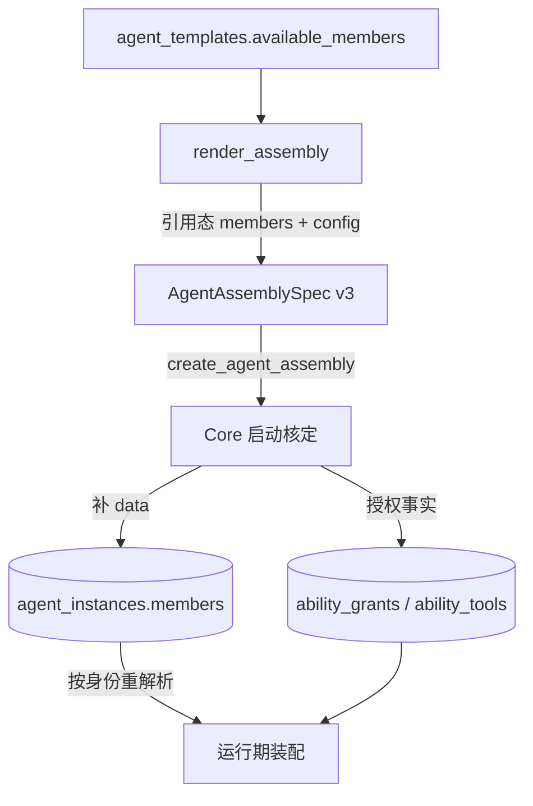
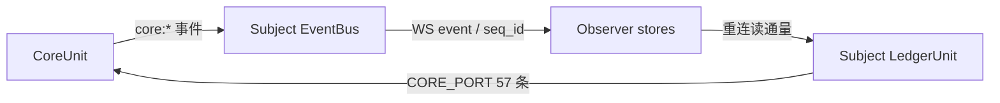

# ghrah 系统架构

| 项 | 内容 |
| --- | --- |
| 文档性质 | 现行实现说明（只写当前代码事实，不写路线图） |
| 校准基线 | `a742fcf`（重写于 2026-11-23） |
| 覆盖范围 | 7 个 Python 包、TS 观察端 workspace、进程内端口与 wire 契约、三库数据底座 |
| 口径 | 每条关键论断给「符号名 + 文件路径」；行号只作当前指针。数字均为实测值 |
| 状态词 | **已实现** / **未实施** / **已废弃**；未标注的默认为已实现 |

本文以「两半区 + 契约 + 可选组件」为骨架，先给宏观形状，再按协议层、端口层、Subject 运行时、Core 认知半区、上下文、能力、成员与数据底座、模板与实例化、业务域、观察端、一致性、恢复、运维、技术债逐章展开。

**阅读导航**

| 章 | 标题 | 回答的问题 |
| --- | --- | --- |
| §1 | 系统定位与设计原则 | 系统由哪几块组成，边界原则是什么 |
| §2 | 仓库结构与包边界 | 七个包各自装什么，依赖方向与发布范围 |
| §3 | 协议层 | 端口契约与 wire 契约分别是什么、规模多大 |
| §4 | 接口化端口 | 57 + 8 条接口如何声明、装配、报错 |
| §5 | Subject 运行时 | unit 如何挂载、命令面多大、如何对外服务 |
| §6 | Core 认知半区 | CoreUnit、注册表、门面、反向通道 |
| §7 | 上下文系统 | 链、会话、分支、提交、压缩、读侧 |
| §8 | 能力系统 | 定义面、扫描、执行、Hook、HITL、工具面、成员 |
| §9 | 成员、授权与数据底座 | 三库三权威、启动提交、读取路径、绑定双写 |
| §10 | Agent 模板与实例化 | 模板库、渲染、装配接口、创建与恢复 |
| §11 | 业务域 | Project / Room / Task / Workspace / 附件产物 |
| §12 | Observer | 连接、命令事件面、读通量、store、REST、客户端 |
| §13 | 一致性与 CQRS | 权威清单、链历史路径、事件边界、归属 |
| §14 | 恢复与弹性 | 三层期望、对账、监督、占位回收、冻结 |
| §15 | 配置、启动与运维 | 版本、入口、启动十步、落盘、构建、排障 |
| §16 | 已知偏离与技术债 | 当前确认存在的偏差与未实施项 |
| 附录 A | 术语表 | 本文用到的名词 |
| 附录 B | 按角色选读 | 不同读者从哪章开始 |

## 1. 系统定位与设计原则

### 1.1 全景架构图

下图按当前代码绘制，自上而下是依赖方向：上层调用下层，同一层之间不互相调用。点击卡片可跳到对应章节。

```arch
@title ghrah 总体架构
@layer 接入层 ghrah-observer-webui
@group 观察端 | Vue 3 SPA · 16 个 Pinia store
@card Web 控制台 | Agent / Session / ActionChain 可视化 #124-16-个-pinia-store
@card 命令面 + 事件面 | WS 发命令 · 收 core:* 事件 #122-命令面与事件面
@card 读通量 | agents → sessions → branches → history #123-四层读通量瀑布
@card REST 管理面 | 模板 / 媒体 / 产物 三组 #125-rest-三组
@group 配套包
@card protocol | TS 契约镜像 · 161 快照 #37-wire-与-ts-的对齐
@card observer-core | client · stores · 同步 #124-16-个-pinia-store
@card VSCode 扩展 | 打开 dashboard webview #127-四库包与-vscode-扩展
@card mock-server | 本地开发用的契约替身 #127-四库包与-vscode-扩展
@layer 效果半区 ghrah-subject
@group 对外接口 | 由 unit 挂载
@card WS /ws | 命令 + 事件 · EventBus 环形 1000 #55-ws-端点健康检查与-eventbus
@card REST /api/v1 | health · meta · 业务路由 #55-ws-端点健康检查与-eventbus
@group 业务域 | 项目组织与外部世界
@card Project | Root 布局 · ProjectStore v6 #111-projectroot-布局projectstore-v6agentrecord
@card Room | 消息发布 · 投影日志 · 四道闸 #112-room权威投影与四道闸
@card Task | subject_tasks + 归因内核 #113-task两套存储零跨写
@card Workspace | 登记语义 · 零物理写 #114-workspace登记语义零物理写
@card 附件 / 产物 | media_control · artifact_control #115-附件与产物
@group 管理面 | REST unit
@card 能力管理 | 包 / 版本 / 授权 / 导入 #35-rest-资源模块
@card 模板管理 | agent_templates · TPL-01..08 #101-模板库agent_templatesavailable_members
@card Agent 管理 | 创建 / 启停 / 删除 / 模型 #103-七条装配接口
@group 运行时宿主
@card Unit 挂载 | coexistence 6 · full 20 #52-builtin-unit-全表
@card 命令路由 | 79 条命令 #54-命令面79-条
@card Core 装配 | 每项目一个 CorePort #43-作用域模型
@card 启动授权 | GrantPolicy → 启动核定 #93-启动提交链
@card 恢复对账 | 三层期望 · reconcile #142-subject-对账一次性执行--命令触发
@layer 契约层 ghrah-protocol
@group 进程内端口 | 两个 Protocol
@card CorePort | 57 条作用域接口 · 10 分组 #42-清单规模57--8
@card CoreCatalogPort | 8 条无作用域目录接口 #42-清单规模57--8
@card Interface 三件套 | Registry · Runtime · invoke 四步 #32-接口骨架与一次调用的四步
@group wire 契约
@card Envelope + Payloads | CommandType 108 · payloads 180 #33-wire-面计数
@card 错误族 | Problem 16 码 #45-错误族
@card REST 资源模块 | ability_tree / ability_control / agent_control #35-rest-资源模块
@layer 认知半区 ghrah-core
@group Agent 运行时
@card ActorAgent | 驱动循环 · 每轮刷新工具面与技能目录 #66-三个入口supervisor--actoragent--agentbuilder
@card Supervisor | spawn / terminate / 集群成员 #66-三个入口supervisor--actoragent--agentbuilder
@card 装配 | AgentAssemblySpec v3 → 实例 #104-创建线
@group 上下文系统
@card ActionChain | 节点 / 会话 / 分支 #71-对象模型与不变量
@card SessionRuntime | 单 Session 内存聚合 #72-sessionruntime
@card ContextManager | 七步提交 · 压缩 · 窗口 #73-contextmanager-的七步提交
@card SqliteBackend | 7 表 v3 · 单写侧 #74-sqlitebackend7-表-v3read_onlybegin-immediate
@group 能力系统
@card 定义面 | ability.yaml v2 · members 数组 #81-定义面-v2members-数组与-datapath
@card 执行 | executor · Hook · HITL #84-执行localabilityexecutor-八步
@card 工具面 | static / progressive · 5 个元工具 #86-工具面toolsurfaceruntime
@card 技能面 | skill_reminder · read 地址 #86-工具面toolsurfaceruntime
@card 内置包 | 6 包 · 28 成员 #82-内置包与预装包
@group 接口实现
@card CoreUnit | 31 条命令 #61-coreunit-与-34-字段配置
@card CoreFacade | 57 条接口的收敛点 #64-corefacade--corecatalog-与-57--8
@card RuntimeRegistry | 每项目 CoreUnit 的注册与注入 #63-runtimeregistry-的注入点
@layer 数据底座
@group 链 + 能力关系库 | 每 Project db/action-chains.sqlite3
@card 链 7 表 | 节点 / 会话 / 分支 / 消息 #74-sqlitebackend7-表-v3read_onlybegin-immediate
@card ability_* 8 表 | 版本 · 内容 · 授权 · 绑定 · 变更 #92-能力关系库-schema-v5
@group 实例快照库 | 每 Project db/agents.sqlite3
@card agent_instances | 配置 · 成员定义态 · axes #91-三库三权威
@group 全局业务库 | data/subject.db
@card agent_templates | available_members #101-模板库agent_templatesavailable_members
@card 项目 / Room / Task | ProjectStore v6 等 #111-projectroot-布局projectstore-v6agentrecord
@group 外部依赖
@card LLM 端点 | agentconf 库解析 #61-coreunit-与-34-字段配置
@card 安装根 | <ns>/<name>/<version>/ · 启动期提交来源 #83-扫描漂移与启动提交
@card MCP 服务器 | mcp_call · 快照包 #82-内置包与预装包
@note 可选组件（未发布、不在主链上）：ghrah-kernel · ghrah-plugin · ghrah-taskstore · ghrah-scheme
```
### 1.1 两半区、契约与可选组件

ghrah 是一个多 Agent 运行时。它被切成两个半区，两半区之间只共享契约，不共享内存：

| 半区 | 包 | 职责 | 不负责 |
| --- | --- | --- | --- |
| 认知半区 | `ghrah-core` | Agent 循环、LLM 调用、上下文权威、能力执行、HITL 判定 | 项目组织、HTTP/WS 服务、进程托管 |
| 效果半区 | `ghrah-subject` | Project / Room / Task / Workspace、能力与模板管理面、HTTP/WS 端点、unit 生命周期 | 链与消息的写权威、LLM 调用 |
| 契约 | `ghrah-protocol` | 端口协议、视图 DTO、错误族、wire 信封与 payload | 任何实现 |
| 可选组件 | `ghrah-kernel` | 进程监督、跨进程句柄、结构化消息 | Agent 业务语义 |
| 可选组件 | `ghrah-plugin` | 插件 spec、发现、注册、协商、离线验证 | 插件运行宿主 |
| 可选组件 | `ghrah-taskstore` | tasks / claims / evidence 三表归因内核 | 域任务、Project 事务 |
| 可选组件 | `ghrah-scheme` | 类型化 Scheme 控制平面原型（`[scheme]` extra） | 能力/技能的运行期权威 |

「可选」是装配事实而不是措辞：`ghrah-kernel`、`ghrah-plugin`、`ghrah-taskstore`、`ghrah-scheme` 都没有发布通道（`publish.yml` 白名单只含 core / protocol / subject 与两个 npm 包、一个 VSCode 扩展）；`ghrah-scheme` 还是显式 extra，默认安装不引入。`ghrah-kernel` 的 `[agent]` extra 才依赖 `ghrah-core`，基础安装只依赖 `cbor2`。

### 1.3 数据底座：项目内三库

系统的持久化底座是「三库三权威」：两个库在每个 Project Root 内，一个是全局库。`db/action-chains.sqlite3` 的 `ability_*` 表存能力关系与授权，`db/agents.sqlite3` 的 `agent_instances` 存实例配置与成员快照，全局 `subject.db.agent_templates` 存模板成员申请；三者写路径互不重叠，详见 §9。运行期只读这些库与已提交字节，安装目录只是启动期的提交来源。

### 1.4 五条设计原则

| 原则 | 含义 | 在代码里的落点 |
| --- | --- | --- |
| 单一权威 | 同一份逻辑状态只有一条写路径 | `ContextManager` 是链权威；`ProjectStore` 是项目权威；`AbilityAccessStore` 是授权权威 |
| 派生可重建 | 副本不得独立写，必须能从权威重建且幂等 | `LedgerUnit` 读链经 `CORE_PORT`；Observer 读通量 `syncAgentActionState`；`DesiredStateStore` 每次由 ProjectStore 刷新 |
| 契约住第三方包 | 消费方 `except` / `import` 的类型不能来自提供方 | `ghrah-protocol` 定义 `CorePort`、`ApiError`、视图 DTO；`CoreApiError` 只是其子类 |
| 零隐式 | 未声明的行为不发生；失败显式 | 能力未授予即拒绝；插件需信任闸；`progressive` 降级必有原因 |
| 运行期不读安装目录 | 定义、正文、授权都从已提交数据读 | `surface_snapshot` / `read_chunk` 只读关系库与内容 blob（§9） |

「接口」是本文的统一叫法。旧文档里的能力清单类型已经并入 `Interface`；唯一保留的 `capability` 字样是错误载荷字段 `Problem.capability`，它是 wire 兼容名，不代表还有第二套概念（§3、§4）。

### 1.5 三条调用路径

上图是静态分层；一次真实交互只走三条路径，各自的契约类型不同：

```arch
@title 一次交互经过的三条路径
@layer 路径一 Observer → Subject | wire 契约（跨网络）
@wide WS /ws 发命令 · 收 core:* 事件；REST /api/v1 走管理面 #122-命令面与事件面
@layer 路径二 Subject → Core | 进程内端口契约（不经过网络）
@wide CorePort 57 条（按项目作用域）· CoreCatalogPort 8 条（无作用域） #43-作用域模型
@layer 路径三 Core → 持久层 | 单写侧
@wide ContextManager 写链 · AbilityAccessStore 写授权 · AgentInstanceStore 写快照 #131-权威清单
@note 读侧一律经端口回读：LedgerUnit 读链只调 port.sessions.history，不自开数据库 #132-链历史只经-coreport
```

### 1.6 术语：接口 vs 能力包

| 术语 | 指什么 | 不指什么 |
| --- | --- | --- |
| 接口（interface） | 端口暴露的一次调用，点分名如 `nodes.get`；在 `CORE_INTERFACES` 登记 | 不是能力包，不是工具名 |
| 能力包（ability） | 被授权、被装载的实现容器，含 operation / skill / mcp 成员 | 不是接口；包是成员的容器 |
| 成员（member） | 包内可单独申请、授予、装载的最小单元（§8.7） | 不是运行时对象；运行时对象是装载后的工具 |
| wire 契约 | Observer 与 Subject 之间的消息形状（`Envelope` + `payloads/*`） | 不是端口接口 |
| 端口（port） | 一个协议对象，按项目作用域实例化（`CorePort`） | 不是 HTTP 端点 |

## 2. 仓库结构与包边界

### 2.1 七个 Python 包

口径：包内全部 `.py`（含 `tests/`），行数含空行，测量于基线提交。仅算 `src/` 实现时为 471 文件 / 105,697 行；本表用全包口径，以便与 816 / 191,784 对齐。

| 包 | PyPI 名 | 文件 | 行 | 角色 |
| --- | --- | --- | --- | --- |
| `ghrah-core` | `ghrah-core` | 468 | 117,132 | 认知半区；能力系统、上下文、Agent 循环 |
| `ghrah-subject` | `ghrah-subject` | 176 | 42,400 | 效果半区；业务域、管理面、WS/REST、unit 宿主 |
| `ghrah-protocol` | `ghrah-protocol` | 56 | 11,302 | 端口与 wire 契约；无实现 |
| `ghrah-kernel` | 无发布通道 | 66 | 10,938 | 应用微内核与进程监督 |
| `ghrah-plugin` | 无发布通道 | 15 | 2,050 | 插件基础设施（叶子包） |
| `ghrah-taskstore` | 无发布通道 | 15 | 3,166 | 任务归因内核（可选组件） |
| `ghrah-scheme` | 无发布通道 | 20 | 4,796 | Scheme 控制平面原型（`[scheme]` extra，非权威） |
| **合计** | | **816** | **191,784** | |

### 2.2 TS workspace

`ghrah-observer-webui/` 是 pnpm workspace：`packages/*` 加 `vscode-extension`。

| 包 | 形态 | 职责 |
| --- | --- | --- |
| `@ghrah/protocol` | 库，`exports` → `dist/` | zod schema、`CommandType` / `EventType`、`ServerClient`、与 Python 快照对齐 |
| `@ghrah/plugin-registry` | 库，`exports` → `dist/` | 插件注册表视图 |
| `@ghrah/observer-core` | 库，`exports` → `dist/` | 连接、投影、16 个 Pinia store、REST 客户端 |
| `@ghrah/mock-server` | 私有包，`bin` → `dist/cli.js` | 协议级替身（WS 4113 + 可选 HTTP） |
| `@ghrah/observer-web` | Vue SPA，私有 | 页面与组件；无 vue-router |
| `vscode-extension` | 宿主壳 | 拉起进程、注册命令、打开面板 |

TS 生成物 5 个，全部由 `scripts/export_ability_contracts.py` 从 Python 作者模型单向生成：`ability-tree.generated.ts`、`ability-control.generated.ts`、`agent-control.generated.ts`、`agentconf-control.generated.ts`、`hitl.generated.ts`。wire 快照 161 个，位于 `packages/protocol/src/__snapshots__/`，由 `protocol-align.spec.ts` 校验。生成物禁止手改；`--check` 模式只比较不写盘。

### 2.3 core 的内部分层

`ghrah-core/src/ghrah/` 的分层是依赖单向的：

| 路径 | 内容 | 约束 |
| --- | --- | --- |
| `core/api/` | `interfaces.py`（`CORE_INTERFACES` / `CORE_CATALOG_INTERFACES`）、`facade.py`、`runtime.py`、`catalog.py`、`errors.py`、`handlers/` | 只依赖读面与协议 DTO |
| `core/agents/` | `assembly.py`、`members.py`、`instance_store.py`、`bindings.py` | 装配输入解析与实例快照；新增层 |
| `core/read/` | `chain.py`、`mailbox.py`、`ability.py`、`ability_catalog.py`、`ability_admin.py`、`ability_mcp_probe.py` | 只读存储与 DTO，不依赖单元生命周期 |
| `core/units/` | `registry.py`（`RuntimeRegistry`）、`context.py` | 活跃单元注册表；`agents.*` 的运行时真相 |
| `core/` 根 | `unit.py`（`CoreUnit`）、`wiring.py`（装配根）、`hitl.py`、`events.py`、`host_command_bridge.py` | 唯一可同时认识多层的只有 `wiring.py` |
| `ability/` | `access/`、`builtin/`、`execution/`、`loading/`、`package/`、`permissions/`、`scheme/`、`scripts/`、`surface/`、`tools/` 与成员/来源模块 | 能力系统主体 |
| `context/` | `manager.py`、`session_runtime.py`、`persistence/`、`strategies/`、`compact.py`、`window.py`、`topology.py` | 上下文权威 |
| `agents/` | `base.py`（`ActorAgent`）、`builder.py`（`AgentBuilder`）、`entity.py`、`runner.py` | 单 Agent 运行体 |
| `communication/` | `supervisor.py`（`SupervisorActor`）、`message_manager.py`、`mailbox_reader.py`、`router.py`、`registry.py` | 集群内消息与投递 |
| `llm/`、`mcp/`、`manifest/`、`chat/`、`types/` | LLM 工厂、MCP 客户端与探测、manifest 解析类型、聊天消息模型、结果与配置类型 | 支撑面 |

### 2.4 subject 的内部分层

| 路径 | 内容 | 约束 |
| --- | --- | --- |
| `unit/` | `base.py`：`SubjectUnit`、`UnitMeta`、`RouteSpec`、`CommandContext` | 所有 unit 的鸭子类型契约 |
| `units/` | 20 个 builtin unit（19 个文件；`recovery.py` 含 `DesiredStateUnit` 与 `RecoveryUnit`）+ `_commands.py` / `_helpers.py` / `_http_bytes.py` | 挂载清单只在 `mount_builtin_units` |
| `runtime/` | `assembly.py`、`core_ports.py`（`CorePorts`）、`port_transport.py`、`ouroboros_bridge.py`、`service_keys.py`、`route_registry.py`、`plugin_*` | 装配与跨 unit 传输 |
| `project/` | `paths.py`、`store.py`、`manager.py`、`entities.py`、`artifacts.py`、`attachments.py`、`scoped_stores.py`、`models.py` | Project 权威；不直接碰 Root 内业务 DB |
| `room/`、`task/`、`workspace/`、`sandbox/` | 三个业务域的 store/manager、Workspace 登记、沙箱执行器 | 各自单写 |
| `agents/` | `creation.py`、`render.py` | 模板渲染与创建编排；新增层 |
| `template_store/` | `models.py`、`store.py`、`service.py`、`formats/` | 模板库 `agent_templates`；新增层 |
| `recovery/` | `desired_state.py`、`reconciler.py` | 期望态缓存与一次性对账 |
| `server/` | `app.py`、`config.py`、`connection_manager.py`、`event_bus.py`、`router.py`、`event_attribution.py` | FastAPI / WS 薄入口 |
| `shipped_abilities/` | `project_agent_manage/` | 发行版预装能力包（4 个 operation） |
| `core_cluster/` | `registry.py` | 项目 → Core 端口与 CoreUnit 的构造点 |

### 2.5 protocol 的根模块与子包

根模块 17 个（含 `__init__.py`），其中**没有** `runtime*.py`：`ability_control.py`、`ability_tree.py`、`agentconf_control.py`、`agent_control.py`、`corpus.py`、`enums.py`、`envelope.py`、`errors.py`、`events.py`、`factories.py`、`interface.py`、`problem.py`、`routing.py`、`scheme.py`、`shell_allow.py`、`types.py`、`__init__.py`。子包三个：`ports/`（`core.py` 622 行、`keys.py`、`__init__.py`）、`views/`（`core.py` 802 行、`common.py`、`__init__.py`）、`payloads/` 14 个文件（`__init__.py` + 13 个域模块）。

### 2.6 包间依赖方向

| 包 | 依赖的 `ghrah-*` | 说明 |
| --- | --- | --- |
| `ghrah-plugin` | 无 | 叶子；只依赖 pydantic / packaging |
| `ghrah-protocol` | `ghrah-plugin` | **唯一例外**：`payloads/plugin.py` 复用 `NegotiationResult`（§16.7） |
| `ghrah-core` | `ghrah-protocol` | 认知半区只认契约 |
| `ghrah-scheme` | `ghrah-protocol` | 可选控制平面 |
| `ghrah-taskstore` | `ghrah-plugin` | 插件化为目标形态，当前经 builtin 链挂载 |
| `ghrah-subject` | `ghrah-core`、`ghrah-plugin`、`ghrah-protocol`、`ghrah-taskstore` | 效果半区仍静态 import Core（§16.6） |
| `ghrah-kernel` | 无（基础）；`[agent]` extra 依赖 `ghrah-core` | 微内核与监督 |

方向纪律：core 不 import subject；subject 可以 import core（当前基线允许，目标为零）；protocol 不 import core / subject；plugin 不 import 任何 `ghrah-*`。任何反向边都应由契约包承接。

### 2.7 发布白名单

`publish.yml` 的 tag 路由白名单是：

| 发布单元 | 目标 | 包 |
| --- | --- | --- |
| `py/ghrah-core@*` | PyPI | `ghrah-core` |
| `py/ghrah-protocol@*` | PyPI | `ghrah-protocol` |
| `py/ghrah-subject@*` | PyPI | `ghrah-subject` |
| `npm/ghrah-protocol@*` | npm | `@ghrah/protocol` |
| `npm/ghrah-observer-core@*` | npm | `@ghrah/observer-core` |
| `vscode/ghrah-vscode-extension@*` | VS Marketplace | `ghrah-vscode-extension` |

`ghrah-kernel`、`ghrah-plugin`、`ghrah-taskstore`、`ghrah-scheme`、`@ghrah/plugin-registry`、`@ghrah/mock-server` 不在白名单内。后果：`ghrah-protocol` 发布物会传递依赖一个没有发布通道的 `ghrah-plugin`（§16.7）。

## 3. 协议层：ghrah-protocol

```arch
@title 协议层的两块契约
@layer 端口契约 | 模块之间怎么互相调用（进程内）
@group 三个抽象
@card Interface | 名字 + 请求信封 + 出参 #32-接口骨架与一次调用的四步
@card InterfaceRegistry | 57 + 8 条的登记表 #32-接口骨架与一次调用的四步
@card InterfaceRuntime | 查表 → 校验 → 转交 → 校出参 #32-接口骨架与一次调用的四步
@group 两个端口 Protocol
@card CorePort | 作用域接口 · 每项目一个实例 #42-清单规模57--8
@card CoreCatalogPort | 无作用域目录接口 #42-清单规模57--8
@card 视图 DTO | views/core.py · AgentAssemblySpec 等 #33-wire-面计数
@layer wire 契约 | Observer 与 Subject 之间怎么说话（跨网络）
@group 消息形状
@card Envelope | 信封 + CommandType 108 #33-wire-面计数
@card Payloads | 180 个载荷符号 #33-wire-面计数
@card 路由分组 | 7 persist · 10 manifest（无 owner） #34-路由分组常量
@group 错误与 REST
@card Problem | 16 个错误码 · capability 字段兼容保留 #45-错误族
@card REST 资源模块 | ability_tree · ability_control · agent_control #35-rest-资源模块
@group TS 对齐
@card packages/protocol | 5 个生成物 · 161 快照 #37-wire-与-ts-的对齐
@note 没有全局 wire 版本常量：每个 payload 自带 format 字面量 #36-没有全局-wire-版本
```

### 3.1 两条契约：端口契约 vs wire 契约

这个包里同时住着两套**互不替代**的契约：

| 维度 | 端口契约 | wire 契约 |
| --- | --- | --- |
| 消费者 | Subject（同进程） | Observer（跨进程） |
| 形状 | `CorePort` Protocol + 请求信封 / 视图 DTO | `Envelope` + `payloads/*` + `CommandType` / `EventType` |
| 传输 | 直接方法调用 | WebSocket + HTTP |
| 失败 | `ApiError` / `Problem` | `CommandResultPayload` 的 `success/error` |
| 位置 | `protocol/ports/`、`protocol/views/`、`protocol/interface.py`、`problem.py`、`errors.py` | `protocol/envelope.py`、`enums.py`、`routing.py`、`payloads/`、REST 资源模块 |

两者共享同一份 DTO 是刻意的：REST 与端口返回同一视图，避免 Observer 和 Subject 各自维护一套形状。

### 3.2 接口骨架与一次调用的四步

`ghrah-protocol/src/ghrah/protocol/interface.py` 只有三个类型：

| 类型 | 职责 |
| --- | --- |
| `Interface` | 一条接口的声明：`name`、请求信封、出参模型 |
| `InterfaceRegistry` | 有序、名字唯一、可枚举的清单；重名构造期 `ValueError` |
| `InterfaceRuntime` | 模块内唯一入口；构造时要求「清单名字集合 == 处理器集合」，否则 `RuntimeError`（启动即失败） |

`InterfaceRuntime.invoke(name, payload)` 固定四步，顺序不可换：

| 步 | 动作 | 失败 |
| --- | --- | --- |
| 1 | 查表 `_require` | 未知接口 → `INTERNAL`（代码缺陷，不是调用方错误） |
| 2 | 按 `Interface.request` 校验入参 | `INVALID_ARGUMENT`，`details.errors` 只投 `loc/type/msg` |
| 3 | 在 `translator(name)` 上下文里调用处理器 | 模块私有异常翻译成统一错误族 |
| 4 | 按 `Interface.response` 校出参，再 `check_json_serializable` | 非 JSON 可往返即 `JsonShapeError` |

第 4 步是「只说 DTO」的唯一强制点：任何返回活对象（`datetime`、ORM 行）的处理器会在第一次调用时失败，而不是在下游消费方手里才炸。`invoke` 返回 `dict[str, Any]`（JSON 形状），门面必须再 `model_validate` 回来。

### 3.3 wire 面计数

`CommandType` 108 条，`EventType` 69 条；`PAYLOAD_MAP` 共 151 项（84 条命令 + 67 条事件），`payloads.__all__` 导出 180 个符号。

| 类别 | 数量 | 说明 |
| --- | --- | --- |
| `CommandType` 总条数 | 108 | `protocol/enums.py` |
| 已登记 payload 的命令 | 84 | 在 `COMMAND_PAYLOAD_MAP` / `PAYLOAD_MAP` |
| 未登记 payload 的命令 | 24 | 见下分解 |
| `EventType` 总条数 | 69 | `protocol/enums.py` |
| 已登记 payload 的事件 | 67 | 未登记的 2 条为 `ability_package_changed`、`ability_tree_changed` |
| `payloads.__all__` | 180 | `payloads/__init__.py` |

未登记的 24 条命令分三类：

| 类别 | 条数 | 命令 |
| --- | --- | --- |
| persist | 7 | `persist_save_node`、`persist_load_node`、`persist_load_chain`、`persist_save_messages`、`persist_load_messages`、`persist_delete_chain`、`persist_list_agents` |
| manifest（历史，无 owner） | 10 | `manifest_list_abilities`、`manifest_get_ability`、`manifest_put_ability`、`manifest_delete_ability`、`manifest_list_agents`、`manifest_get_agent`、`manifest_put_agent`、`manifest_delete_agent`、`manifest_resolve_agent`、`manifest_validate` |
| Agent 装配与配置 | 7 | `create_agent_assembly`、`start_agent_assembly`、`stop_agent_assembly`、`update_agent_assembly`、`delete_agent_assembly`、`update_agent_model`、`get_agent_config` |

persist 与 manifest 两类在 Subject 侧都没有 owner：persist 是旧持久化直连的残留，manifest 的模板库 unit 已删除（§5.4、§16.2）；装配类命令走 `CoreUnit._COMMANDS` 与装配接口，不经过 wire payload 表。

### 3.4 路由分组常量

`protocol/routing.py` 只提供集合，不提供判定次序：判反了会把 Session 命令当成 Core 通用命令。

| 常量 | 条数 | 消费方 |
| --- | --- | --- |
| `PERSIST_COMMANDS` | 7 | 无（历史） |
| `CORE_COMMANDS` | 22 | 路由层判定「转发到 Core」 |
| `SESSION_COMMANDS` | 5 | Session 细分 |
| `BRANCH_COMMANDS` | 5 | Branch 细分 |
| `WORKSPACE_COMMANDS` | 9 | `WorkspaceUnit` |
| `MANIFEST_COMMANDS` | 10 | 无（无 owner，§16.2） |
| `CHAIN_HISTORY_COMMANDS` | 1 | `LedgerUnit` |
| `TASK_COMMANDS` | 11 | `TaskUnit` |
| `TASK_ATTRIBUTION_COMMANDS` | 4 | `TaskStoreUnit` |
| `PLUGIN_COMMANDS` | 1 | 插件协商 |
| `PROJECT_COMMANDS` | 18 | `ProjectUnit` |
| `ROOM_COMMANDS` | 12 | `RoomUnit` |
| `RECONCILE_COMMANDS` | 2 | `RecoveryUnit` |

### 3.5 REST 资源模块

Observer 的 HTTP 契约按资源拆成四个 Python 模块，TS 侧由生成器做镜像：

| 模块 | 行数 | 内容 |
| --- | --- | --- |
| `protocol/ability_tree.py` | 249 | 能力树、授权/绑定请求（`GrantAbilityRequest`、`BindToolRequest`、`AbilityTreeView`） |
| `protocol/ability_control.py` | 708 | 能力管理面视图与错误体（包目录、版本、实例、surface、MCP 探测） |
| `protocol/agent_control.py` | 462 | Agent 资源 REST 视图与请求 |
| `protocol/agentconf_control.py` | 443 | Agentconf provider / endpoint / MCP 配置视图 |

### 3.6 没有全局 wire 版本

`ghrah-protocol` 里没有 `PROTOCOL_VERSION` / `WIRE_VERSION` 一类常量。前向兼容靠三件事：`Envelope.type` 保持 `str` 并允许未知类型；`PAYLOAD_MAP` 只登记已知且形状正确的 payload；版本差异由 `payloads` 字段与 TS 快照测试显式表达。没有全局版本号意味着**不能靠一个数字判断兼容性**，只能靠快照与一致性测试。

### 3.7 wire 与 TS 的对齐

| 机制 | 事实 |
| --- | --- |
| 生成物 | 5 个 `.generated.ts`，由 `scripts/export_ability_contracts.py` 单向生成 |
| 漂移检查 | `uv run python scripts/export_ability_contracts.py --check`：任一生成物与源模型不一致即非零退出 |
| 快照 | `packages/protocol/src/__snapshots__/*.json` 共 161 个；`protocol-align.spec.ts` 要求每个 payload schema 都有对应快照 |
| 枚举对齐 | `enums.spec.ts` 用 Python 侧集合的字面量副本断言 `CORE_COMMANDS` 等常量一致 |
| 手写镜像 | 仅 `payloads/plugin.ts` 一处（因为 Python 侧复用了 `ghrah-plugin` 的模型，生成器无法跨包推导） |

一致性纪律：先改 Python 作者模型，再生成 TS；禁止单侧手改生成物或快照。

### 3.8 事件骨架

`protocol/events.py` 另定义了一套只带资源引用的事件骨架：`EventEnvelope`、`EventTypeV1`、`ResourceRef`。它当前没有生产消费方，属**未实施**契约，保留给资源级事件读通；现行的实时事件走 `EventType` + `PAYLOAD_MAP`（§13.3）。

### 3.9 契约为什么必须住在第三方包

如果 `CorePort` 定义在 `ghrah-core`，Subject 就必须 `from ghrah.core import CorePort`，模块边界当场失效。因此端口协议、视图、错误基类、注入键只能住在第三方包；提供方只提供实现。这是结构约束，不是风格偏好。同理，`ApiError` 必须在契约包——消费方要 `except` 它，但不能 import 提供方。

## 4. 接口化端口（跨模块唯一通道）

```arch
@title 接口化端口：声明 → 装配 → 调用
@layer 声明 | ghrah-protocol
@group CORE_INTERFACES · 57 条 | 10 个分组
@card abilities | 13 条 · 含 write_grant / write_revoke #42-清单规模57--8
@card agents | 16 条 · 含 config / 5 条装配 / update_model #42-清单规模57--8
@card sessions | 8 条 #42-清单规模57--8
@card mailbox | 6 条 #42-清单规模57--8
@card branches | 5 条 #42-清单规模57--8
@card deliveries · messages | 3 + 3 条 #42-清单规模57--8
@card nodes · rooms · manifests | 1 + 1 + 1 条 #42-清单规模57--8
@group CORE_CATALOG_INTERFACES · 8 条 | 无作用域
@card 包目录 | packages / package_detail / version_profile #42-清单规模57--8
@card shell | validate_allow · builtin_rules #42-清单规模57--8
@card 导入 | package_import · package_mcp_probe #42-清单规模57--8
@layer 装配 | 每项目一次
@group 组装顺序
@card RuntimeRegistry | 构造校验：接口与处理器必须齐全 #44-装配与生命周期
@card build_core_port | 装配作用域门面 #44-装配与生命周期
@card build_core_catalog | 装配目录门面 #44-装配与生命周期
@card CorePorts.for_project | 按项目懒建 · 作用域构造期固定 #43-作用域模型
@layer 调用 | 一条接口的四步
@wide 查表 → 校验入参 → 转交处理器 → 校验出参并强制 JSON #32-接口骨架与一次调用的四步
@note 边界闸门：AST ratchet 基线 25 条，只降不升 #46-边界-ratchet25-条基线
```

### 4.1 为什么用端口而不是 HTTP 语义

两个半区在**同一进程**内通信，没有网络。HTTP 语义在进程内的成本是纯编码开销：路径模板编译与匹配、请求头解析、状态码映射；它的表达力没有一项是 HTTP 独有的。

| HTTP 表达力 | 本方案的等价物 | 处置 |
| --- | --- | --- |
| method + path | 点分接口名（`nodes.get`） | 不采用 |
| 状态码 | `ApiError` + `Problem.code` | 不采用 |
| 查询参数裁剪 | —— | 不采用（进程内无带宽成本） |
| 条件写（`If-Match`） | `details.revision` 冲突 | 保留语义 |
| 幂等键 | `idempotency_key` 参数 | 保留 |
| 分页 | `Page[T]` | 保留 |
| 长动作 | `Operation` | 保留 |

保留下来的不是传输细节，而是**资源命名纪律**：每条接口落到一个名词分组，名字可预测。

### 4.2 清单规模：57 + 8

`ghrah-core/src/ghrah/core/api/interfaces.py` 是接口的唯一权威枚举：

| 分组 | 条数 | 接口 |
| --- | --- | --- |
| `abilities` | 13 | `tree`、`changes`、`admin`、`package_groups`、`instances`、`content`、`status`、`grant`、`revoke`、`write_grant`、`write_revoke`、`enable_tool`、`disable_tool` |
| `agents` | 16 | `create`、`create_from_template`、`get`、`config`、`create_assembly`、`start_assembly`、`stop_assembly`、`update_assembly`、`delete_assembly`、`update_model`、`list`、`delete`、`runtime`、`tools`、`compact`、`reset` |
| `sessions` | 8 | `catalog`、`history`、`head`、`meta`、`create`、`activate`、`archive`、`delete` |
| `mailbox` | 6 | `summary`、`list`、`get`、`publish_external`、`publish_notification`、`recover_room_projections` |
| `branches` | 5 | `list`、`create`、`activate`、`archive`、`delete` |
| `deliveries` | 3 | `get`、`retry`、`resume` |
| `messages` | 3 | `append`、`broadcast`、`delegate` |
| `nodes` | 1 | `get` |
| `rooms` | 1 | `recover` |
| `manifests` | 1 | `resolve` |
| **合计** | **57** | `CORE_INTERFACES` |

全局目录端口 `CORE_CATALOG_INTERFACES` 共 8 条：`shell.validate_allow`、`shell.builtin_rules`、`abilities.packages`、`abilities.package_detail`、`abilities.package_version_profile`、`abilities.package_mcp_probe`、`abilities.package_groups`、`abilities.package_import`。它无作用域、不打开数据库，零项目时也可用。

### 4.3 作用域模型

作用域不再出现在任何接口签名里。Subject 是唯一知道 Project 的一层，它把「项目」翻译成数据根与作用域 token，按需构造并缓存端口实例：

| 事实 | 位置 |
| --- | --- |
| 项目 → 端口实例注册表 `CorePorts.for_project(project_id)` | `ghrah-subject/src/ghrah/subject/runtime/core_ports.py` |
| 端口构造根 `build_core_port(*, scope_id, db_path, ...)` | `ghrah-core/src/ghrah/core/wiring.py` |
| 全局目录构造根 `build_core_catalog(*, install_root, ...)` | 同上 |
| 端口协议 `CorePort` / `CoreCatalogPort` | `ghrah-protocol/src/ghrah/protocol/ports/core.py` |
| 注入键 `CORE_PORT` / `CORE_CATALOG` / `SUBJECT_PORT` | `ghrah-protocol/src/ghrah/protocol/ports/keys.py` |

判据：漏传作用域不可能（不是参数）；越权参数化不可能（一个实例只服务一个项目）；忘了取端口得到的是「未登记定位符」的显式错误，而不是读错项目。`SUBJECT_PORT` 仍是空声明，见 §16.5。

### 4.4 装配与生命周期

`build_core_port` 的组装顺序固定：

| 步 | 对象 | 作用 |
| --- | --- | --- |
| 1 | `ChainReadStore(db_path)` | 链库只读 |
| 2 | `MailboxReadStore(db_path, scope_id)` | 信箱/投递只读 |
| 3 | `RuntimeRegistry(scope_id, config_factory, ...)` | 活跃单元注册表；`agents.*` 的运行时真相 |
| 4 | `AbilityReadStore(..., reclaim_stale=True)` | 能力关系库读面；启动回收占位 |
| 5 | `registry.set_ability_store_factory(...)` | 授权库由 Core 自持 |
| 6 | `CoreRuntime(build_handlers(...))` | 收敛点；此处校验 57 条接口与处理器齐全 |
| 7 | `CoreFacade(runtime=..., scope_id=..., closer=..., registry=...)` | 门面；关闭逆序为 registry → chain → abilities |

`CoreFacade.aclose()` 幂等；端口对象不做进程级单例，由 `CoreClusterRegistryUnit` 在 mount 时构造、`ctx.provide(CORE_PORT, ...)` 注入，单元退出即关闭。`build_core_catalog` 不打开数据库、不建单元，只构造 `CoreCatalog`，因此全局目录能力在零项目时可用。

### 4.5 错误族

| 层 | 符号 | 位置 | 语义 |
| --- | --- | --- | --- |
| 载荷 | `Problem` / `ProblemCode` | `protocol/problem.py` | `code` 是唯一机器判据；无 HTTP 状态码、无 type URI |
| 基类 | `ApiError` | `protocol/errors.py` | 消费方 `except ApiError` 即可捕获所有模块失败 |
| Core 子类 | `CoreApiError` | `core/api/errors.py` | 需要精确定位 Core 时使用 |
| 翻译表 | `translate(capability)` | `core/api/errors.py` | 在 `invoke` 第 3 步包住处理器；最后兜底 `Exception` → `INTERNAL` 并记日志 |

`ProblemCode` 共 16 个值：

| 类别 | 码 |
| --- | --- |
| 参数与状态 | `INVALID_ARGUMENT`、`FAILED_PRECONDITION`、`PRECONDITION_FAILED`、`PRECONDITION_REQUIRED`、`CONFLICT`、`BUSY` |
| 查找与可用性 | `NOT_FOUND`、`UNAVAILABLE`、`RESOURCE_ARCHIVED`、`CURSOR_EXPIRED` |
| 权限与 promise | `PERMISSION_DENIED`、`PROMISE_NOT_HELD` |
| 内容与包 | `TOO_LARGE`、`UNSUPPORTED_FORMAT`、`INVALID_PACKAGE` |
| 兜底 | `INTERNAL` |

只有 `BUSY` 与 `UNAVAILABLE` 默认 `retryable=True`；其余默认 `False`——重试只会重复失败。`Problem.capability` 字段名保留为兼容名，承载的是「发生位置」（接口名），不表示还有另一套概念。

### 4.6 边界 ratchet：25 条基线

`ghrah-subject/tests/test_module_boundary.py` + `module_boundary_baseline.json` 是一份只降不升的 AST 闸门：禁止 `ghrah-subject/src/**` 出现 `ghrah.core` / `ghrah.context` / `ghrah.communication` / `ghrah.ability` / `ghrah.agents` / `ghrah.manifest` / `ghrah.types` 的绝对 import，并检查 `pyproject.toml` 是否仍声明 `ghrah-core` 依赖。

当前基线 25 条：

| 被禁前缀 | 条数 | 备注 |
| --- | --- | --- |
| `ghrah.ability.*` | 9 | config 3、registry 1、manager 1、sandbox 1、shipped_abilities 3 |
| `ghrah.types.results` | 5 | `project_agent_manage` 的 4 个 operation + `_shared` |
| `ghrah.context.*` | 4 | sqlite_backend / persistence / session_runtime |
| `ghrah.communication.*` | 3 | registry、entities、room |
| `ghrah.core.*` | 2 | `core.unit`、`core.wiring` |
| `ghrah.agents.entity` | 1 | `project/entities.py` |
| `pyproject.toml::ghrah-core` | 1 | Subject 仍声明对 Core 的依赖 |

机制：新增违规失败；违规减少但基线未下调也失败；只检查静态 import，`importlib.import_module` / `__import__` 抓不到（刻意取舍，动态导入靠评审）。更新用 `MODULE_BOUNDARY_UPDATE=1` 重跑该测试。

### 4.7 契约与实现为什么分包

端口协议、视图、错误基类、注入键住在 `ghrah-protocol`，实现住在 `ghrah-core` / `ghrah-subject`。这样 Subject 只 import 契约包就能调用 Core，mypy 也能在「实现缺方法」时失败。若把协议放进 core，Subject 必须 import core，边界立刻崩塌。

## 5. Subject 运行时（效果半区）

```arch
@title Subject 运行时：unit 如何挂载并对外服务
@layer 单元模型
@card SubjectUnit | 四契约 · 四条硬约束 #51-单元四契约与硬约束
@card mount_unit | 插件化挂载 · 逐个等 ACTIVE #53-挂载三步与-ctx-四语义
@card ctx | provide / get / on / serial #53-挂载三步与-ctx-四语义
@layer coexistence 6 个 | 默认就挂
@card sandbox | 工作区沙箱 #52-builtin-unit-全表
@card ledger | 链历史只读投影 · 经 CORE_PORT #52-builtin-unit-全表
@card workspace | 工作区登记 #52-builtin-unit-全表
@card taskstore · task · desired_state | 归因内核 + 任务 + 期望态 #52-builtin-unit-全表
@layer full 再加 14 个 | 含可选 room_filter
@card 对外端点 | websocket_observer_endpoint #55-ws-端点健康检查与-eventbus
@card Core 装配 | core_cluster_registry · 每项目一个 CoreUnit #53-挂载三步与-ctx-四语义
@card 预装能力 | shipped_abilities #52-builtin-unit-全表
@card REST 管理 | project / ability / agent_template / agent / agentconf / media / artifact control #35-rest-资源模块
@card 业务域 | project · room · recovery #111-projectroot-布局projectstore-v6agentrecord
@card 可选 | room_filter #112-room权威投影与四道闸
@layer 对外服务
@card WS /ws | 命令 79 条 + 事件 #54-命令面79-条
@card REST /api/v1 | health · meta · 业务路由 #55-ws-端点健康检查与-eventbus
@card CORS / token | GHRAH_SUBJECT_OBSERVER_HTTP_API_* #55-ws-端点健康检查与-eventbus
@note 启动链 10 步：见 #56-启动链10-步
```

### 5.1 单元四契约与硬约束

`ghrah-subject/src/ghrah/subject/unit/base.py` 的 `SubjectUnit` 是鸭子类型契约，一个 unit 只需提供四样东西：

| 契约 | 形状 | 约束 |
| --- | --- | --- |
| `meta` | `UnitMeta(name, requires, provides, routes)`；`routes` 含 `commands` / `long_running_commands` / `events` | 名字全局唯一；服务键冲突即启动失败 |
| 生命周期 | `await init(ctx)` → 路由注册 → `await start()`；卸载 `await stop()` | 顺序不可换 |
| 命令 | `await handle_command(command, payload, cmd_ctx) -> dict` | 只处理 `routes.commands` 内的命令 |
| 事件 | `await handle_event(event_type, payload)` | CoreUnit 不消费事件 |

硬约束：unit 之间不直接调用，只经 `ctx.get(服务名)`；一个服务键只有一个提供方（同名重复 provide 抛 `ServiceConflictError`）；路由注册先于 `start`，避免起来后再补路由的竞态。

### 5.2 builtin unit 全表

`mount_builtin_units` 逐个挂载并 `wait_active(fiber, timeout=10.0)`；并发挂载会让多个 store 同时打开同一 SQLite 文件并触发 `database is locked`，所以必须串行。

| unit | 剖面 | 提供 / 依赖 | 职责 |
| --- | --- | --- | --- |
| `sandbox`（`SandboxUnit`） | coexistence | 提供 `SANDBOX_EXECUTOR` | 共享沙箱执行器 |
| `ledger`（`LedgerUnit`） | coexistence | 提供空 | 链历史只读投影；经 `CORE_PORT` 读 |
| `workspace`（`WorkspaceUnit`） | coexistence | 提供 `WORKSPACE_SERVICE` / `WORKSPACE_MANAGER` | 工作区登记与管理 |
| `taskstore`（`TaskStoreUnit`） | coexistence，`taskstore.enabled` 可关 | 提供三表内核 | 任务归因命令（4 条） |
| `task`（`TaskUnit`） | coexistence | 提供 `TASK_MANAGER` / `TASK_STORE` | 域任务（11 条命令） |
| `desired_state`（`DesiredStateUnit`） | coexistence | 提供 `DESIRED_STATE_STORE` | 期望态派生缓存 |
| `shipped_abilities`（`ShippedAbilityUnit`） | full | — | 发行版预装能力包的启动校验与补齐 |
| `websocket_observer_endpoint` | full | 提供 `OBSERVER_ENDPOINT` / `OBSERVER_EVENT_BUS` | FastAPI app、WS、EventBus |
| `core_cluster_registry`（`CoreClusterRegistryUnit`） | full | 提供 `CORE_CATALOG_SERVICE` / `CORE_CLUSTER_REGISTRY` / `CORE_PORT_SERVICE`；依赖 workspace / sandbox | 项目端口装配、CoreUnit 懒装载、22 条命令 |
| `project`（`ProjectUnit`） | full | 提供 `PROJECT_MANAGER` / `PROJECT_STORE` | 项目与 Agent 记录权威（18 条命令） |
| `project_control`（`ProjectControlUnit`） | full | 依赖 `PROJECT_MANAGER` | Project REST 管理面（10 条路由；新） |
| `ability_control`（`AbilityControlUnit`） | full | 依赖 observer / core port / core catalog / project store / event bus | 能力管理面（21 条路由） |
| `agent_template_control`（`AgentTemplateControlUnit`） | full | 提供 `TEMPLATE_STORE`；依赖 observer / core catalog | 模板 REST（7 条路由；新） |
| `agent_control`（`AgentControlUnit`） | full | 依赖 observer / project manager / project store / core port | Agent REST（6 条路由） |
| `agentconf_control`（`AgentconfControlUnit`） | full | 依赖 observer | Agentconf 配置面（29 条路由） |
| `media_control`（`MediaControlUnit`） | full | 依赖 observer / project manager | 项目附件库（2 条路由；新） |
| `artifact_control`（`ArtifactControlUnit`） | full | 依赖 observer / project manager / workspace manager | 工作区浏览与产物面（5 条路由；新） |
| `room`（`RoomUnit`） | full | 提供 `ROOM_MANAGER` / `ROOM_STORE` | Room 元数据与日志（12 条命令） |
| `recovery`（`RecoveryUnit`） | full | 提供 `RECONCILIATION_SERVICE` / `RECOVERY_START` | 一次性对账（2 条命令） |
| `room_filter`（`RoomFilterUnit`） | full，`room_filter.enabled` 可关 | 依赖 `ROOM_MANAGER` | 事件 → Room 日志白名单过滤 |

计数：coexistence **6**（`taskstore` 默认启用）；full 再追加 13 个常规 unit 加可选 `room_filter`，共 **20** 个 builtin unit。`CoreClusterRegistryUnit` 另按项目懒装载 `CoreUnit`，不计入这 20 个 builtin unit。`units/__init__.py` 的模块 docstring 仍写 7/21（把已删除的模板库 unit 算了进去），以本表为准（§16.12）。

四个新 REST unit 是 `project_control`、`agent_template_control`、`media_control`、`artifact_control`；它们只提供 HTTP 路由，`routes.commands` 为空。

### 5.3 挂载三步与 ctx 四语义

`assemble_subject(ctx, config, profile)` 的顺序固定为：

| 步 | 动作 | 位置 |
| --- | --- | --- |
| 1 | 建 `UnitRouteRegistry` | `runtime/assembly.py` |
| 2 | `mount_builtin_units`：逐个 `ctx.plugin(mount_unit(unit))` 并 `wait_active(10s)` | `units/__init__.py` |
| 3 | 第三方 unit allowlist 挂载 | `runtime/third_party.py` |
| 4 | 插件装配：信任闸 → Project enabled 聚合 → 排序 → 挂载 → `PluginSession` | `runtime/assembly.py` |
| 5 | 若启用且 `RecoveryUnit` 在场，把 `reconcile` 丢到后台 | `runtime/assembly.py` |

单个 unit 的挂载由 `mount_unit` 完成：`inject` 取 `requires` 的服务键；`apply` 内依次 `await unit.init(ctx)` → 注册路由 → `await unit.start()`；disposer 只做 `await unit.stop()`；`apply.__name__` 必须设为 `unit.meta.name`，否则 Ouroboros 会把名字归一成 `None`。

`ctx` 的四条语义（来自 `cordis-ouroboros`，仓库侧只有用法）：

| 调用 | 语义 |
| --- | --- |
| `ctx.provide(name, value)` | 登记到当前 fiber；同名重复抛 `ServiceConflictError`；fiber dispose 自动撤销 |
| `ctx.get(name, strict=True)` | 只解析 ACTIVE 提供者；`strict=False` 允许未激活，且不存在返回 `None` |
| `ctx.on(name, listener, exclusive=False)` | 注册监听并返回 `Disposable`；`exclusive=True` 时交集冲突抛错 |
| `ctx.serial(name, *args)` | 按注册顺序逐个 await；第一个非 `None` / 非 `False` / 非 `Ellipsis` 的回执短路返回 |

注册顺序决定 `serial` 的裁决顺序，激活顺序由 `inject` 决定，两者正交。`wait_active` 超时抛 `AssertionError("fiber did not reach ACTIVE within 10.0s")`；装配末尾对残留 PENDING 只告警。

### 5.4 命令面：79 条

命令清单常量住在 `ghrah-protocol/src/ghrah/protocol/routing.py`，Subject 只在 `units/_commands.py` 再导出。实测合计 **79** 条：

| 域 | 条数 | 消费 unit / 常量 |
| --- | --- | --- |
| Core 转发（项目/Agent/Session/Branch/HITL） | 22 | `core_cluster_registry`：21 条 `_PROJECT_AGENT_COMMANDS` + `hitl_response` |
| Project | 18 | `project`：`PROJECT_COMMANDS` |
| Room | 12 | `room`：`ROOM_COMMANDS` |
| Task | 11 | `task`：`TASK_COMMANDS` |
| Workspace | 9 | `workspace`：`WORKSPACE_COMMANDS` |
| Task 归因 | 4 | `taskstore`：`TASK_ATTRIBUTION_COMMANDS` |
| 对账 | 2 | `recovery`：`RECONCILE_COMMANDS` |
| 链历史 | 1 | `ledger`：`CHAIN_HISTORY_COMMANDS` |

另外，`MANIFEST_COMMANDS` 的 10 条命令仍在协议包里，但**没有任何 owner**：WS `manifest_*` 为历史命令，无 owner；Observer 仍可能发出，回执是 `Unknown command`（§16.2）。

### 5.5 WS 端点、健康检查与 EventBus

| 端点 | 事实 |
| --- | --- |
| `WS /ws` | 由 `WebSocketObserverEndpointUnit` 建路由；路径由 endpoint unit 的 `ObserverServerConfig` 决定（当前装配只注入默认 config，见 §16.11） |
| `GET /api/v1/health` | 返回 `{"status":"ok","active_sessions":N}`；业务/元信息入口统一在 `/api/v1` 命名空间 |
| `GET /api/v1/meta` | 返回名称与版本 |
| `GET /health` | **已废弃**的过渡别名；`deprecated=True`、`include_in_schema=False`，仅为 `ghrah-toolchain` 的存活探测保留 |
| `GET /api/v1/openapi.json` | OpenAPI 文档 |
| REST | 8 个提供 REST 路由的 unit 共 83 条 `add_api_route` / decorator 路由（含 `shell-allow` 3 条） |
| `EventBus` / `EventStore` | 环形缓冲，默认容量 1000，按 `seq_id` 重放；构造参数 `event_replay_capacity` |

`/` 返回 SPA 静态资源；无前缀路由留给 Observer SPA，不与业务 API 混用。

### 5.6 启动链：10 步

| 步 | 动作 | 位置 |
| --- | --- | --- |
| 1 | 装配日志（级别 + 定向级别 + 可选文件） | `server/app.py`、`logging_setup.py` |
| 2 | `ObserverServerConfig.from_env()` 与 `SubjectConfig.from_env()` | `server/app.py` |
| 3 | 把 SIGINT / SIGTERM / SIGBREAK 换成「只记录不终止」的处理器，等 Context 收尾后重放 | `server/app.py` |
| 4 | `async with Context()` → `assemble_subject(..., profile="full")` | `server/app.py`、`runtime/assembly.py` |
| 5 | 逐个挂载 builtin unit 并等 ACTIVE | `units/__init__.py` |
| 6 | 第三方 unit allowlist → 插件装配 → 后台 reconcile | `runtime/assembly.py` |
| 7 | endpoint unit 建 ConnectionManager / EventBus / Router / Server / FastAPI app，并订阅事件全集 | `units/websocket_observer_endpoint.py` |
| 8 | `create_app(config, ctx=ctx)` 从 ctx 取回该 unit 持有的 app | `server/app.py` |
| 9 | `uvicorn.Server(...).serve()` 开始监听 | `server/app.py` |
| 10 | 可服务判据：`/api/v1/health` 返回 ok，`/api/v1/meta` 返回版本，`/ws` 可连接 | `units/websocket_observer_endpoint.py` |

## 6. Core 认知半区

```arch
@title Core 认知半区：一个项目一个 CoreUnit
@layer 入口
@card CoreUnit | 31 条命令的分发器 #61-coreunit-与-34-字段配置
@card CoreUnitConfig | 34 个注入字段 #61-coreunit-与-34-字段配置
@card RuntimeRegistry | 按项目创建 / 缓存 / 停止单元 #63-runtimeregistry-的注入点
@layer 接口实现
@card CoreFacade | 57 条接口的收敛点 #64-corefacade--corecatalog-与-57--8
@card CoreCatalog | 8 条目录接口 #64-corefacade--corecatalog-与-57--8
@card handlers | 10 个分组模块 #64-corefacade--corecatalog-与-57--8
@layer 运行时部件
@card Supervisor | 集群成员 · spawn / terminate #66-三个入口supervisor--actoragent--agentbuilder
@card ActorAgent | 驱动循环 #66-三个入口supervisor--actoragent--agentbuilder
@card AgentBuilder | 装配 Agent 实例 #66-三个入口supervisor--actoragent--agentbuilder
@card 能力关系库 | ability_store · 启动期建库 #63-runtimeregistry-的注入点
@card 实例快照库 | agent_instances_path #63-runtimeregistry-的注入点
@layer 反向通道
@wide Core → Subject：HostCommandBridge / ScopedHostCommandPort #65-core--subject-反向通道
@note 已知漂移：_COMMANDS 31 条 vs CORE_COMMANDS 22 条 #62-命令面31-条-vs-22-条的漂移
```

### 6.1 `CoreUnit` 与 34 字段配置

`CoreUnit`（`ghrah-core/src/ghrah/core/unit.py`）是 Core 的挂载形态。它不 import Subject 与 Ouroboros，只按鸭子类型提供 `meta` / `init` / `start` / `stop` / `handle_command` / `handle_event`；事件经 `UnitEventPublisher` 以 `core:{event_type}` 发出，避免与 Subject / Observer 域事件冲突。

`CoreUnitConfig` 是 frozen dataclass，共 **34** 个字段，按用途分组：

| 组 | 字段 | 说明 |
| --- | --- | --- |
| 身份与超时 | `project_id`、`default_timeout`、`hitl_timeout` | 作用域 token、Agent 通信默认超时、审批等待 |
| 工作区与审批 | `workspace_root`、`auto_approve_abilities`、`require_approval_by_default`、`safe_extra_commands`、`safe_extra_sub_commands`、`hitl_consecutive_timeout_limit`、`hitl_degraded_timeout`、`environment_injection` | 部署侧 HITL 覆盖层与 shell 白名单 |
| 运行注入 | `command_runner`、`shell_cwd_provider`、`shell_allow_lookup`、`persistence_factory`、`agent_instances_path`、`message_manager`、`llm_factory`、`agentconf_db_path` | 测试/嵌入替换点；`agent_instances_path` 指向 `<project_root>/db/agents.sqlite3` |
| 能力 | `ability_source`、`ability_install_root`、`ability_filesystem_roots`、`ability_store`、`ability_grant_policy`、`mcp` | 能力来源、安装根、授权策略、MCP 部署 |
| 工具面预算 | `surface_definition_token_ratio`、`surface_max_static`、`surface_hard_cap`、`surface_search_limit`、`surface_loaded_limit` | 默认值见 §8.6 |
| 集群与宿主 | `max_cluster_members`、`room_projector`、`host_command_grants` | 成员上限、Room 投影回调、宿主命令授权 |

两个字段值得单独指出：`agent_instances_path` 是实例快照库的唯一注入点（`CoreUnit` 在 `init` 时构造 `AgentInstanceStore`；`None` 表示 standalone 不落盘）；`shell_allow_lookup` 是每次命令检查前读取项目 Shell 记忆的函数，决定「项目级放行记忆」是否生效。

### 6.2 命令面：31 条 vs 22 条的漂移

`CoreUnit._COMMANDS` 实测 **31** 条，`ghrah-protocol` 的 `CORE_COMMANDS` 仍是 **22** 条。差集 9 条：

| 差集命令 | 说明 |
| --- | --- |
| `execute_ability`、`hitl_response` | 执行入口与审批回程，由 Core 内部/端口转发处理 |
| `create_agent_assembly`、`start_agent_assembly`、`stop_agent_assembly`、`update_agent_assembly`、`delete_agent_assembly` | 装配生命周期 |
| `update_agent_model`、`get_agent_config` | 模型段更新与生效配置读取 |

影响：`CORE_COMMANDS` 不能作为「Core 能处理什么」的完整判据；Subject 侧另用 `core_cluster_registry` 的 `_PROJECT_AGENT_COMMANDS` + `hitl_response`（22 条）做路由。两份清单必须同时看，见 §16.1。

### 6.3 `RuntimeRegistry` 的注入点

`ghrah-core/src/ghrah/core/units/registry.py` 的 `RuntimeRegistry` 是活跃单元注册表，也是 `agents.runtime` / `abilities.tree` 的运行时真相。它的构造参数就是全部注入点：

| 注入点 | 作用 |
| --- | --- |
| `config_factory` | 无参构造 `CoreUnitConfig`；作用域由闭包绑定 |
| `unit_factory` | 构造 Core 单元，默认 `create_core_unit`；测试可替换 |
| `manager_factory` | 构造 `MessageManager`（Agent 动态注册） |
| `manifest_resolver` | 解析 `manifest_ref`；缺省时相关能力返回 `FAILED_PRECONDITION` |
| `config_hook` | 单元创建前的异步配置钩子（注入 `ability_store` 等） |
| `ability_store_factory` | 启动授权关系库工厂；可在构造后 `set_ability_store_factory` 注入 |
| `emit` / `serial` | 宿主事件回调与命令入口（反向通道） |

`ensure()` 的固定顺序：取 config → 建 manager → 跑 `config_hook` → 若 `config.ability_store` 为空则用工厂建库 → 建 unit → 启动；`stop()` / `aclose()` 逆序释放。运行期不重建配置：配置只在单元创建时生效，重启才重新读。

### 6.4 `CoreFacade` / `CoreCatalog` 与 57 / 8

| 对象 | 协议 | 条目 | 实现 |
| --- | --- | --- | --- |
| `CoreFacade` | `CorePort` | 57 条 / 10 分组 | `ghrah-core/src/ghrah/core/api/facade.py` |
| `CoreCatalog` | `CoreCatalogPort` | 8 条 | `ghrah-core/src/ghrah/core/api/catalog.py` |

`CoreFacade` 的 10 个分组属性与 `CorePort` 一一对应；每个分组类只做三件事：`_call(接口名, **kwargs)` → `model_validate` → 拆壳（裸 id / `None`）。`_call` 只把领域参数装箱交给收敛点；作用域由端口实例在构造时绑定（数据根与 `scope_id` 固定），请求信封里没有作用域字段。全局接口走 `_call_global`，不注入作用域、不要求先取项目端口。

### 6.5 Core → Subject 反向通道

反向通道只用于「Core 需要宿主执行一件事」：`HostCommandBridge.dispatch(command, payload)` 调 `ctx.serial("command/<command>", payload)`，把回执归一成 `{"success": bool, "data"?, "error"?}`；serial 不可用或回执非 dict 一律返回失败，不抛异常给调用方。

另一条是 HITL 回程：Subject 的 `core_cluster_registry` 收到 `hitl_response` 后，经 `port.dispatch_command("hitl_response", payload)` 扇出到所有已启动的 CoreUnit，由持有 promise 的单元认领（§8.5）。这条路径没有 `project_id`，只凭 `promise_id` 定位。

### 6.6 三个入口：Supervisor / ActorAgent / AgentBuilder

| 入口 | 符号 | 职责 |
| --- | --- | --- |
| 集群监督 | `SupervisorActor`（`ghrah-core/src/ghrah/communication/supervisor.py`） | Agent 生命周期：`spawn_agent`（串行预留 + 授权物化）、`terminate_agent`（逆序释放：能力资源 → MM 解绑 → 停止收件 → 释放持久化 → 注销 → 释放注册） |
| Agent 运行体 | `ActorAgent`（`ghrah-core/src/ghrah/agents/base.py`） | 驱动循环、LLM 调用、工具调用、上下文提交 |
| 装配器 | `AgentBuilder`（`ghrah-core/src/ghrah/agents/builder.py`） | 把 `AgentConfig` + 能力 + LLM 工厂装配成 `ActorAgent`；不决定授权 |

Agent 的**自动拉起不在 Core**：Core 只负责「被要求时拉起/停止」，重启后该不该跑由 Subject 的期望态对账决定（§14）。这是「进程活着 ≠ agent 该活着」的分工。

## 7. 上下文系统：ActionChain / Session / Branch

```arch
@title 上下文系统：对象 → 内存聚合 → 提交 → 持久化
@layer 对象模型 | 三种节点
@card ActionSession | 会话 #71-对象模型与不变量
@card ActionBranch | 分支 · Head 唯一持有者 #71-对象模型与不变量
@card ContextNode | 一次迭代的记录 #71-对象模型与不变量
@layer 内存聚合
@card SessionRuntime | create / restore / commit_node / 拓扑校验 #72-sessionruntime
@layer 提交路径 | 唯一写侧
@card ContextManager | 七步提交 · 迭代状态 · 窗口 #73-contextmanager-的七步提交
@card 压缩 | 决策 / 提交 / 观测 三段 #75-压缩三段
@layer 持久化
@card SqliteBackend | 7 表 v3 · BEGIN IMMEDIATE · read_only 开关 #74-sqlitebackend7-表-v3read_onlybegin-immediate
@card PersistenceBackend | 协议 + 另外两个后端 #74-sqlitebackend7-表-v3read_onlybegin-immediate
@layer 读侧
@wide ChainReadStore(*, agent_id) · head / history / branches #76-读侧-chainreadstore
@note 恢复与校验是同一段代码，没有第二条路径 #71-对象模型与不变量
```

### 7.1 对象模型与不变量

| 对象 | 位置 | 关键字段 |
| --- | --- | --- |
| `ContextNode` | `ghrah-core/src/ghrah/context/node.py` | `id`、`parent_id`、`agent_name`、`session_id`、`created_on_branch_id`、`timestamp`、`iteration`、`ability_names`、`agent_state`、`messages_delta`、`messages_snapshot`、`is_snapshot`、`action_results`、`metadata` |
| `ActionSession` | `ghrah-core/src/ghrah/context/action_session.py` | `session_id`、`agent_name`、`name`、`root_node_id`、`active_branch_id`、`lifecycle`、`system_prompt`、三个 `origin_*` |
| `ActionBranch` | `ghrah-core/src/ghrah/context/branch.py` | `branch_id`、`session_id`、`name`、`head_node_id`、`lifecycle`、`parent_branch_id`、`fork_point_node_id` |
| `SessionRuntime` | `ghrah-core/src/ghrah/context/session_runtime.py` | `session`、`chain`、`branches`；Branch Head 的唯一持有者 |

不变量逐条（构造期强制）：

| 不变量 | 落点 |
| --- | --- |
| `agent_name` / `session_id` / `created_on_branch_id` 非空 | `ContextNode.__post_init__` |
| 可变字段在 frozen dataclass 内 deep copy 隔离 | `node.py` |
| Root 节点恒为快照：`parent_id=None`、`iteration=0`、`ability_names=["init"]`、`is_snapshot=True` | `node.py` |
| Session `lifecycle ∈ {open, archived, deleted}`；三个 `origin_*` 同有同无 | `action_session.py` |
| Branch `lifecycle` 同三值；`parent_branch_id` 与 `fork_point_node_id` 同有同无 | `branch.py` |
| `ActionChain` 只建一次 Root；`append_node` 只追加、不改 Branch Head | `chain.py` |
| 回溯检测环与跨 session 节点；`ingest_node` 复核归属 | `chain.py` |
| 拓扑校验一次跑全图：Root 唯一、Head 可解析、Fork 语义闭合 | `topology.py::validate_session_topology` |

`IterationState` 不在链上，也不在 `ContextManager` 里：它归驱动者所有，只有 `iteration` / `max_iterations` / `last_action_result` / `pending_route` 四个字段，`max_iterations < 0` 表示无上限。

### 7.2 `SessionRuntime`

`SessionRuntime` 是单 Session 的内存聚合边界，任何 Head 变更都必须经过它：

| 方法 | 作用 |
| --- | --- |
| `create` | 同时产生 Root 节点 + 默认 Branch + Session，三者 ID 对齐 |
| `restore` | 从已持久化的 session / branches / nodes 重建，并重跑全部不变量 |
| `active_branch` / `active_head` | 由 `active_branch_id` 与 `head_node_id` 两级推导 |
| `create_branch` | 从既有节点派生 Branch，不隐式激活 |
| `activate_branch` | 显式切换 `active_branch_id` |
| `commit_node` | 追加节点 + 原子前移 Head + 重跑校验 |
| `get_history` | 从指定 Branch Head 回溯到 Root |

`restore` 同时是只读读面的构造器：`ChainReadStore.head()` / `history()` 用它拼出 Branch 头与历史，`ContextCheckpoint` 也用它按 session 逐个校验。**恢复与校验是同一段代码**，没有第二条路径。

### 7.3 `ContextManager` 的七步提交

`ContextManager` 是门面：`StateManager`（事务性状态）+ `MessageStore`（运行时消息）+ `dict[str, SessionRuntime]`（多 Session）+ 可选 `PersistenceBackend`。`commit_iteration` 内部固定七步：

| 步 | 动作 | 效果 |
| --- | --- | --- |
| 1 | 若给 `state_changes`，先 `StateManager.apply_changes` | 变更进 pending 区 |
| 2 | `StateManager.commit()` | 得到新状态 |
| 3 | `_pending_messages` 落进 `MessageStore` | 消息进入运行时视图 |
| 4 | 本轮 delta = `_pending_messages`；普通节点不写 `messages_snapshot` | delta 与快照分离 |
| 5 | 合并 `llm_metadata` 与本轮压缩审计记录进节点 metadata | 观测字段随节点落库 |
| 6 | `SessionRuntime.commit_node` 建节点并前移 Head | 链增长、Head 前进 |
| 7 | 清空迭代状态；`auto_persist` 时调度后台持久化 | 事务闭合 |

`commit_iteration_async` 是持久优先版本：先 `wait_for_persist()` 排空旧后台写，再在候选副本上跑同一个 `commit_iteration`，把 `ContextChanges` 交给 `IterationCommitter`，`asyncio.shield` 保证取消期间也有明确结果，只有持久成功后才把候选内存装回权威实例。没有提交器时退化为同步版本。

写入只有三条路径：

| 路径 | 触发 | 语义 |
| --- | --- | --- |
| 同步提交 + `auto_persist` | `commit_iteration` | 内存先推进，后台增量持久化 |
| 持久优先提交 | `commit_iteration_async` | 先落库，成功后才推进内存 |
| 全量检查点 | `persist()` / `_persist_complete_checkpoint()` | 周期快照与恢复点；旧载荷 prune 由 `prune.py` 负责 |

失败路径：`rollback_iteration(error)` 回滚状态事务并新建 `retry-N` Branch；`ensure_iteration_closed()` 兜底关闭逃逸的迭代事务，不建 Branch、不落库。

### 7.4 `SqliteBackend`：7 表 v3、`read_only`、`BEGIN IMMEDIATE`

`ghrah-core/src/ghrah/context/persistence/sqlite_backend.py` 的 schema 版本为 **3**，共 7 张表：

| 表 | 主键 | 内容 |
| --- | --- | --- |
| `context_schema` | `singleton=1` | 版本标记（`version=3`） |
| `runs` | `run_id` | 进程级运行标识与元数据 |
| `agents` | `agent_name` | Agent 到 run 的登记 |
| `sessions` | `session_id` | Session 元数据、Root、Active Branch、lifecycle |
| `branches` | `branch_id` | Branch Head、父 Branch、fork point |
| `nodes` | `id` | 不可变链节点（delta / 快照 / state / action_results） |
| `chain_meta` | — | 链级元信息 |

关键机制：

| 机制 | 事实 |
| --- | --- |
| 并发模式 | `PRAGMA journal_mode=WAL`，`PRAGMA busy_timeout=5000` |
| 写锁 | 写事务用 `BEGIN IMMEDIATE`，避免读事务升级写锁时死锁 |
| 只读模式 | `SqliteBackend(..., read_only=True)` 不迁移建表、不登记 run，只查询既有库 |
| 快照投影 | `load_checkpoint(..., snapshot_payloads=...)` 支持 `all` / `boundaries` / `none`；`boundaries` 只加载 root 与 compact 节点的快照 |
| 恢复语义 | `ContextCheckpoint` 先做全局 ID 唯一性与每 session 拓扑闭包，`ContextManager.restore` 再装回多 session 运行时 |

### 7.5 压缩三段

链上压缩分三段，每段都有独立落点：

| 段 | 入口 | 事实 |
| --- | --- | --- |
| 决策 | `ContextManager.evaluate_compaction_decision()` / `check_compact_trigger()` | 以 `record_window_occupied` 的真实锚点为唯一计量权威；阈值 = `max_tokens * compact_threshold`；无锚点或 `compact_threshold=None` 时不决策。节点 metadata 的 `needs_compaction` 只是审计，不是触发依据 |
| 提交 | `commit_compact_node()` / `commit_compact_node_async()` | compact 节点是语义边界：写 `messages_snapshot`、`messages_delta` 为空、`ability_names=["compact"]`、强制 `node_kind="compact"`；提交后按新 head 重建 store，旧锚点失效 |
| 观测 | `ContextUsageUpdatedEvent` 的 `compaction` 字段与节点 metadata | 记录压缩前后 token、保留窗、方法；Observer 只展示，不据此写库 |

压缩算法本体在 `ghrah-core/src/ghrah/context/compact.py`：`split_compact_windows`、`collect_window_messages`、`fold_long_tool_outputs`、`truncate_summary_input`、`assemble_snapshot`、`post_check_snapshot`。手动压缩由 `request_compact()` 置位、`consume_compact_request()` 消费；空窗时 `skip_compact_until_reanchor()` 防止振荡。

### 7.6 读侧 `ChainReadStore`

`ghrah-core/src/ghrah/core/read/chain.py` 的 `ChainReadStore(db_path)` 是链历史的只读入口。它的查询方法统一用关键字参数，且**只有 `agent_id`，没有 `project_id`**：

| 方法 | 签名要点 |
| --- | --- |
| `node` | `*, agent_id, node_id` |
| `catalog` | `*, agent_id` |
| `meta` | `*, agent_id` |
| `branches` | `*, agent_id, session_id` |
| `head` | `*, agent_id, session_id, branch_id` |
| `history` | `*, agent_id, session_id, branch_id, limit=-1` |

持久层分区键是 `agent_id`（稳定 id），不是显示名。`project_id` 在更外层由端口实例承担，不出现在读侧签名里——这是作用域模型的一部分（§4.3）。

## 8. 能力系统

```arch
@title 能力系统：定义 → 执行 → 工具面 / 技能面
@layer 定义面
@card ability.yaml v2 | members 成员记录数组 #81-定义面-v2members-数组与-datapath
@card 内置包 | 6 包 · 28 成员 #82-内置包与预装包
@card 预装包 | ghrah.project_agent_manage #82-内置包与预装包
@layer 启动提交 | 装载的唯一入口
@wide capture → commit_version → select_instance → write_grant #83-扫描漂移与启动提交
@layer 成员与执行
@card Member | 身份六字段 · axes{visible, bind} #87-成员实体member
@card LocalAbilityExecutor | 八步 · 并行 · 取消 #84-执行localabilityexecutor-八步
@card Hook | 三层 · 无短路 #85-hook-三层hitl-与熔断
@card HITL | promise_id · 超时熔断 #85-hook-三层hitl-与熔断
@layer 模型可见面
@card 工具面 | ToolSurfaceRuntime · static / progressive #86-工具面toolsurfaceruntime
@card 元工具 | search · describe · execute · bind · unbind #86-工具面toolsurfaceruntime
@card 技能面 | skill_reminder · 每轮注入 · read 地址 #86-工具面toolsurfaceruntime
@note 硬边界：运行期不读安装目录 #88-运行期不读安装目录
```

### 8.1 定义面 v2：`members` 数组与 `data.path`

`ability.yaml` 的 `schema_version` 只接受 `'1'` / `'2'`，构建产物恒为 `'2'`。v2 的核心变化是 `members` 从 `{operations, skills}` 两个映射变成**成员记录数组**：

| 字段 | 说明 |
| --- | --- |
| `member` | 成员全名，规范形态三段 `<namespace>.<ability_name>.<key>` |
| `type` | `operation` / `skill` / `mcp` |
| `version` | 能力件为钉住版本；内核件恒 `null` |
| `ability_type` | `kernel` / `external`，只是来源标记，装载逻辑不分叉 |
| `axes` | `{visible, bind}` |
| `data` | 定义数据：`title`、`description`、`path`、`input_schema`、`output_schema`、`tags`、`effects`、`permissions`、`execution`、`expose`；mcp 另有 `mcp` |

`members` 由 `python -m ghrah.ability.tools.build` 生成，禁止手写；operation 的实现位置在 `data.path`（不是旧的 `entry`），`input_schema` / `output_schema` 来自实现脚本的 `Input` / `Output` 模型。纯 skill 包合法：`members` 只含 skill 记录。

### 8.2 内置包与预装包

`ghrah-core/src/ghrah/ability/builtin/` 有 6 个包、28 个成员：

| 包 | 成员数 | 内容 |
| --- | --- | --- |
| `ghrah.core` | 11 | `bind_member`、`unbind_member`、`conversation`、`end_task`、`list_abilities`、`load_skill`、`recall_context`、`search_tools`、`describe_tool`、`execute_tool`、`session_info` |
| `ghrah.cluster` | 7 | `spawn_agent`、`terminate_agent`、`send`、`send_message`、`broadcast_message`、`query_agents`、`query_manifests` |
| `ghrah.fs` | 7 | 读、写、编辑、移动、删除、列目录、搜文件 |
| `ghrah.shell` | 1 | `execute_command` |
| `ghrah.mcp` | 1 | `mcp_call` |
| `ghrah.ability-builder` | 1 | 纯技能包：`ability-package-development-guide`（skill） |

合计 **27 个 operation + 1 个 skill**。另有发行版预装包 `ghrah.project_agent_manage`（`ghrah-subject/src/ghrah/subject/shipped_abilities/`，4 个 operation：add / get / list / remove project agent），由 `ShippedAbilityUnit` 在启动时补齐，属 external 能力件。

`list_abilities` 仍是**活实现**：定义在 `ghrah-core/src/ghrah/ability/builtin/core/ability.yaml`，代码在 `.../core/operations/list_abilities.py`，`expose: true`。它是否出现在模型工具面取决于是否被模板/授权选中并绑定，不是被删除；`LedgerUnit`、`GrantRecord` 同理仍是生产代码（§9.4）。

### 8.3 扫描、漂移与启动提交

| 阶段 | 入口 | 事实 |
| --- | --- | --- |
| 目录扫描 | `ability/loading/ability_scan.py`、`ability_roots.py` | 枚举内置树与安装根；只读定义与实现索引 |
| 定义校验 | `ability/loading/ability_schema.py` | 校验身份、成员全名、保留名、权限与 axes；错误即拒绝 |
| 技能指纹 | `ability/loading/skill_fingerprint.py`、`skill_lock.py` | 计算正文/资源摘要，校验 lock 漂移 |
| 启动提交 | `ability/access/startup.py::StartupGrantMaterializer` | 把安装目录的内容提交进关系库（§9.3） |
| 运行期 | `AbilityReadStore.surface_snapshot` 等 | 只读库与已提交字节，**不读安装目录** |

漂移是启动提交的来源判定，不是运行期行为：同一个 digest 可幂等重提；摘要与定义/实现/manifest 不自洽则拒绝提交（`invalid_change`）。

### 8.4 执行：`LocalAbilityExecutor` 八步

`ghrah-core/src/ghrah/ability/execution/executor.py::LocalAbilityExecutor.execute_ability` 的顺序固定：

| 步 | 动作 | 语义 |
| --- | --- | --- |
| 1 | `prepare_call` | 把成员引用换成装配期事实；无此方法则用 `MemberReference(member=ability.name)` |
| 2 | `check_call` | 返回非 `None` 即硬拒绝；权限检查先于审批 |
| 3 | `prepare_arguments` | 参数级预处理（可 async） |
| 4 | `HookPoint.PRE_EXECUTE` | 运行 ability 级前置 Hook |
| 5 | Hook 裁决 | 拦截 / 路由 / HITL / 继续；四分支显式 |
| 6 | `ability.execute(call, services)` | 真正执行 |
| 7 | `await_reply` | 若结果声明等待回复，登记延迟调用并**跳过** POST_EXECUTE |
| 8 | `HookPoint.POST_EXECUTE` | 后置 Hook；延迟回复在 `finish_deferred` 时补跑 |

`execute_routed` 是元工具 `execute_tool` 的入口：先按成员键解析路径参数，再复用同一条 `execute_ability`——元工具调用也走同样的 Hook 与审批，不是旁路。批量执行用 `asyncio.gather(..., return_exceptions=True)` 并行，但 `BaseException`（取消等）原样重抛。

### 8.5 Hook 三层、HITL 与熔断

`HookPoint` 把触发点分成三层：

| 层 | 触发点 | 位置 |
| --- | --- | --- |
| drive_loop | `before_action` / `after_action` / `on_error` / `on_max_iterations` | `_drive_loop` |
| action | `pre_llm_call` / `post_llm_call` / `pre_tool_execute` / `post_tool_execute` | `_action` |
| ability | `pre_execute` / `post_execute` | `ability.execute()` 前后 |

执行只有一条路径：`HookRunner.run` 按 `HookStore.select(point, member)` 选 Hook，逐个 `execute` 后合并；`HookResult` 的合并规则固定（`should_continue` 取 AND、`requires_hitl` 取 OR、`route_to` / `message` 后者覆盖、`modified_context` 字典合并），合并出的 `modified_context` 写进 `LOOP` 服务。Hook 自身抛错统一翻译成 `HookError`，附带触发点与 Hook 类型。`HookStore` 的 `AGENT_OWNER` 用于 Agent 级 Hook；`HookScope` 支持全局与指定成员两种作用域，装配期用 `_ProjectedHook` 把作用域钉到实际物化的成员上。

HITL 的固定步骤：

| 步 | 动作 |
| --- | --- |
| 1 | `tool_call_id = call.tool_call_id or uuid4().hex`（不从参数推导归因） |
| 2 | `promise_id = uuid4().hex` |
| 3 | 发布 `HITLRequestEvent{agent_name, ability_name, tool_call, context{tool_call_id}, promise_id, reason, shell_remember}` |
| 4 | `HITLFutureStore.create_future(agent, ability, tool_call_id)` |
| 5 | 若注入 `HITLPromiseRegistry`，登记 `promise_id → (agent, ability, tool_call_id)` |
| 6 | 按熔断状态选等待时长：degraded 用 `hitl_degraded_timeout`，否则 `hitl_timeout` |
| 7 | `asyncio.wait_for(future, timeout)`；批准/拒绝发 `HITLResolvedEvent` 并复位超时计数 |
| 8 | 超时则累加连续超时计数、清登记、发 `status="timeout"`；`finally` 再清理 promise 与 future |

`HITLPromiseRegistry` 是 `promise_id → 三元组` 的唯一权威：事件只带 `promise_id` 下发，Observer 的 `hitl_response` 只凭 `promise_id` 回程，Core 据此表翻译回三元组再 resolve Future。`promise_id` 是跨进程引用标识，不是授权凭据。连续超时熔断默认关闭（`hitl_consecutive_timeout_limit=0`），任何 approve/reject 都复位计数。

审批终态用 `HITLWaitResult` 表达：`outcome ∈ {approved, rejected, timeout}`，附 `promise_id` / `tool_call_id` / `reason` / `degraded` / `degraded_timeout`。超时与人工拒绝在 `ActionResult.data` 里用不同键区分（`hitl_timeout` vs `hitl_rejected`），避免把超时折算成「用户拒绝」。

### 8.6 工具面：`ToolSurfaceRuntime`

`ghrah-core/src/ghrah/ability/surface/runtime.py::ToolSurfaceRuntime` 负责「模型这一轮看到哪些工具」：

| 机制 | 事实 |
| --- | --- |
| 绑定集常驻 | 快照 `axes.bind=true` 的成员进入常驻集（`static`），每轮随 schema 下发 |
| 模式 | `auto` / `static` / `progressive`；`auto` 按阈值在 static 与 progressive 之间选择 |
| progressive | 只下发元工具 `search_tools` / `describe_tool` / `execute_tool` / `bind_member` / `unbind_member`，其余工具按需发现、加载 |
| 命名 | `assign_tool_names` 是纯函数：成员键 → 工具名；重名整批改写为 `<package>__<key>`，长度上限 64，超长取前 54 + `__` + sha256 前 8 位；保留名冲突直接拒绝，不静默改名 |
| 预算 | 定义 token 占比默认 2%；静态工具上限 20；auto 硬上限 30；单次搜索默认 8（硬上限 20）；已加载集默认 8；显式 static 绝对上限 64 |
| 技能目录 | `skill_reminder()` 每轮注入已绑定技能；未绑定可见技能只给一行绑定提示；纯技能包照常进目录 |
| 失效 | 成员被撤销/卸载时从 `ready` 与绑定集自然掉出；`refresh` 重建 static 集 |

`list_abilities` 虽然 `expose: true`，但不属于 `META_TOOL_NAMES`，也不会被自动授予：它出现在工具面的前提是包被授予且成员被绑定。默认模板不选它，所以默认工具面看不到它。

### 8.7 成员实体：`Member`

`ghrah-core/src/ghrah/ability/member.py::Member` 是成员的定义态实体，负责身份、全名、axes 与 wire 形状：

| 形态 | 字段 | 用途 |
| --- | --- | --- |
| 定义态 | `namespace`、`name`、`member`、`type`、`version`、`ability_type`、`axes{visible,bind}`、`data` | 实例快照 `agent_instances.members` 与工具面 |
| 引用态 | 只含身份六字段 + `permissions` + `axes{visible,available}` | 模板渲染出的 `AgentAssemblyMember`；创建时由 Core 补齐 `data` |
| 身份六字段 | `namespace` / `name` / `member` / `type` / `version` / `ability_type` | 跨模板、装配、快照、日志稳定的追踪键 |
| axes | `visible`（可发现）与 `bind`（常驻上下文） | 三条合法组合：`true/true`、`true/false`、`false/false`；`false/true` 构造期拒绝 |

三类成员：`operation`（可执行，产工具）、`skill`（说明书 + 资源，产目录条目）、`mcp`（远端工具，经快照绑定）。`skill` 下的 `scripts` 是资源不是成员：它出现在授权地址 `skill/<key>/scripts/<script>`，但不会成为独立的装配成员。

### 8.8 运行期不读安装目录

这是能力系统的硬边界：`surface_snapshot` 的输入只有关系库（授权 → 版本 → 定义），`read_chunk` 的输入只有 `ability_content` 的字节与 `MemberFence`；安装目录只在启动提交、包安装与人工排障时被读。`ghrah-scheme` 的树同样不在运行期主链上：它作为可选控制平面存在（`[scheme]` extra），不参与能力目录、技能目录、授权与正文读取（**已废弃**其权威地位，包本身仍保留）。

## 9. 成员、授权与数据底座

```arch
@title 数据底座：三库三权威
@layer 能力关系库 | 每 Project db/action-chains.sqlite3 · schema v5
@card ability_versions | 已提交定义 · 按 digest 不可变 #92-能力关系库-schema-v5
@card ability_content | 正文 / 附件 / 脚本的字节 blob #92-能力关系库-schema-v5
@card ability_instances | 包级版本槽 #92-能力关系库-schema-v5
@card ability_agents · grants | Agent 修订 · 逐 Agent 授权 #92-能力关系库-schema-v5
@card ability_tools | 常驻工具选择（启动核定 / 管理面写） #96-绑定双写
@card ability_changes | 变更审计 #92-能力关系库-schema-v5
@card ability_registrations | 启动独占占位 #93-启动提交链
@layer 实例快照库 | 每 Project db/agents.sqlite3
@card agent_instances | config · members（定义态 + axes） #91-三库三权威
@layer 全局业务库 | data/subject.db
@card agent_templates | available_members · 只申请 #91-三库三权威
@layer 读取路径 | 只读库，不碰安装目录
@wide surface_snapshot → view → resolve / resolve_address → read_chunk → authorize #94-读取路径
@note 绑定轴权威在快照 axes.bind；ability_tools 是工具投影 #96-绑定双写
```

### 9.1 三库三权威

| 库 | 位置 | 权威内容 | 不负责 |
| --- | --- | --- | --- |
| 能力关系库 | `<project_root>/db/action-chains.sqlite3` 的 `ability_*` 表 | 已提交版本、内容 blob、实例版本槽、逐 Agent 授权、工具绑定、变更日志 | 业务记录、链消息 |
| 实例快照库 | `<project_root>/db/agents.sqlite3` 的 `agent_instances` | 创建时冻结的配置、成员定义快照、成员轴（含 `bind`） | 授权（授权在关系库，不复制） |
| 模板库 | 全局 `subject.db` 的 `agent_templates` | 模板成员集合 `available_members`、模型/提示词/工作区/权限申请 | 成员定义数据、运行期绑定 |

写路径互不重叠：模板只写 `agent_templates`；创建线只写 `agent_instances`；启动核定与 `bind_member` 只写 `ability_*` 与快照的 `axes`。**快照存在不代表有授权**：恢复时必须重新核关系库（§10.5）。

### 9.2 能力关系库 schema v5

`ghrah-core/src/ghrah/ability/access/store.py` 的 `_SCHEMA` 定义 **8 张数据表 + 1 张版本表**：

| 表 | 主键 | 语义 |
| --- | --- | --- |
| `ability_tree_schema` | `version`（CHECK=5） | 版本表，不是数据表 |
| `ability_versions` | `(project, digest)` | 一次提交：`definition`、`implementation`、`manifest` |
| `ability_content` | `(project, digest)` | 按内容摘要存的字节；`read_chunk` 范围读 |
| `ability_instances` | `(project, id)` | 项目内包槽的当前版本摘要与安装根；`id` 由包身份派生 |
| `ability_agents` | `(project, id)` | Agent 授权修订计数与存活标记 |
| `ability_grants` | `(project, agent, alias)` | 成员集合、根、内容白名单、`axes`、来源、修订 |
| `ability_tools` | `(project, agent, name)` | 已绑定工具：工具名 → alias / member / grant 修订 |
| `ability_changes` | `seq` | 变更审计：修订、原因、操作者、版本摘要、策略 |
| `ability_registrations` | `(project, agent)` | 启动独占占位：token、状态、拥有修订 |

打开时三道硬检查：缺版本表但存在任何 `ability_*` 表 → 拒绝继承；版本 ≠ 5 → 要求显式重建；`read_limit` 必须在 1..65536。版本槽是**包级**的（`ability_instances.id` 不含版本），同一包在项目内同一时刻只有一个当前版本（§9.7）。

### 9.3 启动提交链

启动核定是唯一把安装目录写进库的路径（`ghrah-core/src/ghrah/ability/access/startup.py`）：

| 步 | 调用 | 约束 |
| --- | --- | --- |
| 1 | `startup_registration(actor, agent)` | 独占占位，拿 token 与拥有修订；失败只回滚本次修订，不覆盖并发管理写 |
| 2 | `source.capture_package(package)` | 读安装目录/内置树，校验 lock 与可移植性 |
| 3 | `store.commit_version(actor, version)` | 定义 + 实现 + manifest + 内容 blob 落库；同一 digest 幂等 |
| 4 | `store.select_instance(actor, instance, digest, root, invalidate_grants=...)` | 切换版本默认撤销旧获授关联，禁止旧许可随新版本扩大 |
| 5 | `store.write_grant(actor, agent, GrantAbilityRequest)` | 启动期只写事实，不要求运行实例身份 |
| 6 | `release_registration(actor, agent)` | 按 token 收尾：已提交 → `active`；未提交 → 删占位 |

管理面变更（`grant` / `revoke` / `bind_tool` / `unbind_tool`）走另一条路径：写事务里先要求 `expected_revision` 与当前修订一致，再 `_bump` 修订并写 `ability_changes`；冲突返回 `conflict`，不静默覆盖。

### 9.4 读取路径

| 场景 | 入口 | 读什么 |
| --- | --- | --- |
| 目录/工具面 | `surface_snapshot(actor, agent)` | 同一读事务内：授权 → 版本 → 定义，产出 `SurfaceCatalog`（工具 + 技能） |
| Agent 视图 | `view(actor, agent)` | 授权投影：节点、操作、技能、附件可见性 |
| 成员解析 | `resolve(actor, alias, member)` | 授权 → 实例 → 版本 → 摘要，返回 `MemberFence` |
| 地址反查 | `resolve_address(actor, address)` | 只在当前 Agent 已授予实例里按声明路径匹配，再走 `resolve` |
| 正文读取 | `read_chunk` / `read_content` | 按 `MemberFence` 校验收权与摘要，从 `ability_content` 读字节；单次读取上限 65536 字节（`read_limit`，1..65536） |
| 授权复核 | `authorize` / `authorize_many` | 调用前复核当前修订与 grant / instance / version 是否仍匹配 |

管理面读授权用 `AbilityAccessStore.grants(actor, agent) -> list[GrantRecord]`；`GrantRecord` 是活类型，不是历史残留。读取不碰安装目录：目录由库内定义重建，正文由内容 blob 提供。

### 9.5 授权模型

| 符号 | 位置 | 语义 |
| --- | --- | --- |
| `AccessIdentity` | `ability/access/store.py` | 受信调用方身份：`project_id`、`subject_id`、`run_id`、`operator`、`source`；`source` 进审计 |
| `MemberFence` | 同上 | 确定实例、获授关系、工具选择的代次：`instance_id` / `instance_revision` / `member` / `agent_id` / `run_id` / `alias` / `grant_revision` / `tool_name` / `tool_revision` / `version_digest` |
| `GrantPolicy` / `GrantRule` | `ability/access/policy.py` | 部署方显式策略：`replace` / `merge`；一条规则只指向一个目标（包 / operation / skill / script） |
| `_check` | `ability/access/store.py` | 每次读取/执行前的 fail-closed 复核：版本、授权、axes、工具代次、参数准入 |

`_check` 的顺序：实例与修订匹配 → 版本摘要匹配 → 版本可用 → 成员在定义/manifest 内 → Agent 与 run 匹配 → grant 存在且修订/实例/成员匹配 → `axes.visible` / `available` → 工具名与工具修订匹配 → 参数准入 `admission_for`。任一失败抛 `AccessError`（`access_denied` / `unavailable` / `version_changed` / `grant_revoked` / `tool_revoked`），翻译层再折成 `NOT_FOUND` / `FAILED_PRECONDITION`。

### 9.6 绑定双写

绑定轴有两个落点，语义单一：

| 落点 | 内容 | 谁写 |
| --- | --- | --- |
| 关系库 `ability_tools` | 「工具名 → 成员」的常驻工具选择 | 启动核定 `_bind`、管理面 `enable_tool` / `disable_tool` |
| 实例快照 `agent_instances.members[].axes.bind` | 重启恢复的绑定事实 | `bind_member` / `unbind_member` 经 `MemberBindingState` → `AgentInstanceStore.set_member_bindings` |

`bind_member` / `unbind_member` 只改实例快照：`set_member_bound` 更新内部绑定集后经 `MemberBindingState.save` → `AgentInstanceStore.set_member_bindings` 写 `axes.bind`；`ability_tools` 由启动核定与管理面 `enable_tool` / `disable_tool` 维护，元工具不直接写它。旧快照若同时带 `available` 键会一并同步；常驻集以快照轴为准，授权与工具名以关系库为准。

### 9.7 失败语义与已知限制

| 情况 | 结果 |
| --- | --- |
| 版本摘要与定义/实现/manifest 不自洽 | `invalid_change`，拒绝提交 |
| 授权修订冲突 | `conflict`，不覆盖 |
| 成员未授予 / 实例版本不匹配 / 摘要漂移 | `access_denied` / `not_found`，fail-closed |
| 地址反查不在授予面 | `not_found`，不泄露别的 Agent 的成员 |
| 启动占位残留 | 停机核对后显式释放，不自动抢锁 |

已知限制：

| 限制 | 事实 |
| --- | --- |
| 包级单版本 | `ability_instances` 不含版本；同一包在项目内只能选一个版本，多 Agent 绑定同包不同版本未实施 |
| 快照 `data` 不自动失效 | 安装根下同版本内容被替换时，快照与已提交版本不会自动重算；运行期恢复按成员身份重解析定义，快照 `data` 只作审计/展示副本 |
| 退化身份包两段名 | `identity.name` 省略时，定义面给两段成员名（`research.research`），模板/快照给三段；Core 在解析、安装记录、绑定集合比较三处按等价形态兼容。这是兼容层，不是新约定 |

## 10. Agent 模板与实例化

```arch
@title 模板 → 装配 → 实例 → 恢复
@layer 模板库 | subject.db.agent_templates
@card available_members | 身份六字段 · 三段全名 #101-模板库agent_templatesavailable_members
@card 六组配置 | model · prompt · context_policy · 权限 · 路径 #101-模板库agent_templatesavailable_members
@card 列迁移 | ability_request → available_members（启动时幂等） #106-迁移
@layer 渲染 | Subject
@card render_assembly | 模板 + initial_bindings → AgentAssemblySpec v3 #102-渲染agentassemblyspec-v3
@card AgentAssemblyMember | 引用态 · 不含 data #102-渲染agentassemblyspec-v3
@layer 装配接口 | CorePort · 7 条
@card create_assembly | 补齐定义 → 写快照 → 启动 #103-七条装配接口
@card start / stop / update / delete | 生命周期 #103-七条装配接口
@card update_model · config | 模型与配置读取 #103-七条装配接口
@layer 创建线 | Core
@wide resolve_assembly → resolve_member_entities（补齐 data）→ agent_instances #104-创建线
@layer 恢复 | 重启
@wide 读快照成员 → 按身份重解析定义 → 按快照 axes 还原绑定 → 授权重核关系库 #105-恢复
@note 不变式：记录存在 ⇒ 快照存在；授权只在关系库 #104-创建线
```

### 10.1 模板库：`agent_templates.available_members`

模板权威在全局 `subject.db.agent_templates`（`ghrah-subject/src/ghrah/subject/template_store/store.py`，schema v2）：

| 列 | 语义 |
| --- | --- |
| `template_id` / `revision` | 业务 id 与行级版本；主键 `(template_id, revision)` |
| `is_latest` | 单表多版本标记；唯一索引保证每个模板只有一行 latest |
| `format` | 模板格式策略；`formats/` 负责解析 |
| `metadata` | 业务身份（`namespace` + `name`）、标题、描述、标签 |
| `model` / `prompt` / `context_policy` | 模型端点、系统提示词、上下文策略 |
| `available_members` | 成员身份数组，**只存六字段**：`namespace` / `name` / `member` / `type` / `version` / `ability_type` |
| `permission_request` / `path_request` | Agent 级审批与路径申请 |
| `reference_count` / `archived_at` | 引用计数与归档 |

规则：模板是**申请**不是授权；成员必须属于项目能力目录里可选的成员；保存时按 `(namespace, name, member)` 去重；旧形状（包维度申请）已废弃，库内旧行由启动迁移转成成员数组（§10.6）。模板不存 `data`、`axes`、`surface`、`mcp_refs`、脚本 `exec` 选择。

### 10.2 渲染：`AgentAssemblySpec` v3

`ghrah-subject/src/ghrah/subject/agents/render.py::render_assembly` 是纯函数（无 IO）：输入模板修订 + 实例名 + workspace 角色表，输出装配输入（引用态成员）与差异报告。



`AgentAssemblySpec`（`ghrah-protocol/src/ghrah/protocol/views/core.py`）的三种模式：

| 模式 | 判定 | 必须 | 必须为空 |
| --- | --- | --- | --- |
| 新建 | `agent_id == ""` | `config` | ——（`members` 可为空数组，但上游会拦） |
| 恢复 | `agent_id != ""` | 快照存在 | `config`、`members` 都不得携带 |

`AgentAssemblyConfig` 含 `model`、`prompt`（`min_length=1`）、`limits`、`context`、`surface`、`mcp_refs`、`permission`。`AgentAssemblyMember` 只含身份与轴：`member`、`type`、`version`、`ability_type`、`permissions`（九维，`null` = 未申请）、`axes{visible, available}`；`whole_container` 只保留默认 `false` 的兼容字段，新链路不写。

渲染规则：模板行内值就是渲染结果（`ability_type` / `version` / `type` 原样传递）；按包分组，`initial_bindings=None` 时全部绑定，显式集合时非控制成员按全名匹配、控制成员（`conversation` / `end_task`）恒绑定；`visible` 恒 `true`。控制成员可进模板，但装配时被分流到 control 通道：不写授权账本、不受授权投影裁剪。不足即失败：模型/提示词缺失 `assembly_not_ready`，空成员 `no_granted_members`，绑定名不精确 `invalid_binding`，路径角色缺失 `missing_workspace`，external 缺版本 `agent_create_failed`。

### 10.3 七条装配接口

| 接口 / 命令 | 入参 | 出参 | 语义 |
| --- | --- | --- | --- |
| `agents.create_assembly` / `create_agent_assembly` | `spec` | `{agent_id, name, recovery_mode, incarnation_id}` | 新建（生成 id、补齐成员定义、落快照）或恢复（按 id 读快照） |
| `agents.start_assembly` / `start_agent_assembly` | `agent_id` | 同上 | 从快照拉起；在线则幂等返回 |
| `agents.stop_assembly` / `stop_agent_assembly` | `agent_id` | `{agent_id, name, stopped, incarnation_id}` | 终止进程、保留快照 |
| `agents.update_assembly` / `update_agent_assembly` | `agent_id`, `spec` | 同 create | 覆盖快照后重启（配置类变更） |
| `agents.delete_assembly` / `delete_agent_assembly` | `agent_id` | `{agent_id, deleted, stopped}` | 停进程 + 删快照；不存在时幂等 |
| `agents.update_model` / `update_agent_model` | `agent_id`, `endpoint_name`, `model_overrides` | 同 start | 只改模型段 |
| `agents.config` / `get_agent_config` | `agent_id` | `AgentConfigView` | 只读生效配置 |

这七条是「装配接口」的全部，均在 `CORE_INTERFACES` 登记；wire 侧没有对应 payload（§3.3）。

### 10.4 创建线

创建一个实例的完整顺序：

| 步 | 动作 | 落点 |
| --- | --- | --- |
| 1 | 读模板指定修订 | `template_store/TemplateService` |
| 2 | `render_assembly` 渲染引用态成员与配置 | `subject/agents/render.py` |
| 3 | `create_agent_assembly` 交 Core | `CoreFacade.agents.create_assembly` |
| 4 | Core 生成 `agent_id`，按来源补齐成员定义 | `core/unit.py::_handle_create_agent_assembly`、`core/agents/members.py` |
| 5 | 写实例快照 `agent_instances` | `core/agents/instance_store.py::AgentInstanceStore.save` |
| 6 | 启动核定：落 `ability_grants` / `ability_tools` | `ability/access/startup.py` |
| 7 | 按需拉起进程；随后写 `subject_projects.agents` 记录 | `subject/agents/creation.py`、`project/manager.py::create_agent` |

三条不变式：记录存在 ⇒ 快照存在（先 Core 成功再写记录）；快照存在 ⇏ 记录存在（写记录失败会留孤儿快照，未实施自动回收）；授权事实只在关系库，快照不存 grant。

### 10.5 恢复

重启恢复只认两样东西：项目记录里的 `desired_state` 与实例快照。顺序：

| 步 | 动作 |
| --- | --- |
| 1 | 启动对账扫描 active 项目，跳过 `desired_state=stopped` 与已在线实例 |
| 2 | 对期望 `running` 且不在线的实例调 `start_agent_assembly(agent_id)` |
| 3 | Core 按快照 `config` 重建配置，按成员身份重新解析定义，按 `members[].axes.bind` 还原绑定集合 |
| 4 | 启动核定重新核关系库授权；快照不能凭空产生许可 |
| 5 | 回写 `runtime_status` / `last_error` / `incarnation_id` |

恢复**不读模板、也不读快照 `data`**：模板只在创建时读一次；快照 `data` 是钉住的审计副本，运行期定义按 `member` + `version` 从已提交版本解析。恢复报告的分项计数 `agents_restored` / `agents_initialized` 当前不会命中（只计 `agents_spawned`），见 §16.12。

### 10.6 迁移

| 迁移 | 位置 | 说明 |
| --- | --- | --- |
| 模板列 `ability_request` → `available_members` | `template_store/store.py` 启动迁移 | 改列 + 旧行转三段成员数组，幂等 |
| 旧快照 `axes.available` → `axes.bind` | `AgentInstanceStore.set_member_bindings` | 新写用 `bind`；旧键存在时同步 |
| 退化包两段成员名 | `agents/assembly.py`、`core/agents/members.py`、`surface/runtime.py` | 三处等价回退，存量快照无需迁移 |
| 旧 YAML 模板库导入 | `scripts/migrate_agent_templates.py` | 显式 `--source` / `--db`，默认预演，`--apply` 落库；未解析项进报告，不静默丢弃 |
| 授权关系重建/清理 | `scripts/migrate_ability_grants.py`、`scripts/reset_ability_grants.py` | 一次性或排障用 |

原则：迁移必须幂等、可预演、只改本次目标；无法表达的部分进报告，不静默丢弃。

## 11. 业务域：Project / Room / Task / Workspace

### 11.1 Project：Root 布局、`ProjectStore` v6、`AgentRecord`

Project 元数据在全局 `subject.db.subject_projects`；每个项目的业务数据在各自的 Project Root。`ProjectStore` 只碰前者，不连接 Root 内业务 DB。`ProjectPaths`（`ghrah-subject/src/ghrah/subject/project/paths.py`）是 Root 布局的唯一派生点：

| 落点 | 内容 | 写入方 |
| --- | --- | --- |
| `.ghrah-project.json` | 归属标记 `{project_id, schema_version}` | `ProjectPaths.initialize` |
| `db/tasks.sqlite3` | 域任务 | `ProjectScopedTaskStore` → `TaskStore` |
| `db/rooms.sqlite3` | Room 元数据与投影日志 | `ProjectScopedRoomStore` → `RoomStore` |
| `db/action-chains.sqlite3` | 链、消息与 `ability_*` 关系表 | Core `SqliteBackend` / `AbilityAccessStore` |
| `db/agents.sqlite3` | 实例快照 `agent_instances` | Core `AgentInstanceStore`（路径由 `core_cluster/registry.py` 从 `ProjectPaths.db_dir` 派生） |
| `attachments/` | 项目级附件库（内容寻址字节 + sidecar） | `MediaControlUnit` → `AttachmentStore` |
| `artifacts/` | 工作区产物只读面 | `ArtifactControlUnit` → `ArtifactStore` |
| `manifests/` 与 `manifests/agents/` | 历史模板目录 | 仅 `initialize` 建目录；模板权威已迁到 `subject.db.agent_templates`，当前无生产写入 |
| `memory/` | 目录 | 仅 `initialize` 建目录，当前无读写方 |

`ProjectPaths` 没有 `agents.sqlite3` 属性，这是已知缺口（§16.4）。Root 的三条边界不变量：

| 不变量 | 机制 |
| --- | --- |
| Root 互不嵌套、不与可写 Workspace 重叠 | `validate_project_path_boundaries` |
| 认领即所有权 | `initialize` 只认领空目录并写 owner marker；非空且 marker 不匹配即拒绝 |
| 失败可补偿 | `initialize` 返回 `ProjectRootInit`，`rollback_initialize` 只删本次创建且仍为空的目录 |

`ProjectStore`：表 `subject_projects`（JSON 列存 workspaces / agents / task_ids / isolation / config / shell_allow），schema component=`project_store`，**v6**；并发为乐观锁 `version`，每次 update 强制 `version+1`。生命周期：`archive` 写 `archived_at` 并固定 `stopped`；`restore` 清 `archived_at` 但仍 `stopped`；`hard_delete` 带版本锁。

`AgentRecord`（`project/models.py`）是**薄记录**：`agent_id`、`project_id`、`name`、`presentation`、`origin{template_id, revision}`、`desired_state`、`runtime_status`、`last_error`、时间戳。记录里**没有配置字段**——模型、提示词、上下文策略、能力申请都在 Core 快照，避免两处副本分叉。

命令面：`ProjectManager._HANDLERS` 共 18 条（15 条 `project_*` + 3 条 `agent_entity*`）；其中 9 条 mutation 在 per-project 生命周期锁内串行。`project_create` 是手写补偿事务：initialize Root → register_workspace → upsert 记录 → ensure_cluster，任一步失败逆序回收；事件在资源提交之后发，发送失败不反向销毁。

### 11.2 Room：权威、投影与四道闸

Room 有两个写入口但只有一条消息权威：正文权威属于 Core 的 `MessageManager`（MM），Room 侧只保存「消息引用 + 展示态」。

| 对象 | 事实 |
| --- | --- |
| `RoomStore` | 两张表：`subject_rooms`（元数据 + members JSON + `seq_watermark` + 乐观锁 + `archived_at`）与 `subject_room_logs`（append-only，主键 `(room_id, seq)`） |
| seq 分配 | `append_log` 在同一 `asyncio.Lock` 临界区读 watermark、+1、插行、推进水位；推进水位不 bump `version` |
| 引用幂等 | 带 `mm_message_id` 的记录以 `mm:{message_id}:{room_id}` 为 id 唯一，重复追加返回已有行 |
| 投影读通 | 日志行不含正文；`_hydrate_reference` 以只读方式打开该项目的 `action-chains.sqlite3`，从 `mm_messages` / `mm_deliveries` 取回内容、投递态与 `room_data`，并校验「作者一致 + 消息属于该 room」 |

`room_send` 的发布路径：先由 MM 持久受理（human 走 `send_external`，agent 走 `send(NOTIFICATION)`，幂等键 `room:{room_id}:{request_id|uuid}`）→ `recover_room_projections()` 写引用日志 → 回读 `get_log_by_id`，拿不到则返回「已受理、投影待完成」。

`room_filter` 是「能力结果 → RoomLog」的显式白名单 Filter，四道闸全显式：

| 闸 | 规则 |
| --- | --- |
| 来源闸 | 只订阅 `core:action_chain_updated` |
| 归属闸 | 节点带 `metadata.delivery_context.message_manager` 时直接返回——持久输入的 Room 回复由 MM outbox 投影，禁止事件驱动第二写路径 |
| 上下文闸 | 从 `messages_delta` 的 `user.metadata.room_id` 或 `node.metadata.delivery_context.room_id` 解析；两处都缺 → 不落 |
| 白名单闸 | 能力名必须在 `config.room_filter.abilities` 内且 `outcome == "success"`；`send` 恒跳过（自带落账，防双记） |

白名单默认 `("conversation", "end_task")`；`enabled=False` 时 unit 完全不挂载。落账调用的是 `room_send` 命令本身（author_type=agent），因此完整走校验 + seq 分配 + 广播且不投递；同一节点重放靠 per-node LRU（容量 4096）去重。Room 命令面 12 条。

### 11.3 Task：两套存储、零跨写

仓库里有两套「任务」，互不投影、互不跨写：

| | `TaskUnit`（域任务） | `TaskStoreUnit`（归因内核） |
| --- | --- | --- |
| 存储 | 每个 Project Root 的 `db/tasks.sqlite3`，表 `subject_tasks` | 独立库，表 `tasks` / `claims` / `evidence` |
| 权威 | 本 unit 是 `subject_tasks` 的唯一写权威 | 三表唯一真相源 |
| 路径 | 经 `ProjectScopedTaskStore` 按 `project_id` 路由 | `config.taskstore.db_path`，默认 `~/.ghrah/taskstore.sqlite3` |
| 命令集 | `TASK_COMMANDS` 11 条 | `TASK_ATTRIBUTION_COMMANDS` 4 条 |

归因内核的边界/转移分离：`store.py` 是「零钟读」的纯持久化层（`created_at` / `claim_id` / `evidence_id` / `seq` 全由边界层传入，`seq` 只做锁内 `MAX(seq)+1`）；`kernel.py` 是唯一的世界读取点（落证据 → 跑 checker 并冻结结果 → 取钟/分配 id → 调纯转移）；`transition.py` 零 IO、零钟读。`verify_outcome` 落实「执行者独立」：有 `approver` 时 `verifier_id == claimant_id` 即拒。checker 扩展点三段式：契约 `Checker(evidence, task, config)`、执行 `run_checker` 深冻结入参并归一异常、注册 `CheckerRegistry`（插件经 `on_checkers` 注册/注销）。归因内核只发三个事件：`task_delivered` / `task_verified` / `task_rejected`。

注意 `project_link_task` 校验的 `task_get` 走的是 **TaskUnit 的 TaskManager**，因此 `ProjectRecord.task_ids` 引用的是域任务 id，不是归因 task id。

### 11.4 Workspace：登记语义，零物理写

`WorkspaceStore` 是唯一注册真相，且无 marker 落盘。`WorkspaceManager` 的三条语义边界：

| 方法 | 语义 |
| --- | --- |
| `register_workspace` | 挂载登记：只做存在性检查（fail-closed），不 `git init`、不写 config、不 add/commit、不落 marker、不探测 `.git`；同 locator 幂等返回既有记录 |
| `create_workspace` | ghrah 新建默认目录 `<root>/<agent_name>`（plain），仅此路径允许 mkdir |
| `destroy_workspace` ≡ `unregister_workspace` | store 软删 + 解除 sandbox external root 授权，永不物理删除目录 |

`provider_type="git"` 显式拒绝（fail-closed），错误文本指路「默认 plain provider + 只读 git 命令观察」。`start()` 先从 store 重建内存索引，再把 store 未就绪期间的内存登记回填。Project 与 Workspace 是挂载列表关系而非归属：`WorkspaceMount{workspace_id, role, default_for_agents}`，全 project 至多一个默认；`AgentSpec` 不存 `default_workspace_id`。工作区命令面 9 条，其中 `workspace_snapshot` / `workspace_rollback` / `workspace_diff` 保留路由但静态拒绝（`capability_not_supported`，版本能力随 legacy git provider 删除）。

### 11.5 附件与产物

| 面 | unit | 存储 | 语义 |
| --- | --- | --- | --- |
| 附件 | `MediaControlUnit` | `<project_root>/attachments/` | 项目级附件库：内容寻址字节 + sidecar 元数据；与 workspace 隔离，避免 Agent 的 fs 能力直接看到 |
| 产物 | `ArtifactControlUnit` | `<project_root>/artifacts/` | 工作区浏览 + 产物面（列表/创建/内容）；`artifacts` 由 `ArtifactStore` 原子写 |

附件路由 2 条（列表/上传 + 单条读取），产物路由 5 条（工作区 files / file、artifacts 列表/创建/内容）。两者都要求 `PROJECT_MANAGER`；产物面另要求 `WORKSPACE_MANAGER`。上传大小上限由 `config.media.max_upload_bytes`（默认 64MB）控制；HTML 类 MIME 在产物面被显式拒绝（防同源脚本）。

### 11.6 归档冻结

归档/恢复/删除的顺序是刻意排过的：

| 操作 | 顺序 |
| --- | --- |
| `project_archive` | `shutdown_cluster`（失败即 `project_shutdown_failed`，资源不动）→ `close_project` 全部 scoped 资源（失败则 `restore_project` 回滚）→ `store.archive`（异常也回滚解冻）→ 发 `project_archived` |
| `project_restore` | `validate_owner` 校验 Root marker → `store.restore`（保持 `stopped`，不自动启动）→ `restore_project` 解冻 → 发 `project_restored` |
| `project_delete` | 查 room 数（非空且未 `cascade_rooms` → `project_has_rooms`）→ shutdown cluster → close 资源（未归档才回滚）→ `paths.purge`（验 owner 后 rmtree）→ `hard_delete`（版本锁）→ `evict_project` |

冻结是纵深防御：`ProjectScopedTaskStore` / `ProjectScopedRoomStore` 冻结后任何 `_project_store` 访问抛 `ProjectArchivedError`；`LedgerUnit` 对冻结项目返回 `resource_archived`；命令层还有前置闸（Room/Task 写命令先查父 Project 状态）。冻结只冻结写与运行时，不冻结读：`project_get` 可带 `include_archived=True`，归档 room 仍可读。

## 12. Observer 观察端

`ghrah-observer-webui/` 是一个 pnpm workspace（`packages/*` + `vscode-extension`）。五个包的分工是硬边界：`protocol` 是 wire 契约、`observer-core` 是连接与投影、`observer-web` 是视图、`mock-server` 是协议级替身、`vscode-extension` 是宿主壳。

### 12.1 连接与重连

底座是 `@ghrah/protocol` 的 `ServerClient`（`ghrah-observer-webui/packages/protocol/src/client.ts`），`ObserverClient`（`packages/observer-core/src/client.ts`）在其上只加领域方法。

| 机制 | 事实 |
| --- | --- |
| 连接参数 | URL 追加 `client_type`、`client_id`（启动时生成一次）；重连时追加 `last_seq_id` |
| 心跳 | 每 30s 发 `PING`；收到 `PING` 即回 `PONG` |
| 退避 | `initial=1s`、`max=60s`，指数 `2**(attempt%10)` + 50% 抖动 |
| 重连 | `onclose` → 通知 disconnected → 若仍在运行则排程；成功后 `_resubscribe()` + `_syncInitialState()` |
| 生命周期回调 | `onConnected` / `onDisconnected` / `onReconnecting` / `onReconnected`；首连与重连互斥触发 |
| 事件序号 | 每条入站消息 `_seqId++`；`message.seq_id` 覆盖 `_lastSeqId` |

重连不等于补齐：断线窗口里的事件已丢。`bind.ts` 在 `onReconnected` 里对每个 operable 项目重放 `listAgents`（触发整条读通量瀑布），并重发插件协商、刷新能力管理；`inFlight` 清空，断线前排队中的请求不会被误当成新响应。

### 12.2 命令面与事件面

两条面在 wire 上都是同一个 WS，但语义与失败模型不同：

| | 命令面 | 事件面 |
| --- | --- | --- |
| 形态 | `request(message, timeout)` → `CommandResultPayload` | 服务端 push `Message`，按 `eventType` 过滤 |
| 关联 | `request_id`；超时 reject（默认 30s，消息类 60s） | `seq_id` 单调递增 |
| 失败 | `success=false` + `error` / `error_detail`（稳定码与展示文案分离） | 无回执；断线即丢，靠读通量重建 |
| 位置 | `packages/protocol/src/client.ts`、`observer-core/src/client.ts` | `packages/protocol/src/client.ts`、`observer-core/src/bind.ts` |

命令名靠请求上下文回填：`ServerClient._processMessage` 在 `COMMAND_RESULT` 上把 `_requestCommandTypes[request_id]` 写回 payload 的 `original_command`；`ObserverClient` 另存完整请求上下文（命令 + payload），供 `getRequestContext(requestId)` 在分发期间读取。这是 `bind.ts` 能把「回执 → 正确 store」的唯一依据。

服务端：`ObserverRouter` 只本地处理 `subscribe` / `unsubscribe`，其余经 `_EngineDispatchAdapter` → `bridge_command` 分发到注册了 `RouteSpec` 的 Subject unit。事件面：endpoint 对 `EventType` 全集显式订阅 `core:{type}` 与 `event/{type}` 两种前缀，转发时直接以订阅闭包的事件名构造 WS `Message`（无信封解包）。`EventBus` 用容量 1000 的环形 `EventStore` 支持按 `seq_id` 重放。

### 12.3 四层读通量瀑布

`syncAgentActionState` 是重建路径的唯一入口。它不是「刷新当前页」，而是把一个 Agent 的整棵 Session → Branch → Chain 逐层从权威拉回。

| 层 | 调用 | 落点 |
| --- | --- | --- |
| 入口 | `LIST_AGENTS` 回执 → `replaceProjectAgents` + `syncAgentActionState(list)` | agents / 全链 |
| 0（旁路） | `getAgentInfo` 与三层链并行拉取用量 | context-usage |
| 1 | `listSessions` → `replaceAgentSessions(..., baseline)` | sessions |
| 2 | `listBranches` → `replaceSessionBranches(..., baseline)` | branches |
| 3 | `getChainHistory` → `mergeHistory(nodes)` | action-chains |

三个并发不变量让它可重入：**代际**（每个 Agent 一轮同步拿一个 `generation`，新轮次使旧结果逻辑过期，`isStale` 直接丢弃）；**同键串行**（`dedupe(key, run)` 命中在途请求时先等其完成，保证响应 ≥ 本次 baseline 且同键至多一个在途请求）；**不覆盖活指针**（history 只合并不变 node，不覆盖 Session/Branch 快照、不动 active 指针；active 的唯一写路径是 `session_list` 回执的 revision 门加 `session_activated` 事件）。消失的 session / branch 会被 `clearSession` / `clearChain` 级联清理。

另一条不经瀑布的重建：`task_dump` 全量替换 claims / evidence（tasks 只 upsert）；插件协商结果直接以回执覆盖旧投影。

### 12.4 16 个 Pinia store

口径：`ghrah-observer-webui/packages/observer-core/src/stores/` 下非 `*.spec.ts` 的 store 文件数 = **16**，全部经 `observer-core/src/index.ts` 导出。

| 分类 | store | 职责 |
| --- | --- | --- |
| 连接底座 | `connection` | 连接态四值 + `serverUrl` / `httpBaseUrl` / `apiToken` |
| 组织域 | `projects` | `Map<project_id, ProjectInfoPayload>` + `activeProjectId` + `isProjectOperable`（按 `archived_at`） |
| | `agents` | 每项目 Agent 列表与运行时态；`replaceProjectAgents` 返回被移除 target 供级联清理 |
| | `rooms` | 活跃/归档 room 两桶 + 每 room 日志缓存（`MAX_CACHED_ROOM_LOGS` 上限） |
| | `manifests` | 历史清单投影；当前无事件源（模板管理已改 REST） |
| | `tasks` | 域任务投影（受 `TASK_*` 事件驱动）+ claims / evidence |
| | `ability-admin` / `ability-packages` | 授权关系与能力包的 REST 读面 + `markStale` 增量失效 |
| | `plugins` | 插件生命周期/崩溃 + 协商结果 |
| 会话与链投影 | `sessions` | agent → sessions + `captureBaseline` / `mergePushedAgentSessions` |
| | `branches` | session → branches + `advanceHead` 单调前移 |
| | `action-chains` | branch → 节点投影（`onActionChainUpdated` / `mergeHistory` / `clearChain`） |
| | `changes` | 节点 → 文件变更视图 |
| | `chat` | 链节点 + Room 日志合成的对话流 |
| 运行时观测 | `hitl` | 只持 `promise_id` 与展示字段；`removeRequest` 随 `hitl_resolved` |
| | `context-usage` | 用量快照；恢复读通量只补缺失、不覆盖更新的实时态 |

### 12.5 REST 三组

Observer 的 REST 客户端按资源拆文件。相对旧的「Manifest 管理台」，新增三组：

| 组 | 客户端文件 | 端点 |
| --- | --- | --- |
| Agent 模板 | `observer-core/src/agent-templates.ts` | `/api/v1/agent-templates`（列表、详情、修订、创建、更新、归档、引用） |
| 项目附件 | `observer-core/src/attachments.ts` | `/api/v1/projects/{project_id}/attachments`（上传/列表 + 单条读取） |
| 工作区产物 | `observer-core/src/artifacts.ts` | `/api/v1/projects/{project_id}/artifacts` 与 `workspaces/{workspace_id}/files` |

其余 REST 面沿用：`project-api.ts`（项目生命周期）、`ability-control.ts` / `ability-client.ts`（能力包与授权）、`client-project-rest.ts`（Agent 管理）。所有 REST 走 `HttpClient`，基址来自 `connection.httpBaseUrl`；401/409 等错误由 `HttpError` 与各客户端稳定码分流。

### 12.6 客户端零域数据持久化

结论：**刷新页面后所有域状态必须从服务端重建**。

| 事实 | 证据 |
| --- | --- |
| `observer-core` 的 16 个 store 无 `sessionStorage` / `indexedDB` 调用 | 目录内全文检索 0 命中 |
| `localStorage` 只存 UI 偏好与选中指针 | `ghrah-nav`（projectId / roomId）、`theme`、`ghrah-locale`、`ghrah-font-scale`、会话宽度、侧栏折叠、实例显示名、可折叠区块状态 |
| 选中指针恢复必须过存在性校验 | `projects.projects.has()` / `rooms.rooms.has()`，否则丢弃 |
| 域状态重建入口 | `connect()` → `connectStores()` 先绑定，再 `obsClient.connect()`；`_syncInitialState()` 依次拉 `project_list` → 每项目 `list_agents` + `list_rooms` |

### 12.7 四库包与 VSCode 扩展

| 包 | 形态 | 关键事实 |
| --- | --- | --- |
| `protocol` | 库（`exports` → `dist/`） | zod schema + 枚举 + `ServerClient`；与 Python 靠生成的 `.generated.ts` 与 161 个快照对齐 |
| `plugin-registry` | 库（`exports` → `dist/`） | 插件注册表视图；随 `pnpm build:deps` 构建 |
| `observer-core` | 库（`exports` → `dist/`） | 连接、投影、16 store、REST 客户端 |
| `observer-web` | Vue SPA | 无 vue-router；`App` 渲染 `Dashboard` 与覆盖式 `InstanceSettings`；设置分区为 general / agents / abilities / plugins / tasks / archived / connections |
| `mock-server` | 协议级替身（私有） | WS 服务（默认 4113）+ 可选 HTTP 管理面；按 `last_seq_id` 回放环形缓冲，`replayOnConnect` 默认关 |
| `vscode-extension` | 宿主壳 | 按配置 `ensureCore` / `ensureSubject` 拉起进程，注册 `openDashboard` / `openConfig` / `startCluster` / `stopCluster` |

## 13. 一致性与 CQRS 模型

判断标准只有一句：一份副本若能被独立写、或不能从权威重建，它就不是副本而是第二权威。

### 13.1 权威清单

| 事实 | 写侧权威 | 读侧投影 | 重建指令 | 防第二写路径的机制 |
| --- | --- | --- | --- | --- |
| ActionChain / session / branch / messages | Core `ContextManager` 的 sqlite（按项目 `db/action-chains.sqlite3`） | Subject `LedgerUnit`（只读端口）；Observer `action-chains` / `changes` / `chat` | `get_chain_history` | `LedgerUnit` 的 `provides=frozenset()`，读只走 `CORE_PORT` |
| HITL pending | Core `HITLPromiseRegistry`（`promise_id → (agent, ability, tool_call_id)`） | Observer `hitl` store 只持 `promise_id` 与展示字段 | `hitl_request` 事件重放即重建 | Observer 不复制三元组；回程只凭 `promise_id` |
| Project 定义（含 agents / task_ids / recovery） | `ProjectStore`（`subject.db`） | `DesiredStateStore` 派生缓存；Observer `projects` / `agents` | `project_list` 全量刷新 + `project_*` 事件 | `_save_desired` 只从 ProjectStore 重建，失败仅告警；desired cache 绝不反向覆盖 |
| Room 元数据 / 成员 / seq | `RoomStore`（每项目 `db/rooms.sqlite3`） | Observer `rooms` | `room_list` + `room_get_log` | 乐观锁 `version`；seq 只由 `append_log` 在锁内分配 |
| Room 日志正文 | Core `MessageManager`（`mm_messages` / `mm_deliveries`） | Room 日志行只存 `mm_message_id` 引用 | `room_get_log`（逐条 `_hydrate_reference`） | 落账先经 MM 受理，再写引用；`room_filter` 对 MM 投递节点直接返回 |
| 域任务（`subject_tasks`） | `TaskUnit` / `TaskStore` | Observer `tasks` | `task_list` | 单 unit 单写；`ProjectScopedTaskStore` 冻结即抛 `ProjectArchivedError` |
| 归因 tasks / claims / evidence | `ghrah-taskstore` 三表 | Observer `tasks.claims` / `evidence` | `task_dump`（全量替换 claims / evidence） | 内核是唯一写路径；`task_list_claims` 只 upsert claim |
| Workspace 注册 | `WorkspaceStore`（无 marker） | `WorkspaceManager` 内存索引 | `start()` 从 store 重建（+ 回填） | 索引只是缓存，双向收敛 |
| 能力版本 / 内容 / 授权 / 工具绑定 | `AbilityAccessStore`（`ability_*` 表） | Observer `ability-admin` / `ability-packages` | REST 查询 + `markStale` | 只在启动核定与管理面写；运行期不重读配置 |
| Agent 实例快照 | `AgentInstanceStore`（`agents.sqlite3.agent_instances`） | Core 装配输入；Observer 管理面读配置 | `get_agent_config` / `start_agent_assembly` | 创建线写配置与成员；授权仍回关系库核 |
| Agent 模板 | `TemplateStore`（`subject.db.agent_templates`） | Observer 模板页 / `agent-templates` REST | 列表 + 修订查询 | 模板只申请；创建时读一次，之后不随模板变化 |
| wire 契约 | `ghrah-protocol`（Python） | `packages/protocol`（TS） | 生成器 + 161 个快照 | 双侧同步，禁止单侧手改 |

`ProjectStore` / `RoomStore` / `TaskStore` 三张 store 的并发口径一致：均为 `asyncio.Lock` 串行 + `version` 乐观锁。

### 13.2 链历史只经 CorePort

`get_chain_history` 的当前实现是「调用方」而不是「第二读者」：

| 步 | 事实 |
| --- | --- |
| 1 | 命令集合 `CHAIN_HISTORY_COMMANDS` 只有一条 |
| 2 | `LedgerUnit` 不发布任何实例级服务（`provides=frozenset()`），取端口经 `ctx.get(CORE_PORT)` → `ports.for_project(project_id)` |
| 3 | 真正读历史的是 `port.sessions.history(agent_id, session_id, branch_id, limit)` |
| 4 | 会话不存在按「空历史」返回而不是报错：只吞 `NOT_FOUND`，其它 `ApiError` 继续上抛 |
| 5 | 归属先解析后读：`_resolve_persistence_key` 用 `project_get` 校验 `agent_id` 唯一命中且 `name` 一致 |

仓库内**不存在** `ghrah-subject/src/ghrah/subject/ledger/` 目录：链历史在 Subject 侧没有独立包、没有本地库、没有派生 store，只有一个命令处理器。

边界内的例外（同一事实的只读降级，不是第二权威，也没有写侧）：

| 场景 | 读法 |
| --- | --- |
| AgentEntity 在 runtime 离线时读 `context.list_sessions` / `context.get_history` | `SqliteBackend(path, read_only=True)` 直读 `db/action-chains.sqlite3` |
| Room 日志投影补正文 | `aiosqlite.connect("file:{path}?mode=ro", uri=True)` 读 `mm_messages` / `mm_deliveries` |

两处都是显式 `read_only` / `mode=ro`，写路径仍然唯一。

### 13.3 事件不是权威

`core:*` 事件的定位是**实时投影信号**，不是事实来源：

| 环节 | 事实 |
| --- | --- |
| 生产 | CoreUnit 发 `core:{EventType}`，只带「某个节点刚被提交」这类增量 |
| 转发 | endpoint 把 `core:{type}` 与 `event/{type}` 统一成同一 WS 事件名 |
| 消费 | Observer 事件只做实时投影；重连后必须用读通量重建 |
| 缓冲 | `EventStore` 是有界环形缓冲（容量 1000），按 `seq_id` 补发只覆盖短窗口 |

所以事件既不可持久依赖、也不可作为写回源。`room_filter` 之所以**不许事件驱动落库**，是因为它处理的正是事件流：输入可能被重放、可能乱序、不保证恰好一次；若它按事件写一份 Room 正文，就会与 MM 的 outbox 投影形成两条写路径，同一句回复可能落两次。它的答案是「不写库，只走命令」：只调 `room_send`，让唯一写侧完成校验、seq 分配与广播。一句结论：事件负责「快」，读通量负责「对」。



### 13.4 归属契约

归属 = `project_id` + `agent_id`（稳定 id）。`agent_name` 只是展示字段，不参与身份计算。

| 表达 | 内容 |
| --- | --- |
| 事件归属契约 | `AGENT_SCOPED_EVENT_TYPES`（20 个事件）必须携带非空 `project_id` + `agent_id`；M1（2026-11-14）起定义在 Subject 侧 `server/event_attribution.py`，Core 只报告 `agent_id`，不注入也不校验 `project_id` |
| 命令寻址 | session / branch / chain 命令载荷固定 `{project_id, agent_id, agent_name, ...}` |
| 复合键 | TS 侧 `AgentKey = "${projectId}:${agentId}"`；`scope.ts` 用 JSON 元组键派生 agent / session / chain key |

两侧各自校验，校验点不同：

| 侧 | 校验 | 失败处置 |
| --- | --- | --- |
| 生产侧（Core） | 发布前只补不透明 `agent_id`；不再判定归属 | 缺失归属由转发侧丢弃 |
| 转发侧（Subject EventBus） | 用 ProjectStore 权威映射补齐 `project_id` | 补齐失败或缺 `agent_id` → 丢弃 + 计数 `dropped_unattributed_events`，不猜归属 |
| 命令侧（Subject unit） | 每个写边界把显示名归一为 project 内稳定 id | 多义或越界 → `ambiguous` / `agent_project_mismatch` / `agent_identity_mismatch` |
| 客户端 | 用 `projectId + agentId` 作 store 键；推送快照只补缺失、不回退已落地状态 | 无完整 key 的 target 不参与同步 |

`mergePushedAgentSessions` / `mergePushedSessionBranches` 是这套契约的推论：事件已落地的状态优先，推送的旧快照只补缺失实体与未覆盖指针，防止「离散事件先到、全量快照晚到」造成回退。

## 14. 恢复与弹性（reconcile）

恢复分三层，粒度从「项目」到「进程」。

### 14.1 三层期望

| 层 | 期望载体 | 取值 |
| --- | --- | --- |
| Project | `ProjectRecord.recovery.on_restart` | `resume`（默认）/ `pause` / `drop` |
| Agent | `AgentRecord.desired_state` + `runtime_status` / `last_error` | `running` / `stopped`；诊断态 `pending` / `running` / `stopped` / `failed` / `lost` |
| 进程 | Kernel `ServiceSpec` | `restart`（`never` / `on_failure` / `always`）、`max_restarts`（≤3）、`window_seconds`（1–60）、`timeout_action`（`keep` / `kill`） |

另有一个**派生缓存，不是第四层期望**：`DesiredStateRecord`（单 subject 单行全量，`{subject_id, units, projects, agents, updated_at}`；`agents` 在保存时由 `projects` 派生去重）。`DesiredStateStore` 的写入触发是 ProjectUnit 每次成功变更命令后全量快照；RecoveryUnit 启动时从 ProjectStore 重建；本缓存不参与反向恢复覆盖。

### 14.2 Subject 对账：一次性执行 + 命令触发

Subject 侧**没有常驻对账循环**。`reconcile` 在装配末尾显式触发一次，且是后台 task（先能服务，再补状态）：

| 阶段 | 事实 |
| --- | --- |
| 触发 | `config.recovery.enabled and reconcile_on_start` 时经 `RECOVERY_START` 后台跑；失败只记日志 |
| 幂等 | `reconcile()` 全程 `try/except`，不 raise，可重复执行 |
| 权威优先 | 每次都从 `ProjectManager` 读权威并刷新 desired cache |
| bootstrap 门槛 | desired 为空且已登记 workspace 为空才 bootstrap |
| 非 ACTIVE | 直接计入 `paused`，不做 workspace / cluster / agent 对账 |
| 恢复策略 | `resume` 才继续拉 Agent；`pause` / `drop` 只计数后返回 |
| 孤立 workspace | 按 `on_unknown_workspace` 处理；`RESUME` 因 desired 未持久化 locator，当前只记错误 |
| Agent 对账 | 跳过 `desired_state=stopped`；`agent_id` 缺失且同名多义 → 记 `ambiguous legacy name has no stable agent_id` |
| 拉起 | 逐 Agent `restore_agent_if_desired`，分类计数 `spawned` / `restored` / `initialized` / `failed`（后两项当前不命中，§16.12） |
| 二次确认 | `restore_agent_if_desired` 在生命周期锁内重读权威：项目非 ACTIVE、Agent 已 stopped/移除即 `skipped`；已存在于 cluster 也 `skipped` |

命令面只有两条：`reconcile_now` / `reconcile_status`，后者返回最近一次 `ReconcileReport`。报告字段：`projects_reconciled` / `agents_spawned` / `agents_restored` / `agents_initialized` / `agents_failed` / `workspaces_adopted` / `tasks_migrated` / `paused` / `dropped` / `errors`。

### 14.3 Kernel 监督循环

Kernel 的 `Supervisor` 才是常驻循环。它维护 `ServiceState.desired` 与 Kernel 快照里的 `actual`，按固定节奏收敛：

| 机制 | 事实 |
| --- | --- |
| 循环 | `while not _closing: reconcile()` → 等 `wait_supervision`（有重试则按最近 `next_retry`，否则 0.2s 上限） |
| 对账 | 每次拉 `process_snapshot()`：刷新 domain、应答超时策略、处理 `failed` / `reaped`、执行到点的 `Backoff` |
| 权威来源 | 退出与超时的权威记录始终来自 Kernel 快照，通知只触发重建 |
| 重启预算 | 窗口内 `max_restarts`（≤3）用尽 → `RESTART_BUDGET_EXCEEDED` 并停在 `Failed` |
| 退避 | 固定 `(0.1, 0.2, 0.4)` 秒 |
| 代际 | `epoch` 每次 start/stop 自增；启动过程中的旧代次直接放弃并回收 |
| 停机 | `shutdown` 先 `_quiesce`（全 desired=stopped），再按逆序 drain + 关闭应用资源 + 交还 domain |

Core 侧的 `SupervisorActor` 只管 Agent 生命周期；Agent 的自动拉起不在 Core，而在 Subject 对账（§14.2）。

### 14.4 `reclaim_stale`

`reclaim_stale` 回收的是**启动注册占位**（`ability_registrations` 的 pending 行），不是 HITL 询问：

| 环节 | 事实 |
| --- | --- |
| 装配注入 | `build_core_port` 自持授权库工厂固定 `reclaim_stale=True` |
| 语义 | `startup_registration` 发现该 Agent 已有注册行时：`False` → `AccessError("conflict")`；`True` → 告警并 `DELETE` 该行后重新登记 |
| 收尾 | 上下文退出时按 token 复核：已提交 → `state='active'`；未提交 → 删占位 |

HITL 侧的 pending 是另一回事：`HITLPromiseRegistry` 与 `HITLFutureStore` 都是进程内 dict，无持久化、无启动回收。进程崩溃时正在等待的 HITL 询问随进程消失，Observer 侧的 `promise_id` 再无对应 Future 可 resolve；`hitl_response` 会逐级穿透，最终由宿主兜底为 `Unknown command`，Observer 拿到失败回执而不是静默成功。

### 14.5 冻结语义

Project 生命周期通过作用域资源协议下发：`close_project`（冻结 + 释放句柄）、`restore_project`（解冻，资源惰性重开）、`evict_project`（永久删除后清路由缓存）。

| 实现者 | `close_project` 做什么 |
| --- | --- |
| `ProjectScopedTaskStore` | 快照 `task → project` 归属；冻结后任何 `_project_store` 访问抛 `ProjectArchivedError`，并关闭已打开的 `TaskStore` |
| `ProjectScopedRoomStore` | 同构：快照 `room → project`、冻结、关闭 `RoomStore` |
| `LedgerUnit` | 项目加入 `_frozen_projects` 并丢弃缓存端口引用；`_port_for_project` 见冻结即 `resource_archived` |

冻结是纵深防御：即使上层漏了状态判断，命中的 store 也会在取库句柄时拒绝。命令层还有前置闸（Room / Task 写命令先查父 Project 的 `archived_at` / `deleted_at`；Project 自身 9 条 mutation 先过 `_get_active_project`）。归档/删除的完整顺序见 §11.6；冻结只冻结写与运行时，不冻结读。

## 15. 配置、启动与运维

### 15.1 运行时约束

| 约束 | 值 | 声明位置 |
| --- | --- | --- |
| Python 下限 | `>=3.15.1` | 根 `pyproject.toml`、各包 `pyproject.toml` |
| 本机 Python | `3.15.1` | `.python-version` |
| uv workspace 成员 | core / kernel / plugin / protocol / scheme / subject / taskstore | 根 `pyproject.toml` |
| Node 下限 | `>=26.0.0` | 根 `package.json`、`.nvmrc`（内容 `26`） |
| pnpm 下限 | `>=11.0.0`，锁定 `pnpm@11.25.0` | 根 `package.json` |
| TS workspace 成员 | `ghrah-observer-webui/packages/*` + `vscode-extension` | `pnpm-workspace.yaml` |

安装动作必须落在仓库根：Python 用 `uv sync --all-packages`（CI 另加 `--frozen` 与 `--group dev`），TS 用 `pnpm install`。成员目录内禁止单独加锁。

### 15.2 console scripts 与十步启动

`ghrah-subject/pyproject.toml` 定义三个入口：

| 入口 | 目标 | 行为 |
| --- | --- | --- |
| `ghrah-subject` | `ghrah.subject.app:main` | `SubjectConfig.from_env()` → `Context()` → `assemble_subject(profile="full")` → 等待；不监听端口 |
| `ghrah-subject-server` | `ghrah.subject.server.app:main` | 可服务入口：装配 + uvicorn 监听 |
| `subject` | `ghrah.subject.cli:main` | 命令行工具 |

可服务入口固定 10 步（与 §5.6 同一链路，运维视角看每步的判据）：

| 步 | 动作 | 成功判据 |
| --- | --- | --- |
| 1 | 装配日志（级别 + 定向级别 + 可选文件） | 日志文件路径可打印 |
| 2 | 读 `ObserverServerConfig` 与 `SubjectConfig` | 两份配置不抛错 |
| 3 | 安装停止信号处理器 | 进程不因 SIGTERM 提前终止 |
| 4 | 进 `Context()` 并 `assemble_subject(profile="full")` | 装配不抛错 |
| 5 | 逐个挂载 builtin unit 并等 ACTIVE | 最多 20 个 builtin unit 全部 ACTIVE；10s 超时即失败 |
| 6 | 第三方 unit allowlist → 插件装配 → 后台 reconcile | 装配日志无未处理异常 |
| 7 | endpoint unit 建 app、WS、EventBus 并订阅事件全集 | `/ws` 路由已注册 |
| 8 | `create_app(config, ctx=ctx)` 从 ctx 取回 app | 返回 endpoint unit 持有的实例 |
| 9 | `uvicorn.Server(...).serve()` | 端口进入监听 |
| 10 | 健康检查 | `GET /api/v1/health` 返回 `{"status":"ok",...}` |

任一步失败即启动失败；第 5 步的失败通常是 `meta.requires` 指向了未提供方。

### 15.3 数据落盘

全局路径（`SubjectConfig` 默认值，均可被 `GHRAH_SUBJECT_*` 覆盖）：

| 路径 | 默认值 | 写入方 |
| --- | --- | --- |
| workspace 根 | `~/ghrah-workspace` | Sandbox / Workspace unit |
| Subject 主库 | `~/.ghrah/subject.db` | `ProjectStore`、`TemplateStore`、legacy 单库回落 |
| taskstore 三表库 | `~/.ghrah/taskstore.sqlite3` | `TaskStoreUnit` |
| agentconf 库 | `~/.agentconf/config.db`（空值走 agentconf 默认） | Agentconf |
| 新 Project Root 模板 | `~/.ghrah/projects/{project_id}` | `ProjectManager` 初始化 |

Project Root 四库：`db/action-chains.sqlite3`（链 + `ability_*`）、`db/agents.sqlite3`（实例快照）、`db/tasks.sqlite3`（域任务）、`db/rooms.sqlite3`（Room），另有 `attachments/`、`artifacts/`、`memory/`、`manifests/` 目录。

### 15.4 模板不再落 YAML

模板权威已从「发行版目录里的 YAML」改为「实例的 `subject.db`」：

| 事实 | 位置 |
| --- | --- |
| 表 `agent_templates`，schema v2，单表多版本 + `is_latest` | `ghrah-subject/src/ghrah/subject/template_store/store.py` |
| 旧 YAML 导入是一次性脚本，不是运行期读取路径 | `scripts/migrate_agent_templates.py` |
| 运行期不再读 `manifests/agents/*.yaml` | 创建线读模板表；实例配置读 `agent_instances` |
| `ghrah-subject/src/ghrah/subject/config.py` 的 `manifest_root` 仅为兼容字段 | 无生产写入方 |

### 15.5 前端构建与 dist 陷阱

四个库包的 `exports` 全部指向 `dist/`，消费方（SPA、extension、各包测试）解析到编译产物而不是源码。`dist/` 被 gitignore，新克隆没有产物；CI 在跑测试前先 `pnpm build:deps`，再 `pnpm -r test`。

| 现象 | 原因 | 处置 |
| --- | --- | --- |
| `pnpm test` / `pnpm type-check` 报找不到导出或与源码不符 | `dist/` 是上一次构建的陈旧产物 | 先 `pnpm build:deps` 再跑测试/类型检查 |
| `ghrah-observer-webui` 改完后页面行为没变 | SPA 消费的是库包 dist 或其自身构建产物 | 重建对应包；开发态用 `pnpm dev` |
| `pnpm lint` 通过但运行时报 i18n / token 缺失 | lint 门禁与构建是两条链 | 先 `pnpm lint`，再 `pnpm build` 验证产物 |

### 15.6 排障速查

| 失败态 | 症状来源 | 处置 |
| --- | --- | --- |
| Node 版本不足 | 根 `package.json` 要求 `>=26.0.0`；`pnpm` 11 依赖 `node:sqlite` | 切到 `.nvmrc` 指定版本再装依赖 |
| 端口占用 / 绑定失败 | `uvicorn` bind 失败即抛错退出 | 用 `GHRAH_SUBJECT_SERVER_PORT` 换端口，或释放 4112 |
| 配了 `GHRAH_SUBJECT_SERVER_WS_PATH` 却仍只有 `/ws` | endpoint unit 用默认 `ObserverServerConfig` 建路由 | 见 §16.11，当前只能改代码 |
| 能力关系库 schema 版本不符 | 缺版本表或版本 ≠ 5 | 按报错点名执行 `scripts/reset_ability_grants.py` 重建 |
| 启动即失败：授权策略 JSON 非法 | `GrantPolicy.from_json` | 修 `GHRAH_SUBJECT_ABILITY_GRANT_POLICY` 的 JSON；空值表示不授予任何能力 |
| 启动即失败：`GHRAH_SUBJECT_ABILITY_FILESYSTEM_ROOTS` 非法 | `json.loads` | 传 JSON 数组文本 |
| Unit 装配卡住 10 秒后失败 | `wait_active` 抛 `AssertionError` | 查该 unit 的 `meta.requires` 是否指向未提供方 |
| 装配完成但仍有 PENDING fiber | 只告警，不致命 | 按告警里的 fiber 名查 provide / requires |
| 开关类环境变量拼错后「没生效」 | 布尔解析只认 `true/1/yes`，其余静默为 False | 逐项复核；拼错不会报错 |
| TS 类型/测试报「找不到导出」 | 库包 `exports` 指向 `dist`，未重建 | 先 `pnpm build:deps` |
| 全栈起不来、只想起前端 | `dev.sh` 非 mock 分支依赖外部 `ghrah` CLI | 用 `pnpm dev -- --mock` 走协议级 mock |

## 16. 已知偏离与技术债

本章只列**当前确认存在**的偏差与未实施项；已删除的旧设计不再作为活代码描述。

### 16.1 `CORE_COMMANDS` 与 `CoreUnit._COMMANDS` 漂移

- 现状：`CoreUnit._COMMANDS` 31 条，`CORE_COMMANDS` 22 条；差集 9 条（装配 5 条 + `update_agent_model`、`get_agent_config`、`execute_ability`、`hitl_response`）。
- 影响：`CORE_COMMANDS` 不是「Core 能处理什么」的完整判据；路由层必须同时参考 `core_cluster_registry._PROJECT_AGENT_COMMANDS`。两份清单任一改动都可能造成「命令被 Core 支持但没被路由」或反之。
- 状态：已实现但未收敛。

### 16.2 `MANIFEST_COMMANDS` 无 owner

- 现状：`MANIFEST_COMMANDS` 10 条仍在 `routing.py`，没有任何 unit 注册这些命令；模板库 unit 已删除。
- 影响：Observer 侧仍保留 `listManifestAbilities` 等调用，发出后回执是 `Unknown command`；`manifests` store 也因此没有事件源。这是**已废弃**的命令面，不应作为新增功能的基础。
- 状态：已废弃命令 + 未清理的客户端调用。

### 16.3 `ProjectPaths` 缺 `agents.sqlite3` 属性

- 现状：`ProjectPaths` 有 `task_db_path` / `room_db_path` / `action_chain_db_path`，但没有 `agents.sqlite3` 的专用属性；实际路径由 `ghrah-subject/src/ghrah/subject/core_cluster/registry.py` 手工拼 `ProjectPaths.db_dir / "agents.sqlite3"`。
- 影响：Root 布局的「唯一派生点」原则被打破；新增消费方若按 `ProjectPaths` 找库会找不到，容易各自再拼一次路径。
- 状态：已实现但布局不完整。

### 16.4 `SUBJECT_PORT` 只有定义，没有协议与提供方

- 现状：`SUBJECT_PORT = "subject.port"` 定义并再导出；全仓没有 `SubjectPort` Protocol，也没有任何 `ctx.provide("subject.port", ...)`。
- 影响：该键是不可消费的空声明；读 `keys.py` 会误以为 Subject 侧能力面已端口化，实际跨模块调用仍只有 Core 一个方向。
- 状态：未实施。

### 16.5 Subject 仍依赖 Core，边界基线 25 条

- 现状：`ghrah-subject/pyproject.toml` 仍声明 `ghrah-core>=0.2.0a0`；ratchet 基线 25 条（§4.6），含 `pyproject.toml::ghrah-core`。
- 影响：Subject 与 Core 在同一进程内仍以直接 import 耦合；进程内没有物理边界，这条 AST 测试是唯一约束。
- 状态：已实现闸门，目标未达成。

### 16.6 契约包反向依赖 `ghrah-plugin`

- 现状：`ghrah-protocol/pyproject.toml` 依赖 `ghrah-plugin`；`payloads/plugin.py` 的 `PluginNegotiateResultPayload` 直接继承其 `NegotiationResult`。
- 不成环：`ghrah-plugin` 是叶子，不依赖任何 `ghrah-*`。
- 影响一：三个可发布 PyPI 包全部传递依赖一个没有发布通道的包，干净环境安装 `ghrah-protocol` 需要该包可获取。
- 影响二：`ghrah-plugin` 的模型变更会直接改变 wire 形状，而它不在契约评审路径上；TS 侧只能手写镜像 `payloads/plugin.ts`。
- 状态：已知例外，未建立禁止边或同步机制。

### 16.7 Node 版本下限三处不一致

| 声明位置 | 值 |
| --- | --- |
| 根 `package.json` | `>=26.0.0` |
| `ghrah.toml` 的 `[distro.generic.runtime]` | `>=22.12` |
| 三个库包 `package.json` 的 `engines` | `>=20.19.0` |

影响：分发声明入口给出的 22.12 与根 `package.json` 的 26 相差一个大版本；哪个生效取决于调用方（`ghrah` 工具链读 `ghrah.toml`，pnpm / CI 读 `.nvmrc`）。状态：未收敛。

### 16.8 同一个容器键在两个包里各写一份字面量

- 现状：`CORE_PORT` / `CORE_CATALOG` 在协议包 `ports/keys.py`；Subject 的 `runtime/service_keys.py` 又写了两份同值字面量并注释「名字就是协议包的键」。两处都有使用方：`units/core_cluster.py` 用协议常量 provide，`units/ability_control.py` / `agent_control.py` 用 Subject 常量 requires。
- 影响：容器键本应只有一处真相，现值靠字面量相等维持；任一侧改名都不会在静态检查期报错，只在运行期表现为「依赖未满足」。
- 状态：已实现但重复声明。

### 16.9 `TaskStoreUnit` 经 builtin 链挂载与「目标形态是插件」矛盾

- 现状：`TaskStoreConfig` 与 `units/__init__.py` 都写明「目标装配形态是插件…当前经 builtin 链挂载属待纠正偏离」。
- 影响：`taskstore.enabled`（默认 True）决定它作为内置 unit 挂载，顺序固定在 TaskUnit 之前；插件信任闸对它不生效——一个「可选、应受信任闸约束的插件」实际拥有内置 unit 的权限与生命周期。
- 状态：代码自述偏离，未纠正。

### 16.10 Observer 两个配置项只有默认值生效

- 现状：`ObserverServerConfig.from_env()` 读 `GHRAH_SUBJECT_SERVER_WS_PATH`、`..._EVENT_REPLAY_CAPACITY`；但 `serve()` 里 `create_app(observer_config, ctx=ctx)` 第一行 `del config`，app 由 unit 持有；unit 以 `WebSocketObserverEndpointUnit(config)` 构造，`observer_config=None`，`init()` 回落到默认值，WS 固定 `/ws`、EventBus 容量固定 1000。
- 影响：改这两个环境变量不改变行为，也不报错；`HOST` / `PORT` / `PING_*` / `LOG_LEVEL` 仍有效，形成「同一前缀部分生效」的误导。
- 状态：已实现但配置未接通。

### 16.11 其他残留

| 项 | 现状 | 影响 |
| --- | --- | --- |
| `units/__init__.py` docstring | 写 coexistence 7 / full 21（把已删除的模板库 unit 算进去），与实测 6 / 20 不符 | 以 §5.2 为准 |
| 恢复报告分项计数 | `ReconcileReport` 定义 `agents_restored` / `agents_initialized`，但对账只把 `resumed` 计入 `agents_spawned` | 两个分项不会命中 |
| `memory/` 目录 | 仅 `initialize()` 建目录，无读写方 | Root 看起来有记忆落点，实际是空目录 |
| `manifests/` 目录 | 仅 `initialize()` 建目录；模板已迁 `agent_templates` | 无生产写入 |
| `SubjectConfig.core_db_path` | 返回 `Path(db_path).parent / "ghrah.db"`，全仓无读写方；registry 的同名局部变量实际取 `ProjectPaths.action_chain_db_path` | 运维按该属性找库会得到一个不存在的文件 |
| `module_boundary_baseline.json` 的 `note` | 引用 `plans/` 下的本地文档（被 gitignore） | 克隆后无法追溯；违反「项目代码不引用 plans」仓规 |

## 附录 A：术语表

| 术语 | 解释 |
| --- | --- |
| 权威（authority） | 某份被多方使用的状态的唯一写路径；改它只能改一处 |
| 派生（derived） | 从权威重建的副本；不得独立写，重建指令必须存在且幂等 |
| 读通量（read-through） | 断线/重连后从权威重新拉取并覆盖本地投影；是派生的重建路径 |
| 认知半区 | `ghrah-core`：Agent、驱动循环、LLM、上下文权威 |
| 效果半区 | `ghrah-subject`：业务域、管理面、WS 端点、进程生命周期 |
| 接口（interface） | 模块愿意让其它模块调用的一个操作，点分名标识（`nodes.get`） |
| 能力包（ability） | 被授权、被调用的实现容器，含 operation / skill / mcp 成员 |
| 成员（member） | 能力包内可单独申请、授予、装载的最小单元；全名三段 |
| 实例快照（instance snapshot） | `agent_instances` 里冻结的配置与定义态成员；重启恢复的入口 |
| 模板库（template store） | 全局 `subject.db.agent_templates`；只存成员申请，不产生授权 |
| 启动提交（startup commit） | 启动核定把安装目录/内置树写进关系库的唯一路径 |
| 绑定轴（bind axis） | `axes.bind`：成员是否常驻模型上下文；与 `visible`（可发现）正交 |
| 版本槽（version slot） | `ability_instances` 的包级当前版本；同一包同一时刻只有一个 |
| 内容 blob | `ability_content` 中按摘要存储的字节；技能正文/附件/脚本从它读取 |
| 端口（port） | 模块接口的唯一对外集合，是一个 `Protocol`（`CorePort`） |
| 收敛点（runtime） | 模块内部唯一的接口入口：查表 → 校验入参 → 转交 → 校出参并强制 JSON |
| 门面（facade） | 端口的实现对象，每项目一个，由装配根创建 |
| 装配根（composition root） | 唯一允许同时认识多个模块的位置：创建门面、注入、关闭 |
| 契约包 | `ghrah-protocol`：端口协议、视图 DTO、错误码、接口骨架 |
| 请求信封 | 一条接口的入参 DTO；不含作用域字段，作用域由端口实例决定 |
| 出参信封 | 接口层统一返回的 DTO（如 `NodeIdView`），端口层拆壳成裸值 |
| 作用域（scope） | 一条接口所属的项目边界；由端口实例在构造时绑定，调用方不能更换 |
| run | 一次 Agent 进程内实例的标识；能力关系库用它判定运行时态 |
| 工具面（tool surface） | 真正发给模型的工具 schema 集合，由绑定集与模式决定 |
| 定义面（definition surface） | 能力在 `ability.yaml` 里的声明（成员、schema、权限、expose） |
| HITL | Human-in-the-loop：需要人工确认的能力调用；权威是 `HITLPromiseRegistry` |
| promise | 一次待审批调用的句柄；观察端只持 `promise_id` 引用，不复制真相 |
| desired-state | 期望状态快照；派生缓存，每次启动由 Project 权威刷新，绝不反向覆盖 |
| Room 投影 | 把消息投递结果映射成 Room 日志的读侧投影；`room_filter` 是唯一生成路径 |
| 归属（ownership） | 消息/节点所属的 `project_id` + `agent_id`；缺失归属的载荷在转发侧丢弃 |
| wire 契约 | 观察端下发的协议形状（`Envelope` + `payloads/*`），与端口接口是两条通道 |
| 装配输入（`AgentAssemblySpec` v3） | 模板渲染后的引用态成员 + 配置；创建时由 Core 补齐定义态 |
| 迁移（migration） | 一次性、幂等、可预演的数据形状转换；不是运行期兼容分支 |

## 附录 B：按角色选读

| 你是谁 | 建议顺序 |
| --- | --- |
| 刚接手，要把系统跑起来 | §2 → §15 → §5 |
| 要给 Core 加一条对外接口 | §4 → §6 → §3 |
| 要改 Subject 的某个业务域 | §11 → §5 → §13 |
| 要改 Agent 行为或驱动循环 | §6 → §7 → §8 |
| 要动能力定义/执行/授权 | §8 → §9 → §10 |
| 要改模板或实例化链路 | §10 → §9 → §14 |
| 要改观察端 | §12 → §3 → §13 |
| 要排查「重启后为什么这样恢复」 | §14 → §9 → §10 |