# 能力端口：Core ↔ Subject 的调用边界

| 项 | 内容 |
| --- | --- |
| 文档编号 | GHRAH-DESIGN-008 |
| 文档状态 | 现行（能力面已实现，50 项能力与 handler 一一对应） |
| 校准基线 | `ghrah-monorepo` @ `fb2e15e`（2026-11-12） |
| 读者 | 要改模块边界、新增能力、排查跨模块调用的人 |
| 前置阅读 | [ARCHITECTURE.md](ARCHITECTURE.md) §4–§5、[ghrah-06-code-map.md](ghrah-06-code-map.md) §7 |

## 1. 这份文档回答什么

Subject 不再 import Core 内部模块，也不再直连 Core 的 sqlite。两个模块之间只剩一条路：
**Subject 调 `CorePort` 上声明的能力**。

本文给出：

1. 边界的六条不变量及其落点（§2）；
2. 50 项能力的完整清单与归属（§3）；
3. 端口怎么装配、作用域怎么注入（§4）；
4. **按功能点拆开的调用时序**（§5）——排查“这条链路走到哪一步断了”时按图对；
5. 已知偏差与文档维护规则（§6）。

## 2. 边界与不变量

| # | 不变量 | 落点 |
| --- | --- | --- |
| 1 | 零 import：模块之间只认协议包 | `ghrah-subject/tests/test_module_boundary.py` + `module_boundary_baseline.json` |
| 2 | 只说 DTO：跨边界不传内部模型、不传裸 dict 以外的东西 | `ghrah-protocol/src/ghrah/protocol/views/core.py` |
| 3 | 单一端口：每个模块一个 `<Module>Port`，按资源分组 | `ghrah-protocol/src/ghrah/protocol/ports/core.py:426` |
| 4 | 单一错误族：`ApiError` 承载 `Problem(code, capability, detail)` | `ghrah-core/src/ghrah/core/api/errors.py` |
| 5 | 可注入发现：消费方从 `ctx` 取 `core.port`，不 new 实现 | `ghrah-subject/src/ghrah/subject/units/core_cluster.py:316` |
| 6 | 必经 invoke：门面只转交，能力实现只在 handler 里 | `ghrah-core/src/ghrah/core/api/facade.py:198`、`ghrah-core/src/ghrah/core/api/runtime.py` |

**作用域规则**：端口实例不绑定项目；`project(project_id)` 派生绑定视图
（`ghrah-protocol/src/ghrah/protocol/ports/core.py:466`）。调用签名里没有 `project_id`，
它由门面在装箱时注入，调用方无法参与。

**权威归属**：Core 是 ActionChain / session / branch / message 的唯一写入方；
Subject 侧的 Room 日志是**投影**（正文权威在 MessageManager），
能力授权事实在 Core 的 `AbilityAccessStore`。

## 3. 能力面总表（50 项）

登记在 `ghrah-core/src/ghrah/core/api/capabilities.py:64`，facade 与 handler 数量必须
与之一致（parity 测试 `ghrah-core/tests/api/test_port_parity.py`）。

| 资源 | 数量 | 能力 |
| --- | --- | --- |
| `nodes` | 1 | `get` |
| `sessions` | 8 | `catalog` `history` `head` `meta` `create` `activate` `archive` `delete` |
| `branches` | 5 | `list` `create` `activate` `archive` `delete` |
| `agents` | 9 | `create` `create_from_template` `get` `delete` `runtime` `tools` `compact` `reset` `list` |
| `mailbox` | 6 | `summary` `list` `get` `publish_external` `publish_notification` `recover_room_projections` |
| `messages` | 3 | `append` `broadcast` `delegate` |
| `deliveries` | 3 | `get` `retry` `resume` |
| `abilities` | 13 | `tree` `changes` `admin` `content` `packages` `package_detail` `package_groups` `instances` `status` `grant` `revoke` `enable_tool` `disable_tool` |
| `rooms` | 1 | `recover` |
| `manifests` | 1 | `resolve` |

命名即契约：`<资源>.<动词>`。新增能力 = 加一个信封 + 一个 handler + 一条登记，
三处缺一不可（parity 测试会拦）。

## 4. 装配与注入

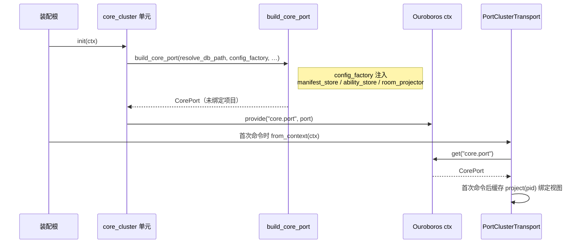

要点：

- 一个端口实例服务全部项目；`project(pid)` 只派生视图，不新建连接池。
- Core 自持消息管理器、能力关系库、manifest 解析器；Subject 只提供工厂
  （`ghrah-core/src/ghrah/core/wiring.py:111`）。
- 关闭由装配根按创建逆序 `aclose()`；单元关闭后端口视图拒绝服务。
- **禁**：在单元 `init` 里立即 `ctx.get` 自己刚 `provide` 的键（同一次 init 内拿到 `None`）。

## 5. 按功能点时序

参与者记号：`UI` 观察端 · `SUBJ` Subject 单元 · `TX` `PortClusterTransport`/`PortMailbox`
· `PORT` `CorePort.project(pid)` · `FACADE` 门面 · `H` handler · `DATA` 只读适配 /
RuntimeRegistry / MessageManager / sqlite。

### 5.1 Agent 列表与运行时状态

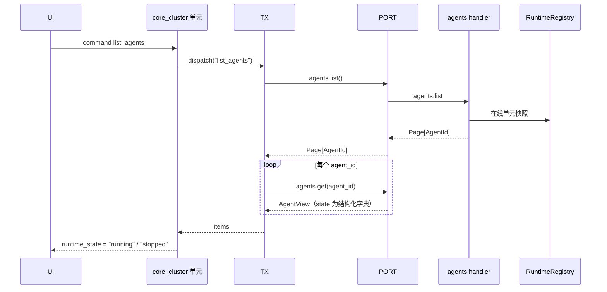

- 列表只回 id，明细按 id 取，避免“列表”退化成重查询。
- `runtime_state` 是**展示语义**，由 Subject 从在线与否推出，Core 不返回。
- 单个 id 并发消失时 `agents.get` 抛 `NOT_FOUND`，跳过该项即可。

### 5.2 创建 Agent（规格 / 模板）

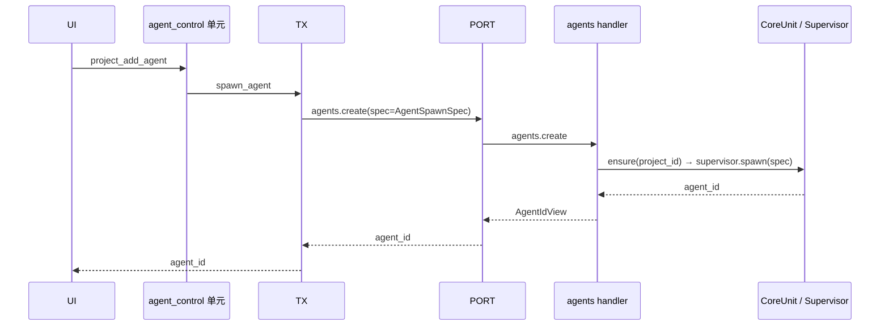

模板路径（能力已实现，供上层按需接入）：

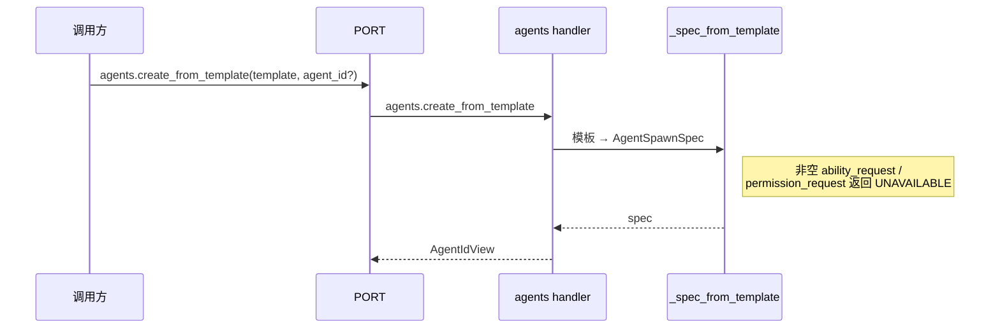

- 创建只回 `agent_id`；后续一律按 id。
- `AgentSpecView`（模板长什么样）与 `AgentSpawnSpec`（这次启动要什么）是两种 DTO，不混用。
- 授权事实由 Core 的 `ability_store` 在 spawn 时核定，Subject 不构造。

### 5.3 行为链读取（session → branch → node）

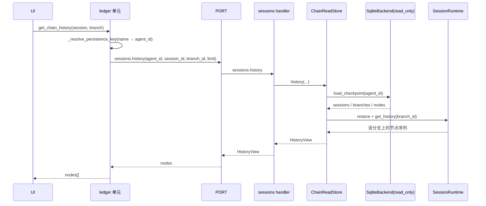

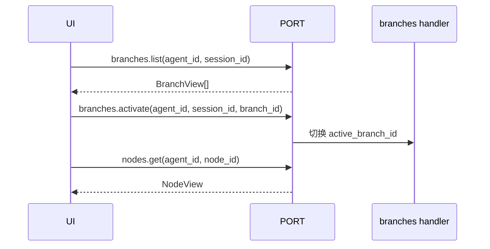

- 关键约束：只读连接**不得长期持有事务**。WAL 下未结束的读事务会把快照固定在建连
  时刻，表现为“服务启动后写入的节点永远读不到”（`ghrah-core/src/ghrah/context/persistence/sqlite_backend.py:256`）。
- 节点沿 `parent_id` 回溯，归属由 `created_on_branch_id` 决定，分支头取 `branches.head_node_id`。
- 会话不存在按空历史处理（`NOT_FOUND` 在 ledger 层被吞掉）。

### 5.4 Room 发消息与投影回流

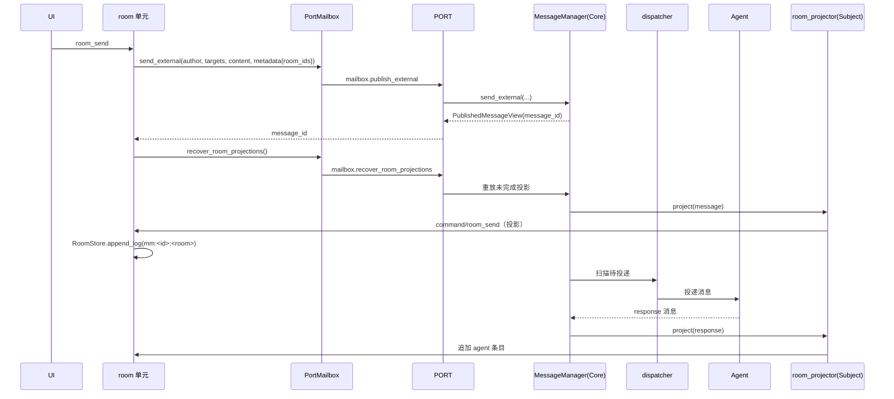

- 正文权威在 Core 的 MessageManager；Room 日志只存 `mm_message_id` 引用。
- 投影器由 Core 单元配置注入（`CoreUnitConfig.room_projector`），Core 只回调，
  房间状态仍归 Subject。
- 目标 Room 已删除属永久失败：跳过并继续，不重试、不复活；临时失败按
  `ROOM_PROJECTION_MAX_ATTEMPTS`（`ghrah-core/src/ghrah/communication/message_manager.py:44`）限次后终结。
- 投递顺序契约：同一收件人同一会话下，前面有未完成投递就会阻塞后续；
  孤儿投递（已消费但无结果）必须在启动期收尾。

### 5.5 信箱与投递运维

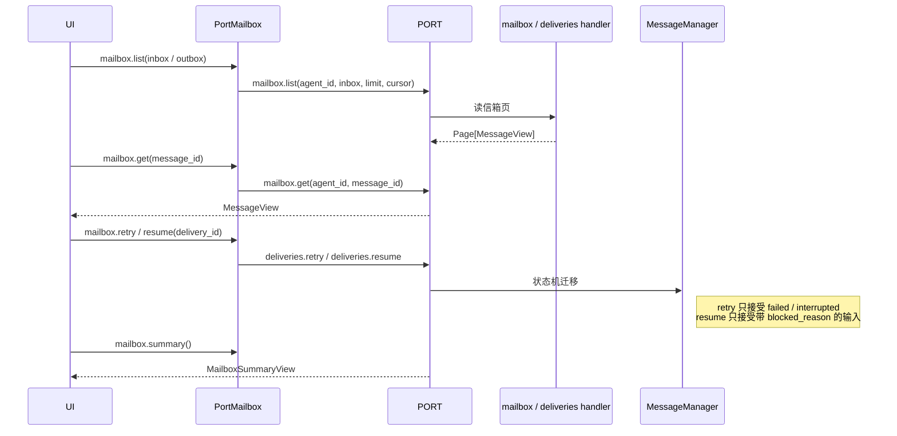

- 投递是状态机：`pending → processing → completed / failed / interrupted`。
- `retry` 与 `resume` 的适用状态不同，错用返回 `INVALID_ARGUMENT`。
- 已消费（`consumed_node_id` 非空）的投递不应重跑，避免重复副作用。

### 5.6 能力面管理

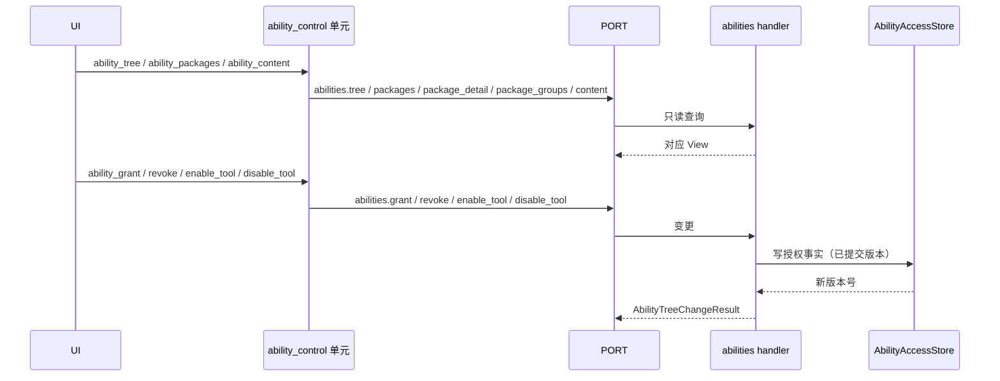

- 只读面（`tree` / `packages` / `content`）与变更面（`grant` / `revoke` / `enable_tool` /
  `disable_tool`）分离，前者无副作用。
- 循环控制成员（`conversation` / `end_task`）不进关系库，由 Agent 自身提供；
  授权策略**只授具体成员**，整包授予会重复注册并导致 spawn 失败。
- 能力正文按成员读取（`content(alias, member, offset, limit)`），不常驻上下文。

### 5.7 Agent 运行控制

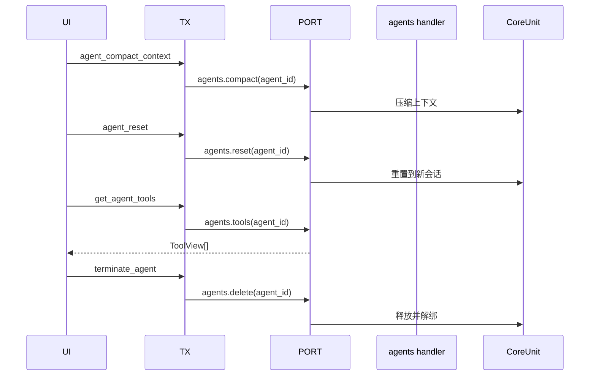

- 控制类能力幂等或可重入：`compact` / `reset` 失败不改状态，`delete` 对已消失的 agent 返回成功。
- `agents.delete` 需同时携带 `agent_id` 与 `name`（后者供 Core 内部定位实例）。

### 5.8 错误与作用域

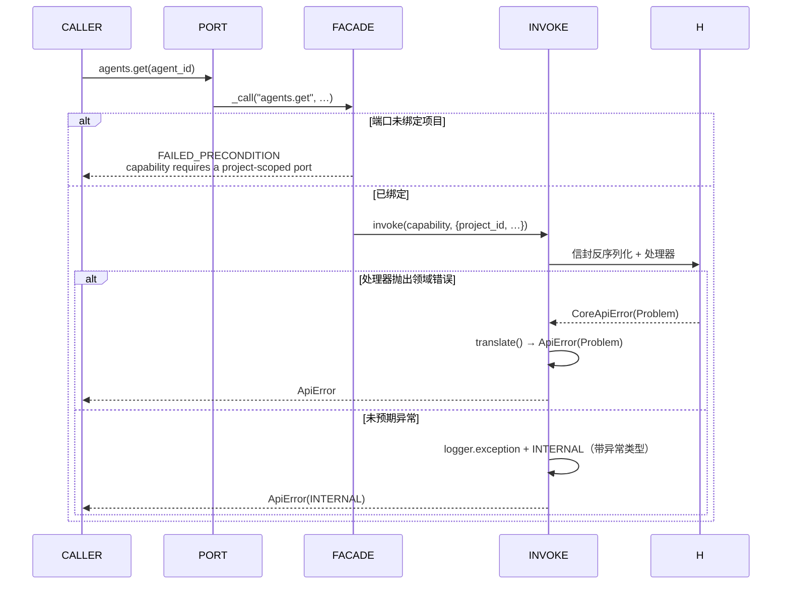

- 只有一个错误族；Subject 按 `code` 分支，不解析文案。
- 缺作用域是**调用方错误**（`FAILED_PRECONDITION`），不是 `NOT_FOUND`。
- 未预期异常必须保留异常类型与栈，否则线上只剩一句 INTERNAL。

### 5.9 状态查询自查表

| 功能点 | 必须画出的边界 | 常见错误 |
| --- | --- | --- |
| 装配 | 谁 provide、谁注入工厂 | 在 `init` 里 `ctx.get` 自己刚 provide 的键 |
| 列表/明细 | 列表回 id、明细按 id | 列表里塞全量视图 |
| 创建 | 规格 DTO 与模板 DTO 分开 | 把 `project_id` 塞进签名而不是作用域 |
| 链读取 | 只读连接不得开长事务 | WAL 快照钉死 → 新节点读不到 |
| Room | 正文权威 vs 投影副本 | 让投影反向覆盖正文 |
| 投递 | 状态机与阻塞规则 | 用 `retry` 处理已消费投递 |
| 能力面 | 只读面与变更面分离 | 整包授予导致循环控制成员重复注册 |
| 错误 | 单一错误族 + 保留栈 | 把异常 `str()` 当 detail，丢掉类型 |

## 6. 已知偏差与维护规则

**已知偏差**

1. `ARCHITECTURE.md` §4.4 / §7 / §10 仍按“Subject `ActionChainLedger` 用同文件第二 WAL
   连接直读 Core sqlite”描述——该实现已删除，读取改经 `sessions.history` 能力
   （`ghrah-subject/src/ghrah/subject/units/ledger.py:113`、`ghrah-subject/src/ghrah/subject/room/manager.py:396`）。
   两份文档冲突时以本文为准，ARCHITECTURE 待下一轮全量校准。
2. `agents.create_from_template` 与 `manifests.resolve` 能力已实现，但 Subject 主链路
   仍走 `agents.create`；模板路径没有生产调用方。
3. 模块边界基线 `ghrah-subject/tests/module_boundary_baseline.json` 仍登记着未清理的
   存量违规（`units/ability_catalog.py`、`units/agent_control.py`），只降不升。

**改动代码后要同步哪份**

| 你改了 | 必须同步 |
| --- | --- |
| `ports/core.py` 或能力清单 | 本文 §3 的总表、`ghrah-06` §7 |
| handler 的错误映射 | 本文 §5.8 |
| Room / 投递语义 | 本文 §5.4、§5.5、`ghrah-03` §8 |
| 上下文读取（session/branch/node） | 本文 §5.3、`ghrah-01` §4 |
| 装配根或单元生命周期 | 本文 §4、`ghrah-05` §2 |