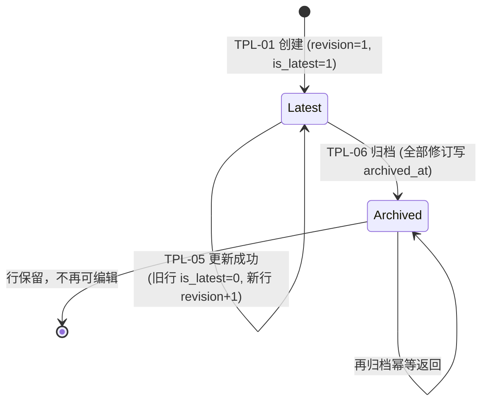
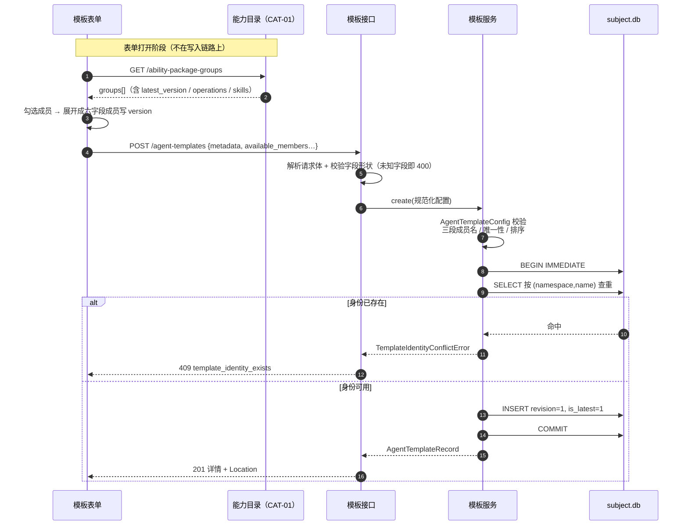
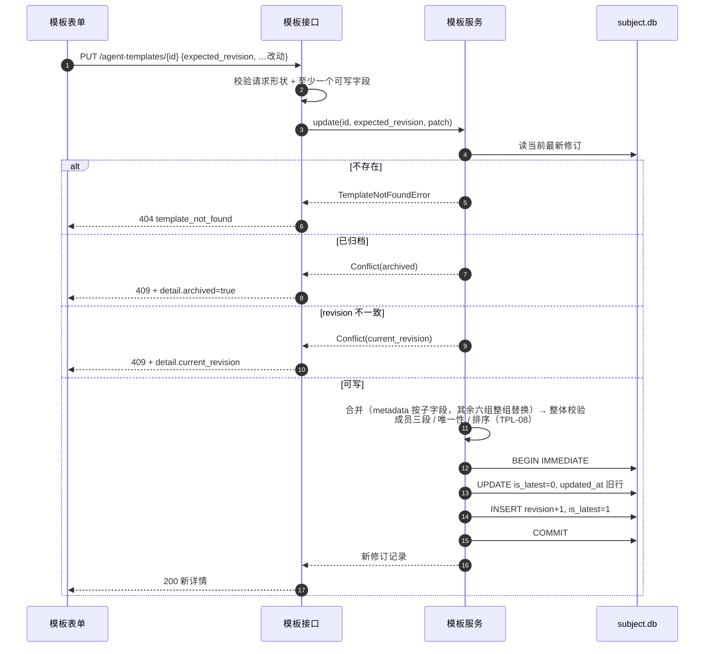

# Agent 模板管理设计说明

| 项 | 内容 |
| --- | --- |
| 文档编号 | GHRAH-DESIGN-009 |
| 文档状态 | 现行（已实现） |
| 校准基线 | `a742fcf`（2026-11-23） |
| 读者 | 需要改模板库、模板表单、模板接口的人；做评审的产品与测试 |
| 覆盖范围 | Agent 模板的存储模型、REST 契约、逐功能行为、成员数组的校验与版本钉住，以及模板选包所依赖的能力目录查询接口 |
| 不覆盖 | Agent 实例化执行链、能力包内部实现、观察端其余页面 |

## 修订记录

| 版本 | 日期 | 变更 |
| --- | --- | --- |
| 1.0 | 2026-11-19 | 首版。按模板库现行实现（单表多版本、成员级落库、能力目录统一查询）逐功能重写 |
| 2.0 | 2026-11-23 | 按 `a742fcf` 校准：能力申请由「整包 + 成员轴」改为 `available_members` 成员身份数组（只存身份六字段）；取消整包申请与整包展开，TPL-08 改写为「成员数组的校验、去重与版本钉住」；模板不再存 `surface` / `mcp_refs`；补「启动时自动改列并转换旧行」的迁移说明与旧 YAML 导入的限制 |

## 1 文档说明

### 1.1 编写目的

让一个只拿到本文的人，能在不改读其它材料的前提下判断：模板有哪些字段、哪个字段能不能加、一次写入会落几行、并发写会怎样失败、删除 Agent 会不会动模板、升级后旧库里的行会变成什么样。本文描述的是**功能与契约**，不描述代码结构；代码结构只在第 7 章的类图里出现一次。

### 1.2 适用范围

- 适用于：模板库的读写行为、模板与能力目录的交互、模板与实例的边界、旧库行的迁移口径。
- 不适用于：Agent 运行期行为（循环、上下文、工具执行）、能力包的定义格式与加载、前端组件样式。

### 1.3 术语

| 术语 | 含义 |
| --- | --- |
| 模板（template） | 一份可复用的 Agent 配置草稿，由「身份 + 五组配置 + 路径申请」构成：`metadata` + `model` / `prompt` / `context_policy` / `available_members` / `permission_request` + `path_request` |
| 模板身份 | `metadata.namespace` + `metadata.name`，创建后不可改；同一身份全局唯一 |
| 修订（revision） | 模板的一次版本；从 1 开始单调递增，每次成功写入 +1 |
| 最新修订 | 某模板 `revision` 最大的那一行，`is_latest=1`，同一模板至多一行 |
| 成员（member） | 能力包内的一个可申请单元，三段全名 `<namespace>.<ability_name>.<member_name>`；`type` 为 `operation` / `skill` / `mcp` |
| 成员数组（`available_members`） | 模板里"选了哪些成员"的唯一存储形状：只记身份六字段（`namespace` / `name` / `member` / `type` / `version` / `ability_type`） |
| 整包（whole container） | **已取消的概念**。编辑器里仍有"全选"复选框，但保存时立刻展开成逐成员（`agent-template-dialog.vue:351-360`）；存储层没有这个字段，模型 `extra=forbid` 会拒绝它 |
| 内核件（kernel） | 随源码发布的包，没有版本层，成员的 `version` 恒为 `null` |
| 能力件（external） | 安装在发行版安装根下的包，`<ns>/<name>/<version>/`，成员带版本 |
| 版本钉住（pin） | 保存时就把成员所属版本写死在 `version` 字段里，之后不再按目录重算 |
| 归档（archive） | 模板的软下架：保留所有行，禁止再编辑，不再用于创建实例 |

### 1.4 模块边界

本模块**只做**：模板的增删改查（含版本化）、成员数组的形状校验与排序、身份查重、引用计数、能力目录查询的对外投影。

本模块**不做**：不渲染装配输入、不创建 Agent、不判断成员是否真实可装载（只校验形状与三段全名）、不修改能力包定义、**写入时也不访问能力目录**（不展开整包、不重新计算版本）。模板里的成员全名在创建实例时才由装配链路按该项目的授权视图解析，解析失败属于实例化阶段的错误（`ghrah-subject/src/ghrah/subject/agents/render.py:293-304`）。

## 2 功能清单

| 功能编号 | 名称 | 触发方式 | 一句话 |
| --- | --- | --- | --- |
| TPL-01 | 创建模板 | `POST /api/v1/agent-templates` | 新身份落一行 `revision=1` |
| TPL-02 | 列出模板 | `GET /api/v1/agent-templates` | 默认每个模板只返回最新修订，可含历史与归档 |
| TPL-03 | 读取模板详情 | `GET /api/v1/agent-templates/{template_id}` | 返回该模板最新修订的完整配置含成员数组 |
| TPL-04 | 读取修订历史 | `GET /api/v1/agent-templates/{template_id}/revisions` | 一行一个修订，不含配置正文 |
| TPL-05 | 更新模板 | `PUT /api/v1/agent-templates/{template_id}` | CAS 通过后追加新修订，旧行转为历史 |
| TPL-06 | 归档模板 | `POST /api/v1/agent-templates/{template_id}/archive` | 全版本写归档时间，之后禁止编辑 |
| TPL-07 | 查询模板引用 | `GET /api/v1/agent-templates/{template_id}/references` | 当前恒返回空列表（未实施跨项目反查） |
| TPL-08 | 成员数组的校验、去重与版本钉住 | 横切规则（TPL-01/05 前置） | 成员三段全名、唯一、按名排序；能力件带版本、内核件为 `null` |
| CAT-01 | 能力目录查询 | `GET /api/v1/ability-package-groups` | 模板下拉与能力配置页共用的唯一来源 |

编号说明：模板功能用 `TPL-nn`，其依赖的目录查询用 `CAT-nn`；本文内不出现第二套编号。

## 3 数据模型

### 3.1 存储位置与权威划分

模板存于 Subject 实例库 `subject.db` 的 `agent_templates` 表（`ghrah-subject/src/ghrah/subject/template_store/store.py:56-86`；库路径来自 `persistence.db_path`，见 `ghrah-subject/src/ghrah/subject/units/agent_template_control.py:365-374`）。它是模板的**唯一权威**：项目管理面、模板接口、创建服务都从这一张表读，没有第二份副本；store 还以服务形式注入运行时供创建链路共用同一实例（`agent_template_control.py:371-372`）。

三份存储的职责边界：

| 数据 | 权威位置 | 内容 | 生命周期 |
| --- | --- | --- | --- |
| 模板 | `subject.db.agent_templates` | 可复用的配置草稿 | 直到归档（行永不物理删除） |
| Agent 记录 | `subject.db.subject_projects.agents`（JSON 列） | 身份、展示快照、来源 `(template_id, revision)`、期望状态 | 直到删除 Agent |
| Agent 配置快照 | 项目库 `db/agents.sqlite3.agent_instances` | 创建时冻结的配置与成员 | 直到删除 Agent |

模板与实例的关系是**一次性填充**：创建时按 `(template_id, revision)` 读一次（`ghrah-subject/src/ghrah/subject/agents/creation.py:169-174`），之后模板再改不影响已存在的实例。实例只保留来源指针，不保留模板内容副本。

### 3.2 `agent_templates` 表结构

| 字段 | 类型 | 约束 | 说明 |
| --- | --- | --- | --- |
| `template_id` | TEXT | 非空，与 `revision` 组成主键 | 创建时生成的稳定标识（uuid4 hex，32 位）；同一身份的所有修订共用一个（`store.py:562-566`） |
| `revision` | INTEGER | 非空，`CHECK >= 1` | 从 1 起递增 |
| `is_latest` | INTEGER | 非空，默认 1，`CHECK IN (0,1)` | 唯一索引保证「每个 `template_id` 至多一行 1」 |
| `format` | TEXT | 非空 | 行格式标记，现行唯一值 `ghrah.agent-templates.v1`（`template_store/formats/__init__.py:32`） |
| `metadata` | TEXT(JSON) | 非空 | 身份与展示：`namespace`、`name`、`title`、`description`、`tags`、`icon`、`deprecated` |
| `model` | TEXT(JSON) | 非空 | `endpoint_name`、`model_overrides` |
| `prompt` | TEXT(JSON) | 非空 | `system_prompt` |
| `context_policy` | TEXT(JSON) | 非空 | `max_iterations`、`communication_timeout`、`window`、`overrides.persistence` |
| `available_members` | TEXT(JSON) | 非空（数组） | 成员身份数组，见 3.3 |
| `permission_request` | TEXT(JSON) | 非空 | `auto_approve[]`、`require_approval_by_default`、`safe_extra_commands[]`、`safe_extra_sub_commands` |
| `path_request` | TEXT(JSON) | 非空（数组） | 路径申请数组，见 3.3 |
| `reference_count` | INTEGER | 非空，默认 0，`CHECK >= 0` | 引用该 `(template_id, revision)` 的 Agent 数；热度指标，非锁 |
| `created_at` / `updated_at` | TEXT | 非空 | RFC 3339 UTC（秒级，`Z` 结尾）；`updated_at` 在修订被取代时刷新 |
| `archived_at` | TEXT | 可空 | 非空表示已归档；归档对该模板**所有修订**生效 |

索引（`store.py:77-85`）：

```text
PRIMARY KEY (template_id, revision)
UNIQUE INDEX uq_agent_templates_latest ON agent_templates(template_id) WHERE is_latest = 1
INDEX idx_agent_templates_template ON agent_templates(template_id)
INDEX idx_agent_templates_archived ON agent_templates(archived_at)
```

七个 JSON 列统一按 `sort_keys` + 紧凑分隔符编码，同一对象在库里只有一种字节形态（`ghrah-subject/src/ghrah/subject/template_store/formats/v1.py:20-45`）。

**列迁移（启动时自动执行，幂等）**

旧库的列名是 `ability_request`，值形如 `{surface, packages, mcp_refs}`。`TemplateStore.start()` 建表后立即执行一次迁移（`store.py:241-277`）：

1. `PRAGMA table_info(agent_templates)` 查列；有 `ability_request` 就 `ALTER TABLE ... RENAME COLUMN ability_request TO available_members`（`store.py:249-252`）；两者都没有则直接返回（`store.py:253-254`）。
2. 逐行读 `available_members`：值已是 JSON 数组的行**跳过**，值仍是旧对象（`dict`）的行用与读入相同的兼容器 `AgentTemplateAbilityRequest.model_validate` 转成成员数组后写回（`store.py:257-276`）。
3. 记一条日志「成员列已就绪，转换 N 行」（`store.py:277`）。

幂等性来自第 2 步的「已是数组即跳过」：重复启动不会二次转换。迁移**无副本、无回滚**，因此不可逆（见 §9）。外部调用方也必须同步改字段名：请求/响应里的键是 `available_members`，旧的 `ability_request` / `packages` 在 REST 层属未知字段，直接 `400 invalid_request`（`ghrah-subject/tests/test_units_agent_templates.py:420-456`）。

schema 版本记在 `subject_schema_versions`（组件名 `agent_template_store`，当前 v2）；检测到更高版本时拒绝启动，检测到未发布的 v1 结构则直接丢弃重建（`store.py:51-52`、`store.py:211-239`）。

不变式（任何写入路径都不得破坏）：

1. 同一 `template_id` 的 `revision` 严格递增且无空洞，从 1 开始（`store.py:335-382`）。
2. 同一 `template_id` 恰有一行 `is_latest=1`（归档后依然保留，便于读最新修订）。
3. 同一身份的 `(namespace, name)` 只能对应一个 `template_id`；查重针对**所有未归档与已归档修订**（`store.py:316-323`、`store.py:538-547`）。
4. 归档是「模板级」状态：写入时对 `archived_at IS NULL` 的行统一置同一时间戳（`store.py:400-406`）。

### 3.3 结构化字段的内部形状

`available_members`（成员数组，落库形态）：

```text
available_members[]                     ← 每项一个成员身份（六字段，无嵌套定义）
├── namespace: string                   ← 包命名空间
├── name: string                        ← 包名（退化身份包 research 落成 name="research"）
├── member: string                      ← 三段全名 <namespace>.<ability_name>.<member_name>
├── type: operation|skill|mcp           ← 成员类型
├── version: string|null                ← 内核件恒 null；能力件为钉住的版本（如 "0.1.0"）
└── ability_type: kernel|external       ← 来源种类
```

模型定义与约束在 `ghrah-subject/src/ghrah/subject/template_store/models.py:154-192`（`AgentTemplateMember`）与 `models.py:195-235`（`AgentTemplateAbilityRequest`）；`AgentTemplateConfig.available_members` 在 `models.py:367`，`AgentTemplateRecord.available_members` 在 `models.py:420`。成员数组里**不存**定义数据：没有 `data` / `axes` / `surface` / `mcp_refs` / 脚本 `exec`——启动 Agent 时才按包版本扫能力定义（`render.py:362-366`）。

规则：

- `member` 必须是三段，且第一段等于 `namespace`、第二段等于 `name`（`models.py:179-186`）。
- `type` 只能是 `operation` / `skill` / `mcp`（`models.py:165`）。
- `ability_type=kernel` 时 `version` 必须为 `null`；`ability_type=external` 时 `version` 给定时不得为空串（`models.py:187-191`）。
- 同一模板内 `member` 必须唯一，重复即校验失败；写入前按 `member` 字典序排序（`models.py:229-235`、`models.py:373-379`）。

`path_request`（路径申请，数组）：

```text
{ scope: agent|package, package: string|null,
  workspace_role: string, subpath: string, access: read|write, deny: bool }
```

规则（`models.py:325-353`）：

- `scope=agent` 时 `package` 必须为 `null`；`scope=package` 时必填。
- `subpath` 必须是 workspace 内相对路径：不得以 `/` 开头、不得是盘符路径、不得含 `..`。
- `(scope, package, workspace_role, subpath)` 不得重复；写入后按五元组排序（`models.py:381-401`）。

**旧形状的兼容只发生在读入侧**

存储层的 `AgentTemplateAbilityRequest._from_legacy` 能把两种旧形状改写成成员数组（`models.py:204-235`）：包级视图 `packages[]`（每项展开成该包的 operation/skill 成员，`models.py:238-275`）与带轴/脚本的 `members[]`（`models.py:278-294`）。这条兼容路径**只服务旧行与迁移脚本**，不是对外的 wire 契约：REST 请求体里出现旧字段会 400。旧形状里的 `surface` 与 `mcp_refs` 在读入时被直接丢弃（`models.py:215-217`）。

### 3.4 版本、归档与引用的状态关系



- 更新只在 `Latest` 上允许；对已归档模板更新一律 `409 template_revision_conflict`（`detail.archived=true`，`store.py:353-356`）。
- 归档不删除行：历史 Agent 的 `origin` 仍可解析、`reference_count` 仍可读；`get` 默认 `include_archived=True`，让悬空来源仍能读到（`store.py:440-451`）。
- 归档拦的是「继续用这个模板」：**已归档模板不能再用于创建 Agent**（创建服务读到修订后立即校验归档状态并拒绝，`creation.py:172-173`），既有实例照常运行、照常按快照恢复。已归档模板仍允许读取、列修订、看引用，只是不能再编辑、不能再派生新实例。

## 4 接口契约

### 4.1 通用约定

- 基址：`/api/v1`；全部为 JSON（`Content-Type: application/json`）。
- 鉴权：回环地址免令牌；非回环需 `Authorization: Bearer <token>`，否则 `403 access_denied`（`agent_template_control.py:140-142`）。
- 开关：`observer_http_api_enabled=false` 时全部端点 `503 capability_unavailable`（`agent_template_control.py:132-138`；错误码见 `ability_control.py:66`）。
- 错误信封：`{"error": {"code": "...", "message": "...", "detail": {...}}}`（处理器与 CORS 由 `AbilityControlUnit` 注册，`ability_control.py:643-663`）。
- 时间：全部 UTC ISO-8601 字符串（`2026-11-23T09:00:00Z`）。
- 条件写：所有写操作带 `expected_revision`（模板修订号），不是项目版本号。
- 未知字段一律 `400`：存储模型侧 `extra="forbid"`（`models.py:75-79`），协议侧 `TreeModel` 是 `strict=True, extra="forbid", frozen=True`（`ghrah-protocol/src/ghrah/protocol/ability_tree.py:15-18`）——因此字符串 "3" 不能当 `expected_revision=3` 用。

错误码总表（映射点 `agent_template_control.py:144-165`）：

| code | HTTP | 何时 |
| --- | --- | --- |
| `invalid_request` | 400 | 请求体不是 JSON 对象、含未知字段、或字段/形状校验失败（`detail.errors` 给出逐字段原因） |
| `template_not_found` | 404 | `template_id`（或 `template_id#revision`）不存在 |
| `template_identity_exists` | 409 | 创建时 `(namespace, name)` 已被占用 |
| `template_revision_conflict` | 409 | `expected_revision` 与最新修订不一致；或模板已归档（`detail.archived=true`）；`detail.current_revision` 给出当前值 |
| `access_denied` | 403 | 非回环且缺少/错误令牌 |
| `capability_unavailable` | 503 | 管理面关闭（`observer_http_api_enabled=false`） |

注：v1.0 里「整包展开时目录不可用 → `503 capability_unavailable`」已随展开逻辑一起取消；关闭管理面开关时返回的同样是 `capability_unavailable`，模板端点没有独立的「管理面已关闭」错误码。

### 4.2 TPL-01 创建模板

`POST /agent-templates`

请求体（`ghrah-protocol/src/ghrah/protocol/agent_control.py:422-431`）：

| 字段 | 类型 | 必填 | 默认 | 说明 |
| --- | --- | --- | --- | --- |
| `metadata` | object | 是 | — | 至少含 `namespace`、`name` |
| `metadata.namespace` | string | 是 | — | 正则 `^[a-z][a-z0-9_.]*[a-z0-9]$` |
| `metadata.name` | string | 是 | — | 正则 `^[a-z][a-z0-9_]*$` |
| `metadata.title` / `description` / `icon` | string | 否 | `""` | 展示字段 |
| `metadata.tags` | string[] | 否 | `[]` | 元素必须非空；写入前去重排序 |
| `metadata.deprecated` | bool | 否 | `false` | 仅标记，不拦使用 |
| `model` | object\|null | 否 | `{}` | `endpoint_name`（提供时不得为空串）、`model_overrides` |
| `prompt` | object\|null | 否 | `{"system_prompt": ""}` | 草稿允许空串 |
| `context_policy` | object\|null | 否 | `max_iterations=-1, communication_timeout=300` | `-1` 表示不限制 |
| `available_members` | array\|null | 否 | `[]` | 成员身份数组，见 3.3 / 4.9 |
| `permission_request` | object\|null | 否 | `require_approval_by_default=true` | 只能收紧部署策略 |
| `path_request` | array | 否 | `[]` | 见 3.3 |

`null` 与省略等价：`service.create` 对每个组取 `payload.get(group) or default`（`ghrah-subject/src/ghrah/subject/template_store/service.py:57-68`）。

响应 `201`，正文为模板详情（同 TPL-03 的 `AgentTemplateDetailView`），并带头：

```text
Location: /api/v1/agent-templates/{template_id}
```

副作用：

1. 生成新的 `template_id`；
2. 写一行 `revision=1, is_latest=1, reference_count=0`；
3. **只有**形状校验、成员唯一性校验与身份查重，不查能力目录、不展开、不改写 `version`（`agent_template_control.py:270-284`）。

幂等性：非幂等。重复提交同一身份返回 `409 template_identity_exists`。

### 4.3 TPL-02 列出模板

`GET /agent-templates`

| 查询参数 | 类型 | 默认 | 说明 |
| --- | --- | --- | --- |
| `namespace` | string | 无 | 精确匹配身份命名空间 |
| `name` | string | 无 | 精确匹配身份名 |
| `tag` | string | 无 | 命中 `metadata.tags` 任一元素（在内存里过滤，`store.py:525-527`） |
| `deprecated` | bool | 无 | 按 `metadata.deprecated` 过滤 |
| `include_archived` | bool | `false` | 含已归档模板 |
| `include_history` | bool | `false` | 含历史修订（默认每个模板只返回最新修订） |

响应 `200`：

```json
{
  "format": "ghrah.agent-templates.list.v1",
  "templates": [
    {
      "format": "ghrah.agent-templates.summary.v1",
      "template_id": "b7479917b0e74c0a9f2e5d1c8a3b6e40",
      "revision": 3,
      "is_latest": true,
      "metadata": { "namespace": "demo", "name": "helper", "title": "…",
                    "description": "…", "tags": [], "icon": "", "deprecated": false },
      "created_at": "2026-11-20T10:10:08Z",
      "updated_at": "2026-11-23T09:00:00Z",
      "archived_at": null,
      "reference_count": 2
    }
  ]
}
```

列表**不返回**配置正文与成员数组（避免列表被大字段拖慢）；需要正文用 TPL-03。排序稳定：按 `metadata.name`、`metadata.namespace`、`revision` 升序（`store.py:517-521`），**不是**按 `updated_at` 倒序。

### 4.4 TPL-03 读取模板详情

`GET /agent-templates/{template_id}`

- 无查询参数；始终返回**最新修订**（含已归档模板）。
- 响应 `200`：`format=ghrah.agent-templates.v1`，字段 = 3.2 的行级字段 + 完整配置六组（`model` / `prompt` / `context_policy` / `available_members` / `permission_request` / `path_request`，即库里那七个 JSON 列；见 `ghrah-subject/src/ghrah/subject/template_store/service.py:31-38`、`agent_template_control.py:87-114`、`agent_control.py:369-386`）。
- 不存在 → `404 template_not_found`。

响应正文示例（成员数组为真实形状，成员名示例取自内置 `ghrah.core` 与退化身份安装包 `research`）：

```json
{
  "format": "ghrah.agent-templates.v1",
  "template_id": "b7479917b0e74c0a9f2e5d1c8a3b6e40",
  "revision": 3,
  "is_latest": true,
  "metadata": { "namespace": "demo", "name": "helper", "title": "演示模板",
                "description": "…", "tags": ["demo"], "icon": "", "deprecated": false },
  "model": { "endpoint_name": "deepseek-v4.1-flash", "model_overrides": null },
  "prompt": { "system_prompt": "You are an AI agent powered by Ghrah…" },
  "context_policy": { "max_iterations": -1, "communication_timeout": 300,
                      "window": null, "overrides": null },
  "available_members": [
    { "namespace": "ghrah", "name": "core", "member": "ghrah.core.load_skill",
      "type": "operation", "version": null, "ability_type": "kernel" },
    { "namespace": "ghrah", "name": "core", "member": "ghrah.core.search_tools",
      "type": "operation", "version": null, "ability_type": "kernel" },
    { "namespace": "research", "name": "research", "member": "research.research.research",
      "type": "skill", "version": "0.1.0", "ability_type": "external" }
  ],
  "permission_request": { "auto_approve": [], "require_approval_by_default": true,
                          "safe_extra_commands": [], "safe_extra_sub_commands": null },
  "path_request": [],
  "created_at": "2026-11-20T10:10:08Z",
  "updated_at": "2026-11-23T09:00:00Z",
  "archived_at": null,
  "reference_count": 2
}
```

### 4.5 TPL-04 读取修订历史

`GET /agent-templates/{template_id}/revisions`

响应 `200`：

```json
{
  "format": "ghrah.agent-templates.revisions.v1",
  "template_id": "b7479917b0e74c0a9f2e5d1c8a3b6e40",
  "revisions": [
    { "revision": 1, "created_at": "2026-11-20T10:10:08Z", "is_latest": false, "reference_count": 0 },
    { "revision": 2, "created_at": "2026-11-21T14:02:31Z", "is_latest": false, "reference_count": 1 },
    { "revision": 3, "created_at": "2026-11-23T09:00:00Z", "is_latest": true,  "reference_count": 2 }
  ]
}
```

- 只返回摘要（不含配置正文与成员数组，`agent_control.py:389-396`）；需要某一修订的正文时按 `(template_id, revision)` 由实例化侧读取（`service.get_version`，`service.py:135-140`），不对外开放独立端点。
- 不存在的 `template_id` → `404 template_not_found`（`service.versions` 先 `get` 一次，`service.py:130-133`）。

### 4.6 TPL-05 更新模板

`PUT /agent-templates/{template_id}`

请求体（`agent_control.py:434-456`；`expected_revision` 必填，其余至少一项）：

| 字段 | 类型 | 说明 |
| --- | --- | --- |
| `expected_revision` | int ≥ 1 | 必须等于当前最新修订，否则 409 |
| `title` / `description` / `icon` | string | 展示字段按子字段 patch（省略或 `null` = 不改） |
| `tags` | string[] | 整组替换 |
| `deprecated` | bool | 整组替换 |
| `model` / `prompt` / `context_policy` / `available_members` / `permission_request` | object / array | 整组替换（省略或 `null` = 不改；传 `[]` 才是清空成员） |
| `path_request` | array | 整组替换（同上，`[]` 才清空） |

身份不可改：请求体里没有 `metadata` 字段，传了就是未知字段 → `400`（`ghrah-subject/tests/test_units_agent_templates.py:467-477`）。

响应 `200`：新修订的完整详情（`revision` 已 +1，`is_latest=true`）。

语义要点：

1. **追加而不是覆盖**：旧行置 `is_latest=0`、`updated_at` 刷新；新行 `revision+1` 携带合并后的完整配置（`store.py:368-382`）。
2. 合并口径：`metadata` 的展示字段按出现与否 patch（`namespace`/`name` 永不改）；其余六组整组替换——不提供「组内部分字段 patch」，避免出现「没给的字段是删除还是保留」的歧义（`service.py:84-93`）。
3. 语义校验在写入前完成：合并后的配置必须整体能通过同一套字段校验（含成员三段与唯一性）；校验失败 `400`，不产生新修订。
4. 归档后更新 → `409 template_revision_conflict`（`detail.archived=true`），不产生新修订。
5. 并发：两个客户端持同一 `expected_revision`，先到者成功，后到者 `409` 并拿到 `detail.current_revision`，需要重读后重试。

### 4.7 TPL-06 归档模板

`POST /agent-templates/{template_id}/archive`

请求体：`{ "expected_revision": 3 }`（`agent_control.py:459-462`）

响应 `200`：归档后的详情（`archived_at` 非空）。

规则（`store.py:384-407`）：

- 归档是模板级软删除：对该 `template_id` 下所有 `archived_at IS NULL` 的行写同一时间戳。
- `expected_revision` 必须等于最新修订，否则 `409`（先比 revision、再看归档，所以「已归档 + revision 不符」仍是 409）。
- 重复归档：若已归档且 `expected_revision` 匹配，幂等返回当前最新行（不报错、不改时间戳）。
- 归档不改变 `reference_count`，也不删除行；历史 Agent 的 `origin` 仍可解析。
- 归档后不能再派发新实例：创建链路读到该模板修订时会拒绝（`template_archived`，`creation.py:169-173`），既有实例不受影响。

### 4.8 TPL-07 查询模板引用

`GET /agent-templates/{template_id}/references`

响应 `200`：

```json
{ "format": "ghrah.agent-templates.references.v1",
  "template_id": "b7479917b0e74c0a9f2e5d1c8a3b6e40", "agents": [] }
```

当前状态：**未实施跨项目反查**，恒返回空数组；但会先校验模板存在（不存在 → 404，`agent_template_control.py:311-323`）。跨项目扫描 Project 库的成本与一致性方案未决，故先给出稳定形状而不给出假数据。前端展示层必须把空数组理解为「不支持」而不是「无引用」。

### 4.9 TPL-08 成员数组的校验、去重与版本钉住（横切规则）

不单独暴露接口，在 TPL-01/05 的写入前由模型层执行（`models.py:195-235`、`models.py:356-379`）。作用对象是 `available_members[]` 的每一项：

```text
for member in request.available_members:
    # 1 身份形状：三段且前两段与包身份一致
    parts = member.member.split(".")
    require len(parts) == 3 and parts[0] == member.namespace and parts[1] == member.name
        └─ 不满足 → 400 invalid_request（models.py:179-186）

    # 2 类型与版本的一致性
    require member.type in {operation, skill, mcp}
    if member.ability_type == "kernel":
        require member.version is None         # 内核件没有版本层
    else:                                      # external
        require member.version is None or member.version.strip() != ""
        └─ 不满足 → 400 invalid_request（models.py:187-191）

# 3 唯一性：同一模板内 member 全名不得重复；重复即拒绝，不静默去重
require len(names) == len(set(names))          # models.py:229-235
# 4 规范化：按 member 全名字典序排序后落库
return sorted(members, key=lambda item: item.member)
```

关键判断：

- **模板层不认识「整包」**：`whole_container` 不在成员模型里，请求体带它（或带旧包级 `packages[]`）一律 `400`（`models.py:75-79` 的 `extra="forbid"`；用例 `ghrah-subject/tests/test_units_agent_templates.py:425-437`）。旧形状读入侧（迁移与旧行兼容）遇到 `whole_container=true` 也是**直接抛错**，不做隐式展开（`models.py:245-246`）。编辑器仍有"全选"复选框，但保存时已展开成逐成员（`agent-template-dialog.vue:351-360`、`agent-template-dialog.vue:588-591`）。
- **展开与版本钉住都在客户端**：服务端只有形状校验，前端负责「全选 → 逐成员」和「成员 → 带版本」两件事（`agent-template-dialog.vue:324-360`）；服务端对应的目录取画像函数是死代码（`agent_template_control.py:167-186`）。
- **版本在保存时就已经确定**：编辑器从 CAT-01 取该包组选中的版本写进每个成员（`agent-template-dialog.vue:336-349`、`agent-template-dialog.vue:158-176`）；内核件写 `null`，能力件写目录判定的最新版本。写入链路不查目录、不重算版本——与 v1.0 的「展开时读目录钉版本」相反。
- **能力件带版本、内核件为 `null` 是编辑器契约**：模型层强制的是「内核件不得带版本」与「能力件不得给空串」，并不强制 `external` 成员必须有 `version`（见 §9 第 6 条）。
- **模板成员没有轴**：成员模型只有六字段，没有 `visible` / `available` / 脚本 `exec`（`models.py:154-167`）；可见面在装配时由 Surface 与授权视图决定，不由模板记录。
- **唯一性校验不是去重**：同名成员出现两次直接失败，让前端的重复来源（同一包多行、operation/skill 撞名）暴露出来，而不是被静默吞掉。
- **排序 + 规范编码 = 幂等字节形态**：同一组成员无论提交顺序如何，落库文本一致（`models.py:229-235`、`formats/v1.py:20-45`）；对已规范化的数组再提交一次不会产生差异。

## 5 逐功能设计

### 5.1 TPL-01 创建模板

| 项 | 内容 |
| --- | --- |
| 名称 | 创建模板 |
| 功能编号 | TPL-01 |
| 功能描述 | 以一个未被占用的身份登记新模板，落 `revision=1`，返回可直接用于编辑与实例化的完整详情 |
| 参与用户 | 项目配置管理员（回环免令牌；远程需持有 Bearer 令牌） |
| 输入 | `metadata`（必填 `namespace`/`name`）+ 五组配置（均可省略，含 `available_members`）+ 路径申请数组 |
| 操作序列 | 打开「Agent 模板」页 → 点「新建模板」→ 表单打开时先取 CAT-01 与端点列表 → 填写身份与配置、勾选成员（保存时展开成逐成员并写版本）→ 提交 → 服务端做形状与唯一性校验（TPL-08）→ 身份查重 → 写行 → 返回详情并跳转到该模板 |
| 扩展及异常 | 身份重复：`409 template_identity_exists`；字段非法（含成员非三段、成员重复、内核件带版本、含未知字段）：`400 invalid_request`（逐字段 errors）；管理面关闭：`503 capability_unavailable`。**请求不查能力目录，因此不会因目录不可用失败** |
| 输出 | `201` + 模板详情（`format=ghrah.agent-templates.v1`）+ `Location` 头 |
| 补充说明 | 模板允许「未完成」：`system_prompt` 可为空、`endpoint_name` 可为空。是否可创建实例由实例化侧校验，模板层不拦 |



### 5.2 TPL-02 列出模板

| 项 | 内容 |
| --- | --- |
| 名称 | 列出模板 |
| 功能编号 | TPL-02 |
| 功能描述 | 按身份、标签、弃用状态筛选模板，默认只给每个模板的最新修订 |
| 参与用户 | 同上 |
| 输入 | 六个可选查询参数（见 4.3） |
| 操作序列 | 进入「Agent 模板」页 → 页面带默认参数请求一次 → 渲染卡片列表（每张卡片显示身份、标题、修订号、引用数、归档态）→ 切筛选时重新请求 |
| 扩展及异常 | 无分页（模板数量按百级设计）；参数类型错误 `400`；结果为空返回空数组而非 404 |
| 输出 | `200` + `AgentTemplateListView` |
| 补充说明 | `include_history=false` 时同一 `template_id` 只出现一次；为 `true` 时按修订各出现一次，前端需自行分组。排序按 `name`/`namespace`/`revision` 升序，与 `updated_at` 无关 |

### 5.3 TPL-03 读取模板详情

| 项 | 内容 |
| --- | --- |
| 名称 | 读取模板详情 |
| 功能编号 | TPL-03 |
| 功能描述 | 取某模板最新修订的完整配置与成员数组，供编辑表单回填与详情展示 |
| 参与用户 | 同上 |
| 输入 | 路径参数 `template_id` |
| 操作序列 | 列表点某张卡片 → 表单打开前先 GET 详情 → 回填身份（只读）、配置与成员行（`rowsFromMembers` 按 `namespace.name` 分行）→ 用户修改后走 TPL-05 |
| 扩展及异常 | 不存在：`404 template_not_found`；已归档模板仍可读（`archived_at` 非空，前端应禁用保存） |
| 输出 | `200` + `AgentTemplateDetailView`（含 `available_members`） |
| 补充说明 | 详情永远返回最新修订；要读历史修订必须显式走实例化侧读取，接口层不提供「按 revision 读模板」的公开端点。前端把成员数组按 `namespace.name` 分行渲染，同一包多版本时行数为多行（`agent-template-dialog.vue:362-391`） |

### 5.4 TPL-04 读取修订历史

| 项 | 内容 |
| --- | --- |
| 名称 | 读取修订历史 |
| 功能编号 | TPL-04 |
| 功能描述 | 列出某模板的全部修订摘要，支撑「这个模板被改过几次、每个版本被几个 Agent 用过」 |
| 参与用户 | 同上 |
| 输入 | 路径参数 `template_id` |
| 操作序列 | 详情页展开「修订历史」→ GET revisions → 渲染行（修订号、创建时间、是否最新、引用数） |
| 扩展及异常 | 不存在：`404`；只有一个修订时返回长度 1 的数组 |
| 输出 | `200` + `AgentTemplateRevisionsView` |
| 补充说明 | 不返回配置正文是刻意设计：历史正文可能很大且极少被读，避免一次请求拖出所有旧版本 |

### 5.5 TPL-05 更新模板

| 项 | 内容 |
| --- | --- |
| 名称 | 更新模板 |
| 功能编号 | TPL-05 |
| 功能描述 | 在 CAS 保护下把模板推进到新修订；旧修订保留可追溯 |
| 参与用户 | 同上 |
| 输入 | 路径参数 `template_id` + `expected_revision` + 至少一个可写字段 |
| 操作序列 | 打开编辑表单（回填最新修订）→ 修改 → 提交 → 服务端合并配置、校验成员数组 → CAS 校验 → 追加新修订 → 返回新详情，页面刷新修订号 |
| 扩展及异常 | 修订冲突：`409 template_revision_conflict`（`detail.current_revision`）；模板已归档：`409`（`detail.archived=true`）；无任何可写字段：`400`；字段非法：`400` 且不落新修订；传 `metadata`：`400` |
| 输出 | `200` + 新修订详情 |
| 补充说明 | 更新不改变 `template_id`，也不改已创建实例；实例只在「创建时读一次」模板。成员数组是整组替换：省略或 `null` 保留旧成员，`[]` 清空 |



### 5.6 TPL-06 归档模板

| 项 | 内容 |
| --- | --- |
| 名称 | 归档模板 |
| 功能编号 | TPL-06 |
| 功能描述 | 软下架一个模板：不再出现在默认列表、不再允许编辑、不再可用于创建实例，但历史与引用保持可查 |
| 参与用户 | 同上 |
| 输入 | 路径参数 `template_id` + `expected_revision` |
| 操作序列 | 详情页点「归档」→ 二次确认 → POST archive → 返回归档详情；列表默认不再显示该模板 |
| 扩展及异常 | 修订冲突：`409`；重复归档：幂等 `200`；不存在：`404` |
| 输出 | `200` + 详情（`archived_at` 非空） |
| 补充说明 | 归档是「停机位」而不是删除位。物理删除从未提供：`origin` 指针与引用计数都依赖行存在 |

### 5.7 TPL-07 查询模板引用

| 项 | 内容 |
| --- | --- |
| 名称 | 查询模板引用 |
| 功能编号 | TPL-07 |
| 功能描述 | 列出引用某模板的 Agent（跨项目） |
| 参与用户 | 同上 |
| 输入 | 路径参数 `template_id` |
| 操作序列 | 详情页点「引用」→ GET references → 渲染列表或「暂不支持」提示 |
| 扩展及异常 | 不存在：`404`；当前恒返回空数组（未实施） |
| 输出 | `200` + `AgentTemplateReferencesView`（`agents: []`） |
| 补充说明 | 已明确「未实施」：接口形状稳定但数据恒空。前端不得把空数组渲染成「无 Agent 使用」，必须提示能力未开放。实现里保留了「先 `service.get` 再返回空」的顺序，等 T2 接入时替换最后一步 |

### 5.8 TPL-08 成员数组的校验、去重与版本钉住

| 项 | 内容 |
| --- | --- |
| 名称 | 成员数组的校验、去重与版本钉住 |
| 功能编号 | TPL-08 |
| 功能描述 | 保证落库的成员数组只有一种可解析形状：三段身份名、类型合法、内核件无版本、能力件带版本、同名成员不重复、顺序固定 |
| 参与用户 | 间接参与（用户在前端勾成员，展开与版本由编辑器完成，校验由服务端完成） |
| 输入 | 请求里的 `available_members[]`（六字段/项） |
| 操作序列 | 用户在表单里选包与成员（版本来自 CAT-01 的 `latest_version`）→ 提交创建/更新 → 服务端逐项校验三段名、类型、版本一致性 → 校验唯一性 → 按 `member` 排序 → 落库 |
| 扩展及异常 | 成员名不是三段或与 `namespace`/`name` 不一致：`400`；`type` 非法：`400`；内核件带 `version` 或能力件给空串版本：`400`；成员重复：`400`；携带已取消的整包字段（`whole_container`）或旧包级 `packages`：`400`（未知字段） |
| 输出 | 规范化后的成员数组（按 `member` 排序，能力件 `version` 非空、内核件 `null`） |
| 补充说明 | 校验**不查能力目录**：模板只保证形状自洽，不保证成员此刻在目录里存在、可装载；后者是实例化阶段的事（`render.py:275-304`）。整包申请与整包展开已取消，见 §8。展开与版本钉住由编辑器完成（`agent-template-dialog.vue:324-360`），服务端只做本节的形状校验 |

## 6 能力目录查询接口（CAT-01）

模板选包与「Ability 配置」页共用同一个查询，返回天然区分内核件与能力件。

`GET /api/v1/ability-package-groups`

**无查询参数**：该端点固定返回发行版范围（`scope=distribution`），项目与 Agent 范围是另外两条路径（`ghrah-subject/src/ghrah/subject/units/ability_control.py:527-530`）：

| 端点 | 范围 | 位置 |
| --- | --- | --- |
| `GET /api/v1/ability-package-groups` | `distribution` | `ability_control.py:527-530` |
| `GET /api/v1/projects/{id}/ability-package-groups` | `project` | `ability_control.py:532-544` |
| `GET /api/v1/projects/{id}/agents/{agent_id}/ability-package-groups` | `agent` | `ability_control.py:546-559` |

模板编辑器只用第一条（`agent-template-dialog.vue:152-154`）。

响应 `200`（节选，一个内核件组 + 一个能力件组）：

```json
{
  "format": "ghrah.ability-control.package-groups.v1",
  "scope": "distribution",
  "installed_available": true,
  "project_id": null,
  "agent_id": null,
  "groups": [
    {
      "namespace": "ghrah", "name": "core", "full_name": "ghrah.core", "title": "Core",
      "ability_type": "kernel",
      "latest_version": null,
      "operations": ["bind_member", "conversation", "describe_tool", "end_task",
                     "execute_tool", "load_skill", "recall_context",
                     "search_tools", "session_info", "unbind_member"],
      "skills": [],
      "versions": [
        { "version": "0.1.0", "origin": "builtin", "ability_type": "kernel",
          "lock_state": "builtin", "problem": null, "shadowed_builtin": false,
          "is_latest": false,
          "operations": ["bind_member", "conversation", "…"],
          "skills": [], "member_count": 11,
          "project": null, "agent": null }
      ]
    },
    {
      "namespace": "research", "name": "research", "full_name": "research",
      "title": "research",
      "ability_type": "external",
      "latest_version": "0.1.0",
      "operations": [],
      "skills": ["research"],
      "versions": [
        { "version": "0.1.0", "origin": "installed", "ability_type": "external",
          "lock_state": "ok", "problem": null, "shadowed_builtin": false,
          "is_latest": true,
          "operations": [], "skills": ["research"], "member_count": 1,
          "project": null, "agent": null }
      ]
    }
  ]
}
```

字段口径（模板选包直接依赖；模型见 `ghrah-protocol/src/ghrah/protocol/ability_control.py:633-683`）：

| 字段 | 口径 |
| --- | --- |
| `scope` | 由端点决定：`distribution` / `project` / `agent`；`distribution` 时后两个 id 必为 `null`（`ability_control.py:685-699`） |
| `installed_available` | 安装根是否可用（能读且能枚举）；为假时只有内置包（`ability_catalog.py:128-142`） |
| `namespace` / `name` / `full_name`（组级） | **可空**：已提交但定义面读不到的版本仍留在组里，此时身份字段为 `null`（`ghrah-protocol/src/ghrah/protocol/ability_control.py:655-664`） |
| `ability_type`（组级） | 组内全是非 installed 来源则为 `kernel`，否则 `external`（`ability_catalog.py:788-794`） |
| `latest_version` | **只在已安装版本里**取版本号数值最大者；内核件恒 `null`（`ability_catalog.py:760-772`） |
| `operations` / `skills`（组级） | 「应当被选中」的成员键：能力件取最新版本，内核件取唯一版本（`ability_catalog.py:773-778`） |
| `versions[].version` | 可空：定义缺失的已提交版本没有版本号（`ability_control.py:636`） |
| `is_latest`（行级） | 该行版本号是否等于 `latest_version`；内核件行恒 `false`（`ability_catalog.py:778-787`、`ability_catalog.py:754`） |
| `lock_state` / `problem` | 安装校验状态；内置行为 `builtin`，非 `ok` 时前端应禁止选该版本 |
| `versions[].project` / `versions[].agent` | 只有项目/Agent 范围才非 `null`（`ability_catalog.py:721-752`） |

规则：

- 接口**不返回**凭据与脚本正文，只返回可选成员键；模板里的成员也不再携带轴的 `visible`/`available` 与脚本 `exec`。
- 版本号比较必须是数值比较（`1.10.0 > 1.9.0`），实现走 `_version_sort_key`（`ability_catalog.py:762-772`）。
- 内核件与能力件在返回结构上同构，只在 `ability_type` / `latest_version` / `version` 上区分；装载逻辑不因此分叉。
- 组级 `operations`/`skills` 是编辑器填成员的首选来源；缺成员时回退到版本画像 `GET /api/v1/ability-packages/{namespace}/{name}/versions/{version}`（`agent-template-dialog.vue:191-238`，端点 `ability_control.py:488-495`）。

## 7 类图（唯一的代码结构视图）

```mermaid
classDiagram
    class AgentTemplateControlUnit {
        +router
        +service
        +store
        +init(ctx)
        +stop()
    }
    class AgentTemplateService {
        +create(payload) AgentTemplateRecord
        +update(id, expected_revision, payload) AgentTemplateRecord
        +archive(id, expected_revision) AgentTemplateRecord
        +get(id) AgentTemplateRecord
        +list(filters) AgentTemplateRecord[]
        +versions(id) AgentTemplateRecord[]
        +get_version(id, revision) AgentTemplateRecord
    }
    class TemplateStore {
        +create(config) AgentTemplateRecord
        +update(id, expected_revision, config) AgentTemplateRecord
        +archive(id, expected_revision) AgentTemplateRecord
        +get(id, include_archived) AgentTemplateRecord
        +get_version(id, revision) AgentTemplateRecord
        +get_by_identity(namespace, name) AgentTemplateRecord
        +versions(id) AgentTemplateRecord[]
        +list(filters) AgentTemplateRecord[]
        +increment_reference(id, revision)
        +decrement_reference(id, revision)
        +_migrate_members_column(db)
    }
    class AgentTemplateConfig {
        +metadata
        +model
        +prompt
        +context_policy
        +available_members AgentTemplateMember[]
        +permission_request
        +path_request
        +document() dict
    }
    class AgentTemplateRecord {
        +template_id
        +revision
        +is_latest
        +reference_count
        +available_members AgentTemplateMember[]
        +archived
        +latest
        +config() AgentTemplateConfig
    }
    class AgentTemplateMember {
        +namespace
        +name
        +member
        +type
        +version
        +ability_type
        +package() str
        +key() str
    }
    class AgentTemplateAbilityRequest {
        +available_members AgentTemplateMember[]
        +_from_legacy(value) dict
        +_check_members(value) list
    }
    class AgentTemplateMemberView {
        +namespace
        +name
        +member
        +type
        +version
        +ability_type
    }
    class RestRouter {
        +GET /agent-templates
        +POST /agent-templates
        +GET /agent-templates/{id}
        +PUT /agent-templates/{id}
        +POST /agent-templates/{id}/archive
        +GET /agent-templates/{id}/revisions
        +GET /agent-templates/{id}/references
    }

    AgentTemplateControlUnit --> AgentTemplateService
    AgentTemplateControlUnit --> RestRouter
    AgentTemplateService --> TemplateStore
    TemplateStore --> AgentTemplateConfig
    TemplateStore --> AgentTemplateRecord
    AgentTemplateRecord --> AgentTemplateMember
    AgentTemplateConfig --> AgentTemplateMember
    AgentTemplateAbilityRequest --> AgentTemplateMember : 旧行兼容（读入侧）
    RestRouter ..> AgentTemplateMemberView : wire 视图
    AgentTemplateService ..> AgentTemplateRecord
```

职责边界：

- `RestRouter`：只做 HTTP 形状（JSON 解析、状态码、Location 头）；不含业务规则（`agent_template_control.py:210-323`）。
- `AgentTemplateService`：合并语义（metadata 子字段 patch / 其余组替换）、校验入口、错误映射的前置事实（`service.py:57-95`）。
- `TemplateStore`：事务、CAS、`is_latest` 维护、引用计数、启动期列迁移；不解析业务字段（`store.py:298-436`、`store.py:241-277`）。
- `AgentTemplateConfig`：字段与跨字段约束的唯一定义点（成员三段名、成员唯一性、内核件无版本、路径约束）（`models.py:325-401`）。
- `AgentTemplateMember`：成员身份六字段 + 两个派生属性（`package`、`key`）（`models.py:154-192`）。
- `AgentTemplateAbilityRequest`：只在旧行/旧载荷读入时出现，负责 `packages[]` / `members[]` → 成员数组的改写（`models.py:195-294`）。
- `AgentTemplateMemberView`：协议侧（wire）同形视图，REST 输出与输入都用它（`agent_control.py:274-298`）。
- 目录端口（`PackageCatalogPort`）：**本类图不再画出**。`build_agent_template_control_router` 仍接收 `catalog` 参数（`agent_template_control.py:117-128`），但写入链路已不再调用它；函数内的 `_profile` 没有任何调用点（`agent_template_control.py:167-186`），只被这段死代码使用，模板路由未使用。删除属未实施清理，见 §9 第 8 条。

## 8 关键决策与已否决方案

**已否决并从代码中移除**：`ability_request.packages`（包维度申请）、`whole_container`（整包申请与整包展开）、模板内的 `surface` / `mcp_refs`。三者都在 v1.0 里作为设计存在，现在只剩旧行迁移的兼容代码（`models.py:204-235`）。

| 决策 | 理由 | 被否决 / 已否决的方案 |
| --- | --- | --- |
| 单表多版本，追加行 + `is_latest` 唯一索引 | 历史可追溯；在途实例可按旧修订解析；并发写只需 CAS 一个字段 | 原地 UPDATE（历史丢失、无法回答「这个 Agent 用的哪版」） |
| 存储层只存成员身份数组 | 模板的职责是「选中哪些成员」；定义、轴、脚本随能力包版本解析，只有一种形状可解析 | **已否决：`ability_request.packages` 包级申请**（同一事实有两种粒度，实例化要处理「包 vs 成员」两套分支，且包的 `version` 与成员的 `version` 可能不一致） |
| 取消整包展开（`whole_container`） | 展开必须在某个时点读目录，写路径就绑上了目录可用性；且两侧目录不同步时展开出的成员会在创建期解析失败 | **已否决：落库时展开整包**（目录不可用时整次保存失败；展开时机一旦漂移就会写出「整包但没有成员」的空壳） |
| 模板不存 `surface` / `mcp_refs` | 能力面与 MCP 引用是运行期装配参数，不是「选了哪些成员」；模板存它们会与成员数组重复描述可见性 | **已否决：模板携带 `surface` 与 `mcp_refs`**（`surface.static` 的键还需要另一套成员解析；渲染时已统一取 `surface=None, mcp_refs=[]`，见 `render.py:224-225`） |
| 版本在保存时钉住（编辑器从 CAT-01 取 `latest_version` 写入） | 保存语义与目录状态解耦：目录之后升级不影响已存模板；同包多版本并存时不记版本会在创建期找不到成员 | **已否决：写入时按目录重算最新版本**（保存结果依赖当时目录状态，无法回答「为什么昨天保存的模板今天版本变了」；也让写路径依赖目录可用性） |
| 成员唯一性「校验并拒绝」，不静默去重 | 重复成员一定是前端 bug（同一包两行、operation/skill 撞名），静默去重会把来源错误藏起来 | 静默去重（掩盖重复来源，事后无法解释成员去了哪） |
| 归档而不是物理删除 | `origin` 指针与引用计数依赖行存在 | 物理删除（历史 Agent 的来源悬空、计数无法核对） |
| `metadata` 按子字段 patch，其余组整组替换 | 展示字段的修改是高频且独立的；配置组是整体语义，组内 patch 会产生「省略=删除还是保留」的歧义 | 全部按子字段 patch（`available_members` 这类数组无法无歧义合并） |
| 引用计数只做「创建 +1 / 删除 -1」，不做事务强一致 | 它是热度指标，不是授权或配额；强一致会引入跨库事务或分布式锁 | 用计数器拦删除（把指标当锁，会因漂移误拦） |
| 旧列启动时自动改名并转换旧行 | 升级即可用；调用方少一步手工迁移；转换复用读入兼容器，口径与运行期一致 | 保留双列 / 双形状长期并存（两套解析路径，迟早写错一边） |

## 9 已知限制

1. **TPL-07 未实施**：引用关系只能从项目侧的 Agent 记录反查，跨项目扫描的成本与一致性方案未定，接口返回空数组（`agent_template_control.py:311-323`）。
2. **迁移不可逆，旧 `surface` / `mcp_refs` 会丢失**：`ability_request` 列被就地改名为 `available_members`，值只保留成员身份；旧 `surface`（`mode` / `static` / `max_static`）与 `mcp_refs` 在读入时被丢弃（`models.py:215-217`），库里不留副本（`store.py:249-252`）。若旧模板依赖过 `static` 可见面或 MCP 引用，升级后需要人工重建（渲染侧现在固定 `surface=None, mcp_refs=[]`，`render.py:224-225`）。
3. **迁移不是逐行容错**：转换循环里任一行校验失败（例如旧行带 `whole_container=true`，`models.py:245-246` 会直接报错）都会让 `_migrate_members_column` 抛出，进而 `TemplateStore.start()` 失败、模板管理面起不来（`store.py:257-276` 没有 try/except）。升级前应对旧库先跑一次预检；一旦失败只能先修复或删除坏行。
4. **旧 YAML 导入是尽力而为**：`scripts/migrate_agent_templates.py` 把发行版 `manifests/agents` 下的 YAML 导进 `agent_templates`，默认预演、`--apply` 才落库（`scripts/migrate_agent_templates.py:381-401`）。它写出的成员一律是 `type=operation`、`ability_type=kernel`、`version=None`（`scripts/migrate_agent_templates.py:191-203`），`path_request` 恒为 `[]`（`scripts/migrate_agent_templates.py:302-310`）——旧 YAML 里的 skill 成员、能力件版本、路径申请无法还原。`hooks` 被丢弃、`allowed_paths` 需人工复核、成员级权限被降维成 Agent 级（`scripts/migrate_agent_templates.py:252-288`、`:311-313`），全部进报告；`--strict` 时存在未解析项即以退出码 3 失败（`:375-377`）。`--on-conflict=update` 会追加一个新修订而不是覆盖（`:357-363`）。
5. **成员唯一性按 `member` 全名字符串判定**：同一 key 不能既是 operation 又是 skill、也不能属于同名的两个包（`models.py:229-235`）。这是个刻意的收紧，但没有按 `(member, type)` 放宽的入口。
6. **`external` 成员的 `version` 允许为 `null`**：模型与协议层只强制「内核件不得带版本」「能力件给定时不得为空串」（`models.py:187-191`、`agent_control.py:288-298`），并不强制 external 必带版本。「能力件必须带版本」由编辑器保证（`agent-template-dialog.vue:336-349`），直连 API 仍可写出未钉版本的能力件成员。
7. **保存阶段不校验成员是否存在**：模板只校验形状（§4.9），允许保存一个当前目录里不存在的成员；这类模板在创建 Agent 时才会暴露为 `missing_packages` / `not_granted`（`render.py:293-304`）。
8. **模板不再展开、不再查目录**：`agent_template_control.py` 里取包画像的 `_profile`（`:167-186`）已无调用点，`catalog` 参数保留但写入不依赖它，unit 的 `meta.requires` 却仍声明 `CORE_CATALOG_SERVICE`（`agent_template_control.py:336-341`）；删除这层残留属于未实施清理。同理，`AgentTemplateSurface`（`models.py:141-151`）与 `AgentTemplateSurfaceView`（`agent_control.py:266-271`）仍在代码与生成的 TS 契约里，但没有任何模板请求/响应引用它们。
9. **`type="mcp"` 有字段、无入口**：成员模型允许 `mcp`（`models.py:165`），但 CAT-01 的版本行来源只有 `builtin` / `installed`（`ability_control.py:637`），编辑器也只产出 `operation` / `skill`（`agent-template-dialog.vue:336-349`）——MCP 成员目前只能手写 API 写入，创建 Agent 时创建对话框还会把它过滤掉、不允许作为初始绑定（§4.9），渲染时按 operation 处理（`render.py:285-286`）。
10. **无分页**：列表按百级模板设计；上千模板时需要增加游标（`store.py:488-527` 一次取全量）。
11. **无差量更新**：`available_members` 等组每次整组写回，大模板的请求体不小。
12. **身份改名不支持**：`namespace`/`name` 创建后不可改；改名等价于「新建一个模板 + 归档旧的」，引用不会迁移。
13. **归档不回填引用**：归档后既有实例照常运行；没有「归档时提示有 N 个实例仍在用」的校验（引用计数只作展示）。
14. **删除 Agent 失败的计数漂移**：删除时若 `decrement_reference` 失败只记警告（`ghrah-subject/src/ghrah/subject/project/manager.py:1118-1126`），计数可能偏大；而创建侧是先落记录再 +1，只会少计（`manager.py:904-907`）。读取方不应把该值当精确配额。