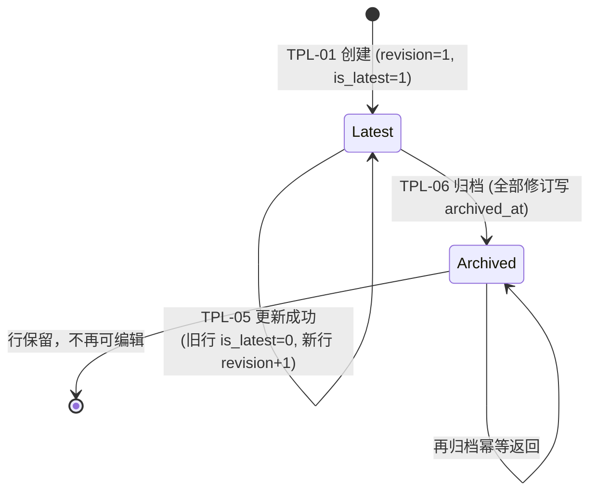
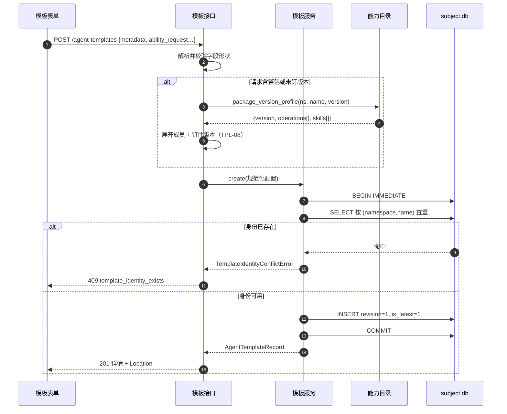
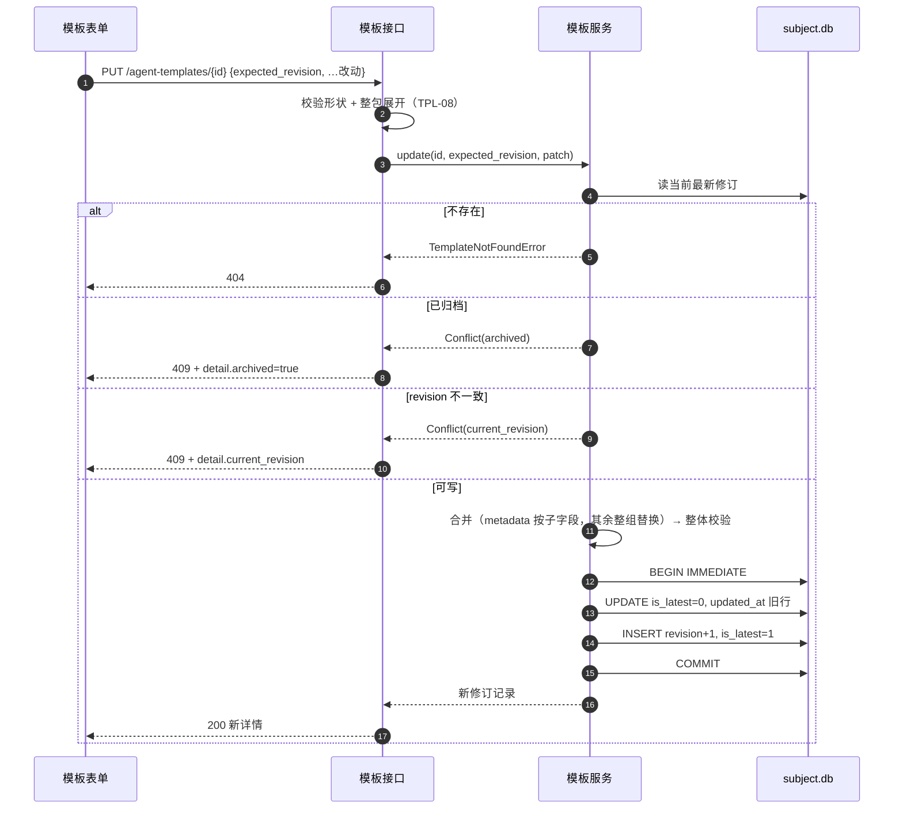

# Agent 模板管理设计说明

| 项 | 内容 |
| --- | --- |
| 文档编号 | GHRAH-DESIGN-009 |
| 文档状态 | 现行（已实现） |
| 校准基线 | `d63c4d0`（2026-11-19） |
| 读者 | 需要改模板库、模板表单、模板接口的人；做评审的产品与测试 |
| 覆盖范围 | Agent 模板的存储模型、REST 契约、逐功能行为、整包展开规则，以及模板选包所依赖的能力目录查询接口 |
| 不覆盖 | Agent 实例化执行链、能力包内部实现、观察端其余页面 |

## 修订记录

| 版本 | 日期 | 变更 |
| --- | --- | --- |
| 1.0 | 2026-11-19 | 首版。按模板库现行实现（单表多版本、成员级落库、能力目录统一查询）逐功能重写 |

## 1 文档说明

### 1.1 编写目的

让一个只拿到本文的人，能在不改读其它材料的前提下判断：模板有哪些字段、哪个字段能不能加、一次写入会落几行、并发写会怎样失败、删除 Agent 会不会动模板。本文描述的是**功能与契约**，不描述代码结构；代码结构只在第 7 章的类图里出现一次。

### 1.2 适用范围

- 适用于：模板库的读写行为、模板与能力目录的交互、模板与实例的边界。
- 不适用于：Agent 运行期行为（循环、上下文、工具执行）、能力包的定义格式与加载、前端组件样式。

### 1.3 术语

| 术语 | 含义 |
| --- | --- |
| 模板（template） | 一份可复用的 Agent 配置草稿，由「身份 + 五组配置 + 路径申请」构成 |
| 模板身份 | `metadata.namespace` + `metadata.name`，创建后不可改；同一身份全局唯一 |
| 修订（revision） | 模板的一次版本；从 1 开始单调递增，每次成功写入 +1 |
| 最新修订 | 某模板 `revision` 最大的那一行，`is_latest=1`，同一模板至多一行 |
| 成员（member） | 能力包内的一个可申请单元：`operation`、`skill` 或 `mcp` 工具 |
| 整包（whole container） | 前端的一种选择方式：选中包即选中其全部成员。**存储层不存在这个概念** |
| 内核件（kernel） | 随源码发布的包，没有版本层，`version` 恒为 `null` |
| 能力件（external） | 安装在发行版安装根下的包，`<ns>/<name>/<version>/`，必须钉版本 |
| 归档（archive） | 模板的软下架：保留所有行，禁止再编辑，不再出现在默认列表里 |

### 1.4 模块边界

本模块**只做**：模板的增删改查（含版本化）、整包展开、身份查重、引用计数、能力目录查询的对外投影。

本模块**不做**：不渲染装配输入、不创建 Agent、不判断成员是否真实可装载（只校验形状）、不修改能力包定义。模板里的成员键在创建实例时才由装配链路解析，解析失败属于实例化阶段的错误。

## 2 功能清单

| 功能编号 | 名称 | 触发方式 | 一句话 |
| --- | --- | --- | --- |
| TPL-01 | 创建模板 | `POST /api/v1/agent-templates` | 新身份落一行 `revision=1` |
| TPL-02 | 列出模板 | `GET /api/v1/agent-templates` | 默认每个模板只返回最新修订，可含历史与归档 |
| TPL-03 | 读取模板详情 | `GET /api/v1/agent-templates/{template_id}` | 返回该模板最新修订的完整五组配置 |
| TPL-04 | 读取修订历史 | `GET /api/v1/agent-templates/{template_id}/revisions` | 一行一个修订，不含配置正文 |
| TPL-05 | 更新模板 | `PUT /api/v1/agent-templates/{template_id}` | CAS 通过后追加新修订，旧行转为历史 |
| TPL-06 | 归档模板 | `POST /api/v1/agent-templates/{template_id}/archive` | 全版本写归档时间，之后禁止编辑 |
| TPL-07 | 查询模板引用 | `GET /api/v1/agent-templates/{template_id}/references` | 当前恒返回空列表（未实施跨项目反查） |
| TPL-08 | 整包展开与版本钉住 | 横切规则（TPL-01/05 前置） | 把「选整包」改写成逐成员 + 钉住能力件版本 |
| CAT-01 | 能力目录查询 | `GET /api/v1/ability-package-groups` | 模板下拉与能力配置页共用的唯一来源 |

编号说明：模板功能用 `TPL-nn`，其依赖的目录查询用 `CAT-nn`；本文内不出现第二套编号。

## 3 数据模型

### 3.1 存储位置与权威划分

模板存于 Subject 实例库 `subject.db` 的 `agent_templates` 表。它是模板的**唯一权威**：项目管理面、模板接口、创建服务都从这一张表读，没有第二份副本。

三份存储的职责边界：

| 数据 | 权威位置 | 内容 | 生命周期 |
| --- | --- | --- | --- |
| 模板 | `subject.db.agent_templates` | 可复用的配置草稿 | 直到归档（行永不物理删除） |
| Agent 记录 | `subject.db.subject_projects.agents`（JSON 列） | 身份、展示快照、来源 `(template_id, revision)`、期望状态 | 直到删除 Agent |
| Agent 配置快照 | 项目库 `db/agents.sqlite3.agent_instances` | 创建时冻结的配置与成员 | 直到删除 Agent |

模板与实例的关系是**一次性填充**：创建后模板再改，不影响已存在的实例。实例只保留来源指针，不保留模板内容副本。

### 3.2 `agent_templates` 表结构

| 字段 | 类型 | 约束 | 说明 |
| --- | --- | --- | --- |
| `template_id` | TEXT | 非空，与 `revision` 组成主键 | 创建时生成的稳定标识（32 位十六进制）；同一身份的所有修订共用一个 |
| `revision` | INTEGER | 非空，`>= 1` | 从 1 起递增 |
| `is_latest` | INTEGER | 非空，默认 1，`CHECK IN (0,1)` | 唯一索引保证「每个 `template_id` 至多一行 1」 |
| `format` | TEXT | 非空 | 行格式标记，现行值 `ghrah.agent-templates.v1` |
| `metadata` | TEXT(JSON) | 非空 | 身份与展示：`namespace`、`name`、`title`、`description`、`tags`、`icon`、`deprecated` |
| `model` | TEXT(JSON) | 非空 | `endpoint_name`、`model_overrides` |
| `prompt` | TEXT(JSON) | 非空 | `system_prompt` |
| `context_policy` | TEXT(JSON) | 非空 | `max_iterations`、`communication_timeout`、`window`、`overrides.persistence` |
| `ability_request` | TEXT(JSON) | 非空 | `surface`、`packages[]`、`mcp_refs[]`（见 3.3） |
| `permission_request` | TEXT(JSON) | 非空 | `auto_approve[]`、`require_approval_by_default`、`safe_extra_commands[]`、`safe_extra_sub_commands` |
| `path_request` | TEXT(JSON) | 非空（数组） | 路径申请数组（见 3.3） |
| `reference_count` | INTEGER | 非空，默认 0，`CHECK >= 0` | 引用该 `(template_id, revision)` 的 Agent 数；热度指标，非锁 |
| `created_at` / `updated_at` | TEXT | 非空 | UTC ISO-8601；`updated_at` 在修订被取代时刷新 |
| `archived_at` | TEXT | 可空 | 非空表示已归档；归档对该模板**所有修订**生效 |

索引：

```text
PRIMARY KEY (template_id, revision)
UNIQUE INDEX uq_agent_templates_latest ON agent_templates(template_id) WHERE is_latest = 1
INDEX idx_agent_templates_template ON agent_templates(template_id)
INDEX idx_agent_templates_archived ON agent_templates(archived_at)
```

不变式（任何写入路径都不得破坏）：

1. 同一 `template_id` 的 `revision` 严格递增且无空洞，从 1 开始。
2. 同一 `template_id` 恰有一行 `is_latest=1`（归档后依然保留，便于读最新修订）。
3. 同一身份的 `(namespace, name)` 只能对应一个 `template_id`；查重针对**所有未归档修订**。
4. 归档是「模板级」状态：所有修订共享同一个 `archived_at` 语义（写入时对 `archived_at IS NULL` 的行统一置值）。

### 3.3 三组结构化字段的内部形状

`ability_request`（能力申请）：

```text
ability_request
├── surface { mode: auto|static|progressive, static: string[], max_static: int|null }
├── packages[]                         ← 每项一个包申请
│   ├── package: string                ← 包全名（内核件 "ghrah.fs"，退化身份包 "research"）
│   ├── origin: builtin|installed|mcp  ← 来源
│   ├── version: string|null           ← 内核件恒 null；能力件为钉住的版本
│   ├── whole_container: bool          ← 仅请求可带；**落库前必被展开为 false**
│   ├── operations[] { key, visible, available }
│   └── skills[]     { key, visible, scripts[] { key, visible, exec } }
└── mcp_refs: string[]
```

`path_request`（路径申请，数组）：

```text
{ scope: agent|package, package: string|null,
  workspace_role: string, subpath: string, access: read|write, deny: bool }
```

规则：

- `scope=agent` 时 `package` 必须为 `null`；`scope=package` 时必填。
- `subpath` 必须是 workspace 内相对路径：不得以 `/` 开头、不得是盘符路径、不得含 `..`。
- `visible=false` 的 operation 不得同时 `available=true`（申请「看不见但可调用」无意义）。
- `whole_container=true` 时 `operations`/`skills` 必须为空；反之亦然。

### 3.4 版本、归档与引用的状态关系



- 更新只在 `Latest` 上允许；对已归档模板更新一律 `409 template_revision_conflict`（`extra.archived=true`）。
- 归档不删除行：历史 Agent 的 `origin` 仍可解析、`reference_count` 仍可读。
- 归档拦的是「继续用这个模板」：**已归档模板不能再用于创建 Agent**（创建服务读到修订后立即校验归档状态并拒绝），既有实例照常运行、照常按快照恢复。已归档模板仍允许读取、列修订、看引用，只是不能再编辑、不能再派生新实例。

## 4 接口契约

### 4.1 通用约定

- 基址：`/api/v1`；全部为 JSON（`Content-Type: application/json`）。
- 鉴权：回环地址免令牌；非回环需 `Authorization: Bearer <token>`，否则 `403 access_denied`。
- 开关：`observer_http_api_enabled=false` 时全部端点 `503 http_api_disabled`。
- 错误信封：`{"error": {"code": "...", "message": "...", "detail": {...}}}`
- 时间：全部 UTC ISO-8601 字符串（`2026-11-19T09:00:00Z`）。
- 条件写：所有写操作带 `expected_revision`（模板修订号），不是项目版本号。

错误码总表：

| code | HTTP | 何时 |
| --- | --- | --- |
| `invalid_request` | 400 | 请求体不是 JSON 对象、或字段校验失败（`detail.errors` 给出逐字段原因） |
| `template_not_found` | 404 | `template_id`（或 `template_id#revision`）不存在 |
| `template_identity_exists` | 409 | 创建时 `(namespace, name)` 已被占用 |
| `template_revision_conflict` | 409 | `expected_revision` 与最新修订不一致；或模板已归档（`detail.archived=true`）；`detail.current_revision` 给出当前值 |
| `capability_unavailable` | 503 | 整包展开时目录服务不可用（不能存空壳） |
| `access_denied` | 403 | 非回环且缺少/错误令牌 |
| `http_api_disabled` | 503 | 管理面关闭 |

### 4.2 TPL-01 创建模板

`POST /agent-templates`

请求体：

| 字段 | 类型 | 必填 | 默认 | 说明 |
| --- | --- | --- | --- | --- |
| `metadata` | object | 是 | — | 至少含 `namespace`、`name` |
| `metadata.namespace` | string | 是 | — | 正则 `^[a-z][a-z0-9_.]*[a-z0-9]$` |
| `metadata.name` | string | 是 | — | 正则 `^[a-z][a-z0-9_]*$` |
| `metadata.title` / `description` / `icon` | string | 否 | `""` | 展示字段 |
| `metadata.tags` | string[] | 否 | `[]` | 元素必须非空 |
| `metadata.deprecated` | bool | 否 | `false` | 仅标记，不拦使用 |
| `model` | object\|null | 否 | `{}` | `endpoint_name`（提供时不得为空串）、`model_overrides` |
| `prompt` | object\|null | 否 | `{"system_prompt": ""}` | 草稿允许空串 |
| `context_policy` | object\|null | 否 | `max_iterations=-1, communication_timeout=300` | `-1` 表示不限制 |
| `ability_request` | object\|null | 否 | 空 surface + 空 packages | 见 3.3；`whole_container` 会被展开 |
| `permission_request` | object\|null | 否 | `require_approval_by_default=true` | 只能收紧部署策略 |
| `path_request` | array | 否 | `[]` | 见 3.3 |

响应 `201`，正文为模板详情（同 TPL-03 的 `AgentTemplateDetailView`），并带头：

```text
Location: /api/v1/agent-templates/{template_id}
```

副作用：

1. 生成新的 `template_id`；
2. 写一行 `revision=1, is_latest=1`；
3. 若请求含整包，先完成 TPL-08 展开（可能追加目录查询耗时，也可能以 `capability_unavailable` 失败且**不落库**）。

幂等性：非幂等。重复提交同一身份返回 `409 template_identity_exists`。

### 4.3 TPL-02 列出模板

`GET /agent-templates`

| 查询参数 | 类型 | 默认 | 说明 |
| --- | --- | --- | --- |
| `namespace` | string | 无 | 精确匹配身份命名空间 |
| `name` | string | 无 | 精确匹配身份名 |
| `tag` | string | 无 | 命中 `metadata.tags` 任一元素 |
| `deprecated` | bool | 无 | 按 `metadata.deprecated` 过滤 |
| `include_archived` | bool | `false` | 含已归档模板 |
| `include_history` | bool | `false` | 含历史修订（默认每个模板只返回最新修订） |

响应 `200`：

```json
{
  "format": "ghrah.agent-templates.list.v1",
  "templates": [
    {
      "format": "ghrah.agent-templates.summary.v1",
      "template_id": "b7479917b0e7...",
      "revision": 3,
      "is_latest": true,
      "metadata": { "namespace": "demo", "name": "helper", "title": "…",
                    "description": "…", "tags": [], "icon": "", "deprecated": false },
      "created_at": "2026-11-18T10:10:08Z",
      "updated_at": "2026-11-18T10:44:56Z",
      "archived_at": null,
      "reference_count": 2
    }
  ]
}
```

列表**不返回**五组配置正文（避免列表被大字段拖慢）；需要正文用 TPL-03。排序稳定：按 `updated_at` 倒序、同刻按 `template_id`。

### 4.4 TPL-03 读取模板详情

`GET /agent-templates/{template_id}`

- 无查询参数；始终返回**最新修订**（含已归档模板）。
- 响应 `200`：`format=ghrah.agent-templates.v1`，字段为 3.2 表去掉 `format`/`is_latest` 的行级字段后，加上五组完整配置与 `path_request`。
- 不存在 → `404 template_not_found`。

响应正文示例（截断）：

```json
{
  "format": "ghrah.agent-templates.v1",
  "template_id": "…", "revision": 3, "is_latest": true,
  "metadata": { "namespace": "demo", "name": "helper", "…": "…" },
  "model": { "endpoint_name": "deepseek-v4.1-flash-阿里云", "model_overrides": null },
  "prompt": { "system_prompt": "You are an AI agent powered by Ghrah…" },
  "context_policy": { "max_iterations": -1, "communication_timeout": 300,
                      "window": null, "overrides": null },
  "ability_request": {
    "surface": { "mode": "auto", "static": [], "max_static": null },
    "packages": [
      { "package": "ghrah.core", "origin": "builtin", "version": null,
        "whole_container": false,
        "operations": [ { "key": "load_skill", "visible": true, "available": true } ],
        "skills": [] }
    ],
    "mcp_refs": []
  },
  "permission_request": { "auto_approve": [], "require_approval_by_default": true,
                          "safe_extra_commands": [], "safe_extra_sub_commands": null },
  "path_request": [],
  "created_at": "…", "updated_at": "…", "archived_at": null, "reference_count": 2
}
```

### 4.5 TPL-04 读取修订历史

`GET /agent-templates/{template_id}/revisions`

响应 `200`：

```json
{
  "format": "ghrah.agent-templates.revisions.v1",
  "template_id": "…",
  "revisions": [
    { "revision": 1, "created_at": "…", "is_latest": false, "reference_count": 0 },
    { "revision": 2, "created_at": "…", "is_latest": false, "reference_count": 0 },
    { "revision": 3, "created_at": "…", "is_latest": true,  "reference_count": 2 }
  ]
}
```

- 只返回摘要（不含配置正文）；需要某一修订的正文时按 `(template_id, revision)` 由实例化侧读取，不对外开放独立端点。
- 不存在的 `template_id` → `404 template_not_found`。

### 4.6 TPL-05 更新模板

`PUT /agent-templates/{template_id}`

请求体（`expected_revision` 必填，其余至少一项）：

| 字段 | 类型 | 说明 |
| --- | --- | --- |
| `expected_revision` | int ≥ 1 | 必须等于当前最新修订，否则 409 |
| `title` / `description` / `icon` | string | 展示字段按子字段 patch（省略=不改） |
| `tags` | string[] | 整组替换 |
| `deprecated` | bool | 整组替换 |
| `model` / `prompt` / `context_policy` / `ability_request` / `permission_request` | object | 整组替换（省略=不改，`null` 视为不改） |
| `path_request` | array | 整组替换 |

响应 `200`：新修订的完整详情（`revision` 已 +1，`is_latest=true`）。

语义要点：

1. **追加而不是覆盖**：旧行置 `is_latest=0`，`updated_at` 刷新；新行 `revision+1` 携带合并后的完整配置。
2. 合并口径：`metadata` 的展示字段按出现与否 patch（`namespace`/`name` 永不改）；其余五组整组替换——不提供「组内部分字段 patch」，避免出现「没给的字段是删除还是保留」的歧义。
3. 语义校验在写入前完成：合并后的配置必须整体能通过同一套字段校验；校验失败 `400`，不产生新修订。
4. 归档后更新 → `409 template_revision_conflict`（`detail.archived=true`），不产生新修订。
5. 并发：两个客户端持同一 `expected_revision`，先到者成功，后到者 `409` 并拿到 `detail.current_revision`，需要重读后重试。

### 4.7 TPL-06 归档模板

`POST /agent-templates/{template_id}/archive`

请求体：`{ "expected_revision": 3 }`

响应 `200`：归档后的详情（`archived_at` 非空）。

规则：

- 归档是模板级软删除：对该 `template_id` 下所有 `archived_at IS NULL` 的行写同一时间戳。
- `expected_revision` 必须等于最新修订，否则 `409`。
- 重复归档：若已归档且 `expected_revision` 匹配，幂等返回当前最新行（不报错）。
- 归档不改变 `reference_count`，也不删除行；历史 Agent 的 `origin` 仍可解析。
- 归档后不能再派发新实例：创建链路读到该模板修订时会拒绝（`template_archived`），既有实例不受影响。

### 4.8 TPL-07 查询模板引用

`GET /agent-templates/{template_id}/references`

响应 `200`：

```json
{ "format": "ghrah.agent-templates.references.v1", "template_id": "…", "agents": [] }
```

当前状态：**未实施跨项目反查**，恒返回空数组；但会先校验模板存在（不存在 → 404）。跨项目扫描 Project 库的成本与一致性方案未决，故先给出稳定形状而不给出假数据。前端展示层必须把空数组理解为「不支持」而不是「无引用」。

### 4.9 TPL-08 整包展开与版本钉住（横切规则）

不单独暴露接口，在 TPL-01/05 的写入前执行，作用于每个 `packages[]` 项：

```text
for package in request.packages:
    expand = package.whole_container
    pin    = package.origin != "builtin" and package.version is None
    if not (expand or pin): continue

    profile = catalog.package_version_profile(namespace, name, package.version)
        ├─ 目录不可用 → 503 capability_unavailable（整次写入放弃，不落库）
        └─ 包/版本解析不到 → 同样放弃

    if pin:   package.version = None if builtin else profile.version
    if expand: package.whole_container = false
               package.operations = map(profile.operations,
                                        key, visible=expose, available=true)
               package.skills     = map(profile.skills,
                                        key, visible=true,
                                        scripts: key, visible=true, exec=false)
```

关键判断：

- **先展开、后校验、再落库**：展开结果参与同一套字段校验（例如 `visible=false && available=true` 会被拦下）。
- **宁可不存，不存空壳**：目录拿不到就整次失败，绝不写入「整包但没有成员」的行——否则实例化阶段必然失败，且失败原因被藏在很远的地方。
- **版本钉住**：能力件不显式给版本时，按目录判定的**最新版本**钉住并写入。理由是同一包多版本并存时，不记版本会在创建实例时找不到成员或选错版本。内核件反过来：`version` 恒 `null`，因为它没有版本层。
- **幂等**：对已展开、已钉版本的请求再执行一遍不会有变化（`expand=false, pin=false` 直接跳过）。

## 5 逐功能设计

### 5.1 TPL-01 创建模板

| 项 | 内容 |
| --- | --- |
| 名称 | 创建模板 |
| 功能编号 | TPL-01 |
| 功能描述 | 以一个未被占用的身份登记新模板，落 `revision=1`，返回可直接用于编辑与实例化的完整详情 |
| 参与用户 | 项目配置管理员（回环免令牌；远程需持有 Bearer 令牌） |
| 输入 | `metadata`（必填 `namespace`/`name`）+ 五组配置（均可省略）+ 路径申请数组 |
| 操作序列 | 打开「Agent 模板」页 → 点「新建模板」→ 填写身份与配置（选包时下拉来自 CAT-01）→ 提交 → 服务端做整包展开（TPL-08）→ 身份查重 → 写行 → 返回详情并跳转到该模板 |
| 扩展及异常 | 身份重复：`409 template_identity_exists`；字段非法：`400 invalid_request`（逐字段 errors）；目录不可用：`503 capability_unavailable`，**不落库**；管理面关闭：`503 http_api_disabled` |
| 输出 | `201` + 模板详情（`format=ghrah.agent-templates.v1`）+ `Location` 头 |
| 补充说明 | 模板允许「未完成」：`system_prompt` 可为空、`endpoint_name` 可为空。是否可创建实例由实例化侧校验，模板层不拦 |



### 5.2 TPL-02 列出模板

| 项 | 内容 |
| --- | --- |
| 名称 | 列出模板 |
| 功能编号 | TPL-02 |
| 功能描述 | 按身份、标签、弃用状态筛选模板，默认只给每个模板的最新修订 |
| 参与用户 | 同上 |
| 输入 | 六个可选查询参数（见 4.3） |
| 操作序列 | 进入「Agent 模板」页 → 页面带默认参数请求一次 → 渲染卡片列表（每张卡片显示身份、标题、修订号、引用数、归档态）→ 切筛选时重新请求 |
| 扩展及异常 | 无分页（模板数量按百级设计）；参数类型错误 `400`；结果为空返回空数组而非 404 |
| 输出 | `200` + `AgentTemplateListView` |
| 补充说明 | `include_history=false` 时同一 `template_id` 只出现一次；为 `true` 时按修订各出现一次，前端需自行分组 |

### 5.3 TPL-03 读取模板详情

| 项 | 内容 |
| --- | --- |
| 名称 | 读取模板详情 |
| 功能编号 | TPL-03 |
| 功能描述 | 取某模板最新修订的完整配置，供编辑表单回填与详情展示 |
| 参与用户 | 同上 |
| 输入 | 路径参数 `template_id` |
| 操作序列 | 列表点某张卡片 → 表单打开前先 GET 详情 → 回填身份（只读）与五组配置 → 用户修改后走 TPL-05 |
| 扩展及异常 | 不存在：`404 template_not_found`；已归档模板仍可读（`archived_at` 非空，前端应禁用保存） |
| 输出 | `200` + `AgentTemplateDetailView` |
| 补充说明 | 详情永远返回最新修订；要读历史修订必须显式走实例化侧读取，接口层不提供「按 revision 读模板」的公开端点 |

### 5.4 TPL-04 读取修订历史

| 项 | 内容 |
| --- | --- |
| 名称 | 读取修订历史 |
| 功能编号 | TPL-04 |
| 功能描述 | 列出某模板的全部修订摘要，支撑「这个模板被改过几次、每个版本被几个 Agent 用过」 |
| 参与用户 | 同上 |
| 输入 | 路径参数 `template_id` |
| 操作序列 | 详情页展开「修订历史」→ GET revisions → 渲染行（修订号、创建时间、是否最新、引用数） |
| 扩展及异常 | 不存在：`404`；只有一个修订时返回长度 1 的数组 |
| 输出 | `200` + `AgentTemplateRevisionsView` |
| 补充说明 | 不返回配置正文是刻意设计：历史正文可能很大且极少被读，避免一次请求拖出所有旧版本 |

### 5.5 TPL-05 更新模板

| 项 | 内容 |
| --- | --- |
| 名称 | 更新模板 |
| 功能编号 | TPL-05 |
| 功能描述 | 在 CAS 保护下把模板推进到新修订；旧修订保留可追溯 |
| 参与用户 | 同上 |
| 输入 | 路径参数 `template_id` + `expected_revision` + 至少一个可写字段 |
| 操作序列 | 打开编辑表单（回填最新修订）→ 修改 → 提交 → 服务端合并配置、整包展开 → CAS 校验 → 追加新修订 → 返回新详情，页面刷新修订号 |
| 扩展及异常 | 修订冲突：`409 template_revision_conflict`（`detail.current_revision`）；模板已归档：`409`（`detail.archived=true`）；无任何可写字段：`400`；字段非法：`400` 且不落新修订 |
| 输出 | `200` + 新修订详情 |
| 补充说明 | 更新不改变 `template_id`，也不改已创建实例；实例只在「创建时读一次」模板 |



### 5.6 TPL-06 归档模板

| 项 | 内容 |
| --- | --- |
| 名称 | 归档模板 |
| 功能编号 | TPL-06 |
| 功能描述 | 软下架一个模板：不再出现在默认列表、不再允许编辑，但历史与引用保持可查 |
| 参与用户 | 同上 |
| 输入 | 路径参数 `template_id` + `expected_revision` |
| 操作序列 | 详情页点「归档」→ 二次确认 → POST archive → 返回归档详情；列表默认不再显示该模板 |
| 扩展及异常 | 修订冲突：`409`；重复归档：幂等 `200`；不存在：`404` |
| 输出 | `200` + 详情（`archived_at` 非空） |
| 补充说明 | 归档是「停机位」而不是删除位。物理删除从未提供：`origin` 指针与引用计数都依赖行存在 |

### 5.7 TPL-07 查询模板引用

| 项 | 内容 |
| --- | --- |
| 名称 | 查询模板引用 |
| 功能编号 | TPL-07 |
| 功能描述 | 列出引用某模板的 Agent（跨项目） |
| 参与用户 | 同上 |
| 输入 | 路径参数 `template_id` |
| 操作序列 | 详情页点「引用」→ GET references → 渲染列表或「暂不支持」提示 |
| 扩展及异常 | 不存在：`404`；当前恒返回空数组（未实施） |
| 输出 | `200` + `AgentTemplateReferencesView`（`agents: []`） |
| 补充说明 | 已明确「未实施」：接口形状稳定但数据恒空。前端不得把空数组渲染成「无 Agent 使用」，必须提示能力未开放 |

### 5.8 TPL-08 整包展开与版本钉住

| 项 | 内容 |
| --- | --- |
| 名称 | 整包展开与版本钉住 |
| 功能编号 | TPL-08 |
| 功能描述 | 把用户「选整包」的选择改写成逐成员列表，并给能力件钉住具体版本，使存储里只有一种成员形状 |
| 参与用户 | 间接参与（用户在前端选包，展开由服务端自动完成） |
| 输入 | 请求里每个 `packages[]` 项的 `whole_container`、`origin`、`version` |
| 操作序列 | 用户在下拉里选整包或只选包不选版本 → 提交创建/更新 → 服务端查目录画像（CAT-01 同源）→ 写入成员列表与版本 → 返回展开后的详情 |
| 扩展及异常 | 目录不可用：`503 capability_unavailable`，整次写入失败且不落库；包或版本解析不到：同样失败；已展开的请求再次提交不做任何改动（幂等） |
| 输出 | 展开后的配置（`whole_container=false`、`operations[]`/`skills[]` 逐项、能力件 `version` 非空） |
| 补充说明 | 展开发生在字段校验之前，因此展开结果也要满足轴约束（`visible=false` 的 operation 不得 `available=true`） |

## 6 能力目录查询接口（CAT-01）

模板选包与「Ability 配置」页共用同一个查询，返回天然区分内核件与能力件。

`GET /api/v1/ability-package-groups?scope=distribution`

| 查询参数 | 类型 | 默认 | 说明 |
| --- | --- | --- | --- |
| `scope` | `distribution\|project\|agent` | `distribution` | 决定行上哪些事实有值（模板选包用 `distribution`） |

响应 `200`（节选，两个包）：

```json
{
  "format": "ghrah.ability-control.package-groups.v1",
  "scope": "distribution",
  "groups": [
    {
      "full_name": "ghrah.core", "namespace": "ghrah", "name": "core", "title": "…",
      "ability_type": "kernel", "latest_version": null,
      "operations": ["conversation", "end_task", "load_skill", "…"],
      "skills": [],
      "versions": [
        { "version": "0.1.0", "origin": "builtin", "ability_type": "kernel",
          "is_latest": true, "lock_state": "ok", "problem": null,
          "operations": ["…"], "skills": [], "member_count": 9 }
      ]
    },
    {
      "full_name": "research", "namespace": "research", "name": "research", "title": "research",
      "ability_type": "external", "latest_version": "0.1.0",
      "operations": [], "skills": ["research"],
      "versions": [
        { "version": "0.1.0", "origin": "installed", "ability_type": "external",
          "is_latest": true, "lock_state": "ok", "operations": [], "skills": ["research"] }
      ]
    }
  ]
}
```

字段口径（模板选包直接依赖）：

| 字段 | 口径 |
| --- | --- |
| `ability_type` | `kernel` = 内核件（无版本）；`external` = 安装的能力件（有版本） |
| `latest_version` | 服务端按版本号**数值**排序取最大；内核件恒 `null` |
| `operations` / `skills`（组级） | 「应当被选中」的成员键：能力件取最新版本，内核件取唯一版本 |
| `is_latest`（行级） | 同一包内是否为最大版本；内核件唯一版本为 `true` |
| `lock_state` / `problem` | 安装校验状态；非 `ok` 时前端应禁止选该版本 |

规则：

- 接口**不返回**凭据与脚本正文，只返回可选成员键；成员的可执行性（`exec`）在模板里默认关闭。
- 版本号比较必须是数值比较（`1.10.0 > 1.9.0`），字符串比较会把最新版判错。
- 内核件与能力件在返回结构上同构，只在 `ability_type`/`latest_version`/`version` 上区分；装载逻辑不因此分叉。

## 7 类图（唯一的代码结构视图）

```mermaid
classDiagram
    class AgentTemplateControlUnit {
        +router
        +service
        +store
        +init(ctx)
        +stop()
    }
    class AgentTemplateService {
        +create(payload) AgentTemplateRecord
        +update(id, expected_revision, payload) AgentTemplateRecord
        +archive(id, expected_revision) AgentTemplateRecord
        +get(id) AgentTemplateRecord
        +list(filters) AgentTemplateRecord[]
        +versions(id) AgentTemplateRecord[]
        +get_version(id, revision) AgentTemplateRecord
    }
    class TemplateStore {
        +create(config) AgentTemplateRecord
        +update(id, expected_revision, config) AgentTemplateRecord
        +archive(id, expected_revision) AgentTemplateRecord
        +get(id) AgentTemplateRecord
        +get_version(id, revision) AgentTemplateRecord
        +versions(id) AgentTemplateRecord[]
        +list(filters) AgentTemplateRecord[]
        +increment_reference(id, revision)
        +decrement_reference(id, revision)
    }
    class AgentTemplateConfig {
        +metadata
        +model
        +prompt
        +context_policy
        +ability_request
        +permission_request
        +path_request
        +document() dict
    }
    class AgentTemplateRecord {
        +template_id
        +revision
        +latest
        +archived
        +reference_count
        +config() AgentTemplateConfig
    }
    class PackageCatalogPort {
        +package_version_profile(ns, name, version) Profile
    }
    class RestRouter {
        +GET /agent-templates
        +POST /agent-templates
        +GET /agent-templates/{id}
        +PUT /agent-templates/{id}
        +POST /agent-templates/{id}/archive
        +GET /agent-templates/{id}/revisions
        +GET /agent-templates/{id}/references
    }

    AgentTemplateControlUnit --> AgentTemplateService
    AgentTemplateControlUnit --> PackageCatalogPort
    AgentTemplateControlUnit --> RestRouter
    AgentTemplateService --> TemplateStore
    TemplateStore --> AgentTemplateConfig
    TemplateStore --> AgentTemplateRecord
    AgentTemplateService ..> AgentTemplateRecord
```

职责边界：

- `RestRouter`：只做 HTTP 形状（JSON 解析、状态码、Location 头）；不含业务规则。
- `AgentTemplateService`：合并语义（metadata patch / 组替换）、校验入口、整包展开的调用方。
- `TemplateStore`：事务、CAS、`is_latest` 维护、引用计数；不解析业务字段。
- `AgentTemplateConfig`：字段与跨字段约束的唯一定义点（`whole_container` 互斥、轴约束、路径约束）。
- `PackageCatalogPort`：目录查询的端口，模板层只依赖它，不直接读安装根。

## 8 关键决策与已否决方案

| 决策 | 理由 | 被否决的方案 |
| --- | --- | --- |
| 单表多版本，追加行 + `is_latest` 唯一索引 | 历史可追溯；在途实例可按旧修订解析；并发写只需 CAS 一个字段 | 原地 UPDATE（历史丢失、无法回答「这个 Agent 用的哪版」） |
| 存储层不保留「整包」 | 快照、恢复、渲染、授权只有一种形状；避免「整包 vs 成员」两套解析分支 | 落库存 `whole_container`（实例化时要处理两种形态，且「整包展开」的时机会漂移） |
| 整包展开时读目录，读不到就失败 | 空壳模板在实例化阶段必然失败，且失败点远离原因 | 允许存空成员（把错误推迟到创建 Agent 时暴露） |
| 能力件钉版本、内核件不钉 | 多版本并存时必须记版本；内核件没有版本层，硬记会造假 | 内核件也写 `0.1.0`（前端会显示一个不存在的版本号，且升级后失真） |
| 归档而不是物理删除 | `origin` 指针与引用计数依赖行存在 | 物理删除（历史 Agent 的来源悬空、计数无法核对） |
| `metadata` 按子字段 patch，其余组整组替换 | 展示字段的修改是高频且独立的；配置组是整体语义，组内 patch 会产生「省略=删除还是保留」的歧义 | 全部按子字段 patch（`ability_request` 的嵌套数组无法无歧义合并） |
| 引用计数只做「创建 +1 / 删除 -1」，不做事务强一致 | 它是热度指标，不是授权或配额；强一致会引入跨库事务 | 用计数器拦删除（把指标当锁，会因漂移误拦） |

## 9 已知限制

1. **TPL-07 未实施**：引用关系只能从项目侧的 Agent 记录反查，跨项目扫描的成本与一致性方案未定，接口返回空数组。
2. **无分页**：列表按百级模板设计；上千模板时需要增加游标。
3. **无差量更新**：`ability_request` 等组每次整组写回，大模板的请求体不小。
4. **身份改名不支持**：`namespace`/`name` 创建后不可改；改名等价于「新建一个模板 + 归档旧的」，引用不会迁移。
5. **归档不回填引用**：归档后既有实例照常运行；没有「归档时提示有 N 个实例仍在用」的校验（引用计数只作展示）。
6. **删除 Agent 失败的计数漂移**：删除 Agent 时若计数更新失败，只记录警告，计数可能偏大；读取方不应把该值当精确配额。