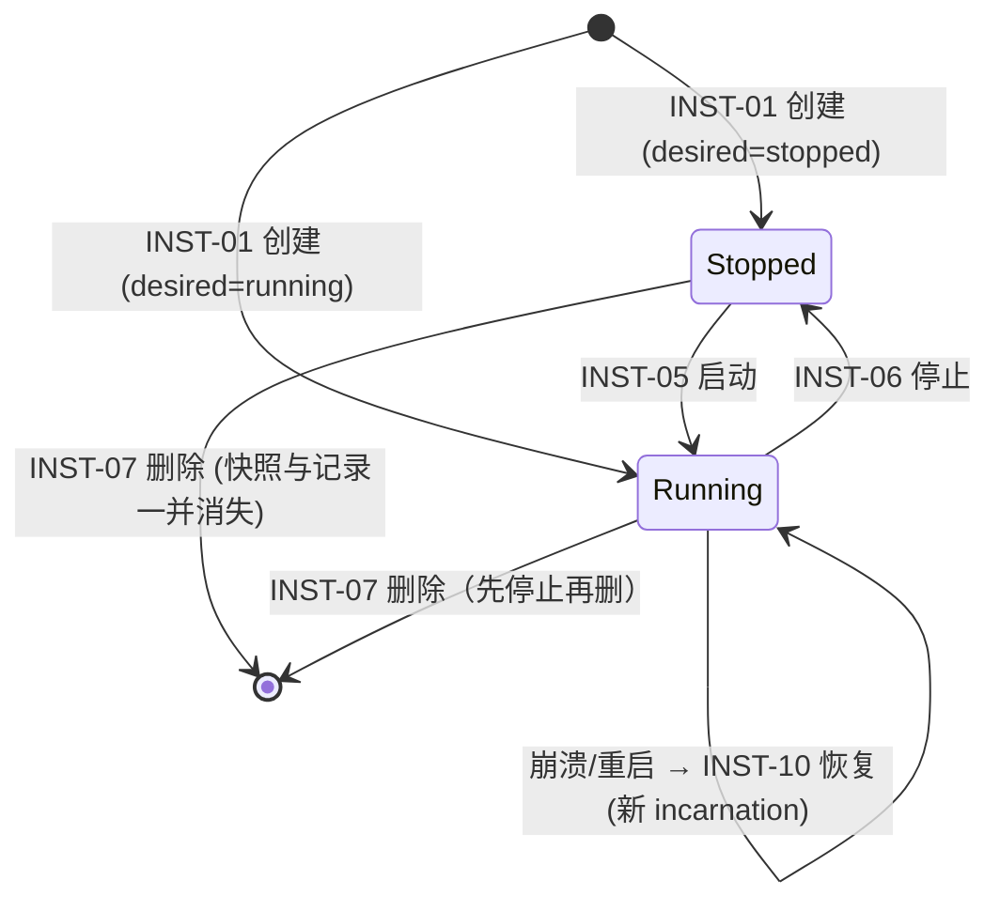
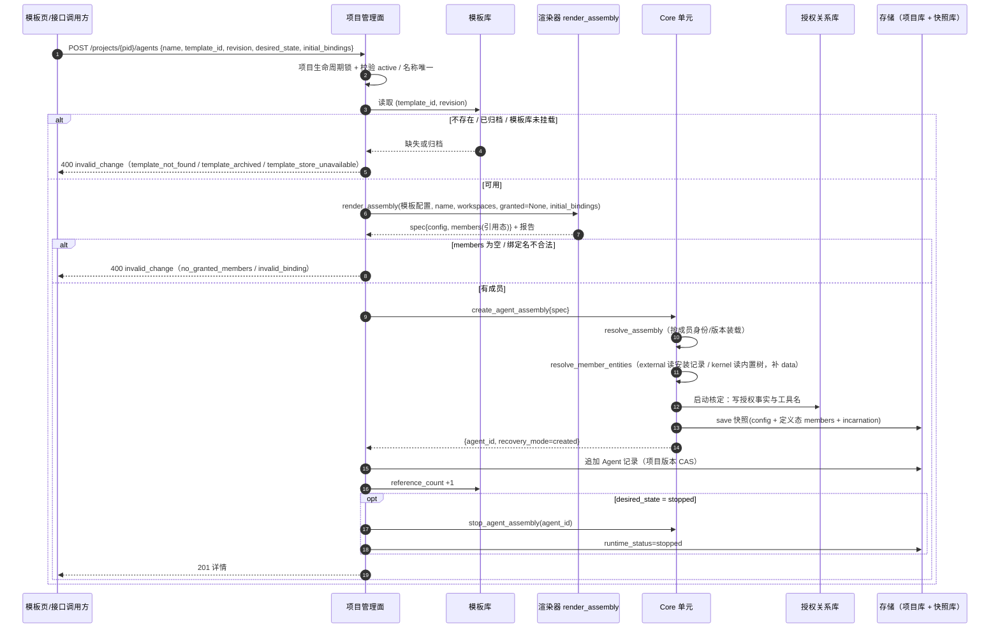
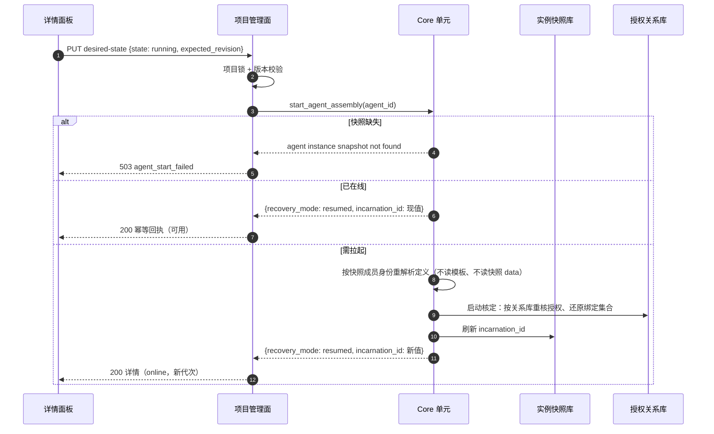
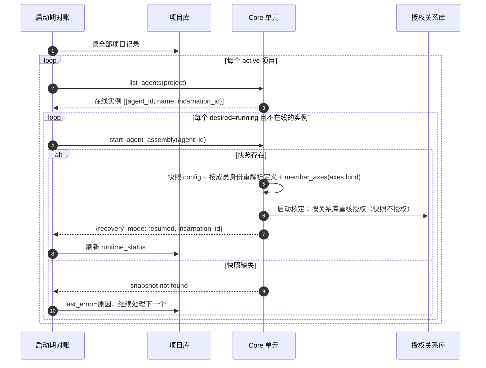
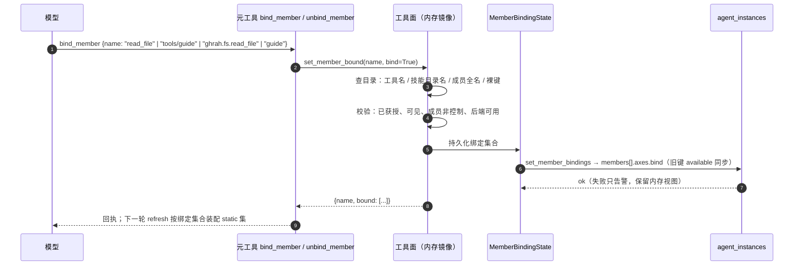
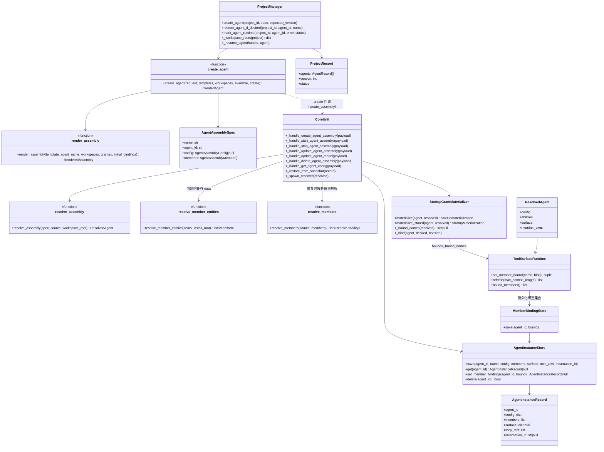

# Agent 实例化设计说明

| 项 | 内容 |
| --- | --- |
| 文档编号 | GHRAH-DESIGN-010 |
| 文档状态 | 现行（已实现） |
| 校准基线 | `a742fcf`（2026-11-23） |
| 读者 | 需要改 Agent 创建/启停/删除链路、装配输入、实例快照的人；做评审与测试的人 |
| 覆盖范围 | 从「选中模板」到「进程可对话」的完整链路：记录模型、实例快照、渲染规则、装配输入契约、REST 与命令契约、生命周期行为、重启恢复 |
| 不覆盖 | 模板自身的增删改查、驱动循环与上下文压缩、能力包内部实现、观察端页面实现 |

## 修订记录

| 版本 | 日期 | 变更 |
| --- | --- | --- |
| 1.0 | 2026-11-19 | 首版。按「模板一次性填充 + 快照为配置权威 + 成员级装配」的现行实现逐功能重写 |
| 2.0 | 2026-11-23 | 按 `a742fcf` 校准：模板成员改为 `available_members` 逐成员渲染（无整包展开）；创建线补齐成员定义数据后写快照（快照 `members` 是定义态，含 `data`、无 `permissions`）；`initial_bindings` 改为三段成员全名、只切绑定轴；绑定/解绑即时改写 `axes.bind`；恢复按成员身份重新解析定义、按快照 `axes` 还原绑定集合；补 `invalid_binding` / `template_store_unavailable` 与快照钉住副本等已知限制 |

## 1 文档说明

### 1.1 编写目的

回答四个问题：**实例的配置存在哪、由谁写、什么时候写、销毁时删什么**。以及：一次创建/启动/停止/删除在网络与存储上各自发生了什么。本文只描述功能与契约；代码结构只在第 7 章类图出现一次。

### 1.2 适用范围

- 适用于：按模板创建 Agent、实例生命周期（启动/停止/删除）、模型更新、重启恢复、装配输入的渲染与校验。
- 不适用于：Agent 运行期的一次任务执行、工具调用与权限判定细节、能力包定义格式、观察端交互实现。

### 1.3 术语

| 术语 | 含义 |
| --- | --- |
| 实例（instance） | 一个具名 Agent 的持久身份；离线也存在 |
| Agent 记录（record） | 项目库里的一条薄记录：身份、展示快照、来源、期望状态 |
| 实例快照（snapshot） | Core 项目库里的配置与成员冻结；实例的配置权威 |
| 装配输入（assembly spec） | 从模板渲染出的创建请求体：`config` + `members`（**引用态**成员） |
| 引用态 / 定义态 | 引用态只有成员身份、类型、版本与轴（`data` 为空）；定义态补上 `data`（path / schema / media_type…） |
| 成员申请（member application） | 装配输入里的 L2 申请（权限上限、可见/绑定轴）；只是申请，不是授权事实 |
| 授权事实（grant） | 关系库 `ability_*` 里的「这个实例被授予了哪些成员」，与装配输入分开存储 |
| 内核件 / 能力件 | 随源码发布、无版本 / 安装在安装根、有版本 |
| 期望状态（desired state） | 记录上的声明：`running` 或 `stopped`；与进程实际是否在线分离 |
| 运行代次（incarnation） | 每次进程启动生成的新标识；用于识别「同一身份的不同进程」 |
| 恢复（restore） | 从快照重新装配并拉起，不读模板 |

### 1.4 模块边界

本模块**做**：读取指定模板修订、逐成员渲染、调用 Core 创建/启停/删除、维护项目记录、维护模板引用计数、重启后按期望状态恢复、按需更新模型段。Core 在创建时按成员身份补齐定义数据并写进快照。

本模块**不做**：不判断成员在运行时是否真能被调用（授权面另有机制）、不写授权事实（Core 启动核定的唯一职责）、不管理会话与历史、不实现能力包的装载、不替用户修模板（模板不足时直接失败并给出稳定错误码）。

## 2 功能清单

| 功能编号 | 名称 | 触发方式 | 一句话 | 状态 |
| --- | --- | --- | --- | --- |
| INST-01 | 按模板创建实例 | `POST /api/v1/projects/{project_id}/agents` | 渲染装配输入 → Core 创建（补齐成员定义、写快照）→ 落记录 → 计引用；可同时指定初始绑定成员 | 已实现 |
| INST-02 | 列出实例 | `GET /api/v1/projects/{project_id}/agents` | 每个实例一行：身份、展示、来源、期望态、运行态 | 已实现 |
| INST-03 | 读取实例详情 | `GET /api/v1/projects/{project_id}/agents/{agent_id}` | 列表行 + 能力摘要 + 生效口径 | 已实现 |
| INST-04 | 修改展示字段 | `PATCH /api/v1/projects/{project_id}/agents/{agent_id}` | 只改展示；配置不可经此改写 | 已实现 |
| INST-05 | 启动实例 | `PUT …/agents/{agent_id}/desired-state`（`running`） | 按快照装配并拉起（幂等） | 已实现 |
| INST-06 | 停止实例 | 同上（`stopped`） | 终止进程、保留快照与身份（幂等） | 已实现 |
| INST-07 | 删除实例 | `DELETE …/agents/{agent_id}` | 停止 + 删快照 + 删记录 + 引用计数减一 | 已实现 |
| INST-08 | 读取实例配置 | Core 命令 `get_agent_config` | 只读：快照里的生效配置（授权段不回填） | 已实现 |
| INST-09 | 更新模型 | 实例命令 `model.configure` | 只改快照模型段；在线需重启生效 | 已实现 |
| INST-10 | 重启恢复 | 进程启动时的对账 | 期望 `running` 且不在线的实例按快照拉起 | 已实现 |
| INST-11 | 绑定 / 解绑成员 | 模型工具 `bind_member` / `unbind_member` | 把成员装进或移出模型上下文；立即改写快照 `axes.bind` | 已实现 |
| ASM-01 | 装配输入 v3 契约 | Core 命令 `create_agent_assembly` | 新建（带 config+members）/ 恢复（只带身份） | 已实现 |
| ASM-02 | 模板 → 成员渲染规则 | INST-01 内部步骤 | 逐成员渲染、版本钉住、控制成员通道、轴与权限 | 已实现 |

编号说明：实例功能用 `INST-nn`，装配契约用 `ASM-nn`；本文内不出现第二套编号。状态只用「已实现 / 未实施 / 已废弃」三态。

## 3 数据模型

### 3.1 三处存储与权威划分

```text
模板（一次性来源）               记录（身份与期望态）                 快照（配置 + 成员定义）
subject.db.agent_templates        subject.db.subject_projects.agents   <project_root>/db/agents.sqlite3.agent_instances
        │ 仅创建时读一次                    ▲ 创建成功后追加                     ▲ 创建成功即写，之后按需更新
        ▼                                   │                                   │
   渲染 render_assembly ──▶ Core 创建（补齐成员定义 + 启动核定 + spawn）────────┘
                                          │
                                          └──▶ 关系库 ability_*（授权事实）
```

| 数据 | 权威 | 谁写 | 何时写 |
| --- | --- | --- | --- |
| 模板 | `agent_templates`（列 `available_members`） | 模板接口 | 用户创建/编辑模板时 |
| Agent 记录 | `subject_projects.agents` | 项目管理面 | 创建、改展示、期望态、运行诊断、删除 |
| 实例快照 | `agent_instances` | Core `AgentInstanceStore` | 创建成功、绑定/解绑、更新装配、更新模型、启动后刷新运行代次、删除 |
| 授权事实 | 关系库 `ability_grants` / `ability_tools` | Core 启动核定、管理面 | 创建/恢复装配、管理面变更 |

三条不变式：

1. **记录存在 ⇒ 快照存在**（创建顺序：先 Core 创建成功并落快照，再写记录）。
2. **快照存在 ⇏ 记录存在**：创建在写记录阶段失败会留下孤儿快照（见 §9 限制 1）。
3. **授权事实只在一处**：授权只写关系库；快照不存 grant，也不复刻授权账本。读取「实例被授予了什么」必须走关系库，不能从快照推断（见 `ghrah-13` §7 不变式 D-3）。

### 3.2 Agent 记录结构（`subject_projects.agents` 的数组元素）

| 字段 | 类型 | 说明 |
| --- | --- | --- |
| `agent_id` | string | Core 生成的 32 位十六进制稳定标识；恢复、启停、删除都以它为准 |
| `project_id` | string | 归属项目；由创建服务之外的一层补齐 |
| `name` | string | 项目内唯一；创建后不可改 |
| `presentation.title` | string | 创建时从模板 `metadata.title` 快照 |
| `presentation.description` | string | 同上（`metadata.description`） |
| `presentation.tags` | string[] | 同上 |
| `presentation.icon` | string | 同上 |
| `presentation.deprecated` | bool | 同上；仅展示标记 |
| `origin.template_id` | string | 来源模板；**不随模板更新而变** |
| `origin.revision` | int ≥ 1 | 创建时使用的修订号 |
| `desired_state` | `running\|stopped` | 声明式期望态；重启恢复只认它 |
| `runtime_status` | `pending\|running\|stopped\|failed\|lost` | 最近一次运行诊断；不影响调度 |
| `last_error` | string | 最近一次失败原因（空串表示无） |
| `created_at` / `updated_at` | string | UTC ISO-8601 |

**记录里没有任何配置字段**：模型、提示词、上下文策略、能力申请都不在记录里。记录是「身份 + 展示 + 来源 + 期望态」，配置一律去 Core 快照读。这是刻意的：配置有两处副本就会分叉。

项目表相关字段：

| 字段 | 说明 |
| --- | --- |
| `agents` | TEXT(JSON)，上述数组 |
| `version` | 项目版本号，所有写操作的条件（`expected_revision`） |
| `status` | `active` 之外的状态下禁止创建；已归档/已删除项目不可写 |

### 3.3 实例快照结构（`agent_instances`）

DDL 见 `ghrah-core/src/ghrah/core/agents/instance_store.py:42-58`：

| 字段 | 类型 | 说明 |
| --- | --- | --- |
| `agent_id` | TEXT 主键 | 与记录一一对应 |
| `name` | TEXT | 实例名（展示与日志用） |
| `config` | TEXT(JSON) | 冻结的完整配置：模型、提示词、上限、上下文、审批覆盖、workspace 根等 |
| `members` | TEXT(JSON) | 冻结的**定义态成员**数组（创建线写 `Member.to_wire()` 形态，见下；`update_agent_assembly` 的写法是例外，见 §9 限制 4） |
| `surface` | TEXT(JSON) 可空 | 工具面覆盖；创建线当前写 `null`（模板不再提供 surface） |
| `mcp_refs` | TEXT(JSON) | MCP 引用；创建线当前写 `[]` |
| `incarnation_id` | TEXT 可空 | 最近一次成功启动的运行代次 |
| `created_at` / `updated_at` | TEXT | UTC ISO-8601 |

`members` 的每条是 `Member.to_wire()`（`ghrah-core/src/ghrah/ability/member.py:352-363`），字段为 `namespace` / `name` / `member` / `type` / `version` / `ability_type` / `axes{visible,bind}` / `data`：

```json
{
  "namespace": "ghrah",
  "name": "fs",
  "member": "ghrah.fs.read_file",
  "type": "operation",
  "version": null,
  "ability_type": "kernel",
  "axes": {"visible": true, "bind": false},
  "data": {
    "title": "Read File",
    "description": "Read a text file from an allowed path.",
    "path": "ghrah/fs/operations/read_file.py",
    "input_schema": {"type": "object", "properties": {}},
    "output_schema": {"type": "object"},
    "execution": {"mode": "request", "timeout_ms": 60000}
  }
}
```

上例只列 `data` 的必填键（`title` / `description` / `path` / `input_schema` / `output_schema` / `execution`）；`tags` / `effects` / `permissions` / `resources` / `expose` 等定义里给出的可选键会原样保存（`ghrah-core/src/ghrah/ability/loading/ability_schema.py:814-836`）。

口径：

- **创建时补齐**：装配输入是引用态（不带 `data`）；Core 在创建时按来源读定义（external 按 `version` 读安装记录、kernel 读内置树）补成定义态，再整条写进快照（`ghrah-core/src/ghrah/core/unit.py:1108-1123`、`ghrah-core/src/ghrah/core/agents/members.py:100-161`）。
- **快照不是装配输入的形状**：创建线写入的快照成员没有 `permissions`（L2 申请只在创建那一次装配里生效），`axes` 用 `bind` 键而不是 `available`，也没有整包标记（见 §4.10 尾注）。
- **绑定变更即写**：`bind_member` / `unbind_member` 经 `MemberBindingState` → `AgentInstanceStore.set_member_bindings` 立即改写 `members[].axes.bind`；旧快照若同时有 `available` 键则一起同步（`ghrah-core/src/ghrah/core/agents/instance_store.py:217-257`、`ghrah-core/src/ghrah/core/agents/bindings.py:31-44`）。
- **恢复按快照重建绑定集合，但定义按身份重解析**：运行期使用的是 Core 按 `member` + `version` 从来源重新加载的定义（`ghrah-core/src/ghrah/core/agents/assembly.py:274-307`），快照里的 `data` 是**钉住的审计/展示副本**，不是运行期读取路径（见 §8、§9 限制 10）。
- 快照的 `config` 是**生效值**（workspace 根、持久化目录等已在渲染期解析成绝对路径），不是模板原样。

### 3.4 状态模型



维度说明：

- `desired_state` 是**声明**（记录里），决定重启后要不要拉起。
- `runtime_status` 是**诊断**（记录里），不影响调度；三态判定口径为 `running` / `stopped` / `failed`（另有 `pending`、`lost` 两个历史值）。
- `incarnation_id` 是**进程实例**（快照里），每次启动变化；停止后记录里仍保留上一次值，仅用于识别陈旧操作。
- 成员轴 `axes{visible,bind}` 是**绑定事实**（快照里），由创建请求与运行期 `bind_member`/`unbind_member` 写。

### 3.5 并发控制

| 层级 | 机制 | 冲突表现 |
| --- | --- | --- |
| 项目 | `expected_revision` = 项目 `version`，每次写 +1 | `409 conflict` + `detail.project_version` |
| 实例操作 | `expected_incarnation_id`（可选） | `409 agent_incarnation_conflict`；用于「对上一次进程下命令」的防误操作 |
| 生命周期 | 项目级可重入生命周期锁 | 串行化创建/删除/启停的编排段，避免同名并发创建 |

## 4 接口契约

### 4.1 通用约定与错误码

- 基址 `/api/v1`；JSON；回环免令牌，非回环需 Bearer。
- 所有写请求带 `expected_revision`（项目 `version`）。
- 错误信封 `{"error": {"code","message","detail"}}`。

| code | HTTP | 触发 |
| --- | --- | --- |
| `invalid_request` | 400 | 请求体字段校验失败（`detail.errors`）；含 PATCH 携带未知/配置字段 |
| `not_found` / `project_unavailable` | 404 | 项目或实例不存在 |
| `agent_name_exists` | 409 | 项目内已有同名实例 |
| `project_not_active` | 409 | 项目不在 `active` 状态（创建/启动被拒） |
| `project_version_conflict`（`conflict`） | 409 | `expected_revision` 落后；`detail.project_version` 给当前值 |
| `agent_incarnation_conflict` | 409 | 目标实例已不是指定运行代次 |
| `agent_runtime_unavailable` | 503 | 运行诊断不可用（无法读运行态） |
| `agent_start_failed` / `agent_stop_failed` / `agent_terminate_failed` | 503 | 进程操作失败 |
| `model_configuration_invalid` | 400 | 模型端点解析不到 |
| `agent_config_immutable` | 409 | 记录层拒绝「没有可写展示字段」的配置修改（REST 侧通常先被 `invalid_request` 挡下） |
| `abilities_managed_by_access_store` | 400 | 试图经旧路径改能力（应走授权面） |

创建阶段的领域码没有独立状态映射，**统一以 `400 invalid_change` 返回**（`ghrah-subject/src/ghrah/subject/units/agent_control.py:221-256`）。注意：错误信封只带 `message`，`message` 取的是细节文本；**领域码本身不保证出现在信封里**（细节为空时 `message` 才回落为码），因此调用方不能可靠地按码分支，只能做诊断展示（见 §9 限制 9）：

| 正文/内部稳定码 | 含义 |
| --- | --- |
| `template_not_found` | 模板或指定修订不存在 |
| `template_archived` | 模板已归档，不能再派发实例 |
| `template_store_unavailable` | 模板库未挂载（`ghrah-subject/src/ghrah/subject/project/manager.py:868-871`） |
| `assembly_not_ready` | 模板配置不足以装配（缺模型端点或提示词为空） |
| `no_granted_members` | 渲染后没有可装配成员（模板 `available_members` 为空） |
| `invalid_binding` | `initial_bindings` 里的名字不是本次下发的成员全名（`ghrah-subject/src/ghrah/subject/agents/render.py:370-372`） |
| `missing_workspace` | 路径申请的角色在项目里解析不到 |
| `invalid_path` | 路径申请非法（绝对路径、`..`） |
| `agent_create_failed` | Core 创建失败（成员定义缺失/装载/校验/权限） |
| `agent_create_timeout` | 创建超过 45 秒 |

### 4.2 INST-01 按模板创建实例

`POST /projects/{project_id}/agents`（REST 请求模型 `AgentCreateRequest`：`ghrah-protocol/src/ghrah/protocol/agent_control.py:154-167`；命令侧 `AgentCreateSpecSchema`：`ghrah-protocol/src/ghrah/protocol/payloads/project.py:83-93`）

请求体：

| 字段 | 类型 | 必填 | 默认 | 说明 |
| --- | --- | --- | --- | --- |
| `expected_revision` | int ≥ 0 | 是 | — | 项目当前版本 |
| `name` | string | 是 | — | 项目内唯一；建议 1–64 字符 |
| `template_id` | string | 是 | — | 模板标识 |
| `revision` | int ≥ 1 | 是 | — | 指定模板修订；**不是**「最新」的隐式语义 |
| `desired_state` | `running\|stopped` | 否 | `stopped` | 创建后立即启动与否 |
| `initial_bindings` | string[] \| null | 否 | `null` | 初始绑定进模型上下文的成员**三段全名**（`<namespace>.<ability_name>.<key>`，如 `ghrah.fs.read_file`）；省略 = 按模板默认轴全部绑定；显式空数组 = 除控制成员外全部不绑定 |

`initial_bindings` 的三条口径（`ghrah-subject/src/ghrah/subject/agents/render.py:312-345`）：

- **只影响绑定轴**：每个成员都下发，`axes.visible` 恒为 `true`；名字不在集合里只表示 `available=false`（可发现、不常驻），成员仍可被 `search_tools` / `execute_tool` 使用。
- **控制成员强制绑定**：`conversation` / `end_task` 不论是否出现在 `initial_bindings` 里都 `available=true`（`:314-318`）。
- **名字必须与下发成员全名精确一致**：写错、写成两段名、或选了本次未下发的成员，直接 `invalid_binding` fail-closed（`:367-372`）；不做前缀匹配或模糊匹配。

响应 `201`：

```json
{
  "format": "ghrah.agent-control.v1",
  "project_id": "bed373c3…",
  "specification": {
    "agent_id": "7555b15997394276813bfe135a7cc18e",
    "name": "helper-agent",
    "presentation": { "title": "…", "description": "…", "tags": [], "icon": "", "deprecated": false },
    "origin": { "template_id": "b7479917b0e7…", "revision": 3 },
    "desired_state": "running",
    "runtime_status": "running",
    "last_error": "",
    "project_version": 12
  },
  "runtime": { "availability": "online", "incarnation_id": "0174ff81…", "busy": false, "error": null },
  "ability": { "revision": 0, "state": "running", "requires_respawn": false, "pending_reasons": [] },
  "ability_unavailable": null,
  "effective": null,
  "spec_overrides_template": false
}
```

并带 `Location: /api/v1/projects/{project_id}/agents/{agent_id}`。

副作用与顺序（严格）：

```text
1. 项目生命周期锁（可重入）
2. 校验项目 active、名称唯一
3. 读模板指定修订（归档 → 失败）
4. 渲染装配输入（ASM-02）：逐成员 members + 路径解析（不传授权视图）
5. 成员为空 → 失败（no_granted_members），不进 Core
6. Core create_agent_assembly（45s 上限）：
   resolve_assembly → 补齐成员定义数据（resolve_member_entities）→ spawn（启动核定写授权）
   → save 快照（生效 config + 定义态 members + incarnation）
7. 项目记录追加（项目版本 CAS）
8. 模板 (template_id, revision) 引用计数 +1
9. desired_state=stopped → 立刻停止进程，记录 runtime_status=stopped
10. 发事件 project_agent_added
```

幂等性：非幂等；同名重复创建 `409 agent_name_exists`。

失败语义：

| 情况 | 结果 |
| --- | --- |
| `initial_bindings` 含未知/未下发名字 | `invalid_binding`（渲染期 fail-closed，不进 Core） |
| 模板没有成员 | `no_granted_members`（创建服务 fail-closed，`ghrah-subject/src/ghrah/subject/agents/creation.py:187-193`） |
| `external` 成员缺 `version`、安装记录缺失、定义缺该成员、类型不匹配 | Core `AssemblyError` → `agent_create_failed`（fail-closed，不落半成品快照） |
| Core 装配超过 45 秒 | `agent_create_timeout`；Core 侧可能仍在装配，需人工确认 |

### 4.3 INST-02 列出实例

`GET /projects/{project_id}/agents` → `200`

```json
{
  "format": "ghrah.agent-control.list.v1",
  "project_id": "…",
  "agents": [
    {
      "format": "ghrah.agent-control.summary.v1",
      "project_id": "…",
      "specification": { "agent_id": "…", "name": "…", "presentation": {…},
                         "origin": { "template_id": "…", "revision": 3 },
                         "desired_state": "running", "runtime_status": "running",
                         "last_error": "", "project_version": 12 },
      "runtime": { "availability": "online", "incarnation_id": "…", "busy": false, "error": null },
      "ability": { "revision": 0, "state": "running", "requires_respawn": false, "pending_reasons": [] },
      "ability_unavailable": null
    }
  ]
}
```

规则：运行态来自 Core 的进程视图，读不到时 `availability=unknown` 且 `error` 给出原因；能力摘要读不到时 `ability=null` 且 `ability_unavailable` 给原因——**两者都不影响列表返回**（诊断信息不该把列表打成 5xx）。

### 4.4 INST-03 读取实例详情

`GET /projects/{project_id}/agents/{agent_id}` → `200`，正文为 `ghrah.agent-control.v1`（同 4.2 响应体）。

比列表多两个口径字段：

| 字段 | 取值 | 含义 |
| --- | --- | --- |
| `effective` | `null\|next_start\|stored` | 当前展示的配置口径是「下次启动生效」还是「已存储」 |
| `spec_overrides_template` | bool | 记录上是否有覆盖模板的字段（当前恒 `false`：记录不含配置） |

### 4.5 INST-04 修改展示字段

`PATCH /projects/{project_id}/agents/{agent_id}`

| 字段 | 类型 | 必填 | 说明 |
| --- | --- | --- | --- |
| `expected_revision` | int ≥ 0 | 是 | 项目版本 |
| `presentation` | object | 是 | 至少提供一个子字段；未给的子字段保持不变 |

可改子字段：`title`、`description`、`tags`、`icon`、`deprecated`（`ghrah-protocol/src/ghrah/protocol/agent_control.py:170-181`）。

响应 `200`：详情视图，`effective=next_start`（配置口径未变，仅展示变了）。

拒绝：请求模型 `extra="forbid"`，带 `model` / `prompt` / 配置类字段会被判为 `400 invalid_request`；记录层另有 `agent_config_immutable` 兜底（`ghrah-subject/src/ghrah/subject/project/entities.py:300-301`）。理由是配置权威在快照，允许经记录改写会造出第二写路径。

### 4.6 INST-05 / INST-06 启动与停止

`PUT /projects/{project_id}/agents/{agent_id}/desired-state`

| 字段 | 类型 | 必填 | 说明 |
| --- | --- | --- | --- |
| `expected_revision` | int ≥ 0 | 是 | 项目版本 |
| `state` | `running\|stopped` | 是 | 目标期望态 |

响应 `200`：详情视图（`effective=stored`）。

语义：

| 操作 | 底层 | 已在线时 | 已停止时 |
| --- | --- | --- | --- |
| 启动 | Core `start_agent_assembly(agent_id)` | 幂等返回当前 `incarnation_id` | 从快照装配并拉起，刷新 `incarnation_id`；启动核定按关系库重核授权 |
| 停止 | Core `stop_agent_assembly(agent_id)` | 终止进程、保留快照 | 幂等成功（`stopped=false`） |

启动失败不影响记录存在性：返回错误码，`last_error` 记录原因，`desired_state` 保持用户声明（下次恢复还会尝试）。

### 4.7 INST-07 删除实例

`DELETE /projects/{project_id}/agents/{agent_id}?expected_revision=<项目版本>`

响应 `200`：

```json
{ "format": "ghrah.agent-control.deleted.v1",
  "project_id": "…", "agent_id": "…", "project_version": 13 }
```

顺序：项目锁 → Core `delete_agent_assembly`（内部先终止进程、再删快照）→ 从记录里移除 → 模板引用计数 -1 → 发事件。终止失败时**保留记录**并返回 `agent_terminate_failed`，不留「记录已删、进程仍在」的游离实例；运行侧已无该实例（重启竞态或已被终止）视为已终止，继续删除（`ghrah-subject/src/ghrah/subject/project/manager.py:1085-1134`）。

幂等性：不存在的实例 → `404`；删除后重复删除仍是 `404`（不伪装成功）。

### 4.8 INST-08 读取实例配置

Core 命令 `get_agent_config`（入参 `{ "agent_id": "…" }`），返回 `AgentConfigView`（`ghrah-protocol/src/ghrah/protocol/views/core.py:628-646`）：

| 段 | 字段 | 说明 |
| --- | --- | --- |
| 顶部 | `agent_id`、`name`、`description` | 身份 |
| `model` | `endpoint_name`、`model_overrides` | 生效模型 |
| `prompt` | `system_prompt` | 生效提示词 |
| `context` | `max_iterations`、`communication_timeout`、`window`、`persistence{type,compress,auto_persist,root_dir,run_id}` | 生效上下文策略 |
| `ability` | `surface{mode,static,max_static}`、`grants[{alias,package,whole_container,operations[],skills[],allowed_roots[]}]`、`mcp_refs[]` | 结构上预留授权事实；**当前命令不回填**（创建线产生的实例恒为 `surface=null`、`grants=[]`、`mcp_refs=[]`） |
| `permission` | `auto_approve[]`、`require_approval_by_default`、`safe_extra_commands[]`、`safe_extra_sub_commands` | 部署策略与该实例覆盖合并后的有效值 |
| `paths` | `[{root, access, deny}]` | 由快照成员的 `permissions.allowed_paths` 派生；创建线写入的快照成员不带 `permissions`，故创建出来的实例恒为空 |
| `core_only` | `workspace_root`、`resources`、`cluster_context_injection`、`environment_context_injection` | 诊断字段，模板不填 |

只读；快照不存在 → `agent instance snapshot not found`（`ghrah-core/src/ghrah/core/unit.py:1398-1469`）。该接口不含 `project_id`（Core 没有项目身份），也不回放模板申请；成员级授权事实要走关系库/能力管理面，不能从这里读。

### 4.9 INST-09 更新模型

实例命令 `model.configure`（经实体操作面执行）：

| 字段 | 类型 | 必填 | 说明 |
| --- | --- | --- | --- |
| `endpoint_name` | string | 是 | 模型端点名（非凭据） |
| `model_overrides` | object\|null | 否 | 请求参数覆盖 |
| `expected_revision` | int | 否 | 项目版本（给了就校验） |
| `expected_incarnation_id` | string | 否 | 目标运行代次（给了就校验） |

行为：只改快照 `config.model`，其余配置保持现值（`ghrah-core/src/ghrah/core/unit.py:1319-1385`）。离线时只落库、下次启动生效；在线时 Core 会终止并重建进程，但接口不回执「已生效」，只回执「已存储」。端点解析失败 → `400 model_configuration_invalid`。

### 4.10 ASM-01 装配输入 v3 契约

Core 命令 `create_agent_assembly`，入参 `{ "spec": AgentAssemblySpec }`（wire 模型：`ghrah-protocol/src/ghrah/protocol/views/core.py:464-489`；命令载荷 `spec` 为完整对象、不摊平：`ghrah-protocol/src/ghrah/protocol/payloads/agent.py:46-53`）。

```text
AgentAssemblySpec
├── name: string                      ← 实例名
├── agent_id: string = ""             ← 空 = 新建；非空 = 恢复
├── config: AgentAssemblyConfig|null  ← 新建必填；恢复必须为空
└── members: AgentAssemblyMember[]    ← 新建必填（可空数组但会被上游拦下）；恢复必须为空
```

```text
AgentAssemblyConfig（extra=forbid）
├── description: string = ""
├── model   { endpoint_name: 非空, model_overrides: object|null }
├── prompt  { system_prompt: 非空 }                    ← min_length=1
├── limits  { max_iterations: int ≥ -1, communication_timeout: float ≥ -1 }
├── context { window: object|null, persistence: object|null } | null
├── surface { mode: auto|static|progressive, static[], max_static } | null
├── mcp_refs: string[] = []
└── permission { auto_approve[], require_approval_by_default,
                safe_extra_commands[], safe_extra_sub_commands } | null
```

```text
AgentAssemblyMember（引用态：只有身份与轴，**不含 data**）
├── member: string             ← 三段成员全名 <namespace>.<ability_name>.<key>
├── type: operation|skill|mcp   ← 装载方式
├── version: string|null       ← 能力件版本（模板钉住）；内核件恒 null
├── ability_type: kernel|external   ← 来源标记（装载逻辑不分叉）
├── permissions: AgentMemberPermissions|null   ← 九维，全可空（null = 未申请）
│     allowed_paths, denied_paths, require_hitl, fs_read_only, fs_write,
│     shell_access, net_access, allowed_commands, denied_commands
└── axes: { visible: bool = true, available: bool = true } | null
```

`whole_container` 已从新契约移除：渲染不再产生、快照不落库（`Member.to_wire()` 没有该键）。协议模型上仍保留一个默认 `false` 的兼容字段，只为读旧快照/旧调用方（`ghrah-protocol/src/ghrah/protocol/views/core.py:460-461`）；新链路不写它，Core 的展开分支只是兼容层（`ghrah-core/src/ghrah/core/agents/assembly.py:292-303`、`ghrah-core/src/ghrah/core/agents/members.py:119-133`）。

模式约束（结构校验直接拒绝）：

| 模式 | 判定 | 必须 | 必须为空 |
| --- | --- | --- | --- |
| 新建 | `agent_id == ""` | `config` | —（`members` 可为空，但上游会在渲染后拦截空成员） |
| 恢复 | `agent_id != ""` | `agent_id` 指向的快照存在 | `config`、`members` 都不得携带 |

**尾注：快照成员不是这个形状。** 装配输入是引用态；创建线写入的实例快照 `members` 是定义态 `Member.to_wire()`：多出 `namespace` / `name` / `data`，`axes` 用 `bind` 而不是 `available`，且**没有 `permissions`**、没有 `whole_container`（`ghrah-core/src/ghrah/ability/member.py:352-363`、`ghrah-core/src/ghrah/core/unit.py:1108-1123`）。因此恢复不会从快照读 `permissions`，L2 申请只在创建/更新装配那一次生效（见 §9 限制 5）。

核心命令一览（供链路理解，非对外 REST）：

| 命令 | 入参 | 出参 | 语义 |
| --- | --- | --- | --- |
| `create_agent_assembly` | `spec` | `{agent_id, name, recovery_mode, incarnation_id}` | 新建（生成 id、补齐成员定义、落快照）或恢复（按 id 读快照） |
| `start_agent_assembly` | `agent_id` | 同上 | 从快照拉起；在线则幂等返回 |
| `stop_agent_assembly` | `agent_id` | `{agent_id, name, stopped, incarnation_id}` | 终止进程、保留快照 |
| `update_agent_assembly` | `agent_id`, `spec` | 同 `create` | 先覆盖快照再重启（配置类变更） |
| `update_agent_model` | `agent_id`, `endpoint_name`, `model_overrides` | 同 `start` | 只改模型段 |
| `delete_agent_assembly` | `agent_id` | `{agent_id, deleted, stopped}` | 停进程 + 删快照；两边都不存在时幂等 |
| `get_agent_config` | `agent_id` | `AgentConfigView` | 只读生效配置 |

## 5 渲染规则（ASM-02：模板 → 成员）

输入：指定修订的模板配置（`available_members`）+ 实例名 + workspace 角色表 + 可选的已授予视图。输出：装配输入（引用态成员）+ 授权计划（仅当传了已授予视图）+ 差异报告。实现是纯函数 `render_assembly`（`ghrah-subject/src/ghrah/subject/agents/render.py:235-380`）。

### 5.1 类型与版本映射

模板成员数组 `available_members` 每行已是完整身份（`namespace` / `name` / `member` / `type` / `version` / `ability_type`），**行内值就是渲染结果**（`ghrah-subject/src/ghrah/subject/template_store/models.py:154-192`；`ghrah-subject/src/ghrah/subject/agents/render.py:283-284`）：

| 模板行 `ability_type` | 渲染后的 `ability_type` | `version` | `member.type` |
| --- | --- | --- | --- |
| `kernel` | `kernel` | 恒 `null` | 行内 `operation` / `skill` / `mcp` |
| `external` | `external` | 行内钉住的版本（允许为空，空则创建期 Core fail-closed） | 行内类型 |

补充口径：

- 成员全名规范形态是**三段** `<namespace>.<ability_name>.<key>`（例 `ghrah.fs.read_file`、`research.research.research`）；退化身份包（`identity.name` 省略）在定义面可能只给两段，Core 在解析/安装记录/绑定集合三处做等价兼容，但模板、装配输入、快照一律三段（见 `ghrah-11` §3.1）。
- 模板**只提供成员身份**：不再提供 `surface`、`mcp_refs`、脚本 `exec` 选择；渲染时 `config.surface=None`、`config.mcp_refs=[]`（`ghrah-subject/src/ghrah/subject/agents/render.py:224-225`），脚本是否可执行由授权事实的 `axes` 表达，不在模板里选。
- 旧包维度申请（`ability_request.packages`）已废弃，不参与渲染，模板只存成员数组。

### 5.2 成员生成

```text
按包分组（group by package from template.available_members）      # ghrah-subject/src/ghrah/subject/agents/render.py:275-279
  ability_type / version ← 该包第一行的行内值                      # :283-284
  operations / skills ← 按 type 拆分                               # :285-286
  若无已授予视图（生产路径）:                                       # :287-291
      selected_ops = 该包全部 operation
      不产生 missing_packages / not_granted、不产生授权计划
  否则（传了已授予视图，仅测试/其他调用方）:
      包不在视图 → missing_packages，该包全部成员跳过
      operation 不在视图 → not_granted；skill 同理
  逐 operation 生成 member{
      member=三段全名, type, version, ability_type,
      permissions=路径申请折算（见 5.4）,
      axes={visible: true, available: bind}}                        # :312-327
  逐 skill 生成 member{
      member=三段全名, type="skill", version, ability_type,
      permissions=同上,
      axes={visible: true, available: bind}}                        # :328-345
```

绑定 `bind` 的取值（`ghrah-subject/src/ghrah/subject/agents/render.py:314-345`）：

| 场景 | `bind` |
| --- | --- |
| `initial_bindings=None`（省略） | 全部 `true`（按模板默认轴） |
| 显式集合 | 非控制成员：`member` 全名 ∈ 集合；控制成员（`conversation` / `end_task`）：恒 `true` |
| 技能成员 | 与 operation 同规则（技能没有工具形态，绑定轴决定目录是否常驻） |

`visible` **恒为 `true`**：模板不提供可见性选择，`initial_bindings` 只切绑定轴（`ghrah-subject/src/ghrah/subject/agents/render.py:314-345`）。渲染结束后若集合里有未下发的名字，抛 `invalid_binding`（`ghrah-subject/src/ghrah/subject/agents/render.py:367-372`）。

### 5.3 控制成员通道

`conversation`、`end_task` 属于 Agent 循环控制成员，不是可授予的能力成员：

- 它们**可以**出现在模板的成员数组里（前端与存量模板都允许），渲染时照常进 `members`；
- 装配时由 Core 的启动核定分流到 control 通道：不写授权账本、不受授权投影裁剪（`ghrah-core/src/ghrah/ability/access/startup.py:834-847`）；
- 工具面上 `conversation` 没有 schema（模型看不到），`end_task` 只在 `toolcall` 模式有 schema；
- 模板不选它们时 Agent 仍能启动，但会缺少对应的循环出口，属于模板配置问题而不是程序错误；
- 创建时若显式给了 `initial_bindings`，控制成员被强制绑定，避免"选了初始绑定反而丢掉循环出口"。

### 5.4 路径与权限

- 路径申请用 `workspace_role + subpath` 表达，渲染期解析成绝对根；角色解析不到 → `missing_workspace`，`..`/绝对路径 → `invalid_path`（`ghrah-subject/src/ghrah/subject/agents/render.py:121-140`）。
- `scope=agent` 的路径申请合并进每个成员的 `permissions`（`allowed_paths` / `denied_paths` 以及 `fs_write`）；`scope=package` 只作用于对应包（`ghrah-subject/src/ghrah/subject/agents/render.py:143-170`）。
- 成员九维权限全部「未申请」时 `permissions=null`，Core 沿用包声明上限；显式 `false` 才是收紧。
- 注意：这些 L2 申请只存在于装配输入；快照成员不带 `permissions`（§4.10 尾注），恢复时按包声明上限重建（§9 限制 5）。

### 5.5 不足即失败

| 情况 | 结果 |
| --- | --- |
| 模板没有模型端点或提示词为空 | `assembly_not_ready` |
| 渲染后成员为空 | 由创建服务拦下：`no_granted_members`（`ghrah-subject/src/ghrah/subject/agents/creation.py:187-193`） |
| `initial_bindings` 名字与下发成员全名不精确一致 | `invalid_binding`（`ghrah-subject/src/ghrah/subject/agents/render.py:367-372`） |
| 路径角色解析不到 / 路径非法 | `missing_workspace` / `invalid_path` |
| `external` 成员缺 `version` 或安装记录缺失 | Core `AssemblyError` → `agent_create_failed`（创建期 fail-closed） |

## 6 逐功能设计

### 6.1 INST-01 按模板创建实例

| 项 | 内容 |
| --- | --- |
| 名称 | 按模板创建实例 |
| 功能编号 | INST-01 |
| 功能描述 | 读取模板指定修订，逐成员渲染装配输入，让 Core 补齐成员定义、拉起进程并冻结配置，再在项目里落一条薄记录 |
| 参与用户 | 项目管理员；也可由「模板页 → 用此模板创建」发起 |
| 输入 | 项目版本、实例名、模板标识 + 修订、期望状态、可选初始绑定全名 |
| 操作序列 | 模板卡片点「用此模板创建」→ 选目标项目、填实例名、勾选是否立即启动 → 提交 → 服务端渲染并创建 → 201 返回详情，列表出现新实例（`initial_bindings` 目前只有 API 支持，观察端未暴露勾选） |
| 扩展及异常 | 名称重复 409；模板缺失/归档、模板不足、绑定名不合法、Core 失败、超时统一 400 `invalid_change`（内部稳定码见 §4.1）；项目版本落后 409（`detail.project_version`） |
| 输出 | `201` + 实例详情 + `Location` |
| 补充说明 | 创建后模板再改不影响该实例；`desired_state=stopped` 时先创建再立即停止，保证身份与快照已就绪 |



### 6.2 INST-02 / INST-03 列表与详情

| 项 | 内容 |
| --- | --- |
| 名称 | 列出实例 / 读取实例详情 |
| 功能编号 | INST-02 / INST-03 |
| 功能描述 | 返回项目内每个实例的身份、展示、来源、期望态与实时运行态；详情额外给出能力摘要与生效口径 |
| 参与用户 | 所有观察端用户 |
| 输入 | 路径参数 `project_id`（+ `agent_id`） |
| 操作序列 | 进入「Agent 概览」→ 列表请求 → 渲染卡片；点某个实例 → 详情请求 → 打开详情面板 |
| 扩展及异常 | 项目不存在 404；实例不存在 404；运行态读取失败不报错而降级为 `unknown` |
| 输出 | `200` + `AgentListView` / `AgentAdminView` |
| 补充说明 | 列表不返回任何配置字段；配置走 INST-08，避免把大字段塞进列表 |

### 6.3 INST-04 修改展示字段

| 项 | 内容 |
| --- | --- |
| 名称 | 修改展示字段 |
| 功能编号 | INST-04 |
| 功能描述 | 只改记录的展示快照（标题、描述、标签、图标、弃用标记），不改运行配置 |
| 参与用户 | 项目管理员 |
| 输入 | `expected_revision` + `presentation` 子字段 |
| 操作序列 | 详情面板点「编辑展示」→ 改字段 → 保存 → 200 返回新详情 |
| 扩展及异常 | 无字段 → 400；带配置字段 → 400 `invalid_request`（记录层另有 `agent_config_immutable`）；版本冲突 → 409 |
| 输出 | `200` + 详情（`effective=next_start`） |
| 补充说明 | 展示字段是「好看的元数据」，改它不需要重启实例 |

### 6.4 INST-05 / INST-06 启动与停止

| 项 | 内容 |
| --- | --- |
| 名称 | 启动实例 / 停止实例 |
| 功能编号 | INST-05 / INST-06 |
| 功能描述 | 按期望状态拉起或终止进程；配置一律从实例快照读，不回看模板 |
| 参与用户 | 项目管理员 |
| 输入 | `expected_revision` + `state` |
| 操作序列 | 详情面板点「启动」→ PUT desired-state(running) → 进程拉起 → 详情显示 online 与新运行代次；点「停止」→ 二次确认 → offline |
| 扩展及异常 | 已在线启动：幂等；已停止停止：幂等；启动失败 503 `agent_start_failed`（记录 `last_error`）；项目非 active → 409 |
| 输出 | `200` + 详情 |
| 补充说明 | 停止保留身份、快照与历史；「停止」不是「删除」。启动时授权仍按关系库重核，快照不能凭空补授权 |



### 6.5 INST-07 删除实例

| 项 | 内容 |
| --- | --- |
| 名称 | 删除实例 |
| 功能编号 | INST-07 |
| 功能描述 | 终止进程、删除快照、移除记录、引用计数减一；之后该身份不可恢复 |
| 参与用户 | 项目管理员 |
| 输入 | 路径参数 + 查询参数 `expected_revision` |
| 操作序列 | 详情面板点「删除」→ 二次确认 → DELETE → 列表移除该实例 |
| 扩展及异常 | 不存在 404；项目版本冲突 409；终止失败 503 `agent_terminate_failed`（此时不删记录，避免留下「有记录无进程无快照」的中间态） |
| 输出 | `200` + `{project_id, agent_id, project_version}` |
| 补充说明 | 删除是不可逆的：快照没了就无法按原配置重建，只能重新按模板创建 |

### 6.6 INST-08 读取实例配置

| 项 | 内容 |
| --- | --- |
| 名称 | 读取实例配置 |
| 功能编号 | INST-08 |
| 功能描述 | 返回快照里的生效配置；授权事实不在此视图内（走能力管理面/关系库） |
| 参与用户 | 观察端用户（只读） |
| 输入 | `agent_id` |
| 操作序列 | 详情面板展开「配置」→ 读一次 → 渲染模型、上下文、路径与诊断字段 |
| 扩展及异常 | 快照缺失 → 错误回执（实例不存在）；授权段不可用不回填，也不报错 |
| 输出 | `AgentConfigView` |
| 补充说明 | 该视图**不回放模板申请**，也不复刻授权账本：`ability` 段是结构预留、当前恒空；`paths` 由快照成员的 `permissions.allowed_paths` 派生，而创建线写入的快照成员不带 `permissions`（§4.10 尾注），故创建出来的实例该段恒空 |

### 6.7 INST-09 更新模型

| 项 | 内容 |
| --- | --- |
| 名称 | 更新模型 |
| 功能编号 | INST-09 |
| 功能描述 | 只替换快照里的模型端点与请求参数，其余配置不动 |
| 参与用户 | 项目管理员 |
| 输入 | `endpoint_name`、`model_overrides`、可选 `expected_revision` / `expected_incarnation_id` |
| 操作序列 | 详情面板「模型」→ 选端点 → 保存 → 提示「下次启动生效」；需要立即生效时点重启 |
| 扩展及异常 | 端点不存在 400；陈旧代次 409；快照缺失 → 失败 |
| 输出 | 成功回执（含运行代次） |
| 补充说明 | 接口不回执「已生效」，只回执「已存储」：Core 侧在线实例会被终止并按新快照重建，但调用方拿到的只是存储回执 |

### 6.8 INST-10 重启恢复

| 项 | 内容 |
| --- | --- |
| 名称 | 重启恢复 |
| 功能编号 | INST-10 |
| 功能描述 | 进程启动时按记录里的期望状态，把应运行的实例从快照重新拉起 |
| 参与用户 | 系统（启动期自动） |
| 输入 | 全部项目记录 + Core 当前在线列表 |
| 操作序列 | 服务启动 → 对账扫描项目（`ghrah-subject/src/ghrah/subject/recovery/reconciler.py:276-373`）→ 跳过非 active 项目 → 对每个期望 `running` 且不在线的实例 → `start_agent_assembly(agent_id)` → 按快照重建配置与成员、按 `axes` 还原绑定集合 → 汇总报告 |
| 扩展及异常 | 项目非 active：跳过；实例 `desired_state=stopped`：跳过；已在线的：跳过（避免重复进程）；同名重复（历史遗留）：判失败并记录原因 |
| 输出 | 对账报告：`agents_spawned` / `agents_restored` / `agents_initialized` / `agents_failed` 计数 + `agent_results` 逐项结果（`ghrah-subject/src/ghrah/subject/recovery/reconciler.py:52-88`；分项计数现状见 §9 限制 11） |
| 补充说明 | 恢复**不读模板、也不读快照 `data`**：成员定义按 `member` + `version` 重新从来源解析（`ghrah-core/src/ghrah/core/agents/assembly.py:274-307`），快照 `data` 只作审计副本；绑定集合按快照 `axes.bind` 还原（`ghrah-core/src/ghrah/ability/access/startup.py:811-821`），但**授权仍以关系库为准**——快照不能凭空产生许可 |



### 6.9 INST-11 绑定 / 解绑成员

| 项 | 内容 |
| --- | --- |
| 名称 | 绑定 / 解绑成员 |
| 功能编号 | INST-11 |
| 功能描述 | 模型在运行中把已获授成员装进或移出模型上下文；绑定只影响上下文占用，不改变授权 |
| 参与用户 | 模型（元工具调用）；创建时的初始绑定由创建者选择（INST-01 的 `initial_bindings`） |
| 输入 | `bind_member` / `unbind_member` 的 `name`，接受四种写法：工具名（`search_tools` 返回的名字）、技能目录名（`<alias>/<key>`）、成员全名（三段）、裸技能键（`ghrah-core/src/ghrah/ability/surface/runtime.py:317-334`） |
| 操作序列 | 模型发现工具（`search_tools`）→ 判断值得常驻 → 调 `bind_member` → 下一轮工具表含该成员 schema；需要腾上下文时调 `unbind_member`，成员仍可被发现与调用；技能成员按目录名绑定/解绑，决定技能目录是否常驻 |
| 扩展及异常 | 未获授/不在目录：失败；控制成员（`conversation` / `end_task`）：拒绝（`Loop-control members cannot be bound or unbound`）；成员不可用（后端离线）：拒绝绑定；快照写入失败：保留内存视图并告警，下一轮仍生效 |
| 输出 | `BindOutput`：`{name, bound: [成员全名]}`（当前绑定集合，`ghrah-core/src/ghrah/ability/surface/meta.py:35-53`） |
| 补充说明 | 绑定的权威是实例快照 `agent_instances.members[].axes.bind`：每次变更立即写库，重启据此恢复；旧快照若同时带 `available` 键则一起同步。工具成员的常驻集在重启后同样由 `axes.bind` 决定；关系库 `ability_tools` 记录"工具名 → 成员"的选择，由启动核定 `_bind`（`ghrah-core/src/ghrah/ability/access/startup.py:946-978`）与管理面 `enable_tool`/`disable_tool`（`ghrah-core/src/ghrah/core/read/ability.py:473-491`）维护，`bind_member` 不直接改它。绑定集合里成员消失（撤销/卸载）时自动掉出 |



## 7 类图（功能视图：函数以模块框表示）

> 说明：`create_agent` / `render_assembly` / `resolve_assembly` / `resolve_member_entities` / `resolve_members` 都是模块级函数，不单独成类；下图把它们标成函数框，只为表达调用关系。



职责边界：

- `ProjectManager`：项目锁、记录、期望态、引用计数、事件、启动期对账入口；不做渲染。
- `create_agent`：按修订读模板、调用渲染、调用 Core、产出待落库记录；不写项目库。
- `render_assembly`：纯函数式的模板 → 装配输入（无 I/O 的状态决定成员），差异报告在返回值里。
- `CoreUnit`：装配、补齐成员定义、spawn、快照读写；配置与成员只认快照。
- `resolve_assembly` / `resolve_members`：把装配输入或快照成员解析成可装载能力（含版本选择、控制成员兼容处理）。
- `resolve_member_entities`：创建线按成员身份补齐类型数据（external 读安装记录、kernel 读内置树），失败即 `AssemblyError`。
- `AgentInstanceStore`：快照表的唯一写者；`set_member_bindings` 是绑定轴的唯一写入口。
- `MemberBindingState`：工具面与实例库之间的绑定持久化接缝，不解释授权。
- `StartupGrantMaterializer`：启动核定写授权，并按快照轴还原绑定集合。

## 8 关键决策与已否决方案

| 决策 | 理由 | 被否决方案 |
| --- | --- | --- |
| 配置权威在 Core 快照，记录不带配置 | 记录是「身份 + 期望态」，若同时存配置就有两个写者，必然分叉 | 记录与快照各存一份配置（需要双向同步，属第二权威） |
| 模板只在创建时读一次 | 改模板不应改变已部署行为；恢复/重启要可复现 | 每次启动重读模板（模板一改，全部实例漂移） |
| 模板只存成员身份数组（`available_members`），逐成员渲染 | 一种形状贯穿模板 → 装配 → 快照；"整包"不再有第二套解析分支 | 模板存包维度申请、实例化时再展开（展开时机漂移，需兼容两套形状） |
| 装配输入是引用态，创建时补齐成定义态写入快照 | wire 只带身份，定义由 Core 按版本确定；快照可审计可展示 | 装配输入直接带 `data`（wire 变大，且定义数据来源不明） |
| `initial_bindings` 只切绑定轴、不改可见性 | 「常驻」是上下文预算问题，不是授权/可见性问题；成员始终可被发现与调用 | 用绑定集合同时控制可见性（等于把绑定当授权） |
| 绑定名字必须与下发成员全名精确一致 | 写错名字时 fail-closed，避免"看起来选了但实际没绑" | 前缀/模糊匹配（拼错静默生效，难诊断） |
| 授权事实只写关系库，快照不复制 | 快照若带授权就有第二个权威；恢复必须重新核库 | 快照里冻结 grant（撤销不生效，或需双向同步） |
| 恢复只给身份，走 `start_agent_assembly` | 与创建解耦、幂等；配置来自快照，不回读模板 | 恢复也走 `create_agent_assembly`（要带 config，等于把模板读回来） |
| 恢复按成员身份重解析定义，快照 `data` 只作审计副本 | 运行期定义与已提交版本一致；避免把钉住副本当运行来源造成"改了安装根但行为仍是旧副本"的错觉 | 运行期直接读快照 `data`（定义永不更新，且与关系库版本脱节） |
| 绑定变更立即写快照 `axes.bind` | 重启恢复需要稳定的绑定事实；内存镜像可丢 | 只在内存里维护绑定（重启后回落到默认全绑） |
| 删除先停后删，且停止失败不删记录 | 避免「记录没了、进程还在」的孤儿进程 | 先删记录（脏进程无人认领） |
| 期望态与运行态分离 | 崩溃后仍能按声明恢复；运维可声明而不依赖当下进程 | 只存运行态（重启后无法判断该不该拉起） |
| `agent_id` 由 Core 生成 | 身份与进程实例同源，避免 Subject 生成后被 Core 拒绝；恢复只认 id | 由 Subject 生成并传入（两处都可能生成，冲突处理复杂） |

## 9 已知限制与未实施

1. **孤儿快照**（未实施自动回收）：创建在「写记录」阶段失败（如项目版本被并发修改）时，Core 侧已存在实例与快照，但没有记录指向它。当前不自动回收，需要按 `agent_id` 显式执行删除命令清理。诊断方式：Core 快照里存在、项目记录里不存在的实例。
2. **无批量操作**（未实施）：创建/启动/停止/删除都是单实例；模板升级后批量重建实例未提供。
3. **配置不可改**（已实现约束）：除模型段外，提示词、上下文、能力成员都没有「改配置」的入口；要变更只能照新模板重建实例（旧的删除）。这是当前有意的收敛，不是遗漏。
4. **`update_agent_assembly` 无对外入口**（未实施）：命令已实现（覆盖快照 + 重启），但没有 REST 或 UI 暴露；且该路径落库的是 `spec.members` 的引用态条目（`ghrah-core/src/ghrah/core/unit.py:1265-1273`），未做创建线的 `resolve_member_entities` 补齐——形状是 `AgentAssemblyMember`（`axes.available`、带 `permissions`/`whole_container`、没有 `namespace`/`name`/`data`），与创建线的 `Member.to_wire()` 不一致。接入前必须先补这一步，否则快照成员没有 `data`，且两种形状并存。
5. **快照成员不带 L2 权限申请**（已实现但语义受限）：`Member.to_wire()` 没有 `permissions`，创建时按模板申请的路径/写权限只在创建那一次装配生效；重启恢复按包声明上限重建（`ghrah-core/src/ghrah/core/agents/assembly.py:288-306` 对创建线写的快照读到的 `permissions` 恒为 `None`；`update_agent_assembly` 例外，见限制 4）。需要持久化成员级收紧时，得先给快照加字段。
6. **创建超时是固定值**（45 秒）：慢磁盘或大包场景可能误判超时；超时后 Core 侧可能仍在装配，需人工确认再重试（`ghrah-subject/src/ghrah/subject/agents/creation.py:48-50`）。
7. **同名约束只在项目内**：不同项目的同名实例互不影响；跨项目按 `agent_id` 区分。
8. **`desired_state=stopped` 创建仍会短暂启动**：当前实现是「创建后立即停止」，因此会消耗一次装配（加载包、起进程、写授权）的开销，而不是完全跳过装配。
9. **创建期错误码没有独立 HTTP 状态，且稳定码不一定出现在信封里**：`template_*`、`assembly_not_ready`、`no_granted_members`、`invalid_binding`、`agent_create_failed/timeout` 都以 `400 invalid_change` 返回；信封 `error.code` 恒为 `invalid_change`，`message` 取细节文本（细节为空时才回落为码）。前端若按状态码或码分类都会误判，只能做诊断展示。
10. **快照 `data` 是钉住副本，安装根内容被替换不自动失效**：创建时按 `version` 读到的定义数据被复制进 `agent_instances.members[].data`；运行期恢复又按成员身份重新解析定义（§6.8）。因此快照 `data` 不会随安装根变化自动失效，也不作为运行期读取来源——两者语义不同，排障时不要拿快照 `data` 判断"当前实际装载的是哪份定义"。
11. **恢复报告的分项计数不全**（未实施修正）：`ReconcileReport` 定义了 `agents_restored` / `agents_initialized`，但 `start_assembly` 只回 `resumed`，对账代码只把它计入 `agents_spawned`（`ghrah-subject/src/ghrah/subject/recovery/reconciler.py:341-357`）；这两个分项实际不会命中。
12. **绑定事实有两个落点**（已实现，已知双写面）：快照 `members[].axes.bind` 是重启恢复的绑定权威；关系库 `ability_tools` 是"工具名 → 成员"的选择表。`bind_member`/`unbind_member` 立即写快照，`ability_tools` 由启动核定与管理面维护；两者短暂不一致时以快照轴决定常驻集，以关系库决定授权与工具名。