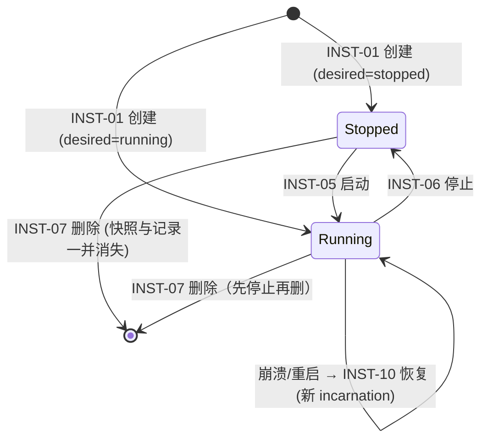
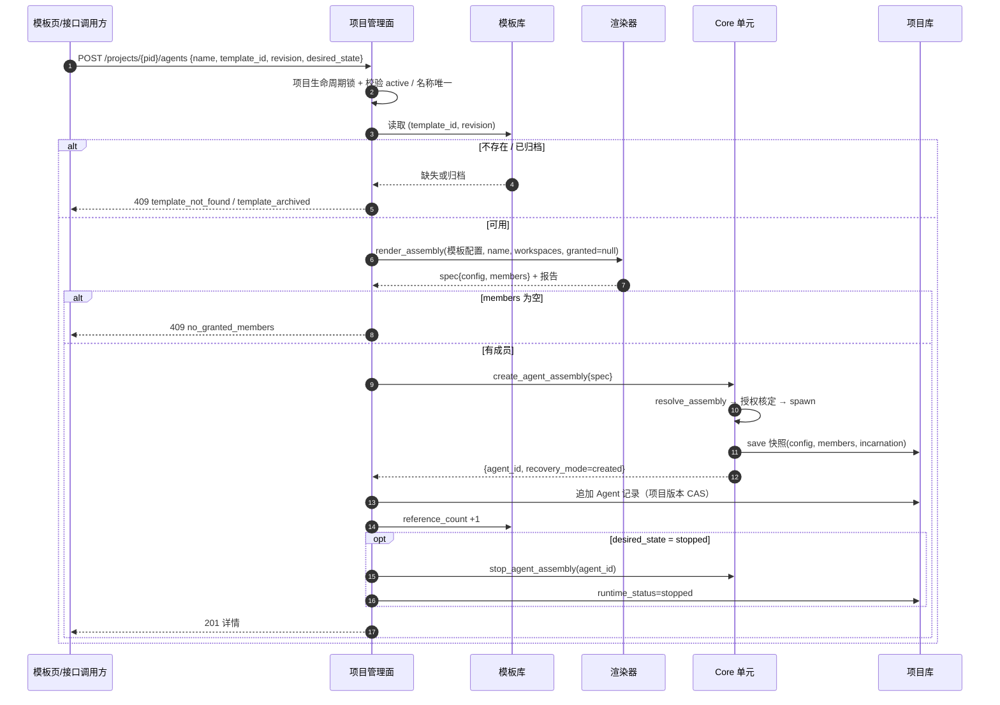
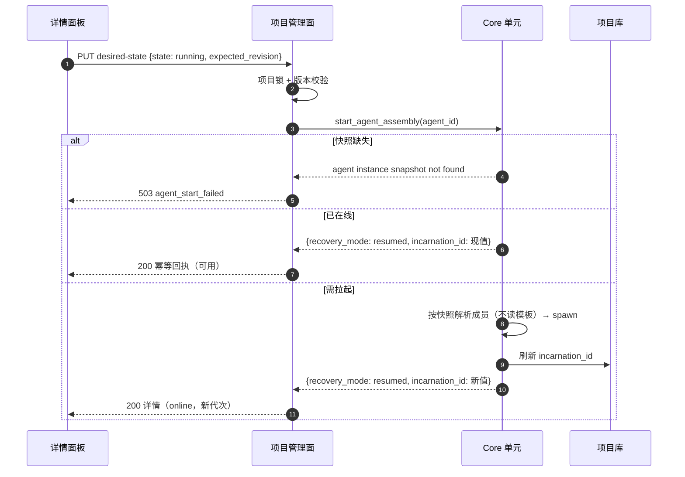
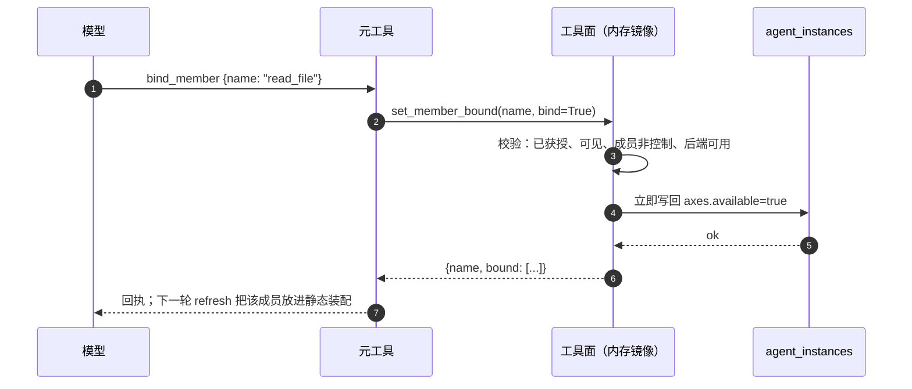
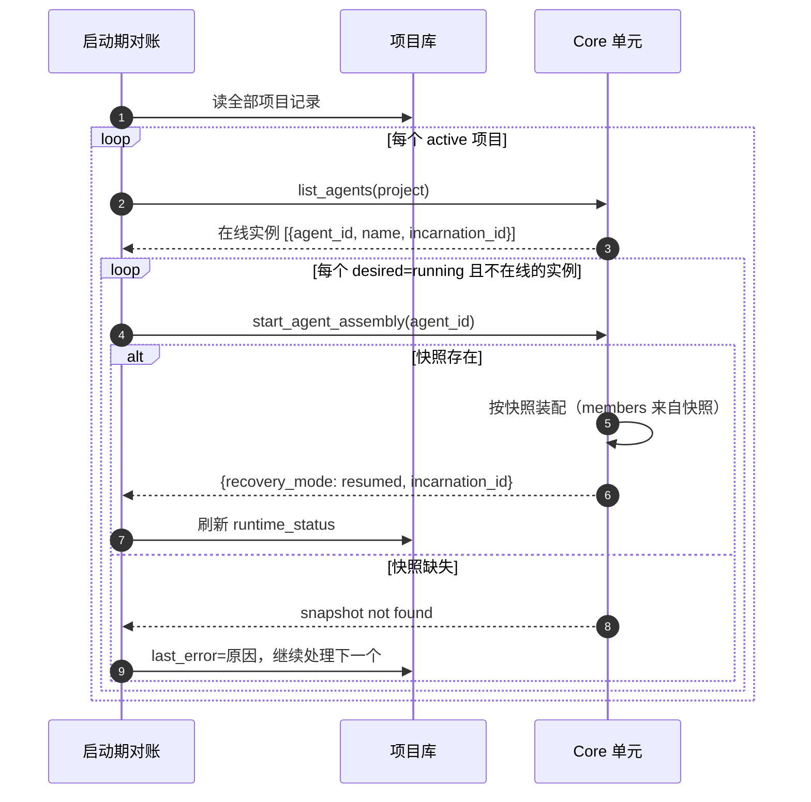
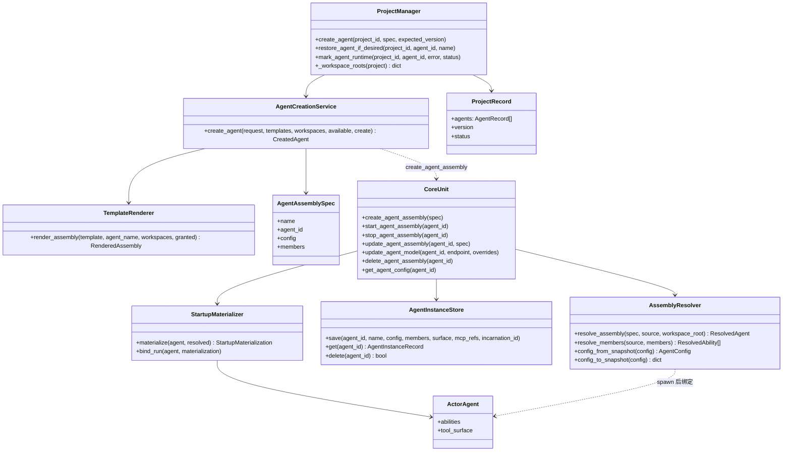

# Agent 实例化设计说明

| 项 | 内容 |
| --- | --- |
| 文档编号 | GHRAH-DESIGN-010 |
| 文档状态 | 现行（已实现） |
| 校准基线 | `d63c4d0`（2026-11-19） |
| 读者 | 需要改 Agent 创建/启停/删除链路、装配输入、实例快照的人；做评审与测试的人 |
| 覆盖范围 | 从「选中模板」到「进程可对话」的完整链路：记录模型、实例快照、渲染规则、装配输入契约、REST 与命令契约、生命周期行为、重启恢复 |
| 不覆盖 | 模板自身的增删改查、驱动循环与上下文压缩、能力包内部实现、观察端页面实现 |

## 修订记录

| 版本 | 日期 | 变更 |
| --- | --- | --- |
| 1.0 | 2026-11-19 | 首版。按「模板一次性填充 + 快照为配置权威 + 成员级装配」的现行实现逐功能重写 |

## 1 文档说明

### 1.1 编写目的

回答四个问题：**实例的配置存在哪、由谁写、什么时候写、销毁时删什么**。以及：一次创建/启动/停止/删除在网络与存储上各自发生了什么。本文只描述功能与契约；代码结构只在第 7 章类图出现一次。

### 1.2 适用范围

- 适用于：按模板创建 Agent、实例生命周期（启动/停止/删除）、模型更新、重启恢复、装配输入的渲染与校验。
- 不适用于：Agent 运行期的一次任务执行、工具调用与权限判定细节、能力包定义格式、观察端交互实现。

### 1.3 术语

| 术语 | 含义 |
| --- | --- |
| 实例（instance） | 一个具名 Agent 的持久身份；离线也存在 |
| Agent 记录（record） | 项目库里的一条薄记录：身份、展示快照、来源、期望状态 |
| 实例快照（snapshot） | Core 项目库里的配置与成员冻结；实例的配置权威 |
| 装配输入（assembly spec） | 从模板渲染出的创建请求体：`config` + `members` |
| 成员申请（member application） | 逐成员的 L2 申请（权限上限、可见/可用轴）；不是授权事实 |
| 授权事实（grant） | 关系库里的「这个实例被授予了哪些成员」，与成员申请分开存储 |
| 内核件 / 能力件 | 随源码发布、无版本 / 安装在安装根、有版本 |
| 期望状态（desired state） | 记录上的声明：`running` 或 `stopped`；与进程实际是否在线分离 |
| 运行代次（incarnation） | 每次进程启动生成的新标识；用于识别「同一身份的不同进程」 |
| 恢复（restore） | 从快照重新装配并拉起，不读模板 |

### 1.4 模块边界

本模块**做**：读取指定模板修订、渲染成员与权限、调用 Core 创建/启停/删除、维护项目记录、维护模板引用计数、重启后按期望状态恢复、按需更新模型段。

本模块**不做**：不判断成员在运行时是否真能被调用（授权面另有机制）、不管理会话与历史、不实现能力包的装载、不替用户修模板（模板不足时直接失败并给出稳定错误码）。

## 2 功能清单

| 功能编号 | 名称 | 触发方式 | 一句话 |
| --- | --- | --- | --- |
| INST-01 | 按模板创建实例 | `POST /api/v1/projects/{project_id}/agents` | 渲染装配输入 → Core 创建 → 落记录 → 计引用；可同时指定初始绑定成员 |
| INST-02 | 列出实例 | `GET /api/v1/projects/{project_id}/agents` | 每个实例一行：身份、展示、来源、期望态、运行态 |
| INST-03 | 读取实例详情 | `GET /api/v1/projects/{project_id}/agents/{agent_id}` | 列表行 + 能力摘要 + 生效口径 |
| INST-04 | 修改展示字段 | `PATCH /api/v1/projects/{project_id}/agents/{agent_id}` | 只改展示；配置不可经此改写 |
| INST-05 | 启动实例 | `PUT …/agents/{agent_id}/desired-state`（`running`） | 按快照装配并拉起（幂等） |
| INST-06 | 停止实例 | 同上（`stopped`） | 终止进程、保留快照与身份（幂等） |
| INST-07 | 删除实例 | `DELETE …/agents/{agent_id}` | 停止 + 删快照 + 删记录 + 引用计数减一 |
| INST-08 | 读取实例配置 | Core 命令 `get_agent_config` | 只读：快照里的生效配置 |
| INST-09 | 更新模型 | 实例命令 `model.configure` | 只改快照模型段；在线需重启生效 |
| INST-10 | 重启恢复 | 进程启动时的对账 | 期望 `running` 且不在线的实例按快照拉起 |
| INST-11 | 绑定 / 解绑成员 | 模型工具 `bind_member` / `unbind_member` | 把成员装进或移出模型上下文；立即写快照 |
| ASM-01 | 装配输入 v3 契约 | Core 命令 `create_agent_assembly` | 新建（带 config+members）/ 恢复（只带身份） |
| ASM-02 | 模板 → 成员渲染规则 | INST-01 内部步骤 | 类型映射、版本钉住、控制成员通道、轴与权限 |

编号说明：实例功能用 `INST-nn`，装配契约用 `ASM-nn`；本文内不出现第二套编号。

## 3 数据模型

### 3.1 三处存储与权威划分

```text
模板（一次性来源）            记录（身份与期望态）          快照（配置与成员）
subject.db.agent_templates → subject.db.subject_projects.agents → <project_root>/db/agents.sqlite3.agent_instances
        │                              │                                  │
   只读一次（创建时）             唯一权威：存在/名称/期望态          唯一权威：config + members
```

| 数据 | 权威 | 谁写 | 何时写 |
| --- | --- | --- | --- |
| 模板 | `agent_templates` | 模板接口 | 用户创建/编辑模板时 |
| Agent 记录 | `subject_projects.agents` | 项目管理面 | 创建、改展示、期望态、运行诊断、删除 |
| 实例快照 | `agent_instances` | Core | 创建成功、更新装配、更新模型、启动后刷新运行代次、删除 |

三条不变式：

1. **记录存在 ⇒ 快照存在**（创建顺序：先 Core 创建成功并落快照，再写记录）。
2. **快照存在 ⇏ 记录存在**：创建在写记录阶段失败会留下孤儿快照（见 §9 限制 1）。
3. **授权事实只在一处**：成员申请冻结在快照里，实际授予写在能力关系库；两者不互相复制，读取时分别取。

### 3.2 Agent 记录结构（`subject_projects.agents` 的数组元素）

| 字段 | 类型 | 说明 |
| --- | --- | --- |
| `agent_id` | string | Core 生成的 32 位十六进制稳定标识；恢复、启停、删除都以它为准 |
| `project_id` | string | 归属项目；由创建服务之外的一层补齐 |
| `name` | string | 项目内唯一；创建后不可改 |
| `presentation.title` | string | 创建时从模板 `metadata.title` 快照 |
| `presentation.description` | string | 同上（`metadata.description`） |
| `presentation.tags` | string[] | 同上 |
| `presentation.icon` | string | 同上 |
| `presentation.deprecated` | bool | 同上；仅展示标记 |
| `origin.template_id` | string | 来源模板；**不随模板更新而变** |
| `origin.revision` | int ≥ 1 | 创建时使用的修订号 |
| `desired_state` | `running\|stopped` | 声明式期望态；重启恢复只认它 |
| `runtime_status` | string | 最近一次运行诊断（`running`/`stopped`/`failed`+原因） |
| `last_error` | string | 最近一次失败原因（空串表示无） |
| `created_at` / `updated_at` | string | UTC ISO-8601 |

**记录里没有任何配置字段**：模型、提示词、上下文策略、能力申请都不在记录里。记录是「身份 + 展示 + 来源 + 期望态」，配置一律去 Core 快照读。这是刻意的：配置有两处副本就会分叉。

项目表相关字段：

| 字段 | 说明 |
| --- | --- |
| `agents` | TEXT(JSON)，上述数组 |
| `version` | 项目版本号，所有写操作的条件（`expected_revision`） |
| `status` | `active` 之外的状态下禁止创建；已归档/已删除项目不可写 |

### 3.3 实例快照结构（`agent_instances`）

| 字段 | 类型 | 说明 |
| --- | --- | --- |
| `agent_id` | TEXT 主键 | 与记录一一对应 |
| `name` | TEXT | 实例名（展示与日志用） |
| `config` | TEXT(JSON) | 冻结的完整配置：模型、提示词、上限、上下文、审批覆盖、workspace 根等 |
| `members` | TEXT(JSON) | 冻结的成员申请数组（`AgentAssemblyMember` 形态，见 4.10） |
| `surface` | TEXT(JSON) 可空 | 工具面配置（`mode`/`static`/`max_static`） |
| `mcp_refs` | TEXT(JSON) | MCP 引用列表 |
| `incarnation_id` | TEXT 可空 | 最近一次成功启动的运行代次 |
| `created_at` / `updated_at` | TEXT | UTC ISO-8601 |

快照的 `config` 是**生效值**（workspace 根、持久化目录等已在渲染期解析成绝对路径），不是模板原样。`members` 是申请，不是授权；读取配置时返回的 `grants` 来自关系库。

### 3.4 状态模型



维度说明：

- `desired_state` 是**声明**（记录里），决定重启后要不要拉起。
- `runtime_status` 是**诊断**（记录里），不影响调度。
- `incarnation_id` 是**进程实例**（快照里），每次启动变化；停止后记录里仍保留上一次值，仅用于识别陈旧操作。

### 3.5 并发控制

| 层级 | 机制 | 冲突表现 |
| --- | --- | --- |
| 项目 | `expected_revision` = 项目 `version`，每次写 +1 | `409 conflict` + `detail.project_version` |
| 实例操作 | `expected_incarnation_id`（可选） | `409 agent_incarnation_conflict`；用于「对上一次进程下命令」的防误操作 |
| 生命周期 | 项目级可重入生命周期锁 | 串行化创建/删除/启停的编排段，避免同名并发创建 |

## 4 接口契约

### 4.1 通用约定与错误码

- 基址 `/api/v1`；JSON；回环免令牌，非回环需 Bearer。
- 所有写请求带 `expected_revision`（项目 `version`）。
- 错误信封 `{"error": {"code","message","detail"}}`。

| code | HTTP | 触发 |
| --- | --- | --- |
| `invalid_request` | 400 | 请求体字段校验失败（`detail.errors`） |
| `not_found` / `project_unavailable` | 404 | 项目或实例不存在 |
| `agent_name_exists` | 409 | 项目内已有同名实例 |
| `project_not_active` | 409 | 项目不在 `active` 状态（创建/启动被拒） |
| `project_version_conflict`（`conflict`） | 409 | `expected_revision` 落后；`detail.project_version` 给当前值 |
| `agent_incarnation_conflict` | 409 | 目标实例已不是指定运行代次 |
| `agent_runtime_unavailable` | 503 | 运行诊断不可用（无法读运行态） |
| `agent_start_failed` / `agent_stop_failed` / `agent_terminate_failed` | 503 | 进程操作失败 |
| `model_configuration_invalid` | 400 | 模型端点解析不到 |
| `agent_config_immutable` | 409 | 试图通过 PATCH 改配置字段 |
| `abilities_managed_by_access_store` | 400 | 试图经旧路径改能力（应走授权面） |

创建阶段的领域码没有单独的状态映射，**统一以 `400 invalid_change` 返回，原始稳定码在正文里**（形如 `template_archived: detail…`）。调用方必须按正文里的稳定码分支，不能只看 HTTP 状态：

| 正文稳定码 | 含义 |
| --- | --- |
| `template_not_found` | 模板或指定修订不存在 |
| `template_archived` | 模板已归档，不能再派发实例 |
| `assembly_not_ready` | 模板配置不足以装配（缺模型端点或提示词为空） |
| `no_granted_members` | 渲染后没有可装配成员 |
| `missing_workspace` | 路径申请的角色在项目里解析不到 |
| `invalid_path` | 路径申请非法（绝对路径、`..`） |
| `agent_create_failed` | Core 创建失败（装载/校验/权限） |
| `agent_create_timeout` | 创建超过 45 秒 |

### 4.2 INST-01 按模板创建实例

`POST /projects/{project_id}/agents`

请求体：

| 字段 | 类型 | 必填 | 默认 | 说明 |
| --- | --- | --- | --- | --- |
| `expected_revision` | int ≥ 0 | 是 | — | 项目当前版本 |
| `name` | string | 是 | — | 项目内唯一；建议 1–64 字符 |
| `template_id` | string | 是 | — | 模板标识 |
| `revision` | int ≥ 1 | 是 | — | 指定模板修订；**不是**「最新」的隐式语义 |
| `desired_state` | `running\|stopped` | 否 | `stopped` | 创建后立即启动与否 |
| `initial_bindings` | string[] \| null | 否 | `null` | 初始绑定进模型上下文的成员全名（`<package>.<key>`）；省略=按模板默认轴全部绑定 |

响应 `201`：

```json
{
  "format": "ghrah.agent-control.v1",
  "project_id": "bed373c3…",
  "specification": {
    "agent_id": "7555b15997394276813bfe135a7cc18e",
    "name": "helper-agent",
    "presentation": { "title": "…", "description": "…", "tags": [], "icon": "", "deprecated": false },
    "origin": { "template_id": "b7479917b0e7…", "revision": 3 },
    "desired_state": "running",
    "runtime_status": "running",
    "last_error": "",
    "project_version": 12
  },
  "runtime": { "availability": "online", "incarnation_id": "0174ff81…", "busy": false, "error": null },
  "ability": { "revision": 0, "state": "running", "requires_respawn": false, "pending_reasons": [] },
  "ability_unavailable": null,
  "effective": null,
  "spec_overrides_template": false
}
```

并带 `Location: /api/v1/projects/{project_id}/agents/{agent_id}`。

副作用与顺序（严格）：

```text
1. 项目生命周期锁（可重入）
2. 校验项目 active、名称唯一
3. 读模板指定修订（归档 → 失败）
4. 渲染装配输入（ASM-02）：members + 路径解析
5. 成员为空 → 失败（no_granted_members），不进 Core
6. Core create_agent_assembly（45s 上限）→ 进程拉起 + 快照落库
7. 项目记录追加（项目版本 CAS）
8. 模板 (template_id, revision) 引用计数 +1
9. desired_state=stopped → 立刻停止进程，记录 runtime_status=stopped
10. 发事件 project_agent_added
```

幂等性：非幂等；同名重复创建 `409 agent_name_exists`。

### 4.3 INST-02 列出实例

`GET /projects/{project_id}/agents` → `200`

```json
{
  "format": "ghrah.agent-control.list.v1",
  "project_id": "…",
  "agents": [
    {
      "format": "ghrah.agent-control.summary.v1",
      "project_id": "…",
      "specification": { "agent_id": "…", "name": "…", "presentation": {…},
                         "origin": { "template_id": "…", "revision": 3 },
                         "desired_state": "running", "runtime_status": "running",
                         "last_error": "", "project_version": 12 },
      "runtime": { "availability": "online", "incarnation_id": "…", "busy": false, "error": null },
      "ability": { "revision": 0, "state": "running", "requires_respawn": false, "pending_reasons": [] },
      "ability_unavailable": null
    }
  ]
}
```

规则：运行态来自 Core 的进程视图，读不到时 `availability=unknown` 且 `error` 给出原因；能力摘要读不到时 `ability=null` 且 `ability_unavailable` 给原因——**两者都不影响列表返回**（诊断信息不该把列表打成 5xx）。

### 4.4 INST-03 读取实例详情

`GET /projects/{project_id}/agents/{agent_id}` → `200`，正文为 `ghrah.agent-control.v1`（同 4.2 响应体）。

比列表多两个口径字段：

| 字段 | 取值 | 含义 |
| --- | --- | --- |
| `effective` | `null\|next_start\|stored` | 当前展示的配置口径是「下次启动生效」还是「已存储」 |
| `spec_overrides_template` | bool | 记录上是否有覆盖模板的字段（当前恒 `false`：记录不含配置） |

### 4.5 INST-04 修改展示字段

`PATCH /projects/{project_id}/agents/{agent_id}`

| 字段 | 类型 | 必填 | 说明 |
| --- | --- | --- | --- |
| `expected_revision` | int ≥ 0 | 是 | 项目版本 |
| `presentation` | object | 是 | 至少提供一个子字段；未给的子字段保持不变 |

可改子字段：`title`、`description`、`tags`、`icon`、`deprecated`。

响应 `200`：详情视图，`effective=next_start`（配置口径未变，仅展示变了）。

拒绝：出现配置类字段（`model`/`prompt`/`ability_request` 等）→ `409 agent_config_immutable`。理由是配置权威在快照，允许经记录改写会造出第二写路径。

### 4.6 INST-05 / INST-06 启动与停止

`PUT /projects/{project_id}/agents/{agent_id}/desired-state`

| 字段 | 类型 | 必填 | 说明 |
| --- | --- | --- | --- |
| `expected_revision` | int ≥ 0 | 是 | 项目版本 |
| `state` | `running\|stopped` | 是 | 目标期望态 |

响应 `200`：详情视图（`effective=stored`）。

语义：

| 操作 | 底层 | 已在线时 | 已停止时 |
| --- | --- | --- | --- |
| 启动 | Core `start_agent_assembly(agent_id)` | 幂等返回当前 `incarnation_id` | 从快照装配并拉起，刷新 `incarnation_id` |
| 停止 | Core `stop_agent_assembly(agent_id)` | 终止进程、保留快照 | 幂等成功（`stopped=false`） |

启动失败不影响记录存在性：返回错误码，`last_error` 记录原因，`desired_state` 保持用户声明（下次恢复还会尝试）。

### 4.7 INST-07 删除实例

`DELETE /projects/{project_id}/agents/{agent_id}?expected_revision=<项目版本>`

响应 `200`：

```json
{ "format": "ghrah.agent-control.deleted.v1",
  "project_id": "…", "agent_id": "…", "project_version": 13 }
```

顺序：项目锁 → Core `delete_agent_assembly`（内部先终止进程、再删快照）→ 从记录里移除 → 模板引用计数 -1 → 发事件。终止失败时**保留记录**并返回 `agent_terminate_failed`，不留「记录已删、进程仍在」的游离实例；运行侧已无该实例（重启竞态或已被终止）视为已终止，继续删除。

幂等性：不存在的实例 → `404`；删除后重复删除仍是 `404`（不伪装成功）。

### 4.8 INST-08 读取实例配置

Core 命令 `get_agent_config`（入参 `{ "agent_id": "…" }`），返回 `AgentConfigView`：

| 段 | 字段 | 说明 |
| --- | --- | --- |
| 顶部 | `agent_id`、`name`、`description` | 身份 |
| `model` | `endpoint_name`、`model_overrides` | 生效模型 |
| `prompt` | `system_prompt` | 生效提示词 |
| `context` | `max_iterations`、`communication_timeout`、`window`、`persistence{type,compress,auto_persist,root_dir,run_id}` | 生效上下文策略 |
| `ability` | `surface{mode,static,max_static}`、`grants[{alias,package,whole_container,operations[],skills[],allowed_roots[]}]`、`mcp_refs[]` | **授权事实**（不是模板申请） |
| `permission` | `auto_approve[]`、`require_approval_by_default`、`safe_extra_commands[]`、`safe_extra_sub_commands` | 部署策略与该实例覆盖合并后的有效值 |
| `paths` | `[{root, access, deny}]` | 已解析的绝对路径 |
| `core_only` | `workspace_root`、`resources`、`cluster_context_injection`、`environment_context_injection` | 诊断字段，模板不填 |

只读；快照不存在 → `agent instance snapshot not found`。该接口不含 `project_id`（Core 没有项目身份），也不回放模板申请。

### 4.9 INST-09 更新模型

实例命令 `model.configure`（经实体操作面执行）：

| 字段 | 类型 | 必填 | 说明 |
| --- | --- | --- | --- |
| `endpoint_name` | string | 是 | 模型端点名（非凭据） |
| `model_overrides` | object\|null | 否 | 请求参数覆盖 |
| `expected_revision` | int | 否 | 项目版本（给了就校验） |
| `expected_incarnation_id` | string | 否 | 目标运行代次（给了就校验） |

行为：只改快照 `config.model`，其余配置保持现值。离线时只落库、下次启动生效；在线时需重启才载入（接口不回执「已生效」，只回执「已存储」）。端点解析失败 → `400 model_configuration_invalid`。

### 4.10 ASM-01 装配输入 v3 契约

Core 命令 `create_agent_assembly`，入参 `{ "spec": AgentAssemblySpec }`。

```text
AgentAssemblySpec
├── name: string                      ← 实例名
├── agent_id: string = ""             ← 空 = 新建；非空 = 恢复
├── config: AgentAssemblyConfig|null  ← 新建必填；恢复必须为空
└── members: AgentAssemblyMember[]    ← 新建必填（可空数组但会被上游拦下）；恢复必须为空
```

```text
AgentAssemblyConfig
├── description: string
├── model   { endpoint_name, model_overrides }
├── prompt  { system_prompt }                       ← 非空
├── limits  { max_iterations ≥ -1, communication_timeout ≥ -1 }
├── context { window, persistence } | null
├── surface { mode: auto|static|progressive, static[], max_static } | null
├── mcp_refs: string[]
└── permission { auto_approve[], require_approval_by_default,
                safe_extra_commands[], safe_extra_sub_commands } | null
```

```text
AgentAssemblyMember
├── member: string            ← 成员全名 <package>.<key>
├── type: operation|skill|mcp  ← 装载方式
├── version: string|null      ← 能力件版本；内核件恒 null
├── ability_type: kernel|external  ← 来源标记（装载逻辑不分叉）
├── permissions: AgentMemberPermissions|null   ← 九维，全可空（null = 未申请）
│     allowed_paths, denied_paths, require_hitl, fs_read_only, fs_write,
│     shell_access, net_access, allowed_commands, denied_commands
├── axes: { visible, available } | null
└── whole_container: bool     ← 兼容字段；落库/下发的成员不带它
```

模式约束（结构校验直接拒绝）：

| 模式 | 判定 | 必须 | 必须为空 |
| --- | --- | --- | --- |
| 新建 | `agent_id == ""` | `config` | —（`members` 可为空，但上游会在渲染后拦截空成员） |
| 恢复 | `agent_id != ""` | `agent_id` 指向的快照存在 | `config`、`members` 都不得携带 |

核心命令一览（供链路理解，非对外 REST）：

| 命令 | 入参 | 出参 | 语义 |
| --- | --- | --- | --- |
| `create_agent_assembly` | `spec` | `{agent_id, name, recovery_mode, incarnation_id}` | 新建（生成 id 并落快照）或恢复（按 id 读快照） |
| `start_agent_assembly` | `agent_id` | 同上 | 从快照拉起；在线则幂等返回 |
| `stop_agent_assembly` | `agent_id` | `{agent_id, name, stopped, incarnation_id}` | 终止进程、保留快照 |
| `update_agent_assembly` | `agent_id`, `spec` | 同 `create` | 先覆盖快照再重启（配置类变更） |
| `update_agent_model` | `agent_id`, `endpoint_name`, `model_overrides` | 同 `start` | 只改模型段 |
| `delete_agent_assembly` | `agent_id` | `{agent_id, deleted, stopped}` | 停进程 + 删快照；两边都不存在时幂等 |
| `get_agent_config` | `agent_id` | `AgentConfigView` | 只读生效配置 |

## 5 渲染规则（ASM-02：模板 → 成员）

输入：指定修订的模板配置 + 实例名 + workspace 角色表 + 可选的项目授权视图。输出：装配输入 + 逐包授权计划 + 差异报告（缺包 / 未授予成员）。

### 5.1 类型与版本映射

| 模板 `origin` | `ability_type` | `version` | `member.type` |
| --- | --- | --- | --- |
| `builtin` | `kernel` | 恒 `null` | `operation`（技能成员单独为 `skill`） |
| `installed` | `external` | 模板里钉住的版本 | `operation` / `skill` |
| `mcp` | `external` | 模板里钉住的版本 | `mcp` |

### 5.2 成员生成

```text
for package in template.ability_request.packages:
    若包不在授权视图里 → 记入 missing，整包跳过
    若整包（whole_container）:
        有授权视图 → 取该包已授予的全部 operation
        无授权视图 → 把**包名**作为成员交给 Core（whole_container=true），由 Core 按自身能力来源展开
    否则:
        逐个 operation：在授权视图内才保留，否则记入 not_granted
    逐 operation 生成 member{member="<pkg>.<key>", type, version, ability_type,
                             permissions=路径申请合并, axes=该 operation 的可见/可用}
    逐 skill 生成 member{member="<pkg>.<key>", type="skill", version, ability_type,
                         axes.visible}
      skill 的 scripts 不进成员级；只有可执行性（exec）进授权轴
```

### 5.3 控制成员通道

`conversation`、`end_task` 属于 Agent 循环控制成员，不是可授予的能力成员：

- 它们**可以**出现在模板的 operation 选择里（历史与前端都允许），渲染时照常进 `members`；
- 装配时由 Core 的启动核定分流到 control 通道：不写授权账本、不受授权投影裁剪；
- 工具面上 `conversation` 没有 schema（模型看不到），`end_task` 只在 `toolcall` 模式有 schema；
- 模板不选它们时 Agent 仍能启动，但会缺少对应的循环出口，属于模板配置问题而不是程序错误。

### 5.4 路径与权限

- `scope=agent` 的路径申请合并进每个成员的 `permissions`（`allowed_paths`/`denied_paths`）；
- `scope=package` 的路径申请只作用于对应包；
- 成员权限九维全部「未申请」（`null`）时，Core 沿用包声明的上限；显式 `false` 才是收紧；
- 渲染期解析 workspace 角色为绝对根；角色解析不到 → `missing_workspace`。

### 5.5 不足即失败

| 情况 | 结果 |
| --- | --- |
| 模板没有模型端点或提示词为空 | `assembly_not_ready` |
| 渲染后成员为空（无授权视图时） | 由创建服务拦下：`no_granted_members` |
| 路径角色解析不到 | `missing_workspace` |
| 路径非法（绝对路径、`..`） | `invalid_path` |

## 6 逐功能设计

### 6.1 INST-01 按模板创建实例

| 项 | 内容 |
| --- | --- |
| 名称 | 按模板创建实例 |
| 功能编号 | INST-01 |
| 功能描述 | 读取模板指定修订，渲染装配输入，让 Core 拉起进程并冻结配置，再在项目里落一条薄记录 |
| 参与用户 | 项目管理员；也可由「模板页 → 用此模板创建」发起 |
| 输入 | 项目版本、实例名、模板标识 + 修订、期望状态 |
| 操作序列 | 模板卡片点「用此模板创建」→ 选目标项目、填实例名、勾选是否立即启动 → 提交 → 服务端渲染并创建 → 201 返回详情，列表出现新实例 |
| 扩展及异常 | 名称重复 409；模板缺失/归档、模板不足、Core 失败、超时统一 400 `invalid_change`（正文稳定码见 §4.1）；项目版本落后 409（`detail.project_version`） |
| 输出 | `201` + 实例详情 + `Location` |
| 补充说明 | 创建后模板再改不影响该实例；`desired_state=stopped` 时先创建再立即停止，保证身份与快照已就绪 |



### 6.2 INST-02 / INST-03 列表与详情

| 项 | 内容 |
| --- | --- |
| 名称 | 列出实例 / 读取实例详情 |
| 功能编号 | INST-02 / INST-03 |
| 功能描述 | 返回项目内每个实例的身份、展示、来源、期望态与实时运行态；详情额外给出能力摘要与生效口径 |
| 参与用户 | 所有观察端用户 |
| 输入 | 路径参数 `project_id`（+ `agent_id`） |
| 操作序列 | 进入「Agent 概览」→ 列表请求 → 渲染卡片；点某个实例 → 详情请求 → 打开详情面板 |
| 扩展及异常 | 项目不存在 404；实例不存在 404；运行态读取失败不报错而降级为 `unknown` |
| 输出 | `200` + `AgentListView` / `AgentAdminView` |
| 补充说明 | 列表不返回任何配置字段；配置走 INST-08，避免把大字段塞进列表 |

### 6.3 INST-04 修改展示字段

| 项 | 内容 |
| --- | --- |
| 名称 | 修改展示字段 |
| 功能编号 | INST-04 |
| 功能描述 | 只改记录的展示快照（标题、描述、标签、图标、弃用标记），不改运行配置 |
| 参与用户 | 项目管理员 |
| 输入 | `expected_revision` + `presentation` 子字段 |
| 操作序列 | 详情面板点「编辑展示」→ 改字段 → 保存 → 200 返回新详情 |
| 扩展及异常 | 无字段 → 400；带配置字段 → 409 `agent_config_immutable`；版本冲突 → 409 |
| 输出 | `200` + 详情（`effective=next_start`） |
| 补充说明 | 展示字段是「好看的元数据」，改它不需要重启实例 |

### 6.4 INST-05 / INST-06 启动与停止

| 项 | 内容 |
| --- | --- |
| 名称 | 启动实例 / 停止实例 |
| 功能编号 | INST-05 / INST-06 |
| 功能描述 | 按期望状态拉起或终止进程；配置一律从实例快照读，不回看模板 |
| 参与用户 | 项目管理员 |
| 输入 | `expected_revision` + `state` |
| 操作序列 | 详情面板点「启动」→ PUT desired-state(running) → 进程拉起 → 详情显示 online 与新运行代次；点「停止」→ 二次确认 → offline |
| 扩展及异常 | 已在线启动：幂等；已停止停止：幂等；启动失败 503 `agent_start_failed`（记录 `last_error`）；项目非 active → 409 |
| 输出 | `200` + 详情 |
| 补充说明 | 停止保留身份、快照与历史；「停止」不是「删除」 |



### 6.5 INST-07 删除实例

| 项 | 内容 |
| --- | --- |
| 名称 | 删除实例 |
| 功能编号 | INST-07 |
| 功能描述 | 终止进程、删除快照、移除记录、引用计数减一；之后该身份不可恢复 |
| 参与用户 | 项目管理员 |
| 输入 | 路径参数 + 查询参数 `expected_revision` |
| 操作序列 | 详情面板点「删除」→ 二次确认 → DELETE → 列表移除该实例 |
| 扩展及异常 | 不存在 404；项目版本冲突 409；终止失败 503 `agent_terminate_failed`（此时不删记录，避免留下「有记录无进程无快照」的中间态） |
| 输出 | `200` + `{project_id, agent_id, project_version}` |
| 补充说明 | 删除是不可逆的：快照没了就无法按原配置重建，只能重新按模板创建 |

### 6.6 INST-08 读取实例配置

| 项 | 内容 |
| --- | --- |
| 名称 | 读取实例配置 |
| 功能编号 | INST-08 |
| 功能描述 | 返回快照里的生效配置与关系库里的授权事实，供诊断与展示 |
| 参与用户 | 观察端用户（只读） |
| 输入 | `agent_id` |
| 操作序列 | 详情面板展开「配置」→ 读一次 → 渲染模型、上下文、授权与路径 |
| 扩展及异常 | 快照缺失 → 错误回执（实例不存在）；授权面不可用 → `ability` 段为空但不报错 |
| 输出 | `AgentConfigView` |
| 补充说明 | 该视图**不回放模板申请**：用户当年选了什么由模板记录，实际生效什么由这里回答 |

### 6.7 INST-09 更新模型

| 项 | 内容 |
| --- | --- |
| 名称 | 更新模型 |
| 功能编号 | INST-09 |
| 功能描述 | 只替换快照里的模型端点与请求参数，其余配置不动 |
| 参与用户 | 项目管理员 |
| 输入 | `endpoint_name`、`model_overrides`、可选 `expected_revision` / `expected_incarnation_id` |
| 操作序列 | 详情面板「模型」→ 选端点 → 保存 → 提示「下次启动生效」；需要立即生效时点重启 |
| 扩展及异常 | 端点不存在 400；陈旧代次 409；快照缺失 → 失败 |
| 输出 | 成功回执（含运行代次） |
| 补充说明 | 接口不回执「已生效」，只回执「已存储」：在线实例必须重启才会换模型 |

### 6.8 INST-10 重启恢复

| 项 | 内容 |
| --- | --- |
| 名称 | 重启恢复 |
| 功能编号 | INST-10 |
| 功能描述 | 进程启动时按记录里的期望状态，把应运行的实例从快照重新拉起 |
| 参与用户 | 系统（启动期自动） |
| 输入 | 全部项目记录 + Core 当前在线列表 |
| 操作序列 | 服务启动 → 对账扫描项目 → 跳过非 active 项目 → 对每个期望 `running` 且不在线的实例 → 按快照拉起（含成员轴与绑定集合）→ 汇总报告 |
| 扩展及异常 | 项目非 active：跳过；实例 `desired_state=stopped`：跳过；已在线的：跳过（避免重复进程）；同名重复（历史遗留）：判失败并记录原因 |
| 输出 | 对账报告：`spawned` / `restored` / `initialized` / `failed` 计数 + 逐项结果 |
| 补充说明 | 恢复**不读模板**：模板后来被改或被归档，都不影响恢复结果；绑定集合同样从快照恢复，模型运行期调整过的绑定点不会丢 |

### 6.9 INST-11 绑定 / 解绑成员

| 项 | 内容 |
| --- | --- |
| 名称 | 绑定 / 解绑成员 |
| 功能编号 | INST-11 |
| 功能描述 | 模型在运行中把已获授成员装进或移出模型上下文；绑定只影响上下文占用，不改变授权 |
| 参与用户 | 模型（元工具调用）；创建时的初始绑定由创建者选择（INST-01 的 `initial_bindings`） |
| 输入 | 工具名（`bind_member` / `unbind_member` 的 `name`） |
| 操作序列 | 模型发现工具（`search_tools`）→ 判断值得常驻 → 调 `bind_member` → 下一轮工具表含该成员 schema；需要腾上下文时调 `unbind_member`，成员仍可被发现与调用 |
| 扩展及异常 | 未获授/不在目录：失败；控制成员（`conversation` / `end_task`）：拒绝；成员不可用（后端离线）：拒绝绑定；快照写入失败：保留内存视图并告警，下一轮仍生效 |
| 输出 | `{name, bound: [成员全名]}`（当前绑定集合） |
| 补充说明 | 绑定的权威是实例快照 `agent_instances.members[].axes`：每次变更立即写库，重启据此恢复；绑定集合成员消失（撤销/卸载）时自动掉出 |





## 7 类图（唯一的代码结构视图）



职责边界：

- `ProjectManager`：项目锁、记录、期望态、引用计数、事件；不做渲染。
- `AgentCreationService`：按修订读模板、调用渲染、调用 Core、产出待落库记录；不写项目库。
- `TemplateRenderer`：纯函数式的模板 → 装配输入（无 I/O 的状态决定成员），差异报告在返回值里。
- `CoreUnit`：装配、spawn、快照读写；配置与成员只认快照。
- `AssemblyResolver`：把 spec 解析成可装载能力（含版本选择、控制成员兼容字段处理）。
- `AgentInstanceStore`：快照表的唯一写者。

## 8 关键决策与已否决方案

| 决策 | 理由 | 被否决方案 |
| --- | --- | --- |
| 配置权威在 Core 快照，记录不带配置 | 记录是「身份 + 期望态」，若同时存配置就有两个写者，必然分叉 | 记录与快照各存一份配置（需要双向同步，属第二权威） |
| 模板只在创建时读一次 | 改模板不应改变已部署行为；恢复/重启要可复现 | 每次启动重读模板（模板一改，全部实例漂移） |
| `agent_id` 由 Core 生成 | 身份与进程实例同源，避免 Subject 生成后被 Core 拒绝；恢复只认 id | 由 Subject 生成并传入（两处都可能生成，冲突处理复杂） |
| 创建即落快照，再写记录 | 保证「记录存在 ⇒ 快照存在」，删除与恢复都不必猜测 | 先写记录再创建（失败会留下「有记录无快照」的不可用实例） |
| 成员级下发、逐成员权限 | 权限可以按成员收紧；快照与授权行同一粒度 | 包级下发（无法表达「同一包内只给一个成员」） |
| 整包由渲染器展开（有授权视图时）或交给 Core 展开（无视图时） | 有视图时按实际授予裁剪，无视图时不假装知道 | 一律由 Subject 展开（无授权视图时会把未授予成员写进快照） |
| 恢复走 `start_agent_assembly` 而不是 `create_agent_assembly` | 恢复的语义是「按快照拉起」，与创建解耦；幂等 | 恢复也走创建接口（要带 config，等于把模板读回来） |
| 删除先停后删，且停止失败不删记录 | 避免「记录没了、进程还在」的孤儿进程 | 先删记录（脏进程无人认领） |
| 期望态与运行态分离 | 崩溃后仍能按声明恢复；运维可声明而不依赖当下进程 | 只存运行态（重启后无法判断该不该拉起） |

## 9 已知限制与未实施

1. **孤儿快照**：创建在「写记录」阶段失败（如项目版本被并发修改）时，Core 侧已存在实例与快照，但没有记录指向它。当前不自动回收，需要按 `agent_id` 显式执行删除命令清理。诊断方式：Core 快照里存在、项目记录里不存在的实例。
2. **无批量操作**：创建/启动/停止/删除都是单实例；模板升级后批量重建实例未提供。
3. **配置不可改**：除模型段外，提示词、上下文、能力成员都没有「改配置」的入口；要变更只能照新模板重建实例（旧的删除）。这是当前有意的收敛，不是遗漏。
4. **`update_agent_assembly` 无对外入口**：命令已实现（覆盖快照 + 重启），但没有 REST 或 UI 暴露；接入前不要假设可以热改成员。
5. **恢复期的路径校验**：记录里已不含实例 manifest 路径，恢复时对缺失路径只做告警不阻断（历史字段残留）。
6. **创建超时是固定值**（45 秒）：慢磁盘或大包场景可能误判超时；超时后 Core 侧可能仍在装配，需人工确认再重试。
7. **同名约束只在项目内**：不同项目的同名实例互不影响；跨项目按 `agent_id` 区分。
8. **`desired_state=stopped` 创建仍会短暂启动**：当前实现是「创建后立即停止」，因此会消耗一次装配（加载包、起进程）的开销，而不是完全跳过装配。
9. **创建期错误码没有独立 HTTP 状态**：`template_*`、`assembly_not_ready`、`no_granted_members`、`agent_create_failed/timeout` 都以 `400 invalid_change` 返回，语义码在正文。前端若按状态码分类会误判成「参数错误」，必须解析正文稳定码。