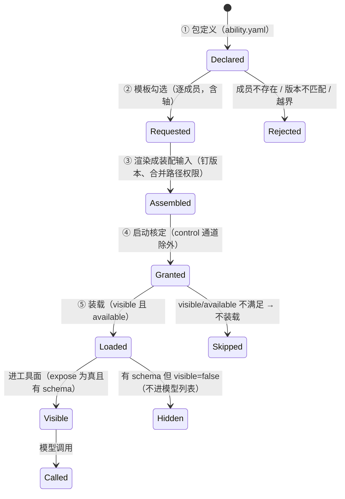
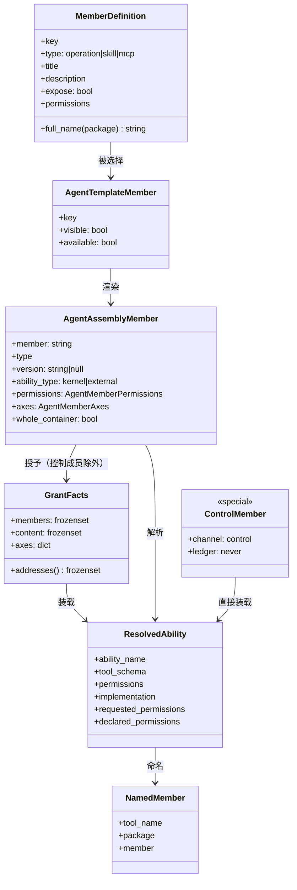

# member 定义规范

| 项 | 内容 |
| --- | --- |
| 文档编号 | GHRAH-SPEC-011 |
| 文档状态 | 现行（唯一范式声明，已实现） |
| 校准基线 | `4a84453`（2026-11-19） |
| 读者 | 写能力包的人、写模板/装配/授权/工具面的人、评审与测试 |
| 效力 | 本文是 `member` 这一概念的**唯一定义**。其它文档、代码注释与 UI 文案出现冲突时，以本文为准并回来修正它们 |
| 不覆盖 | 能力包的目录布局（另一份规范）、驱动的循环语义、MCP 协议本身 |

## 修订记录

| 版本 | 日期 | 变更 |
| --- | --- | --- |
| 1.0 | 2026-11-19 | 首版。把此前散落在模板、装配输入、授权账本、工具面四处的写法收敛为一份定义 |

## 1 定位：member 在装配链上的位置

`member` **不是**某个模块的内部对象，而是贯穿整条装配链的交换单位。同一条信息在五个层次上有五种形态，但**指向的必须是同一个成员**：

```text
①定义面          ②模板申请            ③装配输入              ④授权事实              ⑤工具面
ability.yaml  →  AgentTemplatePackage  →  AgentAssemblyMember  →  GrantRequirement    →  tool_name
members.*        .operations/.skills     (member, type, ...)     (package, operation,   (模型可见的名字)
                                                                 skill, axes)
     │                  │                      │                       │                     │
  作者声明          用户选什么            这次要装什么            实际授予了什么         模型看到什么
```

规则：

- 五层之间**只能单向派生**：定义面 → 申请 → 装配 → 授予 → 工具面。任一层都不得反向改写上一层。
- 每一层都保留**成员全名**（或可无损还原全名的三元组 `package + key + type`），否则跨层追踪断裂。
- 「模板只是申请」：②③ 不产生权限；④ 才是权限事实；⑤ 由 ④ 投影。

## 2 定义：member 是什么

> **member 是能力包内一个可被单独申请、单独授予、单独装载的最小单元。**

| 是 | 不是 |
| --- | --- |
| 包内最小粒度（一个 operation / 一个 skill / 一个远端 mcp 工具） | 不是包（包是成员的容器） |
| 可被模板逐条勾选、被授权账本逐条记录 | 不是「能力」的同义词：能力系统里 ability 包才是容器 |
| 可带自己的权限上限与两轴（visible/available） | 不是一个运行时对象：运行时对象是「装载后的工具」 |
| 有稳定全名，跨版本不变（版本在包上） | 不是脚本/附件：脚本与附件是 skill 的从属资源，不是独立成员 |

### 2.1 三种成员类型

| type | 语义 | 有 `execute` | 有 `available` 轴 | 定义位置 |
| --- | --- | --- | --- | --- |
| `operation` | 一次可调用的动作（读写文件、执行命令、结束任务…） | 是（`async def execute(call, services)`） | 有 | `ability.yaml` 的 `members.operations.<key>` + `operations/<key>.py` |
| `skill` | 一段可注入模型上下文的说明书（`SKILL.md`）及其资源 | 否（被 `load_skill` 读取正文） | **无**（skill 只有可见性；正文/附件始终可读） | `members.skills.<key>` + `skills/<key>/` |
| `mcp` | 远端 MCP 服务器暴露的一个工具，经快照绑定 | 否（转发给远端） | 有 | 声明 `origin: mcp` + 安装生成的快照 |

`skill` 之下的 `scripts` 是**资源**，不是成员：它们出现在授权账本的地址里（`skill/<key>/scripts/<script>`），但不会成为 `AgentAssemblyMember`。

## 3 命名规范

### 3.1 包全名与成员全名

```text
包全名（package full name）
  ├─ 常态：<namespace>.<name>          例：ghrah.fs、ghrah.core、mcp.local
  └─ 退化：<namespace>                 当 identity 不写 name 时，name 视为等于 namespace
                                       例：identity.namespace=research → 包全名 research

成员全名（member full name）
  = <包全名>.<成员键>                  例：ghrah.fs.read_file、research.research
```

- **成员全名是装配链上唯一的成员标识**；模板、装配输入、快照、日志都用它。
- 退化身份下成员全名形如 `research.research`（包名两段相同），这是合法的，不要"顺手去掉一段"。
- 包名与成员键都用 `.` 分隔，成员键本身**禁止**包含 `.`。

### 3.2 字符集

| 对象 | 规则 | 依据 |
| --- | --- | --- |
| 包命名空间 | `^[a-z][a-z0-9_.]*[a-z0-9]$` | 模板身份校验 |
| 包名 | 小写字母开头，允许 `a-z0-9_-` | 工具名算法 |
| operation / skill 键 | `^[a-z][a-z0-9_]{0,63}$`（snake_case） | 工具名算法 |
| skill 键在定义面允许连字符 | 例 `ability-package-development-guide` | 生成器声明常量 |
| 工具名 | `^[A-Za-z0-9_-]{1,64}$`，且不得占用保留名 | 工具名算法 |

### 3.3 键归一（重要）

skill 键常带连字符，直接当能力名会被 `AbilityMetadata` 的名字规则拒绝，因此**加载投影处做一次归一**：

```text
normalize(key) = 逐字符：字母/数字/下划线保留，其余替换为 "_"，且先转小写
ability-package-development-guide → ability_package_development_guide
```

于是存在**两个键**，必须都被登记，否则查不到：

- **定义键**（raw）：`ability-package-development-guide`——出现在目录、模板、UI；
- **装载键**（normalized）：`ability_package_development_guide`——出现在 `ResolvedAbility.ability_name` 与内部注册名。

成员全名以**定义键**为准（`ghrah.ability-builder.ability-package-development-guide`）；装载层用归一键时，必须保持"两个键指向同一个 manifest"，并按成员全名去重，不能出现两条。

### 3.4 保留名

| 名字 | 占用者 | 约束 |
| --- | --- | --- |
| `search_tools` / `describe_tool` / `execute_tool` | 内置 `ghrah.core` 的元工具 | 任何包不得占用 |
| `run_script` | 工具表面层（脚本调用入口） | 任何包不得占用（含内置包） |
| `conversation` / `end_task` | 循环控制成员（见 §7） | 只有 `ghrah.core` 可以声明 |

## 4 数据格式规范（五层逐层）

### 4.1 ① 定义面：`ability.yaml` 的 `members`

```yaml
members:
  operations:
    <key>:
      title: str                 # 必填，短标题
      description: str           # 必填，给模型看的一句话
      entry: operations/<key>.py # 必填，包内相对路径（`/` 分隔，LF 文本）
      input_schema: {...}        # 由构建生成：来自代码里的 Input 模型
      output_schema: {...}       # 由构建生成：来自代码里的 Output 模型
      tags: [str]
      effects: [str]             # 例 session:end
      permissions: {...}         # 包声明的权限上限（成员级申请只能收紧）
      resources: {...}
      execution: {mode, timeout_ms, cancellation, on_revoke, retry}
      expose: bool               # 是否产出工具面（模型可见）
      mcp: {...}                 # 仅 origin: mcp 的包
  skills:
    <key>:
      title: str
      description: str
      body: {path: skills/<key>/SKILL.md, media_type: text/markdown}
      assets: {<资源键>: {path: ...}}
      references: {<资源键>: {path: ...}}
      scripts: {<资源键>: {path: ..., entry: ...}}
```

`operations: {}` / `skills: {}` 表示该类型没有成员；**纯 skill 包必须写 `operations: {}`**，不能省略整个 `operations` 键以外的语义（省略键与空映射在构建期等价，但落盘一律写出空映射）。

### 4.2 ② 模板申请：包级申请里的成员

```text
packages[] {
  package: 包全名, origin: builtin|installed|mcp, version: string|null,
  whole_container: bool,                       # 仅请求可带，落库前必被展开为逐成员
  operations[] { key, visible, available },    # operation 轴申请
  skills[]     { key, visible, scripts[] { key, visible, exec } }
}
```

规则：

- `whole_container=true` 与显式成员**互斥**。
- 存储层**不存在**整包：保存时展开成逐成员（operation 逐个列，skill 逐个列）。
- operation 轴必须满足 §5 的组合约束。

### 4.3 ③ 装配输入：`AgentAssemblyMember`

```jsonc
{
  "member": "ghrah.fs.read_file",   // 成员全名，必填
  "type": "operation",              // operation | skill | mcp
  "version": null,                  // 能力件为钉住的版本；内核件恒 null
  "ability_type": "kernel",         // kernel | external —— 只是来源标记，装载逻辑不分叉
  "permissions": {                  // 九维，全部可空；null = 未申请
    "allowed_paths": null, "denied_paths": null, "require_hitl": null,
    "fs_read_only": null, "fs_write": null, "shell_access": null,
    "net_access": null, "allowed_commands": null, "denied_commands": null
  },
  "axes": { "visible": true, "available": true },
  "whole_container": false          // 兼容字段：装配前应展开，落库/下发的成员不带它
}
```

关键约定：

- `permissions` 的 `null` 表示**未申请**，Core 沿用包声明上限；显式 `false` 才是收紧。用默认值填充等于把「未申请」误判成「显式收紧」。
- `version` 只对 `ability_type=external` 有意义；内核件写 `null`，禁止写一个"看起来像版本"的值。
- `axes` 可以省略（默认 `true/true`），但一旦给出必须满足 §5。

### 4.4 ④ 授权事实：账本里的两个模型

启动策略规则（扁平，一条只指向一个目标）：

```text
GrantRule { package, agent|null, operation|null, skill|null, script|null,
            effect: grant|remove, visible: true, available: true }
```

授予后的事实（按成员地址索引）：

```text
GrantFacts {
  members: {<operation 键>},
  content: {skill/<key>, skill/<key>/scripts/<s>, skill/<key>/assets/<a>, skill/<key>/references/<r>},
  axes:    {成员地址 → (visible, available)}     # 地址全集必须被 axes 覆盖，缺一即报错
}
```

**地址规范**（跨层唯一）：

| 成员 | 地址 |
| --- | --- |
| operation | `operations/<key>` |
| skill 正文 | `skill/<key>` |
| skill 脚本 | `skill/<key>/scripts/<script>` |
| skill 附件 | `skill/<key>/assets/<name>` |
| skill 参考 | `skill/<key>/references/<name>` |

注意 operation 地址带复数前缀 `operations/`，skill 地址是单数 `skill/`——这是既有契约，不要"统一"。

### 4.5 ⑤ 工具面：`tool_name`

装载后成员成为工具，名字由算法决定（纯函数，输入一组 `(包名, 成员键) → 工具名`）：

```text
1. 基础名 = 成员键（operation）；skill 不产工具，只产「可加载的说明书」
2. 长度上限 64；超长时截断到 54 + "-" + 前 8 位摘要
3. 与保留名（search_tools / describe_tool / execute_tool / run_script）冲突时按确定规则加后缀
4. 同一批内重名：确定性消解（与输入顺序无关），无法消解则报错，不静默改名
5. 输出按工具名升序
```

`tool_name` 到成员是**唯一权威的映射**：调用只查表，不拼模块路径、不拼服务器地址。

## 5 两轴：`visible` 与 `bind`

两个轴描述「授予之后」的状态，与定义面的 `expose`（是否有工具形态）是**不同维度**：

| 维度 | 定义面 `expose` | 授予轴 `visible` / `bind` |
| --- | --- | --- |
| 位置 | `ability.yaml` 的成员声明 | 模板/创建请求的成员轴 → 实例快照 |
| 谁决定 | 包作者 | 模板作者 / 创建者 / 模型运行时 |
| 回答 | 这个成员有没有工具形态 | 能不能被发现、是否常驻模型上下文 |
| 是否可逐 Agent 不同 | 否（包级固定） | 是（每个 Agent 每个成员） |

三条合法组合：

| visible | bind | 合法 | 语义 | 装配结果 |
| --- | --- | --- | --- | --- |
| `true` | `true` | ✅ | 已绑定 | schema 常驻模型上下文，可直接调用 |
| `true` | `false` | ✅ | 可发现未绑定 | 可被 `search_tools` 找到、`execute_tool` 调用；模型可 `bind_member` 装上 |
| `false` | `false` | ✅ | 隐藏 | 不进目录，不可发现也不可调用 |
| `false` | `true` | ❌ | 绑定却不可见——无法解释 | 构造期拒绝（`bind=true` 要求 `visible=true`） |

运行期变更：`bind_member` / `unbind_member` 两个元工具由模型自行调用；绑定的权威是
**实例快照**（`agent_instances.members[].axes`），每次变更立即写库，重启按库恢复。
控制成员（`conversation` / `end_task`）不参与两轴，也不允许被绑定或解绑。

技能成员没有 `bind` 语义（正文按需 `load_skill`）；脚本的可执行性仍是独立字段
`exec`（默认 `false`），与可见性无关。

技能成员只有 `visible` 与 `bind` 的组合差异：

- `bind=true`：进每轮技能目录（正文仍按需 `load_skill`）；
- `visible=true, bind=false`：不进目录，但每轮有一行"可绑定"提示（名字 + 绑定入口），模型可 `bind_member` 按目录名绑定；
- `visible=false`：目录与提示都不出现。

装配边界按成员类型分流：`operation` 走工具面（绑定集合 → 静态 schema），
`skill` 走消息面（`skill_reminder` 按绑定过滤后每轮注入），控制成员走 control 通道
（不受两轴影响）。

**wire 过渡**：装配输入沿用历史字段名 `axes.available` 承载绑定轴（`available=true`
即绑定），Core 在解析时映射为 `MemberAxes.bind`；模板/快照不引入新字段名，等
Subject 侧显式升级后再统一。

## 6 成员生命周期



要点：

- **申请不等于授予**：模板没选 → 不申请；策略没给 → 不授予；两者都满足才装载。
- **授予不等于可见**：可见性由轴决定，工具面再由 `expose` 与实际 schema 过滤。
- **跳过不报错**：`visible`/`available` 不满足时该成员只是不装载；只有"申请了但不存在/版本错/权限越界"才是错误。

## 7 控制成员（特殊类别）

`conversation`、`end_task` 是**循环控制成员**：它们属于成员体系，但不受常规授权面约束。

| 方面 | 常规成员 | 控制成员 |
| --- | --- | --- |
| 能否出现在模板 | 能 | 能（历史与前端都允许） |
| 是否写授权账本 | 是 | **否**：启动核定时被分流到 control 通道 |
| 是否受授权投影裁剪 | 是（撤销后从模型视野消失） | **否**：永远保留 |
| 工具形态 | 一般有 schema | `conversation` 无 schema；`end_task` 仅 `toolcall` 模式有 |
| 由谁驱动 | 模型调用 | Agent 主循环 / Hook 路由 |
| 归属 | 任意包 | 仅 `ghrah.core` |

规范要求：

1. 控制成员的判定是**两个条件同时成立**：handler ∈ `{conversation, end_task}` 且成员全名以 `ghrah.core.` 开头。
2. 它们必须能被模板选中并真正进入装配结果——否则循环缺少出口；装配层不得在解析阶段丢弃或拒绝它们。
3. 它们的模板轴应为 `visible=true, available=true`；定义面的 `expose=false`（`conversation`）不得被当作轴值使用。

## 8 不变式（违反即为缺陷）

| 编号 | 不变式 |
| --- | --- |
| M-1 | 成员全名全局唯一；同一包内键唯一 |
| M-2 | 成员全名中的包部分必须等于所属包的包全名（含退化身份的两段相同情形） |
| M-3 | 成员键不得包含 `.`；字符集符合 §3.2 |
| M-4 | 模板/装配/快照里出现的成员，必须能在对应包版本的定义面找到；找不到即失败，不得静默丢弃 |
| M-5 | 能力件成员必须带 `version`；内核件成员必须 `version=null` |
| M-6 | `permissions` 只能收紧包声明，不得放宽 |
| M-7 | 轴组合必须落在 §5 的三条合法组合内 |
| M-8 | skill 不参与 operation 的成员级权限合并；skill 的授予以「整条 skill」为单位 |
| M-9 | 存储层的成员列表不得含 `whole_container=true`（整包必须已展开） |
| M-10 | 控制成员不得写入授权账本；非控制成员不得被静默排除在账本之外 |
| M-11 | `expose` 与 `visible/available` 不得互相赋值 |
| M-12 | 工具名与成员的映射唯一且确定：同输入同输出，与顺序无关，冲突不静默改名 |

## 9 版本与来源标记

| 字段 | 取值 | 用途 | 禁止 |
| --- | --- | --- | --- |
| `ability_type` | `kernel` / `external` | 描述成员来自内置树还是安装根 | 不得据此分叉装载逻辑（两者同一套装载） |
| `version` | 字符串 / `null` | 能力件在安装根下的版本层 | 内核件写任何版本值 |
| `origin`（模板层） | `builtin` / `installed` / `mcp` | 选择来源与展开方式 | 与 `ability_type` 混用（前者是选择来源，后者是装载来源标记） |

版本判定：最新版本按**数值**比较（`1.10.0 > 1.9.0`），字符串比较会把最新版判错。

## 10 类图



职责边界：`MemberDefinition` 是包作者的声明；`AgentTemplateMember`/`AgentAssemblyMember` 是"要什么"；`GrantFacts` 是"给了什么"；`ResolvedAbility` 是"解析出来的可装载对象"；`NamedMember` 是"模型看到什么"。

## 11 已知偏差与待收敛

1. **控制成员不进账本**：如 §7，属于设计选择，但导致管理面的授权视图与真实工具表存在系统性差异（控制成员在跑却看不见）。
2. **整包展开把 `expose` 当轴值**：`conversation` 的 `expose=false` 会使整包选择 `ghrah.core` 产生非法轴组合（`visible=false, available=true`）而被拒。正确做法是展开时轴取 `true/true`，`expose` 只影响是否产出 tool schema。
3. **定义键与装载键双登记**：见 §3.3，目前靠两处登记 + 按成员全名去重维持一致；未来应在装载层只认定义键。
4. **`whole_container` 兼容字段仍留在装配输入里**：契约上允许，但落库与下发的成员不得携带；属于待移除的过渡字段。
5. **绑定轴仍走 `available` 字段名**：wire 未新增 `bind`，Core 解析时映射；模板与快照的语义已经是"是否绑定"，但字段名会误导阅读者，待 Subject 侧统一后改名。
6. **`visible=false` 的成员无法被运行时重新绑定**：它不进目录，`bind_member` 找不到目标；如需"先隐藏、按需启用"，应改为 `visible=true, bind=false`。