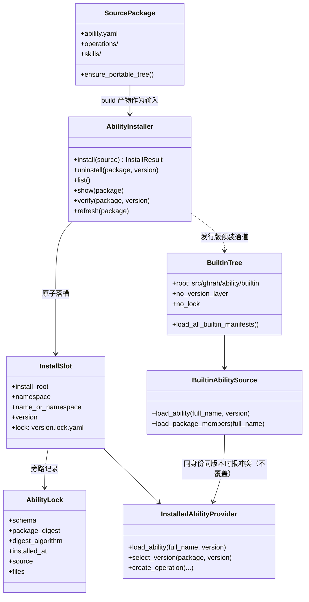

# ability 包结构与定义规范

| 项 | 内容 |
| --- | --- |
| 文档编号 | GHRAH-SPEC-012 |
| 文档状态 | 现行（唯一范式声明，已实现） |
| 校准基线 | `a742fcf`（2026-11-23） |
| 读者 | 写能力包的人、做发行版预装的人、改加载/安装链路的人 |
| 效力 | 本文是能力包**文件结构与各层目录含义**的唯一定义。包长什么样、放哪里、每一层代表什么，以本文为准 |
| 不覆盖 | 成员概念与数据格式（另一份规范）、MCP 协议、运行时装配流程 |

## 修订记录

| 版本 | 日期 | 变更 |
| --- | --- | --- |
| 1.0 | 2026-11-19 | 首版。明确内核件/能力件/MCP 三类的目录差异与构建、安装、装载三方职责 |
| 2.0 | 2026-11-23 | 补安装 intake 归一（文本源 LF/BOM、包内杂物 tolerant）与 `name` 显式化建议；登记两段/三段成员名并存与"构建严格 / 安装宽松"两条已知偏差 |

## 1 两类包与三种来源

| 类别 | 存放位置 | 有版本层 | 有安装记录 | 谁发布 | `ability_type` |
| --- | --- | --- | --- | --- | --- |
| **内核件**（builtin） | 仓库内 `ghrah-core/src/ghrah/ability/builtin/<name>/` | 否 | 否 | 随源码 | `kernel` |
| **能力件**（installed） | 发行版安装根 `<install_root>/<ns>/<name>/<version>/` | 是 | 是（`<version>.lock.yaml`） | 独立安装 | `external` |
| **MCP 包**（mcp） | 安装根下（与能力件同槽位） | 是 | 是 | 受信客户端生成快照 | `external`（成员 `type=mcp`） |

判定依据是**位置**（源码树 / 安装根），不是包的自述字段：

- 同一身份的同一版本同时存在于两处时，**启动装配明确失败**（`ManifestValidationError`：拒绝静默覆盖）；目录视图的 `shadowed_builtin` 只用于展示登记冲突，不是"安装根胜出"。
- 内核件永远没有版本选择语义：目录接口对内核件返回 `latest_version=null`，成员申请里 `version` 恒 `null`。
- MCP 快照的 `namespace=mcp` 是保留命名空间，任何常规安装通道不得占用。

## 2 通用源包目录树

作者侧与内核件共用同一种形状（v1 源包目录）：

```text
<package-root>/
├── ability.yaml                     # ① 索引：头段 + members（members 由构建生成）
├── operations/                      # ② operation 实现（键 = 文件名去后缀）
│   ├── read_file.py
│   └── write_file.py
└── skills/                          # ③ 技能（键 = 目录名）
    └── research/
        ├── SKILL.md                 #    正文（frontmatter + body）
        ├── assets/                  #    附件（可选）
        ├── references/              #    参考资料（可选）
        └── scripts/                 #    脚本（可选，逐脚本可执行性另授权）
            └── export.py
```

### 2.1 `ability.yaml`：索引，不是随便写的配置文件

```yaml
format: ghrah.ability-definition     # 固定值；格式不对直接拒绝
schema_version: '2'                 # 构建产物恒为 '2'；解析兼容 '1'
identity:
  namespace: research               # 必填
  name: research                     # 建议显式写出；省略时包全名取 namespace（退化身份）
  version: 0.1.0                     # 必填，语义化版本
title: research
description: ...                     # 给人和目录看的说明
members:                             # 由 `ghrah ability build` 生成，禁止手写
- namespace: research
  name: research
  member: research.research.research
  type: skill
  version: null
  ability_type: kernel
  axes: {visible: true, bind: true}
  data:
    title: research
    description: ...
    path: research/research/skills/research/SKILL.md   # 能力根相对路径
    media_type: text/markdown
    assets: {}
    references: {}
    scripts: {}
```

规则：

1. **`members` 是构建产物**：`members` 是成员记录数组（不是 `{operations, skills}` 两个映射），从 `operations/*.py` 的声明常量与 `Input`/`Output` 模型生成；手写会在 `--check` 或安装期被判定为索引不一致。
2. 头段（`format`/`identity`/`title`/`description`）**保留作者写法**，构建会重写 `members` 并把 `schema_version` 归一为 `'2'`。
3. 落盘格式固定：UTF-8 无 BOM、LF 换行、`sort_keys=false`、稳定字段顺序、原子写；同一输入两次构建必须字节相同。
4. `name` 省略时目录层级仍然两段：目录用 `<namespace>/<namespace>/<version>/`，定义面成员全名形如 `research.research`。
5. **新包建议显式写 `name`**：成员全名的规范形态是三段（`namespace.ability_name.member_name`）；省略 `name` 会让定义面只剩两段，模板/快照/装配仍用三段，运行期靠兼容层（解析回退 + 等价形态比较）对齐。显式写 `name` 可以完全避开这层兼容。

### 2.2 `operations/<key>.py`：声明与实现同文件

每个 operation 文件就是一个自包含单元，承担三件事：

```python
# ① 模块级声明常量（构建器读取，用于生成 members）
TITLE = "End Task"
SUMMARY = "End the current task and generate a final response"
TAGS = ["core", "lifecycle"]
PERMISSIONS = {...}  # 权限上限（成员级申请只能收紧）
EFFECTS = ["session:end"]
TIMEOUT_MS = 60000
RESOURCES = {...}
EXPOSE = False  # 是否有工具形态


# ② 入参/出参模型（构建器据此生成 input_schema / output_schema）
class Input(BaseModel): ...


class Output(BaseModel): ...


# ③ 唯一入口
class XxxAbility(Ability):
    async def execute(self, call, services) -> ActionResult: ...
```

入口 ABI 是硬约束：`async def execute(call, services)`；`Input`/`Output` 的 schema 必须与生成的索引逐字段一致。安装期会做同一套 ABI 预检——**装得进去就必须建得出 Agent**。

### 2.3 `skills/<key>/`：正文 + 三类资源

| 组成 | 必需 | 含义 | 键/地址 |
| --- | --- | --- | --- |
| `SKILL.md` | 是 | 技能正文（frontmatter 里 `name`/`description` 参与校验） | `skill/<key>` |
| `assets/` | 否 | 附件（图片、数据文件） | `skill/<key>/assets/<资源键>` |
| `references/` | 否 | 参考资料 | `skill/<key>/references/<资源键>` |
| `scripts/` | 否 | 可执行脚本 | `skill/<key>/scripts/<资源键>` |

资源键派生规则：去掉文件后缀、路径分隔符换成 `-`。例：

```text
skills/research/references/api/auth.md  →  api-auth
skills/research/scripts/export.py       →  export
```

skill 不参与工具面（不产 tool schema）；它由 `load_skill` 按需把正文注入模型上下文。脚本的可执行性单独授权（`exec` 轴，默认 `false`），与「技能可见」是两件事。

## 3 内核件布局

```text
ghrah-core/src/ghrah/ability/builtin/          # 内置树根（随源码分发）
├── ability-builder/                           # 纯 skill 包：只有 skills/
│   ├── ability.yaml
│   └── skills/ability-package-development-guide/SKILL.md
├── cluster/                                   # operation 包
│   ├── ability.yaml
│   └── operations/*.py
├── core/                                      # 元工具 + 循环控制成员
├── fs/                                        # 文件读写
├── mcp/                                       # MCP 接入相关
└── shell/                                     # 命令执行
```

每一层的含义与约束：

| 层 | 含义 | 约束 |
| --- | --- | --- |
| `builtin/` | 内置树根 | 目录名不是包身份；身份只看各包 `ability.yaml.identity` |
| `<name>/` | 一个内置包 | 目录名与 `identity.name` 一致（便于人读；身份以 yaml 为准） |
| `ability.yaml` | **已构建**的索引 | 构建产物入库，CI 里有 `--check` 门禁防止漂移 |
| `operations/` | 实现 | 不允许 `__init__.py` 之外的额外层；入口必须是 `execute` |
| `skills/` | 技能 | 纯 skill 包允许没有 `operations/` 目录，但 `members.operations` 必须为空映射 |

内核件没有：版本槽、安装记录、摘要校验文件。它们的 `identity.version` 只是元数据，不参与选择——加载器对内置树按"唯一版本"处理。

## 4 能力件安装布局

```text
<install_root>/                          # 由发行版显式给出，领域层不拼默认值
└── <namespace>/
    └── <name or namespace>/             # 退化身份时第二段与第一段同名
        ├── <version>/                   # 版本槽：内容不可变
        │   ├── ability.yaml
        │   ├── operations/*.py
        │   └── skills/<key>/...
        └── <version>.lock.yaml          # 安装记录：与版本目录同级，不在其内
```

| 层 | 含义 | 规则 |
| --- | --- | --- |
| `<install_root>/` | 发行版的能力根 | 每个发行版一个根；跨发行版不共享 |
| `<namespace>/` | 命名空间 | `mcp` 保留给快照；`ghrah` 只允许发行版预装通道写入 |
| `<name or namespace>/` | 包名层 | 退化身份（`identity.name` 省略）用命名空间补位，保证永远两段 |
| `<version>/` | 一次安装的完整树 | 只读、不可变；重装同版本且摘要相同 → 幂等；摘要不同 → `version_conflict` |
| `<version>.lock.yaml` | 安装事实 | 记录包摘要与逐文件摘要，用于 `verify` / `show` / 漂移检测 |

### 4.1 安装记录（lock）结构

```yaml
# 安装期生成，勿手工编辑
schema: 1
package_digest: sha256:<tree 摘要>
digest_algorithm: sha256-tree-v1
installed_at: '2026-11-18T10:42:24Z'
source:
  kind: directory          # directory | archive | mcp
  ref: <来源绝对路径或标识>
files:
  ability.yaml: sha256:<逐文件摘要>
  skills/research/SKILL.md: sha256:<...>
```

要点：

- 摘要算法是**树摘要**：路径集合 + 逐文件摘要按稳定顺序聚合，不包含 lock 自身。
- lock 在版本目录**之外**：版本目录的内容可被独立校验，lock 是"这次安装发生了什么"的记录。
- 只有 MCP 快照允许 `refresh`（递增 patch 并改写 lock）；普通包刷新等同于重装。
- 安装器**不 import 包代码、不重建索引**：只校验已生成的 `members` 与内容摘要。

### 4.2 安装命令的输入形态

| 输入 | 接受 | 说明 |
| --- | --- | --- |
| 版本目录（含 `ability.yaml` 的目录） | ✅ | v1 源包目录，唯一支持的形态 |
| 归档（zip 等） | ❌ `unsupported_source` | 须先解包再安装 |
| 旧多层布局（`<ns>/<name>/<version>` 嵌套再套一层） | ❌ `legacy_layout` | 提示改造成 v1 源包目录 |
| 含 lock 文件的源目录 | ❌ `lock_in_source` | lock 只能由安装器生成 |

安装源目录会先过一遍 **intake 归一**（`intake.normalize_source`，由 `installer.py` 调用），再进入构建：

- **文本源归一**：`ability.yaml`、`SKILL.md`、`.py` 等文本源统一为 UTF-8 无 BOM + LF；非文本（含空字节）不参与。这一步只改文本，不动二进制。
- **成员扫描宽容**（`tolerant`）：生成 `members` 时，`operations/` 下的说明文件/子目录、`skills/<key>/` 下的未知文件或子目录会被跳过，不登记成资源；作者侧 `build` 命令仍然严格，发现即报错。
- **边界（重要）**：宽容只到「生成成员索引」为止。安装器落槽前仍会**严格比对文件集合**（`installer` 的索引校验），成员目录里残留的杂物会导致 `index_mismatch`；只有**包根**的说明文件（README/CREDITS 等）被允许。所以"上传一个带杂物的包能装上"不成立——要么清掉杂物，要么走包根。
- 归一结果会以 warning 形式回给调用方（例如"已把 N 个文本源统一为 LF"）。

### 4.3 上传导入（intake）与信任边界

```text
Subject POST /ability-packages/import
  → Core package_import
  → 解包到临时目录
  → installer.prepare：normalize_source（合成/保留头段、扫盘定成员、LF/BOM 归一、成员扫描宽容）
  → ABI 预检（import 实现脚本，读常量/Input/Output；不执行 execute）
  → install（严格索引校验、写 lock、原子落槽，source.kind=archive）
  → relock_source 改写 lock 来源
```

- 上传安装等于**在当前进程执行一次包代码的导入期逻辑**（模块顶层与类定义），靠接口鉴权与操作员身份兜底；不可信来源不要直接上传。
- 上传包与作者侧 `build` 的差异只在「宽容范围」与「来源标记」：文本噪声、包根杂物、缺失声明常量会被补齐/跳过；成员目录内的杂物仍会失败。
- 导入失败不落槽：临时目录与半成品版本目录由安装器清理，不污染安装根。

## 5 MCP 包布局

MCP 包是**声明式**的：没有 operation 代码，只有声明 + 由受信客户端探测生成的快照。

```yaml
format: ghrah.ability-definition
schema_version: '1'
origin: mcp                    # 触发 MCP 安装通道
identity: {namespace: mcp, name: <server>, version: '0.0.1'}
title: ...
description: ...
mcp: {server: <agentconf 里的服务器名>}
```

- 快照的成员是远端工具（`type=mcp`），其 schema 由探测得到，不从本地代码推导。
- `namespace=mcp` 是保留命名空间；MCP 成员只来自安装快照，旧的 `ghrah.mcp` 内置接入包已退役。
- 安装根下的槽位与能力件一致；快照刷新走 `refresh`。

## 6 构建、安装、装载的职责边界

```text
作者机器                            发行版机器                         运行期
─────────                          ──────────                        ──────
source tree
   │ ghrah ability build
   │   · 子进程 import 取常量/模型（不执行 execute）
   │   · 生成 members → 原子写回 ability.yaml
   ▼
built tree  ──── ghrah ability install ──▶ <install_root>/<ns>/<name>/<version>/
                     · 校验 members 与内容一致        + <version>.lock.yaml
                     · 只读复制、不 import 代码
                     · 原子 rename 版本目录
                                                        │  启动提交（Core）
                                                        │    · capture：读 ability.yaml、verify lock
                                                        │    · commit_version / select_instance / write_grant
                                                        ▼
                                              SQLite：ability_versions + ability_content
                                                        │  运行期
                                                        │    · 只读库（surface_snapshot / resolve / read_chunk）
                                                        ▼
                                              ProjectedAbility → 工具 / 技能目录
```

四个"谁负责什么"：

| 阶段 | 谁做 | 做什么 | 绝不做什么 |
| --- | --- | --- | --- |
| build | 作者/CI | 生成并校验 `members`，保证幂等字节 | 不改头段、不跑 `execute` |
| install | 发行版 | 校验索引与内容、写 lock、原子落槽 | 不 import 包代码、不重建索引、不改包内容 |
| load | Core | 启动时捕获并提交：读定义面、校验 lock、把版本/内容写入关系库；运行期只读库 | 不在运行期扫盘、不按文件系统猜测成员 |
| catalog | Core 目录面 | 汇总内置树 + 安装根，给出版本与成员键 | 不改任何存储 |

## 7 可移植性规则（构建与安装共同执行）

| 规则 | 细节 | 违反时 |
| --- | --- | --- |
| 换行 | 文本源（`.py`/`.md`/`.yaml`/`.yml`/`.json`）必须 LF | `portable_tree_violation`（提示 `.gitattributes: * text=auto eol=lf`） |
| 编码 | UTF-8 无 BOM；含空字节视为非文本 | 同上 |
| 链接 | 拒绝符号链接与 junction（目录与文件都算） | `symlink_rejected` |
| 文件类型 | 只接受普通文件 | `portable_tree_violation` |
| 路径分隔符 | 声明与包内路径一律 `/`，出现 `\\` 拒绝 | 路径规则错误 |
| 路径安全 | 拒绝绝对路径、盘符、UNC、`.`/`..` 段、空段、以点或空格结尾的段 | 路径规则错误 |
| 字符规范 | NFC 归一后比较；casefold 后相同视为冲突 | 路径冲突错误 |
| 保留名 | Windows 设备名（`CON`、`NUL`、`PRN` 等，带扩展名也算）拒绝 | 路径规则错误 |
| 长度 | 单段 ≤ 字节上限；相对路径 ≤ UTF-16 码元上限 | 路径超长 |
| 忽略项 | `.git`/`__pycache__`/`.mypy_cache`/`.pytest_cache`/`.ruff_cache` 与 `.DS_Store`/`Thumbs.db`/`desktop.ini` 不参与摘要 | — |
| 命名空间 | `mcp` 任意通道拒绝；`ghrah` 仅发行版通道 | `reserved_namespace` |
| 成员键 | 不得占用工具保留名（`search_tools`/`describe_tool`/`execute_tool`/`bind_member`/`unbind_member`/`run_script`） | `reserved_member_name` |

## 8 不变式（违反即为缺陷）

| 编号 | 不变式 |
| --- | --- |
| PKG-1 | 包身份唯一由 `identity`（`namespace` + 可选 `name` + `version`）决定，绝不取自目录名 |
| PKG-2 | `members` 只能由构建生成；手工编辑等同于索引漂移 |
| PKG-3 | 同一 `(namespace, name, version)` 在两处同时存在时，启动装配报错（拒绝静默覆盖），不做优先级裁决 |
| PKG-4 | 版本槽一旦写入即不可变；同版本不同内容只能报冲突，不能覆盖 |
| PKG-5 | lock 只在版本目录之外；lock 缺失或摘要不符视为安装损坏 |
| PKG-6 | 内核件没有版本选择语义，其 `version` 不参与任何选择 |
| PKG-7 | 安装不得 import 包代码；ABI 校验只能走"读定义 + 子进程探测" |
| PKG-8 | 包内所有文本源必须 LF、无 BOM；包内不得有链接 |
| PKG-9 | `mcp` 命名空间保留给快照；`ghrah` 命名空间只允许发行版预装 |
| PKG-10 | 目录树的可枚举结果必须确定（NFC + 稳定排序），否则摘要不可复现 |

## 9 错误码与定位

| 错误码 | 含义 | 常见原因 |
| --- | --- | --- |
| `unsupported_source` | 来源形态不支持 | 直接传了 zip/归档目录 |
| `legacy_layout` | 旧多层布局 | 源目录里又套了 `<ns>/<name>/<version>` |
| `lock_in_source` | 源里带 lock | 把已安装目录当源再装 |
| `invalid_definition` | `ability.yaml` 结构非法 | 缺 `identity.version`、`format` 不符 |
| `invalid_content` | 内容与声明不一致 | 正文/脚本/资源缺失 |
| `index_mismatch` | `members` 与实现不一致 | 改了代码没重新 build |
| `portable_tree_violation` | 违反可移植规则 | CRLF、BOM、符号链接、保留名 |
| `symlink_rejected` | 包内含链接 | 复制/打包时引入了链接 |
| `reserved_namespace` | 命名空间保留 | 用户通道装了 `mcp.*` 或 `ghrah.*` |
| `reserved_member_name` | 成员键占用保留工具名 | operation 起名 `run_script` |
| `version_conflict` | 同版本不同内容 | 重装时改了包内容 |
| `digest_mismatch` | 摘要不符 | 安装后被改动 |
| `corrupt_install` | 安装目录结构损坏 | 手工删了版本目录里的文件 |
| `path_too_long` | 路径超限 | 深目录 + 长文件名 |

## 10 类图



职责边界：`SourcePackage` 是作者产物；`AbilityInstaller` 是"复制 + 校验 + 记账"；`BuiltinTree` 是随源码发布的只读树；`InstallSlot`/`AbilityLock` 是安装事实；两个 provider 各自读取自己的存储，并在身份重叠时按 §1 的优先级决定胜负。

## 11 已知偏差与待收敛

1. **内核件也带 `identity.version`**：语义上内核件没有版本选择，但 yaml 里仍写了版本号（历史原因），目录接口据此返回 `latest_version=null` 而不是隐藏该字段。
2. **构建与安装共用同一份源包形状**：作者侧必须先 build 再 install；安装不重建索引意味着"改了代码忘记 build"只会在安装期报 `index_mismatch`，不会自动修复。
3. **`refresh` 仅对 MCP 快照有意义**：普通包调用会被 `unsupported_refresh` 拒绝，但 CLI 文案尚未把这一限制说清楚。
4. **`.zip` 不支持直接安装**：需要先解包；这对外部分发不友好，属于待补的输入通道。
5. **退化身份的两段成员名是兼容层**：`identity.name` 省略时定义面成员名两段（`research.research`），模板/快照/装配用三段（`research.research.research`）。Core 在成员解析、安装记录读取、绑定集合比较三处做等价兼容，但两段/三段并存本身就是长期债务——建议后续把 `identity.name` 定为必填（或构建/安装时自动补 `name=namespace`），重建存量包后删除兼容分支。
6. **构建严格 / 安装导入宽松的口径差**：`build` 对包内杂物直接报错；安装 intake 只对**文本噪声**与**成员扫描**宽容，落槽前的文件集合校验仍然严格——成员目录里的杂物依旧会 `index_mismatch`，只有包根说明文件被允许。排障时要先区分失败发生在「生成成员索引」还是「安装落槽」。