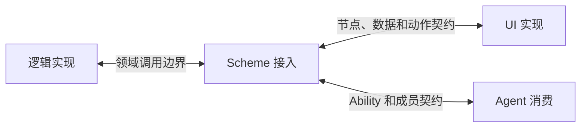

# 二次开发：逻辑、Scheme 接入与 UI 并行推进

> 本文面向新增系统功能、能力或面板的开发者。目标是让三条工作线依赖明确契约，各自开发，再替换替身实现进行联调。

校准基线：`acf06fe` 与 2026-10-29 工作区。本文是开发方法；全局节点变更及面板装配契约仍未冻结。当前可运行示例见[运行时 API](2026-10-29-runtime-api.md)。

## 1. 三条开发线分别负责什么

逻辑实现提供实际行为，Scheme 接入提供可供人类和 Agent 消费的资源与操作，UI 提供交互呈现。它们是职责边界，物理实施上并不意味着需要三个包、进程或仓库。

| 开发线 | 交付内容 | 对另一层的依赖 |
| --- | --- | --- |
| 逻辑实现 | 领域调用、状态变更、事务、外部效果与资源生命周期 | 明确输入输出和行为，不依赖页面、Scheme 路径或组件布局 |
| Scheme 接入 | 节点身份、实例映射、契约导出、Provider 适配、Ability、View 和面板入口声明 | 消费明确领域调用边界，复用既有事实写者 |
| UI 实现 | 面板、布局、表单、交互及加载／结果／失败呈现 | 消费公开节点和动作，不绑定内部表结构、Python 类或私有 provider 方法 |



面板入口可引用 UI 产物、资源及动作，具体渲染在 UI 层。一个界面可聚合多个节点，同一节点也可有多个界面或 Agent 消费。是否自动生成表单是 UI 的选择，树不强制页面布局，也不要求每个节点都有专用面板。

## 2. 从用途画出一个最小子树

先写一条具体使用链，再把需要的资源放进树。下面以“从已获授 Operation 中选择一个工具”为例：

```text
Agent／用户需要选择工具
  → 枚举 agent/<id>/ability 中的可绑定 Operation
  → 提交绑定操作，权威确认成员和范围
  → bound_tools 出现已生效的成员关联
  → View 展示结果，模型工具输入使用同一绑定
```

需要的节点包括获授集合、成员、工具绑定与相应投影。若某个额外节点不影响这条行为，也无其他消费者，先删去或归并。判断是否新增 kind 则更晚：已有种类下的成员、属性或链接不能承接时，再论证独立契约。

树中区分定义、实例、关系与投影，尤其不要将 provider 的启动实例当作 Ability 定义身份。设计完成时应能解释每条关系指向什么，以及谁可以提交它的变化。

## 3. 用最小契约启动并行开发

目录名确定了形状，要让三方真正独立推进，还需要足够实现当前场景的共同约定。它可以按子树逐块明确，不必先定完整系统。

| 契约内容 | 需要给出的答案 |
| --- | --- |
| 身份和范围 | 请求者是谁，目标 Agent／run／实例如何定位，self 怎样解释 |
| 数据 | 字段、类型、空集合、未知／过期状态、来源和修订 |
| 动作 | 输入、输出、错误、允许范围及受信上下文 |
| 效果 | 成功意味着已提交什么，改变哪些节点，哪些效果异步出现 |
| 引用与变更 | 重绑定、撤销、重启及并发变更后的引用规则 |
| 逻辑接线 | Scheme 适配调用哪个领域接口，如何对应结果和失败 |
| 消费者 | UI、Agent 或后台服务具体读取和操作哪些节点 |

保留一份规范来源。Python 模型、公共描述符、UI 类型、工具 schema 和替身样例可以生成或一致性校验，不能各自维护一份独立契约。跨语言公共格式归 ghrah-protocol；改动时同步 Python 与 TS 并跑两侧检查。

例子中的绑定请求至少定位目标 Agent 及其确定获授成员；响应应区分“请求被接收”“业务已接纳”和“绑定已生效”。若 View 刷新滞后，UI 展示版本或等待状态，不凭按钮点击就宣称绑定完成。这是行为约定，不要求新增一套公共原语。

## 4. 使用替身实现分别推进

替身实现是履行同一契约的最小可控实现，可用于其他工作线尚未完成时的开发。它不应成为另一份生产事实来源。

| 工作线 | 独立验证 | 替身 |
| --- | --- | --- |
| 逻辑 | 对当前获授成员提交绑定、解绑和失效，验证事务与结果 | 使用确定身份和成员引用直接调用领域服务 |
| Scheme 接入 | 路径／动作到领域调用的映射、受信上下文、输入输出与错误 | 领域服务替身，不复制最终业务算法 |
| UI | 枚举、选择、提交、结果、空集合、成员失效与失败显示 | 同一公开节点和动作契约的提供者替身 |

Agent 消费也可用同一公开契约验证工具生成和回调定位。UI 的模拟状态不能作为授权来源，适配器不另存最终绑定表，逻辑实现无需为每个页面增加专用分支。

## 5. 接到当前运行时

已有机制可用于实现一个功能的真实访问边界，步骤如下：

1. 确定逻辑接口及唯一事实写者，声明所用资源与真实效果。
2. 用 SchemeModel 定义严格输入输出，建立 SchemeSpec／ActionSpec；与 Ability 定义中的重叠 schema 保持同源。
3. 实现 Provider.execute，将 ProviderCall 映射到逻辑调用，返回确定输出，不暴露管理端口或裸 handler。
4. 由受信宿主 publish，并按 AgentScope 安装局部 bind。Authority 接入同一当前领域关系及接纳事务。
5. 若 provider 持有连接或运行资源，显式接入 ProviderLifecycle；确定哪些导出共享同一 owner。
6. 消费者用 Session 发现、取得引用和提交；处理 pending、遮蔽结果、失效与取消，结束后释放引用。

文件切片已按上述方法实现领域关系、Scheme 入口和可注入面板，见[文件 Ability 资源切片：权威关系、Scheme 接入与面板](2026-10-29-ability-resource-slice.md)。扩大到其他子树时，仍可先固定领域契约并使用替身；不得编造已有 Python 方法，也不得绕回一条不检查当前获授事实的生产写通路。

## 6. 联调与变更规则

联调时将替身换成真实提供者，核对同一批输入、结果和状态变化。重点是目标没有错配、效果进入原有权威写路径、View 能重建、撤销和 provider 代次变化不会让旧引用静默改指。

按职责选择验证：逻辑验证实际效果和事务；Scheme 接入验证映射、契约及生命周期；UI 验证消费与交互。通过共同契约后再验证一条真实完整链路，不要求每个页面重做所有底层机制测试。

实现内部重构在契约不变时可独立进行。契约的字段、动作含义、失败或效果变化仍需协调或版本化；路径不变不代表契约没有变化。新功能的节点先证明用途，公共原语仅在真实机制缺口出现时扩展。

## 后续公共协议的边界

当前 ability_tree Python／TS 模型和共享样例保留为首个切片的演进参考。ghrah-protocol 后续逐步淘汰业务 Command／Event 枚举，以通用信封和描述符承载资源与动作；领域参数由描述符发现，不让新增一个功能继续迫使公共协议包增加一个领域模型或枚举。本轮修复只校正既有切片的完整性，不提前实施通用树会话、描述符生成器或第二个领域。

## 相关文档

- [文件 Ability 资源切片：权威关系、Scheme 接入与面板](2026-10-29-ability-resource-slice.md) — 当日工作区新增的可执行文件资源闭环与独立面板。

- [ghrah-scheme](../README.md) — 开发入口和验证命令。
- [Scheme 系统模型：全局树与局部入口](2026-10-29-system-model.md) — 整体组织与身份层次。
- [资源、权限与节点必要性](2026-10-29-resources-and-authority.md) — 节点用途和变更语义。
- [运行时 API：契约、原语与生命周期](2026-10-29-runtime-api.md) — 可运行的文本 Operation 接入。
- [Ability 容器 API 与 Scheme 接入](2026-10-29-ability-api.md) — 当前容器来源、定义和执行接口。
- [第一代文档的实现状态与代码地图](2026-10-29-implementation-status.md) — 开发时如何定位当前能力和缺口。
